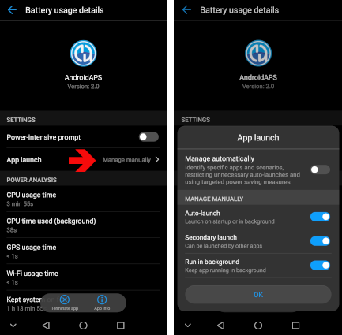

# Jak skonfigurować telefon Huawei

**Których telefonów dotyczy ta strona:** telefonów Huawei z **EMUI 12 do EMUI 15**. Wszystkie te wersje są oparte na Androidzie 12, który jest minimum dla obecnej wersji **AAPS**. Na telefonie ze starszą wersją EMUI możesz używać tylko [starszej wersji AAPS](#maintenance-android-version-aaps-version).

```{admonition} Telefony z HarmonyOS NEXT / HarmonyOS 5 :class: warning

Nowe telefony Huawei sprzedawane w Chinach działają na HarmonyOS NEXT (HarmonyOS 5 i nowszy). Ten system nie jest już Androidem i nie może uruchomić **AAPS**. ```

Telefony Huawei bardzo agresywnie zamykają aplikacje działające w tle. Zastosuj wszystkie poniższe ustawienia dla **AAPS** i dla Twojej aplikacji CGM (na przykład xDrip+ lub Juggluco), w przeciwnym razie pętla i odczyty glukozy mogą się zatrzymać, gdy ekran jest wyłączony.

Nazwy menu mogą się trochę różnić w zależności od modelu. Jeśli nie możesz znaleźć ustawienia, wpisz jego nazwę w pasku wyszukiwania na górze **Ustawień**.

Zrzuty ekranu poniżej pochodzą ze starszej wersji EMUI. Ustawienia są takie same w EMUI 12 do 15.

## Ignorowanie optymalizacji baterii

1. Otwórz **Ustawienia > Aplikacje > Aplikacje**.
2. Dotknij menu **⋮** w prawym górnym rogu i wybierz **Specjalny dostęp > Optymalizacja baterii**.
3. Dotknij strzałki na górze listy i wybierz **Wszystkie aplikacje**.
4. Wybierz **AAPS** i wybierz **Nie zezwalaj**. Huawei nie będzie już optymalizować aplikacji z tej listy.
5. Powtórz to dla swojej aplikacji CGM.


## Uruchamianie aplikacji: zezwól na działanie w tle

1. Otwórz **Ustawienia > Bateria > Uruchamianie aplikacji** (lub **Ustawienia > Aplikacje > Aplikacje >** wybierz aplikację **> Bateria > Uruchamianie aplikacji**).
2. Znajdź **AAPS** i wyłącz **Zarządzaj automatycznie**.
3. W oknie **Zarządzaj ręcznie** włącz wszystkie trzy opcje: 
    - **Automatyczne uruchamianie**
    - **Uruchamianie pośrednie** (aplikacja może być uruchamiana przez inne aplikacje)
    - **Działanie w tle**
4. Powtórz to dla swojej aplikacji CGM.



## Zablokuj AAPS na liście ostatnich aplikacji

Zablokowane aplikacje nie są zamykane, gdy czyścisz listę ostatnich aplikacji.

1. Otwórz listę ostatnich aplikacji.
2. Przesuń w dół kartę **AAPS**. Na karcie pojawi się symbol kłódki.
3. Zrób to samo dla swojej aplikacji CGM.


## Tryb oszczędzania energii

Pozostaw wyłączone **Tryb oszczędzania energii** i **Tryb ultraoszczędzania energii** (**Ustawienia > Bateria**). Zamykają one aplikacje w tle bez względu na powyższe ustawienia.

## Jeśli AAPS nadal zatrzymuje się w tle

Więcej rozwiązań dla telefonów Huawei znajdziesz na stronie [Don't kill my app](https://dontkillmyapp.com/huawei).

## Telefony Honor

Honor jest teraz osobną marką, a jego telefony działają na MagicOS zamiast EMUI. Ustawienia pracy w tle są bardzo podobne: w ustawieniach baterii aplikacji znajdź **Uruchamianie aplikacji**, wyłącz **Zarządzaj automatycznie** i zezwól na wszystkie trzy opcje, a następnie usuń aplikację z optymalizacji baterii.