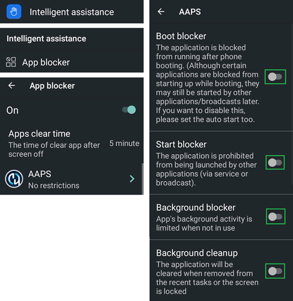

# Jelly

## Jelly Star Mini

**Funkcje**

* Android 13
* 8 GB RAM

**Zalety**

* Jest naprawdę mały.
* Even if you tell people, they might not consider it as a normal smartphone and will accept it more easily as an exception when phones are normally not allowed.

**Wady**

* Polecany tylko dla doświadczonych użytkowników pętli (niektóre ustawienia trudno rozpoznać; musisz wiedzieć z doświadczenia z dużym telefonem z Androidem i AAPS, co i gdzie się znajduje. Niektóre przyciski AAPS trudno nacisnąć: da się to zrobić z wyczuciem, ale nie grubymi palcami.)
* Może służyć tylko jako telefon do pętli. Lepiej mieć w kieszeni także zwykły smartfon. 

### Optymalizacja baterii

Jelly ma silne funkcje optymalizacji, które **musisz** wyłączyć dla AAPS (i innych aplikacji DIY, takich jak BYODA, xDrip, OOP2, Juggluco itp.).

Możesz zostawić włączoną funkcję Intelligent assistance (inteligentna pomoc), ale **musi być wyłączona dla aplikacji DIY**.

Możesz włączyć NFC dla sensorów Libre.

### Optymalizacja baterii

To avoid interference with **AAPS**, the Jelly Star 'battery usage' should be disabled by selecting 'unrestricted' for **AAPS** (and for other **DIY apps** like BYODA, xDrip, OOP2, Juggluco, etc...).

### Google Play Protect

Pamiętaj, aby wyłączyć Google Play Protect.

### Połączenie zdalne dla Wear apk

W przypadku niektórych smartwatchy, np. Samsung Galaxy, opcja „Połączenie zdalne” (Remote Connection) w Funkcjach zaawansowanych Samsunga Galaxy musi być **włączona**, aby używać Jelly, **Wear.apk** i **AAPS** zdalnie przez Wi-Fi.

