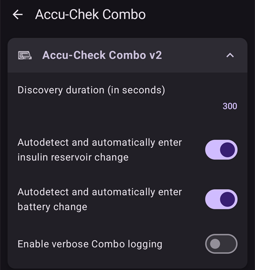
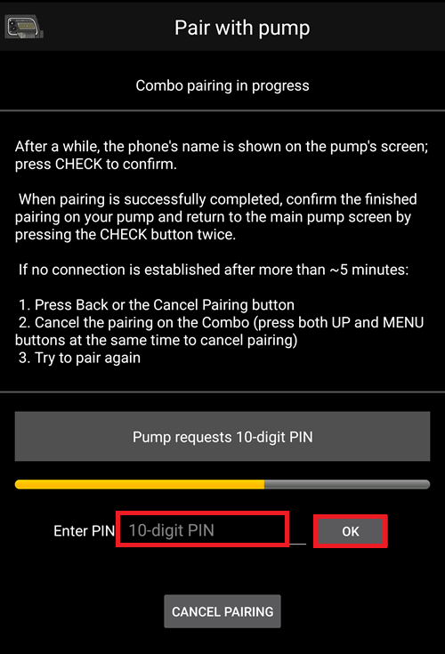

# Accu-Chek Combo

**To oprogramowanie jest częścią rozwiązania DIY (ang. Do It Yourself – zrób to sam). Nie jest gotowym produktem i wymaga od CIEBIE przeczytania, nauczenia się i zrozumienia systemu, w tym tego, jak go używać. To nie jest coś, co zajmie się całym leczeniem cukrzycy za ciebie. Pozwala jednak poprawić wyrównanie cukrzycy i jakość życia, jeśli chcesz poświęcić na to potrzebny czas. Nie śpiesz się, daj sobie czas na naukę. Tylko ty odpowiadasz za to, co robisz z tym systemem.**

```{admonition} Accu-Chek Combo is being phased out
:class: note

Roche wycofuje się z rynku pomp insulinowych, aby skupić swoją ofertę diabetologiczną na systemie CGM Accu-Chek SmartGuide. Firma ogłosiła koniec sprzedaży pomp Accu-Chek Combo i Accu-Chek Insight; wygaszana jest też jej ostatnia mikropompa Accu-Chek Solo (ostatnie dostawy w Niemczech pod koniec 2025 roku). Zmiana jest wprowadzana stopniowo w kolejnych regionach, najpierw w Niemczech, a potem prawdopodobnie na innych rynkach europejskich. Jeśli polegasz na tej pompie, zaplanuj z wyprzedzeniem przejście na obsługiwaną pompę.
```

```{contents} Table of contents
:depth: 1
:local: true
```

## Funkcje pompy w AAPS

* Komunikuje się z **AAPS** przez wbudowany Bluetooth telefonu, bez dodatkowego urządzenia pośredniczącego.
* Automatyczna obsługa czasu letniego i stref czasowych.

## Wymagania sprzętowe i programowe

* Pompa Roche Accu-Chek Combo (dowolna wersja firmware, wszystkie działają).
* Urządzenie Smartpix lub Realtyme razem z oprogramowaniem 360 Configuration Software do konfiguracji pompy. (Roche na prośbę klienta wysyła urządzenia Smartpix i oprogramowanie konfiguracyjne bezpłatnie).
* Kompatybilny telefon z Androidem 12 lub nowszym. Szczegóły znajdziesz w [informacjach o wersji](#maintenance-android-version-aaps-version).
* Aplikacja **AAPS** zainstalowana na telefonie.

Niektóre telefony mogą działać lepiej niż inne. Zależy to od jakości obsługi Bluetooth i od tego, czy mają dodatkowe, bardzo agresywne funkcje oszczędzania energii. Listę telefonów znajdziesz na stronie [Telefony](#Phones-list-of-tested-phones). Pamiętaj, że to nie jest pełna lista i opiera się na osobistych doświadczeniach użytkowników. Zachęcamy cię do dopisania także swoich doświadczeń, aby pomóc innym (te projekty polegają na przekazywaniu pomocy dalej).

(combov2-before-you-begin)=
## Zanim zaczniesz

**BEZPIECZEŃSTWO PRZEDE WSZYSTKIM** – nie wykonuj tego procesu w sytuacji, w której nie możesz naprawić skutków błędu. Miej pod ręką urządzenie Smartpix / Realtyme oraz oprogramowanie 360 Configuration Software. Zaplanuj około godziny na skonfigurowanie wszystkiego i sprawdzenie, czy wszystko działa poprawnie.

Zwróć uwagę na następujące ograniczenia:

* Bolus przedłużony i bolus wielofalowy nie są obecnie obsługiwane (zamiast nich możesz użyć funkcji [Przedłużone węglowodany](../DailyLifeWithAaps/ExtendedCarbs.md)).
* Obsługiwany jest tylko jeden profil bazowy (pierwszy).
* Najniższa dawka bazowa w **Profilu** to 0,05 U/h. **AAPS** odrzuca **Profil** z niższą dawką. Combo zaokrągla dawki bazowe do własnych kroków (0,01 U/h poniżej 1 U/h, 0,05 U/h do 10 U/h, 0,1 U/h powyżej). **AAPS** używa dawek, które pompa naprawdę podaje.
* Tymczasowe dawki bazowe są ograniczone do 500% aktualnej dawki bazowej. **AAPS** uwzględnia ten limit.
* Pętla jest wyłączona, jeśli aktualnie aktywny profil na pompie nie jest profilem nr 1. Trwa to, dopóki profil nr 1 nie stanie się aktywny. Gdy tak się stanie, przy następnym połączeniu AAPS (samodzielnie po pewnym czasie lub gdy stukniesz **Odśwież** na ekranie pompy Accu-Chek Combo) zauważy, że aktywny jest profil nr 1, i znów włączy pętlę.
* Jeśli pętla zażąda anulowania trwającej bazy tymczasowej (TBR), Combo zamiast tego ustawi TBR 90% lub 110% na 15 minut. Dzieje się tak, ponieważ anulowanie TBR wywołuje na pompie alert z wieloma wibracjami, a tych wibracji nie da się wyłączyć.
* Stabilność połączenia Bluetooth zależy od telefonu. Mogą pojawiać się alarmy „pompa nieosiągalna”, gdy połączenia z pompą nie da się już nawiązać. If that error occurs, make sure Bluetooth is enabled, tap **Refresh** on the pump screen (**Manage** > **Pump**) to see if this was caused by an intermittent issue and if still no connection is established, reboot the phone which should usually fix this.
* There is another issue where a restart doesn't help but a button on the pump must be pressed (which resets the pump's Bluetooth stack), before the pump accepts connections from the phone again.
* Unikaj ustawiania TBR na pompie, ponieważ to pętla przejmuje kontrolę nad TBR. Wykrycie nowego TBR na pompie może potrwać do 20 minut, a działanie TBR zostanie uwzględnione dopiero od chwili wykrycia. W najgorszym przypadku może więc być 20 minut TBR, których nie widać w IOB.

Sterownik obsługuje obecnie następujące języki w Combo. (Nie ma to związku z językiem w AAPS – chodzi o język wyświetlany na samym wyświetlaczu LCD Combo).

* Angielski
* Hiszpański
* Francuski
* Włoski
* Rosyjski
* Turecki
* Polski
* Czeski
* Węgierski
* Słowacki
* Rumuński
* Chorwacki
* Niderlandzki
* Grecki
* Fiński
* Norweski
* Portugalski
* Szwedzki
* Duński
* Niemiecki
* Słoweński
* Litewski

**Ważne**: Jeśli pompa jest ustawiona na język, który nie jest wymieniony na tej liście, skontaktuj się z deweloperami i ustaw język pompy na jeden z tej listy. W przeciwnym razie sterownik nie będzie działał prawidłowo.

## Konfiguracja telefonu

Bardzo ważne jest, aby optymalizacja baterii była wyłączona. AAPS sam wykrywa, gdy podlega tej optymalizacji, i w swoim interfejsie prosi o jej wyłączenie. Jednak w nowoczesnych telefonach z Androidem sam Bluetooth _też_ jest aplikacją (aplikacją systemową). Zwykle ta „aplikacja Bluetooth” działa _domyślnie z włączoną optymalizacją baterii_. W efekcie Bluetooth może przestać odpowiadać, gdy telefon oszczędza energię, bo zamyka aplikację Bluetooth. Dlatego w ustawieniach tej systemowej aplikacji Bluetooth także musisz wyłączyć optymalizację baterii. Niestety sposób znalezienia systemowej aplikacji Bluetooth różni się w zależności od telefonu. W czystym Androidzie przejdź do Ustawienia -> Aplikacje -> Wyświetl wszystkie aplikacje (N) (N = liczba aplikacji na telefonie). Następnie otwórz menu w prawym górnym rogu i stuknij „Pokaż systemowe”, „Pokaż aplikacje systemowe” lub „Wszystkie aplikacje”. Teraz na rozszerzonej liście aplikacji poszukaj aplikacji „Bluetooth”. Wybierz ją i na ekranie „Informacje o aplikacji” stuknij „Bateria”. Tam wyłącz optymalizację baterii (czasem nazywaną „użycie baterii”).

## Konfiguracja Combo

* Skonfiguruj pompę w programie Accu-Chek 360 Configuration Software. Jeśli nie masz oprogramowania, skontaktuj się z infolinią Accu-Chek. Zwykle wysyłają zarejestrowanym użytkownikom płytę CD z programem „360° Pump Configuration Software” i urządzeniem SmartPix do połączenia przez USB i podczerwień (urządzenie Realtyme też działa, jeśli je masz).

  - **Wymagane ustawienia** (zaznaczone na zielono na zrzutach ekranu):

     * Ustaw/zostaw konfigurację menu jako „Standard”. Wtedy pompa pokaże tylko obsługiwane menu/akcje i ukryje te nieobsługiwane (bolus przedłużony/wielofalowy, wiele profili bazy). Ich użycie ogranicza działanie pętli, bo wtedy pętla nie może działać bezpiecznie.
     * Sprawdź, czy _Quick Info Text_ ma wartość „QUICK INFO” (bez cudzysłowów; znajdziesz to w _Insulin Pump Options_).
     * Ustaw _Maximum Adjustment_ dla TBR na 500%
     * Wyłącz _Signal End of Temporary Basal Rate_
     * Ustaw _Duration increment_ dla TBR na 15 min
     * Włącz Bluetooth

  - **Zalecane ustawienia** (zaznaczone na niebiesko na zrzutach ekranu)

     * Ustaw alarm niskiego poziomu w zbiorniku według własnych potrzeb
     * Ustaw maksymalny bolus odpowiedni dla twojej terapii, aby chronić się przed błędami w oprogramowaniu
     * Podobnie ustaw maksymalny czas trwania TBR jako zabezpieczenie. Ustaw co najmniej 3 godziny, ponieważ opcja odłączenia pompy na 3 godziny ustawia 0% na 3 godziny.
     * Włącz blokadę klawiszy na pompie, aby nie podawać bolusów z pompy, zwłaszcza jeśli pompa była już wcześniej używana i podawanie szybkiego bolusa weszło w nawyk.
     * Ustaw czas wygaszania wyświetlacza i czas wyjścia z menu na minimum, czyli odpowiednio 5,5 i 5. Dzięki temu AAPS szybciej wraca do działania po błędach, a pompa mniej wibruje w czasie takich błędów

  

  

  

  

## Włączanie sterownika i parowanie go z Combo

* Otwórz **menu** (☰) w lewym górnym rogu, przejdź do [**Konfiguracja** > **Pompa**](../SettingUpAaps/ConfigBuilder.md) i wybierz **Accu-Chek Combo**.

  

  Po wybraniu karta **Accu-Chek Combo** pokazuje dwa przyciski, **Ustawienia** i **Otwórz wtyczkę**:

  

  **Ustawienia** otwiera ustawienia sterownika Accu-Chek Combo (zobacz [Ustawienia](#combov2-preferences) poniżej):

  

  **Otwórz wtyczkę** (lub **Zarządzaj** > **Pompa**) otwiera ekran pompy Accu-Chek Combo. Zanim pompa zostanie sparowana, ekran pokazuje **Nie sparowano z pompą**:

  

* Na ekranie pompy stuknij **Parowanie**. Otworzy się ekran **Paruj z pompą**. Wykonaj kroki pokazane na ekranie, a potem stuknij **Rozpocznij parowanie**. Gdy Android poprosi o zgodę na to, aby telefon był widoczny dla innych urządzeń Bluetooth, stuknij **Zezwól**. Po chwili Combo pokaże na wyświetlaczu 10-cyfrowy PIN parowania, a **AAPS** poprosi o jego wpisanie. Wpisz ten PIN w polu **10-cyfrowy PIN**.

  

  

  

  Kolejne obrazy pochodzą ze starszej wersji **AAPS**. Kroki i teksty są takie same, ale ekrany wyglądają trochę inaczej.

  

  

  

* Jeśli wpiszesz zły PIN, **AAPS** pokaże **PIN nie zadziałał. Sprawdź, czy nie ma literówki. Jeśli problem nie ustaje, anuluj i ponów parowanie.**

  

* Gdy pojawi się **Pomyślnie sparowano z Combo**, stuknij **OK**. Wrócisz do ekranu pompy, który teraz pokazuje stan pompy (zobacz [Zawartość ekranu pompy Accu-Chek Combo](#combov2-tab-contents) poniżej). Przycisk **Parowanie** zmienia się na **Rozparuj**.

* Aby sprawdzić konfigurację (dla bezpieczeństwa z pompą **odłączoną** od kaniuli!), ustaw w AAPS TBR 500% na 15 min i podaj bolus. Pompa powinna teraz mieć aktywny TBR, a bolus powinien być w historii. AAPS też powinien pokazywać aktywny TBR i podany bolus.

* W Combo zalecamy włączenie blokady klawiszy, aby nie podawać bolusów z pompy, zwłaszcza jeśli pompa była już wcześniej używana i funkcja „szybki bolus” weszła w nawyk.

## Uwagi o parowaniu

Accu-Chek Combo powstała przed wydaniem Bluetooth 4.0 i zaledwie rok po wydaniu pierwszej wersji Androida. Dlatego jej sposób parowania z innymi urządzeniami nie jest w 100% zgodny z tym, jak robi się to dziś w Androidzie. Aby w pełni to rozwiązać, AAPS potrzebowałby uprawnień systemowych, które mają tylko aplikacje systemowe. Instalują je w telefonie producenci telefonów – użytkownik nie może instalować aplikacji systemowych.

W efekcie parowanie nigdy nie będzie w 100% bezproblemowe. Podczas parowania okno PIN Bluetooth w Androidzie może na chwilę się pojawić i samo zniknąć. Czasem jednak zostaje na ekranie i prosi o 4-cyfrowy PIN. (Nie myl go z 10-cyfrowym PIN-em parowania Combo). Nic nie wpisuj, po prostu naciśnij Anuluj. Jeśli parowanie nie przechodzi dalej, wykonaj instrukcje na ekranie, aby spróbować ponownie.

(combov2-tab-contents)=
## Zawartość ekranu pompy Accu-Chek Combo

Aby otworzyć ekran pompy, przejdź do **Zarządzaj** > **Pompa**. Po sparowaniu pompy ekran pokazuje następujące informacje (od góry do dołu):


1. **Stan sterownika**: Sterownik może być w jednym z następujących stanów:
   - **Rozłączono**: Nie ma połączenia Bluetooth; sterownik jest w tym stanie przez większość czasu i łączy się z pompą tylko wtedy, gdy to potrzebne – to oszczędza energię
   - **Łączę**
   - **Sprawdzanie pompy**: pompa jest połączona, ale sterownik wykonuje kontrole bezpieczeństwa, aby upewnić się, że wszystko jest w porządku i aktualne
   - **Gotowe**: sterownik jest gotowy do przyjmowania poleceń z AAPS
   - **Wstrzymany**: pompa jest wstrzymana (w Combo widać to jako „stop”)
   - Opis wykonywanego polecenia, na przykład **Wczytuje profil bazowy** lub **Aktualizowanie statusu pompy**
   - **Błąd**: wystąpił błąd; połączenie zostało przerwane, a każde trwające polecenie zostało anulowane
2. **Ostatnie połączenie**: Ile minut temu sterownik połączył się z Combo; jeśli to więcej niż 30 minut, pozycja jest pokazana na czerwono
3. **Bateria**: Poziom baterii; Combo pokazuje tylko **Pełna**, **Słaba** lub **Rozładowana** i nie podaje nic dokładniejszego (np. procentów), dlatego tutaj widać tylko te trzy poziomy
4. **Zbiornik**: Ile jednostek (IU) jest teraz w zbiorniku Combo
5. **Ostatni bolus**: Ile minut temu podano ostatni bolus; jeśli od uruchomienia AAPS nie podano żadnego bolusa, ta pozycja nie jest widoczna
6. **Baza tymczasowa**: Szczegóły aktywnej bazy tymczasowej; jeśli żadna nie jest aktywna, ta pozycja nie jest widoczna
7. **Podstawowa dawka bazowa**: Aktywna podstawowa dawka bazowa („podstawowa” oznacza dawkę bazową bez wpływu aktywnego TBR)
8. **Numer seryjny**: Numer seryjny Combo podany przez pompę (taki sam jak numer seryjny na tylnej stronie Combo)
9. **Adres Bluetooth**: 6-bajtowy adres Bluetooth Combo w formacie `XX:XX:XX:XX:XX:XX`

Gdy sterownik coś robi (na przykład ustawia profil bazowy), pole pod listą opisuje bieżące działanie, a cienki pasek pokazuje postęp.

Combo można obsługiwać przez Bluetooth w trybie _zdalnego terminala_ (remote-terminal) lub w trybie _poleceń_ (command). Tryb zdalnego terminala odpowiada „trybowi zdalnego sterowania” w glukometrze Combo, który naśladuje wyświetlacz LCD pompy i jej cztery przyciski. Niektóre polecenia sterownik musi wykonać w tym trybie, ponieważ nie mają odpowiednika w trybie poleceń. Tryb poleceń jest dużo szybszy, ale, jak wspomniano, ma ograniczone możliwości. Gdy aktywny jest tryb zdalnego terminala, bieżący ekran zdalnego terminala jest pokazany w polu tuż nad rysunkiem Combo. Gdy jednak sterownik przełącza się w tryb poleceń, to pole pozostaje puste.

(Nie masz na to wpływu; sterownik sam decyduje, jakiego trybu użyć. To tylko informacja, abyś wiedział, dlaczego czasem widzisz w tym polu ekrany Combo).

Na dole są następujące przyciski:

- **Odśwież**: Od razu aktualizuje stan pompy. Służy też do poinformowania AAPS, że wcześniej wykryty błąd został usunięty i AAPS może znów sprawdzić, czy wszystko jest w porządku (więcej o tym poniżej w [sekcji o alarmach](#combov2-alerts)). Możesz go stuknąć tylko wtedy, gdy sterownik jest rozłączony, wstrzymany lub w stanie błędu.
- **Rozparuj**: Usuwa sparowanie Combo z **AAPS** i Androidem, gdy potwierdzisz **Czy na pewno chcesz odłączyć pompę od aplikacji?**. Gdy żadna pompa nie jest sparowana, ten przycisk zmienia się na **Parowanie**.

(combov2-preferences)=
## Ustawienia

Te ustawienia są dostępne dla sterownika Combo (**Konfiguracja** > **Pompa** > **Accu-Chek Combo** > **Ustawienia** lub ikona ustawień (koło zębate) na ekranie pompy). Pozycje od góry do dołu:

1. **Czas wyszukiwania (w sekundach)**: Podczas parowania sterownik sprawia, że telefon może zostać wykryty przez pompę. To ustawienie określa, jak długo pompa może być wykrywana. Domyślnie wybrane jest maksimum (300 sekund = 5 minut). Android nie pozwala na wykrywanie bez końca, dlatego trzeba wybrać czas.
2. **Automatyczne wykrywanie i wprowadzanie wpisu o zmianie zasobnika insuliny**: Gdy ta opcja jest włączona, sterownik wpisuje „wymianę zbiornika”, którą normalnie wpisujesz sam przez **Zarządzaj** > **Napełnij/Wypełnij**. Wyjaśniamy to [dokładniej poniżej](#combov2-autodetections).
3. **Automatyczne wykrywanie i wprowadzanie wpisu o zmianie baterii**: Gdy ta opcja jest włączona, sterownik wpisuje „wymianę baterii”, którą normalnie wpisujesz sam przez **Zarządzaj** > **Zmiana baterii pompy**. Wyjaśniamy to [dokładniej poniżej](#combov2-autodetections).
4. **Włącz szczegółowe logowanie Combo**: Bardzo zwiększa ilość logów zapisywanych przez sterownik. **UWAGA**: Nie włączaj tego, chyba że poprosi o to deweloper. W przeciwnym razie może to dodać dużo szumu do logów **AAPS** i zmniejszyć ich przydatność.

Parowanie i rozparowanie robisz na ekranie pompy, nie w ustawieniach (zobacz wyżej).

(combov2-autodetections)=
## Automatyczne wykrywanie i wprowadzanie wymiany baterii i zbiornika

Sterownik potrafi wykryć wymianę baterii i zbiornika, śledząc poziom baterii i zbiornika. Jeśli przy ostatniej aktualizacji stanu pompy Combo zgłosiła niski poziom baterii, a teraz, przy nowej aktualizacji, poziom baterii jest normalny, sterownik uznaje, że użytkownik wymienił baterię. Ta sama logika działa dla poziomu w zbiorniku: jeśli jest teraz wyższy niż wcześniej, sterownik uznaje to za wymianę zbiornika.

Działa to tylko wtedy, gdy bateria i zbiornik są wymieniane po zgłoszeniu niskiego poziomu, _a_ nowa bateria i zbiornik są wystarczająco pełne.

To automatyczne wykrywanie można wyłączyć w [ustawieniach](#combov2-preferences) sterownika.

(combov2-alerts)=
## Alarmy (ostrzeżenia i błędy) i ich obsługa

Combo pokazuje alarmy jako ekrany zdalnego terminala. Warnings are shown with a "Wx" code (x is a digit), along with a short description. Przykład: „W7”, „TBR OVER”. Błędy wyglądają podobnie, ale mają kod „Ex”.

Niektóre ostrzeżenia sterownik zamyka automatycznie. Są to:

- W1 „reservoir low”: sterownik zamienia to na ostrzeżenie „niski poziom w zbiorniku”, pokazywane na ekranie głównym AAPS
- W2 „battery low”: sterownik zamienia to na ostrzeżenie „niski poziom baterii”, pokazywane na ekranie głównym AAPS
- W3, W6, W7, W8: wszystkie są tylko informacją dla użytkownika, więc sterownik może je bezpiecznie zamykać automatycznie

Inne ostrzeżenia _nie_ są zamykane automatycznie. Błędy także _nigdy_ nie są zamykane automatycznie. Obie te grupy są obsługiwane tak samo: sterownik wyświetla okno alarmu nad interfejsem AAPS i przerywa każde trwające polecenie. Sterownik przechodzi wtedy w stan „błąd” (zobacz [zawartość ekranu pompy Accu-Chek Combo powyżej](#combov2-tab-contents)). W tym stanie nie można wykonać żadnego polecenia. Użytkownik musi obsłużyć błąd na pompie; na przykład błąd okluzji może wymagać wymiany kaniuli. Gdy użytkownik zajmie się błędem, normalną pracę można wznowić, stukając **Odśwież** na ekranie pompy Accu-Chek Combo. Sterownik łączy się wtedy z Combo i aktualizuje jej stan, sprawdzając między innymi, czy błąd nadal jest na ekranie. Sterownik także sam odświeża stan pompy po pewnym czasie, więc ręczne naciśnięcie tego przycisku nie jest konieczne.

Bolus to przypadek szczególny. Jest podawany w trybie poleceń Combo, który w trakcie bolusa nie zgłasza, że pojawił się alarm. Dlatego sterownik nie może automatycznie zamykać ostrzeżeń _w trakcie_ bolusa. Niestety oznacza to, że pompa będzie piszczeć aż do końca bolusa. Najczęstszy alarm w trakcie bolusa to zwykle W1 „reservoir low” (niski poziom w zbiorniku). **Don't** dismiss Combo warnings on the pump itself manually during a bolus. Ryzykujesz przerwanie bolusa. Sterownik zajmie się ostrzeżeniem po zakończeniu bolusa.

Sterownik nie zauważy alarmów, które pojawią się, gdy nie jest połączony z Combo. Combo nie potrafi sama wysłać alarmu do telefonu; to zawsze telefon musi rozpocząć połączenie. Dlatego alarm pozostaje aktywny, dopóki sterownik nie połączy się z pompą. Możesz stuknąć **Odśwież** na ekranie pompy, aby wymusić połączenie i pozwolić sterownikowi od razu obsłużyć alarm (zamiast czekać, aż AAPS sam rozpocznie połączenie).

**WAŻNE**: Jeśli wystąpi błąd lub pojawi się ostrzeżenie, którego sterownik nie zamyka automatycznie, sterownik przechodzi w stan błędu. W tym stanie pętla **BĘDZIE ZABLOKOWANA**, dopóki stan pompy nie zostanie odświeżony! Pętla zostaje odblokowana po aktualizacji stanu pompy (przez stuknięcie **Odśwież** lub przez automatyczną aktualizację sterownika), gdy żaden błąd nie jest już pokazywany.

## Na co uważać, używając Combo

* Pamiętaj, że to nie jest gotowy produkt. Zwłaszcza na początku musisz obserwować i rozumieć system, jego ograniczenia i to, jak może zawieść. Stanowczo odradzamy używanie tego systemu, jeśli osoba, która go używa, nie jest w stanie w pełni go zrozumieć.
* Ze względu na sposób działania zdalnego sterowania w Combo niektóre operacje (zwłaszcza ustawianie profilu bazowego) są wolne w porównaniu z innymi pompami. To niestety ograniczenie Combo, którego nie da się obejść.
* Nie ustawiaj ani nie anuluj TBR na pompie. Pętla przejmuje kontrolę nad TBR i nie może inaczej działać niezawodnie, ponieważ nie da się ustalić czasu rozpoczęcia TBR, który użytkownik ustawił na pompie.
* Nie naciskaj żadnych przycisków na pompie, gdy AAPS komunikuje się z pompą (gdy pompa jest połączona z AAPS, na pompie widać logo Bluetooth). Spowoduje to przerwanie połączenia Bluetooth. Rób to tylko wtedy, gdy są problemy z nawiązaniem połączenia (zobacz [sekcję „Zanim zaczniesz” powyżej](#combov2-before-you-begin)).
* Nie naciskaj żadnych przycisków, gdy pompa podaje bolus. Zwłaszcza nie próbuj zamykać alarmów przyciskami. Dokładniejsze wyjaśnienie, dlaczego tak jest, znajdziesz w [sekcji o alarmach](#combov2-alerts).

## Lista kontrolna, gdy nie można nawiązać połączenia z Combo

Sterownik robi wszystko, aby połączyć się z Combo, i używa kilku sztuczek, aby połączenie było jak najbardziej niezawodne. Mimo to czasem połączenia nie udaje się nawiązać. Oto kroki, które mogą pomóc w tej sytuacji.

1. Naciśnij przycisk na Combo. Czasem stos Bluetooth w Combo przestaje odpowiadać i nie przyjmuje już połączeń. Naciśnięcie przycisku na Combo, tak aby wyświetlacz LCD coś pokazał, resetuje stos Bluetooth. Zwykle to jedyny krok potrzebny do naprawy problemów z połączeniem.
2. Uruchom ponownie telefon. Może to być potrzebne, jeśli problem dotyczy samego stosu Bluetooth w telefonie.
3. Jeśli zakrętka baterii Combo jest stara, rozważ jej wymianę. Stare zakrętki baterii mogą powodować problemy z zasilaniem Combo, co wpływa na Bluetooth.
4. Jeśli próby połączenia nadal się nie udają, rozważ rozparowanie i ponowne sparowanie pompy.

(combov2-tips-for-basic-usage)=
## Wskazówki dotyczące podstawowego użycia

### Jak zapewnić płynne działanie

* Zawsze **noś smartfon przy sobie**, a w nocy zostaw go obok łóżka. As your pump may lay behind or under your body while you sleep, a higher position (on a shelf or board) works best.
* Zawsze dbaj o to, aby bateria pompy była jak najbardziej naładowana. See the battery section for tips regarding the battery.
* Gdy to możliwe, obsługuj pompę tylko przez aplikację AAPS. Aby to ułatwić, włącz blokadę klawiszy na pompie w **PUMP SETTINGS / KEY LOCK / ON**. Klawiszy pompy trzeba używać tylko przy wymianie baterii lub zbiornika.


### Pompa nieosiągalna. Co robić?

#### Włącz alarm braku połączenia z pompą
* W **AAPS** stuknij ikonę **Ustawienia** (koło zębate) w prawym górnym rogu ekranu głównego, przejdź do **Lokalne alarmy**, włącz **Alarm, gdy pompa jest nieosiągalna** i ustaw **Próg niedostępności pompy** na **31** minut.
* Dzięki temu alarm nie włączy się, gdy wyjdziesz z pokoju i zostawisz telefon na biurku, ale dostaniesz informację, jeśli pompa będzie nieosiągalna dłużej niż czas trwania bazy tymczasowej.

#### Przywracanie połączenia z pompą

* Gdy AAPS zgłosi alarm **pompa nieosiągalna**, najpierw zdejmij blokadę klawiszy i **naciśnij dowolny klawisz na pompie** (np. przycisk „w dół”). Gdy wyświetlacz pompy zgaśnie, stuknij **Odśwież** na ekranie pompy Accu-Chek Combo (**Zarządzaj** > **Pompa**). Zwykle wtedy komunikacja znów działa.
* Jeśli to nie pomoże, uruchom ponownie smartfon. Po restarcie AAPS uruchomi się ponownie i nawiąże nowe połączenie z pompą.

* Testy z różnymi smartfonami pokazały, że niektóre smartfony częściej niż inne wywołują błąd „pompa nieosiągalna”. Smartfony, które przeszły testy, znajdziesz na stronie [Telefony](#Phones-list-of-tested-phones).

#### Przyczyny i skutki częstych błędów komunikacji
* Na telefonach z **małą ilością pamięci** (lub z **agresywnym oszczędzaniem energii**) AAPS jest często zamykany. Poznasz to po tym, że przyciski leczenia (pasek QuickLaunch) na ekranie głównym nie są widoczne po otwarciu AAPS, bo system się uruchamia. Może to wywołać alarmy „pompa nieosiągalna” przy starcie. W polu **Ostatnie połączenie** na ekranie pompy (**Zarządzaj** > **Pompa**) możesz sprawdzić, kiedy AAPS ostatnio komunikował się z pompą.


* Ten błąd może szybciej rozładowywać baterię pompy, ponieważ po ponownym uruchomieniu aplikacji profil bazowy jest odczytywany z pompy.
* Zwiększa też ryzyko błędu, przez który pompa odrzuca wszystkie połączenia, dopóki nie naciśniesz przycisku na pompie.

### Anulowanie bazy tymczasowej nie udaje się
* Czasem AAPS nie może automatycznie zamknąć alarmu **TBR CANCELED**. Wtedy musisz stuknąć **Odśwież** na ekranie pompy Accu-Chek Combo albo potwierdzić alarm na pompie.

### Uwagi o baterii pompy

#### Wymiana baterii
* Po alarmie **low battery** (słaba bateria) wymień baterię jak najszybciej, aby zawsze było dość energii na niezawodną komunikację Bluetooth ze smartfonem, nawet gdy telefon jest dalej od pompy.
* Nawet po alarmie **low battery** bateria może jeszcze działać przez dłuższy czas. Mimo to po alarmie „low battery” zalecamy zawsze mieć przy sobie nową baterię.
* Przed wymianą baterii naciśnij symbol **Pętla** na ekranie głównym i wybierz **Wstrzymaj pętlę** na 1 godzinę.
* Wait for the phone to communicate with the pump and for the Bluetooth logo on the pump to fade.


* Zdejmij blokadę klawiszy na pompie, przełącz pompę w tryb stop, potwierdź ewentualne anulowanie bazy tymczasowej i szybko wymień baterię.
* Po wymianie baterii nie musisz ponownie ustawiać zegara pompy: AAPS sam aktualizuje datę i godzinę w pompie.
* Then put the pump back in run mode and select **Resume** when pressing on the **Suspended Loop** icon on the main screen.
* AAPS ustawi ponownie potrzebną bazę tymczasową, gdy przyjdzie następna wartość glikemii.

(Accu-Chek-Combo-Tips-for-Basic-usage-battery-type-and-causes-of-short-battery-life)=
#### Typ baterii i przyczyny krótkiego czasu pracy baterii
* Intensywna komunikacja Bluetooth zużywa dużo energii, dlatego używaj tylko **baterii dobrej jakości**, takich jak Energizer Ultimate Lithium, baterie „Power One” z „dużego” zestawu serwisowego Accu-Chek lub, jeśli wolisz akumulatorki, akumulatorki Eneloop.

 

Typowy czas pracy różnych typów baterii:
* **Energizer Ultimate Lithium**: 4 do 7 tygodni
* **Power One Alkaline** (Varta) z zestawu serwisowego: 2 do 4 tygodni
* Akumulatorki **Eneloop** (BK-3MCCE): 1 do 3 tygodni

Jeśli bateria działa wyraźnie krócej niż podano wyżej, sprawdź następujące możliwe przyczyny:
* Niektóre wersje zakrętki baterii pompy Combo częściowo zwierają baterie i szybko je rozładowują. Zakrętki bez tego problemu rozpoznasz po złotych metalowych stykach.
* Jeśli zegar pompy nie „przeżyje” krótkiej wymiany baterii, prawdopodobnie uszkodzony jest kondensator, który podtrzymuje zegar przy krótkim braku zasilania. W takim przypadku może pomóc wymiana pompy przez Roche, co w okresie gwarancji nie jest problemem.
* Sprzęt i oprogramowanie smartfona (system Android i stos Bluetooth) też wpływają na czas pracy baterii pompy, choć dokładne czynniki nie są jeszcze w pełni znane. Jeśli masz taką możliwość, wypróbuj inny smartfon i porównaj czas pracy baterii.

### Bolus przedłużony, bolus wielofalowy
Algorytm OpenAPS nie obsługuje równoległego bolusa przedłużonego ani bolusa wielofalowego. Podobne leczenie można jednak uzyskać w następujący sposób:
* Używaj **e-Carbs** (przedłużonych węglowodanów) przy wpisywaniu węglowodanów lub w kalkulatorze bolusa: wpisz węglowodany całego posiłku i czas, w którym spodziewasz się, że węglowodany trafią do krwi jako glukoza. The system will then calculate small carbs equally distributed over the whole duration which will cause the algorithm to provide equivalent insulin dosing while still permanently checking the overall rise/decrease of the blood glucose level. Aby uzyskać efekt podobny do bolusa wielofalowego, możesz też połączyć mniejszy bolus natychmiastowy z e-carbs.
* Before eating, set a temporary **Eating Soon** target of 80 mg/dL (4.4 mmol/L) for several hours (press the target on the main screen, or **Manage** > **Temp Target**). Czas trwania wybierz tak, jak wybrałbyś czas bolusa przedłużonego. Dzięki temu cel będzie niższy niż zwykle, a ilość podanej insuliny większa.
* Następnie użyj **Kalkulatora bolusa**, aby wpisać wszystkie węglowodany posiłku, ale nie zatwierdzaj od razu proponowanych wartości. Jeśli ma być podany bolus podobny do wielofalowego, zmniejsz dawkę insuliny. Zależnie od posiłku algorytm musi teraz podać dodatkowe SMB lub wyższe bazy tymczasowe, aby przeciwdziałać wzrostowi glikemii. Here, the safety limitation of the basal rate (Max U/h, Maximum basal IOB) should be very carefully experimented with and, if necessary, temporarily changed.

* Nie używaj bolusa przedłużonego ani wielofalowego bezpośrednio na pompie. Sterownik ich nie obsługuje (zobacz [Zanim zaczniesz](#combov2-before-you-begin)); jeśli mimo to podasz bolus wielofalowy na pompie, **AAPS** zapisze go z historii pompy jako zwykły bolus plus bolus przedłużony, więc zostanie uwzględniony w IOB. Bolus przedłużony nie działa w zamkniętej pętli (szczegóły na [tej stronie](#extended-bolus-and-why-they-wont-work-in-closed-loop-environment)).

### Alarmy przy podawaniu bolusa
* Po każdym bolusie sterownik odczytuje historię bolusów z pompy. To mechanizm bezpieczeństwa, który pozwala poprawnie obliczyć aktywną insulinę (IOB), nawet gdy bolus podano bezpośrednio z pompy.
* Jeśli przed bolusem historia pompy zawiera bolus, o którym **AAPS** nie wiedział (na przykład bolus podany bezpośrednio na pompie), żądany bolus **nie zostanie podany**, bo obliczono go bez tej insuliny. **AAPS** pokaże **Historia pompy zawiera bolus, o którym AAPS nie wiedział. Żądany bolus nie został podany...** Sprawdź historię bolusów na pompie i swoje IOB. Jeśli bolus nadal jest potrzebny, oblicz go ponownie. Dotyczy to także sytuacji, gdy nieznany bolus zostanie znaleziony przy nowym połączeniu.
* Jeśli bolus został podany, ale historia pompy zawierała też inne bolusy, o których **AAPS** nie wiedział, zostaną one teraz zapisane, a **AAPS** poprosi cię o sprawdzenie IOB przed następnym bolusem.
* Jeśli połączenie z pompą zostanie utracone **w trakcie** bolusa, **AAPS** nie zapisuje 0 U: pokazuje, ile pompa podała do tej chwili, i ostrzega, że pompa może nadal podać resztę. **Nie podawaj ponownie bolusa.** **AAPS** odczyta rzeczywistą ilość z historii pompy przy następnym połączeniu.
* Jeśli połączenie zostanie utracone, gdy **AAPS** wysyła bolus, nie wiadomo, czy pompa go otrzymała. Przed następnym bolusem sprawdź historię bolusów na pompie.
* Jeśli **AAPS** nie może potwierdzić, że bolus został podany, pokaże **Podanie bolusa nie powiodło się. Wygląda na to, że bolus nie został dostarczony. Aby upewnić się, sprawdź pompę, aby uniknąć podwójnego bolusa, a następnie ponownie podaj bolus.** Bolusy nigdy nie są ponawiane automatycznie.

## Gdzie uzyskać pomoc

Sterownik Combo jest rozwijany przez społeczność na zasadzie **wolontariatu**. Zanim poprosisz o pomoc:

1. **Przeczytaj** odpowiedni rozdział tej dokumentacji, aby sprawdzić, jak dana funkcja ma działać.
2. **Zapytaj** na kanale *#AAPS* na [Discordzie](https://discord.gg/4fQUWHZ4Mw) lub na jednym z innych [kanałów społeczności](../GettingHelp/WhereCanIGetHelp.md).
3. **Zgłoś błąd**: najpierw przeszukaj [istniejące zgłoszenia](https://github.com/nightscout/AndroidAPS/issues); jeśli Twojego problemu tam nie ma, utwórz [nowe zgłoszenie](https://github.com/nightscout/AndroidAPS/issues) i dołącz [pliki logów](../GettingHelp/AccessingLogFiles.md).

Gdy prosisz o pomoc, podaj markę i model telefonu, wersję Androida, wersję **AAPS** oraz prosty, jasny opis problemu (co się zmieniło, kiedy ostatnio działało).
