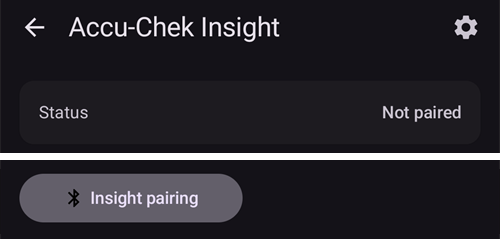

# Accu-Chek Insight

**To oprogramowanie jest częścią rozwiązania DIY (zrób to sam) sztucznej trzustki i nie jest produktem, ale wymaga od CIEBIE przeczytania, nauczenia się i zrozumienia systemu, w tym tego, jak go używać. Nie zajmie się za Ciebie całym leczeniem cukrzycy, ale pozwoli Ci poprawić wyniki leczenia i jakość życia, jeśli zechcesz poświęcić na to potrzebny czas. Nie śpiesz się, daj sobie czas na naukę. Tylko Ty odpowiadasz za to, co z nim robisz.**

```{admonition} Accu-Chek Insight jest wycofywana z rynku :class: note

Roche wycofuje się z rynku pomp insulinowych, aby skupić się w diabetologii na systemie CGM Accu-Chek SmartGuide. Firma ogłosiła koniec sprzedaży pomp Accu-Chek Combo i Accu-Chek Insight; wygaszana jest też jej ostatnia mikropompa Accu-Chek Solo (ostatnie dostawy w Niemczech pod koniec 2025 roku). Zmiana jest wprowadzana stopniowo w kolejnych regionach, najpierw w Niemczech, a potem prawdopodobnie na innych rynkach europejskich. Wsparcie dla Insight jest już oznaczone jako zakończone (patrz [Pompy, których już się nie sprzedaje](./Future-possible-Pump-Drivers.md)). Jeśli polegasz na tej pompie, zaplanuj z wyprzedzeniem przejście na obsługiwaną pompę.

    <br />```{note}
    Zanim **AAPS** miał własny sterownik Insight, pompą Insight sterowano przez osobną aplikację [SightRemote](https://github.com/TebbeUbben/SightRemote). SightRemote nie jest już potrzebny ani rozwijany: jeśli nadal masz go zainstalowanego z tamtych czasów, odinstaluj go i używaj aktualnej wersji **AAPS**.
    

```{contents} Spis treści :depth: 1 :local: true

    <br />## Możliwości pompy z AAPS
    
    * Komunikuje się z **AAPS** przez wbudowany Bluetooth telefonu, bez dodatkowego urządzenia komunikacyjnego.
    * Automatyczna obsługa czasu letniego i strefy czasowej.
    
    ## Wymagania sprzętowe i programowe
    
    * Pompa Roche Accu-Chek Insight (dowolny firmware, wszystkie działają)
    
    Uwaga: AAPS zawsze zapisuje dane w **pierwszym profilu dawki bazowej w pompie**.
    
    * Telefon z Androidem 12 lub nowszym (patrz [Telefony](../Getting-Started/Phones.md))
    * Aplikacja AAPS zainstalowana na telefonie
    
    ## Konfiguracja
    
    * Pompa Insight powinna być połączona tylko z jednym urządzeniem naraz. Jeśli wcześniej używałeś pilota Insight (glukometru), musisz usunąć glukometr z listy sparowanych urządzeń pompy: **Menu** > **Settings** > **Communication** > **Remove device**.
    
       
    
    * W [Konfiguracja > Pompa](#Config-Builder-pump) wybierz kartę **Accu-Chek Insight**. Tylko jedna pompa może być aktywna naraz.
    
       
    
       Po wybraniu karta **Accu-Chek Insight** pokazuje dwa przyciski: **Ustawienia** i **Otwórz wtyczkę**:
    
       
    
       **Ustawienia** otwiera ustawienia sterownika Accu-Chek Insight (patrz [Ustawienia w AAPS](#Accu-Chek-Insight-Pump-settings-in-aaps)).
    
       **Otwórz wtyczkę** (lub **Zarządzaj → Pompa**) otwiera ekran pompy Accu-Chek Insight. Zanim pompa zostanie sparowana, ekran wygląda tak:
    
       
    
    (accu-chek-insight-pairing)=
    ### Parowanie
    
    * Na ekranie pompy dotknij **Parowanie Insight**. Otworzy się kreator parowania i wyszuka urządzenia Bluetooth w pobliżu (górna część obrazka poniżej).
    * W pompie Insight przejdź do **Menu** > **Settings** > **Communication** > **Add Device**. Pompa pokaże poniższy ekran (dolna część obrazka poniżej) z numerem seryjnym pompy.
    
       
    
    * Wróć do telefonu i dotknij numeru seryjnego pompy na liście urządzeń Bluetooth. Jeśli Android poprosi o potwierdzenie parowania, dotknij **Sparuj**.
    
       
    
    * Pompa i telefon pokażą kod. Sprawdź, czy kody na obu urządzeniach są takie same. Potwierdź na pompie i dotknij **Tak** na telefonie. (Dotknij **Nie**, jeśli kody się nie zgadzają.)
    
       
    
    * Telefon pokaże **Parowanie zakończone**. Dotknij **Wyjście**, aby wrócić na ekran pompy.
    
       
    
    * Aby sprawdzić, czy wszystko jest w porządku, spójrz na ekran pompy (**Zarządzaj → Pompa**). Po sparowaniu ekran pokazuje informacje o pompie, np. **Numer seryjny**, **Data produkcji**, **Wersja oprogramowania** i **Adres Bluetooth**.
    
       
    
       ```{admonition} Starszy zrzut ekranu
       :class: note
       Poza górną częścią pierwszego obrazka powyższe zrzuty ekranu parowania pochodzą z wcześniejszej wersji **AAPS** i w **AAPS** 4 mogą wyglądać inaczej.
       ```
    
    * Aby usunąć parowanie, dotknij **Usuń parowanie** na ekranie pompy i potwierdź **Zresetować sparowanie?**. Potem znowu pojawi się przycisk **Parowanie Insight**.
    
    Uwaga: pompa i telefon nie są połączone na stałe. **AAPS** łączy się tylko wtedy, gdy jest to potrzebne (np. aby ustawić bazę tymczasową, podać bolus lub odczytać historię pompy). W przeciwnym razie baterie telefonu i pompy rozładowywałyby się zbyt szybko.
    
    (Accu-Chek-Insight-Pump-settings-in-aaps)=
    ## Ustawienia w AAPS
    
    Otwórz ustawienia przyciskiem **Ustawienia** na karcie **Accu-Chek Insight** w **Konfiguracja** > **Pompa** albo ikoną koła zębatego w prawym górnym rogu ekranu pompy.
    
    
    
    In the Insight settings in **AAPS** you can enable the following options:
    
    * **Log reservoir changes**: automatically records an insulin cartridge change when you change the cartridge in the pump.
    
    * **Melduj zmianę drenu**: dodaje notatkę do bazy danych **AAPS**, gdy uruchomisz w pompie program „tube filling” (wypełnianie drenu).
    
    * **Melduj zmianę miejsca wkłucia**: dodaje notatkę do bazy danych **AAPS**, gdy uruchomisz w pompie program „cannula filling” (wypełnianie kaniuli). **Uwaga: zmiana miejsca wkłucia resetuje też Autosens.**
    
    * **Melduj zmiany baterii**: zapisuje wymianę baterii, gdy włożysz do pompy nową baterię.
    
    * **Melduj zmiany trybu pracy**: dodaje notatkę do bazy danych **AAPS** za każdym razem, gdy uruchomisz, zatrzymasz lub wstrzymasz pompę.
    
    * **Melduj ostrzeżenia**: dodaje notatkę do bazy danych **AAPS** za każdym razem, gdy pompa zgłosi ostrzeżenie (oprócz przypomnień oraz anulowania bolusa i TBR, które nie są zapisywane).
    
    * **Włącz emulację TBR**: pompa Insight może ustawić bazę tymczasową (TBR) tylko do 250%. Aby obejść ten limit, emulacja TBR każe pompie podać dodatkową insulinę jako bolus przedłużony, gdy potrzebna jest TBR powyżej 250%.
    
      **Uwaga: używaj tylko jednego bolusa przedłużonego naraz. Kilka bolusów przedłużonych w tym samym czasie może powodować błędy.**
    
    * **Wyłącz wibracje przy ręcznym podawaniu bolusa**: pompa Insight nie wibruje, gdy podaje ręczny bolus (lub bolus przedłużony). Dostępne tylko z firmware Insight 3.x.
    
    * **Wyłącz wibracje przy automatycznym podawaniu bolusa**: pompa Insight nie wibruje, gdy podaje automatyczny bolus (SMB lub bazę tymczasową z emulacją TBR). Dostępne tylko z firmware Insight 3.x.
    
    * **Min. czas odzyskiwania [s]** i **Max. czas odzyskiwania [s]**: jak długo **AAPS** czeka przed kolejną próbą po nieudanej próbie połączenia. Możesz wybrać od 0 do 20 sekund. Jeśli masz problemy z połączeniem, wybierz dłuższy czas oczekiwania.
        <br><br>Przykład dla min. czas odzyskiwania = 5 i maks. czas odzyskiwania = 20
        <br><br>brak połączenia -> czekaj <b>5</b> s.
          <br>  ponowna próba -> brak połączenia -> czekaj <b>6</b> s.
          <br>  ponowna próba -> brak połączenia -> czekaj <b>7</b> s.
          <br>  ponowna próba -> brak połączenia -> czekaj <b>8</b> s.
          <br>...
          <br>ponowna próba -> brak połączenia -> czekaj <b>20</b> s.
          <br>ponowna próba -> brak połączenia -> czekaj <b>20</b> s.
          <br>...
    
    * **Opóźnienie rozłączenia [s]**: jak długo (w sekundach) **AAPS** czeka po zakończeniu operacji, zanim rozłączy się z pompą. Możesz wybrać od 0 do 15 sekund. Wartość domyślna to 5 sekund.
    
    Dla okresów, gdy pompa była zatrzymana, **AAPS** zapisuje bazę tymczasową 0%.
    
    ### Ekran pompy
    
    Ekran pompy Accu-Chek Insight (**Zarządzaj → Pompa**) pokazuje aktualny stan pompy, np. **Status**, **Ostatnie połączenie**, **Tryb działania**, **Bateria**, **Poziom zbiornika**, dzisiejsze dawki dobowe (**TDD Bolus**, **TDD Baza**), dawki bazowe i ostatni bolus. Po sparowaniu pompy ekran ma następujące przyciski:
    
    * **Odśwież**: odświeża stan pompy.
    * **Włącz powiadomienia o końcu TBR (ustawienia pompy)** / **Wyłącz powiadomienia o końcu TBR (ustawienia pompy)**: standardowa pompa Insight włącza alarm, gdy kończy się TBR. Ten przycisk włącza lub wyłącza ten alarm bez potrzeby używania programu konfiguracyjnego.
    * **Usuń parowanie**: usuwa parowanie z pompą (patrz [Parowanie](#accu-chek-insight-pairing)).
    
    
    
    ```{admonition} Starszy zrzut ekranu
    :class: note
    Powyższy zrzut ekranu pochodzi z wcześniejszej wersji **AAPS**. W **AAPS** 4 ekran pompy wygląda inaczej i ma też przycisk **Usuń parowanie**.
    

## Ustawienia w pompie

Skonfiguruj alarmy w pompie w następujący sposób:

* Menu > Settings > Device settings > Mode settings > Quiet > Signal > Sound
* Menu > Settings > Device settings > Mode settings > Quiet > Volume > 0 (usuń wszystkie kreski)
* Menu > Modes > Signal mode > Quiet

Wyciszy to wszystkie alarmy pompy, a AAPS sam zdecyduje, czy alarm jest dla Ciebie ważny. Jeśli AAPS nie potwierdzi alarmu, jego głośność wzrośnie (najpierw sygnał dźwiękowy, potem wibracje).

(Accu-Chek-Insight-Pump-vibration)=

### Wibracje

W zależności od wersji firmware pompy Insight krótko wibruje przy każdym podaniu bolusa (np. gdy AAPS podaje SMB albo gdy emulacja TBR podaje bolus przedłużony).

* Firmware 1.x: brak wibracji (taka konstrukcja).
* Firmware 2.x: wibracji nie da się wyłączyć.
* Firmware 3.x: AAPS podaje bolus bez wibracji.

Wersję firmware znajdziesz w menu pompy.

## Wymiana baterii

Battery life for Insight when looping ranges from 10 to 14 days, maximum 20 days. Osoba, która to zgłosiła, używa baterii litowych Energizer.

Pompa Insight ma małą wewnętrzną baterię, która podtrzymuje najważniejsze funkcje, np. zegar, podczas wymiany wyjmowanej baterii. Jeśli wymiana baterii trwa zbyt długo, wewnętrzna bateria może się rozładować, zegar zostanie zresetowany i po włożeniu nowej baterii pompa poprosi Cię o wpisanie nowej godziny i daty. Jeśli tak się stanie, żadne wpisy w AAPS sprzed wymiany baterii nie będą już brane pod uwagę w obliczeniach, ponieważ nie da się ustalić ich poprawnego czasu.

(Accu-Chek-Insight-Pump-insight-specific-errors)=

## Błędy specyficzne dla Insight

### Bolus Przedłużony

Używaj tylko jednego bolusa przedłużonego naraz, ponieważ kilka bolusów przedłużonych w tym samym czasie może powodować błędy.

### Limit czasu (Time out)

Czasem pompa Insight nie odpowiada, gdy **AAPS** nawiązuje połączenie. **AAPS** pokazuje wtedy powiadomienie „Przekroczony czas przywitania - zresetuj bluetooth”.


Jeśli tak się stanie, wyłącz Bluetooth w pompie ORAZ w telefonie na około 10 sekund, a potem włącz go ponownie.

## Przekraczanie stref czasowych z pompą Insight

Informacje o zmianie strefy czasowej znajdziesz w sekcji [Zmiana strefy czasowej z pompami](#timezone-traveling-insight).

## Gdzie uzyskać pomoc

Sterownik Insight jest rozwijany przez społeczność na zasadzie **wolontariatu**. Zanim poprosisz o pomoc:

1. **Przeczytaj** odpowiednią część tej dokumentacji, aby sprawdzić, jak funkcja ma działać.
2. **Zapytaj** na kanale *#AAPS* na [Discordzie](https://discord.gg/4fQUWHZ4Mw) lub na jednym z innych [kanałów społeczności](../GettingHelp/WhereCanIGetHelp.md).
3. **Zgłoś błąd**: przeszukaj [istniejące zgłoszenia](https://github.com/nightscout/AndroidAPS/issues); jeśli Twojego problemu tam nie ma, otwórz [nowe zgłoszenie](https://github.com/nightscout/AndroidAPS/issues) i dołącz [pliki logów](../GettingHelp/AccessingLogFiles.md).

Prosząc o pomoc, podaj markę i model telefonu, wersję Androida, wersję **AAPS** i prosty opis problemu po angielsku (co się zmieniło, kiedy ostatnio działało).