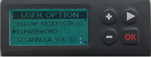

# DanaRS, Dana-i i Dana-i2

*Te instrukcje opisują konfigurację aplikacji i pompy, jeśli masz DanaRS z 2017 roku lub nowszą, Dana-i albo Dana-i2. Jeśli masz oryginalną pompę DanaR, przejdź do strony [DanaR](./DanaR-Insulin-Pump.md).*

**Dana-i2 można używać od wersji AAPS 4.0.** Używa tego samego sterownika **Dana-i/RS** co Dana-i.

* W pompie DanaRS/i/i2 aplikacja używa profilu „BASAL A”. Istniejące dane zostaną nadpisane.

    {contents} Spis treści
    :depth: 1
    :local: true

## Funkcje pompy w AAPS

* Komunikuje się z **AAPS** przez wbudowany Bluetooth telefonu, bez dodatkowego urządzenia komunikacyjnego.
* Zmianę czasu letniego i strefy czasowej musisz obsłużyć ręcznie (patrz [Zmiana strefy czasowej](#timezone-traveling-danarv2-danars)).

(DanaRS-Insulin-Pump-pairing-pump)=

## Parowanie pompy

* Otwórz **menu** (☰) w lewym górnym rogu ekranu głównego **AAPS** i wybierz **Konfiguracja**.
* Dotknij **Pompa** i wybierz **Dana-i/RS**.
    
    
    
    Po wybraniu karta **Dana-i/RS** pokazuje dwa przyciski: **Ustawienia** i **Otwórz wtyczkę**:
    
    
    
    **Ustawienia** otwiera ustawienia sterownika Dana-i/RS:
    
    
    
    **Otwórz wtyczkę** (lub **Zarządzaj** > **Pompa**) otwiera ekran pompy Dana-i/RS. Zanim pompa zostanie sparowana, ekran wygląda tak:
    
    

* Na ekranie pompy dotknij **Parowanie**. **AAPS** wyszukuje pompy w pobliżu.

* Dotknij swojej pompy na liście.
    
    

* **Musisz potwierdzić parowanie na pompie!** Działa to tak samo jak inne parowania Bluetooth, które możesz znać (np. smartfon i radio w samochodzie).
    
    

* Wykonaj parowanie zgodnie z typem i oprogramowaniem (firmware) swojej pompy:
    
    * Dla DanaRS v1 **AAPS** poprosi o **Hasło pompy (tylko v1)**. Wpisz hasło pompy (patrz [Domyślne hasło](#DanaRS-Insulin-Pump-default-password)).
    * Dla DanaRS v3 **AAPS** poprosi Cię o naciśnięcie OK na pompie i wpisanie 2 ciągów cyfr i liter pokazanych na pompie. Aż do zakończenia utrzymuj włączony wyświetlacz pompy, naciskając przycisk minus. Następnie dotknij **Gotowe**.
    * Dla Dana-i i Dana-i2 pojawi się standardowe okno parowania Androida. Wpisz 6-cyfrowy numer pokazany na pompie.

* Gdy pojawi się **Sparowano pomyślnie!**, dotknij **Gotowe**.
    
    
    
    Wrócisz na ekran pompy, który teraz pokazuje stan Twojej pompy.
    
    

* W **Ustawienia** wybierz **Prędkość podawania bolusa**, aby zmienić domyślną prędkość podawania bolusa (12 s/U, 30 s/U lub 60 s/U).

* Ustaw w pompie krok bazy na 0,01 U/h w menu lekarza (Doctors menu, patrz instrukcja obsługi pompy).
* Ustaw w pompie krok bolusa na 0,05 U w menu lekarza (Doctors menu, patrz instrukcja obsługi pompy). **AAPS** odczytuje krok bazy i bolusa z pompy i używa ich przy każdym bolusie, więc bolus zawsze pasuje do kroku ustawionego w pompie. Ekran pompy pokazuje je w wierszu **Rozmiar kroku Bazy/Bolusa**.
* Uaktywnij bolusy przedłużone w pompie

### Opcje widoczne tylko dla niektórych modeli

* **Automatyczna blokada**: w Dana-i2 ekran **Ustawienia użytkownika** (na ekranie pompy, **Zarządzaj** > **Pompa**) ma przełącznik **Automatyczna blokada** dla ustawienia automatycznej blokady pompy. Po zmianie naciśnij **Zapisz ustawienia w pompie**.
* **Tryb uproszczony**: w modelach pomp, które mają uproszczone menu (easy mode), ekran pompy pokazuje wiersz **Tryb uproszczony** z wartością **Włącz** lub **Wyłącz**.
* Jeśli Dana-i2 odrzuci bolus, **AAPS** pokaże przyczynę, np. *Pompa nie jest napełniona*, *Za mało insuliny w zbiorniku* lub *Tryb Easy sleep jest włączony w pompie.*

(DanaRS-Insulin-Pump-default-password)=

### Domyślne hasło

* Dla DanaRS z oprogramowaniem v1 i v2 domyślne hasło to 1234.
* Dla DanaRS z oprogramowaniem v3 lub Dana-i domyślne hasło wynika z daty produkcji i ma postać MMDD, gdzie MM to miesiąc, a DD to dzień produkcji pompy (np. „0124” oznacza miesiąc 01 i dzień 24).
    
    * W MAIN MENU wybierz REVIEW, a następnie otwórz z podmenu SHIPPING INFORMATION
    * Number 3 is manufacturing date. 
    * Dla wersji v3/i to hasło służy tylko do zablokowania menu w pompie. Nie używa się go do komunikacji i nie trzeba go wprowadzać w AAPS.

(DanaRS-Insulin-Pump-change-password-on-pump)=

## Zmiana hasła w pompie

* Naciśnij przycisk OK na pompie
* W menu głównym wybierz „OPTION” (przesuń w prawo, naciskając kilka razy przycisk strzałki)
    
    

* W menu opcji wybierz „USER OPTION”
    
    

* Użyj przycisku strzałki, aby przewinąć w dół do „11. password”
    
    

* Naciśnij OK, żeby wprowadzić stare hasło.

* Wpisz **stare hasło** (domyślne hasło: patrz [powyżej](#DanaRS-Insulin-Pump-default-password)) i naciśnij OK
    
    

* Jeśli wprowadzisz tutaj błędne hasło, nie pojawi się żadna informacja wskazująca niepowodzenie!

* Ustaw **nowe hasło** (zmieniaj cyfry przyciskami + i - / przesuwaj się w prawo przyciskiem strzałki).
    
    

* Potwierdź przyciskiem OK.

* Naciśnij OK, żeby zapisać ustawienie.
    
    

* Przesuń się w dół do „14. EXIT” i naciśnij OK, aby wyjść.
    
    

(DanaRS-Insulin-Pump-dana-rs-specific-errors)=

## Błędy specyficzne dla Dana RS

### Błąd podczas podawania insuliny

Jeśli połączenie między AAPS a Dana RS zostanie przerwane podczas podawania bolusa (np. odejdziesz od telefonu, gdy Dana RS podaje insulinę), zobaczysz poniższy komunikat i usłyszysz alarm.

* W większości przypadków to tylko problem z komunikacją i podana zostaje właściwa ilość insuliny.
* Sprawdź w historii pompy, czy podano właściwy bolus. Możesz to zrobić w samej pompie albo w **AAPS** na ekranie pompy (**Zarządzaj** > **Pompa**) > **Historia pompy** > **Bolusy**.
* Jeśli chcesz, usuń wpis błędu w [leczeniu](#screens-bolus-carbs).
* Rzeczywista ilość zostanie odczytana i zapisana przy następnym połączeniu. Aby to wymusić, dotknij **Odśwież** na ekranie pompy albo po prostu poczekaj na następne połączenie.

## Ważne przy zmianie telefonu

Przy zmianie telefonu na nowy wykonaj następujące kroki:

* Wyeksportuj ustawienia na starym telefonie (zobacz [Tworzenie i przywracanie kopii zapasowych](../Maintenance/ExportImportSettings.md))
* Przenieś ustawienia ze starego telefonu na nowy

### DanaRS v1

* **Sparuj ręcznie** DanaRS z nowym telefonem
* Jeśli przy imporcie zaznaczysz **Także zastąp ustawienia pompy**, zaimportowane zostaną też ustawienia połączenia z pompą i AAPS na nowym telefonie będzie już „znał” pompę, więc nie rozpocznie wyszukiwania Bluetooth. Dlatego nowy telefon i pompa muszą być sparowane ręcznie.
* Zainstaluj AAPS na nowym telefonie.
* Zaimportuj ustawienia na nowym telefonie (zobacz [Tworzenie i przywracanie kopii zapasowych](../Maintenance/ExportImportSettings.md))

### DanaRS v3, Dana-i, Dana-i2

* Rozpocznij parowanie w sposób opisany [powyżej](#DanaRS-Insulin-Pump-pairing-pump).
* Czasem trzeba najpierw usunąć informacje o parowaniu w **AAPS**. Na ekranie pompy (**Zarządzaj** > **Pompa**) dotknij **Rozparuj** i potwierdź **Zresetować sparowanie?**. Następnie ponownie dotknij **Parowanie**.

## Zmiana strefy czasowej z pompami DanaRS, Dana-i i Dana-i2

Informacje o zmianie strefy czasowej znajdziesz w sekcji [Zmiana strefy czasowej z pompami](#timezone-traveling-danarv2-danars).

## Gdzie uzyskać pomoc

Sterownik DanaRS/Dana-i/Dana-i2 jest rozwijany przez społeczność na zasadzie **wolontariatu**. Zanim poprosisz o pomoc:

1. **Przeczytaj** odpowiednią część tej dokumentacji, aby sprawdzić, jak funkcja ma działać.
2. **Zapytaj** na kanale *#AAPS* na [Discordzie](https://discord.gg/4fQUWHZ4Mw) lub na jednym z innych [kanałów społeczności](../GettingHelp/WhereCanIGetHelp.md).
3. **Zgłoś błąd**: przeszukaj [istniejące zgłoszenia](https://github.com/nightscout/AndroidAPS/issues); jeśli Twojego problemu tam nie ma, otwórz [nowe zgłoszenie](https://github.com/nightscout/AndroidAPS/issues) i dołącz [pliki logów](../GettingHelp/AccessingLogFiles.md).

Prosząc o pomoc, podaj markę i model telefonu, wersję Androida, wersję **AAPS** i prosty opis problemu po angielsku (co się zmieniło, kiedy ostatnio działało).