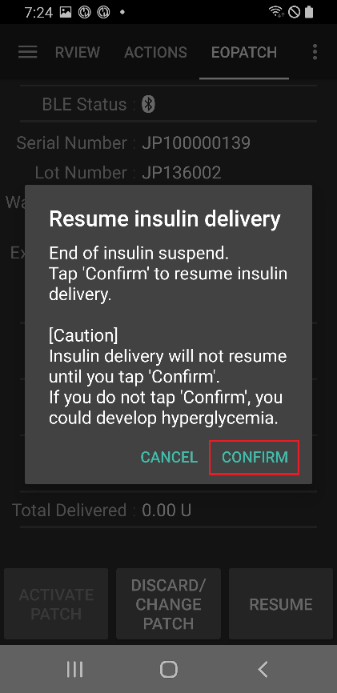
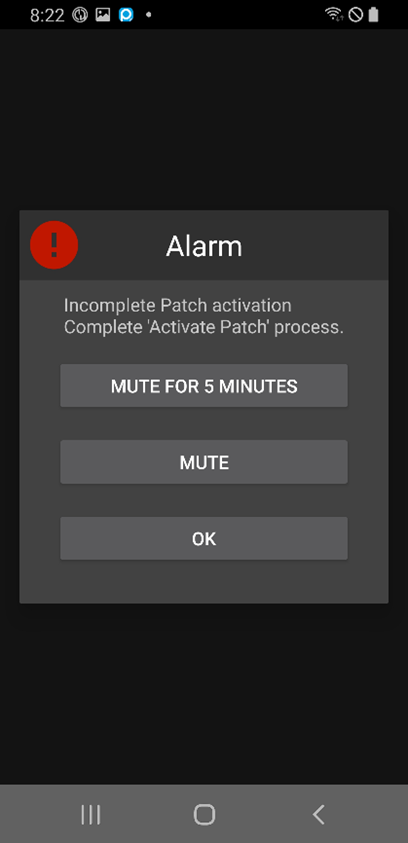

# EOPatch2

Patch wymaga szybko działającej insuliny U-100, np. NovoRapid lub Humalog. Używaj szybko działającej insuliny, którą przepisał Ci lekarz.

Najmniejsza dawka, jaką patch może podać, to 0,05 U. Ustaw każdą dawkę bazową w swoim **Profilu** na co najmniej 0,05 U/godz., w krokach co 0,05 U/godz. W przeciwnym razie **AAPS** zaokrągla każdą dawkę do najbliższej wartości 0,05 U/godz. (nigdy w dół do 0) i używa dawek, które patch naprawdę podaje, więc dzienna ilość insuliny trochę różni się od Twojego **Profilu**. Tak samo bolusy muszą wynosić co najmniej 0,05 U.

```{contents} Table of contents
:depth: 1
:local: true
```

## Funkcje pompy w AAPS

* Komunikuje się z **AAPS** przez wbudowany Bluetooth telefonu, bez dodatkowego urządzenia pośredniczącego.
* Zmiany czasu letniego/zimowego i strefy czasowej trzeba obsłużyć ręcznie.

## Konfiguracja pompy

1. Otwórz **menu** (☰) w lewym górnym rogu ekranu głównego **AAPS** i wybierz **Konfiguracja**.
1. W sekcji **Pompa** wybierz **EOPatch2**.
1. Naciśnij przycisk Wstecz, aby wrócić do ekranu głównego.

 

Po wybraniu karta **EOPatch2** pokazuje dwa przyciski: **Ustawienia** i **Otwórz wtyczkę**:


## Ustawienia

Ustawienia EOPatch2 możesz otworzyć na dwa sposoby:

* naciśnij **Ustawienia** na karcie **EOPatch2** w **Konfiguracji** albo
* otwórz ekran pompy (**Zarządzaj** → **Pompa**) i naciśnij ikonę koła zębatego w prawym górnym rogu.

Są trzy ustawienia:


### Alarmy niskiego poziomu zbiornika

Ostrzeżenie pojawia się, gdy ilość insuliny w patchu spadnie do tej wartości lub niżej. Możesz ustawić od 10 do 50 U, w krokach co 5 U. Domyślnie jest 10 U.

### Przypomnienie o wygaśnięciu Patcha

Przypomina, ile czasu zostało do wygaśnięcia obecnego patcha. Możesz ustawić od 1 do 24 godzin, w krokach co 1 godzinę. Domyślnie są to 4 godziny.

### Alarmy akustyczne pompy

Gdy ta opcja jest włączona, patch wydaje sygnał dźwiękowy, gdy bolus, bolus przedłużony lub baza tymczasowa zaczyna się i kończy. Nie ma to wpływu na Twoją zwykłą bazę. Domyślnie opcja jest wyłączona.

## Aktywacja nowego patcha

### Otwórz kreator aktywacji

Otwórz ekran pompy przez **Zarządzaj** → **Pompa** (lub naciśnij **Otwórz wtyczkę** na karcie **EOPatch2** w **Konfiguracji**). Gdy żaden patch nie jest aktywny, ekran pokazuje **Nieaktywowany** i przycisk **Aktywuj Patch** na dole.

Naciśnij **Aktywuj Patch**, aby uruchomić kreator.


Kreator prowadzi Cię przez każdy krok. Rząd kropek na górze pokazuje, na którym etapie jesteś.

```{note}
Jeśli nigdy nie aktywowałeś **Profilu** w **AAPS**, kreator najpierw pokaże stronę **Wymagany profil**. Wybierz profil, którego chcesz używać, i naciśnij **Aktywuj profil**.
```

### Napełnianie Insuliny

Wbij igłę strzykawki w port napełniania insuliny na patchu. Powoli naciskaj tłok, aby napełnić patch. Gdy w patchu jest więcej niż 80 U, patch wyda jeden sygnał i się uruchomi.

Gdy usłyszysz sygnał, naciśnij **Rozpocznij parowanie**.


```{warning}
- Nie obracaj dźwigni igły, dopóki kreator Ci tego nie każe. Zbyt wczesne obrócenie może spowodować poważne problemy podczas napełniania lub kontroli bezpieczeństwa.
- Patch mieści od 80 do 200 U. Jeśli wlejesz mniej niż 80 U, patch nie będzie działać.
- Wyjmij insulinę z lodówki 15 do 30 minut przed napełnianiem, aby osiągnęła temperaturę pokojową. Insulina musi mieć co najmniej 10°C.
```

### Parowanie Patcha

**AAPS** próbuje teraz automatycznie sparować się z patchem. Podczas parowania pojawią się dwie prośby Androida o parowanie Bluetooth. Na pierwszej naciśnij **OK**. Na drugiej, która pokazuje klucz dostępu (passkey), też naciśnij **OK**.

```{warning}
- Podczas parowania trzymaj patch i telefon w odległości do 30 cm od siebie.
- Po uruchomieniu patch wydaje sygnał co 3 minuty, dopóki parowanie się nie zakończy.
- Aktywację patcha musisz zakończyć w ciągu 60 minut od jego uruchomienia. Jeśli nie zdążysz, odrzuć patch.
```

  

```{admonition} Older screenshot
:class: note
Dwa zrzuty ekranu parowania Bluetooth pochodzą z wcześniejszej wersji **AAPS**: ekran **AAPS** za prośbą Androida o parowanie wygląda inaczej w **AAPS** 4.
```

### Wybierz insulinę

Wybierz insulinę, którą napełniłeś patch, i naciśnij **Dalej**. Po aktywacji **AAPS** wykonuje zmianę profilu z tą insuliną.

### Przygotuj się do założenia Patcha

Zdejmij taśmę samoprzylepną z patcha, a potem naciśnij **Dalej**.

Jeśli igła wystaje albo patch jest mokry, brudny lub jego taśma samoprzylepna jest zagięta, naciśnij zamiast tego **Odrzuć** i użyj nowego patcha.


### Miejsce wkłucia

Ten krok pojawia się tylko wtedy, gdy w ustawieniach zmiany miejsca wkłucia włączona jest opcja **Zarządzaj zmianą miejsca wkłucia pompy**. Dotknij na schemacie ciała miejsca, w którym założysz patch, i naciśnij **Dalej** albo naciśnij **Pomiń**.

### Zakładanie Patcha

Insulina powinna trafić w miejsce z tkanką tłuszczową pod skórą, ale z niewielką liczbą nerwów i naczyń krwionośnych. Dobrym wyborem jest brzuch, ramię lub udo. Oczyść i osusz miejsce, a potem przyklej patch do skóry.

Sprawdź miejsce wkłucia, a potem naciśnij **Rozpocznij kontrolę bezpieczeństwa**.

```{warning}
- Równomiernie dociśnij brzegi taśmy patcha, aby cały patch mocno przylegał do skóry.
- Jeśli patch nie przylega całkowicie, między patch a skórę może dostać się powietrze. To osłabia klej i wodoodporność patcha.
```


### Kontrola bezpieczeństwa

Kontrola bezpieczeństwa trwa około 30 sekund. Gdy się zakończy, patch wyda jeden sygnał. Jeśli się nie powiedzie, naciśnij **Ponów**.

```{warning}
Dla bezpieczeństwa nie obracaj dźwigni igły, dopóki kontrola bezpieczeństwa się nie zakończy.
```

 

```{admonition} Older screenshot
:class: note
Zrzuty ekranu od **Przygotuj się do założenia Patcha** do **Kontrola bezpieczeństwa** pochodzą z wcześniejszej wersji **AAPS** i w **AAPS** 4 mogą wyglądać inaczej.
```

### Wbijanie igły

Mocno trzymaj patch. Obróć dźwignię igły w górę o więcej niż 100°, aby wbić igłę. Gdy igła zostanie wbita prawidłowo, patch wyda jeden sygnał. Potem obracaj dźwignię dalej do końca, aby ją wyjąć. Naciśnij **Dalej**.

```{caution}
Jeśli przejdziesz do następnego kroku bez usłyszenia sygnału, pojawi się **Błąd wkłuwania igły**. Sprawdź, czy był sygnał, i naciśnij **Ponów**. Jeśli błąd nadal występuje, naciśnij **Odrzuć**, aby dezaktywować patch.
```

### Aktywacja Patcha zakończona

Ostatnia strona potwierdza, że patch jest aktywny i że przypomni Ci, gdy zbliży się czas jego wygaśnięcia. Naciśnij **Zakończ**, aby wrócić do ekranu pompy.

## Odrzucanie patcha

Wymień patch, gdy kończy się w nim insulina, gdy wygaśnie lub gdy jest uszkodzony. Zalecamy używanie każdego patcha nie dłużej niż 84 godziny od jego uruchomienia.

1. Otwórz ekran pompy (**Zarządzaj** → **Pompa**). Gdy patch jest aktywny, naciśnij **Odrzuć Patch**.
1. Strona **Odrzuć Patch** pokazuje pozostały czas i ilość insuliny pozostałej w patchu. Naciśnij **Odrzuć Patch**.
1. Pojawi się okno z prośbą o potwierdzenie. Naciśnij ponownie **Odrzuć Patch**.
1. Gdy patch zostanie dezaktywowany, kreator pokaże **Usuwanie Patcha zostało zakończone.** Zdejmij patch z ciała i naciśnij **Potwierdź**.

Potem kreator od razu przechodzi do aktywacji nowego patcha (patrz wyżej). Jeśli chcesz tu zakończyć, naciśnij strzałkę wstecz.

Gdy żaden patch nie jest aktywny, **AAPS** pokazuje pompę jako wstrzymaną i zapisuje bazę tymczasową 0 U/godz., więc insulina bazowa nie jest liczona do IOB, dopóki nie aktywujesz następnego patcha.

   

```{admonition} Older screenshot
:class: note
Zrzuty ekranu powyżej pochodzą z wcześniejszej wersji **AAPS**. W **AAPS** 4 ekran pompy otwierasz przez **Zarządzaj** → **Pompa**, a przycisk na nim nazywa się **Odrzuć Patch**.
```

```{admonition} If the patch does not respond
:class: warning
Jeśli **AAPS** nie może połączyć się z patchem, może pokazać stronę o ręcznym wyłączeniu alarmu patcha: zdejmij patch z ciała, odklej taśmę samoprzylepną i użyj spinacza, aby mocno wcisnąć przycisk w otworze obok portu napełniania insuliny.

Strona **Odrzuć Patch** ma też przycisk **Wymuś reset**. Usuwa on patch tylko z **AAPS**, bez wysyłania żadnego polecenia do patcha. Patch nadal podaje insulinę, dopóki nie wyczerpie się jego bateria albo nie wyłączysz go ręcznie. Używaj go tylko wtedy, gdy normalne odrzucenie się nie powiedzie, i zdejmij patch z ciała.
```

## Wstrzymywanie i wznawianie podawania insuliny

Wstrzymanie podawania insuliny anuluje też trwający bolus przedłużony i bazę tymczasową. Po wznowieniu **nie** są one uruchamiane ponownie. Gdy podawanie insuliny jest wstrzymane, patch wydaje sygnał co 15 minut.

### Wstrzymywanie podawania insuliny

1. Otwórz ekran pompy (**Zarządzaj** → **Pompa**) i naciśnij **Wstrzymaj pompę**.
1. Okno wyjaśnia, co zostanie wstrzymane. Naciśnij **Potwierdź**.
1. W oknie **Czas zawieszenia bazy** wybierz, na jak długo wstrzymać: 30 min, 1 godz, 1 godz 30 min lub 2 godz. Naciśnij **Potwierdź**.

Podawanie insuliny zostanie wstrzymane na wybrany czas.

  

```{admonition} Older screenshot
:class: note
Zrzuty ekranu powyżej pochodzą z wcześniejszej wersji **AAPS**. W **AAPS** 4 ekran pompy otwierasz przez **Zarządzaj** → **Pompa**, a przycisk na nim nazywa się **Wstrzymaj pompę**.
```

### Wznawianie podawania insuliny

1. Otwórz ekran pompy (**Zarządzaj** → **Pompa**) i naciśnij **Wznów pompę**.
1. W oknie **Wznów podawanie insuliny** naciśnij **Potwierdź**.

 

```{admonition} Older screenshot
:class: note
Zrzuty ekranu powyżej pochodzą z wcześniejszej wersji **AAPS**. W **AAPS** 4 ekran pompy otwierasz przez **Zarządzaj** → **Pompa**, a przycisk na nim nazywa się **Wznów pompę**.
```

```{warning}
Gdy czas wstrzymania minie, **AAPS** pokaże ostrzeżenie **Koniec zawieszenia podaży insuliny**. Podawanie insuliny **nie** wznowi się, dopóki tego nie potwierdzisz. Jeśli tego nie zrobisz, może u Ciebie wystąpić hiperglikemia.
```

(eopatch2-alarms-and-warnings)=

## Alarmy i ostrzeżenia

### Alarmy

Alarmy dotyczą pilnych sytuacji o najwyższym priorytecie i wymagają od Ciebie natychmiastowego działania. **AAPS** włącza alarm dźwiękowy, który trwa, dopóki go nie potwierdzisz, i pokazuje komunikat jako powiadomienie na **ekranie głównym**. Alarm oznacza problem z używanym patchem. W wielu przypadkach patch trzeba odrzucić i wymienić na nowy.

Gdy naciśniesz **Potwierdź** w powiadomieniu, **AAPS** obsłuży alarm. W przypadku większości alarmów patch zostanie wtedy dezaktywowany. Przy alarmie **Niewłaściwa temperatura** przycisk to **Ponów**.

 

```{admonition} Older screenshot
:class: note
Zrzuty ekranu alarmów pochodzą z wcześniejszej wersji **AAPS** i w **AAPS** 4 mogą wyglądać inaczej.
```

Poszczególne alarmy są opisane poniżej.

| Alarm                                           | Wyjaśnienie                                                                                                                                                  |
| ----------------------------------------------- | ------------------------------------------------------------------------------------------------------------------------------------------------------------ |
| Pusty zbiornik                                  | W patchu skończyła się insulina.                                                                                                                             |
| Patch wygasł                                    | Czas użytkowania patcha minął i nie może on już podawać insuliny.                                                                                            |
| Zatkanie                                        | Droga podawania insuliny w patchu wydaje się zablokowana.                                                                                                    |
| Błąd podczas auto-diagnostyki przy uruchamianiu | Patch wykrył nieoczekiwany błąd podczas autotestu po uruchomieniu.                                                                                           |
| Niewłaściwa temperatura                         | Temperatura patcha jest poza normalnym zakresem pracy podczas aktywacji lub używania. Przenieś patch w miejsce o odpowiedniej temperaturze (od 4,4 do 37°C). |
| Błąd wkłucia igły                               | Igła nie została prawidłowo wbita podczas aktywacji. Sprawdź, czy krawędź wkłucia igły na patchu i dźwignia igły są w jednej linii.                          |
| Błąd baterii Patcha                             | Wewnętrzna bateria patcha zaraz się wyczerpie i patch się wyłączy.                                                                                           |
| Błąd aktywacji Patcha                           | Patch nie został w pełni aktywowany w ciągu 60 minut od uruchomienia.                                                                                        |
| Błąd Patcha                                     | Patch wykrył nieoczekiwany błąd podczas aktywacji lub używania.                                                                                              |

### Ostrzeżenia

Ostrzeżenia dotyczą sytuacji o średnim lub niskim priorytecie. Ostrzeżenie pojawia się jako powiadomienie na **ekranie głównym**.


```{admonition} Older screenshot
:class: note
Ten zrzut ekranu pochodzi z wcześniejszej wersji **AAPS**: w **AAPS** 4 ostrzeżenie pojawia się na ekranie głównym, który wygląda inaczej.
```

Poszczególne ostrzeżenia są opisane poniżej.

| Ostrzeżenie                        | Wyjaśnienie                                                                                                            |
| ---------------------------------- | ---------------------------------------------------------------------------------------------------------------------- |
| Koniec zawieszenia podaży insuliny | Wybrany czas wstrzymania minął. Naciśnij **Wznów pompę** w powiadomieniu, aby wznowić podawanie insuliny.              |
| Niski poziom zbiornika             | Ilość insuliny w patchu jest mniejsza niż wartość ustawiona w **Alarmy niskiego poziomu zbiornika**.                   |
| Okres użytkowania Patcha minął     | Okres użytkowania patcha minął.                                                                                        |
| Patch wkrótce wygaśnie             | Patch trzeba odrzucić w ciągu 1 godziny.                                                                               |
| Niekompletna aktywacja Patcha      | Aktywacja patcha została przerwana na dłużej niż 3 minuty po parowaniu. Otwórz ekran pompy i dokończ aktywację patcha. |
| Słaba bateria Patcha               | Bateria patcha jest słaba.                                                                                             |

## Gdzie uzyskać pomoc

Sterownik EOPatch2 jest rozwijany przez społeczność na zasadzie **wolontariatu**. Zanim poprosisz o pomoc:

1. **Przeczytaj** odpowiedni rozdział tej dokumentacji, aby sprawdzić, jak dana funkcja ma działać.
2. **Zapytaj** na kanale *#AAPS* na [Discordzie](https://discord.gg/4fQUWHZ4Mw) lub na jednym z innych [kanałów społeczności](../GettingHelp/WhereCanIGetHelp.md).
3. **Zgłoś błąd**: najpierw przeszukaj [istniejące zgłoszenia](https://github.com/nightscout/AndroidAPS/issues); jeśli Twojego problemu tam nie ma, utwórz [nowe zgłoszenie](https://github.com/nightscout/AndroidAPS/issues) i dołącz [pliki logów](../GettingHelp/AccessingLogFiles.md).

Gdy prosisz o pomoc, podaj markę i model telefonu, wersję Androida, wersję **AAPS** oraz prosty, jasny opis problemu (co się zmieniło, kiedy ostatnio działało).
