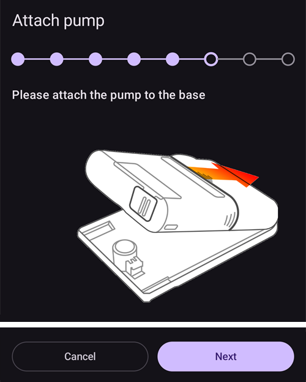

# Equil

Ta instrukcja opisuje konfigurację pompy insulinowej Equil.

```{contents} Table of contents
:depth: 1
:local: true
```

## Funkcje pompy w AAPS

* Pompa typu patch bez drenu, która komunikuje się z **AAPS** przez wbudowany Bluetooth telefonu, bez dodatkowego urządzenia pośredniczącego.
* **AAPS** traktuje Equil jako pompę typu patch ze zbiornikiem 200 U: ekran główny pokazuje wskaźniki stanu pompy typu patch, a opcje **Napełnij/Wypełnij** i **Zmiana baterii pompy** nie są dostępne. Napełnianie zbiornika, wypełnianie i wymianę baterii wykonujesz w kreatorach pompy.
* Gdy pompa jest wstrzymana lub zatrzymana, **AAPS** zapisuje bazę tymczasową 0 U/h, więc insulina bazowa nie jest liczona do IOB.
* Zmiany czasu letniego/zimowego i strefy czasowej trzeba obsłużyć ręcznie.

## Wymagania sprzętowe i programowe
* **Kompatybilny sprzęt Equil**

  Obecnie obsługiwane są Equil 5.3 i 5.4.

* **AAPS** zbudowany i zainstalowany zgodnie z instrukcją [Budowanie AAPS](../SettingUpAaps/BuildingAaps.md)

## Konfiguracja

### Wybierz pompę Equil

Otwórz **menu** (☰) w lewym górnym rogu, wybierz **[Konfiguracja](#Config-Builder-pump)** i w sekcji **Pompa** wybierz **Equil**.

Po wybraniu karta **Equil** pokazuje dwa przyciski: **Ustawienia** i **Otwórz wtyczkę**:


**Otwórz wtyczkę** (lub **Zarządzaj** → **Pompa**) otwiera ekran pompy Equil. Zanim pompa zostanie sparowana, ekran wygląda tak:


### Ustawienia

Ustawienia Equil otworzysz przyciskiem **Ustawienia** na karcie **Equil** albo ikoną koła zębatego w prawym górnym rogu ekranu pompy.


* **Alarm słabej baterii**: ostrzega, gdy bateria pompy jest słaba.
* **Alarm o niskim poziomie zbiornika insuliny**: ostrzega, gdy w zbiorniku jest mało insuliny.
* **Sygnał dźwiękowy**: jak pompa Cię ostrzega: **Wycisz**, **Tylko wibracje**, **Tylko dźwięk** lub **Wibracje i dźwięk**.
* **Prędkość podawania bolusa**: jak szybko podawany jest bolus: **1.5 U/min (standardowa)**, **3 U/min**, **6 U/min** lub **12 U/min**. Szybszy bolus może powodować więcej alarmów zatkania.


```{admonition} Max basal and max bolus on the patch
:class: note
Sam patch odrzuca każdą dawkę bazową wyższą niż maksimum, które zaprogramuje w nim **AAPS**. **AAPS** bierze wyższą z dwóch wartości: Twoje [ustawienie](../SettingUpAaps/Preferences.md) **Maksymalna dawka bazowa** albo najwyższą godzinową dawkę bazową w Twoim **Profilu**, więc patch zawsze przyjmie Twój profil i bazy tymczasowe, o które prosi pętla. **AAPS** wysyła też do patcha Twój maksymalny dozwolony bolus.

Gdy zmienisz ustawienie **Maksymalna dawka bazowa** lub **Maksymalny bolus**, **AAPS** automatycznie wyśle nowe wartości do patcha. Są one też wysyłane przy każdej zmianie profilu. Na samym patchu nie trzeba niczego ustawiać.
```

### Parowanie pompy

Na ekranie pompy naciśnij **Sparuj**. Kreator prowadzi Cię przez każdy krok. Rząd kropek na górze pokazuje, na którym etapie jesteś.

Jeśli Android zapyta, czy **AAPS** może znajdować urządzenia w pobliżu i łączyć się z nimi, naciśnij **Zezwól**. **AAPS** potrzebuje tego, aby znaleźć pompę.


Kreator ma następujące kroki. Naciśnij **Dalej**, aby przejść dalej, lub **Anuluj**, aby wyjść z kreatora.

1. **Wymagany profil**: pokazuje się tylko wtedy, gdy nigdy nie aktywowałeś **Profilu** w **AAPS**. Wybierz profil, którego chcesz używać, i naciśnij **Aktywuj profil**.
1. **Złóż pompę**: połącz pompę, napełniony zbiornik i naładowaną baterię.

   

1. **Znajdź pompę**: **AAPS** wyszukuje pompy Equil w pobliżu. Wybierz swoją pompę z listy.

   
1. **Parowanie urządzenia**: możesz wpisać hasło parowania w polu **Ustaw hasło parowania**. Musi mieć 4 znaki, wybrane spośród `ABCDEF0123456789`. Naciśnij **Sparuj**.

   

1. **Wybierz insulinę**: pokazuje się tylko wtedy, gdy masz skonfigurowaną więcej niż jedną insulinę. Wybierz insulinę, która jest w zbiorniku.
1. **Napełnianie / Wypełnianie**: pompa **nie** może być na podstawce. Naciśnij **Napełnij/Wypełnij** i wypełniaj zbiornik, aż na końcu igły pojawi się kropla insuliny. Naciśnij **Dalej**.

   
1. **Zmiana miejsca**: pokazuje się tylko wtedy, gdy w ustawieniach zmiany miejsca wkłucia włączona jest opcja **Zarządzaj zmianą miejsca wkłucia pompy**. Dotknij miejsca, w którym przymocujesz pompę, lub naciśnij **Pomiń**.
1. **Przymocuj pompę**: przymocuj pompę do podstawki.

   
1. **Odpowietrz kaniulę**: gdy pompa jest już na podstawce, naciśnij **Usuń powietrze**, aby usunąć powietrze z kaniuli. Naciśnij **Dalej**.

   

1. **Potwierdź**: załóż pompę na ciało i naciśnij **Zakończ**.

   

```{warning}
Jeśli ustawisz własne hasło parowania (zalecane dla Twojego bezpieczeństwa), zapisz je w bezpiecznym miejscu. Hasło jest zapisane w pompie. Pompa prosi o nie przy każdym nowym parowaniu, dopóki nie rozparujesz jej prawidłowo w **AAPS**. Do tego czasu pompy nie można też używać z oryginalnym kontrolerem ręcznym (PDA).
```

### Ekran pompy po sparowaniu

Gdy pompa jest sparowana, ekran pompy pokazuje te przyciski:

* **Odśwież**: od razu odczytuje stan i historię pompy.
* **Wstrzymaj** / **Wznów podawanie**: zatrzymuje lub ponownie uruchamia podawanie insuliny.
* **Zmień zbiornik**: prowadzi Cię przez odłączenie pompy, założenie nowego zbiornika (i w razie potrzeby nowej baterii), wypełnienie i ponowne przymocowanie. Pierwszy krok pyta: *Czy założysz też nowy zestaw infuzyjny (podstawkę i kaniulę)?*
  * **Tak, nowy zestaw infuzyjny**: wybierasz miejsce, kaniula jest wypełniana, a **AAPS** zapisuje zmianę insuliny i zmianę kaniuli.
  * **Nie, tylko zbiornik lub baterię**: kaniula nie jest wypełniana, a **AAPS** zapisuje tylko zmianę insuliny.

  Po zmianie zbiornika poziom baterii pokazuje **-**, dopóki **AAPS** nie odczyta go ponownie z pompy.

  

* **Historia**: pokazuje zdarzenia zapisane przez pompę.
* **Rozłącz urządzenie**: prowadzi Cię przez odłączenie pompy i rozparowanie jej z **AAPS**. To zatrzymuje podawanie insuliny, cofa tłok pompy na dół i usuwa sparowanie.

### Alarmy

* Alarm niskiego poziomu insuliny włącza się raz przy każdym progu (10 U, 5 U i 2 U) oraz gdy zbiornik jest pusty. Alarm słabej baterii włącza się raz przy 10% i raz przy 5%. Każdy próg alarmuje tylko raz, aż do następnej zmiany zbiornika.
* Alarmy i zatrzymania pompy są też zapisywane w Leczeniu jako wpisy „Powiadomienie”, z czasem, w którym pompa je zapisała, więc później widać, kiedy i dlaczego pompa się zatrzymała.
* Jeśli zbiornik opróżni się podczas bolusa, **AAPS** zapisze tylko insulinę podaną do tego momentu i poda Ci obie ilości.

## Gdzie uzyskać pomoc

Sterownik Equil jest rozwijany przez społeczność na zasadzie **wolontariatu**. Zanim poprosisz o pomoc:

1. **Przeczytaj** odpowiedni rozdział tej dokumentacji, aby sprawdzić, jak dana funkcja ma działać.
2. **Zapytaj** na kanale *#AAPS* na [Discordzie](https://discord.gg/4fQUWHZ4Mw) lub na jednym z innych [kanałów społeczności](../GettingHelp/WhereCanIGetHelp.md).
3. **Zgłoś błąd**: najpierw przeszukaj [istniejące zgłoszenia](https://github.com/nightscout/AndroidAPS/issues); jeśli Twojego problemu tam nie ma, utwórz [nowe zgłoszenie](https://github.com/nightscout/AndroidAPS/issues) i dołącz [pliki logów](../GettingHelp/AccessingLogFiles.md).

Gdy prosisz o pomoc, podaj markę i model telefonu, wersję Androida, wersję **AAPS** oraz prosty, jasny opis problemu (co się zmieniło, kiedy ostatnio działało).
