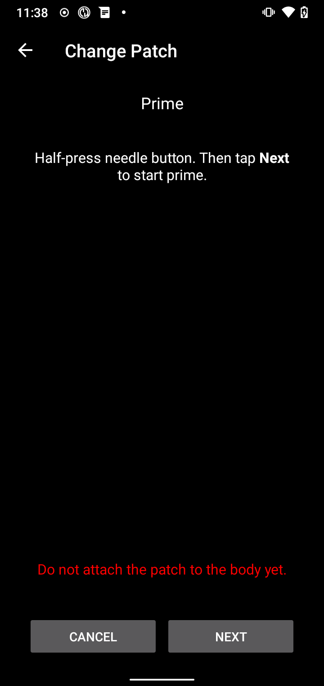
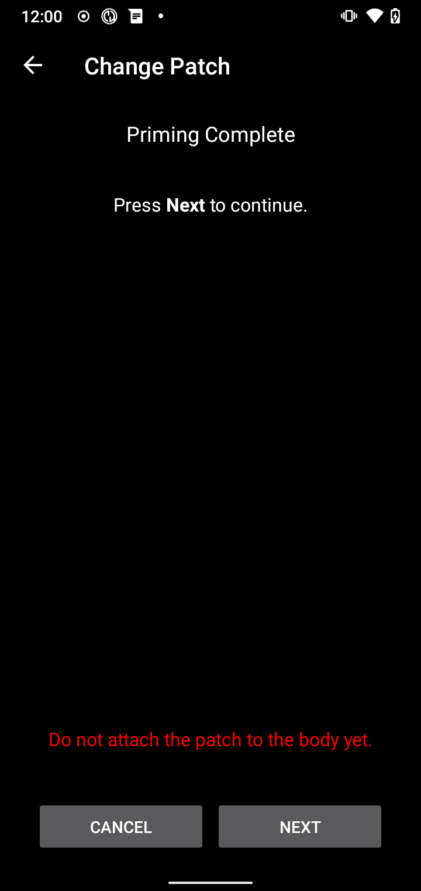

(medtrum-nano-300u)=
# Medtrum Nano 200U / 300U

Ta instrukcja opisuje konfigurację pompy insulinowej Medtrum.

```{contents} Table of contents
:depth: 1
:local: true
```

## Funkcje pompy w AAPS
* Obsługiwane są wszystkie funkcje pętli (SMB, TBR itp.)
* Automatyczna obsługa czasu letniego i strefy czasowej
* Sterownik AAPS nie obsługuje bolusa przedłużonego

## Wymagania sprzętowe i programowe
* **Kompatybilne podstawy pompy Medtrum i patche ze zbiornikiem**
    - Obecnie obsługiwane:
        - Medtrum TouchCare Nano 200U z podstawą pompy o numerach: **MD0201** i **MD8201**.
        - Medtrum TouchCare 300U z podstawą pompy o numerze: **MD8301**.
        - Jeśli masz nieobsługiwany model i chcesz przekazać sprzęt lub pomóc w testach, skontaktuj się z nami na Discordzie [tutaj](https://discordapp.com/channels/629952586895851530/1076120802476441641).
* **AAPS zbudowany i zainstalowany** według instrukcji [Budowanie AAPS](../SettingUpAaps/BuildingAaps.md).
* **Kompatybilny telefon z Androidem** z połączeniem Bluetooth BLE
    - Zobacz [Informacje o wersji](../Maintenance/ReleaseNotes.md) AAPS

## Zanim zaczniesz

**BEZPIECZEŃSTWO PRZEDE WSZYSTKIM** Nie wykonuj tego procesu w sytuacji, w której nie możesz naprawić błędu (zapasowe patche, insulina i urządzenia do sterowania pompą są konieczne).

**PDM i aplikacja Medtrum nie będą działać z patchem aktywowanym przez AAPS.** Wcześniej mogłeś wysyłać polecenia do pompy za pomocą PDM lub aplikacji Medtrum. Ze względów bezpieczeństwa aktywowanego patcha możesz używać tylko z tym urządzeniem lub aplikacją, którymi go aktywowano.

*To NIE znaczy, że masz wyrzucić swój PDM. Zalecamy trzymać go w bezpiecznym miejscu jako zapas na wypadek awarii, na przykład gdy zgubisz telefon albo AAPS nie działa poprawnie.*

**Pompa nie przestanie podawać insuliny, gdy nie jest połączona z AAPS** Domyślne dawki bazowe są zaprogramowane w pompie zgodnie z aktualnie aktywnym profilem. Dopóki AAPS działa, wysyła polecenia bazy tymczasowej, które trwają maksymalnie 120 minut. Jeśli z jakiegoś powodu pompa nie otrzyma nowych poleceń (na przykład gdy połączenie zostało przerwane z powodu odległości między pompą a telefonem), to po zakończeniu bazy tymczasowej pompa wróci do domyślnej dawki bazowej zaprogramowanej w pompie.

**Profil AAPS nie obsługuje dawek bazowych w przedziałach 30-minutowych** Jeśli dopiero zaczynasz z AAPS i po raz pierwszy ustawiasz profil dawek bazowych, pamiętaj, że dawki bazowe zaczynające się o pełnej połowie godziny nie są obsługiwane. Musisz dostosować profil tak, aby każda dawka bazowa zaczynała się o pełnej godzinie. Na przykład, jeśli masz dawkę bazową 1,1 U, która zaczyna się o 09:30 i trwa 2 godziny do 11:30, to nie zadziała. Musisz zmienić tę dawkę bazową 1,1 U na przedział czasu 9:00–11:00 albo 10:00–12:00. Chociaż sam sprzęt pompy Medtrum obsługuje w profilu bazy kroki co 30 min, algorytmy AAPS obecnie nie potrafią ich uwzględnić.

**Dawki bazowe 0 U/h w profilu NIE są obsługiwane w AAPS** Pompa Medtrum obsługuje zerową dawkę bazową, ale AAPS używa wielokrotności dawki bazowej z profilu do wyznaczania automatycznego leczenia, dlatego nie może działać z zerową dawką bazową. Minimalna dawka bazowa w profilu to 0,05 U/h.

Zerową bazę tymczasową możesz uzyskać funkcją „Odłącz pompę” albo połączeniem Wyłącz pętlę/baza tymczasowa lub Wstrzymaj pętlę/baza tymczasowa.

## Konfiguracja

```{caution}
Gdy aktywujesz patch za pomocą **AAPS**, **MUSISZ** wyłączyć każde inne urządzenie, które może komunikować się z podstawą pompy Medtrum, na przykład aktywny PDM lub aplikację Medtrum.
```

### Krok 1: Wybierz pompę Medtrum

#### Opcja 1: Nowe instalacje

Jeśli instalujesz **AAPS** po raz pierwszy, przez konfigurację przeprowadzi Cię **Kreator konfiguracji**. Gdy dojdziesz do kroku **Pompa**, wybierz **Medtrum**.

Jeśli nie masz pewności, możesz też wybrać **Pompa wirtualna**, a **Medtrum** wybrać później, po skonfigurowaniu **AAPS** (patrz opcja 2).


#### Opcja 2: Ekran Konfiguracja

W istniejącej instalacji możesz wybrać pompę **Medtrum** w [Konfiguracja > Pompa](#Config-Builder-pump):

Otwórz **menu** (☰) w lewym górnym rogu, dotknij **Konfiguracja** > **Pompa** i wybierz kartę **Medtrum**. Tylko jedna pompa może być aktywna naraz.


Po wybraniu na karcie **Medtrum** widać dwa przyciski: **Ustawienia** i **Otwórz wtyczkę**:


**Otwórz wtyczkę** (lub **Zarządzaj → Pompa**) otwiera ekran pompy Medtrum. Używasz go do zmiany patchy i do sprawdzania stanu pompy. Zanim patch zostanie aktywowany, ekran wygląda tak:


(medtrum-step-2)=
### Krok 2: Zmień ustawienia Medtrum

Dotknij **Ustawienia** na karcie **Medtrum** w **Konfiguracja** > **Pompa**. Możesz też dotknąć ikony koła zębatego w prawym górnym rogu ekranu pompy Medtrum. Otworzą się **Ustawienia pompy Medtrum**:


```{note}
Nie ma już ustawienia **Numer seryjny**. **AAPS** znajduje podstawę pompy przez skanowanie Bluetooth przy pierwszej aktywacji patcha (patrz [Krok 3](#medtrum-activate-patch)) i zapamiętuje jej numer seryjny. Aby użyć innej podstawy pompy, zobacz [Rozparuj](#medtrum-unpair).
```

#### Ustawienia alarmu

***Domyślnie: Dźwięk.***

To ustawienie zmienia sposób, w jaki pompa powiadamia Cię o ostrzeżeniu lub błędzie.

- **Dźwięk**: patch wydaje dźwięk przy alarmach i ostrzeżeniach.
- **Cicho**: patch nie powiadamia Cię o alarmach i ostrzeżeniach.

Uwaga: w trybie cichym **AAPS** nadal odtwarza alarm, zależnie od ustawień głośności telefonu. Jeśli nie zareagujesz na alarm, patch w końcu wyda dźwięk.

#### Powiadomienie o ostrzeżeniu pompy

***Domyślnie: włączone.***

To ustawienie zmienia sposób, w jaki **AAPS** pokazuje powiadomienia o niekrytycznych ostrzeżeniach pompy. Gdy jest włączone, przy ostrzeżeniu pompy na telefonie pojawia się powiadomienie, między innymi o:
- Niski poziom baterii
- Niski poziom zbiornika (20 jednostek)
- Patch wkrótce wygasa

Zalecamy zostawić to ustawienie włączone, gdy alarmy pompy są ustawione na **Cicho**. W obu przypadkach te ostrzeżenia są też widoczne na ekranie pompy Medtrum w polu [Aktywne alarmy](#medtrum-active-alarms).

(medtrum-patch-expiration)=
#### Wygaśnięcie Patcha

***Domyślnie: włączone.***

To ustawienie zmienia zachowanie patcha. Gdy jest włączone, patch wygasa po 3 dniach i wydaje ostrzeżenie dźwiękowe, jeśli masz włączony dźwięk. Po 3 dniach i 8 godzinach patch przestaje działać.

Jeśli to ustawienie jest wyłączone, patch nie ostrzega Cię, zanim przestanie działać. Z nowszym oprogramowaniem (firmware) podstawy pompy patch działa maksymalnie 5 dni.

#### Ostrzeżenie o upływie terminu ważności pompy [godziny]

***Domyślnie: 72 godziny.***

To ustawienie zmienia czas ostrzeżenia o wygaśnięciu. Gdy [Wygaśnięcie Patcha](#medtrum-patch-expiration) jest włączone, **AAPS** pokazuje powiadomienie po tylu godzinach od aktywacji.

#### Maksymalna Insulina w godzinę [jednostki]

***Domyślnie: 25 U.***

To ustawienie zmienia maksymalną ilość insuliny, którą można podać w ciągu jednej godziny. Po przekroczeniu tego limitu patch wstrzymuje podawanie insuliny i włącza alarm. Alarm możesz zresetować przyciskiem **Zresetuj alarmy** na ekranie pompy, patrz [Zresetuj alarmy](#nano-reset-alarms).

Ustaw rozsądną wartość, dopasowaną do Twojego zapotrzebowania na insulinę.

#### Maksymalna Insulina dziennie [jednostki]

***Domyślnie: 80 U.***

To ustawienie zmienia maksymalną ilość insuliny, którą można podać w ciągu jednego dnia. Po przekroczeniu tego limitu patch wstrzymuje podawanie insuliny i włącza alarm. Alarm możesz zresetować przyciskiem **Zresetuj alarmy** na ekranie pompy, patrz [Zresetuj alarmy](#nano-reset-alarms).

Ustaw rozsądną wartość, dopasowaną do Twojego zapotrzebowania na insulinę.

#### W razie błędów połączenia wykonaj skanowanie

***Domyślnie: wyłączone.***

Znajduje się w **Ustawieniach zaawansowanych**.

Włącz to tylko wtedy, gdy masz problemy z połączeniem. Gdy jest włączone, sterownik ponownie szuka pompy, zanim spróbuje znowu się z nią połączyć. Upewnij się, że uprawnienie do lokalizacji dla **AAPS** jest ustawione na „Zezwalaj zawsze”.

### Krok 2b: Ustawienia alarmów AAPS

Te ustawienia nie są częścią sterownika Medtrum. Otwórz je ikoną **Ustawienia** (koło zębate) w prawym górnym rogu ekranu głównego. Więcej informacji znajdziesz w [Ustawienia (Preferencje)](../SettingUpAaps/Preferences.md).

#### Watchdog BT

Otwórz **Ustawienia** > **Pompa**:


**Watchdog BT** wyłącza Bluetooth w telefonie na jedną sekundę, jeśli **AAPS** nie może połączyć się z pompą. Może to pomóc na niektórych telefonach, na których Bluetooth się zawiesza.

Włącz to ustawienie, jeśli często masz problemy z połączeniem z pompą.

#### Lokalne alarmy

Otwórz **Ustawienia** > **Lokalne alarmy**:


##### Alarm, gdy pompa jest nieosiągalna

***Domyślnie: włączone.***

To ustawienie jest zawsze włączone, gdy sterownik Medtrum jest aktywny. Ostrzega Cię, gdy pompa jest nieosiągalna. Może się to zdarzyć, gdy pompa jest poza zasięgiem lub nie odpowiada z powodu uszkodzonego patcha lub podstawy pompy, na przykład gdy między podstawę pompy a patch dostanie się woda.

Ze względów bezpieczeństwa tego ustawienia nie można wyłączyć.

##### Próg niedostępności pompy

***Domyślnie: 30 min.***

To ustawienie zmienia, jak długo **AAPS** czeka, zanim ostrzeże Cię, że pompa jest nieosiągalna.

Przy pompie Medtrum możesz zmienić to ustawienie, ale ze względów bezpieczeństwa zalecamy zostawić 30 minut.

(medtrum-activate-patch)=
### Krok 3: Aktywuj patch

**Zanim przejdziesz dalej:**
- Przygotuj podstawę pompy Medtrum i nowy patch ze zbiornikiem.
- Wyłącz inne urządzenia, które mogą komunikować się z pompą Medtrum (PDM i aplikację Medtrum).
- Najlepiej upewnij się, że **AAPS** jest skonfigurowany i [profil jest aktywowany](../DailyLifeWithAaps/ProfileSwitch-ProfilePercentage.md). Jeśli żaden profil nie jest aktywny, aktywacja zaczyna się od kroku **Wymagany profil**, w którym wybierasz profil do aktywowania.

#### Rozpocznij aktywację

Otwórz [ekran pompy Medtrum](#nano-overview) (**Zarządzaj → Pompa**) i dotknij **Zmień Patch**. Jeśli ustawiono [ochronę ustawień](#Preferences-protection), najpierw musisz wpisać hasło lub PIN.

Jeśli patch jest już aktywny, zostaniesz najpierw poproszony o jego dezaktywację, patrz [Dezaktywacja patcha](#nano-deactivate-patch).

Aktywacja to kreator krok po kroku. Postępuj zgodnie z instrukcjami na ekranie, aby wypełnić i aktywować nowy patch. Aby przerwać, dotknij **Anuluj** na dowolnym kroku.

```{important}
Przyklej patch do ciała i wprowadź kaniulę dopiero wtedy, gdy kreator Ci to powie (po zakończeniu napełniania).
```

Pierwsze kroki, które zobaczysz, zależą od Twojej konfiguracji:

1. **Wymagany profil**: tylko jeśli żaden profil nie jest aktywny. Wybierz profil do zastosowania, a potem przejdź dalej.
2. **Znajdź pompę**: tylko za pierwszym razem albo po użyciu [Rozparuj](#medtrum-unpair). Połącz podstawę pompy z nowym patchem, aby ją włączyć. **AAPS** szuka pobliskich podstaw pomp Medtrum (ich nazwy zaczynają się od `MT`). Dotknij swojej podstawy na liście. **AAPS** zapisuje jej numer seryjny, a potem od razu przechodzi do wypełniania patcha.

   

3. **Aktywuj Patch**: tylko gdy **AAPS** zna już Twoją podstawę pompy. Na ekranie widać komunikat „Brak aktywnego Patcha. Naciśnij **Dalej**, aby rozpocząć proces aktywacji.” Upewnij się, że podstawa pompy **nie** jest jeszcze połączona z patchem, a potem dotknij **Dalej**.


#### Połącz i wypełnij patch


Połącz podstawę pompy z patchem, usuń pozostałe powietrze i wypełnij patch insuliną. Do aktywacji potrzeba co najmniej 70 jednostek. Ekran pokazuje poziom w zbiorniku. Nie przyklejaj jeszcze patcha do ciała.

Gdy patch zostanie wykryty i wypełniony, pojawi się przycisk **Dalej**. Dotknij go.

#### Wybierz insulinę

Ten krok pojawia się tylko wtedy, gdy masz w **AAPS** ustawioną więcej niż jedną insulinę. Wybierz insulinę, którą wypełniasz patch. Po aktywacji **AAPS** wykonuje zmianę profilu z tą insuliną.

#### Napełnij patch



**Nie** zdejmuj blokady zabezpieczającej. Wciśnij do połowy przycisk igły na patchu, a potem dotknij **Dalej**, aby rozpocząć napełnianie.


Poczekaj na zakończenie napełniania.



Gdy napełnianie się zakończy, dotknij **Dalej**, aby kontynuować.

#### Zmiana miejsca

Ten krok pojawia się tylko wtedy, gdy zarządzasz miejscami wkłucia pompy w [Zmiana miejsca](#Aapsscreens-site-rotation) (ustawienie **Zarządzaj zmianą miejsca wkłucia pompy**). Wybierz, w którym miejscu na ciele przyklejasz patch, albo pomiń ten krok.

#### Przyczep patch


Oczyść skórę i zdejmij naklejki. Zdejmij blokadę zabezpieczającą, przyklej patch do ciała i naciśnij przycisk igły, aby wprowadzić kaniulę.

Dotknij **Dalej**, aby aktywować patch.

#### Aktywuj patch


**AAPS** aktywuje pompę i ustawia początkową dawkę bazową. Proszę czekać. Gdy aktywacja się zakończy, pojawi się następujący ekran:


```{admonition} Older screenshot
:class: note
Poza krokiem **Znajdź pompę** powyższe zrzuty ekranu z aktywacji pochodzą z wcześniejszej wersji **AAPS** i w **AAPS** 4 mogą wyglądać inaczej.
```

Pokazuje, ile jednostek zostało w patchu. Dotknij **OK**, aby wrócić do ekranu pompy.

```{tip}
Po nowej aktywacji [wyeksportuj ustawienia](../Maintenance/ExportImportSettings.md). Dzięki temu możesz później odzyskać tę sesję patcha, na przykład na nowym telefonie.
```

(nano-deactivate-patch)=

### Dezaktywacja patcha

Aby dezaktywować aktywny patch, otwórz [ekran pompy Medtrum](#nano-overview) (**Zarządzaj → Pompa**) i dotknij **Zmień Patch**.


Zostaniesz poproszony o potwierdzenie, że chcesz dezaktywować bieżący patch. **Tego nie można cofnąć.** Dotknij **Dalej**, aby dezaktywować, lub **Anuluj**, aby wrócić do ekranu pompy.


Jeśli **AAPS** nie może dezaktywować patcha (na przykład dlatego, że podstawa pompy została już odłączona od patcha), dotknij **Odrzuć**, aby zapomnieć bieżącą sesję patcha. Potem możesz aktywować nowy patch.


Gdy dezaktywacja się zakończy, wycofaj igłę i zdejmij patch z ciała. Odłącz podstawę pompy i wyrzuć zużyty patch. Dotknij **OK**, aby wrócić do ekranu pompy, lub **Dalej**, aby rozpocząć aktywację nowego patcha.

(nano-resume-interrupted-activation)=

### Wznowienie przerwanej aktywacji

Jeśli aktywacja patcha zostanie przerwana, na przykład dlatego, że rozładuje się bateria telefonu, możesz ją wznowić. Otwórz [ekran pompy Medtrum](#nano-overview) (**Zarządzaj → Pompa**) i dotknij **Zmień Patch**.


Dotknij **Dalej**, aby wznowić aktywację. Dotknij **Odrzuć**, aby zresetować stan aktywacji i móc aktywować nowy patch.


```{admonition} Older screenshot
:class: note
Zrzuty ekranu w częściach **Dezaktywacja patcha** i **Wznowienie przerwanej aktywacji** pochodzą z wcześniejszej wersji **AAPS** i w **AAPS** 4 mogą wyglądać inaczej.
```

Sterownik odczytuje stan aktywacji z pompy. Jeśli to się uda, kreator wraca do kroku, na którym został przerwany.

(nano-overview)=

## Ekran pompy

Ekran pompy Medtrum (**Zarządzaj → Pompa**) pokazuje aktualny stan patcha Medtrum. Ma też przyciski do zmiany patcha, resetowania alarmów i odświeżania stanu. Pasek u góry pokazuje ważne stany, na przykład **Patch nie został aktywowany** lub **Pompa jest wstrzymana**.


Na ekranie mogą być widoczne te wiersze. Niektóre wiersze pojawiają się tylko wtedy, gdy mają wartość.

- **Ostatnie połączenie**: ile czasu minęło od ostatniego połączenia **AAPS** z pompą.
- **Ostatni bolus**: ostatni podany bolus.
- **Bateria**: aktualne napięcie baterii patcha.
- **Zbiornik**: aktualny poziom w zbiorniku.
- **Numer seryjny**: numer seryjny podstawy pompy.
- **Status pompy**: aktualny stan pompy. Na przykład **Aktywny** (patch jest aktywowany i działa normalnie) lub **Zatrzymany** (patch nie jest aktywowany).
- **Podstawowa dawka bazowa**: dawka bazowa z Twojego profilu, która działa teraz.
- **Baza tymczasowa**: tymczasowa dawka bazowa, jeśli jakaś działa.
- **Aktywny bolus**: bolus, który jest podawany w tej chwili.
- **Aktywne alarmy**: patrz [niżej](#medtrum-active-alarms).
- **Typ pompy**: model podstawy pompy.
- **Wersja FW**: wersja oprogramowania (firmware) podstawy pompy.
- **Nr Patcha**: kolejny numer aktywowanego patcha. Zwiększa się o jeden przy każdej aktywacji nowego patcha.
- **Aktywacja**: data i godzina aktywacji patcha oraz ile czasu od niej minęło.
- **Patch wygasa**: data i godzina wygaśnięcia patcha. Pokazuje **Nie włączono**, jeśli [Wygaśnięcie Patcha](#medtrum-patch-expiration) jest wyłączone.

(medtrum-active-alarms)=
### Aktywne alarmy

Ten wiersz pokazuje alarmy, które są teraz aktywne, na przykład niski poziom zbiornika lub kończącą się ważność patcha.

### Odśwież

Ten przycisk odświeża stan patcha. Jest dostępny tylko wtedy, gdy patch jest aktywny, a **AAPS** nie jest w tej chwili połączony z pompą.

### Zmień Patch

Ten przycisk uruchamia kreator zmiany patcha. Więcej informacji znajdziesz w części [Aktywuj patch](#medtrum-activate-patch).

(medtrum-unpair)=
### Rozparuj

Ten przycisk pojawia się tylko wtedy, gdy **AAPS** zna podstawę pompy. Usuwa zapisany numer seryjny podstawy pompy i rozłącza połączenie. Przy następnej aktywacji patcha **AAPS** znowu szuka podstawy pompy (krok **Znajdź pompę**). Użyj tego, jeśli zmieniasz podstawę pompy na inną. Rób to tylko wtedy, gdy żaden patch nie jest aktywny.

(nano-reset-alarms)=

### Zresetuj alarmy

Przycisk **Zresetuj alarmy** pojawia się na ekranie pompy tylko wtedy, gdy patch sam wstrzymał podawanie insuliny, na przykład po alarmie maksymalnej dziennej dawki insuliny. Dotknij go, aby zresetować alarmy i wznowić podawanie insuliny.


```{admonition} Older screenshot
:class: note
Zrzut ekranu powyżej pochodzi z wcześniejszej wersji **AAPS**. W **AAPS** 4 ekran pompy wygląda inaczej, ale przycisk **Zresetuj alarmy** działa tak samo.
```

## Zmiana telefonu, eksport/import ustawień

Gdy przechodzisz na nowy telefon, zrób tak:
* Wyeksportuj ustawienia na starym telefonie (zobacz [Tworzenie i przywracanie kopii zapasowych](../Maintenance/ExportImportSettings.md)).
* Przenieś plik ustawień ze starego telefonu na nowy i zaimportuj go do **AAPS**. Na ekranie importu zaznacz **Także zastąp ustawienia pompy**, w przeciwnym razie sesja patcha nie zostanie przeniesiona na nowy telefon.

Importowany plik ustawień musi pochodzić z sesji patcha, której używasz teraz, w przeciwnym razie patch się nie połączy (patrz [Pompy bez drenu](#ExportImportSettings-tubeless-pumps)).

Po imporcie ustawień sterownik synchronizuje historię z pompą. Może to chwilę potrwać, zależnie od wieku pliku ustawień. Postęp („Synchronizuję rekordy, pozostało ...”) jest widoczny na ekranie głównym:


(medtrum-nano-troubleshooting)=

## Rozwiązywanie problemów

### Problemy z połączeniem

Jeśli masz przekroczenia czasu połączenia lub inne problemy z połączeniem:
- W ustawieniach aplikacji Android dla **AAPS** ustaw uprawnienie do lokalizacji na „Zezwalaj zawsze”.
- Spróbuj włączyć **W razie błędów połączenia wykonaj skanowanie** (ustawienia Medtrum > **Ustawienia zaawansowane**) oraz **Watchdog BT** (**Ustawienia** > **Pompa**), patrz [Krok 2](#medtrum-step-2).

### Problemy z Bluetooth
Znane problemy z połączeniami Bluetooth, zanikami połączenia z pompą/Podem oraz problemy z aktywacją i połączeniem opisuje strona [Rozwiązywanie problemów z Bluetooth](../GettingHelp/BluetoothTroubleshooting.md)

### Aktywacja przerwana

Jeśli aktywacja zostanie przerwana, na przykład przez rozładowaną baterię telefonu lub awarię telefonu, możesz ją wznowić. Dotknij **Zmień Patch** na ekranie pompy i wykonaj kroki z części [Wznowienie przerwanej aktywacji](#nano-resume-interrupted-activation).

### Zapobieganie błędom patcha

Patch może zgłaszać różne błędy. Aby uniknąć częstych błędów:
- Upewnij się, że podstawa pompy jest dobrze osadzona w patchu i nie widać żadnych szczelin.
- Podczas wypełniania patcha nie naciskaj zbyt mocno na tłok. Nie próbuj wypełnić patcha powyżej maksimum dla Twojego modelu.

## Gdzie uzyskać pomoc

Cała praca nad sterownikiem Medtrum jest wykonywana przez społeczność **wolontariuszy**. Pamiętaj o tym i zanim poprosisz o pomoc, postępuj według poniższych zasad:

-  **Poziom 0:** Przeczytaj odpowiednią część tej dokumentacji, aby zrozumieć, jak powinna działać funkcja, z którą masz problem.
-  **Poziom 1:** Jeśli nadal masz problemy, których nie możesz rozwiązać za pomocą tego dokumentu, przejdź na kanał *#Medtrum* na **Discordzie**, korzystając z [tego linku z zaproszeniem](https://discord.gg/4fQUWHZ4Mw).
-  **Level 2:** Search existing issues to see if your issue has already been reported at [Issues](https://github.com/nightscout/AAPS/issues). If it exists, please confirm/comment/add information on your problem. Jeśli nie, utwórz [nowe zgłoszenie](https://github.com/nightscout/AndroidAPS/issues) i dołącz [swoje pliki logów](../GettingHelp/AccessingLogFiles.md).
-  **Bądź cierpliwy – większość członków naszej społeczności to życzliwi wolontariusze, a rozwiązanie problemu często wymaga czasu i cierpliwości zarówno od użytkowników, jak i od programistów.**