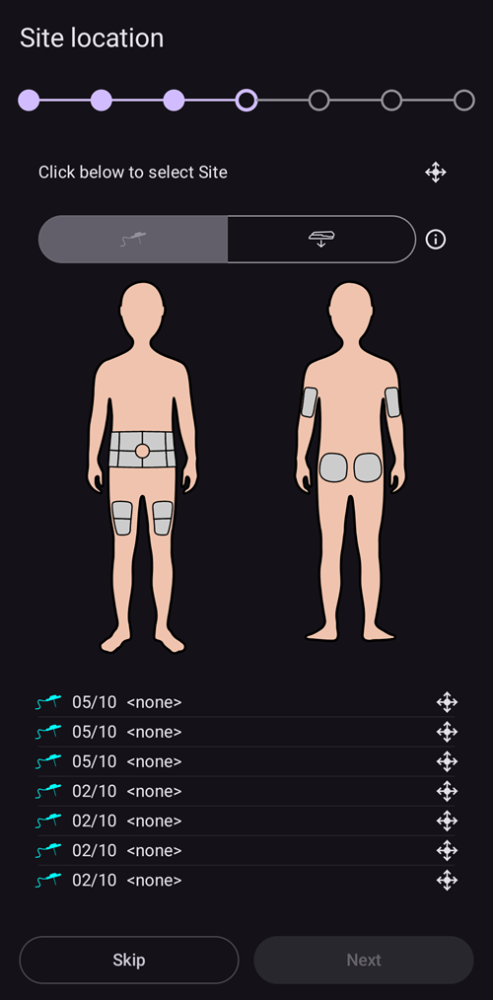
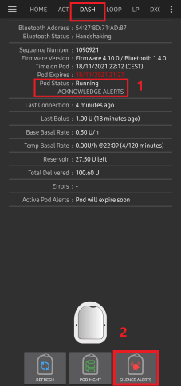

# Omnipod DASH

Te instrukcje dotyczą konfiguracji pompy generacji **Omnipod DASH** **(NIE Omnipod Eros)**. Sterownik DASH to sprawdzony sposób na pętlę z Omnipodem.

```{contents} Table of contents
:depth: 1
:local: true
```

## Specyfikacja Omnipod DASH

Główne cechy **Omnipod DASH** („DASH”):

- Pody DASH rozpoznasz po **niebieskiej osłonce igły** (starszy Pod EROS ma przezroczystą osłonkę igły). Poza tym Pody mają identyczne wymiary fizyczne.
- DASH nie wymaga urządzenia pośredniczącego BLE (mostka) (NIE jest potrzebny RileyLink, OrangeLink ani EmaLink).
- Połączenie Bluetooth z DASH jest używane tylko podczas wysyłania polecenia (np. bolusa) i jest rozłączane zaraz po jego wysłaniu.
- **AAPS** poczeka, aż Pod będzie dostępny, aby wysłać polecenia.
- Podczas aktywacji Poda **AAPS** znajdzie nowy Pod DASH i połączy się z nim.
- Oczekiwany zasięg od telefonu: 5–10 metrów (może się różnić).

(omnipod-dash-constraints)=

## Znane ograniczenia i problemy Omnipod DASH w AAPS
- Ogólnie zalecamy używanie **AAPS** na Androidzie 14 lub 16. Społeczność zgłosiła wiele [problemów](https://github.com/nightscout/AndroidAPS/issues/3471) z Androidem 15. Jeśli jednak używasz Androida 15, prawdopodobnie musisz włączyć **Parowanie Bluetooth** (w części **Ustawienia zaawansowane** w [ustawieniach Dash](#omnipod-dash-advanced-settings)), aby poprawnie aktywować i używać Podów. Więcej o ustawieniach parowania znajdziesz na stronie [Ogólne rozwiązywanie problemów](../GettingHelp/GeneralTroubleshooting.md).
- Zmiany czasu letniego/zimowego i strefy czasowej nie są stosowane automatycznie. Po zmianie zegara musisz ręcznie zaktualizować Poda: naciśnij **Odśwież** na ekranie pompy DASH, a potem naciśnij **Ustaw czas** (widoczne, gdy strefy czasowe Poda i telefonu się różnią) albo wykonaj **Zmianę profilu** (zobacz [Zmiana strefy czasowej dla Omnipod Dash](#timezone-traveling-with-pumps)).
- Dash obsługuje dawkę bazową tylko w krokach co 0,05 U/h. Jeśli spróbujesz ustawić bazę w krokach co 0,01 w swoim **profilu AAPS**, AAPS nie wyświetli ostrzeżenia, choć Pod zaokrągli dawkę w górę do kroku 0,05. Jeśli otworzysz **Historię Poda** na ekranie pompy DASH, zobaczysz, że ustawiono bazę 0,05. Oznacza to także, że najniższa dawka bazowa dozwolona dla DASH w **AAPS** to 0,05 U/h.
- Plik ustawień zawiera aktywną sesję Poda. Eksportuj ustawienia po każdej aktywacji Poda, a przed importem ustawień przeczytaj część [Eksport i import ustawień](#omnipod-dash-export-import).
- Przy ustawianiu nowego profilu bazowego DASH wstrzyma podawanie przed ustawieniem nowego **Profilu** bazowego. Jeśli wystąpi przerwa w komunikacji lub błąd, profil bazowy nie uruchomi się ponownie automatycznie. Szczegóły znajdziesz w części [Wznowienie podawania insuliny](#omnipod-dash-resuming-insulin-delivery).
- Jeśli alarmy są skonfigurowane, a Pod zaraz straci ważność, Pod będzie pikał, dopóki alarmy nie zostaną wyciszone. Szczegóły znajdziesz w części [Wyciszanie alarmów Poda](#omnipod-dash-silencing-pod-alerts).
- Istnieje kilka znanych problemów z Bluetooth, które mogą powodować kłopoty z aktywacją Poda. Znany problem i jego rozwiązania opisuje strona [Rozwiązywanie problemów z Bluetooth](../GettingHelp/BluetoothTroubleshooting.md).

(hardware-software-requirements)=

(omnipod-dash-hardware-software-requirements)=
## Wymagania sprzętowe i programowe

- Omnipod DASH rozpoznasz po niebieskiej osłonce igły.


- **Kompatybilny telefon z Androidem** z Bluetooth Low Energy (BLE) (więcej informacji na stronie [Telefony](../Getting-Started/Phones.md)). Dodatkowo poniższe informacje pomogą Ci uwzględnić inne ważne sprawy, od których zależy udana aktywacja i używanie DASH na kompatybilnym telefonie:
    -  Sterownik Omnipod Dash w **AAPS** łączy się z Podem DASH przez Bluetooth.  
      **AAPS** automatycznie nawiązuje nowe połączenie Bluetooth z Podem za każdym razem, gdy musi wysłać polecenie (np. bolus). Po wysłaniu polecenia połączenie Bluetooth jest od razu rozłączane.
       - **UWAGA:**
         - Połączenie Bluetooth mogą przerywać lub zakłócać inne urządzenia Bluetooth połączone z telefonem, na którym działa **AAPS**, np. słuchawki douszne itp. Takie urządzenia mogą powodować błędy połączenia lub problemy z aktywacją Poda w niektórych modelach telefonów. Przy wyborze telefonu do Omnipod DASH warto przejrzeć listę [przetestowanych zestawów sprzętu](https://docs.google.com/spreadsheets/u/1/d/e/2PACX-1vScCNaIguEZVTVFAgpv1kXHdsHl3fs6xT6RB2Z1CeVJ561AvvqGwxMhlmSHk4J056gMCAQE02sAWJvT/pubhtml?gid=683363241&single=true), aby znaleźć konfiguracje, o których wiadomo, że działają.
         - Istnieje kilka znanych problemów z Bluetooth, które mogą powodować kłopoty z aktywacją Poda (porady dotyczące innych problemów z Bluetooth znajdziesz w części [Rozwiązywanie problemów](#troubleshooting)), szczególnie w części [Problemy związane z Bluetooth](#omnipod-dash-bluetooth-related-issues).
    - Telefon musi mieć **Androida 12 lub nowszego**, a **AAPS** musi być zbudowany i zainstalowany według instrukcji [**Budowanie AAPS**](../SettingUpAaps/BuildingAaps.md). Zawsze używaj najnowszej wydanej wersji.
- Obsługiwany [**system ciągłego monitorowania glukozy (CGM)**](../Getting-Started/CompatiblesCgms.md)

Poniższe instrukcje wyjaśniają, jak aktywować nową sesję Poda za pomocą **AAPS**. Poczekaj, aż obecny Pod będzie bliski końca ważności, ponieważ nowy Pod będziesz musiał aktywować za pomocą **AAPS**. Dezaktywowanego Poda nie można użyć ani aktywować ponownie. Dezaktywacja jest ostateczna.

## Zanim zaczniesz

Upewnij się, że przeczytałeś i rozumiesz cały ten przewodnik, w tym część **Zanim zaczniesz** oraz **[Ograniczenia i problemy Omnipod i AAPS](#omnipod-dash-constraints)**, aby nie natrafić na znany problem.

### **BEZPIECZEŃSTWO PRZEDE WSZYSTKIM** – **NIE POWINIENEŚ** łączyć **AAPS** z Podem po raz pierwszy, jeśli nie masz dostępu do wszystkich poniższych rzeczy:
1. Dodatkowe Pody (3 lub więcej zapasowych)
2. Zapasowa insulina i sprzęt do wstrzyknięć (MDI, penów)
3. Działający PDM Omnipod (na wypadek, gdyby **AAPS** zawiódł)
4. Obsługiwany telefon jest koniecznością! (Zobacz [Wymagania sprzętowe i programowe](#hardware-software-requirements))
5. Zbudowana i zainstalowana właściwa wersja AAPS

### Twój PDM Omnipod Dash przestanie być potrzebny, gdy sterownik Dash w AAPS aktywuje Twojego Poda.
- Zanim zaczniesz używać **AAPS**, Ty lub Twój opiekun musieliście zarządzać Podem za pomocą PDM Omnipod (lub w niektórych regionach aplikacji na telefon), aby wysyłać polecenia do DASH (np. bolus).
- DASH może obsługiwać połączenie tylko z jednym urządzeniem Bluetooth (np. PDM lub telefonem), które nim zarządza i wysyła polecenia.
- Urządzenie, które aktywowało Poda, jest od tej chwili jedynym urządzeniem, które może komunikować się z tym Podem. Oznacza to, że gdy aktywujesz DASH swoim telefonem z Androidem za pomocą **AAPS**, **nie będziesz już mógł używać PDM z tym Podem!** Dopóki ten Pod jest aktywny, sterownik Dash w **AAPS** na Twoim telefonie z Androidem jest nowym PDM dla Twojego Poda.
- **NIE wyrzucaj swojego PDM!** Zalecamy zachować go jako zapas i na sytuacje awaryjne, na przykład gdy zgubisz telefon albo **AAPS** nie działa prawidłowo.

### Twój Pod **NIE PRZESTANIE** podawać insuliny, gdy nie jest połączony z AAPS.
Domyślne dawki bazowe są programowane w Podzie podczas aktywacji zgodnie z obecnie aktywnym [**Profilem**](../SettingUpAaps/YourAapsProfile.md).  
Dopóki **AAPS** działa, wysyła polecenia zmiany dawki bazowej, które trwają maksymalnie 120 minut.  
Jeśli z jakiegoś powodu Pod nie otrzyma żadnych nowych poleceń (na przykład gdy komunikacja zostanie utracona z powodu odległości Pod ➜ telefon), Pod automatycznie wróci do domyślnych dawek bazowych zdefiniowanych w Twoim [**Profilu**](../SettingUpAaps/YourAapsProfile.md).

### Profile AAPS nie obsługują 30-minutowych przedziałów dawek bazowych
Jeśli dopiero zaczynasz z **AAPS** i ustawiasz swój [**Profil**](../SettingUpAaps/YourAapsProfile.md) dawek bazowych po raz pierwszy, pamiętaj, że dawki bazowe zaczynające się o pełnej godzinie i 30 minut (np. 9:30) nie są obsługiwane. Na przykład: jeśli w PDM Omnipod masz dawkę bazową 1,1 jednostki, która zaczyna się o 09:30 i trwa 2 godziny do 11:30, nie da się dokładnie odtworzyć tego **Profilu** bazowego w **AAPS**.  
Musisz zmienić przedział tej dawki bazowej 1,1 jednostki na 9:00–11:00 albo 10:00–12:00. Choć sam sprzęt DASH obsługuje 30-minutowe przedziały dawek bazowych w **Profilu**, **AAPS** NIE obsługuje tej funkcji.

### Dawki bazowe 0 U/h w Profilu NIE są obsługiwane w AAPS
Choć DASH obsługuje zerową dawkę bazową, **AAPS** do ustalania automatycznego leczenia używa wielokrotności dawki bazowej z **Profilu** użytkownika, więc nie może działać z zerową dawką bazową.  
Zamiast tego tymczasową zerową dawkę bazową możesz uzyskać funkcją „Odłącz pompę” albo łącząc Wyłącz pętlę/Tymczasowa dawka bazowa lub Wstrzymaj pętlę/Tymczasowa dawka bazowa.  
**UWAGA:** Najniższa dawka bazowa dozwolona dla DASH w **AAPS** to 0,05 U/h.

## Wybór Dash w AAPS

Są **dwa** sposoby wyboru sterownika Omnipod DASH w **AAPS**:

### Opcja 1: Nowe instalacje

Gdy instalujesz **AAPS** po raz pierwszy, **Kreator konfiguracji** przeprowadzi Cię przez najważniejsze funkcje i wymagania instalacji **AAPS**. Gdy dojdziesz do kroku **Pompa**, wybierz **Omnipod Dash**.


Jeśli jeszcze nie jesteś pewien, możesz na razie wybrać **Pompa wirtualna**, a **Omnipod Dash** wybrać później, po skonfigurowaniu **AAPS** (zobacz Opcja 2).

(omnipod-dash-option-2-config-builder)=
### Opcja 2: Ekran Konfiguracja

W istniejącej instalacji możesz wybrać pompę **Omnipod Dash** na ekranie **Konfiguracja**:

1. Otwórz **menu** (☰) w lewym górnym rogu ekranu głównego i wybierz **Konfiguracja**.
2. Dotknij **Pompa** i zaznacz przycisk opcji **Omnipod Dash** (*„Integracja dla pompy Omnipod Dash (nowy, posiadający Bluetooth model z niebieską osłonką na igłę).”*).

3. Po wybraniu na karcie **Omnipod Dash** widać dwa przyciski:
   - **Ustawienia** otwiera [ustawienia Dash](#omnipod-dash-settings).
   - **Otwórz wtyczkę** otwiera [ekran pompy DASH](#omnipod-dash-tab).

   

### Sprawdzenie wyboru sterownika Omnipod

Aby sprawdzić, czy wybrano **Omnipod Dash**, otwórz **Zarządzaj** (dolny pasek nawigacji na ekranie głównym) i dotknij **Pompa**. Otworzy się ekran pompy DASH, pokazany w następnej części.

(omnipod-dash-tab)=

## Ekran pompy DASH

Na ekranie pompy DASH zarządzasz swoimi Podami: aktywujesz je i dezaktywujesz, odświeżasz status Poda, wyciszasz alarmy i przeglądasz historię Poda. Otwórz go przez **Zarządzaj** > **Pompa** albo przyciskiem **Otwórz wtyczkę** na karcie **Omnipod Dash** w **Konfiguracja** > **Pompa**.

Tak wygląda ekran bez aktywnego Poda:


A tak wygląda ekran z aktywnym Podem:


Ikona **Ustawienia** (koło zębate) w prawym górnym rogu otwiera [ustawienia Dash](#omnipod-dash-settings).

***UWAGA:** Jeśli pole na ekranie pompy pokazuje (niepewne), naciśnij **Odśwież**, aby zaktualizować status Poda.*

### Pola

- **Adres Bluetooth:** Adres Bluetooth Poda.

- **Jakość połączenia:** Jak niezawodnie **AAPS** łączy się z Podem, pokazane jako *udane połączenia / wszystkie próby połączenia :: odsetek udanych*, na przykład `412/420 :: 98.10 %`. Po ponad 50 udanych połączeniach wartość zmienia kolor na żółty poniżej 90% i na czerwony poniżej 70%. Niska wartość wskazuje na problem z Bluetooth (zobacz [Problemy związane z Bluetooth](#omnipod-dash-bluetooth-related-issues)).

- **Status podania:** Surowy status podawania zgłaszany przez Poda. To pole jest widoczne tylko w wersjach w trybie inżynierskim.

- **Unikalny ID:** Unikalny identyfikator, który **AAPS** nadał Podowi podczas aktywacji.

- **Numer LOT:** Numer partii produkcyjnej Poda.

- **Numer sekwencji:** Numer sekwencyjny Poda.

- **Wersja oprogramowania:** Wersje oprogramowania (firmware) i Bluetooth Poda.

- **Czas na Podzie:** Obecny czas w Podzie wraz z jego strefą czasową. Tekst zmienia kolor na czerwony, gdy strefa czasowa Poda różni się od strefy czasowej telefonu, a na żółty, gdy czas Poda różni się o więcej niż 10 minut.

- **Pod traci ważność:** Data i godzina, kiedy Pod traci ważność (72 godziny po aktywacji). Tekst zmienia kolor na żółty w ostatnich 4 godzinach przed tym czasem. Nigdy nie zmienia koloru na czerwony, ponieważ Pod nadal podaje insulinę po tym czasie.

- **Twardy koniec Poda:** Koniec okresu dodatkowego Poda (8 godzin po **Pod traci ważność**, czyli maksymalny czas pracy Poda to 80 godzin). Tekst zmienia kolor na żółty, gdy zaczyna się okres dodatkowy (w chwili **Pod traci ważność**), a na czerwony w ostatnich 4 godzinach przed twardym końcem. W okresie dodatkowym pokazuje też pozostały czas, na przykład *(17m remaining)*. W chwili twardego końca Pod przestaje podawać insulinę i musi zostać wymieniony.

- **Status Poda:** Stan Poda: **Brak akt. Poda**, **Konfiguracja w toku**, **W działaniu**, **Wstrzymany** albo, po błędzie Poda, **ALARM**.

- **Ostatnie połączenie:** Ile czasu minęło od ostatniej komunikacji **AAPS** z Podem.

  - *Moment temu* – mniej niż 10 sekund temu.

  - *Mniej niż minutę temu* – od 10 do 60 sekund temu.

  - *XX minut temu* – ponad 1 minutę temu (a po godzinie *X godzin i XX minut temu*).

- **Ostatni bolus:** Ilość ostatniego bolusa wysłanego do Poda i ile czasu minęło od jego podania. Niepotwierdzony bolus jest oznaczony jako (niepewne).

- **Podstawowa dawka bazowa:** Dawka bazowa zaprogramowana na obecną godzinę w Twoim **Profilu** bazowym.

- **Tymczasowa dawka bazowa:** Tymczasowa dawka bazowa (TBR), która właśnie działa, z czasem rozpoczęcia i czasem trwania. To pole jest widoczne tylko wtedy, gdy działa TBR.

- **Zbiornik:** Pokazuje *Over 50 U left* (ponad 50 U), gdy w zbiorniku zostało więcej niż 50 jednostek. Poniżej 50 jednostek pokazywana jest dokładna ilość. Wartość zmienia kolor na czerwony poniżej 20 jednostek.

- **Łącznie dostarczono:** Łączna ilość insuliny podanej ze zbiornika. Obejmuje to insulinę zużytą na napełnianie.

- **Aktywne alarmy Poda:** Alarmy, które są właśnie aktywne w Podzie, na przykład *Pod wkrótce straci ważność* albo *Niski poziom w zbiorniku*.

- **Błędy:** Błąd Poda, jeśli Pod uległ awarii, pokazany na czerwono jako *Błąd Poda:*, po którym następuje kod i nazwa błędu, na przykład *Błąd Poda: 020 ALARM_OCCLUDED*. Wcześniejsze błędy i bardziej szczegółowe informacje znajdziesz w [Historii Poda](#omnipod-dash-view-pod-history) i w plikach logów. Zobacz [Awarie Poda](#omnipod-dash-pod-failures).

- **Powiadomienie PDM:** Widoczne tylko po błędzie Poda. Pokazuje błąd tak, jak pokazałby go PDM Omnipod: tytuł (na przykład *Wykryto zatkanie*, *Pusty zbiornik* albo *Pod wygasł*), opis tego, co się stało (na przykład *Podawanie insuliny zostało zatrzymane. Zmień Poda teraz.*) i kod *Nr ref.:*.

### Przyciski

Przyciski na dole ekranu pompy zmieniają się zależnie od stanu Poda. Widoczne są tylko przyciski, które mają sens w danej chwili.

- **Odśwież:** Pobiera z Poda jego obecny status.
  - *Używaj go, aby zaktualizować status Poda i wyczyścić pola, które pokazują (niepewne).*
  - *Więcej informacji znajdziesz poniżej w części [Rozwiązywanie problemów](#omnipod-dash-troubleshooting).*

- **Wycisz alarmy:** Zatrzymuje sygnały dźwiękowe alarmów Poda (na przykład o końcu ważności Poda lub niskim poziomie w zbiorniku). Widoczny tylko wtedy, gdy Pod ma aktywny alarm. Zobacz [Wyciszanie alarmów Poda](#omnipod-dash-silencing-pod-alerts).

- **Wznów podawanie:** Wznawia podawanie insuliny we wstrzymanym Podzie. Widoczny tylko wtedy, gdy podawanie jest wstrzymane. Zobacz [Wznowienie podawania insuliny](#omnipod-dash-resuming-insulin-delivery).

- **Ustaw czas:** Ustawia w Podzie strefę czasową Twojego telefonu, wysyłając ponownie Twój **Profil** bazowy. Widoczny tylko wtedy, gdy strefa czasowa Poda różni się od strefy czasowej telefonu.

- [**Aktywuj Poda**](#omnipod-dash-activate-pod): Napełnia i aktywuje nowy Pod. Widoczny, gdy żaden Pod nie jest aktywny.

- [**Odłącz Poda**](#omnipod-dash-deactivate-pod): Dezaktywuje aktywny Pod. Widoczny, gdy tylko Pod zostanie sparowany z **AAPS**, także wtedy, gdy aktywacja zatrzymała się w połowie (na przykład dlatego, że Pod uległ awarii podczas aktywacji). **AAPS** prosi o potwierdzenie, zanim dezaktywuje Poda.

- **Odtwarzaj test dźwięku:** Pod odtwarza jeden testowy sygnał dźwiękowy.

- [**Historia Poda**](#omnipod-dash-view-pod-history): Pokazuje historię działań aktywnego Poda.

- **Usuń Poda:** Usuwa niedokończony Pod z **AAPS**. Widoczny tylko wtedy, gdy aktywacja Poda zatrzymała się w połowie. **AAPS** prosi o potwierdzenie. Po usunięciu **AAPS** nie może już komunikować się z tym Podem: zdejmij go z ciała.


```{admonition} Older screenshot
:class: note
Zrzut ekranu powyżej pochodzi z wcześniejszej wersji **AAPS**, która miała osobne menu **Pod Management** (zarządzanie Podem). W **AAPS** 4 wszystkie te działania, w tym **Aktywuj Poda**, **Odłącz Poda**, **Odtwarzaj test dźwięku** i **Historia Poda**, są przyciskami z opisami bezpośrednio na ekranie pompy.
```

(omnipod-dash-activate-pod)=

## Aktywuj Poda

1. Otwórz ekran pompy DASH (**Zarządzaj** > **Pompa**) i naciśnij **Aktywuj Poda**. Otworzy się kreator aktywacji.

   

   ```{admonition} Older screenshot
   :class: note
   Zrzut ekranu powyżej pochodzi z wcześniejszej wersji **AAPS**. W **AAPS** 4 **Aktywuj Poda** to przycisk bezpośrednio na ekranie pompy DASH, a nie w menu **Pod Management**.
   ```

   Jeśli nigdy wcześniej nie aktywowałeś **Profilu** w **AAPS**, kreator najpierw pokaże krok **Wymagany profil**: wybierz profil, który ma zostać użyty przy aktywacji, i kontynuuj.

2. Pojawi się krok **Wypełnij Poda**. Napełnij nowy Pod ilością insuliny wystarczającą na 3 dni, **co najmniej 80 jednostkami**. Poczekaj na dwa sygnały dźwiękowe z Poda: oznaczają, że wlano minimalną ilość 80 jednostek. Opróżnij strzykawkę do napełniania do końca, nawet po usłyszeniu dwóch sygnałów. Nie zdejmuj jeszcze osłonki igły Poda.

   ***UWAGA:** Obliczając ilość insuliny potrzebną na 3 dni, pamiętaj, że napełnianie Poda zużywa około 3–10 jednostek.*

   

   

   Upewnij się, że nowy Pod i telefon z **AAPS** są blisko siebie, i naciśnij **Dalej**.

3. Jeśli używasz w **AAPS** więcej niż jednej insuliny, pojawi się krok **Wybierz insulinę**. Pokazuje insulinę **Aktualnie aktywna**. Jeśli napełniłeś Poda inną insuliną, naciśnij **Zmień** i ją wybierz. Po zakończeniu aktywacji **AAPS** wykona **Zmianę profilu** z tą insuliną. Naciśnij **Dalej**.

   

4. W kroku **Zainicjalizuj Poda** **AAPS** paruje się z nowym Podem i go napełnia. Usłyszysz kliknięcie, a potem serię tyknięć, gdy Pod sam się napełnia. Gdy to się uda, pojawi się przycisk **Dalej**. Naciśnij **Dalej**.

       

   ***UWAGA**: Jeśli pojawi się komunikat o błędzie, np. _Skanowanie nie powiodło się_ albo _'Could not find an available pod for activation'_ (nie znaleziono dostępnego Poda do aktywacji) (może się to zdarzyć), nie panikuj. Naciśnij **Ponów**. W większości przypadków aktywacja będzie wtedy kontynuowana bez problemu.*

   

   Jeśli Pod uległ awarii (na przykład dlatego, że przekroczono czas jego aktywacji), zamiast **Ponów** pojawi się **Odłącz Poda**. Użyj go i zacznij od nowa z nowym Podem.

   Jeśli naciśniesz **Anuluj** przed zakończeniem aktywacji, **AAPS** poprosi o potwierdzenie, że chcesz wyjść. Naciśnij **OK**, aby opuścić kreator, albo **Anuluj**, aby w nim zostać.

   

5. Jeśli zarządzasz zmianą miejsca wkłucia pompy w **AAPS** (**Zarządzaj zmianą miejsca wkłucia pompy** w ustawieniach [Zmiana miejsca](#Aapsscreens-site-rotation)), pojawi się krok **Miejsce wkłucia**. Wybierz na schemacie ciała, gdzie umieścisz Poda, i naciśnij **Dalej** albo naciśnij **Pomiń**.

   

6. Następnie przygotuj miejsce wkłucia dla nowego Poda. Umyj ręce, aby uniknąć ryzyka zakażenia. Oczyść miejsce wkłucia wodą z mydłem lub gazikiem nasączonym alkoholem i przed kontynuacją poczekaj, aż skóra całkowicie wyschnie na powietrzu. Jeśli plaster podrażnia Twoją skórę, rozważ użycie chusteczki lub sprayu ochronnego (barierowego).

   W kroku **Zamocuj Poda** zdejmij z Poda niebieską plastikową osłonkę igły. Jeśli kaniula lub coś innego wystaje z Poda albo Pod wygląda nietypowo, **ZATRZYMAJ SIĘ**: naciśnij **Anuluj** i zacznij od nowa z nowym Podem. Jeśli wszystko wygląda **OK**, zdejmij biały papier z plastra i przyklej Poda w wybranym miejscu na ciele.

   Gdy skończysz, naciśnij **Dalej**.

   

7. Pojawi się okno potwierdzenia: *Po naciśnięciu OK zostanie wprowadzone wkłucie.* **Naciśnij OK TYLKO wtedy, gdy jesteś gotowy na wprowadzenie kaniuli!**

   

8. W kroku **Załóż wkłucie** **AAPS** ustawia Twój harmonogram dawek bazowych, a Pod wprowadza kaniulę. Może to chwilę potrwać (maksymalnie 1–2 minuty). **Bądź cierpliwy!**

   ***UWAGA:** Dobrą praktyką jest uszczypnięcie skóry w pobliżu miejsca wprowadzenia kaniuli przed jej wprowadzeniem. Pomaga to igle wejść gładko i zmniejsza ryzyko zatkania (niedrożności).*

       

9. Gdy kaniula zostanie prawidłowo wprowadzona, pojawi się przycisk **Dalej**. Naciśnij **Dalej**.

   

10. Pojawi się krok **Pod aktywowany**. Sprawdź, czy kaniula została wprowadzona prawidłowo, i wymień Poda, jeśli uważasz, że nie.

    Naciśnij **Zakończ**.

    Gratulacje! Rozpocząłeś nową sesję Poda.

    

11. Wrócisz na ekran pompy DASH. Teraz pokazuje on informacje o Twoim aktywnym Podzie, w tym obecną dawkę bazową, poziom w zbiorniku, podaną insulinę, błędy i alarmy Poda. **Aktywuj Poda** zostaje zastąpione przez **Odłącz Poda**: nie możesz aktywować kolejnego Poda, zanim nie dezaktywujesz aktywnego.

    ***UWAGA:** Więcej szczegółów o pokazywanych informacjach znajdziesz w części [Ekran pompy DASH](#omnipod-dash-tab).*

    

    ***UWAGA:** Dobrą praktyką jest eksport ustawień PO aktywacji Poda. Eksportuj ustawienia po każdej wymianie Poda i raz w miesiącu. Skopiuj plik z wyeksportowanymi ustawieniami do chmury (na przykład na Dysk Google) albo w inne miejsce poza telefonem, na wypadek jego utraty (zobacz [**Tworzenie i przywracanie kopii zapasowych**](../Maintenance/ExportImportSettings.md)).*

Jeśli wcześniejsza aktywacja zatrzymała się po napełnieniu Poda, naciśnięcie **Aktywuj Poda** kontynuuje od kroku **Zamocuj Poda**.

(omnipod-dash-deactivate-pod)=

## Odłącz Poda

W normalnych warunkach Pod działa trzy dni (72 godziny) plus okres dodatkowy 8 godzin po ostrzeżeniu o końcu ważności Poda: razem 80 godzin.

Aby dezaktywować Poda (bo stracił ważność albo uległ awarii):

1. Otwórz ekran pompy DASH (**Zarządzaj** > **Pompa**) i naciśnij **Odłącz Poda**.

   

2. W kroku **Odłącz Poda** naciśnij **Dalej**. Okno pyta: *Zdeaktywowanego poda nie można użyć ponownie. Czy na pewno chcesz teraz dezaktywować tego poda?* Naciśnij **OK**, aby rozpocząć dezaktywację Poda, albo **Anuluj**, aby go zachować. Dezaktywacja wstrzymuje całe podawanie insuliny i nie można jej cofnąć.

   

3. Krok **Deaktywuję Poda** jest widoczny, gdy **AAPS** dezaktywuje Poda. Pod wyda sygnał dźwiękowy, aby potwierdzić udaną dezaktywację.

   

   ```{admonition} Older screenshot
   :class: note
   Zrzut ekranu powyżej pochodzi z wcześniejszej wersji **AAPS**. W **AAPS** 4 kreator pokazuje postęp jako rząd kropek u góry zamiast paska postępu.
   ```

   Gdy dezaktywacja się uda, pojawi się przycisk **Dalej**. Naciśnij **Dalej**.

   

   Jeśli dezaktywacja się nie uda, pojawi się komunikat o błędzie i przycisk **Usuń Poda**. Zanim go użyjesz, przeczytaj poniżej część [Usuwanie Poda](#omnipod-dash-discard-pod). Możesz też nacisnąć **Anuluj** i spróbować **Odłącz Poda** ponownie później.

4. Pojawi się krok **Pod dezaktywowany**. Zdejmij Poda z ciała i naciśnij **Zakończ**.

   

5. Wrócisz na ekran pompy DASH. Sprawdź, czy pole **Status Poda** pokazuje **Brak akt. Poda** i czy przycisk **Aktywuj Poda** jest znów widoczny.

   

(omnipod-dash-discard-pod)=

### Usuwanie Poda

Usuwaj Poda tylko wtedy, gdy cała komunikacja z nim stale zawodzi. Jeśli **AAPS** nadal może komunikować się z Podem, użyj zamiast tego **Odłącz Poda**.

- **AAPS** prosi o potwierdzenie, zanim usunie Poda.
- Potem **AAPS** nie może już komunikować się z tym Podem.
- **Podawanie insuliny NIE zostało wstrzymane**, ponieważ Pod nie został prawidłowo dezaktywowany. **Zdejmij Poda z ciała!**
- Krok **Pod usunięty** potwierdza, że stan Poda został usunięty. Naciśnij **Zakończ**. Teraz możesz aktywować nowy Pod.

(omnipod-dash-resuming-insulin-delivery)=

## Wznowienie podawania insuliny

**UWAGA**: Podczas **Zmian Profilu**, tak jak przy używaniu PDM, **AAPS** musi wstrzymać podawanie w Podzie przed ustawieniem nowego **Profilu** bazowego. Jeśli komunikacja zawiedzie między poleceniami wstrzymania i wznowienia, podawanie może pozostać wstrzymane. Więcej szczegółów znajdziesz w części [**Podawanie wstrzymane**](#omnipod-dash-delivery-suspended) w rozwiązywaniu problemów.

Gdy podawanie insuliny jest wstrzymane, musisz polecić Podowi wznowienie podawania insuliny. Gdy polecenie zostanie wykonane, Pod znów podaje insulinę według dawki bazowej na obecną godzinę z Twojego aktywnego **Profilu** bazowego. Pod znów przyjmuje polecenia bolusa, **TBR** i **SMB**.

1. Otwórz ekran pompy DASH i sprawdź, czy pole **Status Poda** pokazuje **Wstrzymany**. Naciśnij **Wznów podawanie**, aby polecić Podowi wznowienie normalnego podawania insuliny.

   

2. Gdy polecenie się uda, pole **Status Poda** pokaże **W działaniu**, a przycisk **Wznów podawanie** zniknie.

   

   

   ```{admonition} Older screenshot
   :class: note
   Zrzuty ekranu powyżej pochodzą z wcześniejszej wersji **AAPS**, która pokazywała okno potwierdzenia. W **AAPS** 4 wynik potwierdzasz na ekranie pompy DASH: pole **Status Poda** pokazuje **W działaniu**, a przycisku **Wznów podawanie** już nie ma.
   ```

   Jeśli polecenie się nie uda, **AAPS** pokaże okno ostrzeżenia zaczynające się od *Nie udało się wznowić podawania*. Naciśnij **Odśwież** i spróbuj ponownie.

   

(omnipod-dash-silencing-pod-alerts)=

## Wyciszanie alarmów Poda

Ta część wyjaśnia, jak zatrzymać sygnały dźwiękowe Poda, gdy Pod zbliża się do końca swojej pracy. Kiedy te sygnały się zaczną, zależy od ustawień **Alerty** (zobacz [Ustawienia Dash](#omnipod-dash-settings)):

- **Przypomnienie: godziny przed upływem ważności (72 godz.):** ile godzin przed upływem 72 godzin ważności Pod zaczyna pikać.
- **Alarm: godziny przed wyłączeniem Poda (80 godz.):** ile godzin przed wyłączeniem po 80 godzinach Pod znów zapika.

Maksymalny czas pracy Poda to 80 godzin (3 dni i 8 godzin). Producent Poda zaleca jednak nie przekraczać 72 godzin (3 dni).

***UWAGA**: Przycisk **Wycisz alarmy** jest widoczny na ekranie pompy DASH tylko wtedy, gdy Pod ma aktywny alarm, na przykład o końcu ważności Poda lub niskim poziomie w zbiorniku. Jeśli przycisk **Wycisz alarmy** nie jest widoczny, a słyszysz pikanie Poda, naciśnij **Odśwież**.*

1. Gdy nadejdzie czas przypomnienia, Pod zapika, aby poinformować Cię, że wkrótce straci ważność i musisz go wymienić. Na ekranie pompy DASH pole **Pod traci ważność (1)** pokazuje dokładny czas, kiedy Pod straci ważność (72 godziny po aktywacji). Tekst zmienia kolor na żółty 4 godziny przed tym czasem. Po tym czasie pole **Twardy koniec Poda** zmienia kolor na żółty i pokazuje czas pozostały do chwili, gdy Pod przestanie podawać insulinę. Pole **Aktywne alarmy Poda (2)** pokazuje **Pod wkrótce straci ważność** i pojawia się przycisk **Wycisz alarmy (3)**.

   

2. Naciśnij **Wycisz alarmy**. **AAPS** wyśle do Poda polecenie zatrzymania sygnałów o końcu ważności.

   

   ```{admonition} Older screenshot
   :class: note
   Zrzut ekranu powyżej pochodzi z wcześniejszej wersji **AAPS**, w której ten ekran był zakładką **DASH**. W **AAPS** 4 przycisk **Wycisz alarmy** jest na ekranie pompy DASH (**Zarządzaj** > **Pompa**).
   ```

3. Gdy alarmy zostaną wyciszone, alarm znika z pola **Aktywne alarmy Poda**, przycisk **Wycisz alarmy** znika, a Pod przestaje pikać z powodu końca ważności.

   

   ```{admonition} Older screenshot
   :class: note
   Zrzut ekranu powyżej pochodzi z wcześniejszej wersji **AAPS**, która pokazywała okno potwierdzenia. W **AAPS** 4 wynik potwierdzasz na ekranie pompy DASH: alarm znika z pola **Aktywne alarmy Poda**.
   ```

   Jeśli polecenie się nie uda, **AAPS** pokaże okno ostrzeżenia zaczynające się od *Nie udało się wyciszyć alertów*. Naciśnij **Odśwież** i spróbuj ponownie.

Alarm niskiego poziomu w zbiorniku działa tak samo. Gdy ilość insuliny w Podzie spadnie do wartości **Liczba jednostek** ustawionej w ustawieniach **Alerty**, Pod zapika. Pole **Zbiornik** pokazuje pozostałą ilość, pole **Aktywne alarmy Poda** pokazuje **Niski poziom w zbiorniku** i pojawia się przycisk **Wycisz alarmy**. Naciśnij **Wycisz alarmy**, aby zatrzymać pikanie, i zaplanuj następną wymianę Poda.


(omnipod-dash-view-pod-history)=

## Wyświetlanie historii Poda

Ta część wyjaśnia, jak przeglądać historię aktywnego Poda i filtrować ją według rodzaju działania. Historia Poda pokazuje polecenia wysłane do Twojego aktywnego Poda i ich wyniki w czasie jego trzydniowej pracy (72–80 godzin).

Przydaje się do sprawdzenia bolusów, TBR i poleceń bazy wysłanych do Poda. Pozostałe kategorie pomagają w rozwiązywaniu problemów i pokazują kolejność zdarzeń, które doprowadziły do awarii.

**NOTE:** **Only the last command can be uncertain**. New commands *are not sent* until the **last 'uncertain' command becomes 'confirmed' or 'denied'**. To 'fix' an uncertain command, press **Refresh** on the DASH pump screen.

1. Otwórz ekran pompy DASH i naciśnij **Historia Poda**.

   

   ```{admonition} Older screenshot
   :class: note
   Zrzut ekranu powyżej pochodzi z wcześniejszej wersji **AAPS**. W **AAPS** 4 **Historia Poda** to przycisk bezpośrednio na ekranie pompy DASH, a nie w menu **Pod Management**.
   ```

2. Otworzy się ekran **Historia Poda** z wybranym filtrem **Wszystkie**. Lista pokazuje każde polecenie z jego czasem i wynikiem, od najnowszych, pogrupowane według dni. Użyj przycisków filtrów u góry (na przykład **Bolusy** lub **Dawki Bazowe**), aby pokazać tylko jeden rodzaj poleceń. Naciśnij strzałkę wstecz, aby wrócić na ekran pompy DASH.

    

   ```{admonition} Older screenshot
   :class: note
   Drugi zrzut ekranu powyżej pochodzi z wcześniejszej wersji **AAPS**, w której rodzaj polecenia wybierało się z listy **Type** (typ). W **AAPS** 4 używasz przycisków filtrów pokazanych na pierwszym zrzucie ekranu.
   ```

   Przy bolusach po ilości podany jest rodzaj bolusa, jeśli nie jest to zwykły bolus, na przykład *0.05 U (SMB)* albo *0.05 U (Korekta bazowa)*. Korekta bazowa to bardzo mały bolus (jeden impuls Poda, 0,05 U), który sterownik wysyła sam; nie zlecałeś go.

   ```{admonition} Why basal corrections happen
   :class: note
   Pod podaje insulinę bazową w impulsach po 0,05 U, odmierzanych przez wewnętrzny zegar. Za każdym razem, gdy zmienia się dawka bazowa (na przykład gdy pętla ustawia nową **TBR**), Pod uruchamia ten zegar od nowa, a impuls, do którego odliczał, przepada. Ponieważ pętla często zmienia dawkę bazową, zwłaszcza w nocy, Pod może w efekcie podać mniej insuliny bazowej, niż oczekiwano.

   **AAPS** porównuje insulinę bazową, którą Pod zgłasza jako podaną, z tym, co powinien był podać. Gdy brakuje pół impulsu lub więcej, sterownik podaje jeden dodatkowy impuls jako korektę bazową, więc nadal dostajesz insulinę bazową, której wymagały Twój profil i pętla. Korekta nie jest wysyłana, gdy Pod jest wstrzymany ani gdy działa zerowa **TBR**.
   ```

(omnipod-dash-settings)=

## Ustawienia Dash

Ustawienia sterownika Dash można otworzyć na dwa sposoby:

- Naciśnij ikonę **Ustawienia** (koło zębate) w prawym górnym rogu [ekranu pompy DASH](#omnipod-dash-tab).
- Otwórz **menu** (☰) w lewym górnym rogu ekranu głównego i wybierz **Konfiguracja** > **Pompa**. Na karcie **Omnipod Dash** naciśnij **Ustawienia**.

Ustawienia są pogrupowane w cztery rozwijane części: **Dźwięki potwierdzenia**, **Alerty**, **Powiadomienia** i **Ustawienia zaawansowane**. Dotknij części, aby ją otworzyć:


Większość ustawień to przełączniki wł./wył.

### Dźwięki potwierdzenia


Dźwięki potwierdzenia z Poda przy podaniu i zmianach bolusa, bazy, SMB i TBR.

**Sygnał dźwiękowy bolusa włączony:**    Pod pika, gdy bolus zostanie podany. Domyślnie włączone.

**Sygnał dźwiękowy bazy włączony:**    Pod pika, gdy zostanie ustawiona nowa dawka bazowa albo gdy aktywna dawka bazowa zostanie anulowana lub zmieniona. Domyślnie wyłączone.

**Sygnał dźwiękowy SMB włączony:**  Pod pika, gdy SMB zostanie podany. Domyślnie włączone.

**Sygnał dźwiękowy TBR (tymczasowej dawki bazowej) włączony:**  Pod pika, gdy TBR zostanie ustawiona lub anulowana. Domyślnie wyłączone.

### Alerty


```{admonition} Older screenshot
:class: note
Zrzut ekranu powyżej pochodzi z wcześniejszej wersji **AAPS**. W **AAPS** 4 te ustawienia są w rozwijanej części **Alerty**.
```

Alarmy Poda o końcu ważności, wyłączeniu i niskim poziomie w zbiorniku. Gdy zmienisz te ustawienia przy aktywnym Podzie, **AAPS** wyśle nowe ustawienia alarmów do Poda.

***UWAGA:** Powiadomienie **AAPS** jest ZAWSZE wyświetlane dla każdego alarmu, gdy tylko **AAPS** skomunikuje się z Podem po wystąpieniu alarmu. Zamknięcie powiadomienia NIE zatrzymuje alarmu Poda. Aby zatrzymać alarm, otwórz ekran pompy DASH i naciśnij **Wycisz alarmy**.*

**Przypomnienie o utracie ważności włączone:**    Gdy to jest włączone, Pod pika, gdy nadejdzie czas przypomnienia. Domyślnie włączone.

**Przypomnienie: godziny przed upływem ważności (72 godz.):** Ile godzin przed upływem 72 godzin ważności Poda zaczyna się przypomnienie (od 1 do 24 godzin; domyślnie 4).

**Alarm upływu terminu ważności włączony:**   Gdy to jest włączone, Pod pika, gdy nadejdzie czas alarmu, i ponownie 1 godzinę przed wyłączeniem. Domyślnie włączone.

**Alarm: godziny przed wyłączeniem Poda (80 godz.):**  Ile godzin przed wyłączeniem Poda po 80 godzinach zaczyna się alarm (od 1 do 8 godzin; domyślnie 8).

**Włączony alert o niskim poziomie w zbiorniczku:**    Pod ostrzega Cię, gdy ilość insuliny w zbiorniku spadnie do wartości w **Liczba jednostek**. Domyślnie włączone.

**Liczba jednostek:**    Liczba jednostek, przy której włącza się alarm niskiego poziomu w zbiorniku (od 5 do 50 jednostek; domyślnie 20).

### Powiadomienia


Wybierz, czy **AAPS** ma odtwarzać dźwięk z powiadomieniami, gdy nie ma pewności, czy TBR, SMB lub bolus zostały podane, oraz gdy podawanie jest wstrzymane.

***UWAGA:** To są tylko powiadomienia w telefonie; sam Pod nie pika.*

**Dźwięk dla powiadomień o niepewnych TBR włączony:**  Odtwarza dźwięk z powiadomieniem, gdy **AAPS** nie ma pewności, czy TBR została ustawiona.

**Dźwięk dla niepewnych powiadomień SMB włączony:**  Odtwarza dźwięk z powiadomieniem, gdy **AAPS** nie ma pewności, czy SMB został podany.

**Dźwięk dla powiadomień o niepewnych bolusach włączony:**    Odtwarza dźwięk z powiadomieniem, gdy **AAPS** nie ma pewności, czy bolus został podany.

**Dźwięk przy powiadomieniu o zawieszeniu podawania:**     Odtwarza dźwięk z powiadomieniem, gdy podawanie insuliny jest wstrzymane.

(omnipod-dash-advanced-settings)=

### Ustawienia zaawansowane


**Parowanie Bluetooth:**  Paruje (bonding) Poda z telefonem przez Bluetooth. Używaj tego tylko wtedy, gdy Pod nie może utrzymać stabilnego połączenia, na przykład na Androidzie 15 (zobacz [Znane ograniczenia i problemy Omnipod DASH w AAPS](#omnipod-dash-constraints)). Gdy to jest włączone, telefon wyświetla prośby o parowanie, które musisz zaakceptować. Pozostaw wyłączone, jeśli Pod łączy się poprawnie. Nie ma wpływu na działanie poniżej Androida 15. Domyślnie wyłączone.

## Wiek insuliny i kaniuli

[Wiersz stanu](#screens-sensor-level-battery) na ekranie głównym pokazuje wiek Twojej insuliny i kaniuli. Przy Omnipodzie działa to trochę inaczej niż przy pompach z drenem.

**AAPS** automatycznie zapisuje wymianę kaniuli i wymianę insuliny przy każdej aktywacji Poda. Dzięki temu wiek **Insulina** i **Kaniula** jest zerowany po każdej wymianie Poda. Nie musisz zapisywać tych zmian samodzielnie za pomocą **Napełnij/Wypełnij**. Dzieje się tak, ponieważ Pod wprowadza kaniulę bezpośrednio do skóry w miejscu, w którym jest przyklejony: Omnipod nie używa drenu.

Wiek **Bateria pompy** nie jest pokazywany: bateria i zbiornik insuliny są wbudowane w każdy Pod, a bateria zawsze działa dłużej niż sam Pod (maksymalnie 80 godzin).


```{admonition} Older screenshot
:class: note
Zrzut ekranu powyżej pochodzi z wcześniejszej wersji **AAPS**, w której ten wiek był pokazywany w części **Portal opieki** zakładki **Akcje**. W **AAPS** 4 jest on pokazywany w wierszu stanu na ekranie głównym.
```

### Poziom

**Poziom insuliny**

Pokazany poziom insuliny to ilość zgłaszana przez Poda. Pod zgłasza jednak rzeczywisty poziom w zbiorniku dopiero wtedy, gdy spadnie on poniżej 50 jednostek. Do tego czasu pokazywane jest *Over 50 U left* (ponad 50 U). Zgłaszana ilość nie jest dokładna: gdy Pod zgłasza „pusty”, w większości przypadków w zbiorniku zostaje jeszcze kilka jednostek insuliny.

Ekran pompy DASH pokazuje poziom tak:

  * **Over 50 U left** (ponad 50 U) – Pod zgłasza więcej niż 50 jednostek w zbiorniku.
  * **Poniżej 50 jednostek** – Dokładna ilość insuliny pozostała w zbiorniku, zgłaszana przez Poda.

Dodatkowa uwaga:
  * **SMS** – W odpowiedziach SMS zwraca wartość albo 50+U, gdy jest ponad 50 jednostek.
  * **Nightscout** – Wysyła do Nightscout wartość 50, gdy jest ponad 50 jednostek (wersja 14.07 i starsze). Nowsze wersje zgłaszają wartość 50+, gdy jest ponad 50 jednostek.

(omnipod-dash-troubleshooting)=

## Rozwiązywanie problemów

Ta część opisuje często spotykane problemy i ich rozwiązania przy używaniu Omnipod DASH z AAPS. W dokumentacji jest też część [Ogólne rozwiązywanie problemów](../GettingHelp/GeneralTroubleshooting.md), którą warto przejrzeć, ponieważ opisuje tematy ważne także dla niektórych problemów z Podem.

---

(omnipod-dash-bluetooth-related-issues)=

## Problemy związane z Bluetooth

Znane problemy z połączeniami Bluetooth, zanikami połączenia z pompą/Podem oraz problemy z aktywacją i połączeniem opisuje strona [Rozwiązywanie problemów z Bluetooth](../GettingHelp/BluetoothTroubleshooting.md)

---

(omnipod-dash-delivery-suspended)=

### Podawanie wstrzymane

  - Nie ma już przycisku wstrzymania. Jeśli chcesz „wstrzymać” Poda, możesz ustawić zerową **TBR** na x minut.
  - Podczas **Zmian Profilu** DASH musi wstrzymać podawanie przed ustawieniem nowego **Profilu** bazowego. Jeśli komunikacja zawiedzie między tymi dwoma poleceniami, podawanie może pozostać wstrzymane. Gdy tak się stanie:
     - Insulina nie będzie podawana. Dotyczy to bazy, SMB, bolusów ręcznych itd.
     - Może pojawić się powiadomienie, że jedno z poleceń nie zostało potwierdzone: zależy to od chwili, w której wystąpił błąd.
     - **AAPS** będzie próbował ustawić nowy profil bazowy co 15 minut.
     - Jeśli podawanie jest nadal wstrzymane (wznowienie podawania się nie udało), **AAPS** co 15 minut pokaże powiadomienie, że podawanie jest wstrzymane.
     - Przycisk [**Wznów podawanie**](#omnipod-dash-resuming-insulin-delivery) jest widoczny na ekranie pompy DASH, jeśli chcesz wznowić podawanie ręcznie.
     - Jeśli **AAPS** sam nie wznowi podawania (dzieje się tak, gdy Pod jest nieosiągalny, dźwięk jest wyciszony itp.), Pod zacznie pikać 4 razy na minutę przez 3 minuty, a potem będzie to powtarzał co 15 minut, jeśli podawanie jest wstrzymane dłużej niż 20 minut.
  - W przypadku niepotwierdzonych poleceń naciśnij **Odśwież** na ekranie pompy DASH, aby je potwierdzić lub odrzucić.

*****UWAGA:** Gdy słyszysz pikanie Poda, nie zakładaj, że podawanie będzie kontynuowane, bez sprawdzenia telefonu. Podawanie może pozostać wstrzymane, ***więc musisz to sprawdzić!******

---
(omnipod-dash-pod-failures)=

### Awarie Poda

- Pody czasem ulegają awarii z różnych powodów, także z powodu usterek sprzętowych samego Poda.
- Najlepiej nie zgłaszać do Insulet reklamacji ani wniosków o wymianę, ponieważ AAPS nie jest zatwierdzonym sposobem używania Podów.
- Listę kodów błędów, która pomoże ustalić przyczynę, [**znajdziesz tutaj**](https://github.com/openaps/openomni/wiki/Fault-event-codes).

Gdy Pod ulegnie awarii, przestaje podawać insulinę i pika bez przerwy. **AAPS** pokazuje na ekranie głównym powiadomienie z kodem i nazwą błędu oraz kodem *Nr ref.:*, na przykład *Błąd Poda: 020 ALARM_OCCLUDED*. Naciśnij **Zamknij**, aby zamknąć powiadomienie. Nie zatrzymuje to pikania Poda.


Na ekranie pompy DASH pole **Status Poda** pokazuje **ALARM**, pole **Błędy** pokazuje błąd Poda, a pole **Powiadomienie PDM** go wyjaśnia, na przykład *Wykryto zatkanie. Podawanie insuliny zostało zatrzymane. Zmień Poda teraz. Sprawdź swoją glikemię*.


Pod, który uległ awarii, nie może być użyty ponownie. Sprawdź poziom glukozy, a potem [dezaktywuj Poda](#omnipod-dash-deactivate-pod) i aktywuj nowy.

---
### Zapobieganie awariom Poda z błędem 49

Ten błąd jest związany z nieprawidłowym stanem Poda dla danego polecenia albo z błędem podczas polecenia podania insuliny. Dzieje się tak, gdy sterownik i Pod nie zgadzają się co do rzeczywistego stanu. Pod (ze względu na wbudowane zabezpieczenie) reaguje wtedy nieodwracalnym kodem błędu 49 (0x31) i kończy jako tzw. „screamer” (wyjący Pod): długi, irytujący sygnał dźwiękowy, który można zatrzymać tylko przebijając otwór w odpowiednim miejscu z tyłu Poda. Dokładną przyczynę „błędu Poda 49” często trudno ustalić. W sytuacjach, w których podejrzewasz, że ten błąd może wystąpić (na przykład przy awariach aplikacji, używaniu wersji rozwojowej lub ponownej instalacji).

---

### Alarmy „Pompa nieosiągalna”

Gdy przez ustawiony czas nie można nawiązać komunikacji z Podem, pojawi się alarm „Pompa nieosiągalna”. Alarmy „Pompa nieosiągalna” możesz skonfigurować, naciskając ikonę **Ustawienia** (koło zębate) w prawym górnym rogu ekranu głównego, a potem wybierając **Lokalne alarmy** ➜ **Próg niedostępności pompy**. Zalecana wartość to alarm po **120** minutach.

---
(omnipod-dash-export-import)=
### Eksport i import ustawień

Eksport ustawień **AAPS** pozwala odtworzyć wszystkie ustawienia i Zadania, na przykład po ponownej instalacji **AAPS** albo na nowym telefonie. **Eksportuj ustawienia zaraz po każdej aktywacji Poda** i skopiuj plik w bezpieczne miejsce poza telefonem (na przykład na Dysk Google), aby można było odtworzyć także aktywny Pod. Zobacz [Tworzenie i przywracanie kopii zapasowych](#ExportImportSettings-Settings-Export).

```{admonition} Importing settings can end your active Pod
:class: warning
Na telefonie, na którym już działa Pod, pozostaw pole **Także zastąp ustawienia pompy** niezaznaczone: sesja Poda zostanie zachowana, a zaimportowane zostaną tylko pozostałe ustawienia. Zaznacz je tylko na nowym telefonie, z plikiem wyeksportowanym podczas pracy Poda, którego teraz nosisz. Zobacz [Pompy bez drenu](#ExportImportSettings-tubeless-pumps).
```

Jeśli zaimportowane ustawienia zawierają Poda, który nie jest już aktywny, zobacz następną część.

---
### Import ustawień zawierających stan nieaktywnego Poda

Przy imporcie ustawień z danymi Poda, który nie jest już aktywny, AAPS spróbuje się z nim połączyć, co oczywiście się nie uda. W tej sytuacji nie możesz aktywować nowego Poda.

Aby usunąć starą sesję Poda:
1. Na ekranie pompy DASH naciśnij **Odłącz Poda**. Dezaktywacja najpewniej się nie uda.
2. Gdy się nie uda, naciśnij **Usuń Poda** i potwierdź (zobacz [Usuwanie Poda](#omnipod-dash-discard-pod)).
3. Po usunięciu starego Poda możesz aktywować nowy.

### Generic error: java.lang.IllegalStateException: Trying to set a Bluetooth Address to ***, but it is already set to ***.

Jeśli zobaczysz ten błąd podczas próby inicjalizacji nowego Poda, **AAPS** zawodzi, ponieważ nadal ma w konfiguracji zapisane ustawienia starego Poda.


Może się to zdarzyć, gdy przywracasz ustawienia z kopii zapasowej albo gdy dezaktywacja Poda się nie uda.

Aby to rozwiązać, naciśnij **Anuluj**, aby opuścić aktywację. Na ekranie pompy DASH naciśnij **Usuń Poda**, jeśli jest widoczny. W przeciwnym razie naciśnij **Odłącz Poda**, a gdy dezaktywacja się nie uda, naciśnij **Usuń Poda** (zobacz [Usuwanie Poda](#omnipod-dash-discard-pod)).

Teraz powinieneś móc aktywować nowy Pod.

---
### Ponowna instalacja AAPS

Gdy odinstalujesz **AAPS**, stracisz wszystkie ustawienia, zadania i obecną sesję Poda. **Aby je odtworzyć, upewnij się, że masz aktualny plik z wyeksportowanymi ustawieniami!**

Przy aktywnym Podzie używaj eksportu wykonanego podczas obecnej sesji Poda (zobacz [Eksport i import ustawień](#omnipod-dash-export-import)).

1. Wyeksportuj ustawienia i przechowuj kopię w bezpiecznym miejscu (np. na Dysku Google).
2. Odinstaluj **AAPS** i uruchom ponownie telefon.
3. Zainstaluj nową wersję **AAPS**.
4. Zaimportuj swoje ustawienia.
5. Sprawdź wszystkie ustawienia (opcjonalnie zaimportuj ustawienia ponownie).
6. Aktywuj nowy Pod.
7. Na koniec: wyeksportuj obecne ustawienia.

---
### Aktualizacja AAPS do nowszej wersji

W większości przypadków nie trzeba odinstalowywać aplikacji. Możesz zainstalować nową wersję „na miejscu” starej, po prostu uruchamiając jej instalację. Jest to możliwe także podczas aktywnej sesji Poda.

1. Wyeksportuj swoje ustawienia.
2. Zainstaluj nową wersję **AAPS**.
3. Sprawdź, czy instalacja się udała
4. WZNÓW Poda albo aktywuj nowy Pod.
5. Na koniec: wyeksportuj obecne ustawienia.

---
### Alarmy sterownika Omnipod

Sterownik Omnipod Dash wyświetla na **ekranie głównym** różne alarmy. Większość z nich ma charakter informacyjny i można je zamknąć, ale niektóre wymagają od użytkownika działania, aby usunąć przyczynę alarmu.

Poniżej znajdziesz podsumowanie głównych alarmów, które możesz zobaczyć:

- *Błąd Poda: XXX NAZWA*, a po nim *Nr ref.: ...*: Pod uległ awarii i przestał podawać insulinę. Wymień Poda. Zobacz [Awarie Poda](#omnipod-dash-pod-failures).
- *Brak akt. Poda*: nie znaleziono sesji Poda. To powiadomienie będzie wracać, dopóki nie aktywujesz nowego Poda. Gdy Pod zostanie aktywowany, powiadomienie zniknie automatycznie.
- *Podawanie insuliny zawieszone*: Pod wstrzymał podawanie insuliny. Zobacz [Wznowienie podawania insuliny](#omnipod-dash-resuming-insulin-delivery).
- *Ustawianie profilu bazowego mogło się nie powieść. Podawanie mogło zostać zawieszone! W razie potrzeby proszę ręcznie odświeżyć status Poda na karcie Omnipod i wznowić podawanie.* Ustawienie **Profilu** bazowego w Podzie mogło się nie udać. Naciśnij **Odśwież** na ekranie pompy DASH (komunikat nadal mówi o „karcie Omnipod”) i naciśnij **Wznów podawanie**, jeśli jest widoczny.
- *Unable to verify whether SMB (X U) succeeded. Odśwież status Poda, aby potwierdzić lub odrzucić to polecenie.* **AAPS** nie mógł potwierdzić, że **SMB** został podany. Naciśnij **Odśwież** na ekranie pompy DASH i sprawdź pole **Ostatni bolus**.
- *Status podawania bolusa jest niepewny. Odśwież status Poda aby potwierdzić lub odrzucić.* To samo dotyczy zwykłego bolusa: naciśnij **Odśwież** na ekranie pompy DASH.
- *Strefa czasowa na Podzie różni się od strefy czasowej na telefonie. Dawka bazowa jest nieprawidłowa. Zmień profil, aby to naprawić* Zobacz uwagę o czasie letnim i strefach czasowych w części [Znane ograniczenia i problemy Omnipod DASH w AAPS](#omnipod-dash-constraints).

(omnipod-dash-where-to-get-help-for-dash)=

## Gdzie uzyskać pomoc

Cała praca nad sterownikiem DASH jest wykonywana przez społeczność **wolontariuszy**. Pamiętaj o tym i zanim poprosisz o pomoc, postępuj według poniższych wskazówek:

-  **Poziom 0:** Przeczytaj odpowiednią część tej dokumentacji, aby zrozumieć, jak powinna działać funkcja, z którą masz problem.
-  **Poziom 1:** Jeśli nadal masz problemy, których nie możesz rozwiązać za pomocą tego dokumentu, przejdź na kanał *#AAPS* na **Discordzie**, korzystając z [tego linku z zaproszeniem](https://discord.gg/4fQUWHZ4Mw). Możesz też pytać w wielu grupach na Facebooku i w innych miejscach (zobacz [**Gdzie mogę uzyskać pomoc?**](../GettingHelp/WhereCanIGetHelp.md))
-  **Poziom 2:** Przeszukaj istniejące zgłoszenia, aby sprawdzić, czy Twój problem nie został już zgłoszony na stronie [Issues](https://github.com/nightscout/AndroidAPS/issues) jeśli tak, potwierdź go, skomentuj lub dodaj informacje o swoim problemie. Jeśli nie, utwórz [nowe zgłoszenie](https://github.com/nightscout/AndroidAPS/issues) i dołącz [swoje pliki logów](../GettingHelp/AccessingLogFiles.md).
-  **Bądź cierpliwy – większość członków naszej społeczności to życzliwi wolontariusze, a rozwiązanie problemu często wymaga czasu i cierpliwości zarówno od użytkowników, jak i od programistów.**

Gdy prosisz o pomoc, przygotuj poniższe informacje, aby członkowie społeczności mogli pomóc w Twoich konkretnych pytaniach i problemach:
- Marka i model telefonu z Androidem
- Wersja systemu Android (np. 15 lub 16)
  - Czy niedawno aktualizowałeś wersję systemu Android?
- Wersja **AAPS**, której używasz
- Prosty opis problemu, z uwzględnieniem między innymi poniższych spraw
   - Czy wcześniej to działało?
   - Kiedy działało, a kiedy nie?
   - Czy zmieniałeś coś w konfiguracji lub w ustawieniach profilu?
   - Czy sparowałeś nowe urządzenie Bluetooth?
   - Czy aktualizowałeś albo zainstalowałeś nową aplikację?
   - Jak długo działało, zanim przestało?
