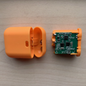
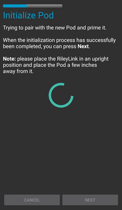
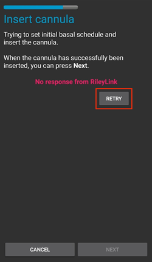
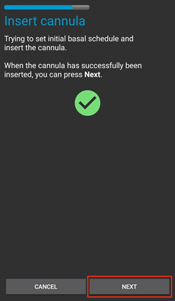
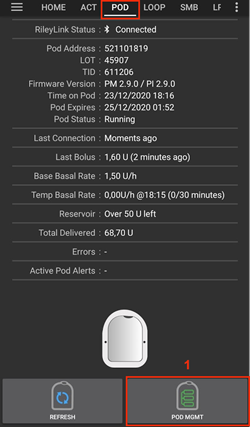
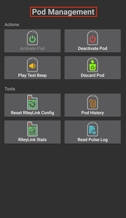
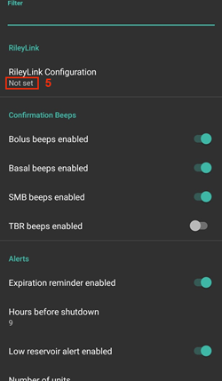

# Omnipod Eros

Te instrukcje dotyczą konfiguracji pompy Omnipod generacji Eros (**NIE Omnipod Dash**).

```{admonition} Omnipod Eros is being phased out
:class: note

[System Omnipod](https://www.omnipod.com/current-podders/resources/omnipod-system) (oryginalny Omnipod, czyli osobisty menedżer cukrzycy (PDM) i Pod) jest wycofywany, a data zakończenia zależy od kraju. Na przykład w Kanadzie nie będzie już dostępny po 30 czerwca 2026. Jeśli używasz pompy Eros, zaplanuj wcześniej przejście na obsługiwaną pompę.
```

**To oprogramowanie jest częścią samodzielnie budowanego systemu sztucznej trzustki (DIY). Nie jest gotowym produktem. To TY musisz przeczytać, poznać i zrozumieć system, także to, jak go używać. Tylko ty odpowiadasz za to, co robisz z tym systemem.**

```{contents} Table of contents
:depth: 1
:local: true
```

## Wymagania sprzętowe i programowe

- **Urządzenie komunikacyjne Poda**

> Element, który przekazuje komunikację z telefonu z AAPS do Podów generacji Eros.
> 
> > -   [Strona OrangeLink](https://getrileylink.org/product/orangelink)
> > -  [RileyLink 433 MHz](https://getrileylink.org/product/rileylink433)
> > -   [Strona Emalink](https://github.com/sks01/EmaLink) - [Kontakt](mailto:getemalink@gmail.com)
> > -   DiaLink - [Kontakt](mailto:Boshetyn@ukr.net)
> > -   [Strona LoopLink](https://www.getlooplink.org/) - [Kontakt](https://jameswedding.substack.com/) - nieprzetestowany

-   **Telefon komórkowy**

> Element, na którym działa AAPS i który wysyła polecenia do urządzenia komunikacyjnego Poda.
> 
> > - Obsługiwany [telefon z Androidem](#Phones-list-of-tested-phones) ze skonfigurowanym **AAPS** i powiązanymi elementami.

-   **Urządzenie podające insulinę**

> Element, który wykonuje polecenia odebrane z urządzenia komunikacyjnego Poda, wysłane z telefonu z AAPS.
> 
> > - Nowy Pod Omnipod (generacja Eros - **NIE DASH**)

Te instrukcje zakładają, że zaczynasz nową sesję Poda. Jeśli tak nie jest, poczekaj cierpliwie i zacznij ten proces przy następnej wymianie Poda.

Na tej stronie **RileyLink** oznacza każde z wymienionych wyżej urządzeń komunikacyjnych Poda.

## Zanim zaczniesz

**BEZPIECZEŃSTWO PRZEDE WSZYSTKIM** - nie wykonuj tego procesu w miejscu, w którym nie możesz naprawić błędu (zapasowe Pody, insulina, naładowany RileyLink i telefon są konieczne).

**Twój PDM Omnipod przestanie działać, gdy sterownik Omnipod w AAPS aktywuje Twojego Poda**. Wcześniej do wysyłania poleceń do Poda Omnipod Eros używałeś PDM Omnipod. Pod Omnipod Eros umożliwia komunikację tylko z jednym urządzeniem. Urządzenie, które aktywuje Poda, jest od tej chwili jedynym urządzeniem, które może się z nim komunikować. Oznacza to, że gdy aktywujesz Poda Omnipod Eros za pomocą RileyLink przez sterownik Omnipod w AAPS, **nie będziesz już mógł używać PDM z tym Podem**. Sterownik Omnipod w AAPS razem z RileyLink jest teraz Twoim PDM. *To NIE znaczy, że masz wyrzucić PDM. Zalecamy zachować go jako zapas i na wypadek, gdy AAPS nie działa poprawnie.*

**Z Podem może się komunikować tylko jeden RileyLink naraz.** **AAPS** pamięta jeden sparowany RileyLink. Jeśli sparujesz inny, zastąpi on poprzedni.

**Pod nie wyłączy się, gdy RileyLink jest poza zasięgiem.** Gdy RileyLink jest poza zasięgiem albo sygnał do aktywnego Poda jest zablokowany, Pod nadal podaje insulinę bazową. Podczas aktywacji Poda profil bazowy ustawiony w AAPS zostanie zaprogramowany w nowym Podzie. Jeśli stracisz połączenie z Podem, wróci on do tego profilu bazowego. Nie będziesz mógł wysyłać nowych poleceń, dopóki RileyLink nie wróci w zasięg i nie nawiąże ponownie połączenia.

**Profile bazowe z dawkami co 30 min NIE są obsługiwane w AAPS.** Jeśli dopiero zaczynasz z AAPS i po raz pierwszy ustawiasz profil bazowy, pamiętaj, że dawki bazowe zaczynające się o pełnej godzinie i pół nie są obsługiwane. Musisz dostosować profil bazowy tak, aby każda dawka zaczynała się o pełnej godzinie. Na przykład dawka bazowa 1,1 U, która zaczyna się o 09:30 i trwa 2 godziny do 11:30, nie zadziała.  Musisz przenieść tę dawkę bazową 1,1 U na przedział 9:00–11:00 albo 10:00–12:00.  Chociaż sam sprzęt Omnipod obsługuje profile bazowe z krokiem 30 min, algorytmy AAPS nie potrafią obecnie ich uwzględnić.

## Włączenie sterownika Omnipod w AAPS

Sterownik Omnipod w AAPS możesz włączyć na **dwa sposoby**:

### Opcja 1: Kreator konfiguracji

Po zainstalowaniu nowej wersji AAPS **Kreator konfiguracji** uruchamia się automatycznie. Jeśli masz już ustawienia wyeksportowane z poprzedniej instalacji, możesz je zaimportować w kreatorze. W przypadku nowej instalacji czytaj dalej.

Przejdź przez [Kreator konfiguracji](../SettingUpAaps/SetupWizard.md) aż do kroku **Pompa**, a potem wybierz **Omnipod Eros** (opis brzmi „Integracja z pompą Omnipod Eros”).


Kreator konfiguracji nie paruje RileyLink. Po zakończeniu kreatora otwórz ekran pompy Omnipod i sparuj RileyLink, jak opisano w [części Konfiguracja RileyLink](#OmnipodEros-rileylink-setup).

**LUB**

### Opcja 2: Ekran Konfiguracja

Otwórz **menu** (☰) w lewym górnym rogu > **Konfiguracja** > **Pompa** i zaznacz **przycisk wyboru** przy **Omnipod Eros**.

Po wybraniu na karcie **Omnipod Eros** widać dwa przyciski, **Ustawienia** i **Otwórz wtyczkę**:


**Ustawienia** otwiera ustawienia sterownika Omnipod (zobacz [Ustawienia Omnipod](#OmnipodEros-omnipod-settings)):


**Otwórz wtyczkę** otwiera ekran pompy Omnipod. Możesz go też otworzyć w każdej chwili z ekranu głównego przez **Zarządzaj** > **Pompa**. Na tej stronie nazywamy go **ekranem pompy Omnipod**. Zanim sparujesz RileyLink i aktywujesz Poda, wygląda on tak:


### Sprawdzenie wyboru sterownika Omnipod

Aby sprawdzić, czy sterownik Omnipod jest włączony, otwórz **Zarządzaj** > **Pompa** z ekranu głównego. Powinien pojawić się ekran pompy **Omnipod Eros** pokazany wyżej. Jeśli nie masz jeszcze sparowanego RileyLink, **Stan RileyLink** pokazuje **Nie rozpoczęto**, a **Status Poda** pokazuje **Brak akt. Poda**.

## Konfiguracja Omnipod

Wszystkie funkcje Poda i RileyLink to przyciski na [ekranie pompy Omnipod](#OmnipodEros-omnipod-pod-tab) (**Zarządzaj** > **Pompa**). Niektóre przyciski pojawiają się tylko w określonych sytuacjach, na przykład gdy Pod jest aktywny.

>  Odśwież połączenie i status Poda
> 
>  Zarządzanie Podem (aktywacja, dezaktywacja, test dźwięku, statystyki RileyLink i historia Poda)

```{admonition} Older screenshot
:class: note
Zrzuty ekranu powyżej pochodzą z wcześniejszej wersji **AAPS**. W **AAPS** 4 nie ma przycisku **POD MGMT** ani menu zarządzania Podem: **Odśwież** i wszystkie akcje zarządzania Podem to przyciski na ekranie pompy Omnipod.
```

(OmnipodEros-rileylink-setup)=

### Konfiguracja RileyLink

Jeśli RileyLink jest już sparowany, przejdź do [części Aktywacja Poda](#OmnipodEros-activating-a-pod) poniżej.

*Uwaga: dobrym widocznym znakiem, że RileyLink nie jest połączony, jest brak przycisków leczenia (paska QuickLaunch) na ekranie głównym. Tak samo dzieje się przez około 30 sekund po uruchomieniu AAPS, gdy AAPS łączy się z RileyLink.*

1. Upewnij się, że RileyLink jest w pełni naładowany i włączony.

2. Połóż RileyLink [blisko telefonu](#OmnipodEros-optimal-omnipod-and-rileylink-positioning) (ok. 30 cm lub mniej).

3. Otwórz ekran pompy Omnipod (**Zarządzaj** > **Pompa**) i naciśnij **Sparuj RileyLink**.

4. Ekran **Sparuj RileyLink** od razu zaczyna szukać urządzeń Bluetooth. Dotknij swojego RileyLink na liście znalezionych urządzeń.

   

5. Gdy pojawi się **Pomyślnie sparowano RileyLink** z nazwą i adresem Twojego urządzenia, naciśnij **OK**.

6. Po powrocie na ekran pompy Omnipod sprawdź, czy **Stan RileyLink** zmienia się na **Połączono**. **Status Poda** powinien pokazywać **Brak akt. Poda**. Jeśli RileyLink się nie łączy, naciśnij **Resetuj RileyLink** albo uruchom ponownie **AAPS**.

 

 


```{admonition} Older screenshot
:class: note
Sześć zrzutów ekranu powyżej (po kroku 6) pochodzi z wcześniejszej wersji **AAPS**. W **AAPS** 4 parujesz RileyLink przyciskiem **Sparuj RileyLink** na ekranie pompy Omnipod zamiast przez **RileyLink Configuration** w ustawieniach Omnipod, a szukanie urządzeń zaczyna się automatycznie.
```

```{note}
Aby przełączyć się na inny RileyLink (na przykład urządzenie zapasowe), naciśnij ponownie **Sparuj RileyLink** i wybierz nowe urządzenie. Zastąpi ono urządzenie sparowane wcześniej. Nie musisz najpierw usuwać starego urządzenia.
```

(OmnipodEros-activating-a-pod)=

### Aktywacja Poda

Zanim aktywujesz Poda, upewnij się, że RileyLink jest sparowany, a **Stan RileyLink** pokazuje **Połączono**. Przycisk **Aktywuj Poda** jest nieaktywny, dopóki RileyLink nie jest gotowy.

*PRZYPOMNIENIE: Ze względów bezpieczeństwa podczas parowania przy aktywacji Pod komunikuje się tylko na małą odległość. Przed sparowaniem sygnał radiowy Poda jest słabszy. Po sparowaniu Pod działa z pełną mocą sygnału. Podczas tych czynności upewnij się, że Pod jest* [blisko](#OmnipodEros-optimal-omnipod-and-rileylink-positioning) *(ok. 30 cm lub mniej), ale nie na RileyLink ani tuż obok niego.*

01. Otwórz ekran pompy Omnipod (**Zarządzaj** > **Pompa**) i naciśnij **Aktywuj Poda**.

    Jeśli nigdy nie aktywowałeś profilu, najpierw pojawi się krok **Wymagany profil**. Wybierz profil, który zostanie zastosowany podczas aktywacji.

    >   
    > 
    > ```{admonition} Older screenshot
    >     :class: note
    >     Zrzuty ekranu powyżej pochodzą z wcześniejszej wersji **AAPS**. W **AAPS** 4 **Aktywuj Poda** to przycisk na ekranie pompy Omnipod, a nie w menu **POD MGMT**.
    > ```

02. Wyświetla się ekran **Wypełnij Poda**. Napełnij nowego Poda ilością insuliny wystarczającą na 3 dni i nasłuchuj dwóch sygnałów dźwiękowych. Oznaczają one, że wlano minimalną ilość 80 U. Opróżnij strzykawkę do napełniania do końca, nawet po usłyszeniu dwóch sygnałów. Gdy obliczasz, ile insuliny potrzebujesz na 3 dni, pamiętaj, że napełnienie Poda zużyje 12–15 U. Nie zdejmuj jeszcze osłonki igły Poda.

    > 
    > 
    > Upewnij się, że nowy Pod i RileyLink są blisko siebie (ok. 30 cm lub mniej), i naciśnij **Dalej**.

03. **Wybierz insulinę** (pokazywane tylko, gdy masz skonfigurowaną więcej niż jedną insulinę): wybierz insulinę, którą napełniasz Poda, i naciśnij **Dalej**. Po aktywacji zostanie zastosowana zmiana profilu z tą insuliną.

04. Na ekranie **Zainicjalizuj Poda** Pod zacznie się napełniać (usłyszysz kliknięcie, a potem serię tykających dźwięków, gdy Pod się napełnia). Jeśli RileyLink jest poza zasięgiem aktywowanego Poda, dostaniesz komunikat o błędzie **Brak odpowiedzi z Poda**. Jeśli tak się stanie, [przysuń RileyLink bliżej](#OmnipodEros-optimal-omnipod-and-rileylink-positioning) Poda (ok. 30 cm lub mniej), ale nie kładź go na Podzie ani tuż obok, i naciśnij **Ponów**.

    >  

05. Gdy napełnianie się uda, pojawia się zielony znacznik, a przycisk **Dalej** staje się aktywny. Naciśnij **Dalej**.

    > 

06. **Miejsce wkłucia** (pokazywane tylko, gdy opcja **Zarządzaj zmianą miejsca wkłucia pompy** jest włączona w [Zmiana miejsca](#Aapsscreens-site-rotation)): wybierz, gdzie na ciele umieszczasz Poda, i naciśnij **Dalej**.

07. Wyświetla się ekran **Zamocuj Poda**. Przygotuj miejsce wkłucia nowego Poda. Zdejmij z Poda plastikową osłonkę igły i biały papier z plastra, a potem przyklej Poda w wybranym miejscu na ciele. Jeśli kaniula wystaje, naciśnij **Anuluj** i wyrzuć Poda. Gdy skończysz, naciśnij **Dalej**.

    > 

08. Pojawia się okno potwierdzenia: „Po naciśnięciu OK zostanie wprowadzone wkłucie”. **Naciśnij OK TYLKO wtedy, gdy jesteś gotowy na wprowadzenie kaniuli**.

    > 

09. Na ekranie **Załóż wkłucie** może minąć trochę czasu, zanim Omnipod odpowie i wprowadzi kaniulę (maksymalnie 1–2 minuty), więc bądź cierpliwy.

    > Jeśli RileyLink jest poza zasięgiem aktywowanego Poda, dostaniesz komunikat o błędzie **Brak odpowiedzi z Poda**. Jeśli tak się stanie, przysuń RileyLink bliżej Poda (ok. 30 cm lub mniej), ale nie kładź go na Podzie ani tuż obok, i naciśnij **Ponów**.
    > 
    > Jeśli RileyLink jest poza zasięgiem Bluetooth albo nie ma aktywnego połączenia z telefonem, dostaniesz komunikat o błędzie **Brak odpowiedzi od RileyLink**. Jeśli tak się stanie, przysuń RileyLink bliżej telefonu i naciśnij **Ponów**.
    > 
    > *UWAGA: Przed wprowadzeniem kaniuli dobrze jest uszczypnąć skórę obok miejsca wkłucia. Dzięki temu igła wchodzi gładko, a ryzyko niedrożności jest mniejsze.*
    > 
    > 
    > 
    >  

10. Po udanym wprowadzeniu kaniuli pojawia się zielony znacznik, a przycisk **Dalej** staje się aktywny. Naciśnij **Dalej**.

    > 

11. Wyświetla się ekran **Pod aktywowany**. Sprawdź, czy kaniula została wprowadzona poprawnie. Jeśli uważasz, że nie, wymień Poda. Naciśnij **Zakończ**. Gratulacje! Właśnie rozpocząłeś nową sesję aktywnego Poda.

    >  
    > 
    > ```{admonition} Older screenshot
    >     :class: note
    >     Zrzuty ekranu w krokach 2–11 pochodzą z wcześniejszej wersji **AAPS** i w **AAPS** 4 mogą wyglądać inaczej. Kroki **Wybierz insulinę** i **Miejsce wkłucia** nie są pokazane na zrzutach.
    > ```

12. Wracasz na ekran pompy Omnipod. Przycisk **Aktywuj Poda** zostaje zastąpiony przez **Odłącz Poda**, bo nie możesz aktywować kolejnego Poda bez dezaktywacji aktywnego.

    Ekran pompy pokazuje teraz informacje o aktywnym Podzie, w tym bieżącą dawkę bazową, poziom w zbiorniku, podaną insulinę, błędy Poda i alarmy. Więcej szczegółów znajdziesz w części [Ekran pompy Omnipod](#OmnipodEros-omnipod-pod-tab).

     

    ```{admonition} Older screenshot
    :class: note
    Zrzuty ekranu powyżej pochodzą z wcześniejszej wersji **AAPS**. W **AAPS** 4 nie ma menu zarządzania Podem: wracasz bezpośrednio na ekran pompy Omnipod, gdzie **Odłącz Poda** zastępuje **Aktywuj Poda**.
    ```

```{note}
Jeśli aktywacja została przerwana po napełnieniu (na przykład aplikacja została zamknięta), naciśnij ponownie **Aktywuj Poda**. Kreator będzie kontynuowany od kroków wprowadzenia kaniuli.
```

### Dezaktywacja Poda

W normalnych warunkach Pod działa trzy dni (72 godziny) i dodatkowe 8 godzin po ostrzeżeniu o utracie ważności, razem 80 godzin.

Aby dezaktywować Poda (po utracie ważności albo po awarii Poda):

1. Otwórz ekran pompy Omnipod (**Zarządzaj** > **Pompa**) i naciśnij **Odłącz Poda**.

   >   
   > 
   > ```{admonition} Older screenshot
   >    :class: note
   >    Zrzuty ekranu powyżej pochodzą z wcześniejszej wersji **AAPS**. W **AAPS** 4 **Odłącz Poda** to przycisk na ekranie pompy Omnipod, a nie w menu **POD MGMT**.
   > ```

2. Na ekranie **Odłącz Poda** najpierw upewnij się, że RileyLink jest blisko Poda, ale nie leży na Podzie ani tuż obok niego. Następnie naciśnij **Dalej**. Okno pyta: *Zdeaktywowanego poda nie można użyć ponownie. Czy na pewno chcesz teraz dezaktywować tego poda?* Naciśnij **OK**, aby rozpocząć dezaktywację Poda, albo **Anuluj**, aby go zachować. Dezaktywacja wstrzymuje całe podawanie insuliny i nie można jej cofnąć.

   > 

3. Pojawia się ekran **Deaktywuję Poda**, a Pod potwierdzi sygnałem dźwiękowym, że dezaktywacja się udała.

   > 
   > 
   > **JEŚLI dezaktywacja się nie uda** i nie usłyszysz sygnału potwierdzenia, może pojawić się komunikat **Brak odpowiedzi od RileyLink** albo **Brak odpowiedzi z Poda**. Naciśnij **Ponów**, aby spróbować dezaktywacji jeszcze raz. Jeśli dezaktywacja nadal się nie udaje, naciśnij **Usuń Poda** i potwierdź. **AAPS** wtedy zapomina Poda. Podawanie insuliny **nie** zostało wstrzymane, więc zdejmij Poda z ciała. Jeśli Pod „wyje” (głośny alarm), może być konieczne ręczne wyciszenie go (szpilką albo spinaczem), bo **Usuń Poda** go nie wycisza.
   > 
   > >   

4. Gdy dezaktywacja się uda, pojawia się zielony znacznik. Naciśnij **Dalej**, aby wyświetlić ekran **Pod dezaktywowany**. Teraz możesz zdjąć Poda, bo aktywna sesja została zakończona.

   > 

5. Naciśnij **Zakończ**, aby wrócić na ekran pompy Omnipod.

   >  
   > 
   > ```{admonition} Older screenshot
   >    :class: note
   >    Zrzuty ekranu w krokach 2–5 pochodzą z wcześniejszej wersji **AAPS** i w **AAPS** 4 mogą wyglądać inaczej.
   > ```

6. Na ekranie pompy Omnipod sprawdź, czy **Stan RileyLink** pokazuje **Połączono**, a **Status Poda** pokazuje **Brak akt. Poda**.

   >    
   > 
   > ```{admonition} Older screenshot
   >    :class: note
   >    Zrzuty ekranu powyżej pochodzą z wcześniejszej wersji **AAPS**. W **AAPS** 4 **Zakończ** przenosi Cię bezpośrednio na ekran pompy Omnipod; nie ma menu zarządzania Podem ani zakładki **Omnipod (POD)**.
   > ```

### Wstrzymywanie i wznawianie podawania insuliny

Poniżej opisujemy, jak wstrzymać i wznowić podawanie insuliny.

*UWAGA - jeśli nie widzisz przycisku **Wstrzymaj***, to jest on domyślnie ukryty. Włącz **Pokaż przycisk wstrzymania podawania w zakładce Omnipod** w [ustawieniach Omnipod](#OmnipodEros-omnipod-settings) w grupie **Inne**.

#### Wstrzymywanie podawania insuliny

Użyj tego polecenia, aby wstrzymać aktywnego Poda. W stanie wstrzymania Pod nie podaje żadnej insuliny. To polecenie działa tak samo jak funkcja wstrzymania, którą oryginalny PDM Omnipod wysyła do aktywnego Poda.

1. Otwórz ekran pompy Omnipod (**Zarządzaj** > **Pompa**) i naciśnij **Wstrzymaj**. Polecenie wstrzymania jest wysyłane przez RileyLink do aktywnego Poda.

2. Gdy Pod wstrzyma całe podawanie insuliny, **Status Poda** pokazuje **Wstrzymany**, a przycisk **Wstrzymaj** zostaje zastąpiony przez **Wznów podawanie**.

   >  
   > 
   > 
   > 
   >  
   > 
   > ```{admonition} Older screenshot
   >    :class: note
   >    Zrzuty ekranu powyżej pochodzą z wcześniejszej wersji **AAPS**. W **AAPS** 4 te kroki odbywają się na ekranie pompy Omnipod zamiast w zakładce **Omnipod (POD)**, a wynik jest pokazany w polu **Status Poda**.
   > ```

Jeśli polecenie się nie uda, okno **Ostrzeżenie** pokaże „Nie udało się zawiesić podawania” z przyczyną. Sprawdź połączenie z RileyLink i spróbuj ponownie.

#### Wznowienie podawania insuliny

Użyj tego polecenia, aby aktywny, obecnie wstrzymany Pod wznowił podawanie insuliny. Gdy polecenie zostanie wykonane, Pod wróci do normalnego podawania insuliny z dawką bazową dla bieżącej godziny z aktywnego profilu bazowego. Pod znów będzie przyjmował polecenia bolusa, TBR i SMB.

1. Otwórz ekran pompy Omnipod i sprawdź, czy **Status Poda** pokazuje **Wstrzymany**. Naciśnij **Wznów podawanie**.

2. Gdy polecenie się uda, **Status Poda** znów pokazuje **W działaniu**, a przycisk **Wznów podawanie** znika (przycisk **Wstrzymaj** pojawia się znowu, jeśli go włączyłeś).

   >  
   > 
   > 
   > 
   >  
   > 
   > ```{admonition} Older screenshot
   >    :class: note
   >    Zrzuty ekranu powyżej pochodzą z wcześniejszej wersji **AAPS**. W **AAPS** 4 te kroki odbywają się na ekranie pompy Omnipod zamiast w zakładce **Omnipod (POD)**, a wynik jest pokazany w polu **Status Poda**.
   > ```

Jeśli polecenie się nie uda, okno **Ostrzeżenie** pokaże „Nie udało się wznowić podawania” z przyczyną. Sprawdź połączenie z RileyLink i spróbuj ponownie.

### Wyciszanie alarmów Poda

*UWAGA - przycisk **Wycisz alarmy** jest widoczny na ekranie pompy Omnipod tylko wtedy, gdy Pod ma aktywny alarm (na przykład o utracie ważności Poda albo niskim poziomie w zbiorniczku), i tylko gdy opcja **Automatycznie wycisz alarmy Poda** jest wyłączona.*

Poniżej opisujemy, jak wyciszyć sygnały dźwiękowe Poda, które zaczynają się, gdy Pod osiągnie czas ostrzeżenia przed utratą ważności. Ten czas ostrzeżenia ustawiasz opcją **Alarm: godziny przed wyłączeniem Poda (80 godz.)** w grupie **Alerty** ustawień Omnipod. Maksymalny czas życia Poda to 80 godzin (3 dni i 8 godzin), ale Insulet zaleca nie przekraczać 72 godzin (3 dni).

*UWAGA - jeśli włączyłeś **Automatycznie wycisz alarmy Poda** w grupie **Alerty** ustawień Omnipod, **AAPS** wyciszy alarm automatycznie przy następnej komunikacji z Podem i NIE musisz robić tego ręcznie.*

1. Gdy nadejdzie czas ostrzeżenia, Pod wydaje sygnały dźwiękowe, aby poinformować Cię, że wkrótce straci ważność i trzeba go wymienić. Na ekranie pompy Omnipod pole **Pod traci ważność** pokazuje dokładny czas utraty ważności Poda (72 godziny po aktywacji); 4 godziny wcześniej zmienia kolor na **żółty**. **Twardy koniec Poda** pokazuje, kiedy Pod przestanie podawać insulinę. **Aktywne alarmy Poda** pokazuje **Pod wkrótce straci ważność** i pojawia się przycisk **Wycisz alarmy**. **AAPS** pokazuje też powiadomienie o zbliżającej się utracie ważności Poda.

   >   
   > 
   > ```{admonition} Older screenshot
   >    :class: note
   >    Zrzuty ekranu powyżej pochodzą z wcześniejszej wersji **AAPS**. W **AAPS** 4 przycisk **ACK ALERTS** nazywa się **Wycisz alarmy** i jest na ekranie pompy Omnipod.
   > ```

2. Naciśnij **Wycisz alarmy**. RileyLink wysyła do Poda polecenie zatrzymania sygnałów ostrzegających o utracie ważności.

   >  
   > 
   > ```{admonition} Older screenshot
   >    :class: note
   >    Zrzut ekranu powyżej pochodzi z wcześniejszej wersji **AAPS**. W **AAPS** 4 przycisk nazywa się **Wycisz alarmy**.
   > ```

3. Po wyciszeniu alarmów Pod wydaje dwa sygnały dźwiękowe. **Aktywne alarmy Poda** nie pokazuje już ostrzeżenia, przycisk **Wycisz alarmy** znika, a Pod przestaje wydawać sygnały ostrzegające o utracie ważności.

   >  
   > 
   > ```{admonition} Older screenshot
   >    :class: note
   >    Zrzut ekranu powyżej pochodzi z wcześniejszej wersji **AAPS**. W **AAPS** 4 wynik jest widoczny na ekranie pompy Omnipod: ostrzeżenie znika z pola **Aktywne alarmy Poda**.
   > ```

Jeśli polecenie się nie uda (na przykład RileyLink jest poza zasięgiem Poda), okno **Ostrzeżenie** pokaże „Nie udało się wyciszyć alertów” z przyczyną. Przysuń RileyLink bliżej Poda i spróbuj ponownie.


```{admonition} Older screenshot
:class: note
Zrzut ekranu powyżej pochodzi z wcześniejszej wersji **AAPS**. W **AAPS** 4 okno **Ostrzeżenie** pokazuje „Nie udało się wyciszyć alertów” z przyczyną.
```

(OmnipodEros-view-pod-history)=

### Wyświetlanie historii Poda

W tej części dowiesz się, jak przeglądać historię aktywnego Poda i filtrować ją według kategorii akcji. Historia Poda pokazuje akcje i ich wyniki dla obecnie aktywnego Poda przez cały jego trzydniowy (72–80 godzin) czas życia.

Ta funkcja pomaga sprawdzić bolusy, TBR i zmiany bazy, które zostały wysłane, gdy nie masz pewności, czy zostały wykonane. Pozostałe kategorie przydają się ogólnie do rozwiązywania problemów i do ustalenia kolejności zdarzeń przed awarią.

*UWAGA:* Polecenia **niepewne** pojawią się w historii Poda, ale z ich natury nie możesz mieć pewności, że są dokładne.

1. Otwórz ekran pompy Omnipod (**Zarządzaj** > **Pompa**) i naciśnij **Historia Poda**.

   >   
   > 
   > ```{admonition} Older screenshot
   >    :class: note
   >    Zrzuty ekranu powyżej pochodzą z wcześniejszej wersji **AAPS**. W **AAPS** 4 **Historia Poda** to przycisk na ekranie pompy Omnipod, a nie w menu **POD MGMT**.
   > ```

2. Ekran **Historia Poda** pokazuje wszystkie akcje Poda i ich wyniki, od najnowszych, pogrupowane według dni. Domyślnie wybrane jest **Wszystko**. Dotknij jednego z przycisków filtra na górze, aby pokazać tylko jedną kategorię. Strzałką wstecz w lewym górnym rogu wrócisz na ekran pompy Omnipod.

   > 

   >  
   > 
   > ```{admonition} Older screenshot
   >    :class: note
   >    Drugi zrzut ekranu pochodzi z wcześniejszej wersji **AAPS** i w **AAPS** 4 może wyglądać inaczej.
   > ```

### Wyświetlanie ustawień i historii RileyLink

Ekran **Statystyki RileyLink** pokazuje ustawienia RileyLink i aktywnego Poda oraz historię komunikacji obu urządzeń. Ma dwie zakładki: **Ustawienia** i **Historia**.

Przycisk **Statystyki RileyLink** jest domyślnie ukryty. Aby pokazać go na ekranie pompy Omnipod, włącz **Pokaż przycisk Statystyki RileyLink w menu zarządzania Podem** w [ustawieniach Omnipod](#OmnipodEros-omnipod-settings) w grupie **Inne**.

#### Ręczne przywracanie połączenia Bluetooth z urządzeniem komunikacyjnym Poda

Jeśli urządzenie komunikacyjne Poda było przez jakiś czas poza zasięgiem Bluetooth telefonu, **Stan RileyLink** na ekranie pompy Omnipod może pokazywać **RileyLink nieosiągalny**. **AAPS** zwykle sam łączy się ponownie, gdy urządzenie wróci w zasięg. Jeśli tak się nie stanie:

1. Upewnij się, że RileyLink jest włączony, naładowany i blisko telefonu.

2. Na ekranie pompy Omnipod naciśnij **Resetuj RileyLink**. Komunikat potwierdza: **Konfiguracja RileyLink zresetowana**. Zobacz [uwagi o Resetuj RileyLink](#OmnipodEros-reset-rileylink-config-notes) poniżej.

3. Jeśli **połączenie Bluetooth** nie wróci, spróbuj ręcznie **wyłączyć** i ponownie **włączyć** Bluetooth w telefonie.

4. Jeśli nadal nie łączy się ponownie, naciśnij **Sparuj RileyLink** i wybierz swój RileyLink jeszcze raz.

5. Po udanym ponownym połączeniu **Stan RileyLink** pokazuje **Połączono**. Możesz też sprawdzić **Status połączenia** w zakładce **Ustawienia** na ekranie **Statystyki RileyLink**. Gratulacje, ponownie połączyłeś skonfigurowane urządzenie komunikacyjne Poda z AAPS!

 


```{admonition} Older screenshot
:class: note
Zrzuty ekranu powyżej pochodzą z wcześniejszej wersji **AAPS**. W **AAPS** 4 łączysz ponownie przyciskiem **Resetuj RileyLink** albo **Sparuj RileyLink** na ekranie pompy Omnipod, a nie przyciskiem odświeżania na ekranie ustawień RileyLink.
```

#### Ustawienia urządzenia komunikacyjnego Poda i aktywnego Poda

Ten ekran pokazuje informacje i stan zarówno obecnie sparowanego urządzenia komunikacyjnego Poda, jak i obecnie aktywnego Poda Omnipod Eros. Informacje odświeżają się automatycznie.

1. Otwórz ekran pompy Omnipod (**Zarządzaj** > **Pompa**) i naciśnij **Statystyki RileyLink**. Zakładka **Ustawienia** pokazuje obecnie sparowany **RileyLink** i aktywnego Poda (**Urządzenie**).

   >   
   > 
   > ```{admonition} Older screenshot
   >    :class: note
   >    Zrzuty ekranu powyżej pochodzą z wcześniejszej wersji **AAPS**. W **AAPS** 4 **Statystyki RileyLink** to przycisk na ekranie pompy Omnipod, a nie w menu **POD MGMT**.
   > ```

   > 

##### Pola RileyLink

> - **Adres:** adres MAC sparowanego urządzenia komunikacyjnego Poda.
> - **Nazwa:** nazwa Bluetooth sparowanego urządzenia komunikacyjnego Poda.
> - **Poziom baterii:** bieżący poziom baterii połączonego urządzenia komunikacyjnego Poda. Pokazywany tylko, gdy opcja **Pokaż poziom baterii zgłaszany przez OrangeLink/EmaLink/DiaLink** jest włączona.
> - **Status połączenia**: bieżący stan połączenia Bluetooth między urządzeniem komunikacyjnym Poda a telefonem z AAPS.
> - **Błąd połączenia:** jeśli wystąpi błąd połączenia Bluetooth z urządzeniem komunikacyjnym Poda, tutaj są pokazane szczegóły.
> - **Wersja oprogramowania:** wersja oprogramowania (firmware) zainstalowana w obecnie połączonym urządzeniu komunikacyjnym Poda.

##### Pola urządzenia - z aktywnym Podem

> - **Typ urządzenia:** typ urządzenia, które komunikuje się z urządzeniem komunikacyjnym Poda (Omnipod (Eros)).
> - **Skonfigurowane urządzenie:** model urządzenia skonfigurowanego do komunikacji z urządzeniem komunikacyjnym Poda.
> - **Połączone urządzenie:** model urządzenia, które obecnie komunikuje się z urządzeniem komunikacyjnym Poda.
> - **Numer seryjny pompy:** numer seryjny obecnie aktywnego Poda.
> - **Częstotliwość pompy:** częstotliwość radiowa używana do komunikacji z Podem.
> - **Ostatnio używana częstotliwość:** ostatnia znana częstotliwość radiowa, której Pod użył do komunikacji z urządzeniem komunikacyjnym Poda.
> - **Ostatnie połączenie z urządzeniem:** data i godzina ostatniego kontaktu Poda z urządzeniem komunikacyjnym Poda.

(omnipod-eros-rileylink-and-active-pod-history)=
#### Historia RileyLink i aktywnego Poda

Ta zakładka pokazuje, od najnowszych, każdy stan lub akcję RileyLink albo obecnie połączonego Poda. Historia jest dostępna tylko dla obecnie aktywnego Poda. Po wymianie Poda ta historia jest kasowana i zapisywane oraz pokazywane są tylko zdarzenia nowo aktywowanego Poda.

1. Otwórz ekran pompy Omnipod (**Zarządzaj** > **Pompa**), naciśnij **Statystyki RileyLink**, a potem dotknij zakładki **Historia**.

   >   
   > 
   > ```{admonition} Older screenshot
   >    :class: note
   >    Zrzuty ekranu powyżej pochodzą z wcześniejszej wersji **AAPS**. W **AAPS** 4 **Statystyki RileyLink** to przycisk na ekranie pompy Omnipod, a nie w menu **POD MGMT**.
   > ```

   > 

##### Pola

Każdy wpis pokazuje:

> - **Urządzenie:** urządzenie, którego dotyczy akcja lub stan.
> - **Czas:** czas zdarzenia.
> - **Stan lub akcja:** stan urządzenia albo akcja, którą wykonało.

(OmnipodEros-omnipod-pod-tab)=

## Ekran pompy Omnipod

Poniżej opisujemy pola stanu i przyciski na **ekranie pompy Omnipod** (**Zarządzaj** > **Pompa** albo **Konfiguracja** > **Pompa** > **Otwórz wtyczkę**).

Ikona koła zębatego w prawym górnym rogu otwiera [ustawienia Omnipod](#OmnipodEros-omnipod-settings).

*UWAGA: jeśli w którymś polu stanu widać (niepewne), naciśnij **Odśwież**, aby odświeżyć status Poda i to usunąć.*


```{admonition} Older screenshot
:class: note
Zrzut ekranu powyżej pochodzi z wcześniejszej wersji **AAPS**, w której ten ekran był zakładką **Omnipod (POD)**. W **AAPS** 4 jest to ekran pompy Omnipod, a niektóre nazwy pól i przyciski są inne.
```

### Pola

- **Stan RileyLink:** pokazuje bieżący stan połączenia z RileyLink. Błędy są pokazane na czerwono.

- *Nie rozpoczęto* - żaden RileyLink nie jest jeszcze sparowany albo połączenie się nie rozpoczęło.
- *RileyLink nieosiągalny* - urządzenie komunikacyjne Poda jest poza zasięgiem Bluetooth telefonu, jest wyłączone albo ma awarię, która uniemożliwia komunikację Bluetooth.
- *RileyLink gotowy* - urządzenie komunikacyjne Poda jest włączone i właśnie nawiązuje połączenie Bluetooth.
- *Połączono* - urządzenie komunikacyjne Poda jest włączone, połączone i może komunikować się przez Bluetooth.

- **Unikalny ID:** pokazuje adres aktywnego Poda.

- **Numer LOT:** pokazuje numer LOT aktywnego Poda.

- **Numer sekwencji:** pokazuje numer seryjny (TID) Poda.

- **Wersja oprogramowania:** pokazuje wersję oprogramowania (firmware) aktywnego Poda.

- **Czas na Podzie:** pokazuje bieżący czas ustawiony w aktywnym Podzie. Jest wyróżniony, gdy różni się od czasu w telefonie o więcej niż 5 minut.

- **Pod traci ważność:** pokazuje datę i godzinę utraty ważności aktywnego Poda. Tekst zmienia kolor na żółty w ostatnich 4 godzinach przed tym czasem. Nigdy nie zmienia koloru na czerwony, ponieważ Pod nadal podaje insulinę po tym czasie.

- **Twardy koniec Poda:** pokazuje koniec dodatkowego czasu Poda (8 godzin po **Pod traci ważność**, czyli maksymalny czas życia Poda to 80 godzin). Tekst zmienia kolor na żółty, gdy zaczyna się okres dodatkowy (w chwili **Pod traci ważność**), a na czerwony w ostatnich 4 godzinach przed twardym końcem. W okresie dodatkowym pokazuje też pozostały czas, na przykład *(17m remaining)*. W chwili twardego końca Pod przestaje podawać insulinę i musi zostać wymieniony.

- **Status Poda:** pokazuje stan aktywnego Poda (na przykład **Brak akt. Poda**, **W działaniu** albo **Wstrzymany**).

- **Ostatnie połączenie:** pokazuje, kiedy ostatnio udało się skomunikować z aktywnym Podem. Tekst zmienia kolor na czerwony, gdy zostanie przekroczony [próg niedostępności pompy](#OmnipodEros-troubleshooting).

- *Moment temu* - mniej niż 20 sekund temu.
- *Mniej niż minutę temu* - więcej niż 20 sekund, ale mniej niż 60 sekund temu.
- *1 minutę temu* - więcej niż 60 sekund, ale mniej niż 120 sekund (2 min)
- *XX minut temu* - więcej niż 2 minuty temu, gdzie XX to liczba minut

- **Ostatni bolus:** pokazuje dawkę ostatniego bolusa wysłanego do aktywnego Poda, a w nawiasie, jak dawno temu został podany.

- **Podstawowa dawka bazowa:** pokazuje dawkę bazową zaprogramowaną na bieżącą godzinę w profilu bazowym.

- **Tymczasowa dawka bazowa:** widoczna tylko wtedy, gdy działa tymczasowa dawka bazowa. Jest pokazywana w takim formacie:

- Jednostki / godz. @ godzina wysłania TBR (minuty, które minęły / łączna liczba minut TBR)
- *Przykład:* 0,00U/h @18:25 ( 90/120 minut)

- **Zbiornik:** pokazuje **Pozostało ponad 50 U**, gdy w zbiorniku zostało więcej niż 50 U. Poniżej tej wartości pokazywana jest przybliżona liczba jednostek. Tekst zmienia kolor na czerwony poniżej progu niskiego poziomu w zbiorniczku ustawionego w [ustawieniach alertów](#OmnipodEros-omnipod-settings).

- **Łącznie dostarczono:** pokazuje łączną liczbę jednostek insuliny podanych ze zbiornika. *To tylko przybliżenie, bo napełnianie i wypełnianie Poda nie jest dokładnym procesem.*

- **Aktywne alarmy Poda:** pokazuje alarmy, które są obecnie aktywne w Podzie. Zwykle używane, gdy Pod działa dłużej niż 72 godziny i włączają się jego własne alarmy dźwiękowe.

- **Błędy:** pokazuje ostatni błąd (na czerwono). Przejrzyj [historię Poda](#OmnipodEros-view-pod-history), [historię RileyLink](#omnipod-eros-rileylink-and-active-pod-history) i pliki logów, aby znaleźć wcześniejsze błędy i więcej informacji.

### Przyciski

Przyciski na dole ekranu pompy zmieniają się zależnie od sytuacji. Przyciski, których teraz nie można użyć, są wyszarzone, na przykład gdy RileyLink nie jest połączony.

**Przyciski statusu Poda** (widoczne, gdy Pod jest aktywny):

- **Odśwież:** wysyła do aktywnego Poda polecenie odświeżenia, aby zaktualizować jego status. Użyj go, aby odświeżyć status Poda i usunąć (niepewne) z pól stanu. Więcej informacji znajdziesz poniżej w [części Rozwiązywanie problemów](#OmnipodEros-troubleshooting).

  

  ```{admonition} Older screenshot
  :class: note
  Zrzut ekranu powyżej pochodzi z wcześniejszej wersji **AAPS**. W **AAPS** 4 jest to przycisk tekstowy **Odśwież** na ekranie pompy Omnipod.
  ```

- **Wycisz alarmy:** wycisza sygnały dźwiękowe i powiadomienia o utracie ważności Poda i niskim poziomie w zbiorniczku. Widoczny tylko wtedy, gdy Pod ma aktywny alarm, a opcja **Automatycznie wycisz alarmy Poda** jest wyłączona. Po wyciszeniu alarmów przycisk znika.

  

  ```{admonition} Older screenshot
  :class: note
  Zrzut ekranu powyżej pochodzi z wcześniejszej wersji **AAPS**. W **AAPS** 4 ten przycisk nazywa się **Wycisz alarmy**.
  ```

- **Ustaw czas:** ustawia w Podzie bieżący czas z telefonu. Widoczny tylko wtedy, gdy czas w Podzie różni się od czasu w telefonie o więcej niż 5 minut.

  

  ```{admonition} Older screenshot
  :class: note
  Zrzut ekranu powyżej pochodzi z wcześniejszej wersji **AAPS**. W **AAPS** 4 jest to przycisk tekstowy **Ustaw czas** na ekranie pompy Omnipod.
  ```

- **Wstrzymaj:** wstrzymuje podawanie insuliny przez aktywnego Poda. Widoczny tylko, gdy jest włączony w ustawieniach (**Pokaż przycisk wstrzymania podawania w zakładce Omnipod**).

  

  ```{admonition} Older screenshot
  :class: note
  Zrzut ekranu powyżej pochodzi z wcześniejszej wersji **AAPS**. W **AAPS** 4 jest to przycisk tekstowy **Wstrzymaj** na ekranie pompy Omnipod.
  ```

- **Wznów podawanie:** wznawia podawanie insuliny przez obecnie wstrzymanego, aktywnego Poda. Widoczny tylko, gdy Pod jest wstrzymany.

  

  ```{admonition} Older screenshot
  :class: note
  Zrzut ekranu powyżej pochodzi z wcześniejszej wersji **AAPS**. W **AAPS** 4 jest to przycisk tekstowy **Wznów podawanie** na ekranie pompy Omnipod.
  ```

**Przyciski zarządzania Podem i RileyLink:**



```{admonition} Older screenshot
:class: note
Zrzut ekranu powyżej pochodzi z wcześniejszej wersji **AAPS**. W **AAPS** 4 nie ma menu zarządzania Podem: te akcje to przyciski bezpośrednio na ekranie pompy Omnipod.
```

- **Aktywuj Poda:** napełnia i aktywuje nowego Poda. Widoczny, gdy żaden Pod nie jest aktywny. Jest aktywny tylko wtedy, gdy RileyLink jest połączony.

  

  ```{admonition} Older screenshot
  :class: note
  Zrzut ekranu powyżej pochodzi z wcześniejszej wersji **AAPS**. W **AAPS** 4 **Aktywuj Poda** to przycisk na ekranie pompy Omnipod, a nie w menu zarządzania Podem.
  ```

- **Odłącz Poda:** dezaktywuje obecnie aktywnego Poda. Widoczny, gdy tylko Pod zostanie sparowany, także gdy aktywacja zatrzymała się w połowie (na przykład dlatego, że Pod uległ awarii podczas aktywacji). Jest aktywny tylko wtedy, gdy RileyLink jest połączony. **AAPS** prosi o potwierdzenie, zanim dezaktywuje Poda.

- Użyj tego polecenia, aby dezaktywować „wyjącego” Poda (błąd 49).
- Jeśli dezaktywacja się nie uda, kreator dezaktywacji proponuje opcję **Usuń Poda**.

  

  ```{admonition} Older screenshot
  :class: note
  Zrzut ekranu powyżej pochodzi z wcześniejszej wersji **AAPS**. W **AAPS** 4 **Odłącz Poda** to przycisk na ekranie pompy Omnipod, a nie w menu zarządzania Podem.
  ```

- **Odtwarzaj test dźwięku:** po naciśnięciu Pod wydaje jeden testowy sygnał dźwiękowy. Widoczny, gdy Pod jest sparowany.

  

  ```{admonition} Older screenshot
  :class: note
  Zrzut ekranu powyżej pochodzi z wcześniejszej wersji **AAPS**. W **AAPS** 4 **Odtwarzaj test dźwięku** to przycisk na ekranie pompy Omnipod, a nie w menu zarządzania Podem.
  ```

- **Historia Poda:** pokazuje historię działań aktywnego Poda. Zobacz [Wyświetlanie historii Poda](#OmnipodEros-view-pod-history).

  

  ```{admonition} Older screenshot
  :class: note
  Zrzut ekranu powyżej pochodzi z wcześniejszej wersji **AAPS**. W **AAPS** 4 **Historia Poda** to przycisk na ekranie pompy Omnipod, a nie w menu zarządzania Podem.
  ```

- **Sparuj RileyLink:** szuka urządzenia komunikacyjnego Poda i paruje je. Zobacz [Konfiguracja RileyLink](#OmnipodEros-rileylink-setup).

- **Statystyki RileyLink:** otwiera ekran Statystyki RileyLink z dwiema zakładkami. Widoczny tylko, gdy jest włączony w ustawieniach (**Pokaż przycisk Statystyki RileyLink w menu zarządzania Podem**).

- **Ustawienia** - pokazuje informacje o ustawieniach RileyLink i aktywnego Poda
- **Historia** - pokazuje historię komunikacji RileyLink i Poda

  

  ```{admonition} Older screenshot
  :class: note
  Zrzut ekranu powyżej pochodzi z wcześniejszej wersji **AAPS**. W **AAPS** 4 **Statystyki RileyLink** to przycisk na ekranie pompy Omnipod, a nie w menu zarządzania Podem.
  ```

- **Resetuj RileyLink:** resetuje konfigurację obecnie połączonego urządzenia komunikacyjnego Poda. Gdy zaczyna się komunikacja, do RileyLink są wysyłane i w nim ustawiane określone dane:

- Ustawiane są rejestry pamięci
- Ustawiane są protokoły komunikacji
- Ustawiana jest dostrojona częstotliwość radiowa
  > 
  > Zobacz [dodatkowe uwagi](#OmnipodEros-reset-rileylink-config-notes) poniżej.

  

  ```{admonition} Older screenshot
  :class: note
  Zrzut ekranu powyżej pochodzi z wcześniejszej wersji **AAPS**. W **AAPS** 4 ten przycisk nazywa się **Resetuj RileyLink** i jest na ekranie pompy Omnipod.
  ```

- **Usuń Poda:** po potwierdzeniu usuwa stan Poda, który nie odpowiada. Widoczny tylko wtedy, gdy Pod został uruchomiony, ale nie w pełni sparowany, bo prawidłowa dezaktywacja nie jest już możliwa:

- **Pod nie jest w pełni sparowany** i dlatego ignoruje polecenia dezaktywacji.
- **Pod utknął** między krokami parowania.
- **Pod w ogóle się nie paruje.**
  > 
  > Po usunięciu Poda **AAPS** nie może się już z nim komunikować. Zdejmij Poda z ciała.

  

  ```{admonition} Older screenshot
  :class: note
  Zrzut ekranu powyżej pochodzi z wcześniejszej wersji **AAPS**. W **AAPS** 4 **Usuń Poda** to przycisk na ekranie pompy Omnipod, a nie w menu zarządzania Podem.
  ```

(OmnipodEros-reset-rileylink-config-notes)=

#### *Uwagi o Resetuj RileyLink*

- Ta funkcja służy głównie do sytuacji, gdy obecnie aktywne urządzenie komunikacyjne Poda nie odpowiada, a komunikacja się zawiesiła.
- Jeśli urządzenie komunikacyjne Poda zostało wyłączone i ponownie włączone, naciśnij **Resetuj RileyLink**, aby te parametry komunikacji zostały znowu ustawione w urządzeniu komunikacyjnym Poda.
- Jeśli tego NIE zrobisz, po wyłączeniu i ponownym włączeniu urządzenia komunikacyjnego Poda trzeba będzie uruchomić AAPS ponownie.
- Tego przycisku **NIE** trzeba naciskać przy przełączaniu między różnymi urządzeniami komunikacyjnymi Poda.

(OmnipodEros-omnipod-settings)=

## Ustawienia Omnipod

Ustawienia sterownika Omnipod otworzysz na jeden z dwóch sposobów:

- naciśnij ikonę koła zębatego w prawym górnym rogu ekranu pompy Omnipod (**Zarządzaj** > **Pompa**) albo
- otwórz **menu** (☰) w lewym górnym rogu > **Konfiguracja** > **Pompa** i naciśnij **Ustawienia** na karcie **Omnipod Eros**.


```{admonition} Older screenshot
:class: note
Zrzut ekranu powyżej pochodzi z wcześniejszej wersji **AAPS**. W **AAPS** 4 otwierasz ustawienia przyciskiem **Ustawienia** na karcie **Omnipod Eros** albo ikoną koła zębatego na ekranie pompy Omnipod, a nie kołem zębatym ustawień w **Konfiguracji** ani menu z 3 kropkami.
```

Ustawienia są pogrupowane jak poniżej. Dotknij grupy, aby ją rozwinąć. Większość pozycji to przełączniki, które możesz włączyć lub wyłączyć:


*UWAGA: Gwiazdka (\*) oznacza, że ustawienie jest domyślnie włączone.*

### RileyLink

Ustawienia urządzenia komunikacyjnego Poda. Samo urządzenie parujesz przyciskiem **Sparuj RileyLink** na ekranie pompy (zobacz [Konfiguracja RileyLink](#OmnipodEros-rileylink-setup)).

- **Użyj skanowania:** skanuje przed połączeniem z OrangeLink. Może to poprawić połączenie. W razie potrzeby można tego używać także z innymi klonami RileyLink.

- **Pokaż poziom baterii zgłaszany przez OrangeLink/EmaLink/DiaLink:** pokazuje rzeczywisty poziom baterii OrangeLink/EmaLink/DiaLink. **Zdecydowanie zalecamy**, aby wszyscy użytkownicy OrangeLink/EmaLink/DiaLink włączyli to ustawienie.

- NIE działa z oryginalnym RileyLink.
- Może nie działać z innymi urządzeniami zastępującymi RileyLink.
- Włączone - pokazuje bieżący poziom baterii obsługiwanych urządzeń komunikacyjnych Poda.
- Wyłączone - pokazuje wartość n/a.

- **Włącz rejestrowanie zmiany baterii w Akcjach:** dostępne tylko wtedy, gdy powyższe ustawienie pokazywania baterii jest włączone. Niektóre urządzenia komunikacyjne Poda mogą używać zwykłych, wymiennych baterii. Gdy to ustawienie jest włączone, możesz zapisać [wpis w Portalu opieki](#aaps-screens-careportal) **Zmiana baterii pompy**, aby odnotować wymianę i wyzerować wiek baterii.

### Dźwięki potwierdzenia

Pod potwierdza sygnałem dźwiękowym podanie i zmiany bolusa, bazy, SMB i TBR.

- **\*Sygnał dźwiękowy bolusa włączony:** włącza lub wyłącza sygnał potwierdzenia po podaniu bolusa.
- **Sygnał dźwiękowy bazy włączony:** włącza lub wyłącza sygnał potwierdzenia, gdy ustawiana jest nowa dawka bazowa, anulowana jest aktywna dawka bazowa albo zmieniana jest bieżąca dawka bazowa.
- **\*Sygnał dźwiękowy SMB włączony:** włącza lub wyłącza sygnał potwierdzenia po podaniu SMB.
- **Sygnał dźwiękowy TBR (tymczasowej dawki bazowej) włączony:** włącza lub wyłącza sygnał potwierdzenia po ustawieniu lub anulowaniu TBR.

### Alerty

Pokazuje alerty AAPS i ogłoszenia w Nightscout o utracie ważności Poda, wyłączeniu Poda i niskim poziomie w zbiorniczku według ustawionego progu jednostek.

*Uwaga: powiadomienie AAPS pojawi się ZAWSZE dla każdego alertu, przy pierwszej komunikacji z Podem po wystąpieniu alertu. Zamknięcie powiadomienia NIE wycisza alarmu, CHYBA ŻE włączona jest opcja **Automatycznie wycisz alarmy Poda**. Aby wyciszyć alarm RĘCZNIE, otwórz ekran pompy Omnipod i naciśnij **Wycisz alarmy**.*

- **\*Przypomnienie o utracie ważności włączone:** gdy jest włączone, Pod wydaje sygnał dźwiękowy, gdy nadejdzie czas ustawiony poniżej.
- **Alarm: godziny przed wyłączeniem Poda (80 godz.):** na ile godzin przed wyłączeniem Poda (80 godzin po aktywacji) włącza się przypomnienie o utracie ważności (od 1 do 8 godzin, domyślnie 8).
- **\*Włączony alert o niskim poziomie w zbiorniczku:** włącza lub wyłącza alert, gdy liczba jednostek pozostałych w Podzie spadnie do progu ustawionego w polu Liczba jednostek.
- **Liczba jednostek:** liczba jednostek, przy której włącza się alert o niskim poziomie w zbiorniczku Poda (od 5 do 50, domyślnie 20).
- **Automatycznie wycisz alarmy Poda:** gdy jest włączone, powiadomienie nadal się pojawia, ale alarm jest automatycznie wyciszany przy następnej komunikacji z Podem po jego wystąpieniu.

### Powiadomienia

Pokazuje powiadomienia AAPS i sygnały dźwiękowe w telefonie, gdy nie wiadomo, czy TBR, SMB lub bolus zostały wykonane.

*UWAGA: To tylko powiadomienia, Pod nie wydaje sygnałów dźwiękowych.*

- **\*Dźwięk dla powiadomień o niepewnych TBR włączony:** włącz lub wyłącz to ustawienie, aby dostawać sygnał dźwiękowy i powiadomienie, gdy AAPS nie ma pewności, czy TBR został ustawiony.
- **\*Dźwięk dla niepewnych powiadomień SMB włączony:** włącz lub wyłącz to ustawienie, aby dostawać sygnał dźwiękowy i powiadomienie, gdy AAPS nie ma pewności, czy SMB został podany.
- **\*Dźwięk dla powiadomień o niepewnych bolusach włączony:** włącz lub wyłącz to ustawienie, aby dostawać sygnał dźwiękowy i powiadomienie, gdy AAPS nie ma pewności, czy bolus został podany.

### Inne

Ustawienia zaawansowane pomocne przy szukaniu błędów.

- **Pokaż przycisk wstrzymania podawania w zakładce Omnipod:** ukrywa lub pokazuje przycisk **Wstrzymaj** na ekranie pompy Omnipod.
- **Pokaż przycisk Pulse Log w menu zarządzania Podem:** to ustawienie nadal jest na liście, ale obecna wersja ekranu pompy nie ma przycisku **Pulse Log**.

- **Pokaż przycisk Statystyki RileyLink w menu zarządzania Podem:** ukrywa lub pokazuje przycisk **Statystyki RileyLink** na ekranie pompy Omnipod.
- **\*Włączone wykrywanie strefy czasowej DST:** pozwala automatycznie wykrywać zmiany strefy czasowej, jeśli telefon jest używany w miejscu, gdzie obowiązuje czas letni (DST).

### Zmiana lub usunięcie aktywnego urządzenia komunikacyjnego Poda (RileyLink)

Jest wiele zamienników oryginalnego RileyLink (takich jak OrangeLink czy EmaLink), a czasem potrzebujesz kilku lub zapasowych egzemplarzy tego samego urządzenia komunikacyjnego Poda. Dlatego może być potrzebne przełączenie na inne urządzenie.

Aby to zrobić, otwórz ekran pompy Omnipod (**Zarządzaj** > **Pompa**), naciśnij **Sparuj RileyLink** i wybierz nowe urządzenie, jak opisano w [Konfiguracja RileyLink](#OmnipodEros-rileylink-setup). Nowe urządzenie zastępuje wcześniej sparowane.

 


 

```{admonition} Older screenshot
:class: note
Zrzuty ekranu powyżej pochodzą z wcześniejszej wersji **AAPS**. W **AAPS** 4 dodajesz urządzenie przyciskiem **Sparuj RileyLink** na ekranie pompy Omnipod zamiast przez **RileyLink Configuration** w ustawieniach Omnipod, a szukanie urządzeń zaczyna się automatycznie.
```

Nie ma osobnego przycisku do usuwania sparowanego urządzenia. Jeśli przestajesz używać RileyLink, po prostu sparuj nowy, gdy będzie potrzebny.




```{admonition} Older screenshot
:class: note
Zrzuty ekranu powyżej pochodzą z wcześniejszej wersji **AAPS**. W **AAPS** 4 nie ma przycisku **Usuń**: sparowanie nowego RileyLink zastępuje poprzedni.
```

## Wiersz stanu i Portal opieki

Jest kilka rzeczy, które wynikają z tego, że Pod Omnipod różni się od pomp z drenem, szczególnie po założeniu nowego Poda.

Wiek **insuliny** i **kaniuli** w [wierszu stanu](#screens-sensor-level-battery) na ekranie głównym jest **zerowany** do 0 dni i 0 godzin **po każdej wymianie Poda**. Wynika to z tego, jak zbudowana jest i jak działa pompa Omnipod. **Bateria pompy** i **zbiornik insuliny** znajdują się w każdym Podzie. Pod wprowadza kaniulę bezpośrednio pod skórę w miejscu, w którym jest przyklejony, więc pompy Omnipod nie mają zwykłego drenu. *Dlatego po wymianie Poda wiek każdego z tych elementów automatycznie wraca do zera.* **Wiek baterii pompy** nie jest pokazywany, bo bateria w Podzie zawsze wystarczy na dłużej niż czas życia Poda (maksymalnie 80 godzin).


### Poziomy

**Poziom insuliny**

Ilość insuliny w Podzie Omnipod Eros nie jest podawana dokładnie. Wynika to z tego, że nie wiadomo dokładnie, ile insuliny wlano do Poda. Wiadomo tylko, że gdy podczas napełniania Poda rozlegną się 2 sygnały dźwiękowe, wlano co najmniej 80 U. Pod mieści maksymalnie 200 U. Napełnianie też może wprowadzać różnice, bo nie jest dokładnym procesem. Z powodu obu tych czynników sterownik Omnipod napisano tak, aby podawał jak najlepsze przybliżenie ilości insuliny pozostałej w zbiorniku.

> - **Powyżej 50 U** - pokazuje wartość 50+U, gdy w zbiorniku jest więcej niż 50 U.
> - **Poniżej 50 U** - pokazuje przybliżoną, obliczoną ilość insuliny pozostałej w zbiorniku.
> - **SMS** - w odpowiedziach SMS zwraca wartość albo 50+U
> - **Nightscout** - wysyła do Nightscout wartość 50, gdy jest więcej niż 50 U (wersja 14.07 i starsze).  Nowsze wersje pokazują wartość 50+, gdy jest więcej niż 50 U.

**Poziom baterii**

Pokazywanie poziomu baterii to ustawienie, które możesz włączyć, aby widzieć bieżący poziom baterii urządzeń komunikacyjnych Poda, takich jak OrangeLink, EmaLink czy DiaLink.  Sprzęt RileyLink nie potrafi zgłaszać poziomu swojej baterii.  Poziom baterii jest odczytywany po każdej komunikacji z Podem, więc podczas ładowania wzrost może nie być równomierny.  Ręczne odświeżenie zaktualizuje bieżący poziom baterii.  Gdy obsługiwane urządzenie komunikacyjne Poda jest rozłączone, pokazywana jest wartość 0%.

> - **Sprzęt RileyLink NIE potrafi zgłaszać poziomu baterii**
> - **Ustawienie „Pokaż poziom baterii zgłaszany przez OrangeLink/EmaLink/DiaLink” MUSI być włączone w ustawieniach Omnipod, aby poziom baterii był pokazywany**
> - **Pokazywanie poziomu baterii działa TYLKO z urządzeniami OrangeLink, EmaLink i DiaLink**
> - **Pokazywanie poziomu baterii MOŻE działać z innymi urządzeniami (poza RileyLink)**
> - **SMS** - w odpowiedzi zwraca bieżący poziom baterii, gdy jest znany; wartość n/a nie jest zwracana
> - **Nightscout** - poziom baterii jest wysyłany, gdy jest znany; wartość n/a nie jest wysyłana

(OmnipodEros-troubleshooting)=

## Rozwiązywanie problemów

### Awarie Poda

Pody czasem ulegają awarii z różnych powodów, także z powodu usterek sprzętowych samego Poda. Najlepiej nie zgłaszać tych błędów do firmy Insulet, bo używanie z AAPS nie jest zatwierdzonym zastosowaniem. Listę kodów błędów, która pomoże ustalić przyczynę, znajdziesz [tutaj](https://github.com/openaps/openomni/wiki/Fault-event-codes).

### Zapobieganie awariom Poda z błędem 49

Ten błąd jest związany z nieprawidłowym stanem Poda dla danego polecenia albo z błędem podczas polecenia podania insuliny. Zalecamy ustawić synchronizację z Nightscout na *tylko wysyłanie*: pozostaw wyłączone wszystkie opcje „Odbieraj … z NS” w ustawieniach synchronizacji klienta Nightscout (zobacz [Nightscout](../SettingUpAaps/Nightscout.md)), aby zapobiec możliwym błędom.

### Alarmy „Pompa nieosiągalna”

Zalecamy ustawić alarm niedostępności pompy na **120 minut**. Naciśnij ikonę **Ustawienia** (koło zębate) w prawym górnym rogu ekranu głównego, wybierz **Lokalne alarmy** > **Próg niedostępności pompy** i ustaw go na **120**.

(OmnipodEros-import-settings-from-previous-aaps)=
### Import ustawień z poprzedniej wersji AAPS

```{admonition} Importing settings can end your active Pod
:class: warning
Na telefonie, na którym już działa Pod, pozostaw pole **Także zastąp ustawienia pompy** niezaznaczone: sesja Poda zostanie zachowana, a zaimportowane zostaną tylko pozostałe ustawienia. Zaznacz to tylko wtedy, gdy plik został wyeksportowany w czasie noszenia obecnego Poda. Zobacz [Pompy bez drenu](#ExportImportSettings-tubeless-pumps).
```

Najbezpieczniej jest zainstalować **AAPS** ponownie między dwoma Podami:

1. Dezaktywuj Poda (zakończ sesję Poda). Sprawdź, czy nie masz aktywnej sesji Poda.
2. Wyeksportuj ustawienia i zachowaj kopię w bezpiecznym miejscu.
3. Odinstaluj poprzednią wersję AAPS i uruchom telefon ponownie.
4. Zainstaluj nową wersję AAPS i sprawdź, czy nie masz aktywnej sesji Poda.
5. Zaimportuj ustawienia i aktywuj nowego Poda.

### Alarmy sterownika Omnipod

Pamiętaj, że sterownik Omnipod pokazuje na **ekranie głównym** różne własne alerty. Większość z nich jest informacyjna i można je zamknąć, ale niektóre wskazują, co zrobić, aby usunąć przyczynę alertu. Poniżej znajdziesz podsumowanie głównych alarmów, które możesz zobaczyć:

#### Brak aktywnego Poda

Nie wykryto aktywnej sesji Poda. Ten alert możesz chwilowo odłożyć, naciskając **WYCISZ**, ale będzie się powtarzał, dopóki nie aktywujesz nowego Poda. Po aktywacji ten alert jest automatycznie wyciszany.

#### Pod wstrzymany

Alert informacyjny, że Pod został wstrzymany.

#### Ustawienie profilu bazy nie powiodło się. Podawanie mogło zostać zawieszone! W razie potrzeby proszę ręcznie odświeżyć status Poda na karcie Omnipod i wznowić podawanie.

Alert informacyjny, że ustawienie profilu bazowego w Podzie się nie udało. Otwórz ekran pompy Omnipod i naciśnij **Odśwież**, a potem w razie potrzeby **Wznów podawanie**.

#### Nie można sprawdzić, czy powiodło się podawanie bolusa SMB. Jeśli jesteś pewien, że bolus nie został podany, należy ręcznie usunąć wpis o SMB z okna Leczenie.

Alert, że nie udało się sprawdzić, czy bolus SMB został podany. Sprawdź pole **Ostatni bolus** na ekranie pompy Omnipod, aby zobaczyć, czy SMB się udał. Jeśli nie, usuń wpis z leczenia.

#### Nie wiadomo, czy „zadanie bolus/TBR/SMB” zostało wykonane. Sprawdź ręcznie, czy się udało.

Ze względu na sposób komunikacji RileyLink i Omnipod mogą zdarzyć się sytuacje, w których *nie wiadomo*, czy polecenie zostało wykonane. Trzeba było informować użytkownika o tej niepewności.

Poniżej kilka przykładów, kiedy może pojawić się powiadomienie o niepewnym poleceniu.

- **Bolusy** - niepewnych bolusów nie można sprawdzić automatycznie. Powiadomienie zostanie do następnego bolusa, ale ręczne odświeżenie Poda usunie komunikat. *Domyślnie dla tego typu powiadomień sygnały dźwiękowe są włączone, bo użytkownik musi je sprawdzić ręcznie.*
- **TBR, statusy Poda, zmiany profilu, zmiany czasu** - ręczne odświeżenie Poda usunie komunikat.
- **Odchylenie czasu Poda -** gdy czas w Podzie i czas w telefonie za bardzo się różnią, pętla AAPS ma trudności z działaniem oraz z dokładnymi prognozami i zaleceniami dawek. Jeśli różnica czasu między Podem a telefonem jest większa niż 5 minut, na ekranie pompy Omnipod pojawia się przycisk **Ustaw czas**. Naciśnij **Ustaw czas**, aby zsynchronizować czas w Podzie z czasem w telefonie. Jeśli potem **Status Poda** pokazuje **Wstrzymany**, naciśnij **Wznów podawanie**, aby Pod wrócił do normalnej pracy.

## Dobre praktyki

(OmnipodEros-optimal-omnipod-and-rileylink-positioning)=

### Najlepsze ułożenie Omnipoda i RileyLink

Antena, której RileyLink używa do komunikacji z Podem Omnipod, to spiralna antena helikalna 433 MHz. Ze względu na swoją budowę wysyła sygnał we wszystkich kierunkach, w kształcie trójwymiarowego pączka (torusa), gdzie oś z to pionowo stojąca antena. Oznacza to, że są lepsze i gorsze miejsca na RileyLink, szczególnie podczas aktywacji i dezaktywacji Poda.


> *(Rys. 1. Wykres anteny helikalnej wysyłającej sygnał we wszystkich kierunkach*)

Ze względów bezpieczeństwa *aktywację* Poda trzeba wykonać z *mniejszej odległości (ok. 30 cm lub mniej)* niż inne operacje, takie jak podanie bolusa, ustawienie TBR czy zwykłe odświeżenie statusu Poda. Ze względu na sposób, w jaki antena RileyLink wysyła sygnał, NIE zaleca się kłaść Poda bezpośrednio na RileyLink ani tuż obok niego.

Na obrazku poniżej widać najlepsze ułożenie RileyLink podczas aktywacji i dezaktywacji Poda. Pod może się aktywować także w innym ułożeniu, ale największą szansę powodzenia masz przy ułożeniu z obrazka poniżej.

*Uwaga: jeśli komunikacja nie działa mimo dobrego ułożenia Poda i RileyLink, przyczyną może być słaba bateria, która zmniejsza zasięg anteny RileyLink. Aby tego uniknąć, upewnij się, że RileyLink jest dobrze naładowany albo podłączony do kabla ładującego podczas tego procesu.*


## Gdzie uzyskać pomoc

Całą pracę nad sterownikiem Omnipod wykonuje społeczność jako wolontariusze. Prosimy, bądź wyrozumiały i stosuj się do tych zasad, gdy prosisz o pomoc:

- **Poziom 0:** Przeczytaj odpowiednią część tej dokumentacji, aby zrozumieć, jak powinna działać funkcja, z którą masz problem.
- **Poziom 1:** Jeśli nadal masz problemy, których nie możesz rozwiązać za pomocą tego dokumentu, przejdź na kanał *#androidaps* na **Discordzie**, korzystając z [tego zaproszenia](https://discord.gg/4fQUWHZ4Mw).
- **Poziom 2:** Przeszukaj istniejące zgłoszenia (issues), aby sprawdzić, czy Twój problem nie został już zgłoszony. Jeśli nie, utwórz nowe [zgłoszenie (issue)](https://github.com/nightscout/AndroidAPS/issues) i dołącz [pliki logów](../GettingHelp/AccessingLogFiles.md).
- **Bądź cierpliwy – większość członków naszej społeczności to życzliwi wolontariusze, a rozwiązanie problemu często wymaga czasu i cierpliwości zarówno od użytkowników, jak i od programistów.**
