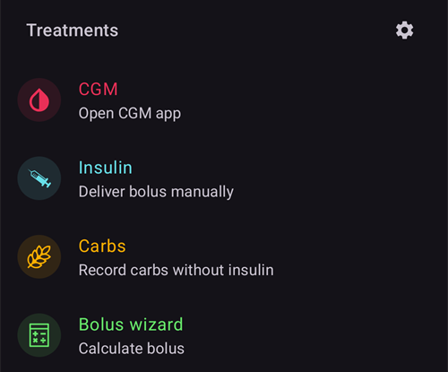
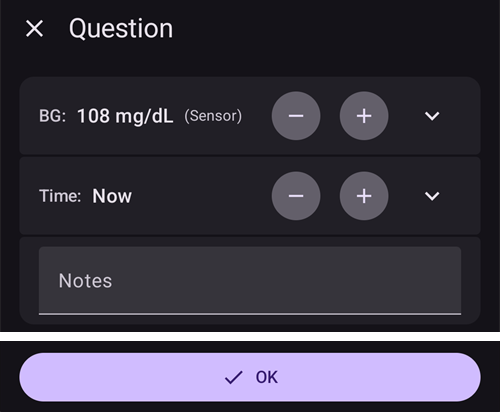

# Ekrany AAPS

```{contents}
:backlinks: entry
:depth: 2
```

(the-homescreen)= (AapsScreens-the-homescreen)=

## Ekran główny


To pierwszy ekran, który zobaczysz po otwarciu **AAPS**. Zawiera większość informacji potrzebnych na co dzień.

### Sekcja A – Górny pasek

* **Menu** (☰) po lewej otwiera panel nawigacji z pozycjami **Historia leczenia**, **Przegląd historii**, **Statystyki**, **Pomocnik profilu**, **Konserwacja**, **Kreator konfiguracji**, **Konfiguracja** i innymi.
* **Pasek wyszukiwania** znajduje ustawienia, okna i dokumentację – po prostu zacznij pisać (zobacz [Wyszukiwanie globalne](../DailyLifeWithAaps/GlobalSearch.md)).
* Ikona **Ustawienia** (koło zębate) po prawej otwiera wszystkie [ustawienia](../SettingUpAaps/Preferences.md).

(aaps-screens-profile--target)=

### Sekcja B – Blok stanu

#### Aktualna glikemia

Ostatni odczyt glikemii z CGM jest pokazany w dużym kole po lewej, razem z różnicą do poprzedniego odczytu (delta) i wiekiem odczytu.

Kolor wartości BG pokazuje jej położenie względem ustawionego [zakresu](#Preferences-range-for-visualization).

* zielony = w zakresie
* czerwony = poniżej zakresu
* żółty = powyżej zakresu

  

(loop-status)= (AapsScreens-loop-status)=

#### Status pętli


Obok koła BG ikona pokazuje tryb pracy pętli (na obrazku od góry do dołu):

1. Zielone koło = [zamknięta pętla](#KeyAapsFeatures-ClosedLoop), pętla działa
2. Fioletowe koło z kropkowaną linią = [zawieszenie przy niskiej glikemii (LGS)](#KeyAapsFeatures-LGS)
3. Niebieskie koło z kropkowaną linią = [otwarta pętla](#KeyAapsFeatures-OpenLoop)
4. Czerwone koło z krzyżykiem = pętla wyłączona (nie działa na stałe)
5. Czerwona ikona pauzy = pętla wstrzymana (czasowo zatrzymana, ale insulina bazowa jest podawana) – pozostały czas jest pokazany obok ikony
6. Szare koło z wtyczką = pompa odłączona (czasowo brak jakiegokolwiek podawania insuliny) – pozostały czas jest pokazany obok ikony

Naciśnij ikonę, aby otworzyć okno pętli. Zawartość okna zależy od aktualnego stanu:

* Gdy pętla **działa** (zamknięta, otwarta lub LGS), możesz zmienić tryb pracy (Zamknięta pętla, Zawieszenie przy niskiej glikemii, Otwarta pętla lub Wyłącz pętlę), **wstrzymać** pętlę albo **odłączyć** pompę na wybrany czas.
* Gdy pętla jest **wyłączona**, możesz ją znowu włączyć, wybierając tryb pracy, albo odłączyć pompę.
* Gdy pętla jest **wstrzymana**, możesz ją **wznowić**, odłączyć pompę albo wybrać nowy czas w **Wstrzymaj pętlę**, aby przedłużyć wstrzymanie.
* Gdy pompa jest **odłączona**, możesz ją **połączyć ponownie** albo wybrać nowy czas w **Odłącz pompę**, aby przedłużyć odłączenie.

Gdy przedłużasz wstrzymanie lub odłączenie, nowy czas **liczy się od teraz**: zastępuje pozostały czas, a nie jest do niego dodawany. Nie musisz najpierw wznawiać ani ponownie łączyć.

Okno, gdy pętla działa w trybie zamkniętej pętli:


Okno, gdy pętla jest wstrzymana, z przyciskiem **Wznów** i czasami do przedłużenia wstrzymania:


Okno, gdy pompa jest odłączona, z przyciskiem **Połącz ponownie pompę** i czasami do przedłużenia odłączenia:


Okno w trybie zawieszenia przy niskiej glikemii, w otwartej pętli i przy wyłączonej pętli różni się tylko trybami pracy, które oferuje:


Tak wygląda ekran główny w każdym trybie. Kolorowy pasek na górze wykresu zmienia się w chwili przełączenia.

Zawieszenie przy niskiej glikemii:


Otwarta pętla:


Pętla wyłączona:


Pętla wstrzymana – pozostały czas jest pokazany obok ikony:


Pompa odłączona – pozostały czas jest pokazany obok ikony. Przyciski leczenia zostają na pasku QuickLaunch, więc nadal możesz zapisać insulinę podaną penem lub węglowodany:


Po każdym wyborze trzeba potwierdzić.

```{admonition} Alarm: pompa nie zaakceptowała zerowej bazy tymczasowej :class: warning Gdy pompa jest odłączona, **AAPS** utrzymuje na pompie zerową bazę tymczasową i ustawia ją ponownie, jeśli jej brakuje. Jeśli to nadal się nie udaje po 10 minutach, **AAPS** włącza pilny alarm: *"Pompa nie zaakceptowała zerowej bazy tymczasowej (TBR). Może nadal podawać insulinę bazową. Sprawdź pompę."* Alarm powtarza się co 15 minut, aż zerowa baza tymczasowa zostanie ustawiona albo odłączenie się skończy. Jeśli go zobaczysz, sprawdź pompę: może ona podawać insulinę bazową, chociaż **AAPS** pokazuje ją jako odłączoną.

    <br />Uwaga: dostępne tryby zależą od postępu w [Zadaniach](../SettingUpAaps/CompletingTheObjectives.md) – Zamknięta pętla i LGS stają się dostępne dopiero po ich ukończeniu.
    
    (aaps-screens-bg-warning-sign)=
    #### Znak ostrzeżenia BG
    
    Jeśli **AAPS** wykryje problem z odczytami BG, które otrzymuje, na dolnym pasku ekranu głównego pojawia się skrót do Twojego źródła BG (nazwany jak to źródło, np. **xDrip+ BG**) z czerwonym znakiem ostrzeżenia. Dotknij go, aby otworzyć [ekran źródła BG](#aaps-screens-bg-source).
    
    ##### Zduplikowane dane BG
    
    Czerwony znak ostrzeżenia oznacza, że musisz natychmiast działać: otrzymujesz **zduplikowane dane BG**, przez co pętla nie może dobrze pracować. **AAPS** nie może wiarygodnie obliczyć trendu BG ze zduplikowanych odczytów, więc przestaje robić korekty.
    
    Jeśli Twoja pętla była zamknięta, **AAPS** przełącza ją w tryb [zawieszenia przy niskiej glikemii (LGS)](#KeyAapsFeatures-LGS): ikona pętli staje się fioletowa.
    
      
    
    Naciśnij ikonę pętli: karta **Ograniczenia** na górze powie Ci dlaczego: "BgQualityCheck: Tryb LGS z powodu zduplikowanych wartości w źródle glikemii".
    
      
    
    ```{admonition} Twoja pętla działa w trybie zawieszenia przy niskiej glikemii
    :class: note
    Pętla nadal działa, ale tylko po to, by chronić Cię przed niskim poziomem: **AAPS** może nadal zmniejszać lub wstrzymywać bazę, ale nie poda żadnej insuliny korekcyjnej, dopóki nie rozwiążesz tego problemu!
    

Musisz sprawdzić, skąd biorą się zduplikowane BG:

* Czy w Twojej stronie Nightscout jest włączony Dexcom bridge? Wyłącz bridge: przejdź do panelu administracyjnego Twojej instancji Nightscout, edytuj zmienną "enable" i usuń z niej część "bridge". (For Heroku [details can be found here](https://nightscout.github.io/troubleshoot/troubleshoot/#heroku).)
* Czy kilka źródeł wysyła Twoje BG do Nightscout? Jeśli używasz aplikacji BYODA, włącz wysyłanie w **AAPS**, ale nie włączaj go w xDrip, jeśli go używasz.
* Czy masz obserwujących, którzy odbierają Twoje BG, ale też wysyłają je ponownie do Twojej strony Nightscout?
* Ostatnia możliwość: w [ustawieniach NSClient](#Preferences-nsclient) wybierz ustawienia synchronizacji i wyłącz opcję "Odbieraj dane CGM z NS".

Aby od razu usunąć ostrzeżenie i znowu włączyć korekty pętli, usuń zduplikowane wpisy na ekranie źródła BG: dotknij skrótu na dolnym pasku. Zduplikowany odczyt jest zaznaczony na czerwono. Przytrzymaj odczyt, aby zacząć zaznaczanie, zaznacz duplikaty i dotknij ikony kosza w prawym górnym rogu.


Jednak gdy duplikatów jest dużo, łatwiej może być

* [zrobić kopię zapasową ustawień](../Maintenance/ExportImportSettings.md),
* zresetować bazę danych w menu konserwacji i
* ponownie [zaimportować ustawienia](../Maintenance/ExportImportSettings.md)

    {admonition} Sam przełącz z powrotem na zamkniętą pętlę
    :class: important
    **AAPS** nie wraca sam do trybu **Zamknięta pętla**, gdy duplikaty znikną. Naciśnij ikonę pętli na ekranie głównym i znowu wybierz **Zamknięta pętla**.

##### Płaskie dane BG

Przy niektórych źródłach BG (Libre 1, AiDEX, Glutec, Medtronic i źródła, które nie podają typu sensora) **AAPS** sprawdza też odczyty, które się nie zmieniają: jeśli BG zmieniła się o mniej niż 2 mg/dl (0,1 mmol/l) w ciągu 45 minut, dane są uznawane za błędne. Skrót do źródła BG pokazuje wtedy czerwony znak płaskiego trendu, a pętla zatrzymuje każdą wysoką bazę tymczasową i nie podaje insuliny korekcyjnej, dopóki odczyty znowu się nie zmienią. Sprawdź sensor i aplikację, która wysyła odczyty.

##### Nieregularne dane BG

Gdy odczyty przychodzą w nieregularnych odstępach lub części brakuje, **AAPS** oblicza wartości 5-minutowe z odczytów, które ma. Dzieje się tak np. po zmianie sensora albo przy sensorach Libre, których czas przesuwa się o minutę lub dwie co kilka godzin. Pętla działa dalej i nie musisz nic robić. **AAPS** 4 nie pokazuje już z tego powodu żółtego znaku ostrzeżenia.

#### Aktualny profil

Aktualny profil jest pokazany obok ikony gwiazdki.

Dotknij nazwy profilu, aby otworzyć [ekran profilu](#aaps-screens-profile), gdzie możesz zobaczyć szczegóły profilu i [przełączać się między profilami](../DailyLifeWithAaps/ProfileSwitch-ProfilePercentage.md).

Aby **zmienić procent profilu** (i czas jego trwania), dotknij nazwy profilu, a potem okrągłego przycisku **▶** (Aktywuj) w prawym dolnym rogu ekranu profilu. W **AAPS** 3.x ten ekran otwierał się po przytrzymaniu nazwy profilu; w **AAPS** 4 przytrzymanie nic nie robi. Krok po kroku: [Zmiana procentu profilu](#ProfileSwitch-change-percentage).


1. Zwykły widok przy aktywacji standardowego profilu.
2. Zmiana profilu z procentem 90% i pozostałym czasem 9 minut – nazwa profilu staje się żółta, gdy działa tymczasowa zmiana profilu.
3. Zmiana profilu z przesunięciem czasu o 1 godzinę i pozostałym czasem 9 minut.

#### Cel


Aktualny docelowy poziom glikemii jest pokazany pod nazwą profilu.

Krótko naciśnij cel, aby otworzyć ekran **[Cel tymczasowy](../DailyLifeWithAaps/TempTargets.md)**.

1. Zwykły widok: zakres docelowy ustawiony w Twoim profilu.
2. Jeśli ustawiony jest cel tymczasowy, cel staje się żółty/pomarańczowy z ikoną użytego ustawienia, a pozostały czas w minutach jest pokazany w nawiasach.

(AapsScreens-visualization-of-dynamic-target-adjustment)=

#### Wizualizacja dynamicznej zmiany celu

Gdy używasz [algorytmu SMB](#Config-Builder-aps) i funkcji [Autosens](#Open-APS-features-autosens), **AAPS** może dynamicznie zmieniać Twój cel zależnie od wrażliwości.

Włącz jedną lub obie poniższe opcje w [ustawieniach OpenAPS SMB](#Preferences-openaps-smb-settings):

* „Wrażliwość podnosi cel glikemii” i/lub
* „Oporność obniża cel glikemii”

Jeśli **AAPS** wykryje oporność lub wrażliwość, cel zmieni się w stosunku do ustawionego w profilu, a pokazany cel zmienia kolor, aby pokazać tę zmianę.

(aaps-screens-iob-cob-basal-sens)=

#### IOB, COB, baza i wrażliwość


1. **Strzykawka**: insulina aktywna (IOB) – ilość aktywnej insuliny w Twoim organizmie  
    Insulina aktywna wynosiłaby zero, gdyby działała tylko standardowa baza i nie zostało nic insuliny z wcześniejszych bolusów. 
    * IOB może być ujemne, jeśli niedawno były okresy zmniejszonej bazy.
    * Naciśnij ten element, aby zobaczyć podział na insulinę z bolusa i z bazy (pierwsze okno na obrazku – tu z ujemnym IOB po okresie zmniejszonej bazy)
2. **Kłos**: [węglowodany aktywne (COB)](../DailyLifeWithAaps/CobCalculation.md) – jeszcze niewchłonięte węglowodany, które zjadłeś wcześniej
3. Morski przycisk po prawej pokazuje **aktualne podawanie bazy**: płaska linia, gdy działa baza z profilu, zmieniona ikona, gdy aktywna jest baza tymczasowa
4. **Wiersz procentów** pokazuje aktualną wrażliwość ([Autosens](#Open-APS-features-autosens) / [DynamicISF](../DailyLifeWithAaps/DynamicISF.md)). Gdy pętla zmienia Twój ISF, wiersz pokazuje też ISF z profilu, strzałkę i ISF, którego pętla używa teraz, np. "80% 2.0 ↗ 2.5". Naciśnij go, aby zobaczyć wartość Autosens i efektywny ISF (drugie okno na obrazku). Jeśli pętla pracuje z inną wartością niż ostatni wynik Autosens (np. dlatego, że cel tymczasowy zmienia Twoją wrażliwość), okno pokazuje też tę wartość jako **Autosens w algorytmie**. Gdy Autosens jest wyłączony, pętla używa ISF z profilu i efektywny ISF nie jest pokazany.

Okno IOB, otwarte przez naciśnięcie elementu IOB:


Naciśnij morski przycisk, aby zobaczyć działającą bazę tymczasową, kiedy się zaczęła i jak długo już działa:


(aaps-screens-carbs-required)=

#### Potrzebne węglowodany


Sugestie węglowodanów pojawiają się, gdy algorytm uzna, że potrzebujesz węglowodanów.

Dzieje się tak, gdy algorytm oref uzna, że nie może Cię uratować zerową bazą tymczasową i potrzebujesz węglowodanów.

Powiadomienia o węglowodanach są dużo dokładniejsze niż te z kalkulatora bolusa. Możesz zobaczyć sugestię węglowodanów, nawet gdy kalkulator bolusa nie pokazuje brakujących węglowodanów.

Jeśli chcesz, powiadomienia o potrzebnych węglowodanach mogą być wysyłane do Nightscout. Wtedy pojawi się i zostanie rozesłane ogłoszenie.

### Sekcja C – Wiersz stanu


Wiersz stanu daje wizualne ostrzeżenie dla

* Wiek wkłucia
* Wiek insuliny (ile dni zbiornik jest używany) i poziom w zbiorniku (jednostki)
* Wiek sensora
* Wiek i poziom baterii pompy (%)

Po przekroczeniu progu ostrzeżenia wartości są pokazane na żółto.

Po przekroczeniu progu krytycznego wartości są pokazane na czerwono.

The age is always shown in its short form, whatever the screen size: *4h* on the first day, *3d4h* later.

Progi możesz zmienić małą ikoną **Ustawienia**, widoczną, gdy wiersz stanu jest **rozwinięty** (strzałka po prawej) – zobacz [Wskaźniki stanu](#Preferences-status-lights).

Rozwinięty panel stanu ma też na końcu niektórych wierszy przycisk do zapisania zmiany, który zeruje odpowiedni wiek: **Dodaj** w wierszu **Sensor** zapisuje założenie sensora. Jeśli Twoja pompa to obsługuje, **Napełnij/Wypełnij** pojawia się w wierszach **Kaniula** (lub **Pompa bezdrenowa**) i **Insulina**, a **Dodaj** w wierszu **Bateria pompy**.


Zależnie od pompy możesz nie mieć wszystkich tych ikon.

(screens-sensor-level-battery)=

#### Poziom sensora (bateria)

Działa dla CGM z dodatkowym nadajnikiem, np. MiaoMiao 2. (Technicznie sensor musi wysyłać informację o poziomie baterii do xDrip.)

Progi możesz ustawić w [Wskaźnikach stanu](#Preferences-status-lights).

(aaps-screens-main-graph)=

### Sekcja D – Wykres główny


Wykres pokazuje Twoją glikemię (BG) odczytaną z systemu monitorowania glukozy (CGM).

Przewijaj wykres i rozsuwaj go dwoma palcami, aby zmienić widoczny zakres czasu.

Zielony obszar to Twój zakres docelowy.

Ten wykres pokazuje też:

* Ręczne bolusy: niebieski trójkąt tuż nad krzywą BG, skierowany w dół na odczyt z tej chwili, z ilością insuliny
* Wpisy węglowodanów: pomarańczowy trójkąt tuż pod krzywą BG, skierowany w górę na odczyt, z ilością węglowodanów. Posiłek wpisany razem z bolusem wygląda jak jeden znacznik, przedzielony odczytem.
* Trójkąty mają trzy rozmiary (mały, średni, duży), zależnie od ilości w porównaniu z największą tego dnia. Jeśli w tym czasie nie ma odczytu BG (przerwa w danych sensora), trójkąt jest rysowany na dole wykresu.
* Pomiary BG i kalibracje: rysowane na poziomie ich zmierzonej wartości, więc możesz porównać je z krzywą sensora
* Cel ustawiony w profilu lub zmieniony przez cel tymczasowy: zielona linia
* Zmiany profilu: ikony gwiazdek na górze wykresu
* Status pętli: kolorowy pasek na górze wykresu, gdy [tryb pracy](#AapsScreens-loop-status) jest inny niż zamknięta pętla: niebieski = otwarta pętla, fioletowy = LGS, czerwony = pętla wyłączona, żółty = pętla wstrzymana, szary = pompa odłączona, pomarańczowy = superbolus (na zrzucie ekranu: fioletowy, potem żółty). Historia tych zmian jest pokazana w [Trybie pracy](#AapsScreens-running-mode)
* [SMB](#Open-APS-features-super-micro-bolus-smb) nie są rysowane na wykresie BG (byłby jeden co kilka minut): są pokazane na [wykresie IOB](#aaps-screens-iob).

Dotknij **pomiaru BG** na wykresie, aby zobaczyć jego wartość i notatkę, jeśli ją napisałeś.

(aaps-screens-graph-press-and-hold)=

#### Zobacz wartości w danym czasie

**Przytrzymaj** przez chwilę wykres BG, aby zobaczyć wartości przy jednym odczycie. Kropka zaznacza najbliższy odczyt, przerywana linia jest rysowana w tym czasie na wszystkich wykresach, a okienko na górze wykresu pokazuje:

* czas i wartość BG
* IOB, COB (tylko gdy jest większe niż 0 g) i dawkę bazową w tym czasie – ikona bazy pokazuje, czy działała baza tymczasowa, tak jak na ekranie głównym
* każdy bolus, SMB lub węglowodany w tym czasie, z tymi samymi trójkątami co na wykresach

Trzymaj palec na ekranie i przesuwaj go w lewo lub w prawo, aby przechodzić od jednego odczytu do następnego. Przy każdym odczycie czujesz lekkie stuknięcie, a wykres się wtedy nie przewija. Okienko zostaje jeszcze przez 2 sekundy po podniesieniu palca.

Tak samo działa to na [dodatkowych wykresach](#aaps-screens-additional-graphs) pod wykresem BG (IOB, COB...): przytrzymaj dowolny z nich.


(aaps-screens-graph-clock-change)=

#### Clock changes

When the clock of the phone jumped, at a daylight saving change or in a new time zone, a dashed vertical line marks that moment in the BG graph, with a small clock icon at its foot. The same dashed line runs through the [additional graphs](#aaps-screens-additional-graphs) below.


(AapsScreens-activate-optional-information)=

#### Włącz dodatkowe informacje

Naciśnij ikonę **ołówka** w prawym górnym rogu wykresu, aby otworzyć ustawienia wykresu:


* **Wysokość wykresu** zmienia wysokość rysowanego wykresu.
* **ACT** nakłada krzywą aktywności insuliny: ciągła żółtozielona linia <span style="background:#141218;color:#D3F166;padding:0 0.3em;border:1px solid #141218;border-radius:4px">━━━━</span> (nie myl jej z kropkowaną żółtą prognozą UAM)
* **PRED** nakłada [linie prognozy](#aaps-screens-prediction-lines) (zobacz niżej)

(aaps-screens-prediction-lines)=

#### Linie prognozy

Gdy **PRED** jest włączone, AAPS rysuje swoje prognozy jako **kropkowane linie** na prawo od linii „teraz”. Każda prognoza ma swój kolor. Ciemny motyw używa jaśniejszych odcieni tych samych kolorów, a linia w zielonym zakresie docelowym może wyglądać trochę bardziej zielono.

| Linia                        | Jasny motyw                                                                                                                       | Ciemny motyw                                                                                                                       | Co prognozuje                                |
| ---------------------------- | --------------------------------------------------------------------------------------------------------------------------------- | ---------------------------------------------------------------------------------------------------------------------------------- | -------------------------------------------- |
| **IOB** (niebieska)          | <span style="background:#FFFFFF;color:#1E88E5;padding:0 0.3em;border:1px solid #CCCCCC;border-radius:4px">●●●●</span>             | <span style="background:#141218;color:#64B5F6;padding:0 0.3em;border:1px solid #141218;border-radius:4px">●●●●</span>              | tylko insulina                               |
| **COB** (pomarańczowa)       | <span style="background:#FFFFFF;color:#FB8C00;padding:0 0.3em;border:1px solid #CCCCCC;border-radius:4px">●●●●</span>             | <span style="background:#141218;color:#FFB74D;padding:0 0.3em;border:1px solid #141218;border-radius:4px">●●●●</span>              | węglowodany aktywne                          |
| **UAM** (żółta)              | <span style="background:#FFFFFF;color:#C9BD60;padding:0 0.3em;border:1px solid #CCCCCC;border-radius:4px">●●●●</span>             | <span style="background:#141218;color:#E6D39A;padding:0 0.3em;border:1px solid #141218;border-radius:4px">●●●●</span>              | nieogłoszony posiłek                         |
| **ZT** (cyjan)               | <span style="background:#FFFFFF;color:#00D2D2;padding:0 0.3em;border:1px solid #CCCCCC;border-radius:4px">●●●●</span>             | <span style="background:#141218;color:#4DD4D4;padding:0 0.3em;border:1px solid #141218;border-radius:4px">●●●●</span>              | zerowa baza tymczasowa (insulina zatrzymana) |
| **aCOB** (jasnopomarańczowa) | <span style="background:#FFFFFF;color:rgba(251,140,0,0.5);padding:0 0.3em;border:1px solid #CCCCCC;border-radius:4px">●●●●</span> | <span style="background:#141218;color:rgba(255,183,77,0.5);padding:0 0.3em;border:1px solid #141218;border-radius:4px">●●●●</span> | tylko starszy algorytm AMA                   |

Gdy dwie prognozy dają te same wartości, ich kropki nakładają się i widzisz tylko jeden kolor (np. UAM na IOB, gdy BG jest płaska).

* **COB** line (orange): [carbs on board](CobCalculation.md) (orange is used throughout AAPS for COB and carbs)
    
    Ta linia prognozy pokazuje, dokąd pójdzie Twoja BG (nie samo COB!) przy obecnych ustawieniach **profilu**, przy założeniu, że odchylenia z powodu wchłaniania węglowodanów pozostaną stałe. Ta linia pojawia się tylko wtedy, gdy są znane COB.

* Linia **IOB** (niebieska): insulina aktywna (w całym AAPS niebieski oznacza IOB i insulinę)
    
    Ta linia prognozy pokazuje, co by się stało pod wpływem samej insuliny. Na przykład gdy podasz insulinę, a potem nie zjesz żadnych węglowodanów.

* Linia **ZT** (cyjan): zerowa baza tymczasowa (prognozowana BG, gdyby ustawić bazę tymczasową 0%)
    
    Ta linia prognozy pokazuje, jak zmieniłby się przebieg BG, gdyby pompa zatrzymała całe podawanie insuliny (TBR 0%). Linia kończy się, gdy wzrośnie powyżej Twojego celu.
    
    *Ta linia pojawia się tylko wtedy, gdy używasz algorytmu [SMB](#Config-Builder-aps).*

* Linia **UAM** (żółta): [nieogłoszone posiłki](#SensitivityDetectionAndCob-sensitivity-oref1)
    
    Nieogłoszone posiłki oznaczają, że wykryto duży wzrost poziomu glukozy z powodu posiłku, adrenaliny lub innych czynników. Ta linia prognozy jest podobna do **pomarańczowej linii COB**, ale zakłada, że odchylenia będą stopniowo maleć w stałym tempie (przez przedłużenie obecnego tempa spadku).
    
    *Ta linia pojawia się tylko wtedy, gdy używasz algorytmu [SMB](#Config-Builder-aps), opcja **Włącz UAM** jest włączona w ustawieniach OpenAPS SMB, a BG rośnie bardziej, niż wyjaśnia to sama insulina.*

* Linia **aCOB** (jasna, półprzezroczysta pomarańczowa): przyspieszone wchłanianie węglowodanów
    
    Similar to COB, but assuming a static 10 mg/dL/5m (0.555 mmol/L/5m) carb absorption rate. Przestarzałe i mało przydatne.
    
    *Ta linia pojawia się tylko wtedy, gdy używasz starszego algorytmu [AMA](#Config-Builder-aps).*

Zwykle Twoja prawdziwa krzywa glukozy leży pośrodku tych linii albo blisko tej, której założenia najbardziej pasują do Twojej sytuacji.

(aaps-screens-how-predictions-become-a-dosing-decision)=

#### Jak AAPS zamienia prognozy w decyzję o dawce

AAPS nie dawkuje insuliny tylko na podstawie aktualnej BG – w każdym cyklu pętli (mniej więcej co 5 minut) patrzy razem na wszystkie powyższe linie prognozy i wybiera najbezpieczniejsze działanie.

Główna zasada to **najpierw bezpieczeństwo**: jeśli *którakolwiek* linia prognozy, w dowolnym przedziale czasu, spada poniżej Twojego dolnego progu bezpieczeństwa, AAPS ustawia zerową bazę tymczasową (baza tymczasowa 0%) i wstrzymuje dalszą insulinę, nawet jeśli Twoja aktualna BG jest wysoka. Dopiero gdy każda linia prognozy pozostaje powyżej tego progu, AAPS rozważy podanie większej ilości insuliny.

Gdy podanie większej ilości insuliny jest bezpieczne, AAPS patrzy, gdzie według połączonych prognoz BG w końcu się znajdzie (**eventual BG**, końcowa BG), i oblicza, jaka korekta jest potrzebna, aby sprowadzić tę końcową BG do celu – podaną jako zwiększona baza tymczasowa albo (jeśli włączony jest algorytm oref1/[SMB](#Open-APS-features-super-micro-bolus-smb)) jako mały natychmiastowy bolus. Jeśli BG jest teraz wysoka, ale już sama spada wystarczająco szybko, AAPS poczeka, a nawet może zmniejszyć dawkę bazową, zamiast dodawać insulinę, która tylko pogłębiłaby późniejszy niski poziom.

Przykłady tej logiki decyzji z prawdziwymi zrzutami ekranu znajdziesz w [scenariuszach dawkowania w Poradniku dla lekarzy](#clinicianguide-dosing-scenarios) – są napisane dla lekarzy, ale dotyczą każdego użytkownika AAPS.

*Pełny techniczny opis, jak obliczane są te prognozy i wynikająca z nich decyzja o dawce, znajdziesz w [dokumentacji determine-basal OpenAPS](https://openaps.readthedocs.io/en/latest/docs/While%20You%20Wait%20For%20Gear/Understand-determine-basal.html).*

#### Dawki Bazowe

**Ciągła niebieska** linia pokazuje bazę podawaną przez pompę, czyli rzeczywiste podawanie w czasie.

**Kropkowana niebieska** linia pokazuje, jaka byłaby dawka bazowa bez tymczasowych zmian bazy (TBR).

Gdy podawana jest standardowa dawka bazowa, pole pod krzywą jest ciemnoniebieskie. Gdy dawka bazowa jest czasowo zmieniona (zwiększona lub zmniejszona), pole pod krzywą jest jasnoniebieskie.

#### Aktywność

**Cienka żółta** linia pokazuje aktywność insuliny.

Opiera się na oczekiwanym spadku BG przez insulinę w Twoim organizmie, gdyby nie było innych czynników (np. węglowodanów).

(AapsScreens-section-g-additional-graphs)= (aaps-screens-additional-graphs)=

### Sekcja E – Dodatkowe wykresy

Pod wykresem głównym możesz włączyć dodatkowe wykresy. W [trybie uproszczonym](#preferences-simple-mode) dodatkowe wykresy są ustawione z góry i nie można ich zmienić. Wyłącz **Tryb uproszczony**, jeśli chcesz sam ustawić dodatkowe wykresy.

Dodatkowe wykresy podążają za wykresem głównym: gdy przewijasz lub powiększasz wykres BG, przesuwają się razem z nim. Przesunięcie palcem w bok na dodatkowym wykresie też przewija wszystkie wykresy. Nie mają własnych oznaczeń czasu – odczytaj czas z wykresu BG.

Aby ustawić dodatkowy wykres, naciśnij ikonę **ołówka** w jego prawym górnym rogu:


Wybierz elementy odpowiadające danym, które chcesz widzieć na tym wykresie; przycisk **Usuń** usuwa wykres.

Aby utworzyć kolejny wykres, naciśnij **Dodaj wykres** pod ostatnim wykresem i tak samo wybierz jego elementy:


Nowy wykres jest dodawany pod pozostałymi – tu drugi dodatkowy wykres z **SENS%** i **DEV**:


Większości użytkowników wystarcza taki układ dodatkowych wykresów:

* Wykres 1 z IOB, COB, zmianą wrażliwości
* Wykres 2 z odchyleniami i BGI.

#### Całkowita insulina (ABS)

Aktywna insulina razem z bolusami **i bazą**.

(aaps-screens-iob)=

#### Aktywna insulina (IOB)

Pokazuje insulinę aktywną (= insulinę, która nadal działa w Twoim organizmie). Obejmuje insulinę z bolusów i baz tymczasowych (**ale nie dawki bazowe ustawione w profilu**).

Gdyby w czasie DIA nie było [SMB](#Open-APS-features-super-micro-bolus-smb), bolusów ani TBR, ta wartość byłaby zerowa.

SMB są pokazane na tym wykresie jako niebieskie trójkąty w trzech rozmiarach, zależnie od ilości w porównaniu z największym SMB tego dnia.

IOB może być ujemne, jeśli od dłuższego czasu nie masz już insuliny z bolusa, a baza tymczasowa jest zerowa lub niska.

Spadek zależy od Twoich [ustawień DIA i typu insuliny](#Config-Builder-insulin-dia).

#### Węglowodany aktywne (COB)

Pokazuje węglowodany aktywne (= węglowodany w Twoim organizmie, które jeszcze się nie wchłonęły).

Spadek zależy od [odchyleń, które wykrywa algorytm](../DailyLifeWithAaps/CobCalculation.md).

Jeśli algorytm wykryje szybsze wchłanianie węglowodanów niż oczekiwane, poda insulinę, a to zwiększy IOB (mniej lub bardziej, zależnie od ustawień bezpieczeństwa).

#### Zmiana wrażliwości (SENS%)

Pokazuje wrażliwość wykrytą przez [Autosens](#Open-APS-features-autosens).

Wrażliwość to obliczona wrażliwość na insulinę, zmieniona przez wysiłek, hormony itp.

Pamiętaj: musisz być w [Zadaniu 8](#objectives-objective8), aby detekcja wrażliwości/[Autosens](#Open-APS-features-autosens) mogła automatycznie dostosowywać ilość podawanej insuliny. Zanim osiągniesz to zadanie, linia na wykresie jest tylko informacją.

### Zmienna wrażliwość (VSENS)

Pokazuje wrażliwość obliczoną przez [DynamicISF](../DailyLifeWithAaps/DynamicISF.md). Wypełnione tylko wtedy, gdy używasz tej funkcji.

(screen-heart-rate-steps)=

#### Tętno (HR) i kroki

Te dane mogą być dostępne, gdy używasz [smartwatcha z Wear OS](../WearOS/WearOsSmartwatch.md). Włącz je w aplikacji **AAPS** Wear i daj zgodę na dostęp do danych o zdrowiu.

Steps are drawn as columns, and the heart rate as a curved line that breaks where the watch sent no data.

#### Odchylenia (DEV)

* **Szare** słupki pokazują odchylenie z powodu węglowodanów.
* **Zielone** słupki pokazują, że BG jest wyższa, niż oczekiwał algorytm. Zielone słupki zwiększają oporność w [Autosens](#Open-APS-features-autosens).
* **Czerwone** słupki pokazują, że BG jest niższa, niż oczekiwał algorytm. Czerwone słupki zwiększają wrażliwość w [Autosens](#Open-APS-features-autosens).
* **Żółte** słupki pokazują odchylenie z powodu UAM.
* **Czarne** słupki pokazują małe odchylenia, których nie bierze się pod uwagę przy wrażliwości

#### Wpływ na glikemię (-BGI)

Ta linia pokazuje, o ile BG „powinna” wzrosnąć lub spaść tylko z powodu aktywności insuliny.


Dobrze jest pokazywać tę linię razem ze słupkami odchyleń. They share the same scale, but it is a different one than the other optional data, so it is a good idea to display them on a separate graph, as shown above. Porównanie linii BGI i słupków odchyleń to kolejny sposób, by zrozumieć, jak zmienia się **BG**. Tutaj, w czasie oznaczonym **1**, słupki odchyleń są wyraźnie nad linią BGI: BG rośnie bardziej, niż wyjaśnia to sama aktywność insuliny (np. po węglowodanach). W czasie oznaczonym **2** słupki odchyleń są poniżej zera (czerwone): BG jest niższa, niż oczekiwał algorytm.

### Sekcja F – Pasek QuickLaunch


Pływający pasek na dole ekranu zawiera Twoje akcje **[QuickLaunch](../DailyLifeWithAaps/QuickLaunch.md)**. Małe **koło zębate** otwiera ustawienia QuickLaunch, gdzie wybierasz, które przyciski są pokazane (leczenie, wpisy portalu opieki, akcje CGM, ekrany z panelu **Zarządzaj**, przyciski [Szybkiego kalkulatora](../DailyLifeWithAaps/QuickWizards.md), [Sceny](../DailyLifeWithAaps/Scenes.md) i inne).

Typowe ustawienie jest pokazane wyżej: **Insulina**, **Węglowodany** i **Kalkulator bolusa**.

Gdy pompa jest **odłączona**, przyciski leczenia zostają na pasku, np. do zapisania insuliny podanej penem (zobacz [Insulina](#aaps-screens-buttons-insulin) niżej). Te same akcje są też dostępne w [panelu Leczenie](#aaps-screens-treatments-sheet) na dolnym pasku nawigacji.

(aaps-screens-buttons-insulin)=

#### Insulina


Aby podać określoną ilość insuliny bez użycia [kalkulatora bolusa](#aaps-screens-bolus-wizard).

Włączając **Rozpocznij TT WkrótcePosiłek**, możesz automatycznie uruchomić [cel tymczasowy „Wkrótce posiłek”](#TempTargets-eating-soon-temp-target).

If you do not want to bolus through the pump but record an insulin amount (i.e. insulin given by pen) enable "**Bolus will be recorded only (not delivered by pump)**". Dodatkowy wiersz **Czas**, ustawiony na **Teraz**, pozwala zapisać wstrzyknięcie insuliny z przeszłości: użyj **-** / **+**, aby go zmienić, albo dotknij strzałki, aby wpisać minuty lub wybrać datę i godzinę.

 

Przyciskami **+0.5 / +1.0 / +2.0** możesz szybko zwiększyć ilość insuliny. Wartości przyrostu możesz zmienić w [ustawieniach kalkulatora bolusa](#Preferences-deliver-this-part-of-bolus-wizard-result).

Okna insuliny możesz też używać, gdy pompa jest wstrzymana lub odłączona, np. aby zapisać insulinę wstrzykniętą penem. In this case, "**Bolus will be recorded only (not delivered by pump)**" is forced on (shown in red) and additional fields appear to select the insulin type and a **Time** offset for an injection made in the past:


#### Węglowodany


Aby zapisać węglowodany bez podawania bolusa.

Niektóre [ustawione z góry cele tymczasowe](#TempTargets-hypo-temp-target) (Hipo, Wkrótce posiłek, Aktywność) możesz uruchomić od razu przełącznikami na górze.

**Czas węglowodanów**: kiedy będziesz jeść lub jadłeś węglowodany.

**Duration**: To be used for ["extended carbs"](ExtendedCarbs.md). Ten wiersz jest zwinięty, abyś nie wpisał do niego gramów przez pomyłkę: użyj **-** / **+**, aby go zmienić, albo dotknij strzałki, aby go otworzyć i wpisać wartość.

Przyciskami **+5 / +10 / +20** możesz szybko zwiększyć ilość węglowodanów.

#### Szybki kalkulator

Łatwo wpisz ilość węglowodanów i ustaw podstawy obliczeń jednym, wcześniej ustawionym przyciskiem.

Szczegóły ustawiasz w [Szybkim kalkulatorze](../DailyLifeWithAaps/QuickWizards.md).

(aaps-screens-treatments-sheet)=

### Sekcja G – Dolny pasek nawigacji

Dolny pasek nawigacji daje dostęp do:

* **Leczenie** – panel szybkich akcji z Twoimi akcjami leczenia:
    
    

* **Sceny** – widoczne tylko wtedy, gdy masz co najmniej jedną [scenę](../DailyLifeWithAaps/Scenes.md) albo regułę **Automatyzacji** oznaczoną jako **Akcja użytkownika**. Otwiera panel, z którego możesz je uruchomić; znaczek pokazuje, ile możesz uruchomić w tej chwili. **Ołówek** na górze panelu otwiera **Zarządzaj → Sceny**.

* **Zarządzaj** – miejsce na wszystko, czym zarządzasz w **AAPS**: Profil, Ustawienia insuliny, Cel tymczasowy, Szybki kalkulator, Sceny, Automatyzacja, Żywność, Zmiana miejsca, Pompa i Autoryzowani opiekunowie. Pod nimi są akcje urządzeń i bazy, np. Założenie sensora i Baza tymczasowa. Niektóre pozycje pojawiają się tylko wtedy, gdy pasują do Twojego zestawu – np. Napełnij/Wypełnij i zmiana baterii zależą od pompy, a Baza tymczasowa, Bolus Przedłużony i wpisy portalu opieki są ukryte w [trybie uproszczonym](#preferences-simple-mode):
    
    

* **Zadania** – Twój postęp w [Zadaniach](../SettingUpAaps/CompletingTheObjectives.md); znaczek pokazuje, ile jest ukończonych. Ta pozycja znika, gdy wszystkie zadania są ukończone, i nie ma jej w **AAPSClient**.

(aaps-screens-notifications)=

#### Powiadomienia

Nad dolnym paskiem, po prawej, może pojawić się **dymek powiadomień**. Zbiera aktywne powiadomienia **AAPS**; mała liczba pokazuje, ile ich jest. Jego kolor zależy od najważniejszego z nich: czerwony dla pilnej wiadomości, zielony dla zwykłej informacji.


Dotknij dymka, aby otworzyć panel **Powiadomienie**. Każda wiadomość pokazuje czas, kiedy się pojawiła. Naciśnij **Zamknij** pod wiadomością, aby ją usunąć; niektóre wiadomości mają zamiast tego inny przycisk, który zabiera Cię do ustawienia wymagającego Twojej uwagi.


(bolus-wizard)= (aaps-screens-bolus-wizard)=

## Kalkulator bolusa


Gdy chcesz podać bolus do posiłku, zwykle robisz to właśnie tutaj.

### Sekcja I

Nagłówek **Obliczenie** pokazuje obliczony bolus. Jeśli insulina aktywna jest już większa niż obliczony bolus, kalkulator pokaże tylko ilość węglowodanów, których wciąż potrzebujesz.

Kalkulatora bolusa możesz używać przy każdej aktualnej **BG**, także gdy jest za wysoka lub za niska. Jeśli **BG** jest powyżej celu, do bolusa posiłkowego dodawana jest korekta. Jeśli **BG** jest poniżej celu, bolus jest zmniejszany, a jeśli insuliny aktywnej jest więcej, niż potrzeba, kalkulator zamiast insuliny pokazuje, ile węglowodanów jeszcze potrzebujesz.

Wiersz ikon pod nagłówkiem pokazuje, które dane wchodzą do obliczenia (BG, trend, IOB, cel tymczasowy, COB). Naciśnięcie ikony włącza / wyłącza tę pozycję w obliczeniu; ikona **(i)** pokazuje szczegółowe liczby obliczenia.

#### Kombinacje COB i IOB i co one oznaczają

* Ze względów bezpieczeństwa nie można wyłączyć IOB, gdy włączone jest COB, bo grozi to podaniem za dużej ilości insuliny, jeśli **AAPS** nie uwzględni tego, co już zostało podane.
* Jeśli włączysz COB i IOB, uwzględnione zostaną niewchłonięte węglowodany, które nie są jeszcze pokryte insuliną, oraz cała insulina podana jako TBR lub SMB.
* Jeśli włączysz IOB bez COB, **AAPS** uwzględni już podaną insulinę, ale nie odejmie jej od węglowodanów, które jeszcze mają się wchłonąć. Pojawia się wtedy komunikat o „brakujących węglowodanach”.
* If you bolus for **additional food** shortly after a meal bolus (e.g. additional dessert) it can be helpful to **disable all inputs**. W ten sposób dodawane są tylko nowe węglowodany, ponieważ główny posiłek niekoniecznie zostanie wchłonięty, więc IOB nie będzie dokładnie pasował do COB wkrótce po bolusie posiłkowym.
* Ze względów bezpieczeństwa **cel tymczasowy** jest uwzględniany w obliczeniu tylko wtedy, gdy sam włączysz tę pozycję.

(AapsScreens-section-j)=

### Sekcja J – Pola do wpisania

W polu **Węglowodany** wpisujesz szacowaną ilość węglowodanów **w gramach**, na którą chcesz podać bolus; przyciski **+** pod nim szybko dodają węglowodany. **AAPS** pracuje tylko z gramami: jeśli liczysz w wymiennikach węglowodanowych (WW) lub innych jednostkach (*np.* wymienniki "CHO" DAFNE), przelicz je na gramy przed wpisaniem. Zobacz [uwagę o wymiennikach węglowodanowych](#your-aaps-profile-insulin-to-carbs-ratio) na stronie o profilu.

#### Typ węglowodanów: pieczywo, ciasto lub pizza

Pod polem **Węglowodany** przyciski **Pieczywo**, **Ciasto** i **Pizza** mówią **AAPS**, jak szybko wchłania się posiłek. Przy **Ciasto** i **Pizza** bolus pokrywa teraz tylko część węglowodanów, a reszta jest dodawana później jako eCarbs. Procenty i czasy znajdziesz w części [Typ węglowodanów: pieczywo, ciasto lub pizza](#AapsScreens-carbs-type) na stronie o przedłużonych węglowodanach.

Wiersz **Korekta** służy do zmiany końcowej dawki, jeśli z jakiegoś powodu tego chcesz.

Tylko pole **Węglowodany** jest zawsze otwarte. Pozostałe wiersze (**Korekta**, **Czas węglowodanów**, **BG** i **Użyj procentów**) są zwinięte: pokazują swoją wartość z przyciskami **-** / **+**, więc możesz ją zmieniać małymi krokami. Dotknij strzałki, aby otworzyć wiersz i wpisać wartość, i dotknij jej ponownie, aby zamknąć wiersz. Dzięki temu nie wpiszesz przez pomyłkę gramów w pole **Korekta**.


Dotknij dowolnego miejsca w wierszu **Profil**, aby otworzyć listę profili, a potem dotknij nazwy, aby użyć tego profilu w tym obliczeniu.


Pole **Czas węglowodanów** służy do bolusa z wyprzedzeniem: możesz powiedzieć systemowi, że węglowodany pojawią się dopiero za jakiś czas. Możesz umieścić ujemną liczbę w tym polu, jeśli podajesz bolusa dla wcześniej zjedzonych węglowodanów.

**Ustaw alarm** (przypomnienie o jedzeniu): gdy wpiszesz czas węglowodanów w przyszłości, pojawia się przełącznik "**Ustaw alarm**", aby o podanej godzinie przypomnieć Ci, że masz zjeść węglowodany wpisane do **AAPS**:


The reminder starts when the bolus has been delivered. While it runs, a **Time to eat** bar on the main screen counts down, with **Stop** and **+5 min**. **+5 min** moves the end of the wait five minutes later, and the bar shows the total wait. When the time has come, the reminder rings with its own sound, a soft kitchen timer. Besides **Silence alarm** (the screen stays open) and **Silence and close**, the alarm screen offers **+5 min**, which starts a new five-minute wait. Once it has rung, the bar reads *The time is up* with **+5 min** and **Dismiss**; **Silence and close** removes the bar too. The bar and the alarm are also shown on **AAPSClient**, and on the [watch](#WearOsSmartwatch-wizard-carb-time). The reminder does not create a timer in your phone's clock app. If Android does not let **AAPS** set alarms, the wizard asks you to allow *Alarms and reminders* for **AAPS** in the Android settings. The bell is not offered for a carb time in the past.


Pole **BG** jest zwykle już wypełnione ostatnim odczytem z CGM. Jeśli nie masz działającego CGM, to pole będzie puste. Gdy odczyt jest świeży, wiersz **BG** pozostaje zwinięty. The field follows new readings while the wizard is open, until you change it yourself.

Przycisk wyniku na dole pokazuje proponowany bolus; po jego naciśnięciu musisz potwierdzić, zanim zostanie podana jakakolwiek insulina. While the confirmation is waiting, the loop gives no SMB, so the bolus you confirm is still right. If an SMB is being delivered at that moment, **OK** waits until it has finished.

Warto wiedzieć:

* Jeśli obliczony bolus jest większy niż Twój **[Maksymalny bolus](#Preferences-maximum-bolus)**, zostaje zmniejszony do maksymalnego bolusa, a potwierdzenie pokazuje ostrzeżenie "Zastosowano ograniczenie bolusa". [Szybki kalkulator](../DailyLifeWithAaps/QuickWizards.md) jest w takim przypadku odrzucany.
* When the bolus is only recorded (for example while the pump is disconnected), the "**Bolus will be recorded only (not delivered by pump)**" warning stays at the top of the dialog, also when you scroll.
* Bolus, który podajesz ręcznie, ma pierwszeństwo przed [SMB](#Open-APS-features-super-micro-bolus-smb), który czeka na podanie: SMB jest anulowany, a pętla oblicza ponownie. Jeśli SMB jest właśnie podawany, Twój bolus jest odrzucany z komunikatem "SMB jest właśnie podawany. Spróbuj ponownie, gdy zakończy się podawanie." Insulina nie jest podawana, a węglowodany wpisane z tym bolusem nie są zapisywane: poczekaj chwilę i wpisz je ponownie.

(AapsScreens-wrong-cob-detection)=

#### Błędne wykrycie COB


Jeśli po użyciu kalkulatora bolusa widzisz powyższe ostrzeżenie, **AAPS** wykrył, że obliczona wartość COB może być błędna. Jeśli więc chcesz ponownie podać bolus po wcześniejszym posiłku z COB, uważaj na przedawkowanie!

Szczegóły znajdziesz we wskazówkach na [stronie o obliczaniu COB](#CobCalculation-detection-of-wrong-cob-values).

Szukasz zakładki **Akcje** z **AAPS** 3.x? Jej funkcje przeniesiono na ekran główny, do panelu **Zarządzaj** i na pasek QuickLaunch: zobacz [Gdzie jest zakładka Akcje?](#screens-action-tab).

(aaps-screens-careportal)=

## Wpisy portalu opieki

Wiek i poziomy pokazane w [wierszu stanu](#screens-sensor-level-battery) (sensor, insulina, kaniula, bateria pompy) opierają się na wpisach portalu opieki: **Napełnij/Wypełnij** (zapisuje zmianę wkłucia pompy i zbiornika insuliny), **Założenie sensora** i **Zmiana baterii pompy**.

Możesz je zapisać z rozwiniętego panelu stanu na ekranie głównym, z panelu **Zarządzaj** albo przyciskami [QuickLaunch](../DailyLifeWithAaps/QuickLaunch.md).

**Napełnij/Wypełnij** zapisuje zmianę wkłucia pompy i/lub zmianę zbiornika insuliny i może podać ilość do napełnienia:


**Założenie sensora** i **Zmiana baterii pompy** pytają tylko o czas zdarzenia:


 Wpisy ćwiczeń, powiadomień, pytań i notatek odpowiadają portalowi opieki Nightscout i są specjalnymi rodzajami notatek.

W panelu **Zarządzaj** przewiń w dół i naciśnij **Portal opieki**, aby pokazać te wpisy: **Sprawdź BG**, **Notatka**, **Ćwiczenia**, **Pytanie** i **Powiadomienie**.


**Sprawdź BG**, **Pytanie** i **Powiadomienie** pozwalają wpisać wartość glukozy (z glukometru, sensora lub innego źródła), notatkę i czas zdarzenia. W **Pytanie** i **Powiadomienie** wiersz glukozy jest zwinięty i pokazuje typ pomiaru obok wartości: jeśli zmienisz wartość, typ zmienia się z **Sensor** na **Glukometr**.




**Notatka** i **Ćwiczenia** pozwalają wpisać czas trwania (zwinięty wiersz: użyj **-** / **+** albo dotknij strzałki, aby go wpisać), notatkę i czas zdarzenia:


We wszystkich tych oknach (**Napełnij/Wypełnij**, **Założenie sensora**, **Zmiana baterii pompy** i wpisy portalu opieki) czas zdarzenia używa tego samego wiersza **Czas** co [okno insuliny](#aaps-screens-buttons-insulin) i kalkulator bolusa: użyj **-** / **+**, aby przesuwać czas co 5 minut (do tygodnia wstecz i 12 godzin do przodu), albo dotknij strzałki, aby wybrać dowolną datę i godzinę.

## Zmiana miejsca

**Zarządzaj → Zmiana miejsca** zapisuje na mapie ciała, gdzie założono każdą kaniulę i każdy sensor, abyś mógł zmieniać miejsca: zobacz [Zmiana miejsca](#Aapsscreens-site-rotation) na stronie o pompach i kaniulach.

**TDD** (dobowa dawka insuliny) i praktyczna zasada proporcji baza/bolus są wyjaśnione przy [zakładce Insulina w Statystykach](#reviewing-tdd).

(AapsScreens-insulin-profile)=

## Insulina


**Zarządzaj → Ustawienia insuliny** pokazuje Twoje konfiguracje insuliny i pozwala nimi zarządzać. Każda konfiguracja jest pokazana na karcie z **czasem szczytu** i **[DIA](#Config-Builder-insulin-dia)**; używana jest oznaczona jako **AKTYWNY**. Pod kartą widzisz krzywą aktywności. Możesz zmienić nazwę, szczyt i DIA każdej konfiguracji oprócz aktywnej: aby zmienić używaną insulinę, [dodaj nową konfigurację i ją aktywuj](#Config-Builder-insulin-change-active).

Zobacz [Czas działania insuliny](#Config-Builder-insulin-dia), aby dowiedzieć się, czym on jest i jak go ustawić.

## Status pompy


**Zarządzaj → Pompa** (lub **Konfiguracja → Pompa → Otwórz wtyczkę**) pokazuje stan Twojej pompy: ostatnie połączenie, podstawową dawkę bazową, baterię, zbiornik...

* Pokazane informacje zależą od modelu pompy.
* Szczegóły znajdziesz na [stronie o pompach](../Getting-Started/CompatiblePumps.md).

## Pętla, AMA / SMB

**Konfiguracja → Pętla → Otwórz wtyczkę** (i **Konfiguracja → APS → Otwórz wtyczkę**) pokazują szczegóły obliczeń algorytmu i dlaczego **AAPS** działa tak, a nie inaczej: ostatnie uruchomienie, wynikające z niego żądanie i ograniczenia. Ekran **Pętla** pokazuje tylko ograniczenia, które naprawdę ograniczyły podaną bazę tymczasową lub SMB (i dlaczego zamknięta pętla nie jest dozwolona, jeśli tak jest); ekran **APS** pokazuje wszystkie ograniczenia użyte w obliczeniu.

Obliczenia są wykonywane za każdym razem, gdy system dostanie nowy odczyt z CGM.

Więcej szczegółów znajdziesz w [części APS na stronie Konfiguracja (Config Builder)](#Config-Builder-aps).

(aaps-screens-profile)=

## Profil


**Zarządzaj → Profil** (lub dotknięcie nazwy profilu na ekranie głównym) otwiera ekran profilu: Twoje profile jako karuzela kart do przesuwania, z przyciskami do dodawania, edycji, klonowania, usuwania i **aktywowania** profilu.

Profil zawiera Twoje indywidualne ustawienia cukrzycy. Więcej informacji znajdziesz na stronie **[Profil](../SettingUpAaps/YourAapsProfile.md)**.

## Automatyzacja


**Zarządzaj → Automatyzacja** pokazuje Twoje reguły automatyzacji. Zobacz osobną stronę [tutaj](../DailyLifeWithAaps/Automations.md).

## NSClient


**Konfiguracja → Komunikacja → NSClientV3 → Otwórz wtyczkę** pokazuje stan połączenia z Twoją stroną Nightscout: URL, stan websocket, kolejkę i dziennik synchronizacji.

Ustawienia możesz zmienić w [ustawieniach NSClient](#Preferences-nsclient).

Rozwiązywanie problemów opisuje ta [strona](../GettingHelp/TroubleshootingNsClient.md).

(aaps-screens-bg-source)=

## Źródło BG – xDrip, BYODA...


**Konfiguracja → Źródło BG → Otwórz wtyczkę** pokazuje historię odczytów CGM i pozwala usunąć odczyty w razie błędu (np. fałszywie niski odczyt z ucisku) lub duplikatów.

## Historia leczenia

Otwórz **menu** (☰) i wybierz **Historia leczenia**, aby zobaczyć, sprawdzić i poprawić wszystko, co **AAPS** zapisał: węglowodany i bolusy, bazy tymczasowe, cele tymczasowe, zmiany profilu, wpisy portalu opieki, zmiany trybu pętli i wpisy użytkownika. Zobacz [Historia leczenia](#aaps-screens-treatments) na stronie Przegląd danych.

## Przegląd historii


Otwórz **menu** (☰) i wybierz **Przegląd historii**.

Pozwala cofnąć się w historii **AAPS**. Zobacz osobną stronę [Przegląd danych > Przegląd historii](../Maintenance/Reviewing.md).

(aaps-screens-statistics)=

## Statystyki


Otwórz **menu** (☰) i wybierz **Statystyki**.

Pokazuje na czterech zakładkach statystyki dobowej dawki insuliny, czasu w zakresie (TIR), Twojego profilu glukozy w ciągu dnia (AGP) i wzorca cyklu insuliny. Zobacz osobną stronę [Przegląd danych > Statystyki](#reviewing-statistics).

(aaps-screens-profile-helper)=

## Pomocnik profilu

Otwórz **menu** (☰) i wybierz **Pomocnik profilu**.


Pomocnik profilu pozwala porównywać profile i tworzyć profile startowe dla dzieci. Zobacz [Twój profil AAPS](../SettingUpAaps/YourAapsProfile.md) – części [Tworzenie profilu od zera dla dziecka](#your-aaps-profile-profile-from-scratch-for-a-kid) i [Porównanie dwóch profili](#your-aaps-profile-compare-profiles).

(aaps-screens-widgets)=

## Widżety na ekranie głównym

**AAPS** ma pięć widżetów, które możesz dodać do ekranu głównego telefonu, aby widzieć swoje dane bez otwierania aplikacji. Zobacz osobną stronę [Widżety na ekranie głównym](../DailyLifeWithAaps/Widgets.md).

