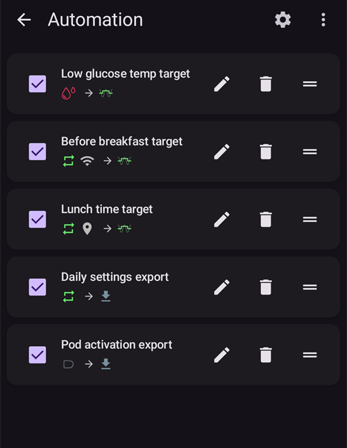

# Automatyzacja

```{contents} In this page
:backlinks: entry
:depth: 2
```

## Czym jest Automatyzacja?

„**Automatyzacja**” to funkcja, która może automatyzować zadania w AAPS.

Automatyzacja wykonuje określone akcje na podstawie jednego lub więcej warunków, czyli wyzwalaczy. Wyzwalaczami mogą być nieregularne zdarzenia, np. niski lub wysoki poziom glukozy (BG) albo określona ilość ujemnej aktywnej insuliny (IOB). Automatyzacje mogą też obsługiwać powtarzające się zdarzenia, np. posiłki lub ćwiczenia o określonych porach dnia, albo sytuację, gdy jesteś w określonej odległości od miejsca GPS lub w zasięgu sieci Wi-Fi o danym SSID. Automatyzacja może tworzyć kopie zapasowe ustawień AAPS według harmonogramu lub przy każdej wymianie poda.

Reguły Automatyzacji tworzysz i zmieniasz na ekranie **Automatyzacja** (**Zarządzaj → Automatyzacja**). Każda reguła ma dwie części:

- Jeden lub więcej warunków, czyli „wyzwalaczy”, które uruchamiają akcję.

    Może to być określony harmonogram, zdarzenie lub wartość jakiejś właściwości w AAPS

- Jedna lub więcej akcji do wykonania.

    Na przykład alarm, ustawienie procentu profilu albo eksport ustawień AAPS przy wymianie poda.


Opcji Automatyzacji jest bardzo dużo. Zachęcamy, aby poznać je w aplikacji AAPS, w sekcji Automatyzacja. Przykłady Automatyzacji od innych użytkowników znajdziesz też w grupach użytkowników AAPS na [**Facebooku**](https://www.facebook.com/groups/AndroidAPSUsers) i [**Discordzie**](https://discord.gg/4fQUWHZ4Mw).

## Jak Automatyzacja może pomóc

1. **Automatyzacja powtarzających się zadań:** zaprogramowane akcje wykonują się same, bez Twojego udziału.

1. **Mniejsze zmęczenie decyzjami:** główną zaletą **Automatyzacji** jest to, że zdejmują z Ciebie ciężar ręcznych działań w **AAPS**. [Badania](https://www.ncbi.nlm.nih.gov/pmc/articles/PMC6286423/#ref4) szacują, że osoby z cukrzycą typu 1 muszą podejmować średnio 180 dodatkowych decyzji dziennie. **Automatyzacje** mogą zmniejszyć obciążenie psychiczne i zostawić Ci więcej energii na inne sprawy w życiu.

1. **Możliwa lepsza kontrola glikemii:** na przykład **Automatyzacje** mogą zapewnić, że **Cele tymczasowe** są zawsze ustawione, gdy są potrzebne, nawet w zabiegane dni lub gdy o czymś zapomnisz. Na przykład jeśli dziecko z cukrzycą ma w szkole zajęcia sportowe we wtorki o 10:00 i w czwartki o 14:00 i potrzebuje wysokiego celu tymczasowego („TT”) 30 minut przed sportem, **Cel tymczasowy** może włączyć **Automatyzacja**.

1. **Duże możliwości dopasowania AAPS**, aby w określonych sytuacjach działał bardziej lub mniej agresywnie, zgodnie z Twoimi potrzebami. Na przykład uruchomienie na określony czas tymczasowo obniżonego % **Profilu**, jeśli w środku nocy pojawi się ujemny **IOB**, co wskazuje, że obecny **Profil** może być za silny.

Poniższy przykład pokazuje, jak **Automatyzacja** może usunąć niektóre kroki.

Użytkownik ćwiczy codziennie rano o 6:00: musi pamiętać, aby o 5:00, przed ćwiczeniami, ręcznie ustawić w AAPS „Cel tymczasowy - Aktywność”.


Użytkownik ustawił **Automatyzację**, która o 5:00 uruchamia „Cel tymczasowy - Aktywność”, aby jego **BG** i **IOB** były optymalne przed ćwiczeniami o 6:00:


## Ważne uwagi przed rozpoczęciem pracy z Automatyzacjami

1. Zanim ustawisz niektóre Automatyzacje, powinieneś mieć w **AAPS** rozsądną kontrolę **BG**. Automatyzacji nie należy używać do wyrównywania źle ustawionej bazy, **ISF** lub **CR** (więcej o tym poniżej). Nie ustawiaj automatycznej **Zmiany profilu**, aby wyrównać wzrosty **BG** spowodowane _np._ jedzeniem. Lepiej poradzić sobie z nimi innymi sposobami (SMB itp.).

1. Jak każda technologia, **systemy CGM**, **pompy** i telefony mogą zawieść: problemy techniczne lub błędy sensora mogą zakłócić działanie **Automatyzacji** i może być potrzebna ręczna interwencja.

1. **Requirements for Automations are likely to change as routines change**. Gdy zmieniasz okres pracy/szkoły/wakacji, ustaw przypomnienie w kalendarzu, aby sprawdzić, które **Automatyzacje** są teraz aktywne (łatwo je włączyć i wyłączyć). Na przykład gdy jedziesz na wakacje i nie potrzebujesz już Automatyzacji ustawionej na sport w szkole lub codzienne ćwiczenia albo musisz zmienić godziny.

1. **Automatyzacje** mogą być ze sobą w konflikcie. Dobrze jest dokładnie sprawdzić każde ustawienie nowej **Automatyzacji** w bezpiecznych warunkach i zrozumieć, dlaczego **Automatyzacja** uruchomiła się albo nie uruchomiła się tak, jak oczekujesz.

1. Jeśli używasz Autosens, staraj się używać **Celów tymczasowych** zamiast **Zmian profilu**. **Cele tymczasowe** nie resetują Autosens do 0. **Zmiany profilu** resetują Autosens.

1. Większość **Automatyzacji** powinna być ustawiana tylko na **ograniczony czas**. Po nim **AAPS** może ponownie ocenić sytuację i powtórzyć **Automatyzację**, jeśli to potrzebne i warunek nadal jest spełniony. Na przykład „rozpocznij cel tymczasowy 7,0 mmol/l na 30 min” lub „włącz **Profil** 110% na 10 min” _i_ „rozpocznij cel tymczasowy 5,0 mmol/l na 10 min”. Używanie **Automatyzacji** do trwałych zmian (np. na silniejszy % profilu) grozi hipoglikemią.

## Kiedy mogę zacząć używać Automatyzacji?

**Automatyzacje** można zacząć używać w **Zadaniu 10**.

## Gdzie w AAPS znajdują się Automatyzacje?

Otwórz **Zarządzaj** na dolnym pasku nawigacji ekranu głównego i wybierz **Automatyzacja**.

## Jak ustawić Automatyzację?

Aby ustawić **Automatyzację**, naciśnij przycisk **+** na ekranie Automatyzacji i utwórz „regułę”:


* nadaj „regule” tytuł (Nazwa zadania);
* naciśnij „**EDYTUJ**” pod **Warunek**. Na ekranie **Warunek** wybierz, jak łączyć wyzwalacze (**i**, **lub**, **wyłącznie lub**), i naciśnij „**Dodaj wyzwalacz**”:


* dodaj co najmniej jeden wyzwalacz:


* naciśnij „**DODAJ**” pod **Działanie** i wybierz jedną akcję:


* zapisz regułę przyciskiem **ZACHOWAJ** i upewnij się, że pole po lewej stronie nazwy reguły jest „zaznaczone”, aby włączyć **Automatyzację**:


Aby wyłączyć regułę **Automatyzacji**, odznacz pole po lewej stronie nazwy **Automatyzacji**. Poniższy przykład pokazuje **Automatyzację** włączoną („zaznaczoną”) lub wyłączoną („odznaczoną”):


Gdy ustawiasz **Automatyzację**, możesz ją najpierw przetestować, włączając opcję „Powiadomienie” w „Akcjach”. Dzięki temu **AAPS** najpierw pokaże powiadomienie, zamiast naprawdę wykonać akcję. Gdy masz pewność, że powiadomienie pojawia się w odpowiednim czasie/warunkach, możesz zmienić regułę **Automatyzacji** i zastąpić „Powiadomienie” właściwą „Akcją”.


```{admonition} Important note
:class: note

**Automatyzacje** działają nadal, gdy pętla jest wyłączona!
```


## Kiedy reguły są sprawdzane

**AAPS** sprawdza wszystkie reguły **Automatyzacji** za każdym razem, gdy przetworzy nowy odczyt glukozy. Reguły są więc oceniane w rytmie Twojego CGM, także przy wyłączonym ekranie telefonu. Reguły są też sprawdzane, gdy telefon zaczyna się ładować, gdy zmienia się sieć lub lokalizacja oraz gdy łączy się urządzenie Bluetooth. Jednocześnie działa tylko jedno sprawdzanie, więc reguła, której akcje trwają dłużej (np. polecenie do pompy), nie może wykonać się dwa razy.

## Limity bezpieczeństwa

Dla **Automatyzacji** ustawione są limity bezpieczeństwa:

* **Cel tymczasowy** ustawiony przez **Automatyzację** musi wynosić od 72 do 180 mg/dl (lub od 4 do 10 mmol/l).
* **Procent profilu** musi wynosić od 50% do 130%.
* Między kolejnymi wykonaniami **Automatyzacji** (i przed pierwszym wykonaniem) obowiązuje odstęp 5 minut.

## Prawidłowe użycie wartości ujemnych

```{admonition} Warning
:class: warning

Zachowaj ostrożność, gdy wybierasz wartość ujemną w **Automatyzacji**
```

Zachowaj ostrożność, gdy wybierasz „wartość ujemną” w „Warunku”, np. „mniejsze niż” w **Automatyzacjach**. Na przykład:


**Przykład 1:** utworzenie Warunku **„jest mniejsze niż”** „-0,1 mmol/l” (lub „-2 mg/dl”) spowoduje:

Uruchom **Automatyzację** dla każdej liczby, która jest **ściśle mniejsza niż** -0,1 (-2). Obejmuje to liczby takie jak -0,2, -0,3, -0,4 (-4, -6, -8) itd. Pamiętaj, że samo -0,1 (-2) **nie jest** objęte tym warunkiem. (Warunek „jest mniejsze lub równe -0,1 mmol/l (-2 mg/dl)” _obejmowałby_ -0,1 mmol/l lub -2 mg/dl).

**Przykład 2:** utworzenie Warunku „jest większe niż” -0,1 mmol/l (-2 mg/dl) spowoduje:

Uruchomienie **Automatyzacji** dla każdej liczby, która jest **większa niż** -0,1 mmol/l (-2 mg/dl). Obejmuje to liczby takie jak 0; 0,2; 0,4 mmol/l (0, 4, 8 mg/dl) i każdą inną liczbę dodatnią.

Wybierając te warunki i wartości, dokładnie przemyśl, co ma robić Twoja **Automatyzacja**.

(automations-automation-triggers)=
## Wyzwalacze Automatyzacji


Przewiń w dół, aby zobaczyć resztę listy:


Możesz wybrać różne „wyzwalacze”. Wyzwalacze to warunki, które muszą być spełnione, aby automatyzacja się wykonała. Poniższa lista nie jest pełna:

**Wyzwalacz:** łączenie warunków

**Opcje:**

Kilka warunków można połączyć za pomocą
* „i”
* „lub”
* „wyłącznie lub” (oznacza to, że akcja/akcje zostaną wykonane, jeśli spełniony jest jeden - i tylko jeden - z warunków)

**Wyzwalacz:** czas a powtarzający się czas

**Opcje:**

* czas = pojedyncze zdarzenie w określonym czasie
* powtarzający się czas = coś, co dzieje się regularnie (np. raz w tygodniu, w każdy dzień roboczy itp.)

**Wyzwalacz:** lokalizacja

**Opcje:**

* w [Ustawienia > Automatyzacja](#preferences-maintenance-settings) możesz wybrać potrzebną usługę lokalizacji.

**Wyzwalacz:** usługa lokalizacji

**Opcje:**

* Użyj lokalizacji pasywnej: **AAPS** pobiera lokalizację tylko wtedy, gdy żądają jej inne aplikacje.
* Użyj lokalizacji sieciowej: lokalizacja Twojej sieci Wi-Fi.
* Użyj lokalizacji GPS (Uwaga! Może to mocno rozładowywać baterię!)

**Wyzwalacze**: dane pompy i sensora

* Wyzwalacz „Wiek wkłucia”: dostępny dla wszystkich pomp
* Wyzwalacz „Wiek insuliny”: dostępny dla obsługiwanych pomp
* Wyzwalacz „Wiek baterii pompy”: dostępny dla obsługiwanych pomp
* Wyzwalacz „Wiek sensora”: zawsze dostępny
* Wyzwalacz „Aktywacja poda”: dostępny dla pomp typu patch

Przy wszystkich wyzwalaczach wieku porównanie „równe” prawdopodobnie się nie uruchomi, dlatego w takim przypadku potrzebne są dwa wyzwalacze, które tworzą zakres

* Wyzwalacz „Poziom zbiornika”: dostępny dla wszystkich pomp. Porównanie „NOT\_AVAILABLE” nie działa dla tego wyzwalacza, bo w **AAPS** wartość jest zawsze wypełniona
* Wyzwalacz „Poziom baterii pompy”: dostępny dla obsługiwanych pomp. Porównanie „NOT\_AVAILABLE” nie działa dla tego wyzwalacza, bo w **AAPS** wartość jest zawsze wypełniona

(automations-automation-action)=
## Działanie


Przewiń w dół, aby zobaczyć resztę listy:


**Akcje:** rozpocznij **Cel tymczasowy**

**Opcje:**

* **BG** musi wynosić od 72 mg/dl do 180 mg/dl (od 4 mmol/l do 10 mmol/l)
* **TT** działa tylko wtedy, gdy nie ma wcześniejszego celu tymczasowego — **AAPS** sam dodaje do reguły linię „**Warunki wstępne: Cel tymczasowy nie istnieje**”

**Akcje:** zatrzymaj **Cel tymczasowy**

**Opcje:**

brak

**Akcje:** **Procent profilu**

**Opcje:**

* **Profil** musi wynosić od 50% do 130%
* działa tylko wtedy, gdy poprzedni procent wynosi 100%

**Akcje:** **Zmień wygładzanie**

**Opcje:**

* wybierz [metodę wygładzania](../CompatibleCgms/SmoothingBloodGlucoseData.md), na którą chcesz przełączyć
* działa tylko wtedy, gdy ta metoda wygładzania nie jest już aktywna — **AAPS** sam dodaje do reguły linię „**Warunki wstępne: Wygładzanie … nie jest aktywne**”. Gdy wybrane wygładzanie jest już aktywne, reguła jest po cichu pomijana.
* Przykład: razem z wyzwalaczem **Wiek sensora** przełącz na **Wygładzanie uśredniające** w pierwszym dniu nowego sensora, a potem z powrotem na **Bez wygładzania**.

**Akcje:** **Notatka** (w grupie **Alarmy** na liście)

**Opcje:**

* wybierz zdarzenie do zapisania: **Notatka**, **Ćwiczenia**, **Pytanie**, **Powiadomienie** lub **Zmiana wkłucia**, oraz opcjonalną notatkę. Nazwa akcji zmienia się na wybrane zdarzenie.
* **Czas trwania**: używany dla **Notatki**, **Ćwiczeń** i **Zmiany wkłucia**. **Pytanie** i **Powiadomienie** nie mają czasu trwania: zamiast tego zapisują Twoją aktualną BG.
* **Zmiana wkłucia** resetuje wiek wkłucia, tak jakby zmianę wkłucia zapisano ręcznie. Przykład: niektóre pompy (np. Combo) same zapisują wymianę zbiornika, ale nie zmianę wkłucia. Jeśli zawsze zmieniasz oba razem, reguła z **Wiek insuliny** mniejszym niż 1 godzina i **Wiek wkłucia** większym niż 24 godziny może zapisać zmianę wkłucia za Ciebie.

 

**Akcje:** **Wyślij SMS** (w grupie **Alarmy**)

**Opcje:**

* wpisz tekst wiadomości. Jest wysyłana na wszystkie numery telefonów dozwolone w ustawieniach [Komunikatora SMS](../RemoteFeatures/SMSCommands.md). Wtyczka Komunikator SMS musi być włączona.

**Akcje:** **Zmień profil na** (w grupie **Profil**)

**Opcje:**

* wybierz **Profil** do włączenia. Jest włączany na 100%, bez przesunięcia czasu. Jeśli ten profil jest już aktywny, akcja nic nie robi.

**Akcje:** **Włącz/wyłącz SMB** (w grupie **Pętla i insulina**)

**Opcje:**

* wybierz **WŁ** lub **WYŁ**. Zmienia to ustawienie **Włącz SMB** w OpenAPS SMB dokładnie tak, jakby zmieniono je w **Ustawieniach**, i obowiązuje, dopóki Ty lub inna reguła tego nie zmienicie.

**Akcje:** **Profil Autotune** (w grupie **Pętla i insulina**)

**Opcje:**

* wybierz profil do dostrojenia i liczbę dni: zobacz [Uruchamianie Autotune regułą automatyzacji](#autotune-run-autotune-with-an-automation-rule).

**Akcje:** **Zatrzymaj przetwarzanie** (w grupie **Pętla i insulina**)

**Opcje:**

* brak. Gdy wykona się reguła z tą akcją, **AAPS** w tym przebiegu nie sprawdza reguł znajdujących się niżej na liście. Dodaj ją do reguły, która musi mieć pierwszeństwo przed regułami poniżej (zobacz [kolejność Automatyzacji](#Automations-the-order-of-the-automations-in-the-list-matters)).

**Akcje:** **Uruchom scenę**, **Włącz scenę**, **Wyłącz scenę** (w grupie **Sceny**)

**Opcje:**

* wybierz [scenę](Scenes.md) do uruchomienia, włączenia lub wyłączenia.

Po dodaniu „Akcji” musisz zmienić wartości domyślne na wybrane, klikając je i dostosowując.


(Automations-the-order-of-the-automations-in-the-list-matters)=
## Kolejność **Automatyzacji** na liście ma znaczenie
 **AAPS** wykonuje utworzone reguły w kolejności ważności, zaczynając od góry listy **Automatyzacji**. Na przykład jeśli **Automatyzacja** „Niska glikemia” jest najważniejszą **Automatyzacją**, ważniejszą od wszystkich innych reguł, to ta **Automatyzacja** powinna być na górze listy **Automatyzacji**, jak pokazano poniżej:




Aby zmienić kolejność reguł **Automatyzacji**, dotknij i przytrzymaj uchwyt **=** po prawej stronie reguły. Zmień kolejność **Automatyzacji**, przesuwając reguły w górę lub w dół.


## Jak usunąć reguły Automatyzacji

Aby usunąć regułę **Automatyzacji**, kliknij ikonę kosza.


## Przykłady Automatyzacji

Poniżej znajdziesz przykłady **Automatyzacji**. Więcej dyskusji o **Automatyzacjach** i o tym, jak użytkownicy dopasowali swoje **Automatyzacje**, znajdziesz w grupach dyskusyjnych na Facebooku lub na Discordzie. Nie kopiuj poniższych przykładów, jeśli dobrze nie rozumiesz, jak dana **Automatyzacja** będzie działać.

(automations-low-glucose-temp-target)=
### Cel tymczasowy przy niskiej glikemii

Ta **Automatyzacja** uruchamia automatyczny **Cel tymczasowy**, gdy **BG** spadnie poniżej określonego progu — tutaj, gdy glukoza jest mniejsza niż 70 mg/dl, na 30 minut uruchamiany jest cel 110 mg/dl:


### Cel tymczasowy w porze obiadu (z „Lokalizacją”)


Ta **Automatyzacja** została utworzona dla osoby, która w każdy dzień roboczy je obiad w pracy mniej więcej o tej samej porze. Uruchamia się tylko wtedy, gdy użytkownik jest w ustawionej „lokalizacji”.  Jeśli więc użytkownika któregoś dnia nie ma w pracy, ta **Automatyzacja** się nie włączy.

Ta **Automatyzacja** ustawi o 13:00 niski **Cel tymczasowy** (Wkrótce posiłek), aby przed obiadem obniżyć BG do 90 mg/dl (lub 5 mmol/l).

Wyzwalacz „lokalizacja” ma nazwę, położenie (dotknij **Wybierz z mapy** lub użyj aktualnej lokalizacji) i promień w metrach. Uruchamia się, gdy jesteś w tym obszarze (lub poza nim):


Dzięki połączeniu „i” **Automatyzacja** działa tylko w „wybranym czasie” i tylko wtedy, gdy użytkownik jest w wybranej lokalizacji.

**Automatyzacja** nie uruchomi się o innej porze w tej lokalizacji ani o tej porze poza promieniem 50 metrów od wybranego położenia.

### Automatyzacja z lokalizacją Wi-Fi SSID

Wi-Fi SSID to dobry sposób na uruchomienie **Automatyzacji**, gdy jesteś w zasięgu określonej sieci Wi-Fi (w porównaniu z GPS): jest dość dokładny, zużywa mniej baterii i działa w zamkniętych pomieszczeniach, gdzie GPS i inne usługi lokalizacji mogą być niedostępne.

Oto inny przykład ustawienia **Celu tymczasowego** tylko w dni robocze przed śniadaniem (1).


**Automatyzacja** uruchomi się o 5:30 tylko od poniedziałku do piątku (2)  
i tylko przy połączeniu z domową siecią Wi-Fi (3).


Następnie ustawi **Cel tymczasowy** 75 mg/dl na 30 minut (4). Jedną z zalet dodania lokalizacji jest to, że reguła nie uruchomi się np. wtedy, gdy użytkownik jest na wakacjach.


Przewiń w dół, aby zobaczyć akcję: **Cel tymczasowy** 75 mg/dl na 30 minut (4).


Oto zrzut ekranu z wyzwalaczami **Automatyzacji**:

1) Pod głównym „i” (oba warunki muszą być spełnione, aby reguła się uruchomiła) 1) Powtarzający się czas = Pn, Wt, Śr, Cz, Pt o 5:30  
1) Wi-Fi SSID = My_Home_WiFi_Name


(automating-preference-settings-export)=

## Automatyczny eksport ustawień

### Eksport bez nadzoru: według harmonogramu (codziennie)

Zrzuty ekranu z wyzwalaczami Automatyzacji:

1) Warunek: Powtarzający się czas = Pn, Wt, Śr, Cz, Pt o 8:00 1) Akcja: Eksport ustawień (w polu „Tekst w leczeniu” wpisz „Daily”)


Uwaga: wykonanie eksportu zostanie zapisane w Portalu opieki

### Eksport bez nadzoru: Aktywacja poda (tylko pompy typu patch)

Zrzuty ekranu z wyzwalaczami Automatyzacji:

1) Warunek: Aktywacja poda 1) Akcja: Eksport ustawień (w polu „Tekst w leczeniu” wpisz „Pod Activation: settings export”)


Uwaga: wykonanie eksportu zostanie zapisane w Portalu opieki. Uwaga: Automatyzacja **w ogóle** się nie uruchomi, jeśli wcześniej nie wykonasz ręcznie eksportu ustawień. Aby poprawnie włączyć eksport ustawień bez nadzoru, zobacz [Ustawienia → Konserwacja](#preferences-maintenance-settings).


## Logi Automatyzacji

**AAPS** pokazuje log ostatnich zdarzeń **Automatyzacji** na dole ekranu **Automatyzacja**, pod regułami. Sprawdzisz w nim, czy Twoje reguły uruchomiły się wtedy, kiedy oczekiwałeś.

W poniższym przykładzie reguła **Low glucose temp target** (1) (zobacz wyżej [Cel tymczasowy przy niskiej glikemii](#automations-low-glucose-temp-target)) jest włączona. Log (2) pokazuje, że o 15:09 glukoza spadła poniżej 70 mg/dl i reguła się uruchomiła:
* akcja to „Start temp target: 110mg/dL@30 min”: **Cel tymczasowy** 110 mg/dl na 30 minut;
* **OK** na końcu oznacza, że akcja została wykonana poprawnie.


(automations-troubleshooting)=

## Rozwiązywanie problemów

* Problem: __Moje automatyzacje nie są uruchamiane przez AAPS?__

Sprawdź, czy pole po lewej stronie nazwy **Automatyzacji** jest „zaznaczone”, aby reguła była włączona:


* Problem: __Moje automatyzacje są uruchamiane w złej kolejności.__

Sprawdź kolejność ważności reguł, jak opisano powyżej.

* Problem: __Warunek pokazuje „Nieznany wyzwalacz … - nigdy nie jest spełniony”.__

Reguła zawiera wyzwalacz, którego ta wersja **AAPS** nie potrafi odczytać, np. po powrocie do starszej wersji lub po imporcie ustawień z nowszej. Taki wyzwalacz nigdy nie jest spełniony, więc reguła się nie wykonuje. Jest zachowany bez zmian, aby nowsza wersja nadal mogła go używać. Edytuj regułę i zamień wyzwalacz albo zaktualizuj **AAPS**.

## Alternatywy dla Automatyzacji

Zaawansowani użytkownicy mają inne możliwości automatyzacji zadań, np. IFTTT lub zewnętrzną aplikację na Androida o nazwie Automate. 
