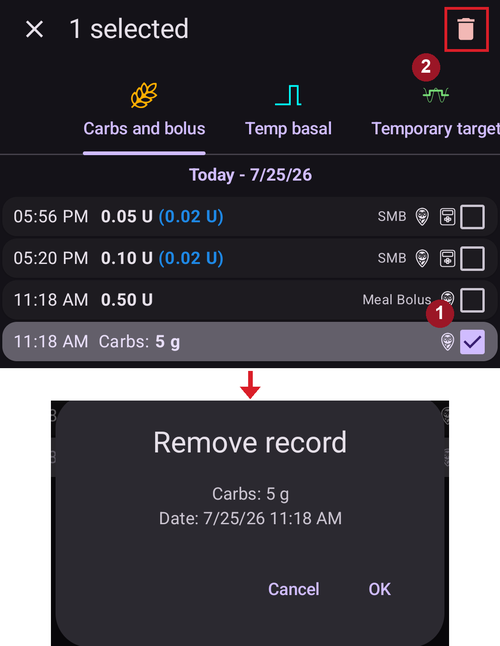

# Obliczanie COB

## Jak AAPS oblicza wartość COB?

Gdy wprowadzasz węglowodany jako posiłek lub korektę węglowodanami, **AAPS** doda je do aktualnych aktywnych węglowodanów (**COB**). Następnie **AAPS** oblicza wchłanianie węglowodanów na podstawie zaobserwowanych odchyleń Twoich wartości **BG**. The rate of absorption depends on the carb’s sensitivity factor (**CSF**). Nie jest to ustawienie w Twoim **Profilu**. **AAPS** oblicza go na podstawie ustawień **ISF/I:C**. Mówi on, o ile mg/dl 1 g węglowodanów podniesie Twoją **BG**.

## Współczynnik wrażliwości na węglowodany (CSF)

**AAPS** używa wzoru:

- absorbed_carbs = deviation * ic / isf.

Zmiana w Twoim **Profilu** działa tak:

- _increase_ **IC** - by increasing the carbs absorbed every 5 minutes thus shorten total time of absorption;

- _zwiększenie_ **ISF** - zmniejsza ilość węglowodanów wchłoniętych co 5 minut, więc wydłuża całkowity czas wchłaniania; a

- _change_ **Profile Percentage** - increase/decrease both values thus has no impact on carbs absorption time.

For example, if the user’s **Profile** **ISF** is 100 and the **I:C** is 5, the user’s Carb Sensitivity Factor would be 20. Na każde 20 mg/dl wzrostu Twojej **BG** **AAPS** uzna 1 g węglowodanów za wchłonięty. Dodatni **IOB** także wpływa na obliczanie **COB**. Jeśli więc **AAPS** przewiduje spadek Twojej **BG** o 20 mg/dl z powodu **IOB**, a glikemia pozostała stała, **AAPS** także uzna 1 g węglowodanów za wchłonięty.

Węglowodany są też uznawane za wchłonięte metodami opisanymi poniżej, zależnie od tego, który algorytm wrażliwości wybrano w Twoim **AAPS**.

## Wrażliwość a węglowodany - Oref1

Niewchłonięte węglowodany są usuwane po określonym czasie:


```{admonition} Older screenshot
:class: note
Powyższy zrzut ekranu pochodzi ze starszej wersji **AAPS** — w **AAPS** 4 wykresy wyglądają nieco inaczej, ale wykres **COB** pokazuje te same informacje.
```


## Wrażliwość a węglowodany - WeightedAverage

Wchłanianie jest obliczane tak, aby po określonym czasie COB = 0:


Jeśli zamiast wartości obliczonej z odchyleń **BG** używane jest minimalne wchłanianie węglowodanów (min_5m_carbimpact), na wykresie **COB** pojawia się pomarańczowa kropka.

(CobCalculation-detection-of-wrong-cob-values)=
## Wykrywanie nieprawidłowych wartości COB

**AAPS** will warn the user if they are about to bolus with **COB** from a previous meal if the algorithm detects current **COB** calculation as incorrect. W takim przypadku pokaże dodatkową podpowiedź na ekranie potwierdzenia po użyciu kalkulatora bolusa.

### Jak AAPS wykrywa nieprawidłowe wartości COB?

Zwykle __AAPS__ wykrywa wchłanianie węglowodanów na podstawie odchyleń **BG**. Jeśli wprowadzisz węglowodany, ale **AAPS** nie może wykryć ich wchłaniania na podstawie odchyleń **BG**, do obliczenia wchłaniania użyje metody [min_5m_carbimpact](#Preferences-min_5m_carbimpact) (tzw. „fallback”, metoda zapasowa). Ta metoda oblicza tylko minimalne wchłanianie węglowodanów, bez uwzględnienia odchyleń **BG**, więc może dać nieprawidłowe wartości COB.


Na powyższym zrzucie ekranu przez 66% czasu wchłanianie węglowodanów było obliczane z min_5m_carbimpact zamiast z wartości wykrytej z odchyleń. Oznacza to, że możesz mieć mniej **COB**, niż obliczył algorytm.

### Co zrobić z tym ostrzeżeniem?

- Rozważ anulowanie leczenia - naciśnij „Anuluj” zamiast OK.
- Oblicz nadchodzący posiłek jeszcze raz w kalkulatorze bolusa, bez zaznaczania **COB**.
- Jeśli potrzebujesz bolusa korekcyjnego, wprowadź go ręcznie.
- Be careful not to overdose or stack insulin!


### Dlaczego algorytm nie wykrywa poprawnie COB?

Możliwe przyczyny:
- Możliwe, że wprowadzono za dużo węglowodanów.
- Aktywność / wysiłek fizyczny po poprzednim posiłku.
- Trzeba dostosować I:C.
- Wartość min_5m_carbimpact jest nieprawidłowa (zalecana to 8 z SMB, 3 z AMA).


## Ręczna korekta wprowadzonych węglowodanów

Jeśli wprowadzono za dużo lub za mało węglowodanów, możesz to poprawić na ekranie **Historia leczenia**, jak opisano [tutaj](#screens-bolus-carbs).


## Korekta węglowodanów - jak usunąć wpis węglowodanów z leczenia


Na ekranie **Historia leczenia** możesz poprawić błędny wpis węglowodanów, usuwając go. Może to wynikać z tego, że wprowadzono za dużo lub za mało węglowodanów:



1. Sprawdź i zapamiętaj aktualne **COB** i **IOB** na ekranie głównym **AAPS**.
2. Otwórz **Historia leczenia** (menu boczne → *Historia leczenia*), zakładka **Węglowodany i bolus**. Depending on the pump, the carbs might show together with insulin in one line or as a separate entry (e.g. with Dana RS).
3. **Naciśnij i przytrzymaj** błędny wpis węglowodanów — lista przejdzie w **tryb wyboru** z polem wyboru w każdej linii, a wpis zostanie zaznaczony (oznaczenie **1** powyżej). Zaznacz też inne wpisy, które chcesz usunąć.
4. Dotknij ikony **🗑 Usuń** na górnym pasku (oznaczenie **2**) i potwierdź — okno potwierdzenia pokazuje dokładnie, co zostanie usunięte.
5. Upewnij się, że węglowodany zostały usunięte, sprawdzając ponownie **COB** na ekranie głównym **AAPS**.
6. Zrób to samo dla **IOB**, jeśli była tylko jedna linia z węglowodanami i insuliną.
7. Jeśli węglowodany nie zostaną usunięte zgodnie z planem, a dodatkowe węglowodany zostaną dodane tak, jak opisano w tej sekcji, wartość **COB** będzie za wysoka i **AAPS** może podać za dużo insuliny.
8. Wprowadź poprawną ilość węglowodanów w oknie **Węglowodany** (**Leczenie** → **Węglowodany**) i ustaw poprawny czas zdarzenia.
9. Jeśli była tylko jedna linia z węglowodanami i insuliną, dodaj też ponownie ilość insuliny. Pamiętaj, aby ustawić poprawny czas zdarzenia i sprawdzić **IOB** na ekranie głównym po potwierdzeniu nowego wpisu.

