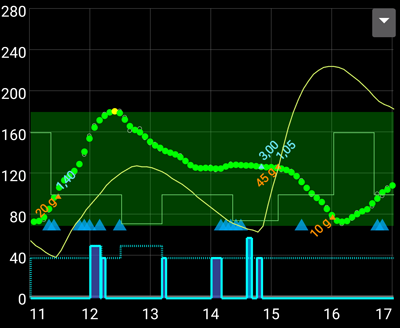

# Najważniejsze funkcje AAPS

## Tryb pętli

Status pętli jest pokazany na ekranie głównym jedną z poniższych ikon.

**AAPS** oferuje kilka trybów pętli, takich jak Zamknięta pętla (1), Zawieszenie przy niskiej glikemii (LGS - 2) i Otwarta pętla (3).

Informacje o tym, jak wybrać tryb pętli, oraz o innych ikonach na obrazku (4 do 6) znajdziesz w [Ekrany AAPS > Ekran główny > Status pętli](#AapsScreens-loop-status).

(KeyAapsFeatures-OpenLoop)=

### Otwarta pętla

**AAPS** stale analizuje wszystkie dostępne dane (IOB, COB, BG...) i w razie potrzeby proponuje zmiany leczenia (bazy tymczasowe).

Sugestie nie są wykonywane automatycznie (jak w zamkniętej pętli). Musisz je wykonać ręcznie na pompie (jeśli używasz wirtualnej pompy) albo przyciskiem, jeśli **AAPS** jest połączony z prawdziwą pompą.

Gdy **AAPS** ma sugestię, w dolnej nawigacji ekranu głównego pojawia się pozycja **Pętla** z plakietką. Naciśnij ją, aby przeczytać sugestię („Zaakceptuj nową bazę tymczasową”) z dawką, czasem trwania i powodem, a potem naciśnij **Wykonaj**, aby ją wykonać:

Sugestia jest ważna tylko przez kilka minut. Jeśli jest starsza niż ok. 9 minut albo w międzyczasie pętla została wstrzymana lub pompa rozłączona, **AAPS** ją odrzuci i nic nie zostanie wysłane do pompy (*„Ta sugestia jest zbyt stara. Nic nie zostało wysłane do pompy. Poczekaj na następną.”*). Poczekaj na następną sugestię.

Ta opcja służy do poznania działania **AAPS** albo do używania nieobsługiwanej pompy. Niezależnie od wyboru tutaj, aż do końca **[Zadania 5](#objectives-objective5)** będziesz w trybie otwartej pętli.

(KeyAapsFeatures-LGS)=

### Zawieszenie przy niskiej glikemii (LGS)

W tym trybie [maxIOB](#Open-APS-features-maximum-total-iob-openaps-cant-go-over) jest ustawione na zero.

Oznacza to, że gdy glikemia spada, **AAPS** może zmniejszyć bazę. Ale gdy glikemia rośnie, nie będzie automatycznej korekty. Dawki bazowe pozostają takie, jak w twoim bieżącym **Profilu**. Tylko gdy IOB jest ujemne (po wcześniejszym zawieszeniu przy niskiej glikemii), zostanie podana dodatkowa insulina, aby obniżyć **BG**.

Ten tryb jest dostępny od **[Zadania 6](#objectives-objective6)**.

Oprócz ręcznego wyboru **AAPS** może też sam przełączyć się w ten tryb: gdy pracujesz nad **[Zadaniem 6](#objectives-objective6)** oraz zawsze, gdy wykryje zduplikowane odczyty BG (zobacz [znak ostrzegawczy BG](#aaps-screens-bg-warning-sign)).

(KeyAapsFeatures-ClosedLoop)=

### Zamknięta pętla

**AAPS** stale analizuje wszystkie dostępne dane (IOB, COB, BG...) i w razie potrzeby sam dostosowuje leczenie (*czyli* bez twojego dalszego udziału), aby osiągnąć ustawiony [zakres lub wartość docelową](#profile-glucose-targets) (podanie bolusa, baza tymczasowa, wyłączenie insuliny, aby uniknąć hipoglikemii itp.).

Zamknięta pętla działa w ramach wielu limitów bezpieczeństwa, które można ustawić indywidualnie.

Zamknięta pętla jest możliwa tylko wtedy, gdy jesteś na **[Zadaniu 7](#objectives-objective7)** lub wyższym i używasz obsługiwanej pompy.

(autosens)= (Open-APS-features-autosens)=

## Autosens

- Autosens to algorytm, który analizuje odchylenia glikemii (dodatnie/ujemne/neutralne).
- Na podstawie tych odchyleń próbuje ocenić, jak bardzo jesteś wrażliwy lub oporny na insulinę.
- Implementacja oref w **OpenAPS** korzysta z połączenia danych z 24 i 8 godzin. Używa tej wartości, która wskazuje na większą wrażliwość.
- Osoby, które wcześniej używały oref1, prawdopodobnie zauważą, że system może wolniej reagować na zmiany, bo wrażliwość jest liczona raz z 24, a raz z 8 godzin.
- Wymiana kaniuli lub zmiana profilu resetuje współczynnik Autosens z powrotem do 100% (procentowa zmiana profilu z czasem trwania nie resetuje Autosens).
- Autosens dostosowuje bazę i ISF (czyli działa podobnie jak przesunięcie profilu).
- Jeśli jesz węglowodany stale przez dłuższy czas, Autosens działa w tym okresie słabiej, bo węglowodany są wyłączone z obliczeń delty **BG**.
- The deviations are converted into a **sensitivity ratio** (a percentage): a ratio below 100% means AAPS thinks you're more sensitive to insulin than your **Profile** assumes (so it lowers effective basal and raises the ISF value), while a ratio above 100% means you're more resistant (so it raises basal and lowers the ISF value).
- Domyślnie ten współczynnik jest utrzymywany między 0,7 (70%, większa wrażliwość) a 1,2 (120%, większa oporność), więc seria nietypowych danych nie może za bardzo oddalić dawkowania od twojego **Profilu**. Te granice można zmienić w ustawieniach zaawansowanych wtyczki Detekcja wrażliwości.
- Autosens i [Autotune](../AdvancedOptions/Autotune.md) rozwiązują ten sam problem w różnej skali czasu: Autosens na bieżąco, minuta po minucie, koryguje twoje *aktualne* dawkowanie na podstawie ostatnich 8–24 godz., a Autotune powoli zmienia sam *Profil* na podstawie historii z wielu tygodni. Używanie obu naraz jest normalne i oczekiwane — uzupełniają się, a nie dublują.

*Pełny techniczny opis algorytmu autosens znajdziesz w [dokumentacji Autosens OpenAPS](https://openaps.readthedocs.io/en/latest/docs/Customize-Iterate/autosens.html).*

(Open-APS-features-super-micro-bolus-smb)=

## Super Mikro Bolus (SMB)

**SMB**, czyli **Super Mikro Bolus**, to funkcja OpenAPS wprowadzona od 2018 roku w algorytmie Oref1. W odróżnieniu od **AMA**, **SMB** nie używa baz tymczasowych do kontroli poziomu glukozy, lecz głównie **małych super mikro bolusów**. W sytuacjach, w których **AMA** dodałby 1,0 IU insuliny przez bazę tymczasową, **SMB** podaje kilka super mikro bolusów w małych krokach co **5 minut**, np. 0,4 IU, 0,3 IU, 0,2 IU i 0,1 IU. Jednocześnie (dla bezpieczeństwa) bieżąca dawka bazowa jest na pewien czas ustawiana na 0 IU/h, aby zapobiec przedawkowaniu (**'zero-temping'**). Dzięki temu system może korygować glikemię szybciej niż przez zwiększenie bazy tymczasowej w **AMA**.

Dzięki SMB przy posiłkach z samymi „wolnymi” węglowodanami może wystarczyć, że podasz systemowi planowaną ilość węglowodanów, a resztę zostawisz **AAPS**. Może to jednak prowadzić do wyższych szczytów glikemii po posiłku, bo nie da się podać bolusa przed posiłkiem. Możesz też podać (w razie potrzeby jako bolus przed posiłkiem) **bolus startowy**, który **tylko częściowo** pokrywa węglowodany (np. 2/3 szacowanej ilości), a resztę insuliny zostawić **SMB**.

SMB są pokazane na [wykresie IOB](#aaps-screens-iob) jako niebieskie trójkąty. [Naciśnij i przytrzymaj](#aaps-screens-graph-press-and-hold) wykres na trójkącie, aby zobaczyć, ile insuliny podano, albo użyj [Historii leczenia](#aaps-screens-treatments).

Funkcje **SMB** zawierają kilka mechanizmów bezpieczeństwa:

1. **Największa pojedyncza dawka SMB**  
  Największa pojedyncza dawka SMB może wynosić najwyżej najmniejszą z tych wartości:
  
        * wartość odpowiadająca bieżącej dawce bazowej (skorygowanej przez autosens) przez czas ustawiony w „Maks. minut bazy dostarczone jako SMB”, np. ilość bazy na następne 30 minut, lub
        * połowa obecnie wymaganej ilości insuliny, lub
        * pozostała część wartości maxIOB z ustawień.
      

2. **Niskie bazy tymczasowe**  
  Niskie bazy tymczasowe (tzw. 'low temps') lub bazy tymczasowe 0 U/h (tzw. 'zero-temps') są w **SMB** włączane częściej. Tak to zaprojektowano ze względów bezpieczeństwa. Nie ma to złych skutków, jeśli **Profil** jest dobrze ustawiony. Na głównym wykresie krzywa IOB (cienka żółta linia) mówi więcej niż przebieg baz tymczasowych.

3. **Nieogłoszone posiłki**  
  Dodatkowe obliczenia do przewidywania przebiegu glukozy, np. przez **UAM** (nieogłoszone posiłki). Nawet bez ręcznego wpisania węglowodanów **UAM** może sam wykryć duży wzrost glukozy z powodu posiłku, adrenaliny lub innych czynników i próbować go skorygować za pomocą **SMB**. Dla bezpieczeństwa działa to też w drugą stronę: SMB może zatrzymać się wcześniej, jeśli glukoza nagle szybko spada. Dlatego przy SMB funkcja UAM powinna być zawsze włączona.

SMB nie decyduje sam, że potrzebna jest insulina — korzysta z tych samych połączonych prognoz BG (eventual BG, zero-temp, COB, UAM), które opisano w części [jak AAPS zamienia prognozy w decyzję o dawkowaniu](#aaps-screens-how-predictions-become-a-dosing-decision). SMB i zero-temping to po prostu dwa narzędzia, których AAPS używa, aby wykonać tę decyzję.

**Aby używać SMB, musisz rozpocząć [zadanie 9](#objectives-objective9).**

Pełny opis techniczny znajdziesz w [dokumentacji oref1/SMB OpenAPS](https://openaps.readthedocs.io/en/latest/docs/Customize-Iterate/oref1.html#understanding-super-micro-bolus-smb), a opis przygotowany przez społeczność w [informacjach Tima o SMB](https://www.diabettech.com/artificial-pancreas/understanding-smb-and-oref1/).

Ustawienia OpenAPS SMB opisano poniżej.

(Open-APS-features-max-u-h-a-temp-basal-can-be-set-to)=

### Maximum basal rate

To ustawienie bezpieczeństwa określa maksymalną dawkę bazy tymczasowej, jaką może podać pompa insulinowa. Nazywa się je też **max-basal**.

Wartość podaje się w jednostkach na godzinę (U/h). Ustaw tu rozsądną wartość. Dobra zasada ustawienia tego parametru:

**MAX-BASAL = NAJWYŻSZA DAWKA BAZOWA x 4**

Na przykład, jeśli najwyższa dawka bazowa w twoim profilu to 0,5 U/h, możesz pomnożyć ją przez 4 i otrzymać 2 U/h.

**AAPS** ogranicza tę wartość 'twardym ograniczeniem' zależnym od ustawienia [Ustawienia > Bezpieczeństwo terapii > Wiek pacjenta](#preferences-patient-type). Twarde ograniczenia są następujące:

- Dziecko: 2
- Nastolatek: 5
- Osoba dorosła: 10
- Osoba dorosła insulinooporna: 12
- Ciąża: 25

*Zobacz też [przegląd ustalonych na stałe ograniczeń](#Open-APS-features-overview-of-hard-coded-limits).*

(Open-APS-features-maximum-total-iob-openaps-cant-go-over)=

### Maksymalne całkowite IOB, którego OpenAPS nie może przekroczyć

Ta wartość określa maksymalną **aktywną insulinę** (IOB z bazy i bolusów), poniżej której **AAPS** pozostaje podczas pracy w trybie zamkniętej pętli. Nazywa się ją też **maxIOB**.

Jeśli bieżące IOB (np. po bolusie do posiłku) przekracza ustawioną wartość, pętla przestaje podawać insulinę, aż IOB spadnie poniżej tej wartości.

Dobry punkt startowy dla tego parametru:

      maxIOB = średni bolus do posiłku + 3x maks. dzienna baza
    

Zmieniaj **max-IOB** ostrożnie i cierpliwie. Ta wartość jest inna dla każdego i może też zależeć od średniej całkowitej dawki dobowej (TDD).

**AAPS** ogranicza tę wartość 'twardym ograniczeniem' zależnym od ustawienia [Ustawienia > Bezpieczeństwo terapii > Wiek pacjenta](#preferences-patient-type). Twarde ograniczenia są następujące:

- Dziecko: 7
- Nastolatek: 13
- Osoba dorosła: 22
- Osoba dorosła insulinooporna: 30
- Ciąża: 70

*Zobacz też [przegląd ustalonych na stałe ograniczeń](#Open-APS-features-overview-of-hard-coded-limits).*

Uwaga: przy używaniu **SMB** wartość **max-IOB** jest liczona inaczej niż w AMA. W **AMA** maxIOB jest parametrem bezpieczeństwa dla **IOB** z bazy, a w trybie SMB obejmuje też IOB z bolusów.

### Włącz wrażliwość dynamiczną

To jest funkcja [DynamicISF](../DailyLifeWithAaps/DynamicISF.md). Po jej włączeniu pojawiają się nowe ustawienia. Ustawienia są opisane na stronie [DynamicISF](#dyn-isf-preferences).

### Użyj Autosens

To jest funkcja [Autosens](#Open-APS-features-autosens). Przy używaniu DynamicISF nie można używać Autosens, bo są to dwa różne algorytmy, które zmieniają tę samą zmienną (wrażliwość).

Autosens analizuje odchylenia glikemii (dodatnie/ujemne/neutralne). Na podstawie tych odchyleń próbuje ocenić, jak bardzo jesteś wrażliwy lub oporny na insulinę, i według nich dostosowuje dawkę bazową oraz ISF.

Po jej włączeniu pojawiają się nowe ustawienia.

#### Wrażliwość podnosi cel glikemii

Jeśli ta opcja jest włączona, wykrywanie wrażliwości (autosens) może podnieść cel, gdy wykryje większą wrażliwość (poniżej 100%). Wtedy cel zostanie podniesiony o procent wykrytej wrażliwości.

Jeśli cel zostanie zmieniony przez detekcję wrażliwości, na ekranie głównym będzie pokazany na zielonym tle.

To ustawienie jest dostępne, gdy włączona jest opcja „Włącz wrażliwość dynamiczną” lub „Użyj Autosens”.

#### Oporność obniża cel glikemii

Jeśli ta opcja jest włączona, wykrywanie wrażliwości (autosens) może obniżyć cel, gdy wykryje oporność (powyżej 100%). Wtedy cel zostanie obniżony o procent wykrytej oporności.

To ustawienie jest dostępne, gdy włączona jest opcja „Włącz wrażliwość dynamiczną” lub „Użyj Autosens”.

### Włącz SMB

Włącz, aby używać funkcji SMB. Jeśli jest wyłączone, **SMB** nie będą podawane.

Po jej włączeniu pojawiają się nowe ustawienia.

(Open-APS-features-enable-smb-with-high-temp-targets)=

#### Włącz SMB z wysokim tymczasowym poziomem docelowym

Jeśli to ustawienie jest włączone, **SMB** będą podawane nawet wtedy, gdy ustawisz wysoki **Cel tymczasowy** (czyli 100 mg/dl lub 5,6 mmol/l i więcej, niezależnie od celu w **Profilu**). Włączaj to ostrożnie: **SMB** mogą stać się zbyt agresywne, jeśli twoje ustawienia nie są dobrze dopasowane albo twój **Profil** często się zmienia (np. u dzieci).

When this setting is disabled, a high **Temp Target** turns **SMBs** off. Na przykład, jeśli ta opcja jest wyłączona, możesz wyłączyć **SMB**, ustawiając **Cel tymczasowy** 100 mg/dl lub 5,6 mmol/l i więcej. Ta opcja wyłączy też **SMB** bez względu na to, jaki inny warunek próbuje włączyć SMB — z wyjątkiem niskiego **Celu tymczasowego**, takiego jak **Wkrótce posiłek** (lub dowolnego **Celu tymczasowego** 98 mg/dl lub 5,4 mmol/l i niżej), przy którym **SMB** mogą nadal być podawane, aby sprowadzić **BG** do celu.

This setting does not turn **SMB** on by itself. With a high temp target, **SMB** is only given if one of the other settings below (for example **Enable SMB always** or **Enable SMB with COB**) also allows it.

(Open-APS-features-enable-smb-always)=

#### Zawsze włącz SMB

Jeśli to ustawienie jest włączone, SMB jest zawsze włączony (niezależnie od COB, celów tymczasowych czy bolusów). Jeśli to ustawienie jest włączone, pozostałe ustawienia włączania SMB poniżej nie mają żadnego wpływu. Jeśli jednak opcja **Włącz SMB z wysokim tymczasowym poziomem docelowym** jest wyłączona i ustawiony jest wysoki cel tymczasowy, SMB zostaną wyłączone.

To ustawienie jest dostępne tylko wtedy, gdy **AAPS** wykryje, że używasz [wiarygodnego źródła BG](#GettingStarted-TrustedBGSource) z zaawansowanym filtrowaniem. FreeStyle Libre 1 nie jest uważany za wiarygodne źródło, bo przy awarii sensora może bez końca powtarzać stare dane BG.

Zaszumione dane mogą sprawić, że **AAPS** uzna, że BG rośnie bardzo szybko, i poda niepotrzebne SMB. Więcej informacji o szumie i wygładzaniu danych znajdziesz [tutaj](../CompatibleCgms/SmoothingBloodGlucoseData.md).

#### Włącz SMB z COB

Jeśli to ustawienie jest włączone, SMB działa, gdy COB jest większe niż 0.

To ustawienie nie jest widoczne, jeśli włączona jest opcja „Zawsze włącz SMB”.

#### Włącz SMB z niskim tymczasowym poziomem docelowym

Jeśli to ustawienie jest włączone, SMB działa, gdy ustawiony jest cel tymczasowy (wkrótce posiłek, aktywność, hipoglikemia, własny). Jeśli to ustawienie jest włączone, ale opcja **Włącz SMB z wysokim tymczasowym poziomem docelowym** jest wyłączona, SMB będzie włączony przy niskim celu tymczasowym (98 mg/dl lub 5,4 mmol/l i niżej), ale wyłączony przy wysokim celu tymczasowym.

To ustawienie nie jest widoczne, jeśli włączona jest opcja „Zawsze włącz SMB”.

#### Włącz SMB po węglowodanach

Jeśli jest włączone, SMB działa przez 6 godz. po wpisaniu węglowodanów, nawet gdy COB spadnie do 0.

Ze względów bezpieczeństwa to ustawienie jest dostępne tylko wtedy, gdy **AAPS** wykryje, że używasz wiarygodnego źródła BG. Nie jest widoczne, jeśli włączona jest opcja „Zawsze włącz SMB”.

To ustawienie jest dostępne tylko wtedy, gdy **AAPS** wykryje, że używasz [wiarygodnego źródła BG,](#GettingStarted-TrustedBGSource) z zaawansowanym filtrowaniem. FreeStyle Libre 1 nie jest uważany za wiarygodne źródło, bo przy awarii sensora może bez końca powtarzać stare dane BG.

Zaszumione dane mogą sprawić, że **AAPS** uzna, że BG rośnie bardzo szybko, i poda niepotrzebne SMB. Więcej informacji o szumie i wygładzaniu danych znajdziesz [tutaj](../CompatibleCgms/SmoothingBloodGlucoseData.md).  
To ustawienie nie jest widoczne, jeśli włączona jest opcja „Zawsze włącz SMB”.

#### Interwał SMB

Ta funkcja ogranicza częstotliwość SMB. Ta wartość określa minimalny czas między SMB. Pamiętaj, że pętla działa za każdym razem, gdy przychodzi nowa wartość glukozy (zwykle co 5 minut). Odejmij 2 minuty, aby pętla miała dodatkowy czas na zakończenie. Np. jeśli chcesz, aby SMB był podawany przy każdym uruchomieniu pętli, ustaw 3 minuty.

Wartość domyślna: 3 min.

(Open-APS-features-max-minutes-of-basal-to-limit-smb-to)=

#### Maks. minut bazy dostarczone jako SMB

To ważne ustawienie bezpieczeństwa. Ta wartość określa, ile SMB można podać na podstawie ilości insuliny bazowej w danym czasie, gdy jest ona pokryta przez COB.

Większa wartość sprawia, że SMB działa bardziej agresywnie. Zacznij od wartości domyślnej 30 minut. Gdy zdobędziesz doświadczenie, zwiększaj wartość co 15 minut i obserwuj skutki przy wielu posiłkach.

Nie zaleca się ustawiania wartości wyższej niż 90 minut, bo wtedy algorytm może nie poradzić sobie ze spadającą BG nawet przy bazie 0 U/h ('zero-temp'). Ustaw też alarmy, zwłaszcza gdy testujesz nowe ustawienia. Ostrzegą cię one dużo wcześniej przed hipoglikemią.

Wartość domyślna: 30 min.

#### UAM: maks. minut bazy dostarczone jako SMB

To ustawienie pozwala zmienić siłę SMB podczas UAM, gdy nie ma już węglowodanów.

Wartość domyślna: taka sama jak **Maks. minut bazy dostarczone jako SMB**.

To ustawienie jest widoczne tylko wtedy, gdy włączone są opcje „Włącz SMB” i „Włącz UAM”.

(enable-uam)=

### Włącz UAM

Gdy ta opcja jest włączona, algorytm SMB może rozpoznać nieogłoszone posiłki. Pomaga to, gdy zapomnisz podać **AAPS** węglowodany, źle je oszacujesz i wpisana ilość jest błędna, albo gdy posiłek z dużą ilością tłuszczu i białka działa dłużej niż oczekiwano. Bez wpisania węglowodanów UAM może rozpoznać szybki wzrost glukozy spowodowany węglowodanami, adrenaliną itp. i próbuje go skorygować za pomocą SMB. Działa to też w drugą stronę: jeśli glukoza szybko spada, SMB mogą zostać zatrzymane wcześniej.

**Dlatego przy używaniu SMB funkcja UAM powinna być zawsze włączona.**

(key-aaps-features-minimal-carbs-required-for-suggestion)=

### Próg sugestii dosłodzenia

Minimalna liczba gramów węglowodanów, przy której pojawia się alert z sugestią zjedzenia węglowodanów. Zjedzenie dodatkowych węglowodanów zostanie zasugerowane, gdy algorytm (reference design) wykryje, że są one potrzebne. Wtedy otrzymasz powiadomienie, które możesz odłożyć na 5, 15 lub 30 minut.

Jeśli chcesz, powiadomienia o potrzebnych węglowodanach mogą być wysyłane do Nightscout. Wtedy pojawi się i zostanie rozesłane ogłoszenie.

W każdym przypadku wymagane węglowodany będą pokazane w sekcji COB na ekranie głównym.

### Ustawienia zaawansowane

Pełny opis wszystkich parametrów (także tych, których tu nie opisano) znajdziesz w [dokumentacji OpenAPS o preferencjach i ustawieniach bezpieczeństwa](https://openaps.readthedocs.io/en/latest/docs/While%20You%20Wait%20For%20Gear/preferences-and-safety-settings.html).

**Zawsze używaj krótkiej średniej delty zamiast prostych danych** Jeśli włączysz tę funkcję, **AAPS** używa krótkiej średniej delty/glikemii z ostatnich 15 minut, czyli zwykle średniej z trzech ostatnich wartości. Dzięki temu **AAPS** działa stabilniej przy zaszumionych źródłach danych, takich jak xDrip i Libre.

**Maks. dzienny mnożnik bezpieczeństwa** To ważny limit bezpieczeństwa. Wartość domyślna (której raczej nie trzeba zmieniać) to 3. Oznacza to, że **AAPS** nigdy nie ustawi bazy tymczasowej większej niż 3x najwyższa godzinowa dawka bazowa zaprogramowana w pompie i/lub profilu. Przykład: jeśli twoja najwyższa dawka bazowa to 1,0 U/h, a maks. dzienny mnożnik bezpieczeństwa wynosi 3, to **AAPS** może ustawić bazę tymczasową najwyżej 3,0 U/h (= 3 x 1,0 U/h).

Wartość domyślna: 3 (nie zmieniaj jej, chyba że naprawdę musisz i wiesz, co robisz)

**Aktualny współczynnik bezpieczeństwa bazy** To kolejny ważny limit bezpieczeństwa. Wartość domyślna (której też raczej nie trzeba zmieniać) to 4. Oznacza to, że **AAPS** nigdy nie ustawi bazy tymczasowej większej niż 4x bieżąca godzinowa dawka bazowa zaprogramowana w pompie i/lub profilu.

Wartość domyślna: 4 (nie zmieniaj jej, chyba że naprawdę musisz i wiesz, co robisz)

* * *

(Open-APS-features-auto-isf)=

## Auto ISF

**Auto ISF** to **eksperymentalny** algorytm dla zaawansowanych użytkowników. Opiera się na OpenAPS SMB i dodaje reguły, które wzmacniają lub osłabiają współczynnik wrażliwości na insulinę (ISF) w zależności od zachowania glukozy.

To funkcja deweloperska: można ją włączyć tylko w [wersji rozwojowej (dev)](../AdvancedOptions/DevBranch.md) z włączonym **Trybem Inżynierskim**. W zwykłej wersji (release) jest zawsze wyłączona i dlatego nie jest widoczna w **Konfiguracja → APS**. Ukończenie [Zadań](../SettingUpAaps/CompletingTheObjectives.md) jej nie odblokowuje.

Po jej wybraniu jej **Ustawienia** zawierają ustawienia OpenAPS SMB oraz grupę **Ustawienia AutoISF**:

- **Włącz AutoISF**: włącza dostosowanie ISF. Bez tego algorytm działa jak OpenAPS SMB.
- **AutoISF min** i **AutoISF maks.**: jak bardzo ISF może zostać osłabiony i jak bardzo wzmocniony, tak samo jak limity Autosens. Przy wartości domyślnej 1,0 efekt jest wyłączony.
- **Wagi**: każda steruje jedną regułą, a wartość domyślna 0,0 wyłącza regułę. 
  - gdy glukoza **przyspiesza**, ISF jest wzmacniany (więcej insuliny);
  - gdy glukoza **zwalnia**, ISF jest osłabiany (mniej insuliny);
  - gdy glukoza jest **poniżej celu**, ISF jest osłabiany;
  - gdy glukoza jest **powyżej celu**, ISF jest wzmacniany;
  - waga **poposiłkowa** i waga **czasu trwania** działają po posiłkach i gdy glukoza długo pozostaje wysoka.
- **Współczynnik dostarczania SMB** (z minimum, maksimum i zakresem BG): jaka część wymaganej insuliny może zostać podana jako SMB.
- **Rozszerzenie maks. zakresu SMB**: o jaki mnożnik można przekroczyć zwykły limit wielkości SMB ([maks. minut bazy](#Open-APS-features-max-minutes-of-basal-to-limit-smb-to), zwykle 120 minut). Wartość domyślna 1 niczego nie zmienia; możliwe jest do 5. Zwiększaj tę eksperymentalną wartość powoli i ostrożnie.
- **Procent progu IOB**: procent max IOB, powyżej którego SMB są wyłączone.

    {admonition} Tylko dla doświadczonych użytkowników
    :class: danger
    Przy wartościach domyślnych Auto ISF niczego nie zmienia. Każda zwiększona wartość sprawia, że **AAPS** działa bardziej agresywnie. Zmieniaj jedną wartość naraz, małymi krokami, i obserwuj wynik przez kilka dni. Bądź bardzo ostrożny z wartością **AutoISF maks.** powyżej 2,5.

(Open-APS-features-advanced-meal-assist-ama)=

## Advanced Meal Assist (AMA)

AMA, czyli skrót od „advanced meal assist” (zaawansowane wspomaganie posiłków), to funkcja OpenAPS z 2017 roku (oref0). OpenAPS Advanced Meal Assist (AMA) pozwala systemowi szybciej ustawić wysoką bazę tymczasową po bolusie do posiłku, jeśli rzetelnie wpisujesz węglowodany.

Więcej informacji znajdziesz w [dokumentacji OpenAPS](https://newer-docs.readthedocs.io/en/latest/docs/walkthrough/phase-4/advanced-features.html#advanced-meal-assist-or-ama).

### Maximum basal rate (OpenAPS "max-basal")

To ustawienie bezpieczeństwa chroni przed tym, aby **AAPS** kiedykolwiek podał niebezpiecznie wysoką dawkę bazową, i ogranicza bazę tymczasową do x U/h. Ustaw tu rozsądną wartość. Dobra zasada: weź najwyższą dawkę bazową w swoim profilu i pomnóż ją przez 4, a co najmniej przez 3. Na przykład, jeśli najwyższa dawka bazowa w twoim profilu to 1,0 U/h, możesz pomnożyć ją przez 4, otrzymać 4 U/h i ustawić 4 jako parametr bezpieczeństwa.

Nie możesz wybrać dowolnej wartości: dla bezpieczeństwa istnieje 'twarde ograniczenie', które zależy od wieku pacjenta. 'Twarde ograniczenie' dla maxIOB jest w AMA niższe niż w SMB. Dla dzieci wartość jest najniższa, a dla dorosłych z insulinoopornością – najwyższa.

Parametry ustalone na stałe w **AAPS** to:

- Dziecko: 2
- Nastolatek: 5
- Osoba dorosła: 10
- Osoba dorosła insulinooporna: 12
- Ciąża: 25

*Zobacz też [przegląd ustalonych na stałe ograniczeń](#Open-APS-features-overview-of-hard-coded-limits).*

### Maksymalne IOB z bazy, jakie OpenAPS może podać \[U\] (OpenAPS "max-iob")

Ten parametr ogranicza maksymalne IOB z bazy, przy którym **AAPS** nadal działa. Jeśli IOB jest wyższe, AAPS przestaje podawać dodatkową insulinę bazową, aż IOB z bazy spadnie poniżej limitu.

Wartość domyślna to 2, ale zwiększaj ten parametr powoli, aby zobaczyć, jak na ciebie wpływa i jaka wartość pasuje najlepiej. Jest inna dla każdego i zależy też od średniej całkowitej dawki dobowej (TDD). Dla bezpieczeństwa istnieje limit, który zależy od wieku pacjenta. 'Twarde ograniczenie' dla maxIOB jest w AMA niższe niż w SMB.

- Dziecko: 3
- Nastolatek: 5
- Osoba dorosła: 7
- Osoba dorosła insulinooporna: 12
- Ciąża: 25

*Zobacz też [przegląd ustalonych na stałe ograniczeń](#Open-APS-features-overview-of-hard-coded-limits).*

### Użyj Autosens (AMA)

Tutaj możesz wybrać, czy chcesz używać [detekcji wrażliwości](../DailyLifeWithAaps/SensitivityDetectionAndCob.md) autosens.

### Autosens zmienia cele

Jeśli ta opcja jest włączona, autosens może też dostosować cele (oprócz bazy i ISF). Dzięki temu **AAPS** może działać bardziej lub mniej 'agresywnie'. Rzeczywisty cel może być wtedy osiągnięty szybciej.

### Ustawienia zaawansowane

- Zwykle nie musisz zmieniać ustawień w tym oknie!
- Jeśli jednak chcesz je zmienić, upewnij się, że rozumiesz, co robisz — zobacz pełny opis parametrów w [dokumentacji OpenAPS o preferencjach i ustawieniach bezpieczeństwa](https://openaps.readthedocs.io/en/latest/docs/While%20You%20Wait%20For%20Gear/preferences-and-safety-settings.html).

**Zawsze używaj krótkiej średniej delty zamiast prostych danych** Jeśli włączysz tę funkcję, **AAPS** używa krótkiej średniej delty/glikemii z ostatnich 15 minut, czyli zwykle średniej z trzech ostatnich wartości. Dzięki temu **AAPS** działa stabilniej przy zaszumionych źródłach danych, takich jak xDrip i Libre.

**Maks. dzienny mnożnik bezpieczeństwa** To ważny limit bezpieczeństwa. Wartość domyślna (której raczej nie trzeba zmieniać) to 3. Oznacza to, że **AAPS** nigdy nie ustawi bazy tymczasowej większej niż 3x najwyższa godzinowa dawka bazowa zaprogramowana w pompie. Przykład: jeśli twoja najwyższa dawka bazowa to 1,0 U/h, a maks. dzienny mnożnik bezpieczeństwa wynosi 3, to **AAPS** może ustawić bazę tymczasową najwyżej 3,0 U/h (= 3 x 1,0 U/h).

Wartość domyślna: 3 (nie zmieniaj jej, chyba że naprawdę musisz i wiesz, co robisz)

**Aktualny współczynnik bezpieczeństwa bazy** To kolejny ważny limit bezpieczeństwa. Wartość domyślna (której też raczej nie trzeba zmieniać) to 4. Oznacza to, że **AAPS** nigdy nie ustawi bazy tymczasowej większej niż 4x bieżąca godzinowa dawka bazowa zaprogramowana w pompie.

Wartość domyślna: 4 (nie zmieniaj jej, chyba że naprawdę musisz i wiesz, co robisz)

**Dzielnik DIA dla uśpienia bolusa** Funkcja „bolus snooze” (uśpienie bolusa) działa po bolusie do posiłku. **AAPS** nie ustawia niskich baz tymczasowych po posiłku przez czas równy DIA podzielonemu przez parametr „bolus snooze”. Wartość domyślna to 2. Oznacza to, że przy DIA 5 godz. „bolus snooze” trwa 5 godz. : 2 = 2,5 godz.

Wartość domyślna: 2

* * *

(Open-APS-features-overview-of-hard-coded-limits)=

## Przegląd ustalonych na stałe ograniczeń

|            | Dziecko | Nastolatek | Osoba dorosła | Osoba dorosła insulinooporna | Ciąża |
| ---------- | ------- | ---------- | ------------- | ---------------------------- | ----- |
| MAXBOLUS   | 5       | 10         | 17            | 25                           | 60    |
| MINDIA     | 5       | 5          | 5             | 5                            | 5     |
| MAXDIA     | 9       | 9          | 9             | 9                            | 10    |
| MINIC      | 2       | 2          | 2             | 2                            | 0.3   |
| MAXIC      | 100     | 100        | 100           | 100                          | 100   |
| MAXIOB_AMA | 3       | 5          | 7             | 12                           | 25    |
| MAXIOB_SMB | 7       | 13         | 22            | 30                           | 70    |
| MAXBASAL   | 2       | 5          | 10            | 12                           | 25    |