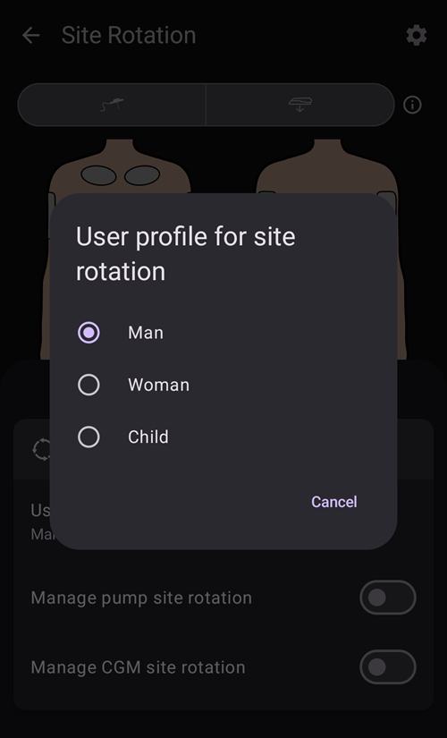

# Pompy i kaniule

## Wymiana zestawów infuzyjnych: zbiorniki insuliny i kaniule

Opisana niżej procedura dotyczy tylko pomp z drenem. Nie dotyczy pomp typu patch, takich jak Omnipod, Medtrum Nano, Accu-Chek Solo itp. Tę procedurę czasem nazywa się „wymianą zestawu”: „pełna” wymiana zestawu obejmuje zbiornik insuliny i kaniulę, a „częściowa” wymiana zestawu oznacza wymianę tylko kaniuli.

Pompy typu patch napełniają się i odpowietrzają same w swoim kreatorze aktywacji, a ich kaniula jest już w ciele. **AAPS** nie oferuje dla nich napełniania: **Napełnij/Wypełnij** nie pokazuje się w panelu **Zarządzaj** ani w QuickLaunch. Zobacz stronę swojej pompy w części [Kompatybilne pompy](../Getting-Started/CompatiblePumps.md).

Fizycznej wymiany wkładu/zbiornika nie da się wykonać przez **AAPS**. Trzeba ją zrobić bezpośrednio na pompie. Po jej wykonaniu trzeba ją ręcznie zapisać w **AAPS**.

(pumps-cannulas-changing-reservoir-and-cannula)=
### Instrukcja wymiany zbiornika pompy i kaniuli

1. W **AAPS** odłącz pompę: naciśnij [ikonę pętli](#AapsScreens-loop-status) na ekranie głównym i wybierz **Odłącz pompę** na 1 godzinę. Ikona zmieni się na szarą wtyczkę, co oznacza, że pompa jest odłączona.

2. Fizycznie wymień zbiornik insuliny: odłącz pompę od ciała i wymień zbiornik/wkład oraz kaniulę zgodnie z instrukcją producenta.

3. Napełnij dren i kaniulę: możesz to zrobić bezpośrednio na pompie. Pamiętaj, aby usunąć wszystkie pęcherzyki powietrza z drenu.

4. Załóż nową kaniulę na ciało. Po wkłuciu kaniuli i wyjęciu igły w kaniuli zostaje mała przestrzeń z powietrzem, którą też trzeba napełnić. To announce this in **AAPS** and prime the site: open **Prime/Fill** (in the expanded status panel on the main screen, in the **Manage** sheet, or as a [QuickLaunch](QuickLaunch.md) button) and tick **Record pump site change** and/or **Record insulin cartridge change** as appropriate to record the change. Teraz naciśnij domyślną ilość do napełnienia kaniuli (zwykle około 0,3 U, ale sprawdź, czy ta wartość jest właściwa dla Twojej kaniuli) i wybierz **OK**. Przeczytaj podsumowanie i potwierdź napełnianie, dotykając **OK**.

   


5. Ponownie podłącz pompę w **AAPS**: naciśnij ikonę szarej wtyczki i wybierz **Połącz ponownie pompę**, aby pętla dalej działała.

### Przydatne informacje o wymianie insuliny i kaniuli

* Zapisanie zmiany wkłucia resetuje Autosens do 100%. Resetuje też odpowiednie wskaźniki stanu kaniuli/insuliny i ich wiek na ekranie głównym **AAPS**.

* Domyślne ilości do napełniania możesz ustawić/zmienić w ustawieniach **Napełnij/Wypełnij** — wpisz „prime” w pasku wyszukiwania na ekranie głównym, aby je otworzyć (zobacz [Ustawienia (Preferencje)](../SettingUpAaps/Preferences.md)). Ile jednostek trzeba podać do napełnienia kaniuli (zależnie od długości igły i drenu), sprawdź w ulotce w pudełku z kaniulami.

* Insuliny podanej funkcją napełniania **AAPS** nie liczy do aktywnej insuliny (IOB). W [Historii leczenia](#aaps-screens-treatments) jest oznaczona jako „Prime” (napełnianie).

* **AAPS** nie uwzględni też insuliny podanej bolusem z pompy w czasie odłączenia pompy. Jeśli podasz bolus bezpośrednio z pompy, gdy **AAPS** jest odłączony, to po ponownym podłączeniu pompy możesz zapisać tę insulinę (bez podawania bolusa) w oknie **Insulina** (zobacz [Zapisanie podanej insuliny bez podawania bolusa](#pumps-cannulas-announce-insulin) poniżej).

### Problemy z kaniulą, miejscem wkłucia, drenem i/lub pompą

Jeśli masz pewność, że przez pewien czas nie dostałeś insuliny, choć **AAPS** zapisał, że ją podano, i wiesz dokładnie, kiedy problem się zaczął (_np._ po wyjęciu kaniuli widzisz, że zagięła się przy wkłuwaniu), możesz to poprawić w **AAPS**. Pamiętaj jednak, że insulina mogła jednak zostać podana, ale z jakiegoś powodu działa wolno.

```{admonition} Caution - Risk of Hypoglycemia
:class: danger
Usuwaj podanie insuliny z **AAPS** z NAJWIĘKSZĄ ostrożnością, bo insulina mogła _naprawdę_ zostać podana. Przez następne 24 godz. uważnie obserwuj BG.
```

Aby usunąć bolusy i SMB, o których wiesz, że nie zostały podane, otwórz **menu** (☰), wybierz [Historię leczenia](#aaps-screens-treatments) i w zakładce **Węglowodany i bolus** ostrożnie usuń zapisane bolusy od chwili, w której zaczął się problem. To poprawi wartość aktywnej insuliny (IOB), która jest kluczowa dla obliczeń **AAPS**; gdy wrócisz na ekran główny, zobaczysz, że IOB się zmniejszyło. Pamiętaj, że nie możesz usunąć insuliny bazowej, którą **AAPS** uznał za podaną, więc **AAPS** nadal będzie ją uwzględniać.

W mniej oczywistych przypadkach problemów z podawaniem insuliny, _np._ przy wyciekach, zatkaniu lub tunelowaniu, gdy nie wiesz, kiedy problem się zaczął, albo myślisz, że część insuliny została podana, musisz uważać. Takie problemy możesz zauważyć po zapachu insuliny, mokrym plastrze, wysokiej glikemii lub po alarmie. Nigdy nie wiesz, ile insuliny dostało się pod skórę (może ona zacząć działać po pewnym czasie), więc trudno określić, ile insuliny trzeba odjąć od aktualnej wartości aktywnej insuliny (IOB). Jedna ze strategii: po rozwiązaniu problemu z podawaniem insuliny wstrzymaj pętlę na 5 godzin (lub na Twój czas działania insuliny), a potem ją wznów. Dzięki temu IOB będzie poprawne, gdy znowu włączysz pętlę.

(pumps-cannulas-disconnecting)=
## Odłączanie pompy na czas prysznica lub aktywności

Jeśli zdejmujesz pompę na czas prysznica, kąpieli, pływania, sportów kontaktowych lub innych aktywności, musisz poinformować **AAPS**, że insulina nie jest podawana, aby IOB było poprawne. Pompę możesz odłączyć przez [ikonę pętli](#AapsScreens-loop-status) na ekranie głównym: naciśnij ją i wybierz **Odłącz pompę** na potrzebny czas. Jeśli aktywność trwa dłużej niż planowano, otwórz to samo okno jeszcze raz i wybierz nowy czas w **Odłącz pompę**: odłączenie zostanie przedłużone, a nowy czas liczy się od teraz. Nie musisz najpierw ponownie podłączać pompy.

Gdy pompa jest odłączona, nie dostajesz insuliny, więc co dwie godziny podłącz ją ponownie, aby uzupełnić brakującą bazę. Możesz to zrobić tak: podłącz pompę, podaj bolusem brakującą dawkę bazową (_np._ z ostatnich dwóch godzin) i znowu ją odłącz. Pomaga to uniknąć dużego braku insuliny, który może prowadzić do cukrzycowej kwasicy ketonowej (DKA). Jeśli ponowne podłączenie pompy w czasie aktywności jest niewygodne (miejsce wkłucia jest zakryte _np._ piankowym kombinezonem), rozważ zamiast tego wstrzyknięcie penem. To ręczne wstrzyknięcie możesz zapisać w **AAPS**. Nie musisz tego robić w chwili wstrzyknięcia (zapamiętaj tylko jego godzinę), bo po ponownym podłączeniu pompy możesz zapisać insulinę z wcześniejszą godziną, o której naprawdę ją podano.

(pumps-cannulas-announce-insulin)=
## Zapisanie podanej insuliny bez podawania bolusa

To announce insulin delivered from the pump either while **AAPS** was disconnected, or from pen injections: open the [Insulin dialog](#aaps-screens-buttons-insulin) (**Treatments** in the bottom navigation, or a QuickLaunch button), enter the amount in units and enable **Bolus will be recorded only (not delivered by pump)**. Wtedy pojawi się wiersz **Czas** (ustawiony na **Teraz**), w którym możesz zapisać prawdziwy czas wstrzyknięcia; jeśli wstrzyknięcie było niedawno, możesz go pominąć. Jeśli bolus podano jakiś czas temu, cofnij czas przyciskiem **-** (_np._ -30 min) albo rozwiń wiersz strzałką i wybierz dokładną datę i godzinę. **AAPS** uwzględni wtedy czas działania insuliny i odpowiednio obliczy insulinę, która nadal działa w organizmie.

Jeśli używasz **AAPS** jako opiekun, możesz bardzo łatwo zdalnie odłączyć (i podłączyć) pompę [poleceniem SMS](../RemoteFeatures/SMSCommands.md), np. "pump disconnect 120" i "pump connect 120". Czas zdalnego odłączenia można ustawić od 1 do 120 min (w tym przykładzie 120 minut). Jest to bardzo przydatne, gdy trudno Ci sięgnąć po telefon z **AAPS**, bo jest schowany w pasie na pompę u dziecka, które biegnie na basen, albo pilnie strzeże go (lub używa) nastolatek.

## Ponowne podłączenie pompy po aktywności

Po długim odłączeniu (1–2 godziny) **AAPS** dość często oblicza, że masz ujemne IOB. Gdy ponownie podłączasz pompę, zależnie od preferencji, aktualnej glikemii, planowanego posiłku lub dalszej aktywności, możesz:

a) Po prostu ponownie podłącz pompę w **AAPS** (z szarej na zieloną, dla zamkniętej pętli) i pozwól **AAPS** samemu znowu zacząć podawać insulinę

_lub_

b) Jeśli chcesz działać bardziej agresywnie (na przykład zmierzasz do hiperglikemii), możesz otworzyć [Kalkulator bolusa](#aaps-screens-bolus-wizard) i podać bolus dla zera węglowodanów, aby od razu podać obliczoną brakującą insulinę jako bolus.

Wybór strategii jest bardzo indywidualny. Najlepiej ustalić go metodą prób i błędów.


(Aapsscreens-site-rotation)=
## Zmiana miejsca

**Zarządzaj → Zmiana miejsca** otwiera okno zmiany miejsca w trybie podglądu:

- Dwoma przyciskami na górze (ikona kaniuli i ikona sensora) możesz pokazać tylko miejsca kaniuli, tylko miejsca sensora albo oba
- All Cannula change and Sensor change events from the past 45 days are available.
- Kliknij obszar ciała albo jeden wpis na liście poniżej, aby lista pokazała tylko wpisy z wybranego obszaru. Wybrany obszar zostanie podświetlony na jasnozielono.
- Dotknij ikony **ołówka** obok wpisu, aby otworzyć widok edycji i zmienić jego miejsce wkłucia, strzałkę lub notatkę


- Ikona **koła zębatego** (w prawym górnym rogu) otwiera ustawienia: **Profil ciała do rotacji miejsc wkłucia** otwiera okno, w którym wybierasz **Mężczyzna**, **Kobieta** lub **Dziecko**, a przełączniki **Zarządzaj zmianą miejsca wkłucia pompy** i **Zarządzaj zmianą miejsca wkłucia CGM** wybierają, którymi miejscami zarządzasz.




*Note: this setting decides whether the Site Rotation dialog (Edit mode) opens automatically when a new entry is made with the "Prime/Fill" button or the "Sensor Insert" button.*

- Jeśli wymieniasz wkłucie bezpośrednio na pompie, musisz otworzyć tryb podglądu i edytować nowy wpis, aby wybrać lokalizację i strzałkę

Tryb edycji pozwala wybrać lokalizację, strzałkę i notatkę dla wybranego wpisu:

- Edytowany wpis jest pokazany pod obrazkami ciała, z ikoną swojego typu (kaniula lub sensor)
- Widok z przodu i z tyłu są pokazane obok siebie: dotknij obszaru, w którym umieszczono wkłucie
- Once a site is selected (highlighted in green), the list below shows all entries made in this site in the past 45 days.


- Możesz dodać opcjonalną strzałkę, dotykając ikony strzałki po prawej stronie wpisu: okno **Wybierz strzałkę** pozwala określić dokładniejsze miejsce lub ułożenie poda


- Możesz też dodać **Notatkę** o wybranym miejscu
- Dotknij ikony **zachowaj** (w prawym górnym rogu), aby zapisać miejsce

Filtrować możesz graficznie na obrazku albo klikając zdarzenie terapii na liście Aby usunąć filtr, kliknij na obrazku poza wszystkimi miejscami


