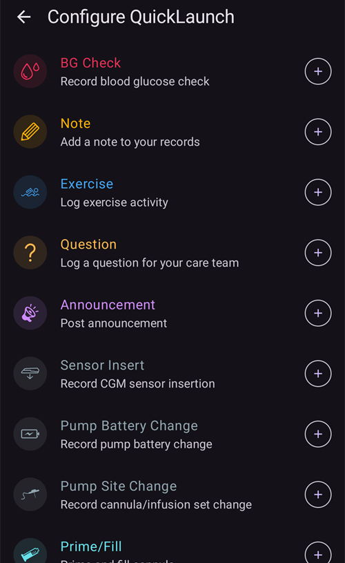

(quicklaunch)=
# QuickLaunch (pasek szybkich akcji na ekranie głównym)

**QuickLaunch** to mały **pasek szybkich akcji**, który unosi się na dole ekranu głównego **AAPS**, tuż nad dolnym paskiem nawigacji. To rząd przycisków, które możesz dostosować i które działają po jednym dotknięciu: sam decydujesz, jakie akcje się tu znajdą i w jakiej kolejności. Dzięki temu to, czego używasz najczęściej, masz na ekranie głównym zawsze pod ręką.

```{contents} Table of contents
:depth: 2
:local: true
```


---

## Korzystanie z paska

Pasek znajduje się na **ekranie głównym**, między wykresami a dolnym paskiem nawigacji:


- **Dotknij** ikony, aby uruchomić jej akcję — dokładnie tak, jakbyś otworzył ją z jej zwykłego ekranu (bolus lub inne leczenie nadal najpierw pokazuje zwykłe potwierdzenie).
- **Przytrzymaj** ikonę, aby zobaczyć **podpowiedź** z nazwą akcji i krótkim opisem.
- Jeśli dodasz **więcej przycisków, niż mieści się** na ekranie, dodatkowe przejdą do **menu dodatkowego** (przycisk **⋮** na końcu paska).
- Każda ikona ma **kolor** swojej akcji (np. insulina, węglowodany, cel tymczasowy), więc rozpoznasz ją od razu.

```{admonition} The toolbar is always there
:class: note
Ostatni przycisk to zawsze **Konfiguracja szybkich akcji** (koło zębate **⚙️**). Nie da się go usunąć, więc zawsze możesz przejść z paska prosto do ekranu konfiguracji. Domyślnie pasek ma tylko dwa przyciski — **Kalkulator bolusa** i to koło zębate.
```

---

## Konfiguracja QuickLaunch

Dotknij koła zębatego **⚙️** na pasku (albo otwórz **[Konfiguracja](../SettingUpAaps/ConfigBuilder.md) → … → Konfiguracja szybkich akcji**), aby otworzyć ekran **Konfiguracja szybkich akcji** (*„Dostosuj przyciski szybkich akcji na głównym dialogu”*).


Ekran ma dwie części:

- **Wybrane akcje** (na górze) — przyciski, które są teraz na Twoim pasku, w kolejności z paska.
- Pod nimi **katalog** — wszystkie akcje, które możesz dodać, pogrupowane w kategorie. Każda pozycja katalogu ma przycisk **➕**, którym ją dodasz.

### Wybrane akcje — zmiana kolejności, edycja, usuwanie

Każda wybrana akcja ma:

- **⠿ uchwyt** — przytrzymaj i przeciągnij, aby **zmienić kolejność** przycisków (kolejność tutaj to kolejność na pasku),
- przycisk **−** — **usuwa** akcję z paska,
- a tylko skrót **profilu** ma też przycisk **✏️** do edycji procentu i czasu trwania (zobacz [Skróty profilu](#profile-shortcuts)).

Zmiany działają **od razu** — nie ma osobnego przycisku *Zachowaj*. Dodana akcja trafia na koniec paska; stamtąd możesz zmienić jej miejsce.

---

## Kategorie akcji

Katalog dzieli wszystko, co możesz dodać, na poniższe kategorie, w tej kolejności. Kategorie, w których nic nie ma (np. nie masz żadnych scen), po prostu się nie pokazują.

### Terapia

Codzienne okna leczenia i CGM:

- **Insulina** — ręczne podanie bolusa.
- **Węglowodany** — zapis węglowodanów bez insuliny.
- **Kalkulator bolusa** — otwiera kalkulator bolusa.
- **Bolus i węglowodany** — zapis insuliny i węglowodanów razem.
- **CGM** — otwiera Twoją aplikację CGM (np. xDrip).
- **Kalibracja** — kalibracja sensora CGM.

### Portal opieki

Zdarzenia z portalu opieki i zapisy o wymianie sprzętu:

- **Sprawdź BG**, **Notatka**, **Ćwiczenia**, **Pytanie**, **Powiadomienie**,
- **Założenie sensora**, **Zmiana baterii pompy**, **Zmiana wkłucia**, **Napełnij/Wypełnij**, **Zmiana miejsca**.

**Napełnij/Wypełnij** i **Zmiana baterii pompy** są dostępne tylko wtedy, gdy Twoja pompa ich używa. Na przykład pompy typu patch napełniają się i wymieniają baterię w swoich krokach aktywacji, więc dla nich te pozycje się nie pokazują (tak samo jak w panelu **Zarządzaj**).



To te same pozycje, do których inaczej dochodzisz przez panele **[Leczenie](#v4changes-treatments)** i **[Zarządzaj](#v4changes-manage)** — QuickLaunch po prostu umieszcza na ekranie głównym te, których używasz.

### Zarządzaj

Ekrany z panelu **[Zarządzaj](#v4changes-manage)**, w tej samej kolejności, więc ten, którego używasz najczęściej, możesz otworzyć z paska:

- **Profil**, **Ustawienia insuliny** (zarządzanie konfiguracjami insuliny i ich aktywacja — nazwa celowo różni się od **Insulina**, bo tamten przycisk podaje bolus), **Cel tymczasowy**, **Szybki kalkulator**, **Sceny**, **Automatyzacja**, **Żywność**,
- **Tryb pracy** — zamknięcie lub otwarcie pętli, jej wstrzymanie albo odłączenie pompy,
- **Autoryzowani opiekunowie** — tylko na urządzeniu pacjenta (master) albo na sparowanym urządzeniu opiekuna.

Te przyciski otwierają ekran; same niczego nie uruchamiają. Aby uruchomić scenę albo szybki kalkulator jednym dotknięciem, dodaj go z kategorii **Sceny** lub **Szybki kalkulator** poniżej.

 

### Szybki kalkulator

Każde Twoje ustawienie **[Szybkiego kalkulatora](QuickWizards.md)** możesz dodać jako przycisk, więc powtarzający się posiłek masz jedno dotknięcie od ekranu głównego. Przycisk ma nazwę ustawienia i pokazuje ilość węglowodanów/insuliny; dotknięcie uruchamia szybki kalkulator ze zwykłym potwierdzeniem.

Szybkie kalkulatory ustawione tylko na zegarek nie są tu dostępne. Przycisk szybkiego kalkulatora na pasku działa według tych samych zasad co w panelu **Leczenie**: jest ukryty poza swoim [zakresem czasu ważności](#quickwizard_validity) i przez krótki czas po użyciu. Zostaje w konfiguracji paska i wraca, gdy szybkiego kalkulatora znowu można użyć.

### Sceny

Każdą włączoną **[scenę](Scenes.md)** możesz dodać jako przycisk. Po dotknięciu pojawia się prośba o potwierdzenie, a potem scena się aktywuje (ten sam zestaw akcji, co z ekranu Sceny). Ta kategoria pojawia się tylko wtedy, gdy masz co najmniej jedną scenę.

Podpowiedź i katalog pokazują to samo podsumowanie co **Zarządzaj → Sceny**, na przykład *„3 akcje, 2 h → Cooldown”*, gdzie nazwa po strzałce to następna scena.

### Automatyzacja

Twoje reguły automatyzacji typu **akcja użytkownika** (te, które uruchamiasz ręcznie) możesz dodać jako przyciski. Po dotknięciu pojawia się prośba o potwierdzenie, a potem wykonują się akcje tej reguły.

```{admonition} Automation buttons run on the master
:class: note
Automatyzacja działa na **urządzeniu pacjenta (master)**, więc skróty automatyzacji są dostępne i działają tylko tam. Nie ma ich na sparowanym **[urządzeniu opiekuna](../RemoteFeatures/ClientMasterControl.md)**.
```

### Ustawienia wstępne celów tymczasowych

Każde Twoje ustawienie **[celu tymczasowego](TempTargets.md)** możesz dodać jako przycisk (pokazuje nazwę, cel i czas trwania, na przykład *„Wkrótce posiłek — 5,0 mmol/l, 45 min”*). Po dotknięciu pojawia się prośba o potwierdzenie, a potem zaczyna się ten cel tymczasowy.


(profile-shortcuts)=
### Profil

Każdy **[profil](ProfileSwitch-ProfilePercentage.md)** możesz dodać jako **skrót**, który jednym dotknięciem wykonuje **zmianę profilu**. W odróżnieniu od większości skrótów skrót profilu ma własny **procent** i **czas trwania**. Ustawiasz je po dodaniu skrótu przyciskiem **✏️**:

- **Procent** (30–250%, co 5%) — zmienia profil w tej samej proporcji, gdy jest aktywowany. 100% używa profilu bez zmian.
- **Czas trwania** (0–10080 min, czyli do 7 dni, co 10 min) — jak długo działa zmiana. **0 = Stały** (aż zmienisz profil ponownie).


Dzięki temu możesz mieć kilka przycisków dla **tego samego** profilu z różną siłą — na przykład *„Profil 100%”* i *„Profil 70% przez 2 h”* — i włączyć każdy z nich jednym dotknięciem. (Ten sam profil możesz dodać więcej niż raz z innymi ustawieniami).

### Wtyczki


Na koniec każdą **włączoną wtyczkę**, która ma własny ekran, możesz dodać jako skrót, który otwiera ją bezpośrednio. Są pogrupowane według typu wtyczki — **Pompa**, **Źródło BG**, **APS**, **Pętla**, **Detekcja wrażliwości (sensitivity)**, **Wygładzanie**, **Kalibracja**, **Ograniczenia**, **Komunikacja** i **Ogólne** — więc możesz na przykład przejść z ekranu głównego prosto do ekranu pompy lub pętli.

---

## QuickLaunch i Master/Client

W odróżnieniu od większości ustawień **pasek QuickLaunch konfigurujesz osobno na każdym urządzeniu** — jest zapisany **lokalnie i nie jest synchronizowany** między urządzeniem pacjenta (master) a sparowanymi urządzeniami opiekuna, więc każde urządzenie ma własny zestaw przycisków. (*Jest* jednak częścią **kopii zapasowej/eksportu** ustawień, więc przywrócenie ustawień przywraca go na tym samym urządzeniu).

To, co urządzenie może umieścić na pasku, zależy od tego, co na nim jest: szybkie kalkulatory, sceny, ustawienia celów tymczasowych i profile są synchronizowane, więc katalog na urządzeniu opiekuna ma te same pozycje — po prostu wybierasz je osobno na każdym urządzeniu. Kilka szczegółów, które warto znać:

- Przyciski, których cel już nie istnieje (usunięty szybki kalkulator, scena lub ustawienie celu, wyłączona reguła), są **automatycznie pomijane**.
- Skróty **Automatyzacji** są dostępne i działają tylko na **urządzeniu pacjenta (master)** (automatyzacja działa na urządzeniu pacjenta). Przyciski scen, szybkiego kalkulatora, celów tymczasowych i profili są dostępne na urządzeniu opiekuna.
- Gdy na urządzeniu opiekuna dotkniesz przycisku, który musi działać na urządzeniu pacjenta (bolus, cel tymczasowy, zmiana profilu lub scena), wykona go **urządzenie pacjenta (master)** i to ono tworzy potwierdzenie. Zobacz [Sterowanie Master ↔ Client](../RemoteFeatures/ClientMasterControl.md).

---


<!-- =====================================================================
     Screenshots captured from a real master device:
       - quicklaunch_toolbar.png    (cropped close-up of the overview toolbar pill)
       - quicklaunch_overview.png   (full overview showing the toolbar in place)
       - quicklaunch_config.png     (Configure QuickLaunch: Selected actions + Treatment + start of Manage)
       - quicklaunch_dynamic.png    (catalog: Quick Wizard / Scenes / Automation / Temp Target Presets)
       - quicklaunch_categories.png (catalog: Profile shortcuts + plugin categories)
     No QuickLaunch action was actually run (nothing delivered; only scrolled).
     Maintainers: relocate page + images and fix cross-links as needed.
     ===================================================================== -->
