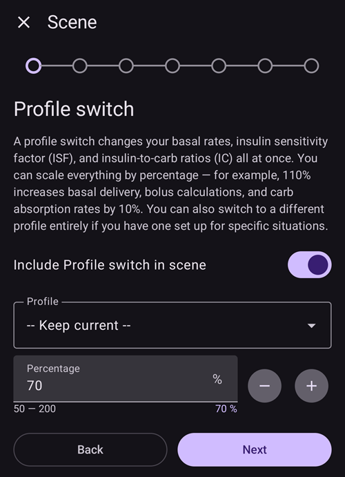

(scenes)=
# Sceny (ustawienia dla sytuacji)

**Scena** to nazwany zestaw ustawień, który wykonuje **kilka akcji naraz** — na przykład zestaw *Sen*, *Ćwiczenia* lub *Choroba*, który jednym dotknięciem zmienia profil, ustawia cel tymczasowy, włącza lub wyłącza SMB i dodaje wpis w portalu opieki, opcjonalnie na ustalony czas.

```{contents} Table of contents
:depth: 2
:local: true
```

---

## Czym jest scena

Zamiast zmieniać kilka rzeczy ręcznie za każdym razem, gdy powtarza się ta sama sytuacja, ustawiasz je raz jako scenę i aktywujesz ją jednym dotknięciem. Scena może łączyć dowolne z tych akcji:

- **Zmiana profilu** — przełącza profil i/lub zmienia go o procent (np. 70%).
- **Cel tymczasowy** — ustawia cel tymczasowy (np. *Aktywność*, *Wkrótce posiłek* lub własną wartość).
- **SMB wł./wył.** — włącza lub wyłącza super mikro bolusy (SMB), gdy scena jest aktywna.
- **Tryb pętli** — zmienia tryb pracy (np. na bardziej ostrożny tryb).
- **Wpis w portalu opieki** — zapisuje zdarzenie (np. *Ćwiczenia*, *Choroba*), aby było widoczne na wykresie i w Nightscout.

Scena ma też **czas trwania** — stały czas (minuty/godziny/dni) albo *Bezterminowo (ręczne zakończenie)* — oraz **akcję końcową**, która wykonuje się po jej zakończeniu: jest to **powiadomienie** albo scena może **przejść** w inną scenę (na przykład *Choroba → Ćwiczenia*).

---

## Zarządzanie scenami

Otwórz **Zarządzaj → Sceny**, aby przeglądać, tworzyć, edytować, włączać/wyłączać sceny i zmieniać ich kolejność.


Każda karta sceny pokazuje:

- **pole wyboru** do włączania/wyłączania sceny,
- **ikonę** i **nazwę**,
- podsumowanie — *„Akcje: N, czas trwania”* oraz **→ następną scenę**, jeśli scena przechodzi w inną,
- oraz trzy przyciski: **▶ aktywuj**, **✏️ edytuj**, **🗑️ usuń**.

Dotknij przycisku **+**, aby utworzyć nową scenę.

---

## Tworzenie lub edycja sceny

### Zacznij od szablonu

Aby **utworzyć** scenę, dotknij przycisku **+** na ekranie Sceny. Pierwszy krok to **Zacznij od szablonu**: wybierz gotową scenę dla częstej sytuacji — *Ćwiczenia*, *Choroba*, *Choroba — wymioty*, *Sen*, *Noc po treningu*, *Przed posiłkiem*, *Alkohol*, *Prowadzenie pojazdu*, *Kąpiel*, *Faza lutealna*, *Upał*, *Zabieg medyczny* — albo zacznij od sceny *Pusta*. Każdy szablon **wstępnie wypełnia zalecane akcje**, a w kolejnych krokach możesz wszystko zmienić.


Po wybraniu szablonu zobaczysz wyjaśnienie jego celu — *kiedy* i *dlaczego* go używać — zanim przejdziesz dalej:


### Przejdź przez kolejne akcje

Reszta edytora to krótki kreator **krok po kroku**. Każdy krok to jeden typ akcji z przełącznikiem *„Uwzględnij … w scenie”* — włącz go tylko dla akcji, które ta scena ma wykonać, a resztę zostaw wyłączoną.



Przechodź przez kroki przyciskami **Dalej**/**Wstecz**: *Zmiana profilu*, *Cel tymczasowy*, *SMB*, *Tryb pętli*, *Wpis w portalu opieki*, potem **czas trwania**, **akcja końcowa** (powiadomienie lub przejście w inną scenę), a na końcu **nazwa i ikona** sceny. Na koniec zapisz scenę. (Aby **edytować** istniejącą scenę, dotknij jej przycisku **✏️** — przejdziesz od razu do tych kroków).

Każdy krok zaczyna się od krótkiego wyjaśnienia, co robi dana akcja. Kroki wyglądają tak, tutaj z szablonem *Ćwiczenia*:

**Cel tymczasowy** — wybierz jeden ze swoich presetów celu tymczasowego:


**SMB** — włącz lub wyłącz SMB, gdy scena jest aktywna:


**Tryb pracy** — opcjonalnie zmień tryb pętli:


**Portal opieki** — typ zdarzenia i notatka do zapisania:


**Czas trwania** — jak długo scena jest aktywna; 0 oznacza: do czasu, aż sam ją zakończysz:


**Następna scena** — opcjonalnie scena, która zaczyna się po zakończeniu tej:


**Scena** — nazwa i ikona. Naciśnij **Zakończ**, aby zapisać:


---

## Aktywacja sceny

Aktywuj scenę z listy **Sceny** (przycisk **▶**) albo z pozycji **Sceny** na dolnym pasku nawigacji. W panelu **Sceny** na dolnym pasku nawigacji każda scena pokazuje to samo podsumowanie co na liście scen, a **ołówek** na górze panelu otwiera **Zarządzaj → Sceny**, gdzie tworzysz lub edytujesz swoje sceny.


If [bolus protection](#Preferences-protection) is on, **AAPS** asks for it before a scene starts or ends. Changing a scene needs the [settings protection](#Preferences-settings-protection) instead.

Zanim cokolwiek zostanie wykonane, zobaczysz **potwierdzenie** z dokładną listą tego, co zrobi scena, więc możesz to sprawdzić:


Jeśli scena przechodzi w inną, potwierdzenie kończy się znakiem **→** i nazwą następnej sceny, tak samo jak na liście scen.

Gdy uruchamiasz scenę z pozycji **Sceny** na dolnym pasku nawigacji, potwierdzenie jest prostszym oknem z tą samą listą akcji. Naciśnij **OK**, aby aktywować:


Po potwierdzeniu akcje są wykonywane, a **aktywna scena** jest pokazana na górze ekranu głównego z przyciskiem **Zakończ scenę**. Jeśli scena przechodzi w inną, baner pokazuje też nazwę następnej sceny:


Akcje sceny działają, dopóki:

- nie skończy się jej **czas trwania** (wykonuje się wtedy **akcja końcowa** — powiadomienie lub przejście do następnej sceny) albo
- nie dotkniesz **Zakończ scenę**, aby zakończyć ją ręcznie. Jeśli scena przechodzi w inną, masz dwie możliwości: **Pomiń i przejdź do** następnej sceny (aktywna scena się kończy, a następna zaczyna się od razu) albo **Zakończ scenę** (aktywna scena się kończy, a następna się nie zaczyna).

Scena bez następnej sceny prosi tylko o potwierdzenie:


Zakończenie sceny **cofa** zmiany, które zrobiła (na przykład zmianę profilu i cel tymczasowy, które uruchomiła).

Gdy scena jest aktywna, profil i cel na ekranie głównym mają małą ikonę sceny, jeśli ustawiła je scena. Panel **Sceny** na dolnym pasku nawigacji jest nadal dostępny, aby uruchomić inną scenę:


Gdy czas trwania sam się skończy, zmiany są od razu cofane, a baner zmienia się na **Scena zakończona** z przyciskiem **Zamknij**. Zamknięcie usuwa tylko baner z ekranu — sama scena już się skończyła, więc reguły automatyzacji i następna scena działają dalej i nie czekają na to.

---

## Uruchamianie scen z automatyzacji

Nie musisz uruchamiać sceny ręcznie — może to za Ciebie zrobić **Automatyzacja**. Gdy dodajesz akcję do reguły automatyzacji (**Zarządzaj → Automatyzacja**), lista akcji ma kategorię **Sceny**:

- **Uruchom scenę** — aktywuje scenę, gdy spełnią się wyzwalacze reguły (na przykład o ustalonej godzinie, gdy dotrzesz w jakieś miejsce albo gdy glukoza przekroczy próg).
- **Włącz scenę** / **Wyłącz scenę** — sprawia, że scena jest dostępna (lub niedostępna), bez jej aktywowania.


Automatyzacja może też **reagować na** scenę: lista wyzwalaczy zawiera wyzwalacz **Scena**, więc reguła może działać tylko wtedy, gdy aktywna jest określona scena. Razem z **akcją końcową** sceny (cofnięcie, powiadomienie lub przejście w inną scenę) pozwala to scenom zaczynać się, następować po sobie i kończyć automatycznie.

---

## Sceny z Master/Client i zegarkiem

**Aktualnie aktywna scena jest synchronizowana** na wszystkich sparowanych urządzeniach — aktywuj ją na jednym telefonie, a pozostałe też ją pokażą.

Sparowane **urządzenie opiekuna** (**AAPSClient**) też może aktywować lub zakończyć scenę: prośba jest wysyłana do **urządzenia pacjenta**, które przygotowuje potwierdzenie i wykonuje scenę na swoich danych. Zobacz [Sterowanie Master ↔ Client](../RemoteFeatures/ClientMasterControl.md), aby dowiedzieć się, jak to działa.

(scenes-from-watch)=
### Ze smartwatcha z Wear OS

Sceny są dostępne na **zegarku z Wear OS** jako **kafelek Scena**. Przewiń do kafelka **Scena** w karuzeli kafelków zegarka (jeśli go tam jeszcze nie ma, najpierw dodaj go z listy kafelków karuzeli) i dotknij sceny, którą chcesz uruchomić:


Kafelek ma cztery miejsca. Domyślnie każde miejsce wypełnia się **automatycznie** kolejną z Twoich włączonych scen, w kolejności z telefonu. Aby wybrać samodzielnie, **przytrzymaj kafelek** i otwórz jego ustawienia: dla każdego z czterech miejsc możesz zostawić **Automatyczna**, przypiąć **konkretną scenę** albo wybrać **Brak**, aby zostawić miejsce puste. Miejsce przypięte do sceny, która została potem usunięta lub wyłączona, pokazuje **Niedostępna** — wybierz dla niego inną scenę.

Zegarek pokazuje wtedy potwierdzenie — dotknij **✓**, aby aktywować, albo przesuń palcem wstecz, aby anulować:


Tak samo jak w przypadku urządzenia opiekuna, **urządzenie pacjenta przygotowuje potwierdzenie i wykonuje scenę**; zegarek tylko przekazuje prośbę (przez telefon opiekuna, jeśli zegarek jest sparowany z urządzeniem opiekuna).

Gdy scena działa — albo jej baner **Scena zakończona** jest jeszcze widoczny na telefonie — kafelek pokazuje przycisk **Zakończ** z nazwą sceny pod spodem. Dotknij go, aby zakończyć aktywną scenę albo usunąć pozostały baner — prosto z nadgarstka.

Jeśli działająca scena przechodzi w inną, kafelek pokazuje też przycisk **Pomiń** z nazwą następnej sceny pod spodem. To te same dwie możliwości co na telefonie:

- **Zakończ** — aktywna scena się kończy. Potwierdzenie informuje, że następna scena się nie zacznie.
- **Pomiń** — aktywna scena się kończy, a następna scena zaczyna się od razu. Potwierdzenie pokazuje nazwy obu scen.

[Ekran Status pętli](#WearOsSmartwatch-loop-status) na zegarku też pokazuje aktywną scenę, pozostały czas i następną scenę.

---


<!-- =====================================================================
     Screenshots captured from a real master device:
       - scenes_list.png        (Manage → Scenes management list)
       - templates_picker.png   (create: "Start from template" picker)
       - template_explanation.png (create: chosen template's explanation)
       - scene_editor.png       (scene editor, Profile switch step)
       - scene_confirmation.png (scene activation confirmation — also used on the Client/Master page)
       - scene_active_banner.png (overview active-scene banner with the End Scene button)
       - automation_scene_action.png (Automation action picker — Scenes category)
       - scene_watch_tile.png    (Wear OS Scene tile)
       - scene_watch_confirm.png (Wear OS scene confirmation)
     Maintainers: relocate page + images and fix cross-links as needed.
     ===================================================================== -->
