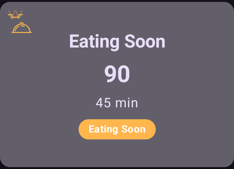
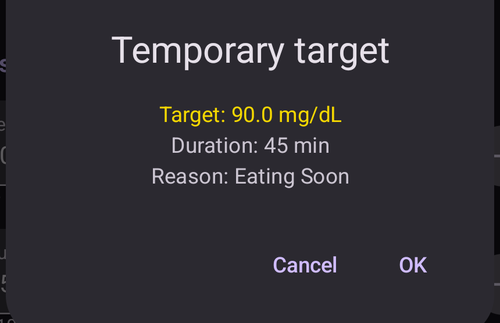
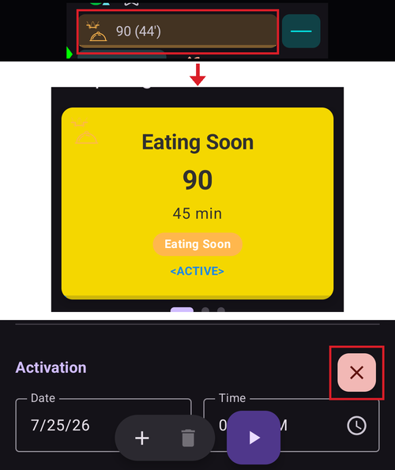

# Cele tymczasowe

## Czym są cele tymczasowe i gdzie mogę je ustawić i skonfigurować?

**Cel tymczasowy** (w skrócie **TT**) to funkcja **AAPS**, która pozwala zmienić [zakres docelowy **BG**](#profile-glucose-targets) na czas planowanych aktywności. **AAPS** robi to, zmieniając ilość insuliny podawanej użytkownikowi.

Cel glukozy, szczególnie krótkotrwały (trwający mniej niż 4 godziny), nie musi być *rzeczywistą wartością*, do której ma dojść Twoja glukoza. To raczej dobry sposób, aby powiedzieć **AAPS**, żeby działał bardziej lub mniej agresywnie, a glukoza nadal była w zakresie.

Cele tymczasowe można ustawić w tych granicach:

|          | Cel tymczasowy (TT)     |
| -------- | ----------------------- |
| Minimum  | 4 mmol/l lub 72 mg/dl   |
| Maksimum | 10 mmol/l lub 180 mg/dl |

**AAPS** ma trzy wbudowane presety **celu tymczasowego**: na ćwiczenia (**Aktywność**), na posiłki (**Wkrótce posiłek**) i na przewidywaną hipoglikemię (**Hipo**). Znajdziesz je na ekranie **Cel tymczasowy** (**Zarządzaj** → **Cel tymczasowy**), który możesz też otworzyć, dotykając **elementu celu** na ekranie głównym.

Miej realistyczne oczekiwania co do wyników, które można osiągnąć, gdy wybierasz **cel tymczasowy** w **AAPS**. To, czy uda się osiągnąć żądany cel **BG**, zależy od wielu czynników, takich jak: poprawność ustawień **AAPS**, ogólna kontrola **BG**, **IOB**, wrażliwość na insulinę, insulinooporność, intensywność wysiłku podczas ćwiczeń i tak dalej.

Osiągnięcie żądanego celu **BG** po ustawieniu **celu tymczasowego** może trwać około 30 minut lub dłużej. **AAPS** nie może osiągnąć celu **BG** natychmiast. Pamiętaj o tym, gdy wybierasz **cel tymczasowy**.

The sections below summarize the features of **Temp-Target Activity**, **Temp-Target Eating soon** and **Temp-Target Hypo**. Pokazane wartości to ustawienia domyślne — możesz [dostosować każdy preset](#TempTargets-change-preset-defaults) do swoich potrzeb.

### TT - Ćwiczenia


**Cel BG (domyślny preset, można go zmienić)**

AAPS będzie dążyć do 140 mg/dl lub 7,8 mmol/l przez 1 godz. 30 min

**Inne rzeczy, które warto wziąć pod uwagę przy wyborze**:

W zależności od poziomu **BG** **AAPS** „zmniejszy” ilość podawanej insuliny, aby osiągnąć cel **BG**. Jeśli **BG** nie jest w zakresie docelowym (tzn. jest powyżej celu **BG** wybranego w **profilu**), **AAPS** może dalej podawać bazę.

W trybie zamkniętej pętli **SMB**:

- *może być* wyłączony (więcej o tym poniżej); i/lub
- baza może zostać włączona, jeśli **AAPS** ma ujemne **IOB**, lub <0.

Możesz też rozważyć:

- *wybranie* tego **TT** 1–2 godziny przed planowanymi ćwiczeniami, aby mieć mniejsze IOB (właściwy czas dla tego TT jest u każdego inny); i
- *wybranie* tymczasowego profilu (zmniejszenie) na czas planowanej aktywności, aby mieć mniejsze **IOB**;
- *ensuring* **TT** is timed to be *deactivated* shortly before the exercise, because **IOB** is already reduced and some users experience a rapid rise in **BG** post exercise.

### TT - Wkrótce posiłek



**Cel BG (domyślny preset, można go zmienić)**

AAPS będzie dążyć do 90 mg/dl lub 5,0 mmol/l przez 45 minut

**Inne rzeczy, które warto wziąć pod uwagę przy wyborze**:

W trybie zamkniętej pętli **SMB**:

- pozostanie włączony; i/lub
- baza też może zostać włączona, w zależności od ustawień **profilu**.

W zależności od poziomu **BG** **AAPS** „zwiększy” ilość podawanej insuliny w granicach Twoich ustawień **AAPS**, aby osiągnąć żądany cel **BG**.

### TT - Hipo


**Cel BG (domyślny preset, można go zmienić)**

AAPS będzie dążyć do 160 mg/dl lub 8,9 mmol/l przez 1 godzinę

**Inne rzeczy, które warto wziąć pod uwagę przy wyborze**:

W trybie zamkniętej pętli **SMB**:

- *może być* wyłączony (więcej o tym poniżej); i/lub
- baza może zostać włączona, jeśli **AAPS** ma ujemne **IOB**, lub <0.

(TempTargets-manage-v4)=

## Ustawianie celów tymczasowych i zarządzanie nimi (Zarządzaj → Cel tymczasowy)

W **AAPS** v4 zarządzasz **presetami** TT i uruchamiasz cel tymczasowy z ekranu **Zarządzaj** (dolny pasek nawigacji) → **Cel tymczasowy** (*„Zarządzaj i ustawiaj tymczasowe cele”*).


Ekran ma trzy części:

1. **Karuzela presetów** (na górze) — przewijaj palcem swoje presety TT. Każda karta pokazuje **nazwę**, **cel** i **czas trwania** presetu; aktualnie działający TT jest wyróżniony.
2. **Edytor** (w środku) — **Cel tymczasowy** i **Czas trwania**, które zostaną naprawdę użyte, oraz data/godzina **Aktywacji**.
3. **Pasek akcji** (na dole) — przyciski **➕ dodaj**, **‘️ usuń** i **▶ aktywuj**.

Wybranie karty presetu wczytuje jej **cel** i **czas trwania** do edytora.

```{admonition} Presety wbudowane i własne :class: note Presety wbudowane — **Wkrótce posiłek**, **Aktywność** i **Hipo** — zawsze istnieją i **nie można ich usunąć** (możesz jednak zmienić ich wartości i je zapisać). Presety, które tworzysz sam, są **własne** i możesz je dowolnie edytować lub usuwać.

    <br />### Aktywacja celu tymczasowego
    
    Przewiń do wybranego presetu (jego wartości wczytają się do edytora), opcjonalnie zmień **cel**/**czas trwania** w edytorze, a potem dotknij **▶ Aktywuj**. Zanim cokolwiek się zacznie, potwierdzenie pokazuje dokładny cel, czas trwania i powód:
    
    
    
    Po potwierdzeniu cel tymczasowy zaczyna działać od razu (albo o wybranym czasie **Aktywacji**) i trwa przez ustawiony **czas trwania**.
    
    ```{admonition} Zmiana liczb działa tylko raz — nie zmienia presetu
    :class: important
    **Cel** i **czas trwania** w edytorze to wartości, których **Aktywuj** użyje *teraz*. Jeśli je zmienisz, ta zmiana jest **tymczasowa**: dotyczy tylko tej aktywacji i **nie zmienia zapisanego presetu**. Dzięki temu możesz „poprawić i aktywować” jednorazowy TT (na przykład aktywować dziś *Aktywność* z trochę innym celem) bez trwałej zmiany presetu.
    

### Zapisywanie zmian w presecie

Jeśli *chcesz* zachować zmienioną wartość, **zapisz** ją: gdy edytor różni się od wybranego presetu, na górnym pasku pojawia się ikona **Zachowaj**. Dotknięcie jej zapisuje aktualny **cel** i **czas trwania** (oraz nazwę, dla własnych presetów) w wybranym presecie. Dla presetów wbudowanych na pasku akcji pojawia się też przycisk **Przywróć domyślne** (↺): przywraca on domyślne wartości presetu.


Prosta zasada:

- **Aktywuj** → użyj liczb **jeden raz** (preset się nie zmienia).
- **Zachowaj** → liczby stają się **nowymi wartościami domyślnymi** presetu.

Aby przywrócić wbudowany preset do ustawień fabrycznych, wybierz go i dotknij przycisku **↺ Przywróć** — pojawia się on na pasku akcji tylko dla presetu **wbudowanego**, którego wartości różnią się teraz od fabrycznych, i przywraca oryginalny **cel** i **czas trwania** tego presetu.

### Dodawanie i usuwanie presetów

- **➕ Dodaj** — tworzy **nowy własny preset** z aktualnych wartości w edytorze. Nowa karta pojawia się w karuzeli.
- **‘️ Usuń** — usuwa wybrany preset **własny**. Presetów wbudowanych (*Wkrótce posiłek*, *Aktywność*, *Hipo*) nie można usunąć.

Gdy masz co najmniej dwa presety **własne**, możesz też zmienić ich kolejność w karuzeli: dotknij ikony **Zmień kolejność** (⇅) na górnym pasku, przesuwaj kartę ze środka **przyciskami ◀ / ▶**, a potem potwierdź **✓**. Presety wbudowane zostają na swoich miejscach — przesuwać można tylko presety własne. (Przyciski wyglądają tak samo jak przy [zmianie kolejności profili](ProfileSwitch-ProfilePercentage.md)).

Twoje presety są częścią synchronizowanej konfiguracji, więc są wspólne dla urządzenia pacjenta i sparowanych urządzeń opiekuna.

### Inne sposoby ustawienia celu tymczasowego

Cel tymczasowy możesz też ustawić bez otwierania tego ekranu:

- **przełącznikami TT w oknie Węglowodany** — zobacz [poniżej](#TempTargets-carbs-dialog),
- **przyciskiem presetu na [pasku QuickLaunch](QuickLaunch.md)** — kategoria *Ustawienia wstępne celów tymczasowych* w *Konfiguracja szybkich akcji* daje przycisk do szybkiego użycia dla każdego z Twoich presetów,
- z **zegarka z Wear OS** (pozycja menu / kafelek **Cel tymczasowy**),
- ze sparowanego **urządzenia opiekuna** — zobacz [Sterowanie Master ↔ Client](../RemoteFeatures/ClientMasterControl.md),
- jako część **[sceny](Scenes.md)** (akcja *Cel tymczasowy*) lub
- z reguły **Automatyzacji** (*Rozpocznij cel tymczasowy* / *Zatrzymaj cel tymczasowy*).

* * *

(TempTargets-where-can-i-select-a-temp-target)=

## Gdzie mogę wybrać cel tymczasowy?

Najszybciej jest dotknąć **elementu celu** na ekranie głównym (pokazuje on Twój aktualny zakres docelowy):


Otwiera to opisany wyżej ekran **Cel tymczasowy** — przewiń do presetu i dotknij **▶ Aktywuj**. Ten sam ekran otworzysz też przez **Zarządzaj** → **Cel tymczasowy**.

(TempTargets-carbs-dialog)= Gdy wpisujesz węglowodany, nie musisz wcale otwierać ekranu **Cel tymczasowy**: **okno Węglowodany** (**Leczenie** → **Węglowodany**) ma na górze przełączniki **Rozpocznij TT Hipo**, **Rozpocznij TT WkrótcePosiłek** i **Rozpocznij TT Ćwiczenia**. Włącz jeden z nich, a odpowiedni preset zostanie aktywowany razem z wpisem węglowodanów:


    {admonition} Automatyczny TT Hipo
    :class: note
    Jeśli otworzysz **okno Węglowodany**, gdy Twoja glukoza jest poniżej 72 mg/dl (4 mmol/l), **AAPS** sam zaznaczy przełącznik **Rozpocznij TT Hipo** (chyba że już działa wyższy cel tymczasowy z dłuższym pozostałym czasem).

(TempTargets-change-preset-defaults)=

## Gdzie mogę zmienić domyślny cel tymczasowy i zastąpić go własnymi ustawieniami?

**Cel** i **czas trwania** każdego presetu edytujesz bezpośrednio na ekranie **Cel tymczasowy** — nie ma już do tego osobnej pozycji w ustawieniach:

1. Otwórz ekran **Cel tymczasowy** (dotknij elementu celu albo **Zarządzaj** → **Cel tymczasowy**).
2. Przewiń do presetu, który chcesz zmienić.
3. Zmień **Cel tymczasowy** i/lub **Czas trwania** w edytorze.
4. Dotknij ikony **Zachowaj**, która pojawi się na górnym pasku.


Gdy edytor różni się od fabrycznych wartości presetu wbudowanego, na pasku akcji pojawia się też przycisk **↺ Przywróć** — dotknij go, aby przywrócić oryginalny cel i czas trwania presetu.

## Jak anulować cel tymczasowy?

Gdy działa cel tymczasowy, element celu na ekranie głównym pokazuje cel i pozostały czas. Dotknij go — na ekranie **Cel tymczasowy** działający preset jest wyróżniony jako **AKTYWNY**, a czerwony przycisk **✗ Anuluj** pojawia się na końcu dolnego paska, tuż na lewo od przycisku **▶ Aktywuj**. Dotknij go i potwierdź:



Działający cel tymczasowy możesz też zatrzymać z **zegarka z Wear OS**, ze sparowanego **urządzenia opiekuna** albo regułą **Automatyzacji** (*Zatrzymaj cel tymczasowy*).

(TempTargets-hypo-temp-target)=

## Cel tymczasowy Hipo

**Cel tymczasowy Hipo** pozwala **AAPS** chronić Cię przed niskim poziomem cukru przez zmniejszenie ilości podawanej insuliny. Jeśli przewidujesz, że Twoja **BG** spadnie nisko: zwykle **AAPS** powinien sobie z tym poradzić, ale dużo zależy od tego, jak dobre są Twoje ustawienia **AAPS**. **Cel tymczasowy Hipo** pozwala zareagować wcześniej, przed przewidywanym spadkiem, i sprawić, że **AAPS** zmniejszy ilość insuliny.

Czasem po zjedzeniu węglowodanów na leczenie hipoglikemii **BG** może szybko rosnąć, a **AAPS** koryguje szybki wzrost **BG**, podając **SMB**.

Niektórzy użytkownicy chcą uniknąć podawania **SMB** w czasie **celu tymczasowego Hipo**. Robisz to, wyłączając *'Włącz SMB z wysokim tymczasowym poziomem docelowym'* w **Ustawienia** → **OpenAPS SMB** (zobacz niżej):

- Advanced, objective 9: the user can enable *“High temp target raises sensitivity”* for **Temp-Targets** of 100 mg/dL (5.6 mmol/L) or higher in OpenAPS SMB, **AAPS** will be more sensitive.

- Advanced, objective 9: the user can deactivate *“Enable SMB with high temp target”*, so that even if **AAPS** has COB > 0, “Enable SMB with low temp target” or “Enable SMB always” enabled and OpenAPS SMB active, **AAPS** will not give SMBs while high temp targets are active.

Uwaga: jeśli otworzysz **okno Węglowodany**, gdy Twoja glukoza jest niższa niż 72 mg/dl lub 4 mmol/l, **AAPS** sam zaznaczy przełącznik **Rozpocznij TT Hipo**.

(TempTargets-activity-temp-target)=

## Cel tymczasowy Ćwiczenia

Przed ćwiczeniami i w ich trakcie możesz potrzebować wyższego celu, aby zapobiec hipoglikemii podczas aktywności.

Aby ułatwić korzystanie z **celu tymczasowego Ćwiczenia**, możesz ustawić domyślny **cel tymczasowy Ćwiczenia**, który podnosi poziom **BG** przez zmniejszenie ilości insuliny. Spowalnia to spadek **BG** i pomaga uniknąć hipoglikemii.

Nowi użytkownicy **AAPS** mogą potrzebować prób i dopasowania domyślnych ustawień **celu tymczasowego Ćwiczenia**, aby ta funkcja działała u nich jak najlepiej. Każdy człowiek inaczej osiąga stabilną kontrolę BG podczas ćwiczeń. Zobacz też [sekcję o sporcie w FAQ](#FAQ-sports).

Some users also prefer to activate a **Profile switch** (being a Profile decrease < 100% to reduce insulin delivery by **AAPS**) before and while **Temp-Target Activity** is on. Możesz uruchomić oba w jednym kroku: dotknij nazwy profilu na ekranie głównym, dotknij okrągłego przycisku **▶**, ustaw **Procent** poniżej 100% i **Czas trwania**, a potem włącz **Cel tymczasowy / Aktywność**. Zobacz [Zmiana procentu profilu](#ProfileSwitch-change-percentage).

Dla zaawansowanych, zadanie 9: możesz włączyć *'Wysoki cel tymczasowy zwiększa wrażliwość'* dla **celów tymczasowych** od 100 mg/dl (5,6 mmol/l) wzwyż w OpenAPS **SMB**. Cel 99 mg/dl (5,5 mmol/l) jest celem normalnym, ani wysokim, ani niskim. Wtedy **AAPS** jest bardziej wrażliwy.

Dodatkowo, jeśli *'Włącz SMB z wysokim tymczasowym poziomem docelowym'* jest wyłączone, **AAPS** nie poda **SMB**, nawet gdy COB > 0, włączone jest *'Włącz SMB z niskim tymczasowym poziomem docelowym'* lub *'Zawsze włącz SMB'* i OpenAPS **SMB** jest aktywny.

(TempTargets-eating-soon-temp-target)=

## Cel tymczasowy Wkrótce posiłek

**Temp-Target Eating soon** can help accomplish a gentle drive down of **BG** and ensure there is ample **IOB** before eating.

This can be an important tool for those users who do not pre bolus, however the efficacy of **Temp-Target Eating soon** will depend on a number of factors including: the user’s settings, if they eat a low carb diet and whether they are using a fast acting insulin (like Fiasp or Lyumjev) in order to eliminate the need to pre bolus. Ordinarily, until users are experienced in **AAPS** they should expect to pre bolus when using **Temp-Target Eating soon** and this is particularly so, if eating a high carb diet.

Więcej o „trybie Eating soon” możesz przeczytać w artykule ['How to do “eating soon” mode'](https://diyps.org/2015/03/26/how-to-do-eating-soon-mode-diyps-lessons-learned/) lub [tutaj](https://diyps.org/tag/eating-soon-mode/).

Dla zaawansowanych, [zadanie 9](#objectives-objective9): jeśli używasz OpenAPS SMB i masz włączone *'Niski cel tymczasowy obniża wrażliwość'*, **AAPS** działa trochę bardziej agresywnie. Ta opcja wymaga, aby **cel tymczasowy** wynosił 98 mg/dl (5,4 mmol/l) lub mniej.

## Jak wyłączyć SMB podczas celów tymczasowych?

Aby to zrobić, otwórz **Ustawienia** → **OpenAPS SMB** i wyłącz *'Włącz SMB z wysokim tymczasowym poziomem docelowym'*.


Spowoduje to, że **AAPS** nie poda **SMB**, nawet gdy COB > 0, włączone jest *'Włącz SMB z niskim tymczasowym poziomem docelowym'* lub *'Zawsze włącz SMB'* i OpenAPS SMB jest aktywny.