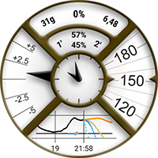

# Dokumentacja własnych tarcz zegarka (Custom Watchface)

Ta strona jest dla projektantów nowych tarcz zegarka. Zawiera listę wszystkich słów kluczowych i funkcji, których możesz użyć, gdy chcesz utworzyć lub animować nową tarczę.

- Nowe funkcje i klucze dostępne w Custom Watchface V2 (Wear apk 3.3.0 lub nowsza) opisano [tutaj](#cwf-reference-new-v2-features)

## Format własnej tarczy (Custom Watchface)

Custom Watchface to otwarty format zaprojektowany dla AAPS i powiązany z nową tarczą „AAPS (Custom)” dostępną na zegarku.

Plik tarczy to zwykły plik zip. Aby został rozpoznany jako plik tarczy, plik zip musi zawierać te pliki:

- Jeden plik obrazu o nazwie CustomWatchface (może to być plik bitmapy `CustomWatchface.jpg`, `CustomWatchface.png` lub plik wektorowy `CustomWatchface.svg`). Ten plik to mała ikona używana do wyboru tarczy po kliknięciu przycisku „Załaduj Tarczę”. To także obraz widoczny we wtyczce Wear w AAPS.
- Jeden plik o nazwie `CustomWatchface.json` (zobacz [Struktura JSON](#cwf-reference-json-structure) poniżej). Drugi plik to plik główny. Zawiera wszystkie informacje potrzebne do zaprojektowania tarczy zegarka. Ten plik json musi być poprawny (to chyba najtrudniejsza rzecz przy ręcznej edycji tego pliku w edytorze tekstu, bo jeden brakujący lub zbędny przecinek wystarczy, aby zepsuć format json). Ten plik JSON musi też zawierać blok `"metadata"` z kluczem `"name"`, który ma niepustą wartość. To będzie nazwa Twojej własnej tarczy (zobacz [Ustawienia metadanych](#cwf-reference-metadata-settings) poniżej)
- rozmiar tego pliku zip powinien być jak najmniejszy (mniej niż około 500 kB). Jeśli ten plik jest za duży, zostanie po prostu zablokowany i nie zostanie wysłany do zegarka.

Plik zip może też zawierać dodatkowe pliki zasobów:

- Stałe nazwy plików obrazów, które będą używane w standardowych widokach tarczy (np. `Background`, `CoverChart`... zobacz [Lista stałych plików zasobów](#cwf-reference-list-of-hardcoded-resource-files) poniżej). Wszystkie te pliki mogą mieć format `jpg`, `png` lub `svg`. ale dla większości z nich musisz użyć formatu `png` lub `svg`, które obsługują przezroczystość (pliki jpg są mniejsze niż png, ale nie mają przezroczystości). Pamiętaj, że najlepszą jakość przy najmniejszym rozmiarze dają zwykle pliki svg (format wektorowy).
- Dodatkowe pliki zasobów o dowolnych nazwach. Te dodatkowe pliki mogą być plikami obrazów albo plikami czcionek (dla czcionek akceptowane są formaty `ttf` i `otf`). Pamiętaj, że dla tych dodatkowych plików `filename` (bez rozszerzenia) jest używany w pliku JSON jako keyValue, aby określić, gdzie lub kiedy te pliki mają być użyte.
  - pliki obrazów są często używane jako tło widoków tekstowych lub do animacji dynamicznych (np. poziom baterii od 0% do 100%)
  - pliki czcionek pozwalają używać własnych czcionek na tarczy zegarka

(cwf-reference-json-structure)=

## Struktura JSON

Pliki JSON możesz edytować w edytorze tekstu Notatnik (lub notepad++) (lepszy jest notepad++, który rozpoznaje JSON i używa kolorów)

- zawiera klucze tekstowe `"string_key":` i wartości kluczy, które mogą być tekstem, np. `"key value"`, liczbą całkowitą, wartością logiczną, np. `true` lub `false`, albo blokiem danych.
- każda wartość jest oddzielona przecinkiem `,`
- Blok danych zaczyna się od `{` i kończy na `}`
- plik json jest jednym całym blokiem, więc zaczyna się od `{` i kończy na `}`. W tym pliku wszystkie zagnieżdżone bloki są powiązane z kluczem `"key"`, który musi być unikalny w danym bloku
- Aby plik json był bardziej czytelny, zwykle ma wcięcia (każdy nowy klucz jest w nowej linii, każdy nowy blok jest przesunięty w prawo o 4 spacje)

(cwf-reference-metadata-settings)=

### Ustawienia metadanych

Ten blok jest pierwszym blokiem w pliku json i jest obowiązkowy. Zawiera wszystkie informacje o tej tarczy, np. nazwę, autora, datę utworzenia lub aktualizacji, wersję autora lub wersję wtyczki.

Poniżej przykład bloku metadanych:

```text
"metadata": {
    "name": "Default Watchface",
    "author": "myName",
    "created_at": "07\/10\/2023",
    "author_version": "1.0",
    "cwf_version": "1.0",
    "comment": "Default watchface, you can click on EXPORT WATCHFACE button to generate a template"
},
```

Pamiętaj, że `/` używany w dacie jest znakiem specjalnym. Aby plik json został poprawnie odczytany, musisz przed nim wstawić znak „escape” `\`

W niektórych plikach json możesz zobaczyć dodatkowy klucz `"filename"`. Ten klucz zostanie automatycznie utworzony lub zaktualizowany, gdy własna tarcza zostanie załadowana w AAPS (służy do pokazania użytkownikowi nazwy pliku zip w folderze exports), więc możesz usunąć ten klucz z bloku metadanych.

(cwf-reference-general-parameter-settings)=

### Ustawienia parametrów ogólnych

Po pierwszym bloku z metadanymi ustawiasz parametry ogólne (zobacz [Lista parametrów ogólnych](#cwf-reference-list-of-general-parameters) poniżej). Pozwalają one ustawić kolory wykresu (węglowodany, bolus, wartości BG...), a także domyślne kolory dla wartości w zakresie, hiper lub hipo (domyślne kolory wartości BG i strzałek)

Poniżej przykład parametrów ogólnych

```text
"highColor": "#FFFF00",
"midColor": "#00FF00",
"lowColor": "#FF0000",
"lowBatColor": "#E53935",
"carbColor": "#FB8C00",
"basalBackgroundColor": "#0000FF",
"basalCenterColor": "#64B5F6",
"gridColor": "#FFFFFF",
"pointSize": 2,
"enableSecond": true,
```
(cwf-reference-imageview-settings)=

### Ustawienia ImageView

Własny obraz ustawiasz, nadając plikowi poprawną nazwę powiązaną z każdym widokiem ImageView w układzie własnej tarczy. Blok json służy tu tylko do ustawienia pozycji, rozmiaru, widoczności widoku i opcjonalnie do zmiany koloru:

Poniżej przykład bloku obrazu dla second_hand (w tym przypadku w pliku zip nie ma obrazu, więc zostanie użyty domyślny obraz wskazówki sekundowej, ale z własnym kolorem).

```text
"second_hand": {
    "width": 400,
    "height": 400,
    "topmargin": 0,
    "leftmargin": 0,
    "visibility": "visible",
    "color": "#BC906A"
}
```
Aby second_hand miała domyślny kolor BG (lowRange, midRange lub highRange), wystarczy zmienić ostatnią linię na wartość klucza `bgColor`

```json
    "color": "bgColor"
```

(cwf-reference-textview-settings)=

### Ustawienia TextView

TextView ma więcej dostępnych parametrów niż ImageView: możesz ustawić obrót (liczba całkowita w stopniach), textsize (liczba całkowita w pikselach), gravity (czy tekst ma być wyśrodkowany (wartość domyślna), czy wyrównany do lewej lub prawej), czcionkę, fontStyle i fontColor, a także kolor tła TextView

```text
"basalRate": {
    "width": 91,
    "height": 32,
    "topmargin": 133,
    "leftmargin": 249,
    "rotation": 0,
    "visibility": "visible",
    "textsize": 23,
    "gravity": "center",
    "font": "default",
    "fontStyle": "bold",
    "fontColor": "#BDBDBD"
},
```
Pamiętaj, że jeśli nie chcesz używać jakiegoś widoku na tarczy, ustaw klucz `"visibility"` na `"gone"`, a także ustaw rozmiar i pozycję poza widocznym obszarem, tak jak tu:

```text
"second": {
    "width": 0,
    "height": 0,
    "topmargin": 0,
    "leftmargin": 0,
    "rotation": 0,
    "visibility": "gone",
    "textsize": 46,
    "gravity": "center",
    "font": "default",
    "fontStyle": "bold",
    "fontColor": "#BDBDBD"
},
```
Jeśli rozmiar i pozycja są w widocznym obszarze, podczas odświeżania tarczy może na chwilę „mignąć” ukryta wartość.

Jeśli chcesz zmienić obraz tła widoku tekstowego, możesz użyć klucza `"background":` i podać jako keyValue nazwę pliku obrazu z pliku zip. Możesz też tylko zmienić kolor tła kluczem `"color:"`.

```json
"background": "fileName"
```

Masz też 4 specjalne widoki tekstowe (o nazwach od freetext1 do freetext4), które mają specjalny parametr `"textvalue":`. Możesz go użyć np. do ustawienia etykiety

(cwf-reference-chartview-settings)=

### Ustawienia ChartView

Widok wykresu to bardzo szczególny widok, który może mieć niektóre parametry wspólne z ImageView lub TextView...

Standardowe ustawienia tego widoku są bardzo proste:

```text
"chart": {
    "width": 400,
    "height": 170,
    "topmargin": 230,
    "leftmargin": 0,
    "visibility": "visible"
},
```
2 dodatkowe parametry, które możesz dodać dla widoku wykresu, to kolor tła (domyślnie przezroczysty) z kluczem `"color"` lub obraz tła z kluczem `"background"`.

(cwf-reference-how-to-build-watchface)=

## Jak zbudować/zaprojektować swoją pierwszą tarczę zegarka

### Potrzebne narzędzia

- Edytor tekstu: radzę używać NotePad++ (lub podobnego). To prosty edytor tekstu, ale jego zaletą jest to, że pokazuje sformatowany tekst z kolorami, więc łatwiej znaleźć błędy. wystarczy dowolny prosty edytor tekstu. Bo celem jest zmiana informacji w json.
- Edytor obrazów (bitmapowy i/lub wektorowy)
  - Jeśli używasz bitmap
    - Edytor obrazów powinien obsługiwać przezroczystość (wymaganą dla wszystkich obrazów nad tłem) i format png (jeśli używasz obrazów bitmapowych)
    - Obraz tła może mieć format jpg (mniejszy niż png)
    - Edytor obrazów powinien pozwalać mierzyć w pikselach obiekty graficzne (może to być prosty kwadrat) (top, left, width, height)
    - Image editor should be able to show you colors with RRGGBB code in hexadecimal
    - Edytor obrazów powinien umieć zmienić rozmiar obrazu na 400px x 400px (bardzo ważne, aby pracować w tej rozdzielczości)
  - Jeśli używasz grafiki wektorowej
    - Obraz wektorowy należy wyeksportować w formacie svg

### Pobierz szablon, aby nie zaczynać od zera

Gdy chcesz zaprojektować swoją pierwszą tarczę, najlepiej zacząć od tarczy domyślnej (dzięki temu masz najnowszą wersję ze wszystkimi dostępnymi widokami w poprawnej kolejności)

- Plik zip możesz pobrać, klikając przycisk „Eksportuj szablon” we wtyczce Wear. Plik zip znajdziesz w folderze AAPS/exports
- Pamiętaj, że aby zobaczyć przyciski własnej tarczy, musisz mieć zegarek połączony z AAPS (zegarek jest też potrzebny do sprawdzenia, testowania i dostrajania własnej tarczy)

Domyślna tarcza jest bardzo prosta, a plik zip zawiera tylko 2 pliki:

- CustomWatchface.png (obraz tarczy domyślnej do wyboru tarczy)
- CustomWatchface.json

### Uporządkuj pliki na komputerze

Najłatwiej pracować z telefonem podłączonym do komputera i z dwoma folderami:

- jedno okno eksploratora otwarte w folderze, który zawiera wszystkie pliki (json, obrazy bitmapowe, obrazy wektorowe, czcionki) oraz plik CustomWatchface.zip
- drugie okno eksploratora (lub drzewo nawigacji) otwarte w folderze Telefon/AAPS/exports

Wtedy praca jest bardzo łatwa: za każdym razem, gdy zmienisz plik json w edytorze tekstu albo obraz w edytorze obrazów (bitmapowym lub wektorowym), wystarczy:

1. zapisać zmiany w każdej aplikacji
2. przeciągnąć i upuścić wszystkie pliki do pliku CustomWatchface.zip
3. przeciągnąć i upuścić plik CustomWatchface.zip do folderu AAPS/exports w telefonie
4. wysłać CustomWatchface do zegarka, aby sprawdzić wynik

### Rozpoczęcie dostosowywania tarczy

Najpierw musisz ustalić nazwę tarczy (potrzebną, aby łatwo wybrać ją do testów) i zacząć zmieniać klucze metadanych na początku pliku json

Następnie musisz ustalić, jakie informacje chcesz pokazać, czyli które widoki mają być widoczne, a które ukryte.

- czy chcesz pokazywać sekundy, czy nie?
- czy chcesz zaprojektować zegarek analogowy, czy cyfrowy (albo oba...)

Teraz możesz zacząć zmieniać plik json, ustawiając klucz `"visibility":` każdego widoku na `"visible"` lub `"gone"` (zależnie od tego, czy chcesz zachować widok)

Możesz też zacząć z grubsza ustawiać wartości górnego i lewego marginesu oraz szerokości i wysokości, aby uporządkować tarczę (te wartości dopracujesz później w edytorze obrazów)

Uwaga: wszystko jest projektowane w **prostokącie 400px x 400px**. Dlatego wszystko jest umieszczane we współrzędnych bezwzględnych w tym obszarze.

Projektując pierwszą tarczę, musisz wiedzieć, że wszystko jest ułożone w warstwach od tyłu do przodu. Każdy widok (ImageView lub TextView) może więc zasłonić to, co jest za nim...


W pliku json wszystkie widoki są ułożone od tyłu do przodu (to pomoże Ci zapamiętać, co jest za czym...)

Jeśli projektujesz lub zmieniasz swoją pierwszą własną tarczę, zacznij od prostych rzeczy: zmień widoczność niektórych widoków, dodaj własny obraz tła bez zmiany pliku json...

### Zarządzanie kolorami

W pliku json jest kilka kluczy do ustawiania kolorów: `"color"`, `"fontColor"` dla widoków, a także `"highColor"`, `"midColor"`, `"lowColor"`, ... (zobacz [Lista parametrów ogólnych](#cwf-reference-list-of-general-parameters))

Kolory podaje się w polu tekstowym, które zaczyna się od `#`, a po nim są wartości RRGGBB (czerwony, zielony, niebieski) w zapisie szesnastkowym:

- `"#FFFFFF"` to biały, `"#000000"` to czarny, `"#FF0000"` to czerwony...

Możesz też dodać 2 dodatkowe wartości dla kanału alfa i ustawić poziom przezroczystości (AARRGGBB):

- `"#00000000"` jest całkowicie przezroczysty, a `"#FF000000"` jest całkowicie nieprzezroczysty (więc `"#FF000000"` jest równoważny `"#000000"`)

Możesz też użyć specjalnej wartości klucza `"bgColor"`, aby automatycznie użyć kolorów `"highColor"`, `"midColor"`, `"lowColor"` ustawionych w parametrach ogólnych, zależnie od wartości BG:

- `"fontColor": "bgColor",` automatycznie ustawi kolor czcionki widoku zależnie od wartości BG
- Pamiętaj, że widoki `sgv` (wartość BG) i `direction` (strzałka trendu) automatycznie używają kolorów BG ustawionych w parametrach ogólnych (jeśli chcesz mieć inne kolory dla tych 2 widoków, musisz użyć zaawansowanej funkcji [dynData](#cwf-reference-dyndata-feature) z kolorem w jednym kroku...)

Więcej informacji o ImageView i kluczu `"color":` znajdziesz poniżej w osobnym rozdziale [Zmiana koloru obrazu](#cwf-reference-tune-image-color).

### Dodawanie stałych obrazów

najłatwiej zacząć zmieniać tarczę, dodając do pliku zip obrazy o określonych nazwach (zobacz [Lista stałych plików zasobów](#cwf-reference-list-of-hardcoded-resource-files))

- Obraz powinien mieć format `.jpg`, `.png` lub `.svg`. ale uważaj: jpg nie obsługuje przezroczystości, więc używaj go tylko dla warstwy tła. Dla wszystkich warstw pośrednich (cover_chart, cover_plate, wskazówki) używaj obrazów `.png` lub `.svg`

- Jeśli masz edytor grafiki wektorowej (np. Illustrator), wybierz ten format. Daje on małe pliki tekstowe z rozszerzeniem `.svg` i najlepszą jakość.
- Uważaj, aby użyć dokładnej nazwy pliku (z uwzględnieniem wielkości liter)

Now if you want a dedicated background image, you only have to include within the zip file a file named `Background.jpg` (without changing anything else). Send the zip file to the watch and check the result!

Jeśli chcesz zmienić hour_hand, minute_hand lub second_hand dla zegarka analogowego, po prostu dodaj `HourHand.png` (lub `HourHand.svg`), `MinuteHand.png` i `SecondHand.png`.

- te obrazy będą się automatycznie obracać wokół środka obrazu, więc powinny być ustawione na godzinę 00:00:00 (a dla zegarka analogowego „na całą tarczę” użyj rozmiaru 400 x 400 px z pozycją top 0, left 0)

W [Liście stałych plików zasobów](#cwf-reference-list-of-hardcoded-resource-files) widać też, że dla każdego widoku obrazu są dwie dodatkowe stałe nazwy plików z `High` i `Low` (np. możesz dodać do pliku zip inne obrazy o nazwach `BackgroundHigh.jpg` i `BackgroundLow.jpg`). wtedy obraz będzie się automatycznie zmieniał zależnie od poziomu BG (w zakresie, Hiper lub Hipo). Zobacz przykład tarczy AIMICO.

(cwf-reference-tune-image-color)=

### Zmiana koloru obrazu

Klucza `"color"` można użyć do zmiany domyślnego koloru obrazu:

- użyty w widoku background ustawia kolor tła (domyślnie czarny)
- użyty w cover_plate (prosta tarcza) lub we wskazówkach zmienia domyślny obraz (biały) na podany kolor (także `"bgColor"`)

Gdy użyjesz klucza `"color"` dla obrazu bitmapowego (`.jpg` lub `.png`), kolor da ciekawy efekt na nasyceniu kolorów. Dzięki temu nadal rozpoznasz swoją bitmapę.

Na koniec: dla plików obrazów `.svg` klucz `"color"` nie działa. Kolory plików wektorowych są na stałe zapisane w obrazie. Jeśli chcesz zmieniać kolory, musisz dodać kilka plików `svg` i użyć do tego zaawansowanej funkcji [dynData](#cwf-reference-dyndata-feature)

### Używanie dodatkowych czcionek w TextView

W wear apk jest już dostępnych kilka domyślnych czcionek (zobacz klucze czcionek w rozdziale [Wartości kluczy](#cwf-reference-key-values)). Ale jeśli chcesz użyć dodatkowych czcionek, które nie są domyślnie dostępne, możesz dodać je do pliku zip:

- akceptowane są 2 formaty czcionek: pliki `.ttf` i `.otf`
- jeśli dodasz własną czcionkę do pliku zip, np. plik o nazwie `myCustomFont.ttf`, musisz użyć nazwy tego pliku w pliku json dla TextView:

```
"font": "myCustomFont",
```

Pamiętaj, że niektóre czcionki mogą być w dużych plikach (a rozmiar pliku zip jest ograniczony). Jeśli więc używasz tylko kilku znaków (cyfry, `.`, `,`), możesz użyć darmowych narzędzi, aby usunąć nieużywane znaki (np. [tutaj](https://products.aspose.app/font/generator/ttf-to-ttf)) i w ten sposób zmniejszyć rozmiar czcionki.

(cwf-reference-advanced-features)=

## Funkcje zaawansowane

(cwf-reference-preference-feature)=

### Funkcja ustawień

CustomWatchface może automatycznie zmienić niektóre ustawienia zegarka, aby tarcza była wyświetlana poprawnie (jeśli użytkownik dał na to zgodę w ustawieniach Wear).

Ale tej funkcji należy używać ostrożnie. Ustawienia są wspólne dla wszystkich innych tarcz. Dlatego przy tej funkcji przestrzegaj kilku zasad:

- nigdy nie zmieniaj ustawień, które dotyczą ukrytych widoków
- staraj się, aby jak najwięcej widoków było widocznych
- śmiało ustaw większą szerokość niektórych widoków:
  - TBR można pokazać jako procent (mała szerokość), ale też jako wartość bezwzględną (dużo szerszą)
  - delta lub średnia delta ze szczegółowymi informacjami mogą być szerokie
  - to samo dla iob2: ten widok może pokazywać całkowite IOB, ale jeśli wybrano szczegółowe IOB, tekst może być bardzo długi

Jeśli nadal potrzebujesz bardzo konkretnych ustawień, aby wszystko wyświetlało się poprawnie (w przykładzie poniżej, jeśli nie ma dość miejsca na szczegółowe IOB, możesz „wymusić” wartość `false` tego parametru na zegarku), możesz dodać w bloku metadanych takie ograniczenie ustawień

```text
"metadata": {
    "name": "Default Watchface",
    "author": "myName",
    "created_at": "07\/10\/2023",
    "author_version": "1.0",
    "cwf_version": "1.0",
    "comment": "Default watchface, you can click on EXPORT WATCHFACE button to generate a template",
    "key_show_detailed_iob": false
},
```

Jeśli użytkownik zezwoli własnej tarczy na zmianę parametrów zegarka (ustawienie we wtyczce Wear), to opcja Pokaż szczegółowe IOB zostanie ustawiona na „wyłączone” i zablokowana w tym stanie (nie można zmienić tego parametru, dopóki zgoda nie zostanie wyłączona w parametrach wtyczki Wear albo nie zostanie wybrana inna tarcza)

- Pamiętaj, że gdy użytkownik wybiera tarczę, widzi liczbę „wymaganych parametrów”

W przykładzie poniżej tarcza Gota ma jeden wymagany parametr. Jeśli zgoda nie została dana, liczba jest pokazana na biało. Jeśli zgoda została dana, ten parametr zostanie ustawiony i zablokowany na zegarku (wtedy liczba jest pomarańczowa)


(cwf-reference-twinview-feature)=

### Funkcja TwinView

Widoki bliźniacze (twin views) to łatwy sposób, aby dopasować pozycję widoku do tego, które widoki są widoczne. Nie daje to takich możliwości jak układ zbudowany w całości z LinearLayout, ale obsługuje wiele typowych przypadków.

W przykładzie poniżej widzisz tarczę AAPS (Cockpit) ze wszystkimi widokami włączonymi w ustawieniach oraz tę samą tarczę z wyłączonymi opcjami „Pokaż baterię zestawu” i „Pokaż Śr. Deltę”


Widać, że gdy jeden z widoków bliźniaczych jest ukryty, drugi jest przesuwany na środek

W tym przykładzie widać, że w bloku `"uploader_battery"` dodano klucz `"twinView":`, który wskazuje widok `"rig_battery"`, a w bloku `"rig_battery"` klucz `"twinView":` wskazuje `"uploader_battery"` jako bliźniaczy. Następnie dodatkowy klucz `"leftOffsetTwinHidden":` określa, o ile pikseli przesunąć widok, gdy widok bliźniaczy jest ukryty.

Aby obliczyć tę liczbę: różnica między leftMargin obu widoków bliźniaczych wynosi 50 pikseli, więc przesunięcie potrzebne do wyśrodkowania to połowa tej wartości w jedną lub drugą stronę.

Jeśli widoki bliźniacze są ułożone pionowo, musisz użyć klucza `"topOffsetTwinHidden":`

```text
"uploader_battery": {
    "width": 49,
    "height": 30,
    "topmargin": 354,
    "leftmargin": 150,
    "rotation": 0,
    "visibility": "visible",
    "textsize": 23,
    "gravity": "center",
    "font": "roboto_condensed_bold",
    "fontStyle": "bold",
    "fontColor": "#FFFFFF",
    "twinView": "rig_battery",
    "leftOffsetTwinHidden": 25
},
"rig_battery": {
    "width": 49,
    "height": 30,
    "topmargin": 354,
    "leftmargin": 200,
    "rotation": 0,
    "visibility": "visible",
    "textsize": 23,
    "gravity": "center",
    "font": "roboto_condensed_bold",
    "fontStyle": "bold",
    "fontColor": "#FFFFFF",
    "twinView": "uploader_battery",
    "leftOffsetTwinHidden": -25
},
```
(cwf-reference-dyndata-feature)=

### Funkcja DynData

DynData to najmocniejsza funkcja, jeśli chcesz dodać animację na tarczy zależną od wartości wewnętrznych (np. wartość BG, poziom BG, delta, % baterii... listę dostępnych danych znajdziesz [tutaj](#cwf-reference-dyndata-key-values))

Aby pokazać tę funkcję, użyję przykładu tarczy AAPS (SteamPunk):



Na tej tarczy musimy obsłużyć [obrót wartości BG](#cwf-reference-background-management) (od 30 do 330 stopni) po prawej stronie, [zakres dynamiczny avg_delta](#cwf-reference-avg-delta-management) (skala do 5 mg/dl, 10 mg/dl lub 20 mg/dl zależnie od wartości), [obrót wskazówki](#cwf-reference-dynamic-rotation-management), który musi być zgodny ze skalą, a także różne warstwy widoków...

Aby obsłużyć tę tarczę, poniżej znajdziesz wszystkie obrazy zawarte w pliku zip:

Uwaga: aby było widać przezroczystość, wszystkie te obrazy są na żółtym tle i otoczone czerwonym kwadratem


- W pierwszym rzędzie Background.jpg i CoverPlate.png zostaną automatycznie przypisane do odpowiednich widoków (domyślne nazwy plików widoków), a steampunk_pointer.png będzie obsługiwany przez dynData
- W drugim rzędzie widzisz 3 skale zakresu dynamicznego dla avg_delta, które też będą obsługiwane przez dynData
- W trzecim rzędzie chartBackground.jpg zostanie ręcznie połączony z widokiem wykresu, a pliki HourHand.png i MinuteHand.png zostaną automatycznie przypisane do odpowiednich widoków

(cwf-reference-background-management)=

#### Obsługa tła

Po pierwsze, obraz wartości BG nie daje tu wyboru: może być tylko w warstwie tła (inaczej byłby przed widokiem wykresu i wykres nie byłby widoczny!). Musimy więc przypisać wartość BG do tła, a potem obracać obraz tła zgodnie z wartością BG.

W bloku `"background"` dodamy 2 specjalne klucze, które wykonają ten obrót:

```text
"background": {
    "width": 400,
    "height": 400,
    "topmargin": 0,
    "leftmargin": 0,
    "dynData": "rotateSgv",
    "rotationOffset": true,
    "visibility": "visible"
},
```
Klucz `"dynData":` określa, który blok definiuje animację (wartość, zakres, przeliczenie...). Tu ten blok nazwano "rotateSgv" (gdy używasz tej funkcji, wybieraj jasne nazwy),

`"rotationOffset": true,` określa, że animacja zależna od wartości ma być obrotem. (inne dostępne klucze to `"leftOffset"` i `"topOffset"`, jeśli chcesz zrobić suwak)

Teraz przejdziemy na koniec pliku, za ostatni widok:

```text
"second_hand": {
    "width": 120,
    "height": 120,
    "topmargin": 140,
    "leftmargin": 140,
    "visibility": "gone"
},
"dynData": {
    "rotateSgv": {
        "valueKey": "sgv",
        "minData": 30,
        "maxData": 330
    },
```
Widać, że za ostatnim widokiem (`"second_hand"`) dodaliśmy nowy blok `"dynData": { ... }`, który zawiera wszystkie animacje:

Blok wskazany w widoku `"background"` ma nazwę `"rotateSgv"`. To pierwszy blok, który znajdziesz w `"dynData"`!

Ten blok jest prosty: pierwszy klucz o nazwie `"valueKey":` określa, której wartości użyć. w tym przypadku `"sgv"` to „keyValue”, który oznacza wartość BG (pamiętaj, że w większości przypadków keyValue ma taką samą nazwę jak widok, który pokazuje tę informację).

Dla wartości BG domyślne min data to 39 mg/dl, a max data to 400 mg/dl (zobacz poniżej [Wartości kluczy DynData](#cwf-reference-dyndata-key-values) – wszystkie dostępne keyValues i powiązane wartości min/max data).

W bloku `"rotateSgv"` dwa dodatkowe klucze (`"minData":` i `"maxData":`) ustawiają wartość minimalną i maksymalną na 30 i 330. Dzięki tym wartościom min i max możemy bezpośrednio użyć wartości danych (bez żadnego przeliczania), aby obracać tło w stopniach. W tej sytuacji wszystkie wartości BG powyżej 330 mg/dl zostaną ograniczone do 330, czyli górnej granicy obrazu.

#### Obsługa wykresu

Domyślne tło wykresu jest przezroczyste. Aby ukryć skalę BG, która jest na obrazie tła, musimy dodać osobny obraz tła wykresu (ten obraz zawiera ogólne cienie tarczy Steampunk). The link to chartBackground.jpg file is done with `"background":` key

Oczywiście rozmiar i pozycję widoku trzeba ustawić z dokładnością do piksela!

```text
"chart": {
    "width": 216,
    "height": 107,
    "topmargin": 280,
    "leftmargin": 80,
    "visibility": "visible",
    "background": "chartBackground"
},
```
(cwf-reference-avg-delta-management)=

#### Obsługa średniej delty

Aby obsłużyć zakres dynamiczny średniej delty, użyjemy czterech widoków freetext. freetext1 posłuży do obsługi obrazu skali, a freetext2 do freetext4 do obsługi obrotu wskazówki zgodnie ze skalą.

**freetext1**

Jak wyjaśniono wcześniej, widoki freetext są przed wykresem i przed tłem. Dlatego dodaliśmy przezroczyste obszary, aby było widać te obrazy (prawa i dolna część obrazu)

Pamiętaj, że usunięta dolna część tych obrazów została użyta jako tło wykresu, aby wszystko idealnie do siebie pasowało.

```text
"freetext1": {
    "width": 400,
    "height": 400,
    "topmargin": 0,
    "leftmargin": 0,
    "rotation": 0,
    "visibility": "visible",
    "dynData": "avgDeltaBackground"
},
```
Dla tego widoku dodajemy połączenie z innym blokiem `"dynData"` o nazwie `avgDeltaBackground`. Ten blok obsługuje skalę avgDelta zależnie od wartości avgDelta.

```text
"avgDeltaBackground": {
    "valueKey": "avg_delta",
    "minData": -20,
    "maxData": 20,
    "invalidImage": "steampunk_gauge_mgdl_5",
    "image1": "steampunk_gauge_mgdl_20",
    "image2": "steampunk_gauge_mgdl_20",
    "image3": "steampunk_gauge_mgdl_10",
    "image4": "steampunk_gauge_mgdl_5",
    "image5": "steampunk_gauge_mgdl_5",
    "image6": "steampunk_gauge_mgdl_10",
    "image7": "steampunk_gauge_mgdl_20",
    "image8": "steampunk_gauge_mgdl_20"
},
```
- `"valueKey":` tworzy połączenie z wartością `"avg_delta"`
- min i max Data ograniczają też zakres do największej wartości dostępnej na tej tarczy (od -20 mg/dl do 20 mg/dl). Jeśli używasz mmol, pamiętaj, że w AAPS wszystkie wartości wewnętrzne są zawsze w mg/dl.

Teraz zobaczymy, jak obsłużyć dynamiczny obraz tła zależny od wartości.

`"invalidImage":` to klucz, który określa obraz pokazywany, gdy dane są nieprawidłowe (lub ich brak). Tu tworzymy połączenie z dodatkowym obrazem w pliku zip ze skalą 5 mg/dl

Następnie użyjemy serii obrazów, od `"image1":` do `"image8":`. Liczba dostarczonych obrazów określa liczbę kroków między `minData` a `maxData`.

- `image1` określa obraz pokazywany, gdy avg_delta jest równa lub bliska `minData`, a obraz z najwyższym numerem (tu `image8`) określa obraz pokazywany, gdy avg_delta jest równa lub bliska `maxData`
- między -20 mg/dl a 20 mg/dl cały zakres wynosi 40 mg/dl. Po podzieleniu przez 8 (liczba dostarczonych obrazów) mamy 8 kroków po 5 mg/dl
- Teraz możemy przypisać obrazy tła do wartości avg_delta, zaczynając od najniższych: między -20 a -15 oraz między -15 a -10 użyjemy `steampunk_gauge_mgdl_20` jako skali, potem między -10 a -5 `steampunk_gauge_mgdl_10` i tak dalej aż do przedziału od +15 do +20, gdzie znów użyjemy obrazu tła `steampunk_gauge_mgdl_20`

(cwf-reference-dynamic-rotation-management)=

**od freetext2 do freetext4**

Dla tych widoków połączymy obrazy dynamiczne i opisaną wcześniej funkcję obrotu:

```text
"freetext2": {
    "width": 276,
    "height": 276,
    "topmargin": 64,
    "leftmargin": 64,
    "rotation": 0,
    "visibility": "visible",
    "dynData": "avgDelta5",
    "rotationOffset": true
},
"freetext3": {
    "width": 276,
    "height": 276,
    "topmargin": 64,
    "leftmargin": 64,
    "rotation": 0,
    "visibility": "visible",
    "dynData": "avgDelta10",
    "rotationOffset": true
},
"freetext4": {
    "width": 276,
    "height": 276,
    "topmargin": 64,
    "leftmargin": 64,
    "rotation": 0,
    "visibility": "visible",
    "dynData": "avgDelta20",
    "rotationOffset": true
},
```
Tu każdy widok jest przeznaczony dla konkretnej skali (więc jest powiązany z osobnym blokiem dynData). Zauważ też, że klucz `"rotationOffset":` jest włączony dla tych 3 widoków. Teraz zobacz pierwszy blok dynData:

```text
"avgDelta5": {
    "valueKey": "avg_delta",
    "minData": -20,
    "maxData": 20,
    "rotationOffset": {
        "minValue": -120,
        "maxValue": 120
    },
    "invalidImage": "null",
    "image1": "null",
    "image2": "null",
    "image3": "null",
    "image4": "steampunk_pointer",
    "image5": "steampunk_pointer",
    "image6": "null",
    "image7": "null",
    "image8": "null"
},
```
Tu, nawet jeśli zakres dynamiczny będzie używany tylko dla danych avg_delta między -5 a +5, ważne jest, aby zachować cały zakres od -20 do +20 mg/dl. Dzięki temu wskazówka będzie zgodna z tłem podczas zmiany skali. Dlatego zachowujemy ten sam cały zakres co dla `avgDeltaBackground` i tę samą liczbę kroków (8 obrazów).

Zauważ, że zarówno `"invalidImage"`, jak i kilka kluczy `"imagexx"` ma wartość `"null"` (może to być dowolny tekst, który nie jest nazwą pliku w pliku zip). Gdy nazwa pliku nie zostanie znaleziona, obraz tła widoku będzie przezroczysty. Dzięki temu ustawieniu wskazówka będzie widoczna tylko dla kroku 4 i kroku 5 (średnia delta między -5 mg/dl a +5 mg/dl), a poza tym zakresem nie będzie widoczna.

Teraz widzimy nowy blok `"rotationOffset":`, który zawiera dwa klucze `"minValue":` i `"maxValue":`. Te wartości służą do przeliczenia danych wewnętrznych (w mg/dl) na kąt obrotu, który chcemy uzyskać.

- Tarcza Steampunk jest zaprojektowana tak, że wskazówka obraca się maksymalnie od -30 do 30 stopni. Zgodnie ze skalą (tu od -5 mg/dl do 5 mg/dl) chcemy mieć dla tych wartości 30 stopni. Ponieważ `minData` i `maxData` są 4 razy większe, odpowiednie minValues i maxValues to 4 * 30 stopni, czyli -120 i +120 stopni. Ale przy każdym obrocie powyżej lub poniżej +-30 stopni wskazówka będzie ukryta (żaden obraz nie jest widoczny), więc wskazówka będzie widoczna tylko dla wartości od -5 do +5 mg/dl... I dokładnie o to tu chodzi.

The other dynData blocks are defined the same way to tune `"avgDelta10"`and `"avgDelta20"`

#### widok loop

na tarczy Steampunk zielone i czerwone strzałki pętli (status) są wyłączone. To też jest obsługiwane przez osobny blok dynData powiązany z widokiem loop.

```text
    "loopArrows": {
        "invalidImage": "greyArrows",
        "image1": "greenArrows",
        "image2": "redArrows"
    }
```
Ponieważ ten blok jest używany tylko przez widok loop, a domyślne dane tego widoku to informacje o pętli, klucz `"valueKey":` jest opcjonalny.

Domyślne `minData` i `maxData` dla pętli to 0 min i 28 min. Przy dwóch obrazach wszystkie wartości poniżej 14 min będą pokazane z tłem `image1`, a wszystkie wartości powyżej 14 min z tłem `image2`. 14 min to dokładnie próg, przy którym zielona strzałka zmienia się na czerwoną.

W tym przykładzie pliki `greyArrows`, `greenArrows` i `redArrows` nie są w pliku zip, więc te strzałki są po prostu usunięte (niewidoczne). Możesz jednak użyć tego bloku „tak jak jest”, jeśli chcesz zmienić strzałki statusu za pomocą własnych obrazów tła.

#### widoki rig_battery i uploader_battery

Na koniec przeglądu funkcji dynData zobaczymy, jak obsłużyć baterię. Chodzi o to, aby kolor tekstu zależał od poziomu baterii (od 0 do 100%)

```text
"uploader_battery": {
    "width": 60,
    "height": 28,
    "topmargin": 100,
    "leftmargin": 170,
    "rotation": 0,
    "visibility": "visible",
    "textsize": 20,
    "gravity": "center",
    "font": "default",
    "fontStyle": "bold",
    "fontColor": "#00000000",
    "dynData": "batteryIcons",
    "twinView": "rig_battery",
    "topOffsetTwinHidden": -13
},
"rig_battery": {
    "width": 60,
    "height": 28,
    "topmargin": 74,
    "leftmargin": 170,
    "rotation": 0,
    "visibility": "visible",
    "textsize": 20,
    "gravity": "center",
    "font": "default",
    "fontStyle": "bold",
    "fontColor": "#00000000",
    "dynData": "batteryIcons",
    "twinView": "uploader_battery",
    "topOffsetTwinHidden": 13
},
```
Widać tu, że oba widoki używają tego samego bloku `dynData` o nazwie `batteryIcons`. Jest to możliwe, bo domyślnie powiązane dane to dane danego widoku (jeśli więc nie podasz klucza `"valueKey":` w bloku `batteryIcons`, blok zostanie użyty z danymi `uploader_battery` lub `rig_battery`, zależnie od widoku).

Pamiętaj, że te dwa widoki używają też funkcji TwinView opisanej [tutaj](#cwf-reference-twinview-feature).

Teraz zobaczmy blok dynData:

```text
"batteryIcons": {
    "invalidFontColor": "#00000000",
    "fontColor1": "#A00000",
    "fontColor2": "#000000",
    "fontColor3": "#000000",
    "fontColor4": "#000000",
    "fontColor5": "#000000"        
},
```
Używamy tu dokładnie tej samej logiki co dla dynamicznego obrazu tła, ale ze specjalnymi kluczami (`"invalidFontColor"` oraz od `"fontColor1"` do `"fontColor5"`, aby określić 5 kroków po 20% każdy).

- `"fontColor1"` (ciemnoczerwony) będzie używany dla wszystkich wartości poniżej 20%, a biały dla wszystkich wartości powyżej tego progu.
- Jeśli chcesz obniżyć próg do „poniżej 10%”, wystarczy dodać 5 dodatkowych kluczy od `"fontColor6"` do `"fontColor10"`. Możesz też dopasować każdy kolor, jeśli chcesz płynnego przejścia od zielonego przez żółty i pomarańczowy do czerwonego...

(cwf-reference-dynpref-feature)=

### Funkcja DynPref

Zanim przeczytasz ten rozdział, musisz rozumieć, jak działa [dynData](#cwf-reference-dyndata-feature), bo DynPref to zaawansowane użycie DynData: teraz możesz dopasować każdy blok DynData do ustawień wybranych przez użytkownika:

Aby pokazać funkcję DynPref, użyjemy dwóch przykładów:

- Tarcza Steampunk (proste użycie: jedna tarcza zawiera wersję mg/dl i mmol, a tarcza automatycznie przełącza się zależnie od jednostek wybranych w AAPS).
- Tarcza AAPS V2 łączy różne ustawienia, aby kolor tekstu i tło zależały od ustawień trybu ciemnego i dopasowania separatora.

#### Proste użycie dynPref na tarczy Steampunk

Na tarczy Steampunk mamy dwa zestawy obrazów zależnie od jednostek: obraz `background`, który ma skalę BG i obraca się zależnie od wartości BG, oraz `freeText1`, który zawiera dynamiczną skalę zależną od wartości avgDelta. Aby jedna tarcza automatycznie pokazywała poprawne jednostki, musimy wybierać obraz zależnie od wybranych jednostek.

W tym celu w bloku widoku zastąpimy klucz `dynData` kluczem `dynPref`:

```text
 "background": {
    "width": 400,
    "height": 400,
    "topmargin": 0,
    "leftmargin": 0,
    "dynPref": "rotateSgv",
    "rotationOffset": true,
    "visibility": "visible"
},
```
Klucze `dynPref` używa się bardzo podobnie jak klucze `dynData` opisane w poprzednim rozdziale

Teraz zobaczymy koniec pliku json, za blokiem `dynData`:

```text
"dynData": {
    ...
},
"dynPref": {
    "rotateSgv": {
        "prefKey": "key_units",
        "true": {
            "valueKey": "sgv",
            "minData": 30,
            "maxData": 330,
            "invalidImage": "Background_mgdl",
            "image1": "Background_mgdl"
        },
        "false": {
            "valueKey": "sgv",
            "minData": 30,
            "maxData": 330,
            "invalidImage": "Background_mmol",
            "image1": "Background_mmol"
        }
    },
    ...
}
```
Widać, że klucz dynPref zdefiniowany w bloku widoku `background` (`"dynPref": "rotateSgv"`) istnieje w bloku json `dynPref` na końcu pliku json:

Ten blok powinien zawierać klucz `"prefKey"`, który określa, którego ustawienia użyć. W tym przykładzie klucz `"key_units"` jest powiązany z jednostkami wybranymi w AAPS na telefonie. Wartość to `"true"`, jeśli wybrane jednostki to mg/dl, i `"false"`, jeśli wybrane jednostki to mmol.

Następnie znajdziesz dwa bloki json w formacie „dynData”, które będą używane zależnie od wybranego ustawienia

Note that the "HardCoded" file name for Background image is now replaced by a dynamic image that will be the same whatever the BG value (`Background_mgdl.png`file if key_units is "true", `Background_mmol.png` if key_units is false), and we also include an `"invalidImage"` key to always have a background image even if no data has been received from the phone.

#### Łączenie różnych ustawień w dynPref na tarczy AAPS V2

Najczęściej, gdy ustawiasz jakąś opcję, nie chodzi o „dynamiczne zachowanie”, tylko o wynik zależny od tego, co wybierzesz. Jednak w dynPref jest to traktowane jako funkcja dynamiczna...

- w `dynData` podajesz jeden pełny blok parametrów (z obrazami, fontColor, Color, ...), a w `dynPref` możesz łączyć każdy parametr zależnie od konkretnego ustawienia.
- Tu zobaczymy, jak ustawienie dopasowania separatora zostanie połączone z ustawieniem trybu ciemnego, aby gdy jest włączone (true), pokazywać biały tekst na czarnym tle na ciemnej tarczy (dark ma wartość true) lub czarny tekst na białym tle na jasnej tarczy (dark ma wartość false)...

Najpierw zobaczmy początek pliku json:

```text
"dynPrefColor": "prefColorDark",
"pointSize": 2,
"enableSecond": false,
"background": {
    "width": 400,
    "height": 400,
    "topmargin": 0,
    "leftmargin": 0,
    "visibility": "visible",
    "dynPref": "dark"
},
```
`"dynPrefColor": "prefColorDark"` określa blok dynPref dla wszystkich domyślnych kolorów poza widokami. Te kolory będą dopasowane zależnie od parametru trybu ciemnego w `"prefColorDark"`:

A na końcu, w bloku `dynPref`, będzie osobny blok dynPref dla kolorów domyślnych:

```text
"prefColorDark": {
    "prefKey": "key_dark",
    "true": {
        "highColor": "#FFFF00",
        "midColor": "#00FF00",
        "lowColor": "#FF0000",
        "lowBatColor": "#E53935",
        "carbColor": "#FB8C00",
        "basalBackgroundColor": "#0000FF",
        "basalCenterColor": "#64B5F6",
        "gridColor": "#FFFFFF"
    },
    "false": {
        "highColor": "#A0A000",
        "midColor": "#00A000",
        "lowColor": "#A00000",
        "lowBatColor": "#E53935",
        "carbColor": "#D07C00",
        "basalBackgroundColor": "#0000A0",
        "basalCenterColor": "#64B5F6",
        "gridColor": "#303030"
    }
}
```
Różnica między tym blokiem dynPref a innymi standardowymi blokami dynPref używanymi dla widoków polega na tym, że tu nie ma bloku dynData dla każdej wartości parametru `"key_dark"`, a tylko lista głównych kolorów (`highColor`, `midColor`, ...)

Lets now take a look on items included into the "divider banner" (in example below `"basalRate"` view linked to `"matchDivider"` dynPref view):

```text
"basalRate": {
    "width": 90,
    "height": 32,
    "topmargin": 127,
    "leftmargin": 242,
    "rotation": 0,
    ...
    "leftOffsetTwinHidden": 33,
    "dynPref": "matchDivider"
},
```
Następnie w bloku dynPref widać, że parametr dopasowania separatora (klucz `key_match_divider`) zawiera 2 bloki "true" i "false". Te dwa bloki służą tylko do określenia, czy widok użyje dynBlock "dark" (czyli dokładnie tych samych kolorów tła i tekstu co inne widoki poza paskiem), czy dynBLock "white", który ustawia odwrotne kolory tła i tekstu...

```text
"matchDivider": {
    "prefKey": "key_match_divider",
    "true": {
        "dynPref": "dark"
    },
    "false": {
        "dynPref": "white"
    }
},
"dark": {
    "prefKey": "key_dark",
    "true": {
        "color1": "#000000",
        "fontColor1": "#FFFFFF"
    },
    "false": {
        "color1": "#FFFFFF",
        "fontColor1": "#000000"
    }
},
```
Pamiętaj, że tu jesteś w bloku „dynData”. Aby zdefiniować color lub fontColor, użyjesz dynData (tu nieokreślonego) i jednego kroku (używane są `"color1"` i `'fontColor1'`)

- dla wszystkich parametrów innych niż `image` domyślna „nieprawidłowa wartość” (jeśli nie ustawiono jej osobno kluczem `"invalidColor"` lub `"invalidFontColor"`) to `"color1"` i `"fontColor1"`.


Następnie zobaczymy trzeci przykład z widokami iob (`iob1` i `iob2`), w którym użyjemy mniejszego tekstu dla szczegółowego IOB i większego tekstu dla całkowitego IOB:

```text
"iob1": {
    "width": 125,
    "height": 33,
    "topmargin": 168,
    "leftmargin": 275,
    "rotation": 0,
    "visibility": "visible",
    "textsize": 19,
    ...
    "dynPref": "prefIob1"
},
"iob2": {
    "width": 125,
    "height": 33,
    "topmargin": 196,
    "leftmargin": 275,
    "rotation": 0,
    "visibility": "visible",
    "textsize": 24,
    ...
    "leftOffsetTwinHidden": -10,
    "dynPref": "prefIob2"
},
```
W domyślnych ustawieniach widoku zobaczysz rozmiar tekstu (19 dla `iob1` i 24 dla `iob2`) oraz dwa różne bloki `dynPref`, które mają zmieniać textsize (zależnie od parametru szczegółowego IOB) i kolory (zależnie od parametru trybu ciemnego)

```text
"prefIob1": {
    "prefKey": "key_show_detailed_iob",
    "true": {
        "dynPref": "dark",
        "textsize1": 24
    },
    "false": {
        "dynPref": "dark"
    }
},
"prefIob2": {
    "prefKey": "key_show_detailed_iob",
    "true": {
        "dynPref": "dark",
        "textsize1": 19
    },
    "false": {
        "dynPref": "dark"
    }
},
```
Widać tu, że zależnie od parametru szczegółowego IOB (klucz `"key_show_detailed_iob"`), gdy ma on wartość „true”, textsize jest ustawiony na stałą wartość większą niż domyślna (24 zamiast 19). Robi się to funkcją „kroków” textsize, z tylko jedną wartością, czyli jednym krokiem... (pamiętaj, że dla wszystkich parametrów innych niż obrazy, jeśli invalidTextSize nie jest ustawiony, dla nieprawidłowych danych zostanie użyty textsize1)

Następnie blok dynPref „dark” zostanie użyty do ustawienia color i fontColor

W tym przykładzie, gdy szczegółowe IOB jest włączone i tryb ciemny jest włączony, dla widoku iob1 zostanie użyty taki blok dynData:

```text
{
    "color1": "#000000",
    "fontColor1": "#FFFFFF",
    "textsize1": 24
},
```

Tekst będzie więc biały na czarnym tle, a rozmiar 24 zastąpi domyślny rozmiar 19 ustawiony w widoku

Dla tego samego widoku iob1, gdy szczegółowe IOB jest wyłączone i tryb ciemny jest wyłączony, zostanie użyty taki blok dynData:

```text
{
    "color1": "#FFFFFF",
    "fontColor1": "#000000"
},
```

Teraz tekst będzie czarny na białym tle, w rozmiarze 19

#### Wskazówki i porady dla dynPref

- Możesz łączyć dowolnie wiele ustawień, ale uważaj: liczba bloków do opisania może rosnąć bardzo szybko (wykładniczo). Jeśli połączysz 3 parametry i chcesz opisać wszystkie sytuacje, musisz opisać 8 bloków, nawet jeśli każdy parametr ma tylko 2 wartości...
- Uważaj, aby nie zbudować „nieskończonej pętli” (np. gdy blok dynpref1 ma być uzupełniony blokiem dynpref2, który ma być uzupełniony blokiem dynpref1...). W takim przypadku bloki dynPref zostaną uznane za nieprawidłowe...
- Nie zapomnij dodać numeru indeksu po kluczu (gdy np. używasz klucza `"textsize"` w widoku, w bloku wartości dynPref musisz użyć `"textsize1"`, bo jest to format „dynData”, w tym przypadku powiązany z wartością jednym krokiem)
- Dla jednego widoku należy ustawić tylko jeden klucz `"valueKey"`. Jeśli więc końcowy blok `dynData` jest zbudowany z kilku bloków `dynPref`, nie dodawaj kilku kluczy `"valueKey"` (i powiązanych `"minData"`, `"maxData"`, ...)

(cwf-reference-new-v2-features)=

### Nowe funkcje w CustomWatchface V2 (AAPS V3.3.0 lub nowszy)

Pamiętaj, że tarcze, które używają tych nowych funkcji lub widoków, wymagają najnowszej wear apk zbudowanej z wersji AAPS 3.3.0.

Jeśli użyjesz pliku zip „v2” z zegarkiem, który ma CustomWachface V1, na tarczy zabraknie informacji lub pojawi się błędna treść.

CustomWatchface V2 ma te nowe funkcje:

- [Nowy widok Status](#cwf-reference-new-status-feature)
- [Nowy widok TempTarget](#cwf-reference-new-temp-target-feature)
- [Nowy widok poziomu zbiornika](#cwf-reference-new-reservoir-level-feature)
- [Nowa funkcja formatowania](#cwf-reference-new-formating-feature)
- [Pokazywanie danych zewnętrznych dla obserwujących](#cwf-reference-show-external-datas) (do 3 zestawów danych na jednej tarczy, dla AAPS, AAPSCLIENT i AAPSCLIENT2)

(cwf-reference-new-status-feature)=

#### Nowy widok Status

Klucz tego widoku to `"status"`, a powiązany blok jest automatycznie dodawany do szablonu wyeksportowanego z wear apk „Custom Watchface V2” (zbudowanej z AAPS w wersji 3.3.0 lub nowszej)

Ten widok był na wcześniejszych tarczach AAPS (NoChart), AAPS (BigChart) i AAPS (Large) i zawierał wartość tekstową (tworzoną w wear apk).

Te wcześniejsze tarcze zostały usunięte i zastąpione 3 nowymi własnymi tarczami w AAPS 3.3.0.

- minimalna informacja to wartość IOB (zawsze widoczna, niezależnie od parametru IOB na zegarku)
- potem szczegółowe wartości IOB (BolusIOB|BasalIOB), jeśli są włączone w ustawieniach
- oraz wartość BGI (też jeśli jest włączona w ustawieniach)

Ten widok `"status"` jest powiązany z kluczem `"key_show_loop_status"` (w dynPref), który określa jego widoczność.

W V1 ten widok można było zrobić za pomocą istniejących widoków `"iob1"`, `"iob2"` i `"bgi"`, ale wymagało to złożonych ustawień dynPref, aby ustawić odstępy między informacjami zależnie od różnych ustawień wybranych na zegarku.

(cwf-reference-new-temp-target-feature)=

#### Nowy widok TempTarget

Klucz tego widoku to `"tempTarget"`, a powiązany blok jest automatycznie dodawany do szablonu wyeksportowanego z wear apk „Custom Watchface V2” (zbudowanej z AAPS w wersji 3.3.0 lub nowszej).

Pokazuje na tarczy:

- Cel z profilu (jedna wartość lub wartości celu min–max) (domyślnie biały)
- Cel dostosowany przez pętlę (domyślnie zielony)
- Cel tymczasowy ustawiony przez użytkownika (domyślnie żółty)

Ten widok `"tempTarget"` jest powiązany z kluczem `"key_show_temp_target"` (w dynPref), który określa jego widoczność.

Klucz DynData (powiązany z informacją o kolorze) to `"tempTarget"` (domyślny klucz DynData powiązany z widokiem TempTarget)

Wartość DynData wynosi:

- 0 (cel z profilu),
- 1 (cel pętli) lub
- 2 (cel tymczasowy użytkownika)

Pamiętaj, że ten widok jest też dostępny dla danych zewnętrznych (zobacz [poniżej](#cwf-reference-show-external-datas)) z kluczami `"tempTarget_Ext1"` i `"tempTarget_Ext2"` (widok i DynData)

(cwf-reference-new-reservoir-level-feature)=

#### Nowy widok poziomu zbiornika

Klucz tego widoku to `"reservoir"`, a powiązany blok jest automatycznie dodawany do szablonu wyeksportowanego z wear apk „Custom Watchface V2” (zbudowanej z AAPS w wersji 3.3.0 lub nowszej).

Ten widok pokazuje poziom zbiornika (w `U`): domyślnie na biało, na żółto przy poziomie ostrzeżenia, na czerwono przy poziomie pilnym

Ten widok `"reservoir"` jest powiązany z kluczem `"key_show_reservoir_level"` (w dynPref), który określa jego widoczność.

Klucze DynData powiązane z poziomem zbiornika to:

-  `"reservoir"` (domyślny klucz DynData powiązany z widokiem poziomu zbiornika), powiązany z poziomem insuliny w `U`
  - Wartość min to 0.0 U
  - Wartość max to 500.0 U
-  `"reservoirLevel"`
  - 0 (poziom standardowy, domyślnie kolor biały)
  - 1 (poziom ostrzeżenia, domyślnie kolor żółty)
  - 2 (poziom pilny, domyślnie kolor czerwony)

Pamiętaj, że ten widok jest też dostępny dla danych zewnętrznych (zobacz [poniżej](#cwf-reference-show-external-datas)) z kluczami `"reservoir_Ext1"`, `"reservoir_Ext2"`, `"reservoirLevel_Ext1"` i `"reservoirLevel_Ext2"` (widok i DynData).

(cwf-reference-new-formating-feature)=

#### Nowa funkcja formatowania dla DynData lub DynPref

Możesz teraz ustawić własne formatowanie surowych wartości, które odbiera zegarek i które są wymienione w [tabeli wartości kluczy dyndata](#cwf-reference-dyndata-key-values) poniżej.

Aby pokazać, jak działa ta funkcja, weźmy jako przykład tarczę AAPS (Large) i zobaczmy wyniki zależnie od wartości „czas od odczytu” oraz od tego, czy nowy widok „status” jest widoczny:


- Na pierwszym zrzucie ekranu po lewej widok status jest widoczny (z IOB, szczegółowym IOB i BGI), więc na timestamp zostaje tylko 1/3 linii (bardzo zwięzła informacja `1'`, a dla baterii uploadera `U: 55%`)
- Na drugim zrzucie ekranu widok `status` został ukryty w parametrach zegarka, więc jest dużo miejsca na pełną etykietę dla timestamp i baterii uploadera (`1 minute ago` i `Uploader : 55%`)
- Na trzecim zrzucie ekranu po prawej ustawienia zegarka są dokładnie takie same, ale timestamp zmienił się i jest powyżej „1”. teraz własna tarcza może pokazać etykietę z poprawną liczbą mnogą (`2 minutes ago`)

Nie będę poniżej wyjaśniać, jak obsłużone są wszystkie widoki w pliku zip (pozycja każdego widoku zależnie od różnych ustawień). Skupię się tylko na tym, jak działa funkcja formatowania i powiązana wartość dynamiczna na tarczy AAPS (Large).


**Ta funkcja wymaga „bloku dynamicznego”** (może to być blok `dynData` lub blok `dynPref`)

- Dla tarczy AAPS (Large) chcieliśmy, aby format zależał od parametrów (format krótki lub długi zależnie od widoczności widoku `status`), więc użyliśmy do tego bloku `dynPref`.

Zacznijmy od widoków:

```text
"uploader_battery": {
    "width": 200,
    "height": 50,
    "topmargin": 175,
    "leftmargin": 0,
    "rotation": 0,
    "visibility": "visible",
    "textsize": 25,
    "gravity": "center",
    "font": "roboto_condensed_light",
    "fontStyle": "normal",
    "dynPref": "uploader",
    "dynValue": false,
    "fontColor": "#BDBDBD"
},

"timestamp": {
    "width": 200,
    "height": 50,
    "topmargin": 175,
    "leftmargin": 0,
    "rotation": 0,
    "visibility": "visible",
    "textsize": 25,
    "gravity": "center",
    "font": "roboto_condensed_light",
    "fontStyle": "normal",
    "dynPref": "timestamp",
    "dynValue": false,
    "fontColor": "#FFFFFF"
},
```
tu najważniejszy jest klucz `"dynValue"`: dzięki niemu włączasz dynamiczną obsługę surowej wartości. wartość logiczna (true lub false) określa, czy wartość ma być „przeliczona”, czy nie

- `false`: surowa wartość zostanie użyta tak, jak jest, bez żadnych ograniczeń ani przeliczeń
- `true`: surowa wartość zostanie przeliczona (za pomocą kluczy `minData` i `maxData` w bloku dynData oraz `minValue` i `maxValue` zdefiniowanych w dynData)

Na tej tarczy surowe wartości są używane bez przeliczania, więc dla obu widoków klucz `"dynValue"` ustawiono na `false`.


Teraz zobaczmy blok `"uploader"` zdefiniowany w `"dynPref"`:

```text
"uploader": {
    "prefKey": "key_show_loop_status",
    "true": {
        "dynPref": "uploader_true_ago",
        "invalidTextvalue": "U: --",
        "textvalue1": "U: %.0f%%"
    },
    "false": {
        "dynPref": "uploader_false_ago",
        "invalidTextvalue": "Uploader: --",
        "textvalue1": "Uploader: %.0f%%"
    }
},
```
Domyślnie widok `"uploader_battery"` jest powiązany z `"uploader_battery"`, więc nie trzeba dodawać osobnej linii z

`"valueKey": "uploader_battery"` (wartość min 0, wartość max 100, a surowa wartość to procent baterii telefonu)

Tekst formatu jest w kluczu `"textvalue1"` (klucze `"textvalue1"`, `"textvalue2"` itd. są powiązane z kluczem `"textvalue"`, który może być w bloku `view`)

- Klucza `"textvalue"` z informacją o formacie można użyć w bloku widoku (wtedy format będzie stały, niezależnie od wartości i ustawień)
- Jeśli chcesz zmieniać informację o formacie zależnie od ustawień lub wartości, możesz użyć wszystkich funkcji dynData. Specjalne klucze to `"invalidTextValue"` (bez „informacji o formacie”, bo wartość jest nieprawidłowa) oraz `"textvalue1"`, `"textvalue2"`... (i tyle wartości, ile kroków chcesz obsłużyć między minData a maxData)
- dodatkowe klucze `"dynPref"` służą do zdefiniowania innych bloków dla zmian pozycji i zmian koloru, zależnie od widocznych widoków oraz ustawień dark i matchDivider

Tekst formatu ma taką składnię: `%[flags][width][.precision]f`

- `%` to początek formatu, `f` to koniec. Używa się go do przeliczania wartości Double.
  - Pamiętaj, że jeśli chcesz użyć znaku `%` w tekście, musisz wpisać `%%`, aby było wiadomo, że to nie jest format, tylko znak procentu.
- `[flag]` jest opcjonalna, zwykle może to być `+`, jeśli zawsze chcesz mieć znak przed liczbą, lub `(`, jeśli chcesz mieć wartości ujemne w nawiasach
- `[width]` jest opcjonalna, określa minimalną liczbę znaków wypisywanych na wyjściu
- `[.precision]` określa liczbę cyfr po przecinku dziesiętnym.
  - Pamiętaj, że wartości są typu Double, więc warto zawsze ustawić precyzję (aby uniknąć wielu znaków po przecinku, wynikających z precyzji kotlina)

W powyższym przykładzie `%.0f` pokaże więc wartość Double jako liczbę całkowitą


Zobaczmy teraz blok dynPref timestamp, który obsługuje liczbę mnogą:

```text
"timestamp": {
    "prefKey": "key_show_loop_status",
    "true": {
        "dynPref": "timestamp_true_uploader",
        "invalidTextvalue": "U: --",
        "textvalue1": "%.0f'"
    },
    "false": {
        "dynPref": "timestamp_false_uploader",
        "minData": 0,
        "maxData": 3,
        "invalidTextvalue": "-- minute ago",
        "textvalue1": "%.0f minute ago",
        "textvalue2": "%.0f minutes ago"
    }
},
```
- here if `status` view is visible (so  `"key_show_loop_status"` key is `true`), a single format is used (`"textvalue1"`), with `'`  as "unit"
- jeśli widok `status` jest ukryty, używane są 2 różne formaty: jeden dla 0 lub 1 z liczbą pojedynczą i drugi dla wartości od 2 w górę z liczbą mnogą
  - `"minData"` i `"maxData"` służą do określenia zakresu i zapewniają, że zmiana z liczby pojedynczej na mnogą nastąpi między wartościami 1 a 2
  - Pamiętaj, że `"maxData"` (liczba całkowita) ustawiono na 3, a nie 2, bo dane Double w systemie nie są liczbami całkowitymi. Wartość nieco powyżej lub nieco poniżej 1 może więc mieć format liczby pojedynczej lub mnogiej, nawet jeśli po zaokrągleniu do liczby całkowitej równa się 1.

- Dla widoku `timestamp` ważne jest, aby ustawić klucz `"dynValue"` na `false`. Inaczej, z powodu formatowania (liczba pojedyncza/mnoga), wszystkie wartości powyżej 3 zostaną ograniczone do `3 minutes ago` przez przeliczenie z `maxData`...


**Dodatkowe uwagi o funkcji formatowania**

- pamiętaj, że jedyne dostępne wartości dynamiczne to te wymienione [tutaj](#cwf-reference-dyndata-key-values)
- Wszystkie wartości `BG` są w mg/dl. Jeśli chcesz użyć funkcji formatowania, aby pokazać wartości w mmol, musisz sam przeliczyć mg/dl na mmol. W bloku `dynData` lub `dynPref` klucz, który nazywa blok z `"minValue"` i `"maxValue"` do przeliczania wartości, musi mieć nazwę `"dynValue": { ...  }`. (zobacz [Klucze DynData](#cwf-reference-dyndata-keys))
- Jeśli w widoku chcesz użyć stałego tekstu formatu, z kluczem `"textvalue"` do ustawienia formatu i kluczem `"dynValue"` do użycia wartości dynamicznej, musisz też użyć bloku `"dynData"` lub `"dynPref"` (nawet pustego), aby móc użyć funkcji formatowania.
- `"textvalue1"`, `"textvalue2"` do textvalue*n* można używać bez funkcji formatowania, aby zastąpić krok wartości double własną etykietą tekstową (np. z wartością klucza `"day_name"` i siedmioma krokami, aby ustawić własne nazwy dni tygodnia, ...)

- Pełną dokumentację znajdziesz w [Class Formatter](https://docs.oracle.com/javase/8/docs/api/java/util/Formatter.html)

(cwf-reference-show-external-datas)=

#### Pokazywanie danych zewnętrznych dla obserwujących

Custom Watchface może teraz pokazać na jednej tarczy do 3 zestawów danych: AAPS, AAPSCLIENT i AAPSCLIENT2

Aby użyć tej funkcji, musisz:

- mieć zainstalowane w telefonie co najmniej 2 z 3 aplikacji (AAPS, AAPSCLIENT, AAPSCLIENT2)
- włączyć wysyłanie danych (Broadcast data) w AAPSCLIENT i/lub AAPSCLIENT2, aby dane były wysyłane do głównej aplikacji, która synchronizuje się z CustomWatchface (AAPS lub AAPSCLIENT)
- Użyj tarczy CustomWatchface, która ma widoki z kluczami zawierającymi `_Ext1` lub `_Ext2` (zobacz [Opis kluczy i wartości kluczy](#cwf-reference-key-and-keyvalue-reference) poniżej)

Pamiętaj, że jeśli główną aplikacją w telefonie jest AAPSCLIENT, a drugą aplikacją, która wysyła dane, jest AAPSCLIENT2, musisz włączyć parametr `Switch external data in watchface` (w aplikacji: „Przełącz dane zewnętrzne na tarczy”) w parametrach Custom Watchface, jeśli używasz tarczy ze standardowymi widokami i dodatkowymi widokami Ext1 (Ext1 jest powiązany z AAPSCLIENT, a Ext2 z AAPSCLIENT2)

Dodatkowo dodano trzy nowe widoki (`"patient_name"`, `"patient_name_Ext1"` i `"patient_name_Ext2"` *), aby automatycznie pokazać na tarczy imię pacjenta (ustawione w ustawieniach AAPS) (zobacz przykład poniżej)


(cwf-reference-key-and-keyvalue-reference)=

## Opis kluczy i wartości kluczy

(cwf-reference-list-of-metadata-keys)=

### Lista kluczy metadanych

(cwf-reference-list-of-standard-metadata-keys)=

#### Lista standardowych kluczy metadanych z informacjami

| Klucz              | Komentarz                                                                                                              |
| ------------------ | ---------------------------------------------------------------------------------------------------------------------- |
| `"name"`           | Nazwa własnej tarczy                                                                                                   |
| `"author"`         | Imię lub pseudonim autora (autorów)                                                                                    |
| `"created_at"`     | Data utworzenia (lub aktualizacji). Uważaj: `/` to znak specjalny, więc jeśli używasz go w dacie, wstaw przed nim `\` |
| `"cwf_version"`    | Wtyczka tarczy zgodna z projektem Twojej tarczy                                                                        |
| `"author_version"` | Autor może tu podać wersję swojej tarczy                                                                               |
| `"comment"`        | Dowolny tekst, który może podać informacje lub ograniczenia tej tarczy                                                 |

(cwf-reference-preference-keys)=

#### Klucze ustawień

| Klucz                         | Wartość domyślna i komentarz                                                                                                                                                                                                                                                                |
| ----------------------------- | ------------------------------------------------------------------------------------------------------------------------------------------------------------------------------------------------------------------------------------------------------------------------------------------- |
| `"key_show_detailed_iob"`     | true zablokuje szczegółowe dane IOB w widoku `iob2`, a wtedy `iob1` (jeśli jest widoczny i nie został zastąpiony ikoną) pokaże całkowite IOB.<br />false zablokuje całkowite IOB w widoku `iob2`. można użyć, jeśli widok `iob2` jest za wąski, aby poprawnie pokazać szczegółowe IOB |
| `"key_show_detailed_delta"`   | false (tylko jeśli projekt nie mieści szerokości szczegółowej delty w widokach `delta` i `avg_delta`)                                                                                                                                                                                       |
| `"key_show_bgi"`              | true, jeśli Twój projekt wymaga informacji `bgi`                                                                                                                                                                                                                                            |
| `"key_show_iob"`              | true, jeśli Twój projekt wymaga widoków `iob1` lub `iob2`                                                                                                                                                                                                                                   |
| `"key_show_cob"`              | true, jeśli Twój projekt wymaga widoków `cob1` lub `cob2`                                                                                                                                                                                                                                   |
| `"key_show_delta"`            | true, jeśli Twój projekt wymaga informacji `delta`                                                                                                                                                                                                                                          |
| `"key_show_avg_delta"`        | true, jeśli Twój projekt wymaga informacji `avg_delta`                                                                                                                                                                                                                                      |
| `"key_show_temp_target"`      | true, jeśli Twój projekt wymaga informacji `tempTarget`                                                                                                                                                                                                                                     |
| `"key_show_reservoir_level"`  | true, jeśli Twój projekt wymaga informacji `reservoir`                                                                                                                                                                                                                                      |
| `"key_show_uploader_battery"` | true, jeśli Twój projekt wymaga informacji `uploader_battery` (bateria telefonu)                                                                                                                                                                                                            |
| `"key_show_rig_battery"`      | true, jeśli Twój projekt wymaga informacji `rig_battery`                                                                                                                                                                                                                                    |
| `"key_show_temp_basal"`       | true, jeśli Twój projekt wymaga informacji `basalRate`                                                                                                                                                                                                                                      |
| `"key_show_direction"`        | true, jeśli Twój projekt wymaga informacji `direction` (strzałki zmian BG)                                                                                                                                                                                                                  |
| `"key_show_ago"`              | true, jeśli Twój projekt wymaga informacji `timestamp` (ile minut temu odebrano ostatnią BG)                                                                                                                                                                                                |
| `"key_show_bg"`               | true, jeśli Twój projekt wymaga informacji `sgv` (wartość BG)                                                                                                                                                                                                                               |
| `"key_show_loop_status"`      | true, jeśli Twój projekt wymaga informacji `loop` (status pętli i czas od ostatniego uruchomienia)                                                                                                                                                                                          |
| `"key_show_week_number"`      | true if your design requires `week_number` information                                                                                                                                                                                                                                      |
| `"key_show_date"`             | true, jeśli Twój projekt wymaga informacji `Date`, `Month` lub `Day of the week`                                                                                                                                                                                                            |

#### Klucze wewnętrzne

| Klucz                 | Komentarz                                                                                                                                                                                    |
| --------------------- | -------------------------------------------------------------------------------------------------------------------------------------------------------------------------------------------- |
| `"filename"`          | Ten klucz zostanie utworzony (lub zaktualizowany) automatycznie, gdy tarcza zostanie załadowana. Zawiera nazwę lokalnego pliku zip w folderze exports                                        |
| `"cwf_authorization"` | ten klucz zostanie utworzony (gdy tarcza zostanie załadowana) i zaktualizowany za każdym razem, gdy zmienisz ustawienie zgody w ustawieniach Wear. Służy do synchronizacji zgody z zegarkiem |

(cwf-reference-list-of-general-parameters)=

### Lista parametrów ogólnych

| Klucz                    | Komentarz                                                                                                                                                                                                                    |
| ------------------------ | ---------------------------------------------------------------------------------------------------------------------------------------------------------------------------------------------------------------------------- |
| `"highColor"`            | `"#FFFF00"`(domyślnie żółty): kolor wartości BG, strzałek trendu i wartości BG na wykresie, jeśli BG jest powyżej górnej granicy (Hiper)                                                                                     |
| `"midColor"`             | `"#00FF00"`(domyślnie zielony): kolor wartości BG, strzałek trendu i wartości BG na wykresie, jeśli BG jest w zakresie                                                                                                       |
| `"lowColor"`             | `"#FF0000"`(domyślnie czerwony): kolor wartości BG, strzałek trendu i wartości BG na wykresie, jeśli BG jest poniżej dolnej granicy (Hipo)                                                                                   |
| `"lowBatColor"`          | `"#E53935"`(domyślnie ciemnoczerwony): kolor `uploader_battery`, gdy wartość jest niska (poniżej 20%, do potwierdzenia)                                                                                                      |
| `"carbColor"`            | `"#FB8C00"`(domyślnie pomarańczowy): kolor punktów węglowodanów na wykresie                                                                                                                                                  |
| `"basalBackgroundColor"` | `"#0000FF"`(domyślnie ciemnoniebieski): kolor krzywej TBR na wykresie                                                                                                                                                        |
| `"basalCenterColor"`     | `"#64B5F6"`(domyślnie jasnoniebieski): kolor punktów bolusa lub SMB na wykresie                                                                                                                                              |
| `"gridColor"`            | `"#FFFFFF"`(domyślnie biały): kolor linii i skali tekstowej na wykresie                                                                                                                                                      |
| `"pointSize"`            | 2 (domyślnie): rozmiar punktów na wykresie (1 dla małych punktów, 2 dla dużych punktów)                                                                                                                                      |
| `"enableSecond"`         | false (domyślnie): określa, czy tarcza obsługuje sekundy w widokach `time`, `second` lub `second_hand`. ważne jest, aby widoczność widoków była zgodna z tym ogólnym ustawieniem, które pozwala aktualizować czas co sekundę |
| `"dayNameFormat"`        | "E" (domyślnie): od "E" do "EEEE" określa format nazwy dnia (liczba, nazwa skrócona, pełna nazwa), do potwierdzenia                                                                                                          |
| `"monthFormat"`          | "MMM" (domyślnie): od "M" do "MMMM" określa format miesiąca (liczba, nazwa skrócona, pełna nazwa)                                                                                                                            |

(cwf-reference-list-of-hardcoded-resource-files)=

### Lista stałych plików zasobów

Dla większości obrazów przyrostki High i Low pozwalają dopasować obraz do poziomu BG (w zakresie, Hiper lub Hipo)

| Nazwy plików                                                    | Komentarz                                                                                                                                                                                |
| --------------------------------------------------------------- | ---------------------------------------------------------------------------------------------------------------------------------------------------------------------------------------- |
| CustomWatchface                                                 | Obraz pokazywany przy wyborze tarczy i we wtyczce Wear                                                                                                                                   |
| Background,<br />BackgroundHigh,<br />BackgroundLow | brak (domyślnie czarny): obraz tła. tło jest zawsze widoczne, a jego domyślny kolor to czarny, jeśli nie podano obrazu. Kolor można zmienić, aby pasował do projektu tarczy              |
| CoverChart,<br />CoverChartHigh,<br />CoverChartLow | brak (domyślnie): obraz przed wykresem (musi mieć przezroczystość, aby było widać wykres za nim). Można go użyć do ograniczenia brzegów wykresu                                          |
| CoverPlate,<br />CoverPlateHigh,<br />CoverPlateLow | prosta tarcza (domyślnie): obraz przed wszystkimi wartościami tekstowymi. przezroczystość jest obowiązkowa, aby było widać wszystkie wartości, które są za nim                           |
| HourHand,<br />HourHandHigh,<br />HourHandLow       | hour_hand (domyślnie): obraz wskazówki godzinowej. dostępny jest obraz domyślny, który można pokolorować, aby pasował do projektu analogowego. Uwaga: osią obrotu będzie środek obrazu   |
| MinuteHand,<br />MinuteHandHigh,<br />MinuteHandLow | minute_hand (domyślnie): obraz wskazówki minutowej. dostępny jest obraz domyślny, który można pokolorować, aby pasował do projektu analogowego. Uwaga: osią obrotu będzie środek obrazu  |
| SecondHand,<br />SecondHandHigh,<br />SecondHandLow | second_hand (domyślnie): obraz wskazówki sekundowej. dostępny jest obraz domyślny, który można pokolorować, aby pasował do projektu analogowego. Uwaga: osią obrotu będzie środek obrazu |
| ArrowNone                                                       | ?? (domyślnie): obraz pokazywany, gdy nie ma prawidłowej strzałki.                                                                                                                       |
| ArrowDoubleUp                                                   | ↑↑ (domyślnie): obraz podwójnej strzałki w górę                                                                                                                                          |
| ArrowSingleUp                                                   | ↑ (domyślnie): obraz pojedynczej strzałki w górę                                                                                                                                         |
| Arrow45Up                                                       | ↗ (domyślnie): obraz strzałki w górę pod kątem 45 stopni                                                                                                                                 |
| ArrowFlat                                                       | → (domyślnie): obraz strzałki poziomej                                                                                                                                                   |
| Arrow45Down                                                     | ↘ (domyślnie): obraz strzałki w dół pod kątem 45 stopni                                                                                                                                  |
| ArrowSingleDown                                                 | ↓ (domyślnie): obraz pojedynczej strzałki w dół                                                                                                                                          |
| ArrowDoubleDown                                                 | ↓↓ (domyślnie): obraz podwójnej strzałki w dół                                                                                                                                           |

Każda z powyższych nazw plików może mieć rozszerzenie `.jpg`, `.png` lub `.svg`. Ale uważaj: `.jpg` nie obsługuje przezroczystości (więc większość plików powinna mieć format .png lub .svg, aby nie zasłaniać widoków, które są za nimi...)

(cwf-reference-list-of-view-keys)=

### Lista kluczy widoków

Ta lista jest ułożona od tła do pierwszego planu. Przy projektowaniu tarczy bardzo ważne jest, aby znać tę kolejność, bo niektóre obrazy lub teksty mogą być zasłonięte przez inne obrazy.

Uwaga: wszystkie klucze z `_Ext1` lub `_Ext2` na końcu są nowe i przeznaczone dla tarcz z wieloma użytkownikami.

| Klucz                                                                                  | Typ widoku                           | Powiązane dane                                                                                                                                               | Klucz DynData                                                                                                                                    |
| -------------------------------------------------------------------------------------- | ------------------------------------ | ------------------------------------------------------------------------------------------------------------------------------------------------------------ | ------------------------------------------------------------------------------------------------------------------------------------------------ |
| `"background"`                                                                         | Widok obrazu (Image View)            |                                                                                                                                                              |                                                                                                                                                  |
| `"chart"`                                                                              | Specjalny widok wykresu (Chart View) | Krzywe graficzne                                                                                                                                             |                                                                                                                                                  |
| `"cover_chart"`                                                                        | Widok obrazu (Image View)            |                                                                                                                                                              |                                                                                                                                                  |
| `"freetext1"`                                                                          | Widok tekstu (Text View)             |                                                                                                                                                              |                                                                                                                                                  |
| `"freetext2"`                                                                          | Widok tekstu (Text View)             |                                                                                                                                                              |                                                                                                                                                  |
| `"freetext3"`                                                                          | Widok tekstu (Text View)             |                                                                                                                                                              |                                                                                                                                                  |
| `"freetext4"`                                                                          | Widok tekstu (Text View)             |                                                                                                                                                              |                                                                                                                                                  |
| `"patient_name"` *<br/>`"patient_name_Ext1"` *<br/>`"patient_name_Ext2"` * | Widok tekstu (Text View)             | Nazwa pacjenta                                                                                                                                               |                                                                                                                                                  |
| `"iob1"`<br/>`"iob1_Ext1"` *<br/>`"iob1_Ext2"` *                           | Widok tekstu (Text View)             | Etykieta IOB lub całkowite IOB                                                                                                                               |                                                                                                                                                  |
| `"iob2"`<br/>`"iob2_Ext1"` *<br/>`"iob2_Ext2"` *                           | Widok tekstu (Text View)             | Całkowite IOB lub szczegółowe IOB                                                                                                                            |                                                                                                                                                  |
| `"cob1"`<br/>`"cob1_Ext1"` *<br/>`"cob1_Ext2"` *                           | Widok tekstu (Text View)             | Etykieta węglowodanów                                                                                                                                        |                                                                                                                                                  |
| `"cob2"`<br/>`"cob2_Ext1"` *<br/>`"cob2_Ext2"` *                           | Widok tekstu (Text View)             | Wartość COB                                                                                                                                                  |                                                                                                                                                  |
| `"delta"`<br/>`"delta_Ext1"` *<br/>`"delta_Ext2"` *                        | Widok tekstu (Text View)             | Krótka delta (5 min)                                                                                                                                         | delta  
delta_Ext1<br/>delta_Ext2                                                                                                          |
| `"avg_delta"`<br/>`"avg_delta_Ext1"` *<br/>`"avg_delta_Ext2"` *            | Widok tekstu (Text View)             | Średnia delta (15 min)                                                                                                                                       | avg_delta<br/>avg_delta_Ext1<br/>avg_delta_Ext2                                                                                  |
| `"tempTarget"`*<br/>`"tempTarget_Ext1"` *<br/>`"tempTarget_Ext2"` *        | Widok tekstu (Text View)             | Cel BG (jedna wartość lub wartości celu min – max)                                                                                                           | tempTarget<br/>tempTarget_Ext1<br/>tempTarget_Ext2                                                                                   |
| `"reservoir"`*<br/>`"reservoir_Ext1"` *<br/>`"reservoir_Ext2"` *           | Widok tekstu (Text View)             | Poziom zbiornika                                                                                                                                             | reservoir<br/>reservoirLevel<br/>reservoir_Ext1<br/>reservoirLevel_Ext1<br/>reservoir_Ext2<br/>reservoirLevel_Ext2 |
| `"uploader_battery"`                                                                   | Widok tekstu (Text View)             | poziom baterii telefonu (%)                                                                                                                                  | uploader_battery                                                                                                                                 |
| `"rig_battery"`<br/>`"rig_battery_Ext1"` *<br/>`"rig_battery_Ext2"` *      | Widok tekstu (Text View)             | poziom baterii zestawu (rig) (%)                                                                                                                             | rig_battery<br/>rig_battery_Ext1<br/>rig_battery_Ext2                                                                            |
| `"basalRate"`<br/>`"basalRate_Ext1"` *<br/>`"basalRate_Ext2"` *            | Widok tekstu (Text View)             | % lub wartość bezwzględna                                                                                                                                    |                                                                                                                                                  |
| `"bgi"`<br/>`"bgi_Ext1"` *<br/>`"bgi_Ext2"` *                              | Widok tekstu (Text View)             | mg/dl/(5 min) lub mmol/(5 min)                                                                                                                               |                                                                                                                                                  |
| `"status"` *<br/>`"status_Ext1"` *<br/>`"status_Ext2"` *                   | Widok tekstu (Text View)             | Podsumowanie IOB (niezależnie od ustawienia IOB na zegarku), szczegółowego IOB (zależnie od ustawienia na zegarku) i BGI (zależnie od ustawienia na zegarku) |                                                                                                                                                  |
| `"time"`                                                                               | Widok tekstu (Text View)             | GG:MM lub GG:MM:SS                                                                                                                                           |                                                                                                                                                  |
| `"hour"`                                                                               | Widok tekstu (Text View)             | GG                                                                                                                                                           |                                                                                                                                                  |
| `"minute"`                                                                             | Widok tekstu (Text View)             | MM                                                                                                                                                           |                                                                                                                                                  |
| `"second"`                                                                             | Widok tekstu (Text View)             | SS                                                                                                                                                           |                                                                                                                                                  |
| `"timePeriod"`                                                                         | Widok tekstu (Text View)             | AM lub PM                                                                                                                                                    |                                                                                                                                                  |
| `"day_name"`                                                                           | Widok tekstu (Text View)             | nazwa dnia (zob. dayNameFormat)                                                                                                                              | day_name                                                                                                                                         |
| `"day"`                                                                                | Widok tekstu (Text View)             | DD data                                                                                                                                                      | day                                                                                                                                              |
| `"week_number"`                                                                        | Widok tekstu (Text View)             | (WW) numer tygodnia                                                                                                                                          | week_number                                                                                                                                      |
| `"month"`                                                                              | Widok tekstu (Text View)             | nazwa miesiąca (zob. monthFormat)                                                                                                                            |                                                                                                                                                  |
| `"loop"`<br/>`"loop_Ext1"` *<br/>`"loop_Ext2"` *                           | Widok tekstu (Text View)             | minuty od ostatniego uruchomienia i status (kolorowe strzałki w tle), kolorowe strzałki można zmienić przez DynData                                          | loop                                                                                                                                             |
| `"direction"`<br/>`"direction_Ext1"` *<br/>`"direction_Ext2"` *            | Widok obrazu (Image View)            | TrendArrows                                                                                                                                                  | direction                                                                                                                                        |
| `"timestamp"`<br/>`"timestamp_Ext1"` *<br/>`"timestamp_Ext2"` *            | Widok tekstu (Text View)             | liczba całkowita (minuty temu)                                                                                                                               | timestamp                                                                                                                                        |
| `"sgv"`<br/>`"sgv_Ext1"` *<br/>`"sgv_Ext2"` *                              | Widok tekstu (Text View)             | wartość sgv (mg/dl lub mmol)                                                                                                                                 | sgv<br />sgvLevel<br/>sgv_Ext1<br />sgvLevel_Ext1<br/>sgv_Ext2<br />sgvLevel_Ext2                                  |
| `"cover_plate"`                                                                        | Widok obrazu (Image View)            |                                                                                                                                                              |                                                                                                                                                  |
| `"hour_hand"`                                                                          | Widok obrazu (Image View)            |                                                                                                                                                              |                                                                                                                                                  |
| `"minute_hand"`                                                                        | Widok obrazu (Image View)            |                                                                                                                                                              |                                                                                                                                                  |
| `"second_hand"`                                                                        | Widok obrazu (Image View)            |                                                                                                                                                              |                                                                                                                                                  |

**Widok dodany w Custom Watchface V2.0 lub nowszym (dostępny w wear apk AAPS 3.3.0 lub nowszej)*

(cwf-reference-list-of-json-keys)=

### Lista kluczy json

(cwf-reference-common-keys)=

#### Klucze wspólne

 których można użyć we wszystkich typach widoków (Text View, Image View, widok wykresu)

| Klucz                    | typ     | komentarz / wartość                                                                                                                                                                                 |
| ------------------------ | ------- | --------------------------------------------------------------------------------------------------------------------------------------------------------------------------------------------------- |
| `"width"`                | int     | szerokość widoku w pikselach                                                                                                                                                                        |
| `"height"`               | int     | wysokość widoku w pikselach                                                                                                                                                                         |
| `"topmargin"`            | int     | górny margines w pikselach                                                                                                                                                                          |
| `"leftmargin"`           | int     | lewy margines w pikselach                                                                                                                                                                           |
| `"rotation"`             | int     | kąt obrotu w stopniach                                                                                                                                                                              |
| `"visibility"`           | string  | zobacz tabelę wartości kluczy                                                                                                                                                                       |
| `"dynData"`              | string  | nazwa bloku, który określa powiązane dane dynamiczne i animację (kolory, obraz, przesunięcie, obrót)<br />`"dynData": "customName",` (zobacz poniżej)                                         |
| `"leftOffset"`           | boolean | dodaj ten klucz z wartością true, aby włączyć przesunięcie poziome (wartość dodatnia lub ujemna) zależne od wartości dynData                                                                        |
| `"topOffset"`            | boolean | dodaj ten klucz z wartością true, aby włączyć przesunięcie pionowe (wartość dodatnia lub ujemna) zależne od wartości dynData                                                                        |
| `"rotationOffset"`       | boolean | dodaj ten klucz z wartością true, aby włączyć obrót (wartość dodatnia lub ujemna) zależny od wartości dynData                                                                                       |
| `"twinView"`             | string  | klucz drugiego widoku (zwykle drugi widok też zawiera parametr twinView z kluczem tego widoku)                                                                                                      |
| `"topOffsetTwinHidden"`  | int     | liczba pikseli, o którą przesunąć widok w pionie, jeśli widok bliźniaczy jest ukryty (wartość dodatnia lub ujemna)<br />topOffsetTwinHidden = (topOffset twinView - topOffset thisView)/2     |
| `"leftOffsetTwinHidden"` | int     | liczba pikseli, o którą przesunąć widok w poziomie, jeśli widok bliźniaczy jest ukryty (wartość dodatnia lub ujemna)<br />leftOffsetTwinHidden= (leftOffset twinView - leftOffset thisView)/2 |
| `"dynPref"`              | string  | nazwa bloku, który określa powiązane dynamiczne ustawienie i animację (kolory, obraz, przesunięcie, obrót)<br />`"dynPref": "customName",` (zobacz poniżej)                                   |

(cwf-reference-textview-keys)=

#### Klucze TextView

| Klucz          | typ     | comment                                                                                                                                                                                                                                                                                                                                                                                                                                                                                                                                                                                                                                                                                                                                                                                                      |
| -------------- | ------- | ------------------------------------------------------------------------------------------------------------------------------------------------------------------------------------------------------------------------------------------------------------------------------------------------------------------------------------------------------------------------------------------------------------------------------------------------------------------------------------------------------------------------------------------------------------------------------------------------------------------------------------------------------------------------------------------------------------------------------------------------------------------------------------------------------------ |
| `"textsize"`   | int     | rozmiar czcionki w pikselach (pamiętaj, że czcionka może mieć górny i dolny margines, więc rzeczywisty rozmiar tekstu będzie zwykle mniejszy niż ustawiona liczba pikseli). Pamiętaj, że rozmiar powinien być mniejszy niż wysokość widoku, aby tekst nie był obcięty                                                                                                                                                                                                                                                                                                                                                                                                                                                                                                                                        |
| `"gravity"`    | string  | zobacz tabelę wartości kluczy                                                                                                                                                                                                                                                                                                                                                                                                                                                                                                                                                                                                                                                                                                                                                                                |
| `"font"`       | string  | zobacz tabelę wartości kluczy z dostępnymi czcionkami.<br />Może to być też nazwa pliku czcionki (bez rozszerzenia) dla czcionek zawartych w pliku zip                                                                                                                                                                                                                                                                                                                                                                                                                                                                                                                                                                                                                                                 |
| `"fontStyle"`  | string  | zobacz tabelę wartości kluczy                                                                                                                                                                                                                                                                                                                                                                                                                                                                                                                                                                                                                                                                                                                                                                                |
| `"fontColor"`  | string  | Manage color of the font<br />`"#RRGGBB"`: color code in RGB format, hexadecimal values #FF0000 is red<br />`"#AARRGGBB"`: AA include Alpha information (transparency), 00 is transparent, FF is opaque<br />`"bgColor"`: keyValue bgColor is an easy way to use highColor, midColor or lowColor according to BG value                                                                                                                                                                                                                                                                                                                                                                                                                                                                     |
| `"allCaps"`    | boolean | true, jeśli chcesz tekst wielkimi literami (głównie nazwa dnia lub nazwa miesiąca)                                                                                                                                                                                                                                                                                                                                                                                                                                                                                                                                                                                                                                                                                                                           |
| `"background"` | string  | `resource_filename` możesz dodać obraz z zasobów jako tło widoku tekstowego (plik zasobu zostanie przeskalowany do wysokości i szerokości widoku tekstowego, z zachowaniem proporcji obrazu). wartość tekstowa będzie przed obrazem tła.<br />- Pamiętaj, że tego klucza można też użyć w widoku `chart`, aby ustawić własne tło wykresu, przed obrazem tła                                                                                                                                                                                                                                                                                                                                                                                                                                            |
| `"color"`      | string  | Manage the color of view Background or tune color of image (if bitmap only)<br />`"#RRGGBB"`: color code in RGB format, hexadecimal values #FF0000 is red<br />`"#AARRGGBB"`: AA include Alpha information (transparency), 00 is transparent, FF is opaque<br />`"bgColor"`: keyValue bgColor is an easy way to use highColor, midColor or lowColor according to BG value<br />- For default embedded image (hand, dial) color will be applied directly, for bitmap image (jpg or png) this will apply a saturation gradient filter on image<br />- For svg this parameter will have no effect (color of svg files cannot be modified)<br />- Note that this key can also be used for `chart` view to set a custom background to the chart, in front of background image |
| `"textvalue"`  | string  | Klucz dotyczy tylko 4 widoków wolnego tekstu w układzie (od freetext1 do freetext4). Pozwala ustawić tekst, który ma się pojawić (może to być etykieta albo tylko `:`, jeśli chcesz dodać separator między widokiem godzin a widokiem minut...)  
Od wtyczki Custom Watchface v2 (AAPS 3.3) w textvalue można też podać tekst formatu dla innych widoków tekstowych (używany z kluczem `dynValue` oraz `dynData` lub `dynPref`). na przykład                                                                                                                                                                                                                                                                                                                                                                 |
| `"dynValue"`*  | boolean | true, jeśli chcesz dodać surową wartość (double). Useful with `textvalue` key if you want a dedicated format to show value                                                                                                                                                                                                                                                                                                                                                                                                                                                                                                                                                                                                                                                                                   |

**Klucz dodany w Custom Watchface V2.0 lub nowszym (dostępny w wear apk AAPS 3.3.0 lub nowszej)*

(cwf-reference-imageview-keys)=

#### Klucze ImageView

| Klucz     | typ    | comment                                                                                                                                                                                                                                                                                                                                                                                                                                                                                                                                                                                                                                                                                                                                                                                                      |
| --------- | ------ | ------------------------------------------------------------------------------------------------------------------------------------------------------------------------------------------------------------------------------------------------------------------------------------------------------------------------------------------------------------------------------------------------------------------------------------------------------------------------------------------------------------------------------------------------------------------------------------------------------------------------------------------------------------------------------------------------------------------------------------------------------------------------------------------------------------ |
| `"color"` | string | Manage the color of view Background or tune color of image (if bitmap only)<br />`"#RRGGBB"`: color code in RGB format, hexadecimal values #FF0000 is red<br />`"#AARRGGBB"`: AA include Alpha information (transparency), 00 is transparent, FF is opaque<br />`"bgColor"`: keyValue bgColor is an easy way to use highColor, midColor or lowColor according to BG value<br />- For default embedded image (hand, dial) color will be applied directly, for bitmap image (jpg or png) this will apply a saturation gradient filter on image<br />- For svg this parameter will have no effect (color of svg files cannot be modified)<br />- Note that this key can also be used for `chart` view to set a custom background to the chart, in front of background image |

(cwf-reference-chartview-keys)=

#### Klucze ChartView

| Klucz          | typ    | comment                                                                                                                                                                                                                                                                                                                                                                                                                                                                                                                                                                                                                                                                                                                                                                                                      |
| -------------- | ------ | ------------------------------------------------------------------------------------------------------------------------------------------------------------------------------------------------------------------------------------------------------------------------------------------------------------------------------------------------------------------------------------------------------------------------------------------------------------------------------------------------------------------------------------------------------------------------------------------------------------------------------------------------------------------------------------------------------------------------------------------------------------------------------------------------------------ |
| `"color"`      | string | Manage the color of view Background or tune color of image (if bitmap only)<br />`"#RRGGBB"`: color code in RGB format, hexadecimal values #FF0000 is red<br />`"#AARRGGBB"`: AA include Alpha information (transparency), 00 is transparent, FF is opaque<br />`"bgColor"`: keyValue bgColor is an easy way to use highColor, midColor or lowColor according to BG value<br />- For default embedded image (hand, dial) color will be applied directly, for bitmap image (jpg or png) this will apply a saturation gradient filter on image<br />- For svg this parameter will have no effect (color of svg files cannot be modified)<br />- Note that this key can also be used for `chart` view to set a custom background to the chart, in front of background image |
| `"background"` | string | `resource_filename` możesz dodać obraz z zasobów jako tło widoku tekstowego (plik zasobu zostanie przeskalowany do wysokości i szerokości widoku tekstowego, z zachowaniem proporcji obrazu). wartość tekstowa będzie przed obrazem tła.<br />- Pamiętaj, że tego klucza można też użyć w widoku `chart`, aby ustawić własne tło wykresu, przed obrazem tła                                                                                                                                                                                                                                                                                                                                                                                                                                            |

(cwf-reference-key-values)=

### Wartości kluczy

| Wartość klucza               | klucz      | comment                                                                            |
| ---------------------------- | ---------- | ---------------------------------------------------------------------------------- |
| `"gone"`                     | visibility | widok ukryty                                                                       |
| `"visible"`                  | visibility | widok widoczny na tarczy (ale widoczność można włączyć lub wyłączyć w parametrach) |
| `"center"`                   | gravity    | tekst jest wyśrodkowany w pionie i w poziomie w widoku                             |
| `"left"`                     | gravity    | tekst jest wyśrodkowany w pionie, ale wyrównany do lewej w widoku                  |
| `"right"`                    | gravity    | tekst jest wyśrodkowany w pionie, ale wyrównany do prawej w widoku                 |
| `"sans_serif"`               | font       |                                                                                    |
| `"default"`                  | font       |                                                                                    |
| `"default_bold"`             | font       |                                                                                    |
| `"monospace"`                | font       |                                                                                    |
| `"serif"`                    | font       |                                                                                    |
| `"roboto_condensed_bold"`    | font       |                                                                                    |
| `"roboto_condensed_light"`   | font       |                                                                                    |
| `"roboto_condensed_regular"` | font       |                                                                                    |
| `"roboto_slab_light"`        | font       |                                                                                    |
| `"normal"`                   | fontStyle  |                                                                                    |
| `"bold"`                     | fontStyle  |                                                                                    |
| `"bold_italic"`              | fontStyle  |                                                                                    |
| `"italic"`                   | fontStyle  |                                                                                    |

(cwf-reference-dyndata-keys)=

### Klucze DynData

| Klucz                     | typ    | comment                                                                                                                                                                                                                                                                                                                                                                                                                                                                                                                              |
| ------------------------- | ------ | ------------------------------------------------------------------------------------------------------------------------------------------------------------------------------------------------------------------------------------------------------------------------------------------------------------------------------------------------------------------------------------------------------------------------------------------------------------------------------------------------------------------------------------ |
| `"dynData"`               | blok   | definiuje blok wszystkich bloków danych dynamicznych, które będą używane przez widoki. zwykle za ostatnim widokiem.<br />Wszystkie klucze zdefiniowane w tym bloku będą używane jako wartości kluczy w bloku widoku:<br />`"dynData": { dynData blocks }`<br />a każdy blok ma własną nazwę i kilka kluczy w środku:<br />`"customName": { one dynData block }`                                                                                                                                              |
| `"valueKey"`              | string | nazwa danych dynamicznych do użycia (zwykle taka sama jak klucz powiązanego widoku).<br />Jeśli go nie ma, domyślnie użyte zostaną wartości widoku, który używa tego bloku. <br />na przykład możesz zdefiniować jeden blok do zmiany wyglądu procentowego poziomu baterii bez podawania valueKey, a potem użyć tego samego bloku dla uploader_battery i rig_battery                                                                                                                                                   |
| `"minData"`               | int    | określa minimalną wartość danych AAPS, która jest brana pod uwagę: np. jeśli wartość to sgv (wewnętrznie w mg/dl) i minData ustawiono na 50, wszystkie wartości BG poniżej 50 mg/dl zostaną ustawione na 50.<br />- Pamiętaj, że minData i maxData są używane do obliczania wartości dynamicznych (w pikselach lub stopniach).                                                                                                                                                                                                 |
| `"maxData"`               | int    | określa maksymalną wartość danych AAPS, która jest brana pod uwagę: np. jeśli wartość to sgv (wewnętrznie w mg/dl) i maxData ustawiono na 330, wszystkie wartości BG powyżej 330 mg/dl zostaną ustawione na 330.                                                                                                                                                                                                                                                                                                                     |
| `"leftOffset"`            | blok   | Określa przesunięcie widoku w poziomie w pikselach, zależnie od wartości min i max.<br />- Zawiera klucz minValue, klucz maxValueKey i klucz invalidValue (opcjonalny)<br />- Jeśli dane są mniejsze lub równe minData, widok zostanie przesunięty o minValue pikseli, a jeśli dane są większe lub równe maxData, widok zostanie przesunięty o maxValue pikseli<br />Pamiętaj, że aby zastosować to przesunięcie, w widoku musi być ustawione `leftOffset` na true                                                 |
| `"topOffset"`             | blok   | Określa przesunięcie widoku w pionie w pikselach, zależnie od wartości min i max.<br />- Zawiera klucz minValue, klucz maxValue i klucz invalidValue (opcjonalny)<br />- Jeśli dane są mniejsze lub równe minData, widok zostanie przesunięty o minValue pikseli, a jeśli dane są większe lub równe maxData, widok zostanie przesunięty o maxValue pikseli<br />Pamiętaj, że aby zastosować to przesunięcie, w widoku musi być ustawione topOffset na true                                                         |
| `"rotationOffset"`        | blok   | Określa kąt obrotu widoku w stopniach, zależnie od wartości min i max.<br />- Zawiera klucz `minValue`, klucz `maxValue` i klucz `invalidValue` (opcjonalny)<br />- Jeśli dane są mniejsze lub równe `minData`, widok obróci się o `minValue` stopni, a jeśli dane są większe lub równe `maxData`, widok obróci się o `maxValue` stopni<br />Pamiętaj, że aby zastosować ten obrót, w widoku musi być ustawione `rotationOffset` na true                                                                           |
| `"dynValue"`*             | blok   | Określa przeliczenie dynValue z zakresu min i max na wartości min i max w pikselach.<br />- Zawiera klucz `minValue`, klucz `maxValue` i klucz `invalidValue` (opcjonalny)<br />- Jeśli dane są mniejsze lub równe `minData`, wysłane dynValue będzie równe minValue (przeliczone na double), a jeśli dane są większe lub równe `maxData`, obliczone dynValue będzie równe maxValue (przeliczone na double)<br />Pamiętaj, że aby zastosować to przeliczenie, w widoku musi być ustawiony klucz `dynValue` na true |
| `"minValue"`              | int    | wartość wynikowa stosowana do widoku (klucz działa tylko w bloku leftOffset, topOffset lub rotationOffset)                                                                                                                                                                                                                                                                                                                                                                                                                           |
| `"maxValue"`              | int    | wartość wynikowa stosowana do widoku (klucz działa tylko w bloku leftOffset, topOffset lub rotationOffset)                                                                                                                                                                                                                                                                                                                                                                                                                           |
| `"invalidValue"`          | int    | wartość wynikowa stosowana do widoku, jeśli dane są nieprawidłowe (klucz działa tylko w bloku leftOffset, topOffset lub rotationOffset)                                                                                                                                                                                                                                                                                                                                                                                              |
| `"invalidImage"`          | string | `resource_filename` używany dla ImageView lub tła TextView, jeśli dane są nieprawidłowe                                                                                                                                                                                                                                                                                                                                                                                                                                              |
| image*1_to_n*           | string | `resource_filename` obraz używany dla każdego kroku między minData (lub wartością bliską minData) z `"image1"` a maxData (lub wartością bliską maxData) z image*n*<br />Jeśli np. dodasz 5 obrazów (od image1 do image5), zakres między minData a maxData zostanie podzielony na 5 kroków i zależnie od wartości danych zostanie pokazany odpowiedni obraz                                                                                                                                                                     |
| `"invalidFontColor"`      | string | Manage fontColor steps if the data is invalid<br />`"#RRGGBB"` or `"#AARRGGBB"`: Color to use if an invalid data is received (can be transparent if AA=00)                                                                                                                                                                                                                                                                                                                                                                     |
| fontColor*1_to_n*       | string | Manage fontColor steps<br />`"#RRGGBB"` or `"#AARRGGBB"`: color to use for each step between minData (or close to minData) with `"fontColor1"` and maxData (or close to maxData) with fontColor*n*                                                                                                                                                                                                                                                                                                                             |
| `"invalidColor"`          | string | Manage background color or image color steps if the data is invalid<br />`"#RRGGBB"` or `"#AARRGGBB"`: Color to use if an invalid data is received (can be transparent if AA=00)                                                                                                                                                                                                                                                                                                                                               |
| color*1_to_n*           | string | Manage background color or image Color steps<br />`"#RRGGBB"` or `"#AARRGGBB"`: color to use for each step between minData (or close to minData) with `"color1"` and maxData (or close to maxData) with color*n*                                                                                                                                                                                                                                                                                                               |
| `"invalidTextSize"`       | int    | Obsługa kroków rozmiaru tekstu, jeśli dane są nieprawidłowe                                                                                                                                                                                                                                                                                                                                                                                                                                                                          |
| textsize*1_to_n*        | int    | Określa rozmiar tekstu dla każdego kroku między minData (lub wartością bliską minData) z `"textsize1"` a maxData (lub wartością bliską maxData) z textsize*n*                                                                                                                                                                                                                                                                                                                                                                        |
| `"invalidLeftOffset"`     | int    | Obsługa kroków leftOffset, jeśli dane są nieprawidłowe                                                                                                                                                                                                                                                                                                                                                                                                                                                                               |
| leftOffset*1_to_n*      | int    | Określa leftOffset dla każdego kroku między minData (lub wartością bliską minData) z `"leftOffset1"` a maxData (lub wartością bliską maxData) z leftOffset*n*<br />Uwaga: można tego użyć z dynPref, aby przesunąć widok, gdy inny jest ukryty...                                                                                                                                                                                                                                                                              |
| `"invalidTopOffset"`      | int    | Obsługa kroków topOffset, jeśli dane są nieprawidłowe                                                                                                                                                                                                                                                                                                                                                                                                                                                                                |
| topOffset*1_to_n*       | int    | Określa topOffset dla każdego kroku między minData (lub wartością bliską minData) z topOffset1 a maxData (lub wartością bliską maxData) z topOffset*n*<br />Uwaga: można tego użyć z dynPref, aby przesunąć widok, gdy inny jest ukryty...                                                                                                                                                                                                                                                                                     |
| `"invalidRotationOffset"` | int    | Obsługa kroków rotationOffset, jeśli dane są nieprawidłowe                                                                                                                                                                                                                                                                                                                                                                                                                                                                           |
| rotationOffset*1_to_n*  | int    | Określa rotationOffset dla każdego kroku między minData (lub wartością bliską minData) z rotationOffset1 a maxData (lub wartością bliską maxData) z rotationOffset*n*                                                                                                                                                                                                                                                                                                                                                                |
| `"invalidTextvalue"`*     | string | Obsługa textvalue, jeśli dane są nieprawidłowe                                                                                                                                                                                                                                                                                                                                                                                                                                                                                       |
| textvalue*1_to_n* *     | string | Manage textvalue to use for each step between minData (or close to minData) with textvalue1 and maxData (or close to maxData) with textvalue*n*<br />Note, can include formatting string if `"dynValue"` is set to true within view                                                                                                                                                                                                                                                                                            |

**Klucz dodany w Custom Watchface V2.0 lub nowszym (dostępny w wear apk AAPS 3.3.0 lub nowszej)*

(cwf-reference-dyndata-key-values)=

### Wartości kluczy DynData

| Wartość klucza                                                                              | klucz    | comment                                                                                                                                                                                                                                                                 |
| ------------------------------------------------------------------------------------------- | -------- | ----------------------------------------------------------------------------------------------------------------------------------------------------------------------------------------------------------------------------------------------------------------------- |
| `"sgv"`<br/>`"sgv_Ext1"` *<br>`"sgv_Ext2"` *                                    | valueKey | domyślnie minData = 39 mg/dl<br />domyślnie maxData = 400 mg/dl<br />- Pamiętaj, że rzeczywiste maxData zależy od Twojego sensora, a wartości wewnętrzne są zawsze w mg/dl                                                                                  |
| `"sgvLevel"`<br/>`"sgvLevel_Ext1"` *<br/>`"sgvLevel_Ext2"` *                    | valueKey | domyślnie minData = -1 (Hipo)<br />domyślnie maxData = 1 (Hiper)<br />jeśli BG jest w zakresie = 0                                                                                                                                                          |
| `"direction"`<br/>`"direction_Ext1"` *<br/>`"direction_Ext2"` *                 | valueKey | domyślnie minData = 1 (podwójna w dół)<br />domyślnie maxValue = 7 (podwójna w górę)<br />strzałka pozioma = 4<br />błąd lub brak danych = 0 (??)                                                                                                     |
| `"delta"`<br/>`"delta_Ext1"` *<br/>`"delta_Ext2"` *                             | valueKey | domyślnie minData = -25 mg/dl<br />domyślnie maxData = 25 mg/dl<br />- Pamiętaj, że rzeczywiste min i maxData mogą być wyższe, a wartości wewnętrzne są zawsze w mg/dl                                                                                      |
| `"avg_delta"`<br/>`"avg_delta_Ext1"` *<br/>`"avg_delta_Ext2"` *                 | valueKey | domyślnie minData = -25 mg/dl<br />domyślnie maxData = 25 mg/dl<br />- Pamiętaj, że rzeczywiste min i maxData mogą być wyższe, a wartości wewnętrzne są zawsze w mg/dl                                                                                      |
| `"tempTarget"`*<br/>`"tempTarget_Ext1"` *<br/>`"tempTarget_Ext2"` *             | valueKey | domyślnie minData = 0 (cel z profilu)<br />domyślnie maxData = 2 (cel tymczasowy)<br />cel dostosowany przez pętlę = 1<br/>wartość domyślna lub brak informacji = 0                                                                                   |
| `"reservoir"`*<br/>`"reservoir_Ext1"` *<br/>`"reservoir_Ext2"` *                | valueKey | domyślnie minData = 0 U<br />domyślnie maxData = 500 U                                                                                                                                                                                                            |
| `"reservoirLevel"`*<br/>`"reservoirLevel_Ext1"` *<br/>`"reservoirLevel_Ext2"` * | valueKey | domyślnie minData = 0 (kolor standardowy)<br/>domyślnie maxData = 2 (kolor pilny)<br/>kolor ostrzeżenia = 1                                                                                                                                                 |
| `"uploader_battery"`                                                                        | valueKey | domyślnie minData = 0 %<br />domyślnie maxData = 100%                                                                                                                                                                                                             |
| `"rig_battery"`<br/>`"rig_battery_Ext1"` *<br/>`"rig_battery_Ext2"` *           | valueKey | domyślnie minData = 0 %<br />domyślnie maxData = 100%                                                                                                                                                                                                             |
| `"timestamp"`<br/>`"timestamp_Ext1"` *<br/>`"timestamp_Ext2"` *                 | valueKey | domyślnie minData = 0 min<br />domyślnie maxData = 60 min                                                                                                                                                                                                         |
| `"loop"`<br/>`"loop_Ext1"` *<br/>`"loop_Ext2"` *                                | valueKey | domyślnie minData = 0 min<br />domyślnie maxData = 28 min<br />- Pamiętaj, że strzałki statusu są zielone poniżej 14 min i czerwone powyżej 14 min. Jeśli więc dodasz 2 obrazy, możesz zastąpić tło statusu własnymi obrazami przy domyślnych min i maxData |
| `"day"`                                                                                     | valueKey | domyślnie minData = 1<br />domyślnie maxData = 31                                                                                                                                                                                                                 |
| `"day_name"`                                                                                | valueKey | domyślnie minData = 1<br />domyślnie maxData = 7                                                                                                                                                                                                                  |
| `"month"`                                                                                   | valueKey | domyślnie minData = 1<br />domyślnie maxData = 12                                                                                                                                                                                                                 |
| `"week_number"`                                                                             | valueKey | domyślnie minData = 1<br />domyślnie maxData = 53                                                                                                                                                                                                                 |

**Klucz dodany w Custom Watchface V2.0 lub nowszym (dostępny w wear apk AAPS 3.3.0 lub nowszej)*

(cwf-reference-dynpref-keys)=

### Klucze DynPref

| Klucz            | typ    | comment                                                                                                                                                                                                                                                                                                                                                                                                                                                                                                                     |
| ---------------- | ------ | --------------------------------------------------------------------------------------------------------------------------------------------------------------------------------------------------------------------------------------------------------------------------------------------------------------------------------------------------------------------------------------------------------------------------------------------------------------------------------------------------------------------------- |
| `"dynPref"`      | blok   | definiuje blok wszystkich bloków ustawień dynamicznych, które będą używane przez widoki. Zwykle za ostatnim widokiem lub za blokiem dynData.<br />Wszystkie klucze zdefiniowane w tym bloku będą używane jako wartości kluczy w bloku widoku:<br />`"dynPref": { dynPref blocks }`<br />a każdy blok ma własną nazwę i kilka kluczy w środku:<br />`"customName": { one dynPref block }`                                                                                                            |
| `"dynPref"`      | string | *W bloku widoku*<br />nazwa bloku dynPref do użycia (zwykle taka sama jak klucz powiązanego widoku lub powiązanego ustawienia).                                                                                                                                                                                                                                                                                                                                                                                       |
| `"dynPref"`      | string | *W częściowym bloku dynData zawartym w bloku dynPref*<br />nazwa bloku dynPref, który uzupełni blok dynData. Pozwala to dopasować blok dynData do kilku ustawień                                                                                                                                                                                                                                                                                                                                                      |
| `"dynPrefColor"` | string | ten klucz dotyczy tylko głównego bloku ze wszystkimi głównymi kolorami (highColor, midColor, lowColor, kolory wykresu...). użyjesz go, jeśli chcesz, aby główne kolory zależały od ustawień                                                                                                                                                                                                                                                                                                                                 |
| `"prefKey"`      | string | określa wartość klucza ustawienia, z której zostaną pobrane ustawienia użytkownika (zobacz [Wartości PrefKey](#cwf-reference-prefkey-values) poniżej). Tego klucza należy używać w bloku `dynPref`.<br />Zależnie od klucza ustawienia blok `dynPref` powinien zawierać tyle kluczy, ile wartości ma prefKey.<br />Pamiętaj, że większość ustawień jest typu „Boolean”, więc w bloku dynPref powinny być te dwa bloki dynData: <br />`"true": { dynData Block },`<br />`"false": { dynData Block }` |
| `"true"`         | blok   | większość ustawień ma wartość logiczną `"true"` lub `"false"`. Określasz blok dynData, który będzie użyty, jeśli ustawienie wybrane przez użytkownika ma wartość true.<br />Pamiętaj, że jeśli blok zawiera też klucz `"dynPref":`, blok dynData zostanie połączony z innym blokiem. Pozwala to np. ustawić kolor zależnie od jednego ustawienia, a textsize zależnie od innego ustawienia                                                                                                                            |
| `"false"`        | blok   | większość ustawień ma wartość logiczną `"true"` lub `"false"`. Określasz blok dynData, który będzie użyty, jeśli ustawienie wybrane przez użytkownika ma wartość false.<br />Pamiętaj, że jeśli blok zawiera też klucz `"dynPref":`, blok dynData zostanie połączony z innym blokiem. Pozwala to np. ustawić kolor zależnie od jednego ustawienia, a textsize zależnie od innego ustawienia                                                                                                                           |

(cwf-reference-prefkey-values)=

### Wartości PrefKey

Wszystkich kluczy z rozdziału [Klucze ustawień](#cwf-reference-preference-keys) powyżej można użyć do zmiany parametrów widoku

You can also use these additional keys below included into AAPS (Custom) specific parameters:

| Klucz                 | typ     | comment                                                                                                                                                                                                                                                                                                                                                                  |
| --------------------- | ------- | ------------------------------------------------------------------------------------------------------------------------------------------------------------------------------------------------------------------------------------------------------------------------------------------------------------------------------------------------------------------------ |
| `"key_units"`         | boolean | *true*: jeśli w AAPS wybrano jednostki mg/dl<br />*false*: jeśli w AAPS wybrano jednostki mmol                                                                                                                                                                                                                                                                     |
| `"key_dark"`          | boolean | *true*: to use a dark background<br />*false*: to use a light background<br />Note: this parameter is often used in previous AAPS watchfaces (AAPS, AAPS V2...)                                                                                                                                                                                              |
| `"key_match_divider"` | boolean | *true*: separator na tarczach AAPS, AAPS v2 nie będzie widoczny<br />*false*: separator na tarczach AAPS, AAPS v2 będzie widoczny<br />Uwaga: to ustawienie jest często łączone z ustawieniem trybu ciemnego (za pomocą klucza `dynPref` w bloku `dynData`), aby ustawić kolor tekstu (i tła) taki sam jak parametr trybu ciemnego albo odwrotny do niego... |
