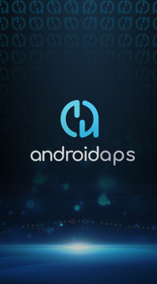

# Telefony

<!-- List of hidden pages to avoid overcrowding the menu -->

```{toctree}
:hidden:

../CompatiblePhones/Jelly.md
../CompatiblePhones/Huawei.md
```

Obecna wersja **AAPS** (4.0) wymaga smartfona z systemem Google **Android 12.0 lub nowszym**. Jeśli planujesz kupić nowy telefon (stan na styczeń 2026), **zalecany jest Android 16**, a Android 15 nie jest zalecany.

Najnowsze informacje na ten temat znajdziesz na [Facebooku lub Discordzie](../GettingHelp/WhereCanIGetHelp.md).

Ze względów bezpieczeństwa zdecydowanie zalecamy, aby zawsze używać aktualnej wersji **AAPS**. Jeśli jednak nie możesz używać urządzenia z Androidem 12.0 lub nowszym, nadal są dostępne starsze wersje **AAPS** zgodne ze starszymi wersjami Androida, zobacz: [Informacje o wersji](#maintenance-android-version-aaps-version).

- [Ustawienia Jelly Pro](../CompatiblePhones/Jelly.md)
- [Ustawienia Huawei](../CompatiblePhones/Huawei.md)

(Phones-list-of-tested-phones)=

## Lista przetestowanych telefonów

Prowadzimy listę [przetestowanych konfiguracji sprzętowych](https://docs.google.com/spreadsheets/u/1/d/e/2PACX-1vScCNaIguEZVTVFAgpv1kXHdsHl3fs6xT6RB2Z1CeVJ561AvvqGwxMhlmSHk4J056gMCAQE02sAWJvT/pubhtml?gid=683363241&single=true), którą możesz [przeglądać w wygodnym interfejsie](https://vnniyb.github.io/androidAPS_testedHardwareEasyBrowser/). Pomóż nam: wypełnij [formularz Google](https://docs.google.com/forms/d/e/1FAIpQLSfoGKLYEx4aUAJ5RWL3xLJeNdmRyxtXmDzpGhuU3Rfcj2H_Jw/viewform) i dodaj swoją konfigurację!

Ta lista zawiera opinie użytkowników o używaniu telefonu z **AAPS** razem z daną pompą i systemem CGM. Pomoże Ci sprawdzić, czy Twój telefon / pompa / CGM były już z powodzeniem używane przez innych użytkowników.

Dokument jest tylko do odczytu. Za pomocą CTRL-F możesz wyszukiwać tekst w arkuszu Google.

Aby zapisać test Twojej konfiguracji sprzętowej, wypełnij ten [formularz](https://docs.google.com/forms/d/e/1FAIpQLSfoGKLYEx4aUAJ5RWL3xLJeNdmRyxtXmDzpGhuU3Rfcj2H_Jw/viewform). Po wypełnieniu formularza arkusz jest odświeżany automatycznie co 5 minut.

W razie problemów z arkuszem skontaktuj się z jego opiekunem, *@theodoor5137*, na Discordzie albo zobacz stronę [Gdzie mogę uzyskać pomoc? ](../GettingHelp/WhereCanIGetHelp.md).

## Nie ma mojego telefonu na liście

Jeśli masz pytania o konkretny model telefonu, poszukaj odpowiedzi lub zapytaj w naszej [społeczności na Facebooku lub Discordzie](../GettingHelp/WhereCanIGetHelp.md).

Jeśli chcesz przekazać modele smartfonów lub smartwatchy, które trzeba jeszcze przetestować, napisz na adres <donations@androidaps.org>.

(Phones-phone-wallpaper)=

## Tapeta na telefon

Jeśli chcesz ozdobić swój telefon motywem **AAPS**, możesz pobrać tapetę [tutaj](../images/bg_phone.jpg)!



Design: Thiago :)