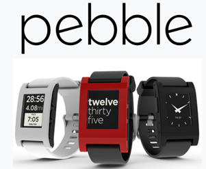

# Smartwatche i AAPS

Różne smartwatche mogą pokazywać część informacji dostępnych w **AAPS** albo wykonywać działania zdalne.

Bezpośrednie sterowanie **AAPS** (pompą i sensorem) przez smartwatch jest możliwe na zegarkach z pełnym Androidem (które są traktowane jak małe [smartfony](./Phones.md)).

Niektóre smartwatche pozwalają wprowadzać leczenie i więcej, ale **AAPS** nadal działa na telefonie.

Smartwatche są coraz częściej używane z **AAPS** _zarówno_ przez dorosłych z cukrzycą, jak i przez opiekunów/rodziców dzieci z cukrzycą.

## Ogólne zalety używania smartwatchy z **AAPS**


Smartwatche – zależnie od modelu – można używać z **AAPS** na wiele różnych sposobów. Mogą służyć do pełnego lub częściowego sterowania **AAPS** albo tylko do zdalnego sprawdzania poziomu glukozy, aktywnej insuliny (IOB) i innych parametrów.

Połączenie smartwatcha z **AAPS** może być przydatne w wielu sytuacjach, np. podczas jazdy samochodem, (moto)cyklem lub podczas ćwiczeń. Niektórzy uważają, że spojrzenie na zegarek (na spotkaniu, imprezie, przy stole itp.) jest bardziej dyskretne niż spojrzenie na telefon. Ze względów bezpieczeństwa smartwatch może być też przydatny w drodze: telefon **AAPS** może być schowany (np. w torbie), a Ty nadal używasz smartwatcha do zdalnego sterowania.

## Szczególne zalety dla rodziców/opiekunów używających **AAPS**

Jeśli telefon **AAPS** dziecka jest w pobliżu, opiekun może używać smartwatcha do monitorowania lub wprowadzania zmian bez używania telefonu **AAPS**. Może to być przydatne na przykład wtedy, gdy telefon **AAPS** jest schowany w pasku na pompę.

Smartwatcha można używać _obok_ opcji opartych na TELEFONIE albo _zamiast_ nich, zarówno do zdalnego sterowania, jak i do [samego obserwowania](../RemoteFeatures/FollowingOnly.md).

Poza tym, w przeciwieństwie do telefonów obserwujących rodzica/opiekuna (które potrzebują sieci komórkowej lub Wi-Fi), smartwatche połączone przez Bluetooth mogą być przydatne w odległych miejscach, np. w jaskini, na łodzi albo w połowie drogi na szczyt góry. Jeśli oba urządzenia (telefon **AAPS** i smartwatch) są w tej samej sieci Wi-Fi, mogą też używać Wi-Fi.

## Różne sposoby współpracy smartwatcha z AAPS

Obecnie jest pięć głównych sposobów używania smartwatchy razem z **AAPS**. Pokazuje je poniższa tabela: 

| Rodzaj zegarka          | Funkcje                                      | Wymagania                                                                                                                                                                                                                                                                                                                                   |
| ----------------------- | -------------------------------------------- | ------------------------------------------------------------------------------------------------------------------------------------------------------------------------------------------------------------------------------------------------------------------------------------------------------------------------------------------- |
| Samodzielny             | AAPS bez telefonu                            | Zegarek z pełnym Androidem (sprawdź minimalną wersję Androida)</br> Z aplikacją **app-fullRelease**                                                                                                                                                                                                                                         |
| Pełne zdalne sterowanie | Większość funkcji AAPS                       | Zegarek z Androidem **Wear OS** (sprawdź wersję Androida/API)</br>Z aplikacją **wear-fullRelease**                                                                                                                                                                                                                                          |
| Zdalne sterowanie       | Funkcje AAPSClient                           | Zegarek z Androidem **Wear OS** (sprawdź wersję Androida/API)</br>Z aplikacją **[wear-aapsclientRelease](https://github.com/nightscout/AndroidAPS/releases)**                                                                                                                                                                               |
| Zdalne sterowanie       | Niektóre funkcje AAPSClient                  | Zegarki Garmin</br>(tylko starsze zestawy Samsung Tizen i Fitbit, niezalecane)</br>Zobacz poniżej.                                                                                                                                                                                                                                          |
| Wyświetlanie            | Glukoza, trend, IOB, COB, stan pętli i pompy | Wiele smartwatchy przez aplikację towarzyszącą na telefonie **AAPS**, która odbiera dane z [Zewnętrznych aplikacji towarzyszących](#watches-external-companion-apps): [WatchDrip+](https://bigdigital.home.blog/) (Xiaomi, Amazfit), [GlucoDataHandler](https://github.com/pachi81/GlucoDataHandler) (Wear OS), G-Watch</br>Zobacz poniżej. |

## Zanim kupisz smartwatch…

Konkretny model smartwatcha zależy od tego, do czego ma służyć. Przydatne informacje znajdziesz na [stronie Telefony](#Phones-list-of-tested-phones), w tym listę przetestowanych telefonów, na której są też niektóre smartwatche.

Popularne marki zegarków to m.in. Samsung Galaxy, Garmin, Fossil i Mi Band. Opcje zebrane w powyższej tabeli są dokładniej opisane poniżej. Pomoże Ci to wybrać smartwatch odpowiedni do Twojej sytuacji.

Jeśli łączysz smartwatch z **AAPS** na telefonie, aby zdalnie obsługiwać **AAPS**, sprawdź też, czy oba urządzenia ze sobą współpracują, zwłaszcza gdy masz starszy lub nietypowy telefon.

Ogólnie, jeśli chcesz tylko obserwować wartości glukozy bez obsługi **AAPS**, masz do wyboru więcej tańszych i prostszych zegarków.

Najlepszy sposób na wybór smartwatcha to wyszukanie postów o zegarkach („watch”) w grupach **AAPS** na Discordzie lub Facebooku. Przeczytaj doświadczenia innych osób i zadaj konkretne pytania, jeśli starsze posty nie odpowiadają na Twoje pytanie.

## Pełny Android

Brzmi atrakcyjnie, prawda? Jednak obecnie tylko nieliczni entuzjaści eksperymentują z **AAPS** na samodzielnym zegarku. Jest niewiele smartwatchy z rozsądnym interfejsem, które dobrze działają z samodzielnym **AAPS** i Twoją aplikacją CGM. Popularne modele to m.in. LEMFO LEM 15 Pro i 16. Na zegarku musisz zainstalować plik apk **AAPS** „full” (ten, który zwykle instaluje się na smartfonie), a nie plik apk **AAPS** „wear”.

Nie ma jasnej specyfikacji, która mówi, czy zegarek będzie dobrze działał z samodzielnym **AAPS**, ale pomogą te parametry:

1)  Android 12 lub nowszy. 2)  Możliwość wyłączenia trybu „kwadratowego” tarczy zegarka, aby tekst był większy i łatwiejszy do czytania. 3)  Bardzo dobry czas pracy na baterii. 4)  Dobry zasięg Bluetooth.

Większość frustracji z samodzielnymi zegarkami **AAPS** wynika z obsługi bardzo małego ekranu i z tego, że obecny interfejs pełnej aplikacji AAPS nie był projektowany dla zegarka. Z powodu małego ekranu możesz woleć używać rysika do zmiany ustawień **AAPS** na zegarku. Niektóre przyciski AAPS mogą nie być widoczne na ekranie zegarka.

Kolejne trudności: trudno uzyskać wystarczający czas pracy na baterii, a zegarki z wystarczającą baterią są często duże i grube. Użytkownicy zgłaszają walkę z systemem i ustawieniami oszczędzania energii, trudności z uruchamianiem sensorów na zegarku, słaby zasięg Bluetooth (potrzebny do utrzymania połączenia z sensorem i pompą) oraz wątpliwą wodoodporność. Przykłady pokazują poniższe zdjęcia.


Jeśli chcesz skonfigurować samodzielny zegarek, przeczytaj posty i komentarze w grupie **AAPS** na Facebooku (dobre słowa do wyszukiwania to „standalone” i „Lemfo”) oraz na Discordzie.

## Wear OS

Kod **AAPS** zawiera rozszerzenie aplikacji, które można zainstalować na [smartwatchach z **Wear OS**](https://wearos.google.com/#oem-carousel).


Sprawdź, czy Twój smartwatch spełnia [wymagania](#maintenance-android-version-aaps-version) **AAPS**.

### Czym _jest_ Wear OS?

Pierwsze trzy opcje wymagają smartwatcha z systemem **Wear OS**.

**Wear OS** to system operacyjny działający na niektórych nowoczesnych smartwatchach z Androidem. Jeśli opis smartwatcha mówi tylko o _zgodności_ z Androidem i iOS, nie znaczy to, że działa na nim Wear OS. Może to być inny system operacyjny producenta, który nie współpracuje z **AAPS**. Aby można było zainstalować i używać dowolnej wersji **AAPS** lub **AAPSClient**, smartwatch musi mieć **Wear OS 3.0, 3.2 lub 3.5** (Android 11, poziom API 30) **lub nowszy**. Każde wydanie Wear OS odpowiada wersji Androida, na której jest oparte: **Wear OS 3** to Android 11 (poziom API 30), **Wear OS 4** to Android 13 (poziom API 33), **Wear OS 5** to Android 14 (poziom API 34), a **Wear OS 6** to Android 16 (poziom API 36). Zegarki z Wear OS 2 nie mogą uruchomić **AAPS**.

Jeśli zainstalujesz wear.apk **AAPS** na zegarku z **Wear OS**, możesz wybrać jedną z wielu własnych tarcz zegarka **AAPS**. Możesz też użyć zwykłej tarczy zegarka i pokazywać informacje **AAPS** w małych polach na tarczy, nazywanych „komplikacjami” (complications). Komplikacja to każdy element wyświetlany na tarczy zegarka oprócz godziny.

```{note}
Ostatnie zmiany w **Wear OS** stopniowo psują własne tarcze zegarka **AAPS** (im wyższa wersja Wear OS, tym bardziej), ale **komplikacje** nadal działają. Zanim kupisz lub zaktualizujesz zegarek, przeczytaj [Zmiany tarcz zegarka w Wear OS](#wearos-watchface-changes).
```


### Jak może wyglądać mój smartwatch?

Po [zainstalowaniu **AAPS** na zegarku](../WearOS/WearOsSmartwatch.md) od razu możesz wybrać ulubioną tarczę spośród tych tarcz przygotowanych dla **AAPS**. Na większości zegarków wystarczy przytrzymać ekran główny, aż się zmniejszy, i przesunąć w prawo, aby wybrać inny ekran:


To podstawowe ekrany wbudowane w **AAPS**. Jest też [więcej tarcz zegarka](#WearOS_changing-to-AAPS-watchface) i możesz również używać [komplikacji](#Watchfaces-complications).

### Jak na co dzień obsługiwać zegarek z Wear OS?

Więcej informacji o tarczach zegarka i codziennym używaniu, w tym o tym, jak stworzyć (i udostępnić) własną tarczę, znajdziesz w sekcji [Smartwatch z Wear OS](../WearOS/WearOsSmartwatch.md).

(Watchfaces-tizen)= (watches-external-companion-apps)=

## Zewnętrzne aplikacje towarzyszące

**AAPS** może wysyłać swój stan do innych aplikacji zainstalowanych na tym samym telefonie: glukozę i trend, IOB, COB, bazę i bazę tymczasową, nazwę profilu, stan pętli, baterię telefonu i pompy, poziom zbiornika i postęp bolusa. Kilka aplikacji towarzyszących dla zegarków odbiera te dane i pokazuje je na zegarkach, których **AAPS** nie obsługuje bezpośrednio. Aby wysyłać dane, włącz **Zewnętrzne aplikacje towarzyszące** w **Konfiguracja** > **Komunikacja** (zobacz [Zewnętrzne aplikacje towarzyszące](#external-companion-apps) na stronie Konfiguracja). Dane są wysyłane przy każdym nowym odczycie i nie można o nie poprosić: przycisk odświeżania w aplikacji towarzyszącej nie działa na **AAPS**.


Aplikacje towarzyszące, o których wiadomo, że odbierają te dane:

- [WatchDrip+](https://bigdigital.home.blog/) dla zegarków Xiaomi i Amazfit, zobacz [Zegarki Xiaomi i Amazfit](#watches-xiaomi-amazfit) poniżej.
- [GlucoDataHandler](https://github.com/pachi81/GlucoDataHandler) dla zegarków z Wear OS, jako komplikacja lub widżet. To dobre rozwiązanie zapasowe na wersjach Wear OS, na których tarcze zegarka **AAPS** działają niepewnie, zobacz [Konfiguracja AAPS na zegarku z Wear OS](../WearOS/WearOsSmartwatch.md). Jej aplikacja towarzysząca GlucoDataAuto pokazuje te same dane w samochodzie z Android Auto.
- [Aplikacja G-Watch](https://play.google.com/store/apps/details?id=sk.trupici.g_watch) dla zegarków Samsung Tizen i jej późniejsza wersja na Wear OS. We wcześniejszych wersjach **AAPS** wtyczka nazywała się od tej aplikacji **Samsung Tizen**.

```{warning}
**Aplikacja G-Watch** i jej wersja na **Wear OS** nie są już rozwijane, a Samsung przeniósł swoje smartwatche z Tizen na Wear OS. G-Watch ma znaczenie tylko dla istniejących, starszych zestawów i nie jest zalecany do nowej instalacji. Najnowsze informacje znajdziesz w dedykowanej [grupie na Facebooku](https://www.facebook.com/groups/gwatchapp).
```

(Watchfaces-garmin)=

## Garmin

W sklepie Garmin ConnectIQ jest kilka tarcz zegarka dla Garmin, które współpracują z [AAPS](https://apps.garmin.com/search?keywords=androidaps).


[AAPS Glucose Watch](https://apps.garmin.com/apps/3d163641-8b13-456e-84c3-470ecd781fb1) współpracuje bezpośrednio z **AAPS**. Oprócz odczytów glukozy pokazuje dane o stanie pętli (aktywna insulina, baza tymczasowa) i wysyła do **AAPS** odczyty tętna. Jest dostępna w sklepie ConnectIQ; włącz wtyczkę **Garmin** w **Konfiguracja → Komunikacja**. 

1. Najwyższa i najniższa wartość glukozy na wykresie
2. Zmiana glukozy na minutę
3. Aktywna insulina (IOB)
4. Czas od ostatniego odczytu glukozy (minuty:sekundy)
5. Baza tymczasowa jako procent dawki bazowej z profilu
6. Wykres glukozy z ostatnich 2 godzin
7. Aktualna wartość glukozy


## Fitbit

```{warning}
Google przenosi Fitbit do Google Health i w UE usuwa z zegarków Fitbit aplikacje i tarcze innych firm. Dlatego tarcze zegarka Fitbit **nie są już zalecaną opcją** i nie zalecamy kupowania Fitbit do używania z **AAPS**.
```

Dla istniejących zegarków Fitbit [strony Nightscout](https://nightscout.github.io/nightscout/wearable/#fitbit) podają kilka opcji tylko do monitorowania, np. [Glance](https://glancewatchface.com/). To też są tarcze innych firm, więc dotyczy ich to samo ograniczenie w UE.

## Tylko obserwowanie

Te smartwatche pokazują część informacji **AAPS**, niektóre potrzebują innych aplikacji.

Jest wiele tanich smartwatchy, które mogą tylko wyświetlać dane. Jeśli używasz Nightscout, dobry przegląd wszystkich opcji znajdziesz [tutaj](https://nightscout.github.io/nightscout/wearable/#)

Poniżej kilka zegarków do samego obserwowania, popularnych wśród użytkowników **AAPS**:

(watches-xiaomi-amazfit)=
### Zegarki Xiaomi i Amazfit

**WatchDrip+** to aplikacja towarzysząca tworzona przez społeczność. Pokazuje dane o glukozie i pętli na różnych modelach smartwatchy, głównie marek Xiaomi (_np._ Mi Band) i Amazfit:


Od wersji 0.5 **WatchDrip+** odczytuje dane bezpośrednio z **AAPS**, bez pośrednictwa xDrip+. Na telefonie **AAPS**:

1. Włącz **Zewnętrzne aplikacje towarzyszące** w **Konfiguracja** > **Komunikacja**, zobacz [powyżej](#watches-external-companion-apps). Dostarcza to aktualną glukozę, deltę, strzałkę trendu, IOB i stan pompy.
2. Włącz wtyczkę **xDrip** w **Konfiguracja** > **Komunikacja** i w jej ustawieniach włącz **Wyślij status do xDrip+**. Dostarcza to linię stanu IOB/COB, a wykres glukozy na zegarku wypełni się po kilku odczytach.
3. Jeśli xDrip+ jest zainstalowany na telefonie, wyłącz w nim **Broadcast Service API** (xDrip+ > Settings > Inter-app settings), aby zegarek nie dostawał danych dwa razy. Jeśli xDrip+ tylko przekazywał dane do zegarka, możesz go odinstalować.

Przycisk odświeżania w WatchDrip+ nie działa z **AAPS**: dane przychodzą z każdym nowym odczytem.


Więcej o nich, w tym o tym, jak je skonfigurować, przeczytasz na [stronie WatchDrip+](https://bigdigital.home.blog/). Zaletą tych zegarków jest to, że są małe i stosunkowo tanie. Są popularne zwłaszcza wśród dzieci i osób z mniejszym nadgarstkiem.

### Zegarek Pebble




Zegarki Pebble ([już nieprodukowane](https://en.wikipedia.org/wiki/Pebble_(watch))) były w sprzedaży od 2013 do 2016 roku i nadal można je kupić z drugiej ręki. Fitbit przejął majątek firmy Pebble. Użytkownicy Pebble mogą oglądać dane z Nightscout na tarczy Urchin. Wyświetlane dane to m.in. IOB, aktualna baza tymczasowa i prognozy. Przy otwartej pętli możesz użyć IFTTT, aby utworzyć aplet, który po otrzymaniu powiadomienia z **AAPS** wyśle SMS lub powiadomienie pushover.

### [Zegarki Bluejay](https://bluejay.website/)


To wyjątkowe urządzenia, które mogą odbierać dane o glukozie **bezpośrednio** z nadajnika Dexcom. Mało kto wie, że nadajniki Dexcom G6/G7 wysyłają aktualne dane o glukozie _dwoma_ osobnymi kanałami: kanałem telefonu i kanałem medycznym. Zegarki Bluejay można ustawić tak, aby odbierały dane o glukozie z dowolnego kanału. Jeśli więc **AAPS** używa kanału telefonu, zegarki Bluejay mogą używać kanału medycznego.

Główna zaleta to niezależność zegarka zarówno od telefonu, jak i od systemu pętli. Na przykład jeśli na plaży lub w parku rozrywki odłączysz pompę i telefon **AAPS** i będziesz poza zasięgiem telefonu **AAPS**, nadal dostaniesz odczyty z Dexcom bezpośrednio na zegarek Bluejay.

Pierwszy model **Bluejay GTS** nie jest już produkowany i nie odczytuje Dexcom G7. Późniejsze modele (U1, a potem obecny **U3**, w chwili pisania sprzedawany we wczesnym dostępie) to zegarki z pełnym Androidem i xDrip, które odbierają dane bezpośrednio z Dexcom G6 i G7. Producent opisuje zegarek jako narzędzie badawcze, nie do użytku medycznego. Zgłaszane wady: nie zawsze odbiera odczyt co 5 minut, a baterię trzeba często ładować. Aktualny model i dostępność sprawdzisz na [stronie Bluejay](https://bluejay.website/).

### Apple Watch

Zobacz [Nightscout na Twoim zegarku](https://nightscout.github.io/nightscout/wearable/#).

Apple Watch obsługuje teraz bezpośrednie połączenie z G7 i może być używany jednocześnie z **AAPS**.

