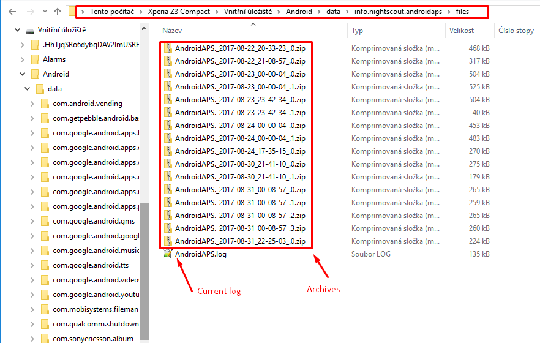

(Accessing-logfiles-accessing-logfiles)=

# Dostęp do plików logów

* Podłącz telefon do komputera w trybie przesyłania plików
* Pliki logów znajdziesz w katalogu danych AAPS, w `Android\data\info.nightscout.androidaps\files`.  
    Nazwa głównego folderu pamięci może się trochę różnić w zależności od telefonu.
* Dla [AAPSClient](#RemoteControl_aapsclient) lokalizacja to `Android\data\info.nightscout.aapsclient\files`.
* Uwaga: lokalizacja logów zmieniła się w **AAPS 3.3**. W razie potrzeby zajrzyj do dokumentacji poprzednich wersji.

* Bieżący log to plik .log. Możesz go otworzyć na kilka sposobów, na przykład w [LogCat](https://developer.android.com/studio/debug/am-logcat.html) w Android Studio, w dowolnej aplikacji do przeglądania logów na Androida albo po prostu jako zwykły tekst. 
* Poprzednie pliki logów są spakowane (zip) i zapisane w folderach według daty i godziny. 
* Jeśli udostępniasz plik logu na [discordzie](https://discord.gg/4fQUWHZ4Mw), aby porozmawiać o możliwym błędzie, rozpakuj i wyślij plik z datą sprzed wystąpienia błędu.