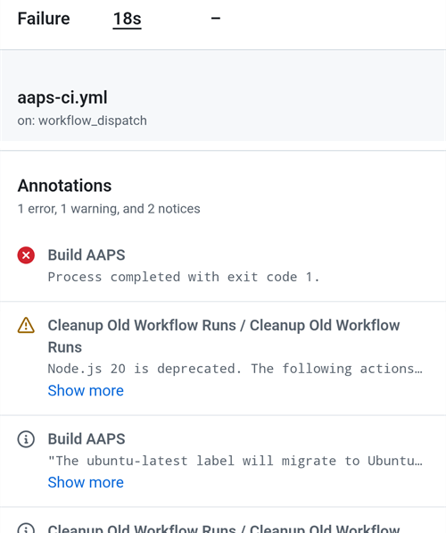
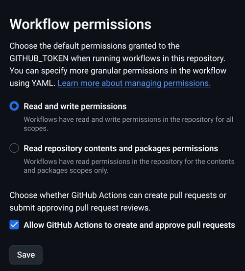

(aaps-ci-troubleshooting)=

# Budowanie w przeglądarce: rozwiązywanie problemów

```{note}
Na tej stronie zebrano wskazówki dotyczące rozwiązywania problemów z [Budowaniem w przeglądarce](../SettingUpAaps/BrowserBuild.md).

Używasz **AAPS Builder**? Zacznij od jego własnej [sekcji rozwiązywania problemów](#aaps-builder-troubleshooting). Poniższe sekcje o Dysku Google dotyczą także jego.
```

## Rozwiązywanie problemów z AAPS-CI

(aaps-ci-read-the-logs)=
### Najpierw: sprawdź, co poszło nie tak

Gdy budowanie się nie uda, GitHub zapisuje log każdego kroku. Log mówi, który krok się nie udał i dlaczego. Przeczytaj go, zanim spróbujesz czegokolwiek innego: komunikatu błędu szukasz na tej stronie i o niego zapytają Cię osoby, które pomagają.

1. W swojej kopii AndroidAPS na GitHub otwórz **Actions**. Nieudane budowanie ma czerwony krzyżyk. Dotknij jego nazwy.

   

2. Podsumowanie uruchomienia pokazuje **Failure**, a niżej zadanie, które się nie udało (**Build AAPS**, z czerwonym krzyżykiem).

   

3. Przewiń w dół do **Annotations** i dotknij czerwonej linii **Build AAPS**.

   

4. Zadanie się otworzy. Kroki z szarym znaczkiem ✓ się udały. Krok z czerwonym krzyżykiem to ten, który się nie udał: GitHub otwiera go dla Ciebie. Kroki po nim zostały pominięte (szare kółko).

   

5. Przeczytaj linie tuż nad `Error: Process completed with exit code 1.`: wyjaśniają one problem. W tym przykładzie krok **Retrieving Google Drive access token** nie udał się z błędem `invalid_grant` i `Token has been expired or revoked.`, zobacz [Token odświeżania Google wygasł](#aaps-ci-google-token-expired).

   

```{tip}
Prosisz o pomoc? Podaj nazwę kroku, który się nie udał, i linie z błędem (wystarczy zrzut ekranu jak powyżej). Nigdy nie udostępniaj zawartości swoich sekretów.
```

(aaps-ci-update-secret)=
#### Zaktualizuj sekret

Wiele poprawek polega na zmianie wartości sekretu. W swojej kopii AndroidAPS na GitHub przejdź do **Settings** → **Secrets and variables** → **Actions** i dotknij ołówka obok sekretu.


Wpisz lub wklej nową wartość i dotknij **Update secret**. GitHub nigdy nie pokazuje starej wartości: pole jest zawsze puste.


(aaps-ci-rerun)=
#### Uruchom budowanie ponownie po poprawce

Gdy usuniesz przyczynę, nie musisz zaczynać od początku: otwórz nieudane uruchomienie, dotknij **...** (w prawym górnym rogu), a potem **Re-run failed jobs**.


Dotknij **Re-run jobs**. Możesz też jak zwykle uruchomić nowe budowanie przez **Run workflow**.


(aaps-ci-preparation-web)=
### Strona aaps-ci-preparation
  - Stronę przygotowania wyświetla tymczasowy lokalny serwer (na przykład Simple Web Server na komputerze), który odbiera też token odświeżania Google.
  - Jeśli widzisz poniższy ekran, lokalny serwer został zatrzymany lub jest niedostępny.
  - Zamknij stronę przygotowania, sprawdź, czy lokalny serwer działa, potem otwórz ponownie aaps-ci-preparation.html tak samo jak w Kroku 2 i wykonaj pozostałe kroki. Jest to potrzebne zwłaszcza przy tworzeniu pierwszego połączenia z Google podczas konfiguracji.

  

(aaps-ci-google-token-expired)=
### Token odświeżania Google wygasł
  - Tokeny odświeżania Google OAuth2 wygasają, jeśli nie są używane przez 6 miesięcy. Mogą też stać się nieważne w innych sytuacjach (np. gdy zmienisz hasło do konta Google albo ręcznie odbierzesz dostęp). Więcej szczegółów znajdziesz w [dokumentacji Google OAuth2](https://developers.google.com/identity/protocols/oauth2).
  - W [logu budowania](#aaps-ci-read-the-logs) krok **Retrieving Google Drive access token** kończy się błędem `invalid_grant` i `Token has been expired or revoked.`:

  

  - Jeśli budowanie nie udaje się z powodu wygasłego lub odebranego tokenu odświeżania Google, musisz ponownie wykonać kroki [Autoryzacji Dysku Google](#aaps-ci-google-drive-auth), aby dostać nowy token `GDRIVE_OAUTH2`, [zaktualizować sekret](#aaps-ci-update-secret) w swoim repozytorium GitHub, a potem [uruchomić budowanie ponownie](#aaps-ci-rerun).
  - Jeśli autoryzacja znowu się nie uda albo Google nie prosi już o Twoją zgodę, najpierw usuń istniejący dostęp AAPS ze swojego konta Google, zobacz [poniżej](#aaps-ci-google-remove-access).

(aaps-ci-google-remove-access)=
### Usuń dostęp AAPS ze swojego konta Google i zacznij autoryzację od nowa
  - Jeśli autoryzacja Dysku Google ciągle się nie udaje albo chcesz zacząć od nowa od czystego stanu, najpierw usuń dostęp, który wcześniej dałeś AAPS, a potem wykonaj autoryzację ponownie.
  - W telefonie otwórz [https://myaccount.google.com](https://myaccount.google.com), dotknij **Bezpieczeństwo** (Security), przewiń w dół do **Twoje połączenia z aplikacjami i usługami innych firm** (Your connections to third-party apps & services) i otwórz listę połączonych aplikacji. Możesz też przejść bezpośrednio do [https://myaccount.google.com/connections](https://myaccount.google.com/connections).
  - Dotknij **AAPS** na liście.

  

  - Strona pokazuje dostęp, który dałeś AAPS (pliki na Dysku Google używane przez aplikację). Dotknij **Usuń wszystko** (Delete all), aby usunąć połączenie, albo **Zobacz szczegóły** (See details), aby najpierw je sprawdzić.

  

  - Na stronie szczegółów dotknij **Usuń cały dostęp** (Remove all access).

  

  - Dotknij **Potwierdź** (Confirm).

  

  - Google potwierdza, że AAPS nie ma już dostępu. AAPS nie jest już widoczny na liście połączonych aplikacji.

  

  - Teraz zacznij autoryzację od nowa: zamknij **obie** aplikacje, czyli stronę przygotowania i menedżer plików, otwórz ponownie aaps-ci-preparation.html z menedżera plików i wykonaj jeszcze raz kroki [Autoryzacji Dysku Google](#aaps-ci-google-drive-auth). Google znowu poprosi Cię o przyznanie dostępu, a strona poda nowy token `GDRIVE_OAUTH2`.
  - [Zaktualizuj sekret `GDRIVE_OAUTH2`](#aaps-ci-update-secret) w swoim repozytorium GitHub, wpisując nowy token, a potem [uruchom budowanie ponownie](#aaps-ci-rerun).

(aaps-ci-disable-software)=
### Disable Software That May Interfere With OAuth Verification
  - Disable any VPN or security app (firewall, antimalware,...) on the phone before trying to get the OAuth key.

(aaps-ci-actions-permission)=
### Sprawdź ustawienia uprawnień GitHub Actions
  - Upewnij się, że zasady GitHub Actions są ustawione na „Allow all actions and reusable workflows” (Settings → Actions → General). Jeśli to zmienisz, naciśnij **Save** pod opcjami.

  

`actions/checkout@v4` and `actions/setup-java@v4` are not allowed to be used in `xxxxx/AndroidAPS`. Actions in this workflow must be: within a repository owned by `xxxxx`

(aaps-ci-workflow-permissions)=
### Sprawdź ustawienia uprawnień workflow w GitHub
  - Jeśli budowanie od razu kończy się błędem „Invalid workflow file”, podobnym do tego poniżej, domyślne uprawnienia workflow w Twoim repozytorium są zbyt ograniczone:

```
Invalid workflow file
The workflow is not valid. .github/workflows/aaps-ci.yml (Line: 361, Col: 3):
Error calling workflow 'xxxxx/AndroidAPS/.github/workflows/cleanup-workflow-runs.yml@...'.
The nested job 'cleanup' is requesting 'actions: write', but is only allowed 'actions: none'.
```

  - Upewnij się, że uprawnienia workflow są ustawione na „Read and write permissions” (Settings → Actions → General → Workflow permissions), potem zapisz i uruchom ponownie workflow budowania.

  

(aaps-ci-password-special-characters)=
### Budowanie nie udaje się przy sprawdzaniu hasła magazynu kluczy
  - W [logu budowania](#aaps-ci-read-the-logs) krok **Validating keystore, alias and password** kończy się błędem `Either KEYSTORE_BASE64, KEYSTORE_PASSWORD, KEY_PASSWORD, or KEY_ALIAS is incorrect`, a po nim `Keystore was tampered with, or password was incorrect`. Budowanie zatrzymuje się w tym miejscu: magazyn kluczy i hasła są sprawdzane, zanim AAPS zostanie zbudowany.

  

  - Workflow budowania zachowuje każdy znak Twoich haseł bez zmian. Wpisz `KEYSTORE_PASSWORD` i `KEY_PASSWORD` dokładnie tak, jak brzmią, bez dodawania ukośnika wstecznego (backslash) ani innego znaku ucieczki. Jeśli dodałeś ukośniki wsteczne, [zaktualizuj sekrety](#aaps-ci-update-secret), wpisując hasło dokładnie takie, jakie jest. Poniższy przykład jest błędny: hasło to `Example2026`, a ukośnik wsteczny został dodany.

  

  - Jeśli budowanie nadal nie udaje się przy podpisywaniu APK, chociaż hasło jest poprawne, a hasło zawiera `$`, grawis (backtick), `"` lub `\`, to plik workflow w Twoim forku jest starszy niż wrzesień 2026 i nadal interpretuje te znaki. [Zsynchronizuj swój fork](#Update-to-new-version-update-your-repo) z najnowszą gałęzią dev, a potem uruchom ponownie workflow budowania.
  - Pionowa kreska `|` to szczególny przypadek. Strona przygotowania z [Opcji 1](#aaps-ci-option1) łączy magazyn kluczy, hasła i alias w jeden sekret `KEYSTORE_SET`, rozdzielony znakiem `|`, a workflow dzieli go według tego znaku. Hasło wygenerowane przez stronę przygotowania zawiera tylko litery i cyfry, więc w Opcji 1 ten problem nie może wystąpić. Może się zdarzyć tylko wtedy, gdy sam złożyłeś sekret `KEYSTORE_SET` z hasłem zawierającym `|`. W takim przypadku usuń `KEYSTORE_SET` i zamiast niego wpisz osobne sekrety z [Opcji 2](#aaps-ci-option2).
