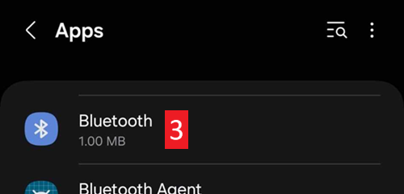
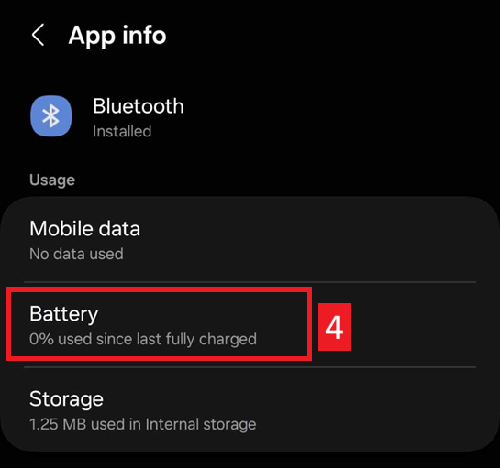

(generaltroubleshooting)=

# Rozwiązywanie problemów

**Zacznij tutaj, gdy coś nie działa.** Informacje o rozwiązywaniu problemów są na wielu stronach dokumentacji. Ta strona zbiera je w jednym miejscu: to lista linków, ułożonych według tematu, która pomaga rozwiązać najczęstsze problemy.

Jeśli nie znajdziesz odpowiedzi poniżej, sprawdź też:

* [FAQ](../UsefulLinks/FAQ.md) z odpowiedziami na częste pytania, oraz
* [Dostrajanie profilu AAPS](ProfileTuning.md), jeśli pętla działa, ale kontrola glikemii wymaga poprawy.

```{admonition} Still stuck?
:class: tip
Jeśli żaden z linków nie rozwiąże problemu, zobacz [Gdzie mogę uzyskać pomoc?](WhereCanIGetHelp.md), aby zapytać społeczność (Facebook, Discord), albo wyślij [pliki logów](AccessingLogFiles.md) do programistów.
```

---

(generaltroubleshooting-aaps-app)=

## Aplikacja AAPS

### Budowanie i aktualizacja

* Jeśli budowanie się nie uda, zobacz [Jeśli budowanie się nie uda](#building-aaps-troubleshooting): jest tam sekcja rozwiązywania problemów dla każdej metody budowania:
  * [AAPS Builder](#aaps-builder-troubleshooting)
  * [Budowanie w przeglądarce](#aaps-ci-troubleshooting)
  * [Android Studio](TroubleshootingAndroidStudio.md)
* Utracony lub nowy magazyn kluczy (keystore): [Ponowna instalacja AAPS](#reinstall-aaps)
* Aktualizacja **AAPS**: [przez AAPS Builder](#aaps-builder-updates), [przez budowanie w przeglądarce (fork)](#update-browser-build-troubleshooting), [przez Android Studio](#update-computer-build-troubleshooting)

### Instalacja

* [Ostrzeżenie Google Play Protect](#transferring-installing-play-protect-warning): aplikacja jest zgłaszana jako niebezpieczna.
* Instalacja jest **zablokowana** z komunikatem o niezweryfikowanym deweloperze: zobacz [weryfikacja deweloperów Androida](#android-developer-verification), gdzie są opisane darmowe metody instalacji.

### Ustawienia

* [Profil: „Dawka bazowa nie jest zgodna z bieżącą pompą”](#your-aaps-profile-basal-not-compatible)
* [Pompa: „Dane pochodzą z innej pompy”](#config-builder-wrong-pump-data)
* [Nightscout Client](TroubleshootingNsClient.md)

### Użytkowanie

* [Błędne wartości węglowodanów (wolne wchłanianie węglowodanów)](#CobCalculation-detection-of-wrong-cob-values)
* [Automatyzacja](#automations-troubleshooting)
* [W pełni zamknięta pętla](#full-closed-loop-troubleshooting)

---

(generaltroubleshooting-bluetooth-related-issues)=


## Problemy związane z Bluetooth

Znane problemy z połączeniami Bluetooth, zanikami połączenia z pompą/Podem oraz problemy z aktywacją i połączeniem opisuje strona [Rozwiązywanie problemów z Bluetooth](../GettingHelp/BluetoothTroubleshooting.md)

---

(generaltroubleshooting-android-related-issues)=

## Problemy związane z Androidem

### Optymalizacja baterii

**AAPS** może pomóc Ci znaleźć właściwe ustawienia dla Twojego telefonu: otwórz **menu** (☰) > **O aplikacji** i dotknij **Nie zabij mojej aplikacji?**. Otworzy się instrukcja dla marki Twojego telefonu na stronie [Don't kill my app](https://dontkillmyapp.com/). [Kreator konfiguracji](#setup-wizard-bluetooth-battery-optimisation) też prosi o wyłączenie optymalizacji baterii dla **AAPS** i Bluetooth.

Android ma ustawienia oszczędzania baterii, które są domyślnie włączone. Te ustawienia same wstrzymują aplikacje, które nie są potrzebne do działania systemu. Dzięki temu aplikacje, które nie muszą działać cały czas, zużywają mniej baterii.

Gdy ta opcja jest włączona, bardzo prawdopodobnie spowoduje problemy z **AAPS** i innymi aplikacjami pomocniczymi, np. **xDrip**.

Ważne jest, aby wyłączyć optymalizację baterii, tak aby **AAPS** i inne aplikacje pomocnicze były aktywne przez cały czas.

W zależności od marki i modelu telefonu może być więcej niż jedno miejsce i ustawienie, które trzeba wyłączyć.

***UWAGA:** Wykonaj poniższe kroki, aby wyłączyć optymalizację baterii dla usługi Bluetooth, jeśli Twój telefon ma tę opcję. Te same kroki działają dla **AAPS** i innych aplikacji, ale zrzuty ekranu pokazują tylko, jak to zrobić dla usługi Bluetooth.*

#### Telefony Pixel (czysty Android)

* Przejdź do ustawień Androida i wybierz „Aplikacje”.

  

* Wybierz „Wyświetl wszystkie aplikacje” (See all apps)

  

* W menu po prawej stronie wybierz „Pokaż systemowe” (Show system).

  

* Teraz wyszukaj i wybierz aplikację „Bluetooth”.

  

* Kliknij „Wykorzystanie baterii przez aplikację” (App battery usage) i wybierz „Bez ograniczeń” (Unrestricted; w niektórych starszych wersjach Androida „Bez optymalizacji”).

  


#### Telefony Samsung

* Przejdź do ustawień Androida i wybierz „Aplikacje”

* Na ikonie, która prawdopodobnie zmienia sposób sortowania (1), wybierz „Pokaż aplikacje systemowe” (2).

  

  

* Teraz wyszukaj aplikację Bluetooth i wybierz ją, aby zobaczyć jej ustawienia.

  

* Wybierz „Bateria”.

  

* Ustaw „Bez ograniczeń” (Unrestricted; w niektórych starszych wersjach Androida „Bez optymalizacji”).

  

#### Telefony Huawei

Zobacz ten poradnik: [Huawei – Bluetooth i optymalizacja baterii](../CompatiblePhones/Huawei.md)

---

(generaltroubleshooting-cgm)=

## System ciągłego monitorowania glikemii (CGM)

Przydatne linki do znanych problemów z CGM i sposobów ich rozwiązania.

* [Ogólne](#general-cgm-troubleshooting)
* [Dexcom G6](#DexcomG6-troubleshooting-g6)
* [Libre 2 z Minimal Looper](#minimallooper-troubleshooting)
* [Libre 3](#libre3-experiences-and-troubleshooting)
* [xDrip – brak danych z CGM](#xdrip-identify-receiver)
* [xDrip – rozwiązywanie problemów z Dexcom](#xdrip-troubleshooting-dexcom-g5-g6-and-xdrip)

---

(generaltroubleshooting-pumps)=

## Pompy

Przydatne linki do znanych problemów z pompami i sposobów ich rozwiązania

* [Accu-Chek Combo](#combov2-tips-for-basic-usage)
* [Accu-Chek Insight](#Accu-Chek-Insight-Pump-insight-specific-errors)
* [CareLevo](#carelevo-alarms-and-notifications)
* [DanaRS](#DanaRS-Insulin-Pump-dana-rs-specific-errors)
* [Diaconn G8](#diaconn-g8-bluetooth-troubleshooting)
* [EOPatch2](#eopatch2-alarms-and-warnings)
* [Medtronic + RileyLink](#MedtronicPump-what-to-do-if-i-loose-connection-to-rileylink-and-or-pump)
* [Medtrum Nano](#medtrum-nano-troubleshooting)
* [Omnipod DASH](#omnipod-dash-troubleshooting)
* [Omnipod Eros](#OmnipodEros-troubleshooting)

---

(generaltroubleshooting-phones)=

## Telefony

Przydatne linki do znanych problemów z telefonami i sposobów ich rozwiązania

* [Lista przetestowanych telefonów i konfiguracji urządzeń](https://docs.google.com/spreadsheets/u/1/d/e/2PACX-1vScCNaIguEZVTVFAgpv1kXHdsHl3fs6xT6RB2Z1CeVJ561AvvqGwxMhlmSHk4J056gMCAQE02sAWJvT/pubhtml?gid=683363241&single=true)
* [Jelly](../CompatiblePhones/Jelly.md)
* [Huawei – Bluetooth i optymalizacja baterii](../CompatiblePhones/Huawei.md)

---

(generaltroubleshooting-remote-control)=

## Zdalne sterowanie

* [AAPSClient i zdalne sterowanie (parowanie, polecenia nie docierają)](#client-master-control-troubleshooting)
* [Problemy z „Tokenem dostępu do Nightscout”](#remotecontrol-nightscout-access-token)
* [Polecenia SMS](#SMSCommands-troubleshooting)
* [Android Auto](#android-auto-troubleshooting)

---

(generaltroubleshooting-smartwatches)=

## Smartwatche

Przydatne linki do znanych problemów ze smartwatchami i sposobów ich rozwiązania

* [Rozwiązywanie problemów z aplikacją Wear](#Watchfaces-troubleshooting-the-wear-app)
* [Zegarek i telefon nie komunikują się](#wear-os-watch-phone-communication)
* [Wear OS 5](#wear-os-5-troubleshooting)
* [Budowanie aplikacji Wear](#building-aaps-wear-os-troubleshooting)
