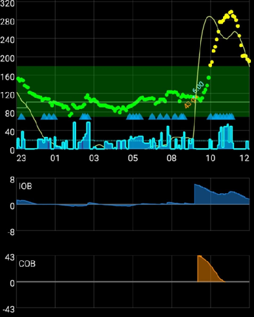

# Dostrajanie profilu AAPS

```{admonition} This is NOT a medical advice
:class: warning
Współpracuj ze swoim zespołem diabetologicznym, który wspiera Cię i doradza w leczeniu cukrzycy.</br>
Używaj tego poradnika dopiero wtedy, gdy [poprawnie skonfigurujesz swój **Profil**](https://androidaps.readthedocs.io/en/latest/SettingUpAaps/YourAapsProfile.md) i ukończysz wszystkie zadania **AAPS**.
```

Ten poradnik wyjaśnia logikę wyników algorytmu OpenAPS przy danym __Profilu__ i podaje, które wartości w **AAPS** można zmienić, gdy widzisz określone sytuacje lub wzorce. Poniższe porady dotyczące testowania bazy mogą różnić się od zaleceń Twojego zespołu diabetologicznego.

Używanie **zamkniętej pętli** może ułatwić testowanie bazy i znacznie zmniejszyć ryzyko hipoglikemii, jeśli baza w Twoim __Profilu__ jest zbyt silna.

## Jak postępować przy zmianie ustawień profilu

1. Upewnij się, że przeczytałeś i rozumiesz zalecane przez __AAPS__ ustawienia i porady poniżej. Jeśli nie zastosujesz się do tych porad, dostrajanie może być trudne i mniej prawdopodobne będzie uzyskanie dobrze dopasowanego __Profilu__
2. Uważnie obserwuj i porównuj **przez kilka dni**, co dzieje się z Twoją __BG__ i __IOB__.
3. Zwracaj uwagę na wzorce w **AAPS**, które powtarzają się (prawie) codziennie o tej samej porze.
4. Ważne jest, aby robić to przez kilka dni. Decyzje o zmianach __Profilu__ oparte na danych z jednego dnia zwykle dają słabe wyniki.
5. Dopiero gdy zobaczysz powtarzający się wzorzec, np. o 13:00 widzisz skok __BG__ albo ujemną wartość __IOB__, zacznij wprowadzać małe zmiany w swoim __Profilu__.
6. Ważne jest, aby zmieniać tylko jedną rzecz naraz. Np. zwiększ bazę o 10% około 13:00.
7. Po każdej zmianie ważne jest, aby przez kolejne kilka dni obserwować jej wpływ na __BG__ i __IOB__.
8. Powtarzaj ten schemat: obserwuj, decyduj, w razie potrzeby znów popraw

Nie spiesz się, działaj powoli!

## Zalecane ustawienia i porady podczas dostrajania bazy

- Wszystkie testy wykonuj z [włączoną zamkniętą pętlą](#AapsScreens-loop-status).
- **<u>WYŁĄCZ</u> wszystkie [automatyzacje](../DailyLifeWithAaps/Automations.md)**
- **<u>WYŁĄCZ</u> [DynISF](#Open-APS-features-DynamicISF), [AutoISF](#Open-APS-features-auto-isf), [AutoSens](#Open-APS-features-autosens)**, aby nie próbowały dostosowywać Twojego profilu.
- Podczas testów nie wykonuj ręcznych działań (ręczny bolus, cele tymczasowe itp.): pozwól systemowi używać tylko ustawień **Profilu**.
- Dla [dodatkowych wykresów](#AapsScreens-section-g-additional-graphs): na wykresie 1 użyj Insulina na pokładzie (IOB), Węglowodany aktywne (COB) (oraz Zmiana wrażliwości). Na wykresie 2 użyj Odchylenia i Wpływ na glikemię. Gdy prosisz o radę, zawsze pokaż je na swoich zrzutach ekranu.
- COB=0[*](#profiletuning-cob-zero)

Inne czynniki, których najlepiej unikać, bo wpływają na dane i mogą prowadzić do błędnych wniosków:
- Brak aktywności fizycznej.
- Brak stresu.
- Brak choroby.
- Brak skrajnej pogody, np. bardzo wysokich lub niskich temperatur.
- Brak nieudanych sesji pompy lub CGM.
- Brak nieogłoszonych węglowodanów.

Zwróć też uwagę:
- Jeśli Twój [profil dawek bazowych](#your-aaps-profile-basal-rates) jest poprawny, to gdy jesteś w celu przy COB=0[*](#profiletuning-cob-zero) i IOB=0, pozostaniesz stale w celu niezależnie od **ISF** (**ISF** jest używany tylko wtedy, gdy jesteś powyżej celu **BG**).
- Musisz sprawdzić aktualne **IOB**, ale też wykres **IOB**, aby zobaczyć, jak **IOB** zmieniało się w ostatnich kilku godzinach.

(profiletuning-cob-zero)=

***COB = 0**

Oznacza to, że posiłek jest strawiony i w Twoim organizmie nie ma już węglowodanów.

**AAPS** może pokazywać [COB=0, gdy wciąż masz aktywne węglowodany](../DailyLifeWithAaps/CobCalculation.md).

## Definicje [Profilu](../SettingUpAaps/YourAapsProfile.md)

Zbyt **silny Profil** oznacza jakieś połączenie poniższych:

- Wartość [ISF](#your-aaps-profile-insulin-sensitivity-factor) jest zbyt mała.
- Wartość [bazy](#your-aaps-profile-basal-rates) jest zbyt duża.
- Wartość [I:C](#your-aaps-profile-insulin-to-carbs-ratio) jest zbyt mała.

## Obserwacje IOB

*Uwaga: możesz też użyć wykresu IOB z Loopalyzer w raportach Nightscout, aby zobaczyć IOB z kilku dni.*

Jeśli po kilku dniach zobaczysz poniższe wzorce, rozważ następujące zmiany:

### IOB dodatnie

- Baza w **Profilu** może być niewystarczająco silna (przyczyną mogą też być np. nieogłoszone jedzenie, choroba, słabe wchłanianie w miejscu wkłucia itp.)


### IOB ujemne

- Domyślna baza zbyt silna.
- Może to być skutek wcześniejszych ćwiczeń/aktywności fizycznej.


- Poprzedni posiłek: za duży bolus (co spowodowało bardzo długą zerową bazę tymczasową)


## Obserwacje celu BG

### Glikemia stale wysoka

- Wartość __ISF__ jest wysoka i niewystarczająco silna (obliczona insulina jest za słaba)


- Baza w __Profilu__ może być niewystarczająco silna (**SMB** nie mają wystarczającego „zapasu bazy” do użycia)
- Mogło zadziałać zabezpieczenie ([MaxIOB](#Open-APS-features-maximum-total-iob-openaps-cant-go-over)?), które ogranicza podawanie insuliny. Sprawdź na ekranie wtyczki **APS** (**Konfiguracja → APS → Otwórz wtyczkę**); zobacz [SMB](#Open-APS-features-super-micro-bolus-smb).
- Problem techniczny: wchłanianie w miejscu wkłucia, zestaw infuzyjny, ...

### Glikemia stale niska

- __ISF__ jest zbyt silny i trzeba zwiększyć jego wartość
- Baza w __Profilu__ jest zbyt silna (jeśli IOB jest też ujemne)

### Huśtawka (wzrosty i spadki)

- **ISF** zbyt silny? Zobacz [Twój profil AAPS](#your-aaps-profile-insulin-sensitivity-factor)


## Obserwacje BG po posiłkach

### Szybki wzrost i wysoka BG

- Jedzenie zawiera szybkie węglowodany (np. sok owocowy).
- Rozważ bolus przed posiłkiem albo podanie go nieco wcześniej.
- Bolus (IC lub % podanej dawki) niewystarczająco silny.



### Szybki wzrost, a potem niska BG

- Rozważ bolus przed posiłkiem, Twój **Profil** może być zbyt agresywny (nadmierna korekta wzrostu)
- Bolus zbyt silny.


## [Jak obliczyć swój I:C](#your-aaps-profile-insulin-to-carbs-ratio)

1. Najpierw musisz mieć poprawne domyślne ustawienia bazy w swoim **Profilu**.
2. Zacznij w celu, najlepiej bez ujemnego IOB.
3. Record the total insulin given in **Manage → Pump** (or pump history) and call it Start insulin. Bardzo dokładnie odmierz znaną porcję węglowodanów i zapisz czas rozpoczęcia oraz IOB na początku (Start IOB). Then enter carbs and bolus information into **AAPS** using the wizard (with the current configured I:C). Nie zapomnij zjeść tych węglowodanów ;)
4. Po kilku godzinach, gdy COB=0[*](#profiletuning-cob-zero) i znów jesteś w celu, zapisz czas zakończenia i IOB na końcu (End IOB), sprawdź łączną podaną insulinę tak jak wcześniej i nazwij ją End insulin (insulina na końcu). *UWAGA: Długość okresu NIE jest ważna, o ile jest dłuższa niż czas trawienia*
5. Od różnicy między End insulin i Start insulin odejmij/dodaj różnicę End IOB – Start IOB. Potem odejmij insulinę bazową obliczoną z ustawień Twojego **Profilu**.
6. Jeśli __BG__ jest w celu, otrzymasz całkowitą ilość insuliny użytej do „strawienia” węglowodanów. Oblicz swój **I:C**.

### Wyjaśnienie obliczeń I:C

- Z **Profilem**, który ma poprawną domyślną dawkę bazową, w każdym okresie powinieneś pozostać w celu i mieć IOB bliskie 0. Dostajesz tylko bazę z **Profilu**.
- Do tego dodajesz węglowodany i bolus. Poczekaj, aż organizm strawi wszystkie węglowodany i wrócisz do celu **BG**. Zużyta insulina to suma bazy + insuliny potrzebnej na węglowodany. Obliczasz insulinę użytą na bazę (na podstawie **Profilu**), a nadwyżka to insulina użyta do strawienia węglowodanów.
- Jeśli okres jest zbyt krótki, część węglowodanów nie zostanie strawiona, więc Twoja „insulina potrzebna na węglowodany” będzie błędna.
- Jeśli okres jest zbyt długi, nic złego się nie stanie. Zużyjesz wszystkie węglowodany i dostaniesz więcej bazy. Na końcu odejmiesz bazę od całkowitej zużytej insuliny, więc dłuższy okres (z większą ilością bazy) nie wpłynie na wynik.

Pierwotnie napisane przez @Robby (Discord) jako porady pomagające dostroić **profil AAPS**, sprawdzone i poprawione przez społeczność (dziękujemy!).
