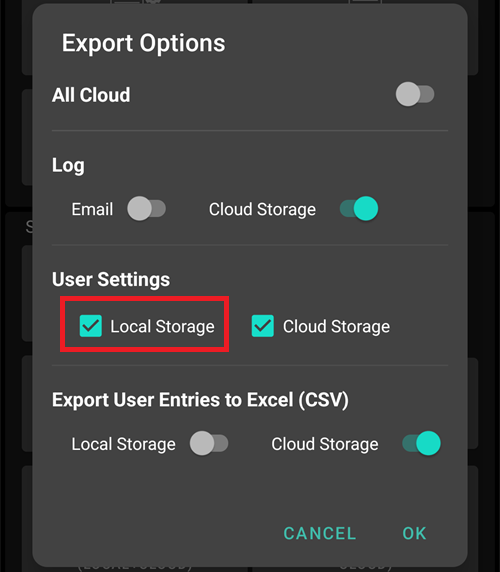
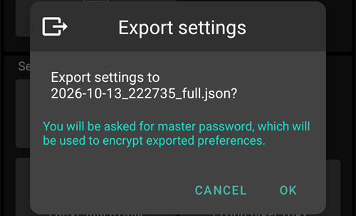

(reinstall-aaps)=
# Ponowna instalacja AAPS z nowym magazynem kluczy

Każdy plik apk **AAPS** jest podpisany **magazynem kluczy (keystore)**. Aktualizacja zainstaluje się na obecnym **AAPS** tylko wtedy, gdy jest podpisana **tym samym magazynem kluczy**: wtedy wszystkie ustawienia i dane zostają zachowane. Dlatego zalecamy przechowywać magazyn kluczy i jego hasło w bezpiecznym miejscu.

Jeśli spróbujesz zainstalować apk podpisany innym magazynem kluczy niż wcześniej, dostaniesz komunikat, że instalacja się nie udała!

(reinstall-aaps-when)=
## Kiedy trzeba zainstalować ponownie?

Musisz odinstalować i ponownie zainstalować **AAPS**, gdy nowy apk jest podpisany innym magazynem kluczy, na przykład gdy:

- Nie możesz znaleźć starego magazynu kluczy albo jego hasła.
- Utworzyłeś nowy magazyn kluczy, na przykład przez [Opcję 1 budowania w przeglądarce](../SettingUpAaps/BrowserBuildKeystore.md) lub **Create a new key** w [AAPS Builder](../SettingUpAaps/BrowserBuildAapsBuilder.md).
- Budujesz na nowym komputerze i nie skopiowałeś na niego magazynu kluczy.

Jeśli wciąż masz swój magazyn kluczy, ta strona nie jest Ci potrzebna: użyj go ponownie i [zaktualizuj **AAPS**](../Maintenance/UpdateToNewVersion.md) bez odinstalowania.

(reinstall-aaps-before)=
## Zanim zaczniesz

- Odinstalowanie **AAPS** usuwa wszystkie jego ustawienia, Twoje [zadania](../SettingUpAaps/CompletingTheObjectives.md) i obecne połączenie z pompą. Odzyskasz je, importując swój **plik ustawień**, więc upewnij się, że masz aktualny.
- Plik ustawień nie zawiera historii leczenia ani historii glukozy. Jeśli wysyłasz dane do [Nightscout](../SettingUpAaps/SettingUpTheReportingServer.md), możesz je wczytać z powrotem po ponownej instalacji (krok 8).
- Potrzebujesz swojego [**hasła głównego**](#Preferences-master-password): plik ustawień jest nim zaszyfrowany.
- **Użytkownicy Omnipod i Medtrum:** najpierw przeczytaj [Pompy bez drenu](#ExportImportSettings-tubeless-pumps). Twój plik ustawień musi być wyeksportowany w czasie noszenia obecnego poda lub patcha.
- W razie potrzeby przed rozpoczęciem [skonfiguruj odbiornik źródła CGM/BG](../Getting-Started/CompatiblesCgms.md).

(reinstall-aaps-steps)=
## Kroki

Obrazki pokazują przejście z **AAPS** 3.4 (kroki 1 do 3) na **AAPS** 4 (kroki 6 do 8). Inne wersje wyglądają trochę inaczej.

(reinstall-aaps-export)=
### 1. Wyeksportuj swoje ustawienia

Wyeksportuj ustawienia w **AAPS**, który jest teraz zainstalowany na Twoim telefonie. Szczegóły znajdziesz w [Eksport ustawień](#ExportImportSettings-Settings-Export).

W **AAPS** 3.4: otwórz **Konserwacja** i dotknij **Export options** (opcje eksportu). W **User Settings** (ustawienia użytkownika) zaznacz **Local Storage** (pamięć lokalna) i dotknij **OK**.

*Uwaga: możesz też użyć [Cloud Storage](#preferences-maintenance-cloud) (pamięć w chmurze), aby mieć zapasową kopię: to dobry pomysł, ale zachowaj pamięć lokalną, aby szybko odzyskać ustawienia.*

Przycisk ma teraz napis **Export settings (local)**. Dotknij go.

**AAPS** pokazuje nazwę pliku, który utworzy. Dotknij **OK**, wpisz hasło główne i dotknij **OK**.

W **AAPS** 4: otwórz **Konserwacja**, wybierz element **Lokalnie** obok **Eksport ustawień** i dotknij **Eksport ustawień**.

(reinstall-aaps-copy)=
### 2. Skopiuj plik ustawień poza telefon

Plik jest w folderze **preferences** w Twoim [katalogu **AAPS**](#SetupWizard-StoragePermission), a jego nazwa wygląda tak: `2026-10-13_222735_full.json`. Skopiuj go lub wyślij w inne miejsce (np. na komputer, do usługi przechowywania w chmurze...). Po odinstalowaniu plik zwykle zostaje na telefonie, ale na wszelki wypadek trzymaj kopię gdzie indziej.

(reinstall-aaps-nightscout-before)=
### 3. Synchronizuj z Nightscout

Ten krok nie jest obowiązkowy, ale zalecany, jeśli używasz [DynISF](#Open-APS-features-DynamicISF): pozwoli od razu kontynuować z obecnymi ustawieniami, zamiast czekać 5 dni na zebranie danych potrzebnych tej wtyczce. NSClient V3 musi być [włączony i skonfigurowany](../SettingUpAaps/SettingUpTheReportingServer.md).

Przed odinstalowaniem upewnij się, że Nightscout ma wszystkie Twoje dane.

Otwórz **NSClient**, dotknij przycisku **Pełna synchronizacja** na dole ekranu, a potem **OK**.

*Uwaga: potrzebny czas zależy od usługi, na której działa Twój Nightscout.*

Następnie **AAPS** proponuje wyczyszczenie swojej bazy danych. **OK** usuwa z telefonu dane starsze niż 3 miesiące, dzięki czemu synchronizacja jest dużo szybsza. **Anuluj** synchronizuje bez czyszczenia. Baza danych w telefonie i tak zostanie usunięta przy odinstalowaniu, więc obie opcje są w porządku.

Pozostaw **AAPS** uruchomiony, aż synchronizacja się zakończy.

(reinstall-aaps-build)=
### 4. Zbuduj nowy apk

[Zbuduj](../SettingUpAaps/BuildingAaps.md) nowy podpisany apk z nowym magazynem kluczy i przenieś go na telefon.

(reinstall-aaps-uninstall)=
### 5. Odinstaluj AAPS

W telefonie otwórz **Ustawienia** > **Aplikacje** > **AAPS**, dotknij **Odinstaluj** i potwierdź **OK**.

(reinstall-aaps-install)=
### 6. Zainstaluj i uruchom nowy AAPS

[Zainstaluj](../SettingUpAaps/TransferringAndInstallingAaps.md) nowy apk i uruchom **AAPS**. [Kreator konfiguracji](../SettingUpAaps/SetupWizard.md) prosi o uprawnienia, których potrzebuje **AAPS**: dotknij **Przyznaj** przy każdym z nich. To także ponownie wyłącza [optymalizację baterii](#setup-wizard-bluetooth-battery-optimisation).

Dla **Katalog AAPS** wybierz ten sam folder **AAPS** co wcześniej (ten z folderem **preferences** w środku), dotknij **Użyj tego folderu** i **Zezwól**.

Gdy **AAPS** znajdzie wyeksportowane ustawienia, kreator konfiguracji pokaże ekran [Znaleziono zapisane ustawienia](#setup-wizard-import-settings), na którym możesz je zaimportować. Możesz też zamknąć kreator i zaimportować ustawienia z **Konserwacja**, jak opisano poniżej.

(reinstall-aaps-import)=
### 7. Zaimportuj ustawienia

Jeśli pliku ustawień nie ma już na telefonie, skopiuj go z powrotem do folderu **preferences** w Twoim katalogu **AAPS**.

Otwórz menu (☰) > **Konserwacja**, wybierz element **Lokalnie** obok **Importuj ustawienia** i dotknij **Importuj ustawienia**.

Lista pokazuje każdy plik z jego wersją **AAPS** i wiekiem. Wybierz plik wyeksportowany w kroku 1.

Nie musisz najpierw ustawiać hasła głównego w nowym **AAPS**. Wpisz hasło główne użyte przy eksporcie w polu **Hasło do odszyfrowania** i dotknij **Odszyfruj**. Komunikat **Plik został zaszyfrowany innym hasłem** jest normalny: nowy **AAPS** nie zna jeszcze Twojego hasła. Import przywraca je razem z innymi ustawieniami.

Zaznacz **Także zastąp ustawienia pompy**: bez tego pompa i jej ustawienia nie zostaną przywrócone. Użytkownicy Omnipod i Medtrum: zaznacz to tylko wtedy, gdy plik został wyeksportowany w czasie noszenia obecnego poda lub patcha (zobacz [Pompy bez drenu](#ExportImportSettings-tubeless-pumps)).

Dotknij **Importuj**, potem **OK**, aby zastosować ustawienia, i jeszcze raz **OK** przy **Ustawienia zastosowane**.

(reinstall-aaps-nightscout-after)=
### 8. Odzyskaj historię z Nightscout

Otwórz menu (☰) > [**Konfiguracja**](../SettingUpAaps/ChangeAapsConfiguration.md) > **Komunikacja** i dotknij **Otwórz wtyczkę** pod **NSClientV3**. Sprawdź, czy status pokazuje **Połączono**. Jeśli nie, zobacz [Wskazówki dotyczące rozwiązywania problemów z NSClient](TroubleshootingNsClient.md).

Dotknij przycisku **Pełna synchronizacja** na dole ekranu i **OK**. Baza danych jest nowa, więc na pytanie o czyszczenie możesz odpowiedzieć dowolnie.

**AAPS** wczytuje Twoje dane z Nightscout. Gdy skończy, log pokazuje **Full sync finished**.

(reinstall-aaps-check)=
### 9. Sprawdź i dalej używaj pętli

Sprawdź, czy pompa jest połączona i czy docierają wartości z CGM, a potem dalej używaj pętli.

(reinstall-aaps-afterwards)=
## Później

Od teraz zawsze używaj nowego magazynu kluczy i przechowuj go razem z hasłem w bezpiecznym miejscu, poza telefonem. Zobacz [Tworzenie i przywracanie kopii zapasowych](../Maintenance/ExportImportSettings.md).
