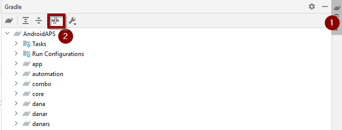

(troubleshooting_androidstudio-troubleshooting-android-studio)=

# Rozwiązywanie problemów z Android Studio

```{contents} List of common issues
:depth: 2
:local: true
```

(troubleshooting_androidstudio-lost-keystore)=
## Utracony magazyn kluczy
Jeśli utraciłeś magazyn kluczy lub jego hasło, apk podpisany nowym magazynem kluczy nie może zaktualizować obecnego **AAPS**: musisz go odinstalować i zainstalować ponownie. Zobacz [Ponowna instalacja AAPS z nowym magazynem kluczy](#reinstall-aaps).

## Gradle Sync failed (synchronizacja Gradle nie powiodła się)
Gradle Sync może się nie udać z różnych powodów. Gdy dostaniesz komunikat „gradle sync failed”, otwórz kartę „Build” (1) na dole Android Studio i sprawdź, jaki komunikat o błędzie (2) jest wyświetlany.


```{contents} Likely reasons for gradle sync failures are:
:depth: 1
:local: true
```

*Ważne*: Gdy wykonasz instrukcje dla swojego problemu, musisz ponownie uruchomić [synchronizację Gradle](#gradle-resync).

(troubleshooting_androidstudio-uncommitted-changes)=
### Niezatwierdzone zmiany

Jeśli dostaniesz taki komunikat o błędzie:


```
Build file 'C:\Data\50-Android\AndroidAPS\app\build.gradle.kts' line: 243

There are uncommitted changes.
Sklonuj źródła ponownie, jak opisano w dokumentacji, i nie zezwalaj na aktualizację gradle
```

#### Krok 1 – Sprawdź instalację Git
  * Otwórz kartę Terminal (1) na dole Android Studio, skopiuj poniższy tekst i wklej go lub wpisz w terminalu (2).
    ```
    git --version
    ```

    

    Uwaga: między Git a version jest spacja i dwa myślniki!

  * Musisz dostać komunikat z zainstalowaną wersją Git, tak jak na zrzucie ekranu powyżej. W takim przypadku przejdź do [Kroku 2](#troubleshooting-android-studio-check-for-uncommitted-changes).

  * Jeśli dostaniesz komunikat
    ```
    Git: command not found
    ```
    to Twoja instalacja Git nie jest poprawna.

  * [Sprawdź instalację Git](#BuildingAaps-steps-for-installing-git)

  * If you are on Windows and Git was just installed, you should restart your computer to make Git globally available after the installation

  * If Git is installed, you have restarted (if on windows), and Git still cannot be found:

  * Wyszukaj na komputerze plik „git.exe”.

    Zanotuj sobie, w jakim katalogu jest zapisany.

  * Przejdź do zmiennych środowiskowych w Windows, wybierz zmienną „PATH” i kliknij Edytuj. Dodaj katalog, w którym znalazłeś swoją instalację Git.

  * Zapisz i zamknij.

  * Uruchom ponownie Android Studio.

(troubleshooting-android-studio-check-for-uncommitted-changes)=
#### Krok 2: Sprawdź niezatwierdzone zmiany.

  * W Android Studio otwórz kartę „Commit” (1) po lewej stronie. 
  * Możesz zobaczyć „Changes” (w starszych wersjach Android Studio „Default changeset”) (2) albo „Unversioned Files” (3):

    * W przypadku „Changes” prawdopodobnie zaktualizowałeś „Gradle” albo przez pomyłkę zmieniłeś zawartość niektórych plików.

    * Kliknij prawym przyciskiem „Changes” i wybierz „Rollback…” (1)

      

    * Pliki zostaną ponownie pobrane z serwera Git. Jeśli na karcie Commit nie ma innych zmian, przejdź do [Kroku 3](#gradle-resync).

  * Jeśli widzisz „Unversioned Files”, mogłeś przez pomyłkę zapisać pliki w katalogu z kodem źródłowym. Mogą to być ważne pliki, np. plik magazynu kluczy, który trzeba przenieść w inne miejsce. Jeśli nie wiesz, czym są te pliki, i sam ich nie utworzyłeś, możesz je usunąć.

    * Użyj zwykłego eksploratora plików na komputerze, aby przenieść lub wyciąć i wkleić ten plik w bezpieczne miejsce.

    * Wróć do Android Studio i kliknij przycisk Refresh (4) na karcie Commit, aby upewnić się, że pliku nie ma już w katalogu **AAPS**.

      Jeśli na karcie Commit nie ma innych zmian, przejdź do [Kroku 3](#gradle-resync).


#### Krok 3: Ponownie zsynchronizuj Gradle (jeszcze raz)

Wykonaj instrukcje z [Ponowna synchronizacja Gradle](#gradle-resync).

### Git Pull Failed - Please tell me who you are

Jeśli widzisz ten komunikat, Git potrzebuje, żebyś się przedstawił.


Otwórz terminal i wpisz po kolei dwa poniższe polecenia.

```
git config --global user.name "Your name here"
git config --global user.email your.email@here.com
```

Twoje imię musi być wpisane w cudzysłowie.


(troubleshooting_androidstudio-android-gradle-plugin-requires-java-11-to-run)=

(incompatible-gradle-jvm)=
### Incompatible Gradle JVM (niezgodna wersja JVM dla Gradle)


```
Your build is currently configured to use incompatible Java 21.0.3 and Gradle 8.2.
Cannot sync the project.

We recommend upgrading to Gradle version 8.9.

The minimum compatible Gradle version is 8.5.

The maximum compatible Gradle JVM version is 19.
```

Lub:

```
Cause: error: invalid source release: 21
```

Jeśli widzisz powyższy komunikat o błędzie, musisz pobrać właściwą wersję JVM, zanim spróbujesz zbudować ponownie:

1.  Sprawdź w [tabeli wymagań](#Building-APK-recommended-specification-of-computer-for-building-apk-file), której wersji JVM potrzebujesz dla budowanej wersji **AAPS**, i zanotuj ją.

2. Otwórz widok Gradle, klikając słonia (1) po prawej stronie Android Studio, otwórz ustawienia (2) i wybierz **Gradle Settings** (3):


3.  W polu **Gradle JDK** sprawdź, czy wybrana jest właściwa wersja (1). Jeśli nie, kliknij pole i zobacz, czy jest już dostępna na liście. Poniższy przykład pokazuje, że JVM 21 jest oznaczona jako „jbr-21”. Jeśli ją znajdziesz, po prostu ją wybierz i gotowe. Jeśli jej nie ma, wybierz **Download JDK** (2).


4. W Version (1) wybierz JDK wymagane dla Twojej wersji **AAPS** (to, które zanotowałeś, sprawdzając tabelę wymagań). W Vendor (2) wybierz dowolnego dostawcę. Location (3): nie zmieniaj. Kliknij **Download** (4).


5.  Zamknij okno **Settings** przyciskiem **OK**.
6. Teraz musisz ponownie uruchomić Gradle Sync. Wykonaj instrukcje z [Ponowna synchronizacja Gradle](#gradle-resync).

(incompatible-version-of-android-gradle-plugin)=
### Incompatible version of Android Gradle plugin (niezgodna wersja wtyczki Android Gradle)

  Jeśli pojawi się następujący komunikat o błędzie

`The project is using an incompatible version (AGP x.x.x) of the Android Gradle plugin. Latest supported version is AGP x.x.x`

  

  Używasz nieaktualnej wersji Android Studio. W menu przejdź do Help > Check for updates i zainstaluj wszystkie znalezione aktualizacje Android Studio i jego wtyczek.

(troubleshooting_androidstudio-could-not-resolve-no-cached-version)=
### Could not resolve/No cached version

  Możesz dostać taki komunikat o błędzie:


  * Po prawej stronie otwórz kartę Gradle (1).

    Upewnij się, że przycisk pokazany przy (2) *NIE* jest zaznaczony.

    

  * Teraz musisz uruchomić [ponowną synchronizację Gradle](#gradle-resync)

(troubleshooting_androidstudio-unable-to-start-daemon-process)=
### Unable to start daemon process

  Jeśli widzisz komunikat o błędzie podobny do poniższego, prawdopodobnie używasz 32-bitowego systemu Windows 10. Android Studio 3.5.1 i nowsze tego nie obsługuje i niestety programiści **AAPS** nie mogą nic z tym zrobić!

  W internecie są informacje, jak sprawdzić, czy masz system 32-bitowy czy 64-bitowy – np. [ta strona](https://support.microsoft.com/en-us/windows/32-bit-and-64-bit-windows-frequently-asked-questions-c6ca9541-8dce-4d48-0415-94a3faa2e13d).

  

(gradle-resync)=
### Ponowna synchronizacja Gradle

  Jeśli nadal widzisz komunikat, że synchronizacja gradle się nie udała, wybierz teraz link **Try again** (1). 


  Jeśli nie widzisz już tego komunikatu, możesz uruchomić to ręcznie:

  * Otwórz kartę Gradle (1) na prawej krawędzi Android Studio.

    

  * Kliknij prawym przyciskiem myszy na AAPS (2)

  * Kliknij „Reload Gradle Project” (3)

## Generate Signed APK zakończone sukcesem z 0 wariantami budowania

When you generate the signed apk, you might get the notification that generation was successful but that '0 build variants' were generated:


To fałszywe ostrzeżenie. Sprawdź katalog wybrany jako „Destination folder” do generowania (krok [Generate Signed APK](#Building-APK-generate-signed-apk)), a znajdziesz tam wygenerowany apk!


## Aplikacja została utworzona z ostrzeżeniami kompilatora/kotlin

Jeśli budowanie zakończyło się sukcesem, ale dostajesz ostrzeżenia kompilatora lub kotlin (oznaczone żółtym lub niebieskim wykrzyknikiem), możesz te ostrzeżenia po prostu zignorować.

 

Twój apk został zbudowany poprawnie i możesz go przenieść na telefon!


## AAPS nie otrzymuje danych z CGM

* Jeśli używasz zmodyfikowanej aplikacji Dexcom G6 (patched): ta aplikacja jest nieaktualna. Zamiast niej użyj aplikacji [BYODA](#DexcomG6-if-using-g6-with-build-your-own-dexcom-app).

* Jeśli używasz xDrip: zidentyfikuj odbiornik, jak opisano na [stronie ustawień xDrip](#xdrip-identify-receiver).


## Apk nie został zainstalowany


* Upewnij się, że plik „app-full-release.apk” jest przeniesiony na telefon.
* Ten błąd zwykle oznacza, że nowy apk jest podpisany innym magazynem kluczy niż zainstalowany **AAPS**. Jeśli wciąż masz poprzedni magazyn kluczy, wybierz go i zbuduj ponownie. W przeciwnym razie zobacz [Ponowna instalacja AAPS z nowym magazynem kluczy](#reinstall-aaps).
* Jeśli na telefonie pojawi się „Aplikacja nie została zainstalowana” (App not installed), wykonaj te kroki:

1. Wyeksportuj ustawienia w wersji AAPS zainstalowanej teraz na Twoim telefonie (zobacz [Tworzenie i przywracanie kopii zapasowych](../Maintenance/ExportImportSettings.md))
2. Odinstaluj **AAPS** z telefonu.
3. Włącz tryb samolotowy i wyłącz Bluetooth.
4. Zainstaluj nową wersję („app-full-release.apk”)
5. [Importuj ustawienia](../Maintenance/ExportImportSettings.md)
6. Włącz z powrotem Bluetooth i wyłącz tryb samolotowy

## Apk zainstalowany, ale stara wersja

Jeśli aplikacja zbudowała się poprawnie, przeniosłeś ją na telefon i zainstalowałeś bez błędów, ale numer wersji się nie zmienił, to być może nie wykonałeś kroku [aktualizacji lokalnej kopii](#Update-to-new-version-update-your-local-copy)

## Nic z powyższych nie pomogło

Jeśli żadna z powyższych porad nie pomogła, rozważ zbudowanie apk od nowa:

1. Wyeksportuj ustawienia w wersji AAPS zainstalowanej teraz na Twoim telefonie (zobacz [Tworzenie i przywracanie kopii zapasowych](../Maintenance/ExportImportSettings.md))

2. Przygotuj hasło klucza i hasło magazynu kluczy.

    Albo po prostu użyj nowego magazynu kluczy.

3. Zbuduj apk od nowa, jak opisano [tutaj](#Building-APK-download-AAPS-code).

4. Gdy zbudujesz apk poprawnie, usuń istniejący apk z telefonu, przenieś nowy apk na telefon i zainstaluj.
5. Ponownie zaimportuj ustawienia (zobacz [Tworzenie i przywracanie kopii zapasowych](../Maintenance/ExportImportSettings.md)), aby przywrócić zadania i ustawienia.
6. Sprawdź opcje optymalizacji baterii i ponownie je wyłącz.

## Najgorszy przypadek

Jeśli powyższe nie rozwiąże problemu z budowaniem, możesz spróbować całkowicie odinstalować Android Studio i zbudować wszystko od nowa.  Niektórym użytkownikom pomaga to rozwiązać problem z budowaniem.  Przy usuwaniu Android Studio nie usuwaj ustawień użytkownika Androida i **upewnij się, że odinstalujesz wszystkie pliki związane z Android Studio.** Jeśli nie usuniesz Android Studio całkowicie, ze wszystkimi ukrytymi plikami, odinstalowanie może spowodować nowe problemy zamiast rozwiązać obecne. Instrukcje całkowitego odinstalowania znajdziesz w internecie, np.

[https://stackoverflow.com/questions/39953495/how-to-completely-uninstall-android-studio-from-windowsv10](https://stackoverflow.com/questions/39953495/how-to-completely-uninstall-android-studio-from-windowsv10).

Zainstaluj Android Studio od nowa, jak opisano [tutaj](#Building-APK-install-android-studio).
