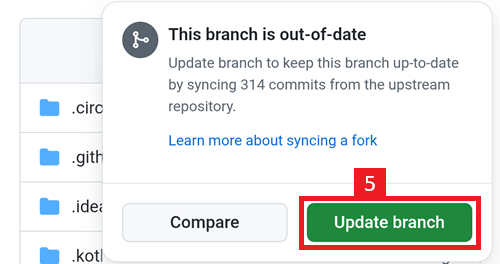

# Aktualizacja w przeglądarce (fork)

```{tip}
Twój AAPS został zbudowany za pomocą **AAPS Builder**? Ta strona nie jest Ci potrzebna: zobacz [Aktualizacja AAPS za pomocą AAPS Builder](#aaps-builder-updates).
```

## Zbuduj sam zamiast pobierać

**AAPS** nie jest dostępny do pobrania ze względu na przepisy dotyczące wyrobów medycznych. Zbudowanie aplikacji na własny użytek jest legalne, ale NIE WOLNO Ci przekazywać jej kopii innym osobom! Szczegóły znajdziesz na stronie [FAQ](../UsefulLinks/FAQ.md).

```{note}
Jeśli chcesz pierwszy raz zaktualizować **AAPS** w przeglądarce: skopiuj kopię zapasową pliku magazynu kluczy (keystore) na swój Dysk Google. Następnie zamiast tej instrukcji postępuj zgodnie z [procedurą budowania **AAPS** w przeglądarce](../SettingUpAaps/BrowserBuild.md). Zamiast tworzyć nowy magazyn kluczy, MUSISZ wybrać ten, który skopiowano z komputera.
Ten krok jest obowiązkowy tylko za pierwszym razem. Przy kolejnych aktualizacjach możesz postępować zgodnie z tą instrukcją.
```

```{tip}
**Chcesz przejść na AAPS Builder?** [AAPS Builder](../SettingUpAaps/BrowserBuildAapsBuilder.md) to prostsze budowanie w przeglądarce: nie ma forka do synchronizacji, a aplikację pobierasz bezpośrednio z GitHub. Nie musisz przechodzić: ta instrukcja nadal działa. Jeśli przechodzisz, najpierw pobierz kopię magazynu kluczy ze swojego forka, jak opisano w [Przejście z poprzedniego budowania w przeglądarce](#aaps-builder-from-fork). W przeciwnym razie nowa wersja nie będzie mogła zaktualizować AAPS w Twoim telefonie.
```

## Przegląd aktualizacji AAPS do nowej wersji w przeglądarce

```{contents} Steps for updating to a new version of AAPS
:depth: 1
:local: true
```

In case you experience problems, see separate page for [browser build troubleshooting](../GettingHelp/BrowserBuildTroubleshooting.md).

### Wyeksportuj swoje ustawienia

Wyeksportuj ustawienia z obecnej wersji **AAPS** w swoim telefonie. Może nie będą Ci potrzebne, ale lepiej dmuchać na zimne.

Jeśli nie pamiętasz, jak to zrobić, zobacz stronę [Tworzenie i przywracanie kopii zapasowych](ExportImportSettings.md).

(Update-to-new-version-update-your-repo)=
### Zaktualizuj swoje repozytorium GitHub

[Zaloguj się do GitHub](https://github.com/login).

1. Wybierz Repositories (repozytoria).
2. Przewiń w dół i wybierz swoje własne repozytorium AndroidAPS.


3. Sprawdź, czy używasz własnej kopii AndroidAPS (Forked from nightscout/AndroidAPS)
4. Dotknij Sync Fork, aby ją zaktualizować (liczba commitów „behind” może się różnić od tej na obrazku)


5. Dotknij Update Branch



Uwaga: jeśli przez pomyłkę zmieniono Twoją kopię AndroidAPS, zobaczysz ten ekran. Odrzuć wszystkie zmiany (commity) przyciskiem Discard, aby wrócić do wydanej wersji.


Twoja kopia jest teraz zsynchronizowana (zaktualizowana) z najnowszą wersją AndroidAPS. Dobra robota.


### Uruchom workflow, aby zbudować podpisany plik APK

1. W swojej kopii AndroidAPS na GitHub wybierz Actions.
2. Rozwiń All Workflows.
3. Wybierz AAPS-CI


4. Przewiń w dół i dotknij Run Workflow.


5. Keep the branch set to master. In **Select AAPS Version**, check that **4.0.0**, the newest version at the top of the list, is selected. If your fork is not up to date, the preselected version is an older one: if you run the workflow with the form as it opens, you rebuild that older version and your app is not updated. Choose the [variant](#browserbuild-variant) (fullRelease), and then tap Run workflow.

   ```{note}
   The list of versions is part of the workflow in your fork. If **4.0.0** is missing, your fork is not synchronized yet: go back to [Update your GitHub repository](#Update-to-new-version-update-your-repo).
   ```


6. Zobaczysz komunikat „Workflow run was successfully requested.” Odśwież stronę w przeglądarce, a zobaczysz postęp budowania. Gdy akcja się zakończy, przy akcji AAPS CI pojawi się zielony znacznik. Zaktualizowana wersja AndroidAPS została zbudowana. Oznacza to, że plik apk Master i Wear jest teraz zapisywany bezpośrednio na Twoim Dysku Google (jak poniżej). Plik apk AAPSClient możesz pobrać z Github > nightscout > AndroidAPS [tutaj](https://github.com/nightscout/AndroidAPS/releases)


### Zainstaluj plik APK AAPS

1. Otwórz swój Dysk Google
2. Przejdź do folderu AAPS i wybierz folder nowej wersji. Znajdziesz tam wersję na telefon i wersję na Android Wear.


```{note}
Od września 2026 [weryfikacja deweloperów Androida](#android-developer-verification) wprowadzona przez Google może, zależnie od kraju, blokować instalację pliku APK przez dotknięcie pliku. Darmowe obejścia są opisane na tamtej stronie.
```

Kontynuuj [tutaj](#Update-to-new-version-check-aaps-version-on-phone)

(update-browser-build-troubleshooting)=

## Rozwiązywanie problemów

Jeśli coś pójdzie nie tak, nie panikuj.

Weź głęboki oddech!

Następnie sprawdź, czy Twój problem jest już opisany: zobacz [Rozwiązywanie problemów z AAPS Builder](#aaps-builder-troubleshooting), jeśli budujesz za pomocą **AAPS Builder**, lub w przeciwnym razie [Budowanie w przeglądarce: rozwiązywanie problemów](#aaps-ci-troubleshooting).

Jeśli potrzebujesz dalszej pomocy, zwróć się do innych użytkowników **AAPS** na [Facebooku](https://www.facebook.com/groups/AndroidAPSUsers) lub [Discordzie](https://discord.gg/4fQUWHZ4Mw).
