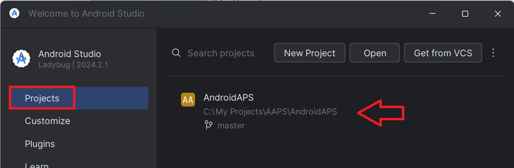
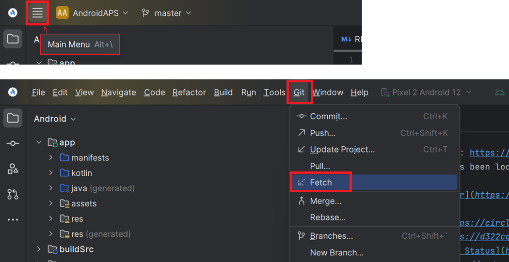
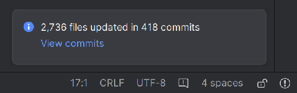

# Aktualizacja w Android Studio

## Zbuduj sam zamiast pobierać

**AAPS** nie jest dostępny do pobrania ze względu na przepisy dotyczące wyrobów medycznych. Zbudowanie aplikacji na własny użytek jest legalne, ale NIE WOLNO Ci przekazywać jej kopii innym osobom! Szczegóły znajdziesz na stronie [FAQ](../UsefulLinks/FAQ.md).

```{note}
Jeśli chcesz zbudować **AAPS** na nowym komputerze: skopiuj kopię zapasową pliku magazynu kluczy (keystore) na nowy komputer. Następnie zamiast tej instrukcji postępuj zgodnie z [procedurą pierwszego budowania **AAPS**](../SettingUpAaps/BuildingAaps.md). Jedyna różnica: zamiast tworzyć nowy magazyn kluczy, możesz wybrać ten, który skopiowano na nowy komputer.
```

## Przegląd aktualizacji AAPS do nowej wersji w Android Studio

```{contents} Steps for updating to a new version of AAPS
:depth: 1
:local: true
```

Jeśli masz problemy, zobacz osobną stronę [Rozwiązywanie problemów z Android Studio](../GettingHelp/TroubleshootingAndroidStudio.md).

### Wyeksportuj swoje ustawienia

Wyeksportuj ustawienia z obecnej wersji **AAPS** w swoim telefonie. Może nie będą Ci potrzebne, ale lepiej dmuchać na zimne.

Jeśli nie pamiętasz, jak to zrobić, zobacz stronę [Tworzenie i przywracanie kopii zapasowych](ExportImportSettings.md).

### Sprawdź wersję Android Studio

Minimalna wymagana wersja jest opisana w [instrukcji budowania](#Building-APK-recommended-specification-of-computer-for-building-apk-file). Jeśli Twoja wersja jest starsza, [najpierw zaktualizuj Android Studio](#Building-APK-install-android-studio)!

(Update-to-new-version-update-your-local-copy)=
### Zaktualizuj swoją lokalną kopię

* Otwórz swój istniejący projekt AAPS w Android Studio. Może być konieczne wybranie projektu. Kliknij (dwukrotnie) projekt AAPS.

  

* Na pasku menu Android Studio wybierz Git -> Fetch

   

* W prawym dolnym rogu zobaczysz komunikat, że Fetch się powiódł.

   

* Teraz na pasku menu wybierz Git -> Pull

   

* Pozostaw wszystkie opcje bez zmian (origin/master) i wybierz Pull

   

* Poczekaj, aż pobieranie się zakończy. Informację o tym zobaczysz na dolnym pasku. Po zakończeniu zobaczysz komunikat o powodzeniu.

  ```{note}
  Lista zaktualizowanych plików może być inna! This is not an indication of a problem.
  ```

   

* Gradle Sync zostanie uruchomiony, aby pobrać niektóre zależności. Poczekaj, aż się zakończy.

  

### Sprawdź wersję JVM

To sprawdzenie jest szczególnie zalecane, jeśli na tym samym komputerze zbudowano już wcześniejszą wersję **AAPS**.

Sprawdź w [instrukcji budowania](#Building-APK-recommended-specification-of-computer-for-building-apk-file), jaka wersja JVM jest wymagana dla wersji **AAPS**, którą teraz budujesz. Następnie wykonaj kroki opisane w [Niezgodna wersja Gradle JVM](#incompatible-gradle-jvm), aby upewnić się, że używasz właściwej wersji.

(Update-to-new-version-build-the-signed-apk)=
### Zbuduj podpisany plik APK

Twój kod źródłowy jest teraz aktualną wydaną wersją, a wszystkie wymagania zostały sprawdzone. Teraz zbuduj podpisany plik apk, jak opisano w [sekcji o budowaniu podpisanego pliku apk](#Building-APK-generate-signed-apk).

(Update-to-new-version-transfer-and-install)=

### Przenieś i zainstaluj plik apk
Musisz przenieść plik apk do telefonu, aby go zainstalować.

```{note}
Jeśli zbudowano aplikację z tym samym istniejącym magazynem kluczy w Android Studio, nie musisz usuwać obecnej aplikacji z telefonu. Podczas instalacji pliku apk postępuj zgodnie z komunikatami, aby zainstalować aktualizację.
W innych przypadkach, np. gdy w Android Studio utworzono nowy magazyn kluczy dla podpisanego pliku apk, musisz usunąć starą aplikację przed instalacją pliku apk. **Pamiętaj, aby wyeksportować ustawienia!**
```

Zobacz instrukcję [Przenoszenie i instalacja AAPS na smartfonie](../SettingUpAaps/TransferringAndInstallingAaps.md). Tam, gdzie obowiązuje [weryfikacja deweloperów Androida](#android-developer-verification) Google (od września 2026, zależnie od kraju), instaluj przez [ADB](#android-developer-verification-adb) zamiast dotykać pliku APK.

Kontynuuj [tutaj](#Update-to-new-version-check-aaps-version-on-phone).

(update-computer-build-troubleshooting)=

## Rozwiązywanie problemów

Jeśli coś pójdzie nie tak, nie panikuj.

Weź głęboki oddech!

Następnie sprawdź na osobnej stronie [Rozwiązywanie problemów z Android Studio](../GettingHelp/TroubleshootingAndroidStudio.md), czy Twój problem jest już opisany!

Jeśli potrzebujesz dalszej pomocy, zwróć się do innych użytkowników **AAPS** na [Facebooku](https://www.facebook.com/groups/AndroidAPSUsers) lub [Discordzie](https://discord.gg/4fQUWHZ4Mw).