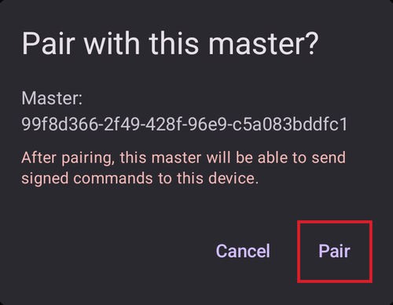

(aapsclient-app)=
# Aplikacja AAPSClient

**AAPSClient** to aplikacja dodatkowa do **AAPS**: aplikacja towarzysząca na drugi telefon – zwykle telefon opiekuna – która pozwala **obserwować** osobę używającą **AAPS**. Od wersji 4 **AAPS** opiekun może też zdalnie **sterować** pętlą za pomocą podpisanych poleceń. Oba telefony komunikują się przez Twoją stronę **Nightscout**. Bezpośrednie połączenie między telefonami nie jest potrzebne.

```{admonition} Wording used on this page
:class: note
- **Client** (urządzenie opiekuna) = telefon z aplikacją **AAPSClient**.
- **Master** (urządzenie pacjenta) = główny telefon z **AAPS**, który obsługuje pompę i prowadzi pętlę.
```

```{admonition} iPhone version in development
:class: note
**AAPSClient** działa obecnie na telefonach z Androidem. Wersja **AAPSClient** na iPhone'a jest w trakcie tworzenia i we wczesnej fazie testów. Nie została jeszcze wydana: nie ma jej w App Store i nie ma czego pobrać. Ta strona zostanie zaktualizowana, gdy wersja będzie dostępna.
```

```{contents} Table of contents
:depth: 2
:local: true
```

## Czym AAPSClient jest (a czym nie jest)

**AAPSClient** wygląda i działa podobnie jak **AAPS**, ale **nie ma własnej pętli**:

- Nie zawiera **algorytmu APS**, **Zadań** ani **sterowników pomp** – nigdy sam nie podaje insuliny.
- Nie ma w nim też wtyczek używanych tylko przez główną aplikację (**Komunikator SMS**, **Tidepool**, **Open Humans**).
- Co *zawiera*: synchronizację **NSClientV3**, wtyczki źródeł BG, wysyłanie danych do **xDrip+** oraz połączenia z **Wear OS** / **Garmin** – wszystko, co jest potrzebne do obserwowania i przekazywania poleceń. Zegarek **Garmin** połączony z urządzeniem opiekuna może pokazywać dane, ale wysłane z niego węglowodany nie są wprowadzane i nie może on podłączyć ani odłączyć pompy: urządzenie opiekuna pokazuje komunikat, a Ty wprowadzasz je w **AAPS**.

Wszystko, co uruchomisz z **AAPSClient**, jest sprawdzane, ograniczane, potwierdzane i **wykonywane przez urządzenie pacjenta** (telefon z pompą). Osobna strona [Sterowanie Master ↔ Client](ClientMasterControl.md) wyjaśnia, jak to działa: jak sparować oba telefony, jak urządzenie pacjenta tworzy tekst potwierdzenia, który widzisz, jak jest podawany bolus uruchomiony na urządzeniu opiekuna i co się dzieje, gdy urządzenie pacjenta jest offline.

## Wersje: AAPSClient, AAPSClient2 i AAPSClient3

Na tym samym telefonie obserwującego można zainstalować obok siebie do trzech aplikacji, a każda obserwuje **inną** osobę: **AAPSClient** (ikona żółtej sowy), **AAPSClient2** (niebieska sowa) i – nowość w wersji 4 **AAPS** – **AAPSClient3** (zielona sowa). Działają tak samo. Różnią się tylko nazwą i kolorem (ikona aplikacji, tło widżetu i sekcja stanu na ekranie głównym), aby można je było odróżnić. Każda aplikacja jest sparowana z własnym urządzeniem pacjenta. Szczegóły znajdziesz w [AAPSClient, AAPSClient2 i AAPSClient3](#remotecontrol-aapsclient-versions).

## Jak zdobyć aplikację

**AAPSClient** zdobywasz tak samo jak **AAPS** – zobacz [Pobieranie i instalacja AAPSClient](#RemoteControl_aapsclient) – i instalujesz jak główną aplikację ([Przenoszenie i instalacja](../SettingUpAaps/TransferringAndInstallingAaps.md)).

## Pierwsze uruchomienie: krótszy Kreator konfiguracji

Przy pierwszym uruchomieniu **AAPSClient** uruchamia ten sam **Kreator konfiguracji**, który znasz z **AAPS**, ale z dużo mniejszą liczbą kroków – na telefonie obserwującego nie ma konfiguracji profilu, insuliny, pompy, APS ani zadań:

1. **Witaj**, **umowa licencyjna**, **uprawnienia** i **hasło główne** – tak samo jak w głównej aplikacji, zobacz [Kreator konfiguracji AAPS](../SettingUpAaps/SetupWizard.md).
2. Urządzenie opiekuna **nie** pyta o **jednostki** ani **dolny/górny próg**: pobiera je z głównego telefonu, gdy tylko połączy się z Nightscout. Możesz je zobaczyć później w **Ustawieniach**, gdzie mała **ikona telefonu** pokazuje, że są [synchronizowane z głównym telefonem](#client-master-config-prefs). Można je edytować tylko wtedy, gdy urządzenie pacjenta jest dostępne.
3. **Konfiguracja z telefonu pacjenta** – na urządzeniu pacjenta otwórz **Zarządzaj → Autoryzowani opiekunowie**, dodaj ten telefon z **kodem QR** i dotknij tutaj **Zeskanuj kod QR**. Jedno skanowanie konfiguruje Nightscout z własnym tokenem tego telefonu, a jeśli kod zawiera parowanie, także paruje telefon. Telefon przyjmuje też jako nazwę instancji nazwę, pod którą został dodany na urządzeniu pacjenta (litery z akcentami stają się zwykłymi literami, „Miloš” zmienia się w „Milos”). **Po skanowaniu konfiguracja jest zakończona**: kreator się zamyka, bo kolejne kroki pokazałyby tylko to, co zrobił kod. Bez kodu QR pomiń ten krok. (Tylko Android: skaner nie jest jeszcze dostępny w iOS).

   

4. **Komunikacja** – lista wtyczek pokazuje tylko to, czego potrzebuje obserwujący (NSClientV3, xDrip+, Wear, Zewnętrzne aplikacje towarzyszące, Garmin). Jeśli nie zeskanowałeś kodu QR, włącz **NSClientV3** i wpisz **ten sam adres URL strony Nightscout** co na głównym telefonie oraz token dostępu, z włączonymi **websockets** – dokładnie tak, jak opisano w [Synchronizacja](#RemoteControl_aapsclient).

   

5. **Sparuj z telefonem pacjenta** – ten krok istnieje **tylko** na urządzeniu opiekuna. Łączy to urządzenie z urządzeniem pacjenta przez bezpieczny kanał poleceń, za pomocą kodu PIN, i przyjmuje nazwę, pod którą telefon został dodany na urządzeniu pacjenta – tak jak kod QR. **Po sparowaniu konfiguracja jest zakończona.** Możesz też pominąć ten krok i sparować w dowolnym momencie później w **Zarządzaj → Sparuj z telefonem pacjenta**.

   

6. **Kto korzysta z tego telefonu?** – tylko jeśli nie sparowałeś w kreatorze: imię osoby, która używa tego telefonu. Pozwala odróżnić tę instancję w raportach i synchronizacji.

(aapsclient-pairing-with-the-master)=

## Parowanie z urządzeniem pacjenta

Na **urządzeniu pacjenta** otwórz **Zarządzaj → Autoryzowani opiekunowie** i dodaj urządzenie opiekuna. Są dwa sposoby parowania:

- **Kodem QR** (najszybciej, jeśli telefon ma aparat): zeskanuj kod w kroku kreatora „**Konfiguracja z telefonu pacjenta**” albo w **Zarządzaj → Sparuj z telefonem pacjenta → Skanuj kod QR** i potwierdź przyciskiem „**Użyj**”. To konfiguruje też Nightscout.
- **Kodem PIN**: na **urządzeniu opiekuna** otwórz powyższy krok kreatora (lub **Zarządzaj → Sparuj z telefonem pacjenta**), wpisz jednorazowy PIN pokazany na urządzeniu pacjenta i naciśnij „**Paruj**”. Urządzenie opiekuna pokaże wtedy, komu zamierza zaufać – potwierdź przyciskiem „**Sparuj**”:



Jeśli parujesz z kreatora, udane parowanie kończy konfigurację i otwiera ekran główny. Na urządzeniu pacjenta urządzenie opiekuna pojawia się jako **Aktywny** na liście [Autoryzowani opiekunowie](#client_master_master_setup). Potem **Zarządzaj → Sparuj z telefonem pacjenta** pokazuje „*Już sparowano*”, rolę telefonu i to, czy tryb silniejszych zabezpieczeń jest włączony:

 Pełna procedura parowania, szczegóły bezpieczeństwa i rozwiązywanie problemów są na stronie [Sterowanie Master ↔ Client](#client_master_client_setup).

Po sparowaniu urządzenie opiekuna dostaje od urządzenia pacjenta własny token Nightscout (jeśli urządzenie pacjenta ma token administratora) tylko z uprawnieniami potrzebnymi urządzeniu opiekuna i przestaje używać tokena, który mogłeś wpisać. **AAPSClient** nigdy sam nie zapisuje leczenia ani BG w Nightscout: wszystko, co robi, jest wysyłane do urządzenia pacjenta, które to zapisuje. Zobacz [Własny token Nightscout klienta](#client-master-control-own-token).

Urządzenie pacjenta decyduje, co ten telefon może robić, przez jego **[rolę](#client-master-control-roles)** (Tylko odczyt, Posiłki, Opiekun lub Administrator). **Zarządzaj → Sparuj z telefonem pacjenta** pokazuje rolę telefonu.

## Ekran główny

Ekran główny urządzenia opiekuna odzwierciedla obserwowaną pętlę:


- **BG, wykresy, IOB/COB i profil** pochodzą z Nightscout, dokładnie tak, jak wysłało je urządzenie pacjenta.
- Pokazywany **stan pętli** to stan **urządzenia pacjenta** (urządzenie opiekuna nie ma własnej pętli). Dopóki urządzenie opiekuna nie otrzyma z Nightscout trybu pracy urządzenia pacjenta, element trybu pracy pokazuje **znak zapytania** (nieznany).
- **Karta stanu** pokazuje zbiornik i baterię **obserwowanej pompy** oraz baterię uploadera, pobrane ze stanu urządzenia w Nightscout – urządzenie opiekuna nie ma pompy, więc w aplikacji nie ma lokalnego stanu pompy ani zarządzania pompą.
- Dolny pasek oferuje **Leczenie**, **Sceny** i **Zarządzaj**, gdy urządzenie opiekuna jest sparowane (przed sparowaniem tylko **Zarządzaj**) – nie ma zakładek pompy ani zadań.

## Leczenie i akcje

Wszystko w **Zarządzaj** działa jak w głównej aplikacji, z jedną ważną różnicą: na urządzeniu opiekuna akcje, które zmieniałyby terapię (bolus, węglowodany, cele tymczasowe, sceny…), są **ukryte do czasu sparowania urządzenia**, a po sparowaniu są **przekazywane do urządzenia pacjenta** do potwierdzenia i wykonania – zobacz [Używanie zdalnego sterowania](#client-master-control).

Wyjątkiem jest pozycja **Profil**: jest widoczna nawet na **niesparowanym** urządzeniu opiekuna, ale otwiera się **tylko do podglądu** – urządzenie opiekuna pokazuje profile, które otrzymuje przez Nightscout (potrzebuje ich do własnych obliczeń), bez przycisków edycji i aktywacji. Gdy urządzenie opiekuna jest **sparowane**, lista profili jest synchronizowana z urządzeniem pacjenta i możesz edytować oraz aktywować profile z urządzenia opiekuna jak każdą inną zdalną akcję.

Na **niesparowanym** urządzeniu opiekuna **Zarządzaj** oferuje tylko **Profil** i **Sparuj z telefonem pacjenta**:


Czerwony baner „*Urządzenie pacjenta jest niedostępne. Edycja jest wyłączona, dopóki połączenie nie zostanie przywrócone.*” pojawia się też na niesparowanym urządzeniu opiekuna. To normalne: nie ma jeszcze urządzenia pacjenta, z którym można się połączyć. Baner znika, gdy urządzenie opiekuna jest sparowane, a urządzenie pacjenta jest online.

Gdy urządzenie opiekuna jest sparowane, pojawiają się akcje terapii:


**Nie ma pozycji Pompa** – urządzenie opiekuna nie ma pompy.

Jeśli urządzenie pacjenta jest niedostępne, ten sam baner pojawia się na sparowanym urządzeniu opiekuna: akcje terapii są wyszarzone, a każda próba jest blokowana, zanim zostanie wysłana. Urządzenie opiekuna zauważa, że urządzenie pacjenta jest offline, gdy próbujesz wykonać akcję, i ponownie włącza akcje, gdy urządzenie pacjenta wróci online.


## Ustawienia synchronizowane z urządzeniem pacjenta

Aktywna **konfiguracja** wtyczek i wiele **ustawień** jest synchronizowanych między urządzeniem pacjenta a sparowanymi urządzeniami opiekuna. Synchronizowane pozycje są oznaczone małą **ikoną telefonu** i są wyłączone (z banerem „*Urządzenie pacjenta jest niedostępne*”), gdy urządzenie pacjenta jest niedostępne. Opisano to w [Zmiana konfiguracji i ustawień](#client-master-config-prefs).

## AAPSClient na smartwatchu

Zegarek z Wear OS można sparować z telefonem **opiekuna**. Jego akcje są przekazywane przez urządzenie opiekuna do urządzenia pacjenta. Zobacz [Smartwatch z Wear OS](../WearOS/WearOsSmartwatch.md) i [opcje smartwatcha w Zdalnym sterowaniu](#RemoteControl_smartwatches).
