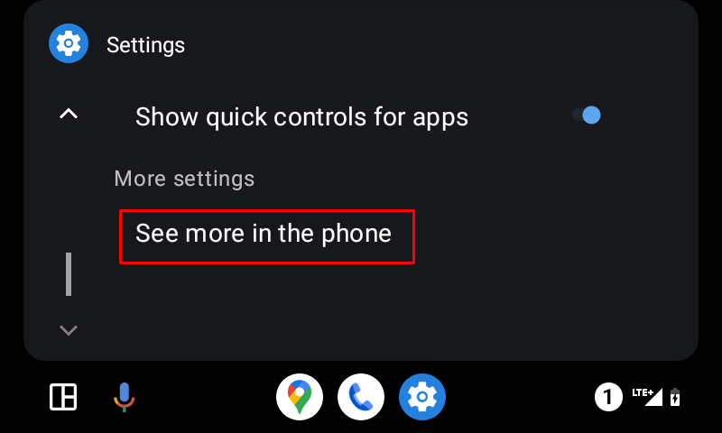

# Android Auto

**AAPS** może wysyłać informacje o Twoim aktualnym stanie jako wiadomość bezpośrednio do Android Auto w samochodzie.

## Wymagania

**AAPS** używa funkcji Android Auto, która przekazuje wiadomości z aplikacji w telefonie na ekran systemu audio w samochodzie.

To oznacza, że:

* Android musi pozwalać **AAPS** na pokazywanie powiadomień oraz
* **AAPS** nie jest oficjalną aplikacją, więc zezwól w Android Auto na „nieznane źródła”.

(androidauto-check-that-aaps-can-show-notifications)=

## Sprawdź, czy AAPS może pokazywać powiadomienia

**AAPS** zawsze pokazuje powiadomienie o stanie z aktualną glikemią, IOB i COB. To jest powiadomienie, które Android Auto wyświetla w samochodzie. W **AAPS** nie trzeba niczego włączać, ale Android musi pozwalać **AAPS** na pokazywanie powiadomień.

W telefonie otwórz **Ustawienia** > **Aplikacje** > **AAPS** > **Powiadomienia** i upewnij się, że **Wszystkie powiadomienia AAPS** są włączone.

Przewiń w dół i upewnij się, że **Bieżący status** jest włączony: to kanał powiadomienia o stanie.

Zanim pójdziesz do samochodu, sprawdź, czy widzisz w telefonie powiadomienie o stanie **AAPS**!

(androidauto-allow-the-use-of-unknown-sources-with-android-auto)=

## Zezwól w Android Auto na „nieznane źródła”

**AAPS** nie jest oficjalną aplikacją Android Auto, więc w Android Auto trzeba włączyć powiadomienia z „nieznanych źródeł”. Robi się to przez tryb programisty, który tutaj pokażemy.

Wejdź do samochodu i połącz telefon z systemem audio samochodu.

Powinien pojawić się ekran podobny do tego.

Naciśnij ikonę **ustawień**, aby rozpocząć konfigurację.

Przewiń w dół do końca strony i wybierz **więcej ustawień w telefonie** (see more in the phone).

Teraz włączymy tryb programisty w telefonie.

Pierwszy ekran wygląda tak. Przewiń w dół do końca strony.

Tam zobaczysz numer wersji Android Auto. Dotknij 10 razy (słownie: dziesięć) wersji Android Auto. Tą ukrytą kombinacją włączyłeś tryb programisty.

Potwierdź w oknie „Zezwolić na ustawienia programisty?” (Allow development settings?), że chcesz włączyć tryb programisty.

W **ustawieniach programisty** włącz „Nieznane źródła” (Unknown sources).

Teraz możesz wyjść z trybu programisty, jeśli chcesz. Aby to zrobić, wejdź w menu z trzema kropkami w prawym górnym rogu.

## Pokazywanie powiadomień w samochodzie

Dotknij **ikony z liczbą** w prawym dolnym rogu Android Auto w samochodzie.

Dane CGM będą wyświetlane tak:

(android-auto-troubleshooting)=

## Rozwiązywanie problemów:

* If you don't see the notification, check if you [allowed AAPS to show notifications](#androidauto-check-that-aaps-can-show-notifications) in Android and if [Android Auto has access rights to notifications](#androidauto-allow-the-use-of-unknown-sources-with-android-auto).