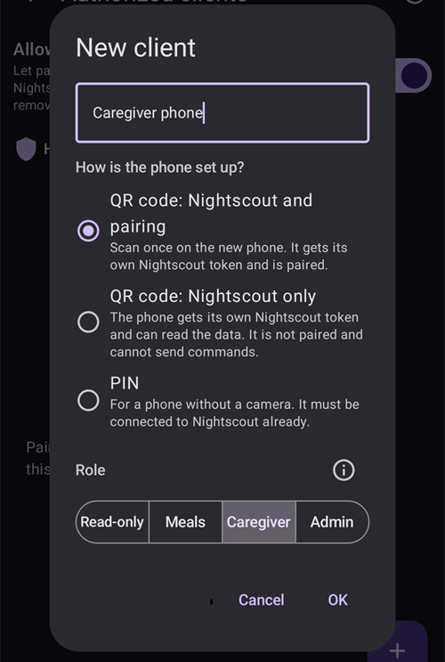
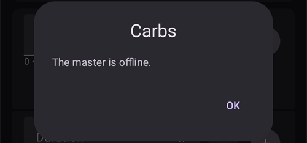

(client-master-control)=
# Sterowanie Master ↔ Client (podpisane zdalne sterowanie)

Od wersji 4 **AAPS** telefon obserwującego z aplikacją **AAPSClient** może zrobić dużo więcej niż tylko *zgłaszać* leczenie przez Nightscout: po **sparowaniu** z głównym telefonem może wysyłać **podpisane polecenia**, które główny telefon (urządzenie pacjenta, **master**) sprawdza, potwierdza i wykonuje — także podanie **bolusa insuliny** z pompy urządzenia pacjenta.

Ta strona wyjaśnia, jak to działa, jak to skonfigurować i jak tego używać.

```{contents} Table of contents
:depth: 2
:local: true
```

```{admonition} Wording used on this page
:class: note
- **Master** (urządzenie pacjenta) = główny telefon z **AAPS**, który steruje pompą i prowadzi pętlę (aplikacja `full`).
- **Client** (urządzenie opiekuna) = telefon z **AAPSClient** bez pompy, który obserwuje urządzenie pacjenta, a teraz także nim *steruje*.
- Oba telefony muszą być połączone z **tą samą stroną Nightscout**. Cała komunikacja nadal idzie przez Nightscout — bezpośrednie połączenie między telefonami nie jest potrzebne.
```

---

## Jak to działa

```{admonition} Coming from AAPS v3?
:class: note
W **AAPS** v3 **AAPSClient** mógł tylko zapisywać w Nightscout niepodpisane wpisy portalu opieki i nie mógł podać bolusa. Zdalne sterowanie wymaga teraz jednorazowego [parowania](#client_master_master_setup). Zobacz też [Co zmieniło się w AAPS v4](#v4changes-remote-control).
```

**AAPS** v4 używa osobnego kanału **Client-Control**. Nadal działa on przez Twoją stronę Nightscout (w kolekcji `settings`), ale każda wiadomość jest **podpisana kryptograficznie** tajnym kluczem, który znają tylko te dwa telefony. Tajny klucz jest przekazywany raz, podczas **parowania**, i zaraz potem zastępowany nowym, więc nigdy nie jest przesyłany otwartym tekstem.

Główna zasada brzmi: **decyduje urządzenie pacjenta**:

1. Urządzenie opiekuna wysyła *zamiar* („bolus 2 U”, „uruchom scenę Ćwiczenia”, „ustaw ten cel tymczasowy”…).
2. **Urządzenie pacjenta** oblicza akcję od nowa i **ogranicza** ją według **własnych** aktualnych danych (profil, IOB, COB, aktualny cel tymczasowy, pompa) oraz **tworzy dokładny tekst potwierdzenia**, który zobaczy użytkownik.
3. Urządzenie opiekuna (lub zegarek) pokazuje tekst potwierdzenia **urządzenia pacjenta** — nigdy nie tworzy własnego.
4. Po potwierdzeniu urządzenie pacjenta **wykonuje akcję jeden raz** i odsyła wynik do urządzenia opiekuna.

Co to oznacza dla Ciebie:

- **Podpisane polecenia**: polecenia mogą wysyłać tylko sparowane przez Ciebie urządzenia opiekuna (każde ma własny tajny klucz parowania i podpis). Stare lub powtórzone polecenia są odrzucane.
- **Rola dla każdego urządzenia opiekuna**: decydujesz, co może robić każde urządzenie opiekuna, od *Tylko odczyt* do *Administrator* — zobacz [Role urządzeń opiekuna](#client-master-control-roles).
- **Bolus insuliny z urządzenia opiekuna**: urządzenie pacjenta podaje go swoją pompą, a urządzenie opiekuna pokazuje postęp podawania.
- **Decyduje urządzenie pacjenta**: ogranicza każdą akcję według własnych ograniczeń i tworzy potwierdzenie pokazywane na urządzeniu opiekuna.
- **Tylko sparowane urządzenia opiekuna zmieniają terapię**: gdy sterowanie z urządzenia opiekuna jest włączone, urządzenie pacjenta nie przyjmuje już leczenia ani zmian wpisanych bezpośrednio w Nightscout — zobacz [Tryb silniejszych zabezpieczeń](#client-master-control-hardened-mode).
- **Każde urządzenie opiekuna dostaje własny token Nightscout** tylko z uprawnieniami, których potrzebuje — zobacz [Własny token Nightscout urządzenia opiekuna](#client-master-control-own-token).
- **Urządzenie pacjenta offline**: akcje są blokowane i widzisz jasny komunikat.
- **Odebranie dostępu urządzeniu opiekuna** to jedno dotknięcie (dla każdego urządzenia osobno). Możesz też użyć przełącznika na urządzeniu pacjenta, aby zatrzymać wszystkie urządzenia opiekuna.

Akcje, które można uruchomić z urządzenia opiekuna: **bolus**, **węglowodany / eCarbs**, **cel tymczasowy** (ustawienie i anulowanie), **zmiana profilu**, zmiana **pętli / trybu pracy**, **baza tymczasowa** (ustawienie i anulowanie), **bolus przedłużony** (ustawienie i anulowanie), **wybór insuliny** oraz **[sceny](../DailyLifeWithAaps/Scenes.md)**. Część **ustawień** jest też synchronizowana w obie strony między urządzeniem pacjenta a urządzeniami opiekuna.

---

## Role i wymagania

```{admonition} Before you start
:class: important
- **Urządzenie pacjenta** (master) ma zwykłą wersję `full` **AAPS** i jest połączone z Twoją pompą.
- **Urządzenie pacjenta** używa **NSClientV3** z Twoim Nightscout i pokazuje stan *połączono*. Daj mu **token administratora** Twojego Nightscout: dzięki niemu urządzenie pacjenta może utworzyć osobny token dla każdego urządzenia opiekuna i pokazać mu go jako kod QR.
- **Urządzenie opiekuna** (client) ma aplikację **[AAPSClient](AapsClient.md)** (lub **AAPSClient2** / **AAPSClient3** dla kolejnych pacjentów — zobacz [O AAPSClient, AAPSClient2 i AAPSClient3](#remotecontrol-aapsclient-versions)). Musi używać **tego samego** Nightscout. Jeśli konfigurujesz je kodem QR z urządzenia pacjenta, urządzenie opiekuna dostaje z niego adres Nightscout i token; w przeciwnym razie najpierw sam skonfiguruj na nim **NSClientV3**.
- **Websockety** są potrzebne na obu telefonach: polecenia docierają do urządzenia pacjenta tylko przez połączenie websocket. Gdy sterowanie z urządzenia opiekuna jest włączone, **AAPS** utrzymuje websockety włączone na urządzeniu pacjenta i na sparowanych urządzeniach opiekuna.
```

Parowanie i synchronizacja to dwie różne rzeczy:

- **Synchronizację** (dane: BG, leczenie, profil) konfigurujesz jak dotąd — zobacz [Synchronizacja](#RemoteControl_aapsclient). Kod QR z urządzenia pacjenta może zrobić to za Ciebie na urządzeniu opiekuna.
- **Parowanie** (sterowanie: opisany tutaj kanał podpisanych poleceń) to nowy krok opisany poniżej.

---

## Konfiguracja

(client_master_master_setup)=
### 1. Na urządzeniu pacjenta — włącz sterowanie i dodaj urządzenie opiekuna

Na urządzeniu pacjenta otwórz ekran **Zarządzaj** i wybierz **Autoryzowani opiekunowie**.

Włącz **Zezwalaj na sterowanie z urządzenia opiekuna** (domyślnie jest **wyłączone**). To główny wyłącznik: gdy jest wyłączony, żadne urządzenie opiekuna nie może wysyłać poleceń, ale sparowane urządzenia opiekuna zostają zapisane, więc możesz go później włączyć ponownie. Włączenie go włącza też [Tryb silniejszych zabezpieczeń](#client-master-control-hardened-mode), co widać jako „*Włączono tryb silniejszych zabezpieczeń*” z ikoną **(i)**, która to wyjaśnia. W [Trybie uproszczonym](#preferences-simple-mode) sterowanie z urządzenia opiekuna jest zawsze włączone, więc przełącznik nie jest widoczny.


Dotknij przycisku **+** (w prawym dolnym rogu), aby dodać urządzenie opiekuna. W oknie **Nowe urządzenie opiekuna**:

1. Wpisz **nazwę urządzenia**, aby rozpoznać je na liście.
2. Wybierz, **jak skonfigurowano telefon** (zobacz tabelę poniżej).
3. Wybierz jego **[rolę](#client-master-control-roles)**. Nic nie jest wybrane za Ciebie: właściwa rola zależy od tego, kto używa telefonu.



| Sposób                             | Co dostaje nowy telefon                                                     | Kiedy używać                                                                                                    |
| ---------------------------------- | --------------------------------------------------------------------------- | --------------------------------------------------------------------------------------------------------------- |
| **Kod QR: Nightscout i parowanie** | adres Nightscout, własny token Nightscout i parowanie — w jednym skanowaniu | nowy telefon ma aparat: najszybszy sposób, nie trzeba nic wpisywać                                              |
| **Kod QR: tylko Nightscout**       | adres Nightscout i własny token Nightscout, bez parowania                   | telefon ma tylko **pokazywać** dane i nigdy nie wysyłać poleceń                                                 |
| **PIN**                            | tylko parowanie; telefon zachowuje swoje ustawienia Nightscout              | telefon nie ma aparatu (albo urządzenie pacjenta nie może tworzyć tokenów); musi już być połączony z Nightscout |

Oba sposoby z kodem QR wymagają **tokenu administratora** w ustawieniach **NSClientV3** urządzenia pacjenta, bo to urządzenie pacjenta tworzy w Nightscout token dla urządzenia opiekuna. Bez niego opcje kodu QR są widoczne, ale nie można ich wybrać, a okno wyjaśnia dlaczego; **PIN** działa zawsze.

#### Kodem QR

Dotknij **OK**: urządzenie pacjenta tworzy token Nightscout dla urządzenia opiekuna i pokazuje **kod QR**. Kod, który także paruje, działa przez około **dwie minuty**; ekran odlicza czas i zamyka się sam, gdy urządzenie opiekuna zostanie sparowane. Zeskanuj go na nowym telefonie, jak opisano w części [Na urządzeniu opiekuna](#client_master_client_setup).

```{admonition} The QR code is a secret
:class: warning
Każdy, kto zobaczy kod QR, może odczytać Twój Nightscout, a kod, który paruje, zawiera też dane parowania. Pokaż go tylko nowemu telefonowi. **AAPS** blokuje zrzuty ekranu, gdy kod jest na ekranie.
```


#### PIN-em

Dotknij **OK**: urządzenie pacjenta pokazuje 8-cyfrowy **PIN parowania** w dwóch grupach po cztery cyfry (na przykład `1234 5678`). Ten PIN jest **jednorazowy** i **wygasa po około dwóch minutach**.


```{admonition} The pairing PIN is a secret
:class: warning
PIN chroni tajny klucz parowania, który jest przekazywany przez Nightscout. Podaj go tylko urządzeniu, które parujesz, nie publikuj go i pozwól mu wygasnąć, jeśli go nie używasz. Nowy PIN możesz zawsze wygenerować, dotykając ponownie **+**.
```

(client_master_client_setup)=
### 2. Na urządzeniu opiekuna — sparuj z urządzeniem pacjenta

#### Skanowanie kodu QR

Kod QR urządzenia pacjenta możesz zeskanować w dwóch miejscach:

- w **Kreatorze konfiguracji** urządzenia opiekuna, na kroku „**Konfiguracja z telefonu pacjenta**”, który jest przed krokiem Nightscout. Jedno skanowanie konfiguruje wtedy Nightscout, a kodem, który paruje, także parowanie, więc konfiguracja jest zakończona: kreator się zamyka i otwiera się ekran główny;
- w dowolnym momencie później w **Zarządzaj → Sparuj z telefonem pacjenta → Skanuj kod QR**.

Za pierwszym razem **AAPSClient** prosi o uprawnienie do **aparatu**. Jeśli odmówisz, ekran poinformuje, że aparat jest potrzebny. Możesz wtedy zezwolić na niego przyciskiem **Spróbuj ponownie** albo sparować za pomocą PIN-u.

Skieruj aparat na kod. Urządzenie opiekuna pokazuje, co robi kod — adres Nightscout oraz, dla kodu, który paruje, urządzenie pacjenta, z którym się sparuje — i pyta „**Użyć tego kodu?**”. Dotknij **Użyj**: urządzenie opiekuna włącza **NSClientV3**, zastępuje swój adres Nightscout i token tymi z kodu i włącza websockety. Kod, który paruje, paruje też telefon; telefon wysyła powitanie do urządzenia pacjenta, gdy tylko połączy się z Nightscout.


```{admonition} Scanning is available on Android
:class: note
Skaner nie jest jeszcze dostępny na iOS, a komputer nie ma aparatu: tam użyj PIN-u.
```

#### Wpisywanie PIN-u

Na urządzeniu opiekuna otwórz **Zarządzaj → Sparuj z telefonem pacjenta** (lub krok kreatora **Sparuj z telefonem pacjenta**, po kroku Nightscout), **wpisz 8-cyfrowy PIN** pokazany na urządzeniu pacjenta i dotknij **Paruj**. Urządzenie opiekuna używa PIN-u, aby bezpiecznie pobrać z Nightscout zaproszenie do parowania, a potem pyta „**Sparować z tym urządzeniem pacjenta?**” i pokazuje identyfikator urządzenia pacjenta. Dotknij **Sparuj**, aby potwierdzić (zrzut ekranu znajdziesz w części [Parowanie z telefonem pacjenta](#aapsclient-pairing-with-the-master)).


#### Po sparowaniu

Po sparowaniu urządzenie opiekuna wysyła do urządzenia pacjenta wiadomość **Hello** i pojawia się na liście **Autoryzowani opiekunowie** urządzenia pacjenta jako **Aktywny**, z czasem *„Ostatnio widziany”*. Urządzenie opiekuna zna swoją [rolę](#client-master-control-roles) z parowania, więc od razu pokazuje właściwe przyciski. Parowanie wykonane w Kreatorze konfiguracji kończy kreator. W tym samym kroku oba telefony zastępują tajny klucz parowania nowym, który nigdy nie był przesyłany (zobacz [Uwagi dotyczące bezpieczeństwa](#client-master-control-security)), a urządzenie opiekuna skonfigurowane PIN-em dostaje własny token Nightscout (zobacz [Własny token Nightscout urządzenia opiekuna](#client-master-control-own-token)). Urządzenie opiekuna może być sparowane tylko z **jednym** urządzeniem pacjenta naraz; aby sparować je z innym urządzeniem pacjenta, najpierw użyj **Odłącz**.


### 3. Zarządzanie urządzeniami opiekuna

Na ekranie **Autoryzowani opiekunowie** urządzenia pacjenta możesz w każdej chwili:

- **Zmienić rolę** urządzenia opiekuna rzędem czterech przycisków pod jego nazwą. Nowa rola działa od razu, bez ponownego parowania.
- **Zobaczyć, jakim tokenem Nightscout** zapisuje urządzenie opiekuna: właściwy stan to „*Własny token Nightscout*”. Czerwona linia „*Używa tokena Nightscout …, który ma więcej uprawnień, niż potrzebuje klient*” oznacza, że urządzenie opiekuna nadal używa tokenu z większymi uprawnieniami, zwykle Twojego tokenu administratora — zobacz [Własny token Nightscout urządzenia opiekuna](#client-master-control-own-token).
- **Odebrać dostęp** jednemu urządzeniu opiekuna — dotknij ikony **kosza** obok niego. Urządzenie opiekuna nie może wtedy wysyłać poleceń, dopóki nie zostanie ponownie sparowane. Jego własny token Nightscout też zostaje usunięty, więc nie może już także odczytywać Twojego Nightscout.
- **Zatrzymać całe sterowanie** bez utraty parowań — wyłącz **Zezwalaj na sterowanie z urządzenia opiekuna**.

Telefony skonfigurowane opcją **Kod QR: tylko Nightscout** są pokazane pod urządzeniami opiekuna, w części „**Tylko odczyt Nightscout**”. Dla każdego z nich możesz ponownie pokazać kod QR (aby jeszcze raz skonfigurować ten sam telefon) albo usunąć jego token, co kończy jego dostęp do Twojego Nightscout.


---

(client-master-control-roles)=
## Role urządzeń opiekuna

Każde sparowane urządzenie opiekuna ma **rolę**. Urządzenie pacjenta sprawdza ją przy każdym poleceniu, a urządzenie opiekuna pokazuje tylko to, na co pozwala jego rola. Nowa rola działa od razu, bez ponownego parowania. Role są zbudowane jedna na drugiej: każda może robić wszystko to, co rola przed nią.

| Rola              | Urządzenie opiekuna może                                                                                                                                                                                                                                                |
| ----------------- | ----------------------------------------------------------------------------------------------------------------------------------------------------------------------------------------------------------------------------------------------------------------------- |
| **Tylko odczyt**  | tylko pokazywać dane. Pozostaje sparowane, więc jest gotowe, gdy dasz mu wyższą rolę.                                                                                                                                                                                   |
| **Posiłki**       | podać bolus, użyć kalkulatora bolusa i Szybkiego kalkulatora, wpisać węglowodany i zatrzymać trwający bolus. Wpisane tu węglowodany mogą sprawić, że pętla poda więcej insuliny.                                                                                        |
| **Opiekun**       | robić wszystko, co użytkownik robi w **AAPS**: cele tymczasowe, zmiany profilu i insuliny, tryb pętli, baza tymczasowa, bolus przedłużony, sceny, zdarzenia portalu opieki, kalibracje i usuwanie wpisów. Nie może zmieniać ustawień ani ustawień wstępnych (presetów). |
| **Administrator** | robić wszystko, także zmieniać ustawienia i presety (Szybki kalkulator, presety celów tymczasowych, sceny, profile, automatyzacja, insulina).                                                                                                                           |

Ikona **(i)** u góry ekranu **Autoryzowani opiekunowie** pokazuje to samo wyjaśnienie. Na urządzeniu opiekuna **Zarządzaj → Sparuj z telefonem pacjenta** pokazuje rolę tego telefonu.

---

(client-master-control-hardened-mode)=
## Tryb silniejszych zabezpieczeń

Gdy **Zezwalaj na sterowanie z urządzenia opiekuna** jest włączone, urządzenie pacjenta działa w **trybie silniejszych zabezpieczeń**: przyjmuje zmiany tylko od sparowanych urządzeń opiekuna. **Nie** przyjmuje leczenia, celów tymczasowych, zmian profilu, zmian trybu pracy ani usunięć wykonanych bezpośrednio w Nightscout, na przykład na stronie Nightscout lub w innych aplikacjach.

- Ustawienia przyjmowania danych z Nightscout (**NSClientV3 → Synchronizacja**) są ukryte, gdy tryb silniejszych zabezpieczeń jest włączony; **AAPS** traktuje je tak, jakby były wyłączone.
- Urządzenie pacjenta nadal **wysyła** wszystkie swoje dane do Nightscout, także BG, i utrzymuje **websockety** włączone.
- Jeśli urządzenie pacjenta dostaje **BG z Nightscout**, nadal pobiera BG stamtąd.
- Aby wczytać historię na **nowym** urządzeniu pacjenta, użyj **Pełna synchronizacja** w **NSClientV3**: pobiera ona wszystko, co jest w Nightscout, także profile.
- [Polecenia SMS](SMSCommands.md) działają bez zmian.

Sparowane urządzenie opiekuna stosuje tryb silniejszych zabezpieczeń urządzenia pacjenta: utrzymuje websockety włączone, a te same ustawienia Nightscout są na nim ukryte. Niesparowane urządzenie opiekuna zachowuje własne ustawienia.

[Tryb uproszczony](#preferences-simple-mode) zawsze włącza tryb silniejszych zabezpieczeń. Aby go wyłączyć, wyjdź z Trybu uproszczonego i wyłącz **Zezwalaj na sterowanie z urządzenia opiekuna** na urządzeniu pacjenta.

```{admonition} Why hardened mode
:class: note
Wszystko, co wysyła sparowane urządzenie opiekuna, jest podpisane, sprawdzone i potwierdzone przez urządzenie pacjenta. Leczenie wpisane na stronie Nightscout nie jest: mógł je dodać każdy, kto ma prawo zapisu do Twojego Nightscout. W trybie silniejszych zabezpieczeń tylko podpisane polecenia mogą zmienić to, co robi urządzenie pacjenta.
```

---

(client-master-control-own-token)=
## Własny token Nightscout urządzenia opiekuna

Urządzenie opiekuna nie potrzebuje tokenu administratora. Tylko odczytuje Twój Nightscout i wysyła przez niego polecenia do urządzenia pacjenta; samo niczego nie przesyła. Dlatego urządzenie pacjenta daje każdemu urządzeniu opiekuna osobny token Nightscout tylko z tymi uprawnieniami:

- odczyt wszystkiego,
- zapis do kolekcji `settings`, czyli kanału do urządzenia pacjenta,
- wyciszanie alarmów Nightscout.

Token należy do roli Nightscout o nazwie **`aaps-client`**, którą urządzenie pacjenta tworzy, gdy po raz pierwszy jej potrzebuje. Rolę i tokeny (o nazwie `aaps-` i nazwa urządzenia opiekuna) zobaczysz w **Admin tools** (narzędzia administratora) na Twojej stronie Nightscout. Jeśli rola zostanie tam zmieniona, urządzenie pacjenta przywróci ją, gdy następnym razem utworzy token lub gdy otworzysz **Autoryzowani opiekunowie**.

Jak urządzenie opiekuna dostaje swój token:

- **Konfiguracja kodem QR**: token jest w kodzie.
- **Parowanie PIN-em** (lub parowanie wykonane, zanim ta funkcja istniała): po sparowaniu urządzenie pacjenta wysyła urządzeniu opiekuna jego własny token przez sparowany kanał, w postaci zaszyfrowanej. Urządzenie opiekuna najpierw sprawdza, czy logowanie tym tokenem działa, a potem używa go zamiast dotychczasowego tokenu. Wymaga to tokenu administratora na urządzeniu pacjenta; bez niego urządzenie opiekuna zachowuje swój token, a jego karta na urządzeniu pacjenta pokazuje czerwoną linię.

**Urządzenie opiekuna zachowuje własny token.** Gdy urządzenie pacjenta zobaczy, że urządzenie opiekuna zapisuje własnym tokenem, od tej chwili przyjmuje polecenia tego urządzenia opiekuna tylko z tym tokenem. Polecenie zapisane innym tokenem (na przykład tokenem administratora wpisanym później na urządzeniu opiekuna albo tokenem innego urządzenia opiekuna) jest odrzucane, nawet jeśli urządzenie opiekuna jest sparowane, a urządzenie opiekuna pokazuje komunikat „*Telefon pacjenta odrzucił żądanie: ten telefon zapisuje dane do Nightscout innym tokenem niż własny*”. Jego karta na urządzeniu pacjenta pokazuje to na czerwono. Urządzenie opiekuna nadal jest pokazywane jako online, więc widać, co jest nie tak. Aby to naprawić, usuń urządzenie opiekuna na urządzeniu pacjenta i dodaj je ponownie.

Urządzenie pacjenta nigdy nie usuwa ani nie zmienia tokenu Nightscout, którego samo nie utworzyło (tokenu z innymi rolami niż `aaps-client`): te tokeny należą do Ciebie. Usuwa własny token urządzenia opiekuna, gdy usuniesz to urządzenie opiekuna.

---

## Używanie zdalnego sterowania

### Uruchamianie akcji z urządzenia opiekuna

Używaj urządzenia opiekuna dokładnie tak jak samego telefonu pacjenta: otwórz **Węglowodany**, **Insulina**, **Cel tymczasowy**, **Profil**, **Sceny**, panel **Zarządzaj** itd. i wpisz wartości.

Gdy potwierdzisz, urządzenie opiekuna przez chwilę pokazuje **„Łączenie z telefonem pacjenta…”**, **urządzenie pacjenta** oblicza i ogranicza akcję, a potem urządzenie opiekuna wyświetla **potwierdzenie utworzone przez urządzenie pacjenta** — dokładnie te linie, wartości i kolory, które urządzenie pacjenta pokazałoby na własnym ekranie. Sprawdź je i dotknij **OK**, aby kontynuować.


To samo dotyczy zwykłego wpisu węglowodanów — ilość pokazana do potwierdzenia to ta, którą obliczyło urządzenie pacjenta:


Po potwierdzeniu urządzenie pacjenta wykonuje akcję jeden raz, a wynik jest widoczny na urządzeniu opiekuna.

### Bolus insuliny z urządzenia opiekuna

To najważniejsza nowa możliwość w v4. Bolus uruchomiony na urządzeniu opiekuna jest **podawany przez urządzenie pacjenta jego pompą**; urządzenie pacjenta ogranicza go według własnych ograniczeń, a urządzenie opiekuna pokazuje **postęp podawania na żywo** (oraz alarm, jeśli pompa zgłosi błąd).

```{admonition} Boluses are always confirmed and capped on the master
:class: note
Urządzenie opiekuna nigdy samo nie decyduje o podanej dawce. Urządzenie pacjenta oblicza ją od nowa i ogranicza, Ty potwierdzasz dawkę podaną przez urządzenie pacjenta i dopiero wtedy jest ona podawana.
```

(clientmastercontrol-when-the-master-is-offline)=
### Gdy urządzenie pacjenta jest offline

Jeśli urządzenie pacjenta jest nieosiągalne (telefon jest wyłączony lub uśpiony, nie jest połączony z Nightscout albo websockety nie działają), akcje sterowania na urządzeniu opiekuna są **blokowane, zanim cokolwiek zostanie wysłane**, i widzisz jasny komunikat. Nic nie zostaje wykonane tylko w połowie.



Urządzenie opiekuna automatycznie sprawdza ponownie połączenie i znów włącza sterowanie, gdy urządzenie pacjenta jest z powrotem online.

(clientmastercontrol-wear-os-on-a-client)=

### Wear OS (zegarek) na urządzeniu opiekuna

Zegarek sparowany z telefonem **opiekuna** przekazuje swoje akcje przez urządzenie opiekuna do urządzenia pacjenta (zegarek → urządzenie opiekuna → urządzenie pacjenta). Zegarek pokazuje linie potwierdzenia **urządzenia pacjenta** i prawdziwy wynik, tak samo jak telefon. Konfiguracja zegarka się nie zmienia — zobacz [Smartwatch z Wear OS](../WearOS/WearOsSmartwatch.md).


<!-- 📷 SCREENSHOT NEEDED (optional): watch confirmation screen relayed from the master,
     and/or the "Contacting master" state on the watch. Requires a paired Wear OS device. -->

---

(client-master-config-prefs)=
## Zmiana konfiguracji i ustawień

Parowanie robi więcej niż przekazywanie pojedynczych akcji — utrzymuje też zgodność **konfiguracji** i wielu **ustawień** między urządzeniem pacjenta a jego urządzeniami opiekuna.

### Konfiguracja (które wtyczki są aktywne)

Aktywne **wtyczki** (algorytm APS, wrażliwość, wygładzanie, …) wybiera się na **urządzeniu pacjenta** i są one **kopiowane** na każde sparowane urządzenie opiekuna. Na urządzeniu opiekuna te wybory są oznaczone małą **ikoną telefonu** na ekranie [Konfiguracja](#configuration_sync_icon) — zmień je na urządzeniu pacjenta, a urządzenia opiekuna zmienią się automatycznie, i odwrotnie.

Na urządzeniu opiekuna ikona telefonu jest widoczna przy *Wygładzanie*, *Kalibracja*, *Detekcja wrażliwości* i *APS* (synchronizowane z urządzenia pacjenta), ale nie przy *Komunikacja*:


Dane połączenia, które są inne dla każdego urządzenia — przede wszystkim **adres URL Nightscout / token dostępu w NSClient** — *nie* są synchronizowane. Każdy telefon ma własne; na urządzeniu opiekuna pochodzą z kodu QR urządzenia pacjenta albo ustawiasz je sam.

### Profile

Twoja **lista profili** jest też synchronizowana między urządzeniem pacjenta a sparowanymi urządzeniami opiekuna. Na sparowanym urządzeniu opiekuna **Zarządzaj → Profil** pokazuje te same profile co urządzenie pacjenta; możesz **edytować** profil lub go **aktywować**, a zmiana — jak każde inne polecenie — jest wysyłana do **urządzenia pacjenta**, tam stosowana i synchronizowana z powrotem.

Gdy po raz pierwszy aktywujesz profil na nowo zainstalowanym urządzeniu opiekuna, może ono pokazać „*Nie używasz jeszcze żadnej insuliny*” i poprosić o **wybranie insuliny**. Wybierz insulinę, która jest aktywna na urządzeniu pacjenta (pokazuje ją **Zarządzaj → Ustawienia insuliny** na urządzeniu pacjenta).

Na urządzeniu opiekuna, które **nie jest sparowane**, ekran Profil jest nadal dostępny, ale **tylko do podglądu**: urządzenie opiekuna pokazuje profile, które dostaje przez Nightscout (potrzebuje ich do własnych obliczeń), ale nie ma przycisku edycji ani aktywacji — nie ma urządzenia pacjenta, do którego można wysłać zmianę.

### Ustawienia

Część **ustawień** jest **dwukierunkowa**: możesz je zmienić **na urządzeniu pacjenta lub na sparowanym urządzeniu opiekuna**, a zmiana jest synchronizowana na drugą stronę. Gdy zmienisz takie ustawienie na urządzeniu opiekuna, jest ono wysyłane do urządzenia pacjenta podpisanym kanałem, tam stosowane, a wiążąca wartość wraca z powrotem — więc na urządzeniu opiekuna zawsze widzisz to, co zapisało urządzenie pacjenta. Jeśli to samo ustawienie zostanie zmienione na dwóch urządzeniach prawie w tym samym czasie, **wygrywa najnowsza zmiana**. Przy ustawieniu z suwakiem nowa wartość jest wysyłana, gdy podniesiesz palec.

W ustawieniach ta sama mała **ikona telefonu** oznacza pojedyncze ustawienia, które są synchronizowane. W przykładzie poniżej *Czas odcięcia wchłaniania* jest synchronizowany (ikona telefonu), a ustawienia bez ikony są lokalne dla urządzenia:


```{admonition} The master must be online to change synced settings from a client
:class: note
Urządzenie pacjenta decyduje o zapisanej wartości, dlatego zmiana elementu konfiguracji sterowanego przez urządzenie pacjenta lub ustawienia dwukierunkowego z urządzenia opiekuna wymaga, aby urządzenie pacjenta było **osiągalne**. When the master is offline those controls are disabled on the client (see [When the master is offline](#clientmastercontrol-when-the-master-is-offline)).
```

---

(client-master-control-security)=
## Uwagi dotyczące bezpieczeństwa

```{admonition} How the channel is protected
:class: tip
- **Tajny klucz parowania**: urządzenie pacjenta przekazuje go urządzeniu opiekuna jeden raz — chroniony PIN-em w dokumencie Nightscout albo w kodzie QR — i oba urządzenia przechowują go zaszyfrowany.
- **Nowy tajny klucz zaraz po parowaniu**: pierwsza wiadomość urządzenia opiekuna po sparowaniu rozpoczyna wymianę kluczy i od tej chwili oba telefony używają tajnego klucza, który nigdy nie był przesyłany. Tajny klucz, który ktoś mógł zobaczyć (sfotografowany kod QR, zaproszenie PIN odczytane z Nightscout), jest potem bezużyteczny. Telefony sparowane, zanim ta funkcja istniała, robią to samo jeden raz po aktualizacji.
- **Każde polecenie jest podpisane** (HMAC). Urządzenie pacjenta odrzuca wszystko, czego podpis nie pasuje do sparowanego urządzenia opiekuna.
- **Powtórzenie jest blokowane** przez rosnący licznik dla każdego urządzenia opiekuna, a każde polecenie **wygasa** po krótkim czasie ważności.
- **Najmniejsze uprawnienia w Nightscout**: każde urządzenie opiekuna ma [własny token Nightscout](#client-master-control-own-token), który pozwala tylko na odczyt i zapis do kanału sterowania urządzenia opiekuna. Gdy urządzenie opiekuna go użyje, urządzenie pacjenta przyjmuje jego polecenia tylko z tym tokenem. Usunięcie urządzenia opiekuna usuwa ten token.
- **Tylko podpisane zmiany**: w [trybie silniejszych zabezpieczeń](#client-master-control-hardened-mode) urządzenie pacjenta ignoruje zmiany terapii wpisane bezpośrednio w Nightscout.
- **Urządzenie pacjenta podpisuje to, co udostępnia**: ustawienia, lista urządzeń opiekuna i znak „urządzenie pacjenta działa”, który urządzenie pacjenta umieszcza w Nightscout dla urządzeń opiekuna, mają podpis urządzenia pacjenta. Urządzenie opiekuna przyjmuje je tylko wtedy, gdy podpis należy do urządzenia pacjenta, więc token innego urządzenia opiekuna nie może ich zmienić. Urządzenie opiekuna poznaje klucz urządzenia pacjenta podczas parowania albo z kodu QR, jeśli telefon tylko odczytuje Nightscout. Odrzucony dokument jest widoczny w logu NSClient jako „*✕ SETTINGS … refused*”.
- **Ty masz kontrolę**: daj każdemu urządzeniu opiekuna [rolę](#client-master-control-roles), której potrzebuje, odbierz dostęp urządzeniu opiekuna jednym dotknięciem albo wyłącz wszystko przełącznikiem **Zezwalaj na sterowanie z urządzenia opiekuna**.
```

```{admonition} After restoring a backup
:class: warning
Jeśli urządzenie opiekuna zostanie przywrócone z kopii zapasowej, która cofa jego licznik poleceń, urządzenie pacjenta odrzuci jego następne polecenia jako powtórzone. Aby to naprawić, po prostu **odłącz i sparuj ponownie**.
```

---

(client-master-control-troubleshooting)=

## Rozwiązywanie problemów

| Objaw                                                                                                                                | Co sprawdzić                                                                                                                                                                                                                                                                                                                                                                              |
| ------------------------------------------------------------------------------------------------------------------------------------ | ----------------------------------------------------------------------------------------------------------------------------------------------------------------------------------------------------------------------------------------------------------------------------------------------------------------------------------------------------------------------------------------- |
| Urządzenie opiekuna pokazuje, że **urządzenie pacjenta jest offline**                                                                | Telefon pacjenta nie jest uśpiony i działa na nim **AAPS**; oba telefony są połączone w **NSClientV3**; **websockety** są włączone na obu; ta sama strona Nightscout.                                                                                                                                                                                                                     |
| Urządzenie opiekuna pokazuje, że **nie jest sparowane**                                                                              | Sparuj ponownie w **Zarządzaj → Sparuj z telefonem pacjenta**. Sprawdź, czy urządzenie opiekuna ma stan **Aktywny** na liście **Autoryzowani opiekunowie** urządzenia pacjenta.                                                                                                                                                                                                           |
| Polecenie **odrzucone** przez urządzenie pacjenta                                                                                    | Urządzenie pacjenta sprawdza polecenie ponownie według swojego aktualnego stanu — np. wybrany profil już nie istnieje albo typ pompy się nie zgadza. Sprawdź to ponownie na urządzeniu pacjenta.                                                                                                                                                                                          |
| Polecenia działają, ale **wolno**                                                                                                    | Włącz **websockety** na obu telefonach (inaczej aplikacje przechodzą na wolniejsze odpytywanie).                                                                                                                                                                                                                                                                                          |
| Parowanie jest anulowane z komunikatem *„Nie udało się zapisać klucza parowania na tym telefonie”*                                   | Nic nie zostało zmienione. Rozpocznij parowanie ponownie; jeśli nadal się nie udaje, uruchom ponownie **AAPSClient** i spróbuj jeszcze raz.                                                                                                                                                                                                                                               |
| Po sparowaniu nic się nie dzieje                                                                                                     | Upewnij się, że **Zezwalaj na sterowanie z urządzenia opiekuna** jest WŁĄCZONE na urządzeniu pacjenta i że urządzenie pacjenta jest połączone z Nightscout.                                                                                                                                                                                                                               |
| Nie można wybrać opcji kodu QR w oknie **Nowe urządzenie opiekuna**                                                                  | Okno wyjaśnia dlaczego. *To nie jest token administratora*: daj urządzeniu pacjenta token administratora Twojego Nightscout albo dodaj urządzenie opiekuna za pomocą **PIN**. *Nie połączono*: poczekaj, aż urządzenie pacjenta pokaże *połączono* w **NSClientV3**.                                                                                                                      |
| *„Nightscout ma już token o takiej samej nazwie, ale innych uprawnieniach”*                                                          | Jeden z Twoich tokenów Nightscout nazywa się `aaps-` i ta nazwa. Wybierz inną nazwę dla urządzenia opiekuna.                                                                                                                                                                                                                                                                              |
| *„Klient o tej nazwie znajduje się już na liście”*                                                                                   | Wybierz inną nazwę albo najpierw usuń to urządzenie opiekuna.                                                                                                                                                                                                                                                                                                                             |
| Urządzenie opiekuna pokazuje *„Ten kod pochodzi z innej wersji AAPS”*                                                                | Urządzenie pacjenta i urządzenie opiekuna muszą mieć **tę samą** wersję **AAPS**. Zaktualizuj starsze z nich.                                                                                                                                                                                                                                                                             |
| Urządzenie opiekuna pokazuje *„Ten kod wygasł”*                                                                                      | Kod, który paruje, działa przez około dwie minuty. Dodaj urządzenie opiekuna ponownie na urządzeniu pacjenta, aby dostać nowy kod.                                                                                                                                                                                                                                                        |
| Urządzenie opiekuna pokazuje *„Ten telefon jest już sparowany”*                                                                      | Najpierw go odłącz (**Zarządzaj → Sparuj z telefonem pacjenta → Odłącz**), potem zeskanuj ponownie. Kod **tylko Nightscout** działa też na sparowanym telefonie.                                                                                                                                                                                                                          |
| Urządzenie opiekuna pokazuje *„Telefon pacjenta odrzucił żądanie: ten telefon zapisuje dane do Nightscout innym tokenem niż własny”* | Urządzenie opiekuna używało wcześniej własnego tokenu Nightscout, a teraz zapisuje innym, na przykład po wpisaniu tokenu w jego ustawieniach Nightscout. Usuń urządzenie opiekuna na urządzeniu pacjenta i dodaj je ponownie (zobacz [Własny token Nightscout urządzenia opiekuna](#client-master-control-own-token)).                                                                    |
| Log NSClient na urządzeniu opiekuna pokazuje *„✕ SETTINGS … refused”*, a jego ustawienia już nie podążają za urządzeniem pacjenta    | Ktoś inny zapisał dokument ustawień urządzenia pacjenta albo urządzenie pacjenta ma nowy klucz (na przykład po wyczyszczeniu jego danych). Sparowane urządzenie opiekuna samo przyjmie nowy klucz, gdy następnym razem połączy się z Nightscout. Telefon, który tylko odczytuje Nightscout, potrzebuje ponownie kodu QR urządzenia pacjenta (**Tylko odczyt Nightscout → Pokaż kod QR**). |
| Karta urządzenia opiekuna pokazuje na czerwono *„Używa tokena Nightscout …”*                                                         | Urządzenie opiekuna nadal zapisuje tokenem, który ma więcej uprawnień, niż potrzebuje. Urządzenie pacjenta wysyła mu własny token po sparowaniu, ale tylko wtedy, gdy samo ma token administratora. Sprawdź token urządzenia pacjenta albo skonfiguruj urządzenie opiekuna ponownie kodem QR.                                                                                             |
| Urządzenie opiekuna nie może już odczytywać Nightscout                                                                               | Jego token został usunięty, na przykład dlatego, że urządzenie opiekuna usunięto na urządzeniu pacjenta. Dodaj je ponownie.                                                                                                                                                                                                                                                               |
| Leczenie wpisane na stronie Nightscout nie jest stosowane                                                                            | Tak ma być w [trybie silniejszych zabezpieczeń](#client-master-control-hardened-mode): wpisuj je na sparowanym urządzeniu opiekuna.                                                                                                                                                                                                                                                       |

Przy problemach z Nightscout / synchronizacją najpierw zobacz [Wskazówki dotyczące rozwiązywania problemów z NSClient](../GettingHelp/TroubleshootingNsClient.md).

---


<!-- =====================================================================
     SCREENSHOTS STILL TO ADD:
       1. (optional) Wear OS confirmation relayed from the master
     Already included:
       - authorized_clients_master.png       (master: Allow client control, hardened mode, client card, + button)
       - authorized_clients_roles.png        (master: client card with roles, Read Nightscout only section)
       - new_client_master.png               (master: New client dialog, three ways and role row)
       - qr_code_master.png                  (master: pairing QR code with countdown, code blurred; console screenshot)
       - aapsclient_wizard_from_master.png   (client: Set up from the master wizard step)
       - pair_with_master_unpaired.png       (client: pairing screen, unpaired PIN entry)
       - pairing_pin_master.png              (master: one-time pairing PIN — expired demo PIN)
       - pair_with_master_client.png         (client: pairing screen, paired state)
       - confirmation_master_authored.png    (client: master-authored scene confirmation)
       - carbs_confirmation_client.png       (client: master-authored carbs confirmation)
       - master_offline_error.png            (client: master-offline message)
     Maintainers: relocate page + images and fix cross-links as needed.
     ===================================================================== -->
