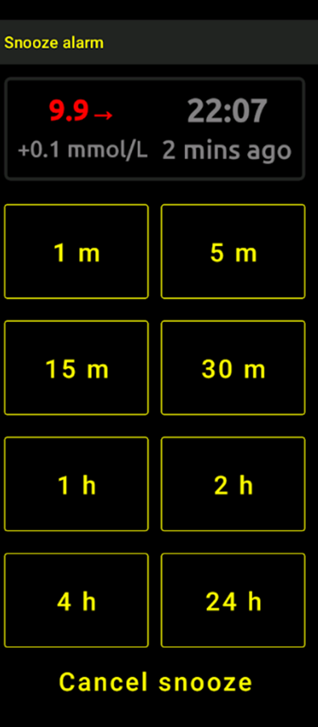
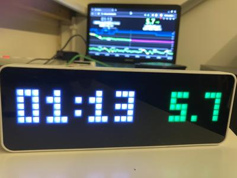

# Obserwowanie AAPS (bez interakcji z systemem AAPS)

Oprócz wielu możliwości zdalnego sterowania _i_ obserwowania **AAPS**, opisanych na stronie [Zdalne sterowanie AAPS](../RemoteFeatures/RemoteControl.md), społeczność stworzyła kilka dodatkowych aplikacji i urządzeń do prostego obserwowania wartości (poziomu glukozy i innych informacji) bez interakcji z **AAPS**.

Dobry przegląd wielu możliwości obserwowania **AAPS** znajdziesz na stronie [Nightscout follower](https://nightscout.github.io/nightscout/downloaders/#).

```{contents} Table of contents
:depth: 1
:local: true
```

Najczęstsze sposoby używane razem z **AAPS** są dokładniej opisane poniżej.

## Aplikacje na smartfony

```{contents} These are some of the main “follower” apps used by **AAPS** users. All of these apps are “free”: 
:depth: 1
:local: true
```

### Dexcom Follow ([Android](https://play.google.com/store/apps/details?id=com.dexcom.follow.region2.mgdl) i [iOS](https://apps.apple.com/fr/app/dexcom-follow-mg-dl-dxcm2/id1032203080))


* Dexcom Follow działa na wielu telefonach (Android i iPhone). Dexcom Follow możesz używać nawet wtedy, gdy nie korzystasz z oficjalnej aplikacji Dexcom do odbierania danych z sensora.

* Wielu opiekunów zna Dexcom Follow i woli jego przejrzysty wygląd od bardziej skomplikowanych rozwiązań.

* Dexcom Follow bardzo dobrze sprawdza się u nauczycieli, dziadków i osób, które mało wiedzą o cukrzycy i poziomie glukozy. Ma alarmy z własnymi ustawieniami (poziom BG, jaki dźwięk odtworzyć itp.). Alarmy można w razie potrzeby całkowicie wyłączyć. To bardzo przydatne, gdy sensor jeszcze się stabilizuje i pokazuje wiele fałszywych niskich wartości.

#### Konfiguracja Dexcom Follow: instrukcja

Jeśli do odbierania danych z sensora używasz nieoficjalnej aplikacji Dexcom BYODA, być może możesz wysyłać zaproszenia do obserwujących z poziomu aplikacji BYODA.

Z aplikacji innych firm nie możesz już wysyłać e-maili z zaproszeniem dla obserwujących Dexcom. W xDrip prośba o zaproszenie kończy się tylko komunikatem „invite not sent” (zaproszenie nie zostało wysłane).

Musisz zainstalować oficjalną aplikację Dexcom, wysłać zaproszenie, a potem odinstalować oficjalną aplikację.

Wykonaj te kroki:

1)  Zainstaluj oficjalną aplikację „Dexcom” na _dowolnym_ smartfonie (Android/iPhone). Może to być telefon obserwującego, jeśli tak jest wygodniej. 2)  Zaloguj się nazwą użytkownika i hasłem Dexcom. To te same dane logowania, których używasz w Dexcom Clarity, jeśli już jesteś klientem Dexcom/Clarity. Jeśli nie masz konta Dexcom, w tym miejscu możesz utworzyć nowe konto.   
3)  Przewiń ekrany wprowadzające. 4)  Jako kod sensora wybierz „no code” (bez kodu). 5)  W polu Transmitter SN wybierz „enter manually” (wpisz ręcznie) i wpisz dowolny prawidłowy numer nadajnika (użyj numeru jednego z Twoich zużytych nadajników, jeśli go znasz, aby nie zakłócać pracy obecnego nadajnika; numery mają określony format cyfr i liter: „NLNNNL” i tylko niektóre kombinacje są prawidłowe, więc najłatwiej użyć numeru, o którym wiesz, że jest prawidłowy). 6)  Gdy aplikacja szuka nadajnika i sensora, możesz zaprosić obserwujących: dotknij małych trzech kropek w lewym górnym rogu aplikacji i dodaj nowego obserwującego. Możesz to też wykorzystać, gdy jeden z obserwujących zmienił telefon i potrzebuje nowego zaproszenia: tutaj możesz usunąć go z listy obserwujących i wysłać nowy e-mail z zaproszeniem, którego użyje na nowym telefonie. 7)  Na telefonie obserwującego zainstaluj Dexcom Follow ze sklepu App Store (iPhone) lub Google Play (Android). Skonfiguruj aplikację Dexcom Follow. Aplikacja poprosi Cię o otwarcie poczty e-mail i znalezienie zaproszenia do obserwowania.    
8)  Teraz możesz usunąć oficjalną aplikację Dexcom G6.

W przypadku Dexcom Follow dane z sensora są wysyłane z telefonu z **AAPS** bezpośrednio z BYODA albo z xDrip, w zależności od tego, której aplikacji używasz.


### [Nightguard](https://apps.apple.com/fr/app/nightguard/id1116430352) (iOS)


Zalety (według użytkowników):

* Dostępny w [App Store](https://apps.apple.com/us/app/nightguard/id1116430352), prosty i łatwy w obsłudze interfejs.

* Przesuń przycisk lub potrząśnij telefonem, aby wyciszyć alarmy na czas od 5 min do 24 godz.

* Własne ustawienia alarmów (wysoka, niska wartość, brak odczytów, gdy nie ma danych przez 15–45 minut).

* Szybki wzrost/spadek przez 2–5 kolejnych odczytów (wybierasz sam). Można też wybrać deltę (różnicę) między dwoma pojedynczymi odczytami

* Inteligentne wyciszanie: brak alarmu, gdy poziom zmienia się we właściwym kierunku

* Jest zakładka Care, która pozwala ustawić nowy cel tymczasowy na określony czas, usunąć cel tymczasowy lub wpisać węglowodany.

Wady (według użytkowników)

* Dostępny tylko na iOS

* Cel tymczasowy (TT) jest pokazywany jako 5 mmol bez względu na ustawioną wartość TT

* Nigdy nie pokazuje dawki bazy tymczasowej, choć pokazuje TB

### [Nightwatch](https://play.google.com/store/apps/details?id=se.cornixit.nightwatch) (Android)




* Nightwatch przedstawia się jako klient Nightscout i monitoruje poziom glukozy użytkownika z Nightscout na telefonie lub tablecie z Androidem.

* Aplikację możesz pobrać z [Google Play](https://play.google.com/store/apps/details?id=se.cornixit.nightwatch). Pokazuje dane BG w czasie rzeczywistym.

* Użytkownik może dostawać głośne alarmy niskiej i wysokiej wartości z własnymi ustawieniami.

* Dane BG można oglądać w mmol/l lub mg/dl.

* Wymaga Androida 5.0 lub nowszego.

* It has a dark UI, large readings and buttons, designed for usage at night.

### xDrip (Android)

Możesz używać xDrip jako aplikacji obserwującej.

#### Z Nightscout

Ustaw xDrip jako Nightscout Follower (obserwujący Nightscout). Otrzymasz BG i leczenie, ale nie bazę.


#### Bez Nightscout – xDrip jako źródło danych BG

Jeśli źródłem danych **AAPS** jest xDrip (lub jeśli xDrip może też odbierać BG z innej aplikacji, np. BYODA, Juggluco...), możesz go użyć na telefonie pacjenta, aby udostępniać dane obserwującym w xDrip: BG, leczenie i dawki bazowe.


#### Bez Nightscout – xDrip jako aplikacja towarzysząca BG

Jeśli źródłem danych **AAPS** nie jest xDrip, ale xDrip może pokazywać dane BG ze źródła danych Companion App (aplikacja towarzysząca), możesz go użyć na telefonie pacjenta, aby udostępniać dane obserwującym w xDrip: BG, leczenie i dawki bazowe.


### xDrip4iOS (iOS)


xDripSwift powstał przez przeniesienie oryginalnej aplikacji xDrip na iOS i rozwinął się w „xDrip for iOS”, zapisywany jako **xDrip4iOS** .

```{admonition} Further detail about how to attempt to obtain the original **xDrip4iOS** app
:class: dropdown
[Grupa xDrip4iOS na Facebooku](https://www.facebook.com/groups/853994615056838/announcements) to główne miejsce wsparcia społeczności dla xDrip4iOS i Shuggah. **xDrip4iOS** może łączyć się z wieloma różnymi systemami CGM i nadajnikami, pokazywać wartości glukozy, wykresy i statystyki oraz dawać alarmy. Może też wysyłać dane do Nightscout lub działać jako [aplikacja obserwująca Nightscout](https://xdrip4ios.readthedocs.io/en/latest/connect/follower/). 

„Jak mogę zainstalować **xDrip4iOS** na moim iPhonie?”
Są dwie możliwości:

1. Jeśli masz komputer Mac i konto Apple Developer (99 EUR/USD rocznie), możesz sam zbudować xDrip4iOS [według instrukcji](https://xdrip4ios.readthedocs.io/en/latest/install/build/).

Jeśli chcesz, możesz potem zostać „releaserem” (osobą udostępniającą aplikację) i [udostępnić osobisty Testflight xDrip4iOS](https://xdrip4ios.readthedocs.io/en/latest/install/personal_testflight/) maksymalnie 100 innym osobom, aby im pomóc.

2. Dołącz do [grupy xDrip4iOS na Facebooku](https://www.facebook.com/groups/853994615056838/announcements) i przeczytaj przypięte posty, aby poznać aktualne sposoby zdobycia aplikacji. **Nie proś o zaproszenie do aplikacji** (przeczytaj zasady grupy).
```


„Co to jest **Shuggah**?” Grupa ukraińskich programistów skopiowała kod projektu xDrip4iOS (który jest publicznie dostępny na GitHub) i wydała go w App Store na koncie firmowym. Deweloperzy xDrip4iOS w żaden sposób nie zarządzają wydaniem Shuggah.

[Grupa xDrip4iOS na Facebooku](https://www.facebook.com/groups/853994615056838/announcements) wspiera xDrip4iOS i pasujące do niego aplikacje na Apple Watch.

### [Sugarmate](https://apps.apple.com/fr/app/sugarmate/id1111093108) (iOS)


[Sugarmate](https://sugarmate.io/) możesz pobrać na iPhone'a ze sklepu App Store. Sugarmate działa na:
* Apple iPhone (wymaga systemu w wersji 13.0 lub nowszej)
* Apple iPad (wymaga systemu w wersji 13.0 lub nowszej)
* Google Android (zapisz aplikację webową na ekranie głównym)

Użytkownicy Sugarmate zgłaszają, że w USA można go używać z Apple CarPlay, aby wyświetlać wartości glukozy podczas jazdy. Nie wiadomo jeszcze, czy jest to możliwe w krajach poza USA. Jeśli wiesz o tym więcej, dodaj szczegóły do dokumentacji, tworząc pull request (link). To szybkie i proste.


### [Spike](https://spike-app.com/) (iOS)


Spike może działać jako główny odbiornik lub jako aplikacja obserwująca. Pokazuje BG, alarmy, IOB i więcej.

Strona i aplikacja nie są już rozwijane. Pomoc znajdziesz na [Facebooku](https://www.facebook.com/groups/1973791946274873) i na [Gitterze](https://gitter.im/SpikeiOS/Lobby).

## Smartwatche do **monitorowania AAPS** (pełne dane profilu lub tylko glukoza), gdy **AAPS** działa na telefonie.

Zobacz [tutaj](../Getting-Started/Watches.md).


## Urządzenia do obserwowania AAPS

```{contents} Devices include:
:depth: 1
:local: true
```

### M5 stack


M5Stack to małe urządzenie, które można zaprogramować do wielu zastosowań. Projekt Martina [M5Stack NightscoutMon](https://github.com/mlukasek/M5_NightscoutMon/wiki) pokazuje wartości glukozy z sensora i trendy, IOB i COB. Jest w plastikowej obudowie, ma kolorowy wyświetlacz, gniazdo karty micro SD, 3 przyciski, głośnik i wbudowaną baterię. To świetny monitor poziomu glukozy i jest dość łatwy w konfiguracji, jeśli masz konto Nightscout. Użytkownicy zwykle używają go w domowej sieci Wi-Fi, ale niektórzy używają go jako wyświetlacza podczas jazdy motocyklem, łącząc go z hotspotem Wi-Fi w telefonie.

### Sugarpixel

SugarPixel to urządzenie do dodatkowego wyświetlania wartości glukozy i alarmów z systemu ciągłego monitorowania glukozy. Łączy się z aplikacją Dexcom lub z Nightscout na smartfonie użytkownika. Urządzenie pokazuje wartości glukozy w czasie rzeczywistym. Ten monitor CGM ma bardzo głośne alarmy dźwiękowe z losowymi tonami, alarmy wibracyjne dla osób niedosłyszących, własne ustawienia wyświetlania i wbudowane obserwowanie przez wielu użytkowników.


* SugarPixel ma wiele opcji wyświetlania w mg/dl i mmol/l, dopasowanych do potrzeb użytkownika, z wartościami glukozy oznaczonymi kolorami.
* Standardowa tarcza pokazuje BG, strzałkę trendu i deltę. Delta to zmiana (+ lub -) od ostatniego odczytu.
* SugarPixel można ustawić do używania przy słabym oświetleniu z tarczą BG and Time, aby widzieć wartość BG i aktualną godzinę na stoliku nocnym.
* Tarcza kolorów SugarPixel używa całego wyświetlacza, aby pokazać jeden kolor oznaczający wartość BG. Dzięki temu użytkownik widzi wartości BG z daleka przez okno, gdy bawi się na dworze w ogrodzie, na tarasie lub w basenie.
* Tarcza Big BG jest przydatna dla osób, które trzymają urządzenie na stoliku nocnym i noszą okulary lub soczewki kontaktowe.

### Nightscout Clock na Ulanzi TC001

**Nightscout Clock** to oprogramowanie open source działające na urządzeniu **Ulanzi TC001**. Łączy się z serwerami Dexcom lub z Nightscout i pokazuje wartości glukozy w czasie rzeczywistym.



* Zegar obsługuje jednostki mmol/l i mg/dl oraz ma alarmy dźwiękowe.
* Several displays are available, see [Github nightscout-clock](https://github.com/ktomy/nightscout-clock?tab=readme-ov-file#more-information-for-people-who-needs-it) for an overview.
* Konfiguracja urządzenia wymaga tylko kilku prostych kroków. Po konfiguracji potrzebuje do działania tylko zasilania i Wi-Fi.
* Urządzenie Ulanzi TC001 jest dużo tańsze niż SugarPixel.
* Oprogramowanie i instrukcję instalacji znajdziesz na [GitHub nightscout-clock](https://github.com/ktomy/nightscout-clock?tab=readme-ov-file).
* Rozwija je i utrzymuje Artiom Kenibasov, który udziela pomocy w [grupie Facebook AAPS Users](https://www.facebook.com/groups/cgminthecloud/posts/8776932509094594/).

### PC (TeamViewer)
Niektórym użytkownikom przy zaawansowanym zdalnym rozwiązywaniu problemów pomaga narzędzie do pełnego zdalnego dostępu, takie jak [TeamViewer](https://www.teamviewer.com/).
