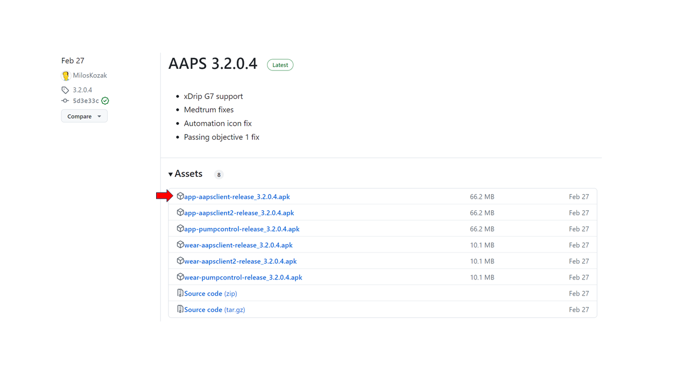

# Zdalne sterowanie AAPS

```{contents} In this page
:backlinks: entry
:depth: 2
```

Są cztery bardzo skuteczne narzędzia do zdalnego zarządzania **AAPS**:

1) [Polecenia SMS](#RemoteControl_SMS-Commands) (telefon opiekuna może mieć Androida lub iOS), 2) [AAPSClient](#RemoteControl_aapsclient) (telefon opiekuna z Androidem; wersja na iPhone'a jest w przygotowaniu) 3) [Nightscout](#RemoteControl_nightscout) (Android, iOS lub inny komputer/urządzenie), głównie do obserwowania: zobacz uwagę o [sterowaniu z urządzenia opiekuna](#client-master-control) w tej sekcji.  
4) [Smartwatche](#RemoteControl_smartwatches) (Android)

Pierwsze trzy są przydatne głównie dla opiekunów/rodziców, ale smartwatche są bardzo przydatne dla opiekunów/rodziców **i** dla dorosłych z cukrzycą.


(RemoteControl_SMS-Commands)=

## 1) Polecenia SMS

Zobacz osobną stronę [Polecenia SMS](../RemoteFeatures/SMSCommands.md).

(RemoteControl_aapsclient)=
## 2) AAPSClient

**AAPSClient** wygląda bardzo podobnie do samego **AAPS**. Daje opiekunowi te same ekrany i przyciski do zdalnego wysyłania poleceń do **AAPS**:


(remotecontrol-aapsclient-versions)=
### O AAPSClient, AAPSClient2 i AAPSClient3

Są 3 wersje aplikacji opiekuna: **AAPSClient**, **AAPSClient2** i **AAPSClient3**. Działają tak samo. Jedyna różnica jest taka, że można je zainstalować obok siebie na tym samym telefonie opiekuna.

Opiekun, który obserwuje jedną osobę, potrzebuje tylko **AAPSClient**. Aby obserwować i zdalnie sterować drugą osobą (z własną stroną **Nightscout** i własnym telefonem z **AAPS**), zainstaluj też **AAPSClient2**, a dla trzeciej osoby **AAPSClient3**. Każdą aplikację konfigurujesz i [parujesz](#aapsclient-pairing-with-the-master) osobno, ze stroną **Nightscout** i telefonem z **AAPS** osoby, którą obserwuje.

Aby łatwo odróżnić aplikacje, niektóre elementy mają inny kolor: żółty dla **AAPSClient**, niebieski dla **AAPSClient2** i zielony dla **AAPSClient3**. Te elementy to ikona aplikacji, tło widżetu i sekcja stanu **AAPS** na ekranie głównym aplikacji. <br/> Uwaga: przezroczystość tła widżetu możesz ustawić w konfiguracji widżetu. Przy dużej przezroczystości kolor jest słabo widoczny.


### Pobieranie i instalacja

**AAPSClient** możesz zainstalować na jednym lub kilku telefonach opiekunów (np. na telefonie rodzica 1 i telefonie rodzica 2), aby obaj opiekunowie mieli dostęp i mogli zdalnie sterować telefonem pacjenta z **AAPS**.

Aby pobrać **AAPSClient**, przejdź do [repozytorium GitHub](https://github.com/nightscout/AndroidAPS/releases/) i kliknij plik **„app-AAPSClient-release_x.x.x.x”** (może to być nowsza wersja niż na zrzucie ekranu poniżej):



Następnie przejdź do folderu _pobrane_ na komputerze. On Windows, _downloads_ will show in the right hand ribbon:


Po pobraniu kliknij _pokaż w folderze_ (show in folder), aby znaleźć plik.

Plik apk **AAPSClient** może teraz zostać:

przeniesiony kablem USB na telefon opiekuna lub przeciągnięty do folderu na Dysku Google, a potem dodany na telefonie opiekuna przez dotknięcie pliku „app-AAPSClient-release”.

Jeśli potrzebujesz **AAPS** dla siebie i **AAPSClient** do monitorowania innej osoby, musisz sam zbudować **AAPSClient** zamiast pobierać go z repozytorium GitHub, jak opisano powyżej. Powodem jest to, że na jednym telefonie nie możesz zainstalować **AAPS** i **AAPSClient** podpisanych różnymi kluczami. <br/> Aby samodzielnie zbudować **AAPSClient**, postępuj tak samo jak przy [zwykłym budowaniu AAPS](../SettingUpAaps/BuildingAaps.md). Na stronie **Generate signed App Bundle or APK** wybierz **aapsclientRelease** zamiast **fullRelease**.

Ta sama zasada obowiązuje, gdy instalujesz kilka aplikacji opiekuna (**AAPSClient**, **AAPSClient2**, **AAPSClient3**) na jednym telefonie opiekuna: wszystkie muszą być podpisane **tym samym kluczem**. W przeciwnym razie Android nie zainstaluje drugiej z nich (błąd `INSTALL_FAILED_DUPLICATE_PERMISSION`).

### Synchronizacja: konfiguracja AAPSClient i AAPS

Once the __AAPSClient__ apk is installed on the follower phone, make sure **NSClientV3** is set up the same way on both phones for Nightscout 15 (see the [update notes](../Maintenance/UpdateToNewVersion.md)). Poniższy przykład pokazuje konfigurację synchronizacji z NSClientV3 i Nightscout 15. W __AAPS__ dostępne są też inne źródła danych (np. xDrip).

W **Konfiguracja** > **Komunikacja** użytkownik synchronizuje swoje dane z Nightscout przez __NSClientV3__ (używając API v3), ustawiony tak samo w __AAPS__ i na telefonie opiekuna.


Użytkownik musi zadbać, aby telefony z AAPS i z AAPSClient były __oba__ zsynchronizowane, ustawiając NSClientV3 na każdym z nich. Na telefonie opiekuna możesz to zrobić zamiast tego, skanując kod QR pokazany przez **AAPS**, zobacz [Parowanie AAPSClient z AAPS](#remotecontrol-pairing) poniżej:

- Wpisz **Adres URL strony Nightscout** w **Ustawieniach** NSClientV3

- Wpisz **Token dostępu do Nightscout** w tych samych ustawieniach. Postępuj zgodnie z instrukcjami [tutaj](https://nightscout.github.io/nightscout/security/#create-a-token). Na telefonie z **AAPS** użyj **tokenu administratora (admin)**: dzięki niemu **AAPS** tworzy osobny token dla każdego telefonu opiekuna.

- Włącz **Użyj websockets** na **obu** telefonach. Na telefonie z **AAPS** websockets są **wymagane** do zdalnego sterowania: bez nich **AAPS** nie może odbierać poleceń z **AAPSClient**. Na obu telefonach przyspieszają też synchronizację, kosztem nieco większego zużycia baterii.


Upewnij się, że __AAPSClient__ i __AAPS__ pokazują stan „połączono” (connected) na ekranie **NSClientV3** każdego telefonu. Teraz **AAPSClient** obserwuje **AAPS** (BG, leczenie, profil), ale nie może nim jeszcze sterować: sparuj oba telefony, jak opisano poniżej.

(remotecontrol-pairing)=
### Parowanie AAPSClient z AAPS (zdalne sterowanie)

Od wersji 4 **AAPS** **AAPSClient** steruje **AAPS** przez bezpieczne, **sparowane** połączenie. Sama synchronizacja nie wystarczy: dopóki telefony nie są sparowane, **AAPSClient** pokazuje tylko **Zarządzaj** z **Profilem** tylko do odczytu i **Sparuj z telefonem pacjenta**.

1. Na telefonie z **AAPS** otwórz **Zarządzaj → Autoryzowani opiekunowie** i włącz **Zezwalaj na sterowanie z urządzenia opiekuna** (domyślnie wyłączone, w Trybie uproszczonym zawsze włączone).
2. Dotknij **+**, wpisz nazwę telefonu opiekuna, wybierz sposób konfiguracji i jego **rolę**:
   - **Kod QR: Nightscout i parowanie** — **AAPS** pokazuje kod QR, który jednym skanem konfiguruje Nightscout na telefonie opiekuna i paruje go. Wymaga to tokenu administratora (admin) w ustawieniach NSClientV3 na telefonie z **AAPS**.
   - **PIN** — dla telefonu opiekuna bez aparatu, już połączonego z Nightscout: zapisz jednorazowy **PIN** (ważny około dwóch minut).
3. Na telefonie z **AAPSClient** zeskanuj kod (w Kreatorze konfiguracji lub w **Zarządzaj → Sparuj z telefonem pacjenta → Skanuj kod QR**) albo otwórz **Zarządzaj → Sparuj z telefonem pacjenta** i wpisz PIN. Potwierdź.

Telefon opiekuna pojawia się wtedy jako **Aktywny** na liście **Autoryzowani opiekunowie**, a **AAPSClient** pokazuje **Leczenie**, **Sceny** i **Zarządzaj**. Telefon opiekuna dostaje własny token Nightscout, tylko z potrzebnymi uprawnieniami. Pełna procedura ze zrzutami ekranu i rozwiązywaniem problemów jest na stronie [Sterowanie Master ↔ Client](#client_master_master_setup).

Sprawdź, czy konfiguracja działa: wpisz węglowodany w **AAPSClient**, potwierdź pokazaną ilość i sprawdź, czy wpis pojawia się w **Leczeniu** na obu telefonach.

(remotecontrol-nightscout-access-token)=

### Rozwiązywanie problemów z konfiguracją „Token dostępu do Nightscout”

Dokładna konfiguracja „Tokenu dostępu do Nightscout” może się różnić w zależności od tego, czy Twój Nightscout jest płatną usługą hostowaną, czy nie.

Jeśli **AAPS** nie chce przyjąć „Tokenu dostępu do Nightscout”, a używasz płatnej usługi hostowanej Nightscout, najpierw skontaktuj się ze swoim dostawcą Nightscout, aby rozwiązać problem z tokenem. W przeciwnym razie zwróć się do grupy **AAPS**, ale wcześniej sprawdź jeszcze raz, czy dobrze wykonałeś instrukcje [tutaj](https://nightscout.github.io/nightscout/security/#create-a-token).

### Co oferuje AAPSClient

Po sparowaniu **AAPSClient** daje opiekunowi prawie te same ekrany co sam **AAPS**:

- **Leczenie**: bolus insuliny, węglowodany i kalkulator bolusa.
- **Sceny**: uruchamianie i zatrzymywanie [scen](../DailyLifeWithAaps/Scenes.md).
- **Zarządzaj**: profile, ustawienia insuliny, cele tymczasowe, Szybki kalkulator, automatyzacja, żywność, rotacja miejsc wkłucia, parowanie i aktualna baza tymczasowa.
- **Menu główne**: historia leczenia, przeglądarka historii, statystyki, konserwacja, konfiguracja.

W **AAPSClient** nie ma pompy ani zadań. Szczegółowy opis znajdziesz na stronie [Aplikacja AAPSClient](AapsClient.md).

**AAPSClient** pozwala opiekunowi zdalnie, przez sieć komórkową lub internet, wprowadzać większość zmian, które można zrobić bezpośrednio w **AAPS**, **w tym bolusy insuliny**. Każde polecenie jest podpisane i wysłane przez Nightscout do telefonu z **AAPS**. Telefon sprawdza je z własnymi danymi, ogranicza do limitów, pokazuje własne potwierdzenie i dopiero wtedy je wykonuje. **AAPSClient** _może_ działać dużo szybciej niż [Polecenia SMS](../RemoteFeatures/SMSCommands.md), szczególnie przy poleceniach, które wymagałyby uwierzytelnienia.

Leczenie wpisane w Nightscout w inny sposób (np. na stronie Nightscout) nie jest stosowane, gdy sterowanie z urządzenia opiekuna jest włączone: **AAPS** jest wtedy w [trybie silniejszych zabezpieczeń](#client-master-control-hardened-mode) i przyjmuje zmiany tylko od sparowanych opiekunów. Gdy sterowanie z urządzenia opiekuna jest wyłączone, są one stosowane tylko wtedy, gdy odpowiednie opcje **Odbieraj** są włączone w [sekcji Synchronizacja w ustawieniach NSClient](#Preferences-nsclient-synchronization).

Zdalne sterowanie przez **AAPSClient** jest zalecane tylko wtedy, gdy synchronizacja działa dobrze (_tzn._ nie widzisz niechcianych zmian danych, np. samoczynnych zmian TT, TBR itd.).

### AAPSClient z opcjami smartwatcha

Smartwatch może bardzo pomóc w zarządzaniu **AAPS** u dzieci. Możliwych jest kilka różnych konfiguracji. Jeśli **AAPSClient** jest zainstalowany na telefonie opiekuna, aplikację [**AAPSClient WearOS**](https://github.com/nightscout/AndroidAPS/releases/) możesz pobrać i zainstalować na zgodnym smartwatchu połączonym z telefonem rodzica. Pokazuje aktualną BG i stan pętli. Gdy **AAPSClient** jest sparowany z **AAPS**, akcje z zegarka (w tym bolusy, węglowodany, cele tymczasowe i zmiany profilu) są przekazywane przez **AAPSClient** do **AAPS**, który je potwierdza i wykonuje: zobacz [Wear OS na urządzeniu opiekuna](#clientmastercontrol-wear-os-on-a-client). Więcej o smartwatchach przeczytasz [tutaj](#remotecontrol-smartwatches).

(RemoteControl_nightscout)=
## 3) Nightscout

Nightscout to serwer w „chmurze”, ale jest też osobna aplikacja **Nightscout**, którą możesz pobrać bezpośrednio z App Store na iPhone'a. Jeśli telefon opiekuna ma Androida, nie ma osobnej aplikacji Nightscout. Lepiej wtedy użyć [**AAPSClient**](#2-aapsclient), a jeśli chcesz tylko obserwować bez wysyłania leczenia, możesz pobrać i zainstalować aplikację [Nightwatch](https://play.google.com/store/apps/details?id=se.cornixit.nightwatch) ze sklepu Google Play.

Po zainstalowaniu aplikacji **Nightscout** na iPhonie otwórz ją i postępuj zgodnie z poleceniami konfiguracji. Wpisz adres swojej strony Nightscout (patrz poniżej, po lewej). Format adresu może się różnić w zależności od tego, gdzie jest hostowany Twój Nightscout. (_np._ http://youraddresshere.herokuapp.com). Następnie wpisz swój API secret Nightscout (patrz poniżej, po prawej). Jeśli aplikacja nie poprosi o hasło API, wpisz je, dotykając kłódki u góry aplikacji:


Więcej informacji o konfiguracji znajdziesz bezpośrednio na stronie [Nightscout](https://nightscout.github.io/nightscout/discover/)

Po pierwszym zalogowaniu ekran jest bardzo prosty. Dostosuj opcje wyświetlania: wybierz menu „hamburger” w prawym górnym rogu i przewiń w dół:


Przewiń w dół do „Settings” (ustawienia). Możesz zmienić „scale” (skala) na „linear” (liniowa), bo domyślnie wykres BG jest logarytmiczny. W „render basal” wybierz „default”, aby pokazywać bazę z pompy.


Wybierz potrzebne opcje. Odznacz alarmy, jeśli do alarmów używasz innej aplikacji.


Przewijaj dalej w dół do „show plugins” (pokaż wtyczki).

Upewnij się, że „careportal” jest zaznaczony. Możesz też wybrać różne inne wartości (najbardziej przydatne to: IOB, care portal, pump, cannula age, insulin age, basal profile i OpenAPS).

Ważne: teraz musisz dotknąć „save” (zapisz) na dole, aby zmiany zaczęły działać.


Po dotknięciu „save” aplikacja wróci do głównego ekranu Nightscout, który wygląda mniej więcej tak:

1. Aktualna wartość glukozy
2. Informacje o stanie systemu AAPS – dotknij poszczególnych zakładek na ekranie, aby zobaczyć więcej szczegółów. Dodaj lub usuń te opcje wyświetlania w menu hamburger.
3. Ostatni przebieg glukozy z leczeniem (węglowodany, bolusy)
4. Przebieg glukozy z dłuższego czasu
5. Menu „hamburger” do ustawiania opcji wyświetlania, tworzenia raportów, edycji profili i narzędzi administracyjnych Nightscout
6. Menu „**+**” do wpisywania leczenia (zobacz [poniżej](#RemoteControl_nightscout-treatments), kiedy **AAPS** je stosuje).
7. Wybierz inny okres do wyświetlenia
8. Profil insuliny bazowej
9. Zielona linia = wcześniejsze wartości glukozy Niebieskie linie = prognoza glukozy


Bardziej szczegółowy opis menu w lewym górnym rogu aplikacji Nightscout:

1. Careportal – późniejsza edycja wpisów
2. Włączanie/wyłączanie alarmów
3. Hamburger – do ustawiania preferencji
4. Careportal – zapis leczenia (zobacz [poniżej](#RemoteControl_nightscout-treatments), kiedy **AAPS** je stosuje)


Na tym ekranie, w szarych zakładkach, jest bardzo dużo informacji o stanie systemu **AAPS** (a jeszcze więcej po dotknięciu zakładki):

1. Trend glukozy z 5 min
2. Podgląd kalkulatora bolusa (Bolus wizard preview)
3. Dotknij Basal, aby zobaczyć aktualny profil i informacje o bazie
4. Czas od ostatniego odczytu CGM w AAPS
5. **Pompa**: insulina, bateria (%) i kiedy AAPS ostatnio się z nią połączył
6. Ostatnie odświeżenie AAPS – jeśli było ponad 5 min temu, może to oznaczać problem z połączeniem między telefonem z AAPS a pompą/CGM
7. Dotknij IOB, aby zobaczyć podział na insulinę bazową i z bolusów
8. Wiek insuliny w zbiorniku
9. Wiek wkłucia
10. Stan baterii telefonu z AAPS
11. Rozmiar Twojej bazy danych. Jeśli baza za bardzo się zapełni (dotyczy tylko własnego Nightscout DIY – w usługach hostowanych możesz to zignorować), mogą pojawić się problemy z połączeniem. Aby zmniejszyć tę liczbę, możesz usunąć dane w menu Admin tools (przez hamburger).


Dotknij „refresh” (odśwież) na dole strony, aby zamknąć okienko.

(RemoteControl_nightscout-treatments)=
### Wysyłanie leczenia przez aplikację Nightscout do AAPS

W **AAPS** 4 wspieranym sposobem zdalnego sterowania **AAPS** jest **sparowany AAPSClient**, zobacz [Sterowanie Master ↔ Client](#client-master-control): każdy opiekun ma [rolę](#client-master-control-roles), która ogranicza, co może robić, a każde polecenie jest podpisane, sprawdzone i potwierdzone przez telefon z **AAPS**. Gdy sterowanie z urządzenia opiekuna jest włączone, telefon z **AAPS** jest w [trybie silniejszych zabezpieczeń](#client-master-control-hardened-mode): leczenie, cele tymczasowe i zmiany profilu wpisane na stronie Nightscout lub w aplikacji Nightscout **nie** są stosowane. Aplikacja Nightscout służy wtedy tylko do obserwowania.

```{admonition} Only when client control is off
:class: warning
Jeśli **Zezwalaj na sterowanie z urządzenia opiekuna** jest wyłączone w **Zarządzaj → Autoryzowani opiekunowie** (i Tryb uproszczony jest wyłączony), **AAPS** stosuje wpisy careportal z Nightscout tylko dla tych typów danych, które włączyłeś w opcjach **Odbieraj** w [sekcji Synchronizacja w ustawieniach NSClientV3](#Preferences-nsclient-synchronization): węglowodany, cele tymczasowe, zmiany profilu i inne wpisy careportal. Insulina nigdy nie jest podawana w ten sposób: „Bolus korekcyjny” wpisany w Nightscout jest tylko *ogłoszony*, a **AAPS** liczy go jako aktywną insulinę (IOB), ale go nie podaje. Ta konfiguracja nie jest zalecana do zdalnego sterowania; użyj zamiast niej sparowanego **AAPSClient**.
```

Więcej o opcjach **Nightscout** przeczytasz [tutaj](https://nightscout.github.io/)

### Wskazówki, jak najlepiej korzystać z aplikacji Nightscout

1). Jeśli „utkniesz” na jakiejś stronie i chcesz wrócić do ekranu głównego, dotknij „refresh” (odśwież, na dole pośrodku). Wrócisz na stronę główną **Nightscout** z wykresem BG.

Aby zobaczyć aktualny profil działający na telefonie, dotykaj różnych ikon na ekranie nad wykresem. Więcej informacji (aktualny współczynnik insulina/węglowodany (IC), wrażliwość, strefa czasowa itd.) zobaczysz po dotknięciu „basal”. „OpenAPS” pokazuje informacje o profilu, aktualnym celu itd. Możesz też monitorować poziom baterii (%) telefonu i pompy. BWP pokazuje, co według algorytmu stanie się w przyszłości przy obecnym IOB i COB.

#### Inne ikony w menu: co oznacza ołówek (edycja)?

Ołówkiem edycji możesz (technicznie) przesunąć lub usunąć bolusy lub korekty z ostatnich 48 godz.

Więcej o tym [tutaj](https://nightscout.github.io/nightscout/discover/#edit-mode-edit)

Może to być przydatne do usuwania ogłoszonych węglowodanów (bez podanego bolusa), ale w praktyce obecnie nie działa to dobrze z **AAPS**. Zalecamy wprowadzać takie zmiany bezpośrednio w aplikacji **AAPS**.

(RemoteControl_smartwatches)= (remotecontrol-smartwatches)=

## 4) Smartwatche

### Opcja 1) Sterowanie AAPS ze smartwatcha z Wear OS


Gdy już [skonfigurujesz **AAPS** na zegarku](../WearOS/BuildingAapsWearOS.md), szczegółowy opis tarcz smartwatcha i ich funkcji znajdziesz na stronie [Smartwatch z Wear OS](../WearOS/WearOsSmartwatch.md).

W skrócie, ze smartwatcha możesz uruchomić te funkcje:

* ustawić cel tymczasowy

* użyć kalkulatora bolusa (parametry obliczeń możesz ustawić w ustawieniach na telefonie)

* podać eCarbs

* podać bolus (insulina + węglowodany)

* ustawienia zegarka

* stan

* sprawdzić stan pompy

* sprawdzić stan pętli

* sprawdzić i zmienić profil, CPP (Circadian Percentage Profile = przesunięcie czasu + procent)

* pokazać TDD (całkowita dawka dobowa = bolus + baza na dobę)

* Zdalny bolus, gdy opiekun i dziecko z cukrzycą typu 1 są w różnych miejscach (jest to możliwe dla zegarka z **AAPS** i telefonu z **AAPS**, jeśli oba urządzenia są połączone z siecią)

#### Komunikacja opiekunów z zegarkiem przez inne aplikacje (np. WhatsApp)

Na zegarek można dodać inne aplikacje, np. WhatsApp, do wysyłania wiadomości (na przykład) między opiekunami i dziećmi. Ważne: z telefonem może być powiązane tylko JEDNO konto Google, w przeciwnym razie zegarek nie przeniesie tych danych. Konto Samsung może mieć tylko osoba w wieku 13 lat lub starsza. Konto musi używać tego samego adresu e-mail, który jest używany na telefonie z Androidem.

Film o konfiguracji WhatsApp do wysyłania wiadomości na zegarku Galaxy 4 (WhatsApp nie działa tam w pełni) znajdziesz [tutaj](https://gorilla-fitnesswatches.com/how-to-get-whatsapp-on-galaxy-watch-4/)

Zmiany ustawień w aplikacji **Galaxy wearable** na telefonie z **AAPS** i na zegarku sprawiają, że wiadomości WhatsApp są sygnalizowane lekką wibracją i wyświetlają się na aktualnej tarczy zegarka.

### Opcja 2) **AAPS** na zegarku do zdalnego sterowania **AAPS** na telefonie

Podobnie jak telefonu opiekuna z **AAPSClient** lub poleceń SMS (zobacz sekcje powyżej), smartwatcha można używać do zdalnego sterowania **AAPS** i pokazywania pełnych danych profilu. Ważna różnica w porównaniu z telefonem opiekuna: smartwatch łączy się z telefonem z **AAPS** przez Bluetooth i nie potrzebuje ani Nightscout, ani kodu uwierzytelniającego. Dodatkowo, jeśli smartwatch i telefon z **AAPS** połączone przez Bluetooth są też w sieci Wi-Fi/komórkowej, zegarek będzie się komunikował z telefonem z **AAPS** także przez sieć, co daje większy zasięg. Obejmuje to zdalne podanie bolusa, gdy opiekun z zegarkiem z **AAPS** i dziecko z cukrzycą typu 1 (z telefonem z **AAPS**) są w różnych miejscach. Może to być przydatne, gdy dziecko jest w szkole.

Smartwatch do zdalnego sterowania jest więc często przydatny w każdej sytuacji, w której:

a)  polecenia **AAPSClient** lub **SMS** nie mogą działać; lub

b)  użytkownik nie chce wpisywać kodu uwierzytelniającego (wymaganego przy poleceniach SMS).

Smartwatch potrzebuje **Wear OS 3 lub nowszego**, aby móc sterować **AAPS**. Sprawdź specyfikację techniczną zegarka i zobacz stronę [Smartwatche i AAPS](../Getting-Started/Watches.md). Jeśli nie masz pewności, poszukaj informacji lub zapytaj w grupach **AAPS**  na Facebooku/Discordzie.

Specific How-to guides for setting up **AAPS** on the popular Samsung Galaxy Watch 4 (40mm) are given below. Popularnym wyborem jest też zegarek [Garmin](https://apps.garmin.com/en-US/apps/a2eebcac-d18a-4227-a143-cd333cf89b55?fbclid=IwAR0k3w3oes-OHgFdPO-cGCuTSIpqFJejHG-klBTm_rmyEJo6gdArw8Nl4Zc#0). Jeśli masz doświadczenie z konfiguracją innego smartwatcha i uważasz, że przyda się innym, dodaj je do tych stron ([edytuj dokumentację](../SupportingAaps/HowToEditTheDocs.md)), aby podzielić się wiedzą z całą społecznością **AAPS**.

### Opcja 3) AAPSClient na zegarku do zdalnego sterowania **AAPS** na telefonie


Oprogramowanie na zegarek, **AAPSClient** Wear apk, możesz pobrać bezpośrednio z [GitHub](https://github.com/nightscout/AndroidAPS/releases/).

Aby pobrać oprogramowanie, kliknij aplikację na zegarek, która pasuje do aplikacji opiekuna na telefonie: **wear-aapsclient-release_**_wersja_ pasuje do **AAPSClient**, **wear-aapsclient2-release_**_wersja_ pasuje do **AAPSClient2** (zobacz [O AAPSClient, AAPSClient2 i AAPSClient3](#remotecontrol-aapsclient-versions)):


Następnie wybierz „save as” (zapisz jako) i zapisz plik w wygodnym miejscu na komputerze:


Plik **AAPSClient** wear apk możesz przenieść na telefon i zainstalować na zegarku ręcznie (side-load) tak samo jak aplikację **AAPS** Wear, jak opisano w [Przenoszenie aplikacji Wear na telefon z AAPS](#remote-control-transferring-the-aaps-wear-app-onto-your-aaps-phone)  


