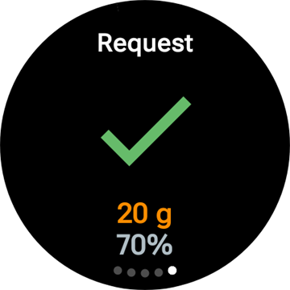
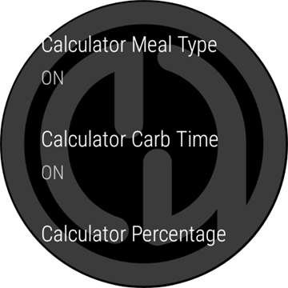
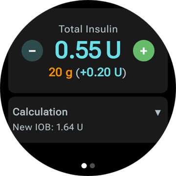
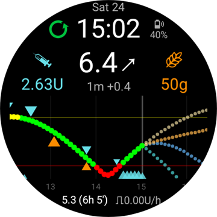
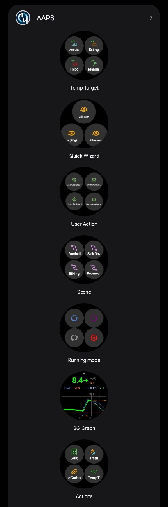
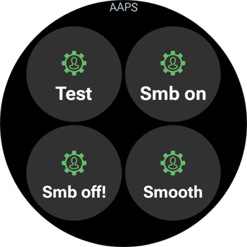

# Obsługa AAPS ze smartwatcha z Wear OS

(Watchfaces-aaps-watchfaces)=

## Tarcze zegarka AAPS

```{warning}
Klasyczne tarcze zegarka **AAPS** działają tylko na Wear OS 5 i starszych, a Wear OS 5 już je ogranicza. Na **Wear OS 6 i nowszych** aplikacja na zegarek instaluje zamiast nich jedną tarczę w formacie Google Watch Face Format: Twoją własną tarczę jako obraz albo **Tarczę z komplikacjami**. Zobacz [Zmiany tarcz zegarka w Wear OS](#wearos-watchface-changes), aby dowiedzieć się, co przestaje działać w każdej wersji Wear OS, oraz [tarcza instalowana przez AAPS](#wearos-aaps-v4-watchface) dla Wear OS 6.
```

Na Wear OS 5 i starszych w aplikacji **AAPS** na zegarek jest kilka wbudowanych klasycznych tarcz. Pokazują glikemię z deltą, IOB, aktywną dawkę bazową i wykres odczytów. Działają na nich dwa dotknięcia:

* Dotknij dwukrotnie wartości glikemii, aby otworzyć menu główne **AAPS**
* Dotknij dwukrotnie wykresu, aby zmienić jego zakres czasu

W każdej wersji Wear OS [komplikacje](#Watchfaces-complications) i [kafelki](#WearOsSmartwatch-wear-os-tiles) opisane na tej stronie działają z każdą tarczą zegarka, która ma na nie miejsce.

## Konfiguracja

Włącz **Oprogramowanie Wear (Smartwatch)** w [**Konfiguracja** > **Komunikacja**](#Config-Builder-wear).

Aby podawać bolus lub wykonywać inne akcje z zegarka, włącz **Sterowanie z zegarka**. Opcje kalkulatora bolusa dla zegarka ustawisz w tym samym miejscu: zobacz [Ustawienia > Wear](#preferences-wear). Gdy **Sterowanie z zegarka** jest wyłączone, telefon odrzuca każde leczenie i każdą zmianę trybu wysłaną z zegarka, a zegarek pokazuje komunikat *„Sterowanie Wear jest wyłączone w ustawieniach Wear w telefonie.”*

Przyciskiem **Otwórz wtyczkę** na karcie **Oprogramowanie Wear (Smartwatch)** otworzysz ekran Wear:


Górna linia pokazuje nazwę połączonego zegarka albo **(Brak połączonego zegarka)**. Na tym ekranie możesz

* Prześlij ponownie wszystkie dane. Może się przydać, gdy zegarek nie był połączony przez jakiś czas i chcesz wysłać dane na zegarek.
* Otwórz ustawienia zegarka bezpośrednio z telefonu.
* Wybrać, którą tarczę **AAPS** instaluje na zegarku (**Tarcza zainstalowana na zegarku**: Twoja własna tarcza albo tarcza z komplikacjami). Ta karta jest widoczna tylko wtedy, gdy połączony jest zegarek z **Wear OS 6** lub nowszym. Zobacz [tarcza instalowana przez AAPS](#wearos-aaps-v4-watchface).
* Zarządzać **Własną tarczą** (karta jest widoczna, gdy zegarek jest połączony): **Załaduj Tarczę** wysyła własną tarczę na zegarek, **O tarczy** pokazuje szczegóły załadowanej tarczy i pola, które zawiera, **Więcej tarcz zegarka** otwiera [stronę wymiany](../ExchangeSiteCustomWatchfaces/index.md) w przeglądarce, a **Eksportuj szablon** zapisuje szablon, który możesz edytować. Podgląd załadowanej tarczy jest pokazany pod przyciskami. Zobacz [Zmiana na tarczę AAPS](#WearOS_changing-to-AAPS-watchface).

Upewnij się, że powiadomienia z AAPS nie są zablokowane na zegarku. Potwierdzenie akcji (np. bolusa, celu tymczasowego) przychodzi jako powiadomienie, które musisz przesunąć i zatwierdzić znacznikiem.

## Otwieranie menu głównego AAPS


Aby otworzyć menu główne **AAPS**, użyj jednego z tych sposobów:

* otwórz **AAPS** z listy aplikacji na zegarku
* dotknij komplikacji **AAPS**, która otwiera menu, zobacz [Ustawienia komplikacji](#WearOsSmartwatch-complication-settings)
* dotknij kafelka **Wykres glikemii**, gdy jego **Akcja po dotknięciu** jest ustawiona na **Menu główne**, zobacz [Ustawienia kafelka](#WearOsSmartwatch-wear-os-tiles)
* na klasycznej tarczy **AAPS** dotknij dwukrotnie wartości glikemii

(WearOsSmartwatch-loop-status)=

## Ekran Status pętli

Ekran **Status pętli** pokazuje podsumowanie tego, co robi pętla, bez wyjmowania telefonu. Otwórz go z menu głównego AAPS (**Status pętli** albo **Status → Pętla**) lub dotykając komplikacji **Glikemia**. Menu **Status** ma też stronę **Pompa** i stronę **TDD** z całkowitymi dawkami dobowymi.


Ekran to lista kart. Przewiń w dół, aby zobaczyć wszystkie:

* **Tryb pracy** — aktualny tryb (zamknięta pętla, otwarta pętla, LGS, wstrzymana, odłączona…) oraz, dla trybu tymczasowego, jak długo jeszcze potrwa.
* **Wynik pętli** — kiedy pętla działała ostatnio oraz jakiej bazy tymczasowej lub jakiego SMB zażądała.
* **Scena** — tylko gdy [scena](#scenes-from-watch) jest aktywna: jej nazwa, pozostały czas (lub **Do zakończenia** dla sceny bez czasu zakończenia) oraz **Następna** scena, która zacznie się po jej końcu.
* **Cele** — Twój cel oraz cel tymczasowy, jeśli jest aktywny.
* **Profil** — nazwa aktywnego profilu, z jego wartościami **Procent** i **Przesunięcie czasu**, jeśli są inne niż domyślne. Tymczasowa zmiana profilu jest wyróżniona i pokazuje, jak długo jeszcze potrwa oraz profil, do którego wróci po jej końcu (**Powrót do**).
* **Wrażliwość** — te same linie co element wrażliwości na ekranie głównym telefonu: wartość Autosens oraz profilowy, zmienny i efektywny ISF.

Mała ikona sceny obok trybu pracy, celu tymczasowego lub zmiany profilu oznacza, że zostały one **ustawione przez aktywną scenę**. Ta sama ikona jest widoczna w oknie wyboru **Tryb pracy**.


(WearOsSmartwatch-bolus-calculator)=

## Kalkulator bolusa na zegarku

Otwórz **Kalkulator** z menu głównego **AAPS**, z [kafelka Akcje](#WearOsSmartwatch-wear-os-tiles) lub z komplikacji ustawionej tak, aby otwierała kalkulator. Kalkulator ma kilka stron, przesuń palcem od prawej do lewej, aby przejść dalej:

| Węglowodany                                                              | Żądanie                                                               | Rezultat                                                            | Obliczenie                                                                         | Potwierdź                                                                   |
| ------------------------------------------------------------------------ | --------------------------------------------------------------------- | ------------------------------------------------------------------- | ---------------------------------------------------------------------------------- | --------------------------------------------------------------------------- |
|  |  |  |  |  |

1. **Węglowodany**: wpisz węglowodany przyciskami **+10**, **+5**, **−** i **+**.
2. **Żądanie**: ostatnia strona, zanim przejmie telefon. Pokazuje to, co wpisałeś: węglowodany oraz typ posiłku, czas węglowodanów i procent, jeśli ich używasz, zobacz [Strony opcjonalne](#WearOsSmartwatch-calculator-optional-pages). Dotknij znacznika, aby wysłać dane do telefonu, który wykona obliczenie.
3. **Rezultat**: bolus proponowany przez **AAPS**, a pod nim węglowodany: węglowodany teraz i eCarbs później, czas węglowodanów oraz dzwonek przypomnienia o posiłku. Zmień dawkę przyciskami **−** i **+**, zobacz niżej. Przewiń w dół do karty **Obliczenie**: dotknij jej, aby zobaczyć każdą linię obliczenia, tak samo jak na telefonie.
4. **Potwierdź**: przesuń palcem na drugą stronę i dotknij znacznika. Telefon podaje bolus i zapisuje węglowodany.

(WearOsSmartwatch-calculator-optional-pages)=

### Strony opcjonalne

Trzy ustawienia zegarka dodają po jednej stronie po stronie **Węglowodany**. Domyślnie są wyłączone. Otwórz menu główne **AAPS**, potem **Ustawienia** > **Interfejs** i włącz te, których chcesz używać; gdy włączysz więcej niż jedno, strony pojawiają się w kolejności **Typ posiłku**, **Czas węglowodanów**, **Procent**. Kropki na dole kalkulatora pokazują, ile ma on stron.

| Ustawienia                                                                                | Typ posiłku                                                                  | Czas węglowodanów                                                                  | Procent                                                                   |
| ----------------------------------------------------------------------------------------- | ---------------------------------------------------------------------------- | ---------------------------------------------------------------------------------- | ------------------------------------------------------------------------- |
|  |  |  |  |

* **Typ posiłku w kalkulatorze**: **Pieczywo**, **Ciasto** lub **Pizza** - dzieli węglowodany wolnego posiłku na węglowodany teraz i eCarbs później, zobacz [Wybór typu posiłku](#WearOsSmartwatch-wizard-meal-type).
* **Czas węglowodanów w kalkulatorze**: liczba minut do posiłku, z dzwonkiem **Ustaw alarm** dla przypomnienia o posiłku, zobacz [Czas węglowodanów i przypomnienie o posiłku](#WearOsSmartwatch-wizard-carb-time).
* **Procent kalkulatora**: procent obliczonego bolusa, np. 70%, gdy chcesz mniejszą dawkę. Wartość początkowa to **Procent bolusa** z [ustawień kalkulatora bolusa](#Preferences-deliver-this-part-of-bolus-wizard-result) w telefonie, czyli 100%, jeśli go nie zmieniłeś. Zobacz też uwagę w sekcji [Zmiana bolusa na stronie wyniku](#WearOsSmartwatch-wizard-result).

(WearOsSmartwatch-wizard-result)=

### Zmiana bolusa na stronie wyniku

Strona wyniku pokazuje bolus proponowany przez **AAPS** razem z przyciskami **−** i **+**. Użyj ich, aby zmienić dawkę przed potwierdzeniem, bez wracania do telefonu.

| Proponowany                                                                      | Więcej                                                                             | Mniej                                                                                 |
| -------------------------------------------------------------------------------- | ---------------------------------------------------------------------------------- | ------------------------------------------------------------------------------------- |
|  |  |  |

* Każde naciśnięcie zmienia bolus o **jeden krok Twojej pompy**, więc proponowane dawki zawsze pasują do tego, co pompa może naprawdę podać.
* **Naciśnij i przytrzymaj** przycisk, aby zmieniać wartość bez przerwy. Im dłużej trzymasz, tym szybciej się zmienia.
* Nie możesz zejść poniżej **0 U** ani przekroczyć ustawienia **maks. bolus**.

Aktualna suma jest pokazana na stronie wyniku, więc zawsze widzisz dawkę, którą zaraz potwierdzisz. Zmiana jest pokazana za węglowodanami, np. *(+0,20 U)*, a użyty przycisk zmienia kolor na zielony dla zwiększenia lub czerwony dla zmniejszenia.

Jeśli **AAPS** musiał ograniczyć dawkę, np. dlatego, że obliczony bolus jest większy niż ustawienie **maks. bolus**, informuje o tym bursztynowa linia ostrzeżenia pod sumą (np. *„Zastosowano ograniczenie bolusa”*). To samo dotyczy ograniczonej ilości węglowodanów.

```{admonition} To nie to samo co Procent kalkulatora :class: note Ustawienie **Procent kalkulatora** pozwala wpisać *procent* obliczonego bolusa, **zanim** pojawi się strona wyniku. Przyciski **−** i **+** zmieniają *końcową dawkę* **na** stronie wyniku. Możesz używać obu.

    <br />(WearOsSmartwatch-wizard-meal-type)=
    
    ### Wybór typu posiłku
    
    Kalkulator na zegarku może podzielić węglowodany wolnego posiłku na węglowodany teraz i eCarbs później, tak jak [typ węglowodanów](#AapsScreens-carbs-type) w kalkulatorze na telefonie. Włącz **Typ posiłku w kalkulatorze** w ustawieniach zegarka: **Ustawienia** > **Interfejs**. Domyślnie to ustawienie jest wyłączone i wtedy strona **Typ posiłku** jest pomijana.
    
    * Po wpisaniu węglowodanów strona **Typ posiłku** pokazuje trzy ikony: **Pieczywo**, **Ciasto** i **Pizza**. Dotknij ikony: pod ikonami pojawi się jej nazwa i ilość węglowodanów, np. *65 g* dla pieczywa lub *52+22 g* dla pizzy (52 g teraz i 22 g jako eCarbs później). **Pieczywo** to wartość domyślna, wszystkie węglowodany są liczone teraz.
    * Strony żądania i potwierdzenia pokazują węglowodany w ten sam sposób (*52+22 g*). Strona wyniku pokazuje też, kiedy zaczynają się eCarbs i jak długo trwają.
    * Bolus jest obliczany tylko dla węglowodanów zjedzonych teraz. Podział używa tych samych liczb co kalkulator na telefonie.
    
    (WearOsSmartwatch-wizard-carb-time)=
    
    ### Czas węglowodanów i przypomnienie o posiłku
    
    Gdy w ustawieniach zegarka (**Ustawienia** > **Interfejs**) włączysz **Czas węglowodanów w kalkulatorze**, po stronie węglowodanów pojawi się strona **Czas węglowodanów**: liczba minut do posiłku, tak jak [czas węglowodanów](#aaps-screens-bolus-wizard) w kalkulatorze na telefonie. **Teraz** to wartość domyślna. **−** i **+** zmieniają czas co 5 minut, maksymalnie godzinę przed lub po teraz. Czas w przeszłości jest dla węglowodanów, które już zjadłeś.
    
    Przy czasie w przyszłości pod wartością pojawia się dzwonek **Ustaw alarm**. Domyślnie jest włączony, dotknij go, aby go wyłączyć. Strony żądania i wyniku pokazują czas węglowodanów, np. *+30 min*, oraz dzwonek. Telefon zapisuje węglowodany z tym czasem, przesuwa razem z nimi eCarbs wybranego typu posiłku i uruchamia przypomnienie **Czas coś zjeść**.
    
    | Wynik | Wykres BG | Odliczanie | Czas coś zjeść |
    | --- | --- | --- | --- |
    |  |  |  |  |
    
    Przypomnienie działa też na zegarku, więc zadzwoni także wtedy, gdy telefon jest poza zasięgiem:
    
    * Ekran **Wykres BG**, kafelek **Wykres glikemii** i wykres na **Tarczy z komplikacjami** pokazują przerywaną pomarańczową linię w miejscu, gdzie przypomnienie zadzwoni, a obok niej liczbę pozostałych minut.
    * Podczas odliczania w powiadomieniach jest ciche powiadomienie **Czas coś zjeść** z przyciskami **Stop** i **+5 min**. Wraca, gdy je odsuniesz, aż do końca przypomnienia.
    * Gdy nadejdzie czas, zegarek wibruje i powtarza to co pół minuty przez pięć minut, dopóki nie odpowiesz. Powiadomienie ma przyciski **Wycisz** i **+5 min**, a odsunięcie go też je wycisza.
    
    **Stop**, **Wycisz** i **+5 min** działają tak samo na zegarku, na telefonie i w **AAPSClient**, a wszystkie pokazują to samo przypomnienie.
    
    (Watchfaces-complications)=
    
    ## Komplikacje
    
    _Komplikacja_ to pojęcie z tradycyjnego zegarmistrzostwa, gdzie oznacza dodatek do głównej tarczy - kolejne małe okienko lub małą tarczę (z datą, dniem tygodnia, fazą księżyca itp.). Wear OS 2.0 przenosi ten pomysł do świata smartwatchy: dostawcy danych, np. pogoda, powiadomienia czy liczniki aktywności, mogą dodawać swoje dane do każdej tarczy zegarka, która obsługuje komplikacje.
    
    Aplikacja AAPS na Wear OS obsługuje komplikacje od wersji `2.6` i pozwala ustawić każdą tarczę innego producenta, która obsługuje komplikacje, tak aby pokazywała dane AAPS (BG z trendem, IOB, COB itp.).
    
    Komplikacje są też **skrótem** do funkcji AAPS. Po dotknięciu komplikacji możesz otworzyć menu i okna AAPS (zależnie od typu i ustawień komplikacji).
    
    
    
    ### Typy komplikacji
    
    Aplikacja AAPS na Wear OS dostarcza tylko surowe dane w ustalonych formatach. To tarcza zegarka innego producenta decyduje, gdzie i jak pokazać komplikacje, w tym ich układ, ramkę, kolor i czcionkę. Spośród wielu typów komplikacji dostępnych w Wear OS AAPS używa:
    
    * `SHORT TEXT` - Zawiera dwie linie tekstu, po 7 znaków, czasem nazywane wartością i etykietą. Zwykle są pokazywane w kółku lub małej pigułce - jedna pod drugą albo obok siebie. To komplikacja z bardzo małą ilością miejsca. AAPS usuwa zbędne znaki, aby wszystko się zmieściło: zaokrągla wartości, usuwa zera na początku i na końcu wartości itp.
    * `LONG TEXT` - Zawiera dwie linie tekstu, po około 20 znaków. Zwykle są pokazywane w prostokącie lub długiej pigułce - jedna pod drugą. Służy do pokazania większej ilości szczegółów i statusu w formie tekstu.
    * `RANGED VALUE` - Używany dla wartości z ustalonego zakresu, np. procentu. Zawiera ikonę i etykietę, zwykle jest pokazywana jako okrągły wskaźnik postępu.
    * `LARGE IMAGE` - Własny obraz tła, którego można użyć jako tła (jeśli tarcza to obsługuje).
    * `SMALL IMAGE` / `MONOCHROMATIC IMAGE` - Mała ikona. W miejscu `SMALL IMAGE` AAPS rysuje ją we własnym kolorze; w miejscu `MONOCHROMATIC IMAGE` kolor nadaje jej tarcza.
    
    ### Ustawianie komplikacji
    
    Aby dodać komplikację do tarczy, przytrzymaj tarczę i kliknij ikonę koła zębatego poniżej. Zależnie od tego, jak dana tarcza zegarka ustawia komplikacje - kliknij miejsce na komplikację albo otwórz menu ustawień komplikacji na tarczy. Komplikacje AAPS są zebrane w menu pod pozycją AAPS.
    
    Podczas ustawiania komplikacji na tarczy Wear OS pokazuje i filtruje listę komplikacji, które pasują do wybranego miejsca na tarczy. Jeśli nie możesz znaleźć danej komplikacji na liście, to prawdopodobnie jej typ nie pasuje do tego miejsca.
    
    ### Komplikacje dostarczane przez AAPS
    
    AAPS dostarcza komplikacje opisane poniżej. „Otwiera” oznacza, co robi dotknięcie, gdy **Akcja po kliknięciu komplikacji** ma wartość **Domyślnie**, zobacz [Ustawienia komplikacji](#WearOsSmartwatch-complication-settings).
    
    **Glukoza**
    
    * **Glikemia** (`SHORT TEXT`, otwiera _Status pętli_): w pierwszej linii glikemia ze strzałką trendu, w drugiej wiek odczytu i delta.
    * **Glikemia (duża)** (`SHORT TEXT`, otwiera _Wykres BG_): w pierwszej linii sama wartość glikemii, aby tarcza mogła ją pokazać dużą czcionką. Wiek odczytu i strzałka trendu są w drugiej linii.
    * **Wykres BG** (`SMALL IMAGE` / `LARGE IMAGE`, otwiera _Wykres BG_): wykres BG jako obraz, dla tarcz z miejscem na obraz. To jest wykres na **Tarczy z komplikacjami**.
    * **Pełny status** (`LONG TEXT`, otwiera _Menu_): większość danych w jednej linii: glikemia ze strzałką trendu, delta i wiek odczytu, potem aktywne węglowodany, aktywna insulina i dawka bazowa.
    * **Pełny status (odwrócony)** (`LONG TEXT`, otwiera _Menu_): to samo, z zamienionymi liniami, dla tarcz, które pokazują tylko jedną z dwóch linii miejsca `LONG TEXT`.
    
    **Insulina i węglowodany**
    
    * **Ikona IoB** (`SHORT TEXT`, otwiera _Bolus_): aktywna insulina z ikoną strzykawki.
    * **Szczegółowa IoB** (`SHORT TEXT`, otwiera _Bolus_): całkowita aktywna insulina w pierwszej linii, część z bolusa i z bazy w drugiej.
    * **Ikona CoB** (`SHORT TEXT`, otwiera _Kalkulator_): aktywne węglowodany z ikoną węglowodanów.
    * **Szczegółowe CoB** (`SHORT TEXT`, otwiera _Kalkulator_): aktywne węglowodany teraz w pierwszej linii, węglowodany, które jeszcze przyjdą (eCarbs), w drugiej.
    * **CoB i IoB** (`SHORT TEXT`, otwiera _Kalkulator_): aktywna insulina w pierwszej linii, aktywne węglowodany w drugiej.
    
    **Baza i cel**
    
    * **Dawka bazowa** (`SHORT TEXT`, otwiera _Menu_): aktualna dawka bazowa.
    * **BR i IoB** (`SHORT TEXT`, otwiera _Menu_): aktywna insulina w pierwszej linii, dawka bazowa w drugiej.
    * **BR i Cel** (`SHORT TEXT`, otwiera _Cel tymczasowy_): cel w pierwszej linii, z pozostałym czasem, gdy działa cel tymczasowy, a dawka bazowa w drugiej.
    * **Cel** (`SHORT TEXT`, otwiera _Cel tymczasowy_): cel w pierwszej linii, a gdy działa cel tymczasowy, jego pozostały czas w drugiej.
    * **Baza, CoB i IoB** (`SHORT TEXT`, otwiera _Menu_): dawka bazowa w pierwszej linii, aktywne węglowodany i aktywna insulina w drugiej.
    
    **Pętla i telefon**
    
    * **Tryb pracy** (`SMALL IMAGE` / `ICON`, otwiera _okno wyboru trybu pracy_): aktualny tryb pętli jako ikona: zamknięta pętla, otwarta pętla, zawieszenie przy niskiej glikemii, wstrzymana, odłączona lub wyłączona. Dotknięcie otwiera okno wyboru ze zmianami trybu, które są teraz dozwolone, np. **Wstrzymaj pętlę**, **Odłącz pompę**, **Wznów pętlę** lub **Połącz ponownie pompę**. To samo okno wyboru jest w menu głównym **AAPS** pod pozycją **Tryb pracy**.
    * **Bateria uploadera/telefonu** (`RANGED VALUE` / `SHORT TEXT` / `ICON`, otwiera _Status_): bateria telefonu z **AAPS** jako wskaźnik z ikoną baterii, jako liczba lub jako sama ikona. Odświeża się razem z innymi danymi **AAPS**, zwykle co 5 minut z nowym odczytem.
    
    Okno wyboru **Tryb pracy**, otwarte z komplikacji, z menu głównego lub z kafelka Tryb pracy:
    
    
    
    (WearOsSmartwatch-complication-settings)=
    
    ### Ustawienia komplikacji
    
    W menu głównym **AAPS** na zegarku otwórz **Ustawienia** > **Komplikacje**:
    
    
    
    * **Akcja po kliknięciu komplikacji** (domyślnie `Domyślnie`): co otwiera dotknięcie komplikacji **AAPS**, dla wszystkich komplikacji naraz:
      * _Domyślnie_: to, co otwiera sama komplikacja, zobacz listę powyżej
      * _Menu_: menu główne **AAPS**
      * _Kalkulator_: kalkulator bolusa
      * _Terapia_: okno leczenia, insulina i węglowodany
      * _eCarbs_: okno eCarbs
      * _Status_: menu statusu
      * _Tryb pracy_: okno wyboru trybu pracy. Wymaga włączenia **Sterowanie z zegarka** w ustawieniach Wear w telefonie, w przeciwnym razie otworzy się menu główne.
      * _Brak_: dotknięcie nic nie robi
    * **Zakres czasu wykresu BG** (domyślnie `3 godziny`): ile godzin pokazuje komplikacja **Wykres BG**: 1, 3 lub 6. Kafelek Wykres glikemii ma własne ustawienie.
    * **Unicode w Komplikacjach** (domyślnie `WŁ`): komplikacje używają symboli Unicode, np. `Δ` dla delty, `⁞` jako separatora i `⎍` dla dawki bazowej. Ich wygląd zależy od czcionki tarczy. Ustaw `WYŁ`, gdy tarcza pokazuje je jako kwadraty lub puste miejsca.
    
    (WearOsSmartwatch-wear-os-tiles)=
    
    ## Kafelki Wear OS
    
    Kafelki to strony, do których przechodzisz, przesuwając palcem od tarczy zegarka. **AAPS** ma ich siedem, każdy to zestaw do czterech przycisków. Dotknięcie przycisku otwiera odpowiednie okno na zegarku albo prosi o potwierdzenie, a potem telefon wykonuje działanie. Kafelek to skrót, nie ekran statusu: nie pokazuje stanu aplikacji na telefonie.
    
    Zanim zaczniesz używać kafelków, włącz **Sterowanie z zegarka** w [Ustawienia > Wear](#preferences-wear).
    
    ### Dodawanie kafelka
    
    Są dwa sposoby, zależnie od zegarka i telefonu:
    
    1. Na zegarku: przesuń palcem od tarczy za ostatni kafelek do **Dodaj kafelek** i wybierz kafelek **AAPS**. Na większości zegarków przytrzymanie kafelka też otwiera widok dodawania i usuwania.
    2. Na telefonie, w aplikacji towarzyszącej zegarka (**Galaxy Wearable** dla Samsunga, **Wear OS** dla innych marek): otwórz **Kafelki**, dotknij **Dodaj** i wybierz kafelki **AAPS**, które chcesz. Kolejność kafelków możesz zmienić, przeciągając je.
    
    
    
    ### Ustawienia kafelków
    
    Kafelki **Akcje**, **Cel Tymczasowy**, **Wykres glikemii** i **Scena** mają ustawienia na zegarku. Otwórz menu główne **AAPS**, potem **Ustawienia** > **Kafelki** i wybierz kafelek. Przytrzymanie kafelka też otwiera jego ustawienia, z wyjątkiem zegarków Pixel. Pozostałe trzy kafelki są wypełniane z telefonu i nie mają ustawień na zegarku.
    
    | Menu główne | Ustawienia | Kafelki |
    | --- | --- | --- |
    |  |  |  |
    
    Ustawienia kafelka to lista jego czterech miejsc. Dotknij miejsca, aby wybrać, co ma pokazywać, albo **Brak**, aby zostawić je puste.
    
    | Przytrzymanie kafelka | Ustawienia kafelka Cel tymczasowy |
    | --- | --- |
    |  |  |
    
    Każdy kafelek ma cztery miejsca. Kafelek z większą liczbą pozycji pokazuje pierwsze cztery.
    
    ### Kafelek Akcje
    
    
    
    Skróty do okien aplikacji **AAPS** na zegarku. Wybierz do czterech z nich w ustawieniach kafelka:
    
    * **Kalk**: kalkulator bolusa, z polem węglowodanów, opcjonalnym procentem [1] i opcjonalnym typem posiłku [2]
    * **Lecz**: insulina i węglowodany za jednym razem
    * **Insulina**: bolus, wpisywany w jednostkach
    * **Węglowodany**: węglowodany, także przedłużone węglowodany. Przyjmowana jest też ilość **ujemna**, aż do Twojego aktualnego COB, aby poprawić wcześniej wpisane węglowodany. Usunięcie węglowodanów jest widoczne na wykresie BG na zegarku.
    * **eCarbs**: przedłużone węglowodany
    * **CelTymcz.**: cel tymczasowy z własnym celem i czasem trwania
    * **Zmiana profilu**: zmiana profilu z procentem, przesunięciem czasu i czasem trwania
    
    
    
    Okna, które otwierają przyciski. Przesuń palcem od prawej do lewej, aby przejść do następnej strony okna, i dotknij znacznika na ostatniej stronie, aby wysłać żądanie do telefonu:
    
    | Lecz | Insulina | Węglowodany | eCarbs | CelTymcz. | Zmiana profilu |
    | --- | --- | --- | --- | --- | --- |
    |  |  |  |  |  |  |
    
    [1] W ustawieniach zegarka **Ustawienia** > **Interfejs** włącz **Procent kalkulatora**, aby w kalkulatorze bolusa pokazać pole procentu. The default percentage comes from the phone's ["Bolus percentage"](#Preferences-deliver-this-part-of-bolus-wizard-result). Pozostałe ustawienia kalkulatora to ustawienia telefonu w **Ustawienia** > **Ustawienia kalkulatora bolusa**.
    
    [2] W ustawieniach zegarka **Ustawienia** > **Interfejs** włącz **Typ posiłku w kalkulatorze**, aby pokazać stronę **Typ posiłku**, na której wybierasz **Pieczywo**, **Ciasto** lub **Pizza**, aby podzielić węglowodany wolnego posiłku na węglowodany teraz i eCarbs później. Zobacz [Wybór typu posiłku](#WearOsSmartwatch-wizard-meal-type).
    
    ### Kafelek Cel tymczasowy
    
    
    
    Cele tymczasowe z ustawień domyślnych w telefonie. Czas trwania i cel każdego ustawienia ustawisz w telefonie w **Ustawienia** > [Domyślne cele tymczasowe](#Preferences-default-temp-targets). Wybierz do czterech z nich w ustawieniach kafelka:
    
    * **Ćwiczenia**: dla sportu
    * **Posiłek**: wkrótce posiłek, niższy cel, aby przy posiłku było więcej aktywnej insuliny
    * **Hipo**: wyższy cel podczas leczenia hipoglikemii
    * **Ręczne**: własny cel i czas trwania
    * **Anuluj**: kończy aktywny cel tymczasowy. Ten przycisk jest widoczny tylko wtedy, gdy działa cel tymczasowy.
    
    ### Kafelek Szybki kalkulator
    
    
    
    Pozycje [Szybkiego kalkulatora](#quickwizards) z telefonu, które mają włączone **Pokaż na zegarku**, w godzinach, w których są ważne. Pozycja z węglowodanami pokazuje węglowodany w g, a pozycja z insuliną stałą dawkę w U. Dotknięcie uruchamia pozycję po potwierdzeniu na zegarku. Na zegarku nie ma nic do ustawienia: edytuj pozycje w telefonie i włącz **Pokaż na zegarku** w sekcji **Wybór urządzenia** dla każdej pozycji, którą chcesz mieć na kafelku. Poza godzinami ważności wszystkich Twoich pozycji kafelek pokazuje **Konfiguracja nie jest dostępna**.
    
    
    
    ### Kafelek Scena
    
    
    
    [Sceny](#scenes-from-watch) z telefonu. Każde z czterech miejsc w ustawieniach kafelka ma wartość **Automatyczna**, **Brak** lub jedną scenę. Miejsce **Automatyczna** bierze następną scenę z listy w telefonie, której nie zajęło inne miejsce. Miejsce ustawione na scenę, której nie ma już w telefonie, pokazuje **Niedostępna**.
    
    
    
    ### Kafelek Tryb pracy
    
    
    
    [Tryby pracy](#aaps-screens-running-mode), na które możesz przełączyć z aktualnego, z tymi samymi ikonami co w telefonie: zamknięta pętla, zawieszenie przy niskiej glikemii, otwarta pętla, wyłączenie pętli, wstrzymanie pętli i odłączenie pompy albo wznowienie i ponowne połączenie, gdy działa jeden z tych trybów. **Wstrzymaj pętlę** i **Odłącz pompę** najpierw pytają o czas trwania. To telefon decyduje, które tryby są dostępne; zegarek pokazuje pierwsze cztery i pomija **Wyłącz pętlę**, gdy na liście jest **Wstrzymaj pętlę**.
    
    ### Kafelek Akcja użytkownika
    
    
    
    Jeden przycisk dla każdej [automatyzacji](#automations-automation-triggers) w telefonie, której wyzwalaczem jest **Akcja użytkownika**. Dotknięcie prosi o potwierdzenie, a potem telefon wykonuje akcje automatyzacji. Przyciski mają nazwy automatyzacji, więc nadaj im krótkie nazwy. Na zegarku nie ma nic do ustawienia.
    
    ### Kafelek Wykres glikemii
    
    
    
    Glikemia ze strzałką, deltą i wiekiem odczytu, pod nią IOB, COB, dawka bazowa i cel oraz wykres BG z prognozami, bolusami, węglowodanami i SMB. Dwa ustawienia na zegarku: **Zakres czasu** (1, 3 lub 6 godzin) i **Akcja po dotknięciu**, która otwiera pełny **Wykres BG**, **Menu główne** lub ekran **Status pętli**.
    
    
    
    
    
    ## Zawsze włączony ekran (Always on)
    
    Ta i następna sekcja dotyczą klasycznych tarcz **AAPS** na Wear OS 5 i starszych. Na Wear OS 6 **Tarcza z komplikacjami** ma własny tryb Always On, zobacz [tarcza instalowana przez AAPS](#wearos-aaps-v4-watchface).
    
    Długi czas pracy baterii w smartwatchach z Android Wear OS to wyzwanie. Niektóre smartwatche działają do 30 godzin bez ładowania. Aby oszczędzać energię, ekran powinien być wyłączony, gdy go nie używasz. Większość zegarków obsługuje ekran „Zawsze włączony” (Always on).
    
    Od wersji 3 AAPS możemy używać opcji „Uprość UI” w trybie Always On. Ten uproszczony interfejs pokazuje tylko glikemię, kierunek trendu i godzinę. Ten interfejs oszczędza energię: rzadziej się odświeża, pokazuje mniej informacji i zapala mniej pikseli, co oszczędza baterię w ekranach OLED.
    
    Uproszczony interfejs jest dostępny dla tarcz Digital Style i Custom. Uproszczony interfejs jest opcjonalny i ustawiasz go w ustawieniach tarczy (przytrzymaj tarczę i kliknij „edytuj” lub ikonę koła zębatego). Wybierz ustawienie „Uprość UI” i ustaw je na „Tryb Always On” lub „Always On i ładowanie”.
    
    ### Tryb nocny
    
    Podczas ładowania przydałoby się, aby ekran był „zawsze włączony” i pokazywał Twoją glikemię w nocy. Jednak standardowe tarcze zegarka są zbyt jasne i mają za dużo informacji, a szczegóły są trudne do odczytania zaspanymi oczami. Dlatego dodaliśmy opcję, która upraszcza tarczę tylko podczas ładowania, jeśli tak ustawisz w konfiguracji.
    
    Uproszczony interfejs jest dostępny dla tarcz Digital Style i Custom. Uproszczony interfejs jest opcjonalny i ustawiasz go w ustawieniach tarczy (przytrzymaj tarczę i kliknij „edytuj” lub ikonę koła zębatego). Wybierz ustawienie „Uprość UI” i ustaw je na „Podczas ładowania” lub „Always On i ładowanie”.
    
    Opcje programisty Androida pozwalają, aby zegarek nie usypiał ekranu podczas ładowania. Jak włączyć opcje programisty, zobacz w [oficjalnej dokumentacji](https://developer.android.com/training/wearables/get-started/debugging). Set the “Stay awake when charging” to “on” in the developer options.
    
    Uwaga: nie wszystkie ekrany dobrze znoszą tryb Always On. Może to powodować wypalenie ekranu, szczególnie w starszych ekranach OLED. Zegarki zwykle przyciemniają ekran, aby zapobiec wypaleniu; sprawdź instrukcję obsługi, informacje producenta lub poszukaj porad w internecie.
    
    
    
    
    
    (WearOsSmartwatch-phone-alarms)=
    
    ## Alarmy telefonu na zegarku
    
    
    
    Zegarek pokazuje alarmy telefonu, więc widzisz, dlaczego telefon wydaje dźwięk, i możesz odpowiedzieć z nadgarstka. Zegarek wibruje i powtarza to co pół minuty przez pięć minut, dopóki nie odpowiesz. Powiadomienie pokazuje tytuł i tekst alarmu, z tymi samymi odpowiedziami co przypomnienie [Czas coś zjeść](#WearOsSmartwatch-wizard-carb-time):
    
    * **Wycisz** lub odsunięcie powiadomienia: alarm się zatrzymuje, a ekran alarmu na telefonie się zamyka.
    * **Wycisz na 5 min**: alarm się zatrzymuje i dzwoni ponownie po pięciu minutach, na telefonie i na zegarku.
    
    Na zegarek docierają dwa rodzaje alarmów:
    
    * Ekran alarmu telefonu (błędy pompy, alarmy automatyzacji, alarmy BG): **Wycisz** i **Wycisz na 5 min**.
    * Pilne powiadomienia z dźwiękiem, np. *Pompa nieosiągalna* lub alarm Nightscout: tylko **Wycisz**. Telefon ma dla nich tylko **Zamknij** i wracają same, dopóki trwa ich przyczyna.
    
    Przypomnienie *Czas coś zjeść* nie jest wysyłane w ten sposób: zegarek uruchamia je sam.
    
    ## Skrót do wyciszania alarmu
    
    Zegarek sam [pokazuje alarm](#WearOsSmartwatch-phone-alarms); skrót to drugi sposób, aby go wyciszyć jednym naciśnięciem. Możesz utworzyć skrót do wyciszania ostrzeżeń i alarmów AAPS. Wyciszenie dźwięku z zegarka jest wygodne i szybsze, bo nie musisz sięgać po telefon. Note: you still have to check your alarm message on your phone and handle it accordingly, but you can check that later. Jeśli Twój zegarek ma dwa przyciski, możesz przypisać jeden z nich do programu `AAPS Snooze Alert` (w polskiej wersji „Wycisz Alarm AAPS”).
    
    Aby przypisać przycisk w Samsung Watch 4, przejdź do `Settings > Advanced Features > Customize Buttons > Double press > AAPS Snooze Alert` (Ustawienia > Funkcje zaawansowane > Dostosuj przyciski > Naciśnij dwukrotnie > Wycisz Alarm AAPS)
    
    Na tarczy z komplikacjami komplikacja **Skrót do aplikacji** (App shortcut) ustawiona na **Wycisz Alarm AAPS** robi to samo jednym dotknięciem. [Alternatywne ustawienie Tarczy z komplikacjami](#wearos-complications-watchface-setup) używa do tego miejsca w prawym górnym rogu.
    
    ### Wyciszanie xDrip
    
    Jeśli używasz xDrip i masz xDrip zainstalowany na zegarku, skrót „Wycisz Alarm AAPS” wyciszy też każdy alarm xDrip. 
    
    
    ## Wskazówki dotyczące wydajności i czasu pracy baterii
    
    Zegarki z Wear OS mają bardzo ograniczoną ilość energii. Rozmiar koperty zegarka ogranicza pojemność baterii w środku. Nawet przy najnowszych ulepszeniach sprzętu i oprogramowania zegarki z Wear OS nadal trzeba ładować codziennie.
    
    If an experienced battery span is shorter than a day (from dawn to dusk), here are some tips to troubleshoot the issues.
    
    Najwięcej energii zużywają:
    
    * Aktywny ekran z włączonym podświetleniem (dla LED) lub w trybie pełnej jasności (dla OLED)
    * Rysowanie obrazu na ekranie
    * Komunikacja radiowa przez Bluetooth
    
    Ponieważ nie możemy oszczędzać na komunikacji (potrzebujemy aktualnych danych) i chcemy pokazywać najnowsze dane, większość optymalizacji można zrobić w obszarze _czasu wyświetlania_:
    
    * Fabryczne tarcze zegarka są zwykle lepiej zoptymalizowane niż własne, pobrane ze sklepu.
    * Lepiej używać tarcz, które ograniczają ilość pokazywanych danych w trybie nieaktywnym / przyciemnionym.
    * Uważaj, gdy łączysz z innymi komplikacjami, np. widżetami pogody innych producentów lub innymi, które używają danych z zewnętrznych źródeł.
    * Zacznij od prostszych tarcz. Dodawaj po jednej komplikacji i obserwuj, jak wpływają na czas pracy baterii.
    * Używaj ciemnego motywu na tarczy. Na ekranach OLED mniej świecących pikseli oznacza mniejsze zużycie energii i mniejsze wypalenie ekranu.
    * Sprawdź, co działa lepiej na Twoim zegarku: fabryczne tarcze AAPS czy inne tarcze z komplikacjami AAPS.
    * Obserwuj przez kilka dni, przy różnej aktywności. Większość zegarków włącza ekran po spojrzeniu na zegarek, po ruchu ręki i przy innych działaniach użytkownika.
    * Sprawdź ogólne ustawienia systemu, które wpływają na wydajność: powiadomienia, czas podświetlenia / aktywnego ekranu, kiedy włącza się GPS.
    * Sprawdź [listę przetestowanych telefonów i zegarków](#Phones-list-of-tested-phones) i [zapytaj społeczność](../GettingHelp/WhereCanIGetHelp.md) o doświadczenia innych użytkowników i zgłaszany czas pracy baterii.
    * **Nie możemy zagwarantować, że dane pokazywane na tarczy lub w komplikacji są aktualne**. Ostatecznie to Wear OS decyduje, kiedy odświeżyć tarczę zegarka lub komplikację. Nawet gdy aplikacja AAPS prosi o odświeżenie, system może je opóźnić lub pominąć, aby oszczędzać baterię. W razie wątpliwości i przy niskim poziomie baterii zegarka - zawsze sprawdź dane w głównej aplikacji AAPS na telefonie.
    
    (Watchfaces-troubleshooting-the-wear-app)=
    
    ## Rozwiązywanie problemów z aplikacją na zegarek
    
    Jeśli zegarek nie pokazuje danych lub pokazuje stare dane, najpierw sprawdź połączenie między zegarkiem a telefonem, zobacz [Rozwiązywanie problemów z komunikacją zegarka AAPS z telefonem AAPS](#wear-os-watch-phone-communication). Dla zegarka z Wear OS 5 zobacz też [ogólne zalecenia dotyczące rozwiązywania problemów z Wear OS 5](#wear-os-5-troubleshooting). Komplikacja, która się nie odświeża, ma te same przyczyny co kafelek lub tarcza, które się nie odświeżają, więc najpierw sprawdź je.
    
    ## Dostępne są też inne własne tarcze AAPS
    
    [Tutaj](../ExchangeSiteCustomWatchfaces/index.md) możesz pobrać pliki Zip z własnymi tarczami przygotowanymi przez innych użytkowników.
    
    ## Zbuduj własną tarczę
    
    Jeśli chcesz zbudować własną tarczę, postępuj zgodnie z [tym przewodnikiem](../ExchangeSiteCustomWatchfaces/CustomWatchfaceReference.md).
    
    Once you have built a custom watchface, you can share your own **AAPS** custom watchface with others, the zip-file can be uploaded in the folder "ExchangeSiteCustomWatchfaces" via a Pull Request into GitHub. Podczas scalania pull requesta zespół dokumentacji wyodrębni plik CustomWatchface.png i doda przed jego nazwą nazwę pliku Zip.
    
    (WearOsSmartwatch-complications-watchface-download)=
    
    ## Zrób własną wersję Tarczy z komplikacjami
    
    **Tarcza z komplikacjami**, którą **AAPS** instaluje na Wear OS 6 (zobacz [tarcza instalowana przez AAPS](#wearos-aaps-v4-watchface)), jest zrobiona w programie Samsunga **Watch Face Studio**. Jej plik projektu można pobrać za darmo, więc możesz ją zmienić według swojego gustu albo używać jej na zegarku z Wear OS 5 lub starszym, na którym **AAPS** jej nie instaluje:
    
    [Tarcza z komplikacjami (AAPS V4), zip](https://github.com/openaps/AndroidAPSdocs/raw/refs/heads/master/docs/_static/wearos/Complications_watchface_AAPS_V4.zip)
    
    Plik zip zawiera cztery pliki:
    
    * `AAPS V4_0_2.wfs`: projekt. Otwórz go w [Watch Face Studio](https://developer.samsung.com/watch-face-studio/download.html), zmień, co chcesz, i stamtąd zainstaluj na zegarku.
    * `com.watchfacestudio.aapsv4.apk`: gotowa tarcza, do instalacji przez [adb](https://developer.android.com/tools/releases/platform-tools): `adb install com.watchfacestudio.aapsv4.apk`, gdy zegarek jest połączony przez debugowanie ADB.
    * `README.txt`: dwa zalecane ustawienia komplikacji, takie same jak na [stronie Wear OS](#wearos-complications-watchface-setup).
    * `AAPS V4.png`: podgląd.
    
    ```{admonition} To nie jest własna tarcza (custom watchface)
    :class: note
    Ten plik zip nie jest własną tarczą dla przycisku **Załaduj Tarczę** we wtyczce **Wear** i telefon nie może go zainstalować. Trzeba go rozpakować i zainstalować na zegarku przez Watch Face Studio lub adb, jak opisano wyżej.