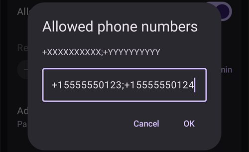
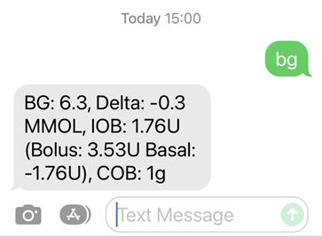
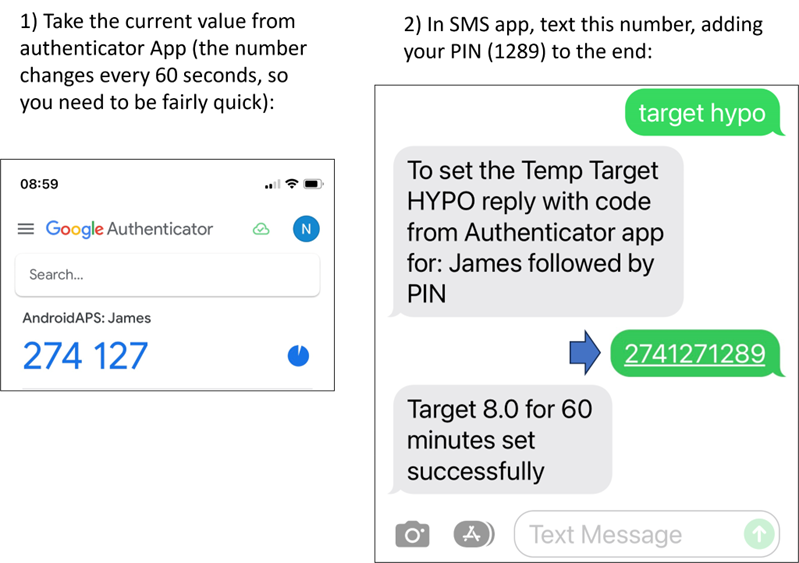

# Polecenia SMS

```{contents} Table of contents
:depth: 2
```

Większość zdalnych zmian (cele tymczasowe, węglowodany, zmiany profilu oraz, po sparowaniu urządzenia opiekuna, bolusy) można zrobić [aplikacją **AAPSClient**](../RemoteFeatures/RemoteMonitoring.md) na telefonie z Androidem z dostępem do internetu, zobacz [Sterowanie Master ↔ Client](#client-master-control) (wersja **AAPSClient** na iPhone jest w przygotowaniu, zobacz [AAPSClient](AapsClient.md)). Polecenia SMS to nadal alternatywa, która działa bez internetu, i jedyna opcja zdalna, jeśli jako telefonu obserwującego używasz iPhone’a i nie masz jeszcze **AAPSClient**.

**Polecenia SMS są bardzo przydatne:**
1. Do zwykłego zdalnego sterowania

2. Jeśli chcesz zdalnie podać bolus insuliny bez sparowanego **AAPSClient**

3. W miejscach ze słabym internetem, gdzie SMS-y dochodzą, ale transmisja danych jest ograniczona. Jest to bardzo przydatne w odległych miejscach (np. na biwaku, na nartach).

4. Jeśli Twój inny sposób zdalnego sterowania (**AAPSClient**) chwilowo nie działa

## Najpierw bezpieczeństwo

Jeśli włączysz **Komunikator SMS** w **AAPS**, pamiętaj, że telefon, z którego wysyłasz zdalne polecenia, może zostać skradziony lub użyty przez kogoś innego. Zawsze blokuj telefon co najmniej PIN-em. Bardzo zalecamy silne hasło i/lub blokadę biometryczną. Upewnij się, że jest inne niż hasło główne APK (hasło potrzebne do eksportu ustawień **AAPS**).

Dodatkowo zalecamy dopuszczenie [drugiego numeru telefonu](#SMSCommands-authorized-phone-numbers) do poleceń SMS. Dzięki temu możesz użyć drugiego numeru, aby [wyłączyć](#SMSCommands-other) Komunikator SMS, jeśli Twój główny telefon do zdalnego sterowania zostanie przejęty przez kogoś innego.

The default minimum time delay between bolus commands is 15 minutes, counted from the moment the pump accepts a bolus. Ze względów bezpieczeństwa musisz dodać co najmniej dwa autoryzowane numery telefonów, aby ustawić krótszy odstęp. Jeśli spróbujesz ponownie podać zdalny bolus w ciągu 15 minut od poprzedniego bolusa, dostaniesz odpowiedź „Bolus zdalny niedostępny. Spróbuj ponownie później.”

AAPS poinformuje Cię też SMS-em, czy Twoje zdalne polecenia, np. bolus lub zmiana profilu, zostały wykonane. Zaleca się takie ustawienie funkcji sterowania pompą poprzez sms, aby teksty potwierdzające były wysyłane na co najmniej dwa różne numery telefonów, w przypadku kradzieży jednego z telefonów odbierających drugi telefon odbierze informację o zmianach.

**If you bolus through SMS Commands, you must enter carbs separately (second SMS, AAPSClient...)!** If you fail to do so, the IOB would be correct with too low COB, potentially leading to not performed correction bolus as **AAPS** assumes that you have too much active insulin.

Przy poleceniach wrażliwych trzeba użyć aplikacji uwierzytelniającej z hasłem jednorazowym opartym na czasie (TOTP), aby zwiększyć bezpieczeństwo.

Jeśli chcesz odebrać telefonowi opiekuna możliwość wysyłania poleceń SMS, użyj w **AAPS** przycisku awaryjnego „[Resetuj uwierzytelnianie](#sms-commands-authenticator-setup)” albo wyślij polecenie SMS „[SMS stop](#SMSCommands-other)”. Resetując uwierzytelnianie, unieważniasz WSZYSTKIE telefony opiekunów. Trzeba będzie je skonfigurować ponownie.

## Konfiguracja poleceń SMS

```{contents} The overall process is as follows
:depth: 1
:local: true
```

(sms-commands-authenticator-setup)=
### Ustawienia uwierzytelnienia

W celu poprawy bezpieczeństwa zastosowane jest dwuskładnikowe uwierzytelnianie.

Na telefonie opiekuna pobierz (z App Store lub Google Play) i zainstaluj aplikację uwierzytelniającą (Authenticator). Popularne darmowe aplikacje to:
  - [Authy](https://authy.com/download/)
  - Google Authenticator - [Android](https://play.google.com/store/apps/details?id=com.google.android.apps.authenticator2) / [iOS](https://apps.apple.com/de/app/google-authenticator/id388497605)
  - [LastPass Authenticator](https://lastpass.com/auth/)
  - [FreeOTP Authenticator](https://freeotp.github.io/)

Takie aplikacje tworzą jednorazowe, 6-cyfrowe hasło ważne przez krótki czas, podobnie jak w bankowości mobilnej lub przy zakupach. Możesz użyć innej aplikacji uwierzytelniającej, o ile obsługuje tokeny TOTP zgodne z RFC 6238. Microsoft Authenticator nie działa.

### Sprawdź ustawienia telefonu

Na telefonie przejdź do **Aplikacje > AAPS > Uprawnienia**. Upewnij się, że **SMS** i **Telefon** są dozwolone.


```{admonition} "App was denied access to SMS"
:class: tip
Android może blokować uprawnienie **SMS** dla aplikacji, które nie zostały zainstalowane ze sklepu z aplikacjami, takich jak **AAPS**. Jeśli zobaczysz ten komunikat przy nadawaniu uprawnienia **SMS**, otwórz w telefonie **Ustawienia > Aplikacje > AAPS**, dotknij menu **⋮** (w prawym górnym rogu) i wybierz **Zezwól na ustawienia z ograniczonym dostępem** (Allow restricted settings). Potem ponownie nadaj uprawnienie **SMS**.
```


### Synchronizacja daty i godziny

Czas w obu telefonach musi być zsynchronizowany. Najlepszą metodą jest ustawienie czasu automatycznie z sieci. Różnice w czasie mogą powodować problemy z uwierzytelnianiem.

Na telefonie z **AAPS** i na telefonie opiekuna sprawdź, czy data i godzina są zsynchronizowane. Sposób zależy od urządzenia, możesz musieć wypróbować różne ustawienia.

Przykład (dla Samsunga S23): **Ustawienia > Zarządzanie ogólne > Data i godzina**: upewnij się, że **Automatyczna data i godzina** jest zaznaczona.

Niektóre opcje mogą być wyszarzone, bo wymagają zgody administratora z konta rodzinnego, jeśli telefon jest ustawiony jako konto dziecka. Na iPhonie opiekuna/rodzica to ustawienie daty i godziny nazywa się „Ustaw automatycznie”. Jeśli nie wiesz, czy telefony są zsynchronizowane, nie martw się. Możesz skonfigurować polecenia SMS i później rozwiązać problem, jeśli coś nie działa (w razie potrzeby poproś o pomoc).

### Ustawienia AAPS

Gdy ustawienia telefonu są już sprawdzone, w samej aplikacji **AAPS** przejdź do [**Konfiguracja** → **Komunikacja**](../SettingUpAaps/ConfigBuilder.md) i włącz wtyczkę **Komunikator SMS**.

Otwórz ustawienia **Komunikatora SMS**.

Włącz **Zezwalaj na zdalne polecenia przez SMS**. Opcje **Dodatkowy obowiązkowy PIN na końcu tokenu** i **Ustawienia uwierzytelnienia** pojawiają się dopiero po włączeniu tej opcji:


(SMSCommands-authorized-phone-numbers)=
#### Dozwolone numery telefonów

Wpisz numer(y) telefonu opiekuna. Podaj numer kierunkowy kraju i pomiń pierwsze „0” numeru telefonu, jak w tych przykładach:
* Numer w Wielkiej Brytanii: +447976304596
* Numer w USA: +11234567890
* Numer we Francji:  +33612344567
* _itd._

„+” przed numerem może być potrzebny lub nie, zależnie od miejsca, w którym jesteś. Aby to sprawdzić, wyślij przykładowy SMS. Otrzymany format zobaczysz na ekranie wtyczki **Komunikator SMS** (**Konfiguracja** → **Komunikacja** → **Komunikator SMS** → **Otwórz wtyczkę**).

Jeśli chcesz dodać więcej niż jeden numer telefonu, oddziel je średnikami, **BEZ spacji między numerami** (to bardzo ważne!). Wybierz **OK**:



#### Minimalny odstęp między zdalnymi bolusami (min)

- Możesz ustawić minimalny odstęp (w minutach) między dwoma bolusami wysłanymi przez SMS.
- Ze względów bezpieczeństwa musisz podać co najmniej dwa autoryzowane numery by móc zmienić tę wartość.

#### Dodatkowy obowiązkowy PIN na końcu tokenu

Ze względów bezpieczeństwa po kodzie odpowiedzi musi być PIN. Wybierz PIN, który Ty (i inni opiekunowie) będziecie wpisywać na końcu kodu z aplikacji uwierzytelniającej przy wysyłaniu polecenia SMS.

Wymagania dla PIN-u:

* at least 6 digits
* digits only

For a safer PIN, do not use the same digit many times (_e.g._ 111111) or a sequence (_e.g._ 123456).


#### Ustawienia uwierzytelnienia

* Dotknij **Ustawienia uwierzytelnienia** i postępuj krok po kroku według instrukcji na ekranie.
* Otwórz zainstalowaną aplikację uwierzytelniającą na _telefonie opiekuna_, dodaj nowe połączenie i
* Telefonem opiekuna zeskanuj kod QR pokazany pod **Zeskanuj kod, aby skonfigurować kody OTP AAPS**.


* W sekcji **Sprawdź hasło jednorazowe** wpisz w polu **Kod do sprawdzenia** hasło jednorazowe z aplikacji uwierzytelniającej na telefonie opiekuna, a po nim swój PIN:

Example:
* Token z aplikacji uwierzytelniającej to 457051
* Twój wymagany PIN to 2401
* Kod do sprawdzenia: 4570512401

If the entry is correct, the red text “WRONG PIN” will change automatically to a green “OK”. **There is no button you can press!** The process is now complete, there is no “OK” button you need to press after entering the code:


You should now be set up with SMS commands.

Use the **Reset Authenticators** button at the bottom of the **Authenticator setup** screen if you want to remove provisioned authenticators. (By resetting authenticator you make ALL already provisioned authenticators invalid. You will need to set them up again.)

## Używanie poleceń SMS

### Pierwsze kroki z poleceniami SMS

1)  To check you have set everything up correctly, test the connection by typing “bg” as an SMS message from the caregiver phone to the **AAPS** phone. You should get a response similar to that shown here:



If you don't receive any response, check the [Troubleshooting](#SMSCommands-troubleshooting) section below.

2)  Now try an SMS command that requires the authenticator, _e.g._ “target hypo”. The caregiver’s phone will receive a text back, prompting you to enter the **six-digit authenticator password** from the authenticator app, followed by the additional secret **PIN** known only by caregivers/followers (a string of twelve digits in total, assuming your PIN has 6 digits).

When you try sending an SMS command for the first time, try it in the presence of the **AAPS** phone, to see how it works:



The caregiver’s phone will receive an SMS in reply from **AAPS** to confirm if the remote SMS command has been carried out successfully.

If your command is successful, you will receive a reply to confirm this. If there is a problem you will receive an error message. See [Troubleshooting](#SMSCommands-troubleshooting) below for common errors.

**Hint**: It can be useful to have unlimited SMS on your phone plan (for each phone used) if a lot of SMS will be sent.

### Podawanie bolusów do posiłków przez polecenia SMS

Remote bolusing of insulin can be done via **SMS Commands** or through a paired **AAPSClient** (see [Master ↔ Client control](#client-master-control)); it cannot be done through the Nightscout website. Carbs can be announced through SMS or **AAPSClient** as well. With SMS, it is not possible to send both carbs and insulin commands in one single SMS message. These commands must be sent separately as follows:

1)  Send the insulin bolus (_e.g._“bolus 2” will command a bolus of 2 units) through SMS commands is equivalent to **Treatments** → **Insulin** in **AAPS**. 2)  Send the carbs (_e.g._ “carbs 20” will announce 20g of carbs). This is equivalent to **Treatments** → **Carbs** in **AAPS**.

To avoid hypos, it is a good idea to start conservatively, by bolusing **less insulin** than would be needed according to your carb ratio, because you are not taking into account the current glucose level or glucose trend.

**The order in which you send these commands is important**. If you announce a large amount of carbs by any route, and have SMBs enabled, **AAPS** may immediately respond by giving a partial bolus of insulin. So, if you then try to send an insulin bolus _after_ announcing the carbs, you may have a frustrating delay and a “bolus in progress” message, and you then need to check what has been given as an SMB. Or, if you do not realise an SMB is being delivered, and your own subsequent bolus is also successful, too much insulin may be delivered for the meal overall. Therefore, if bolusing for meals remotely, always send the insulin bolus _before_ the carb announcement. If you prefer, you can combine **AAPSClient** with SMS commands: carbs entered on a paired **AAPSClient** need no authentication code and are therefore quicker than SMS commands. Carbs or other treatments entered on the Nightscout website are **not** applied while client control is on; **AAPS** is then in [hardened mode](#client-master-control-hardened-mode).

(SMSCommands-commands)=
## Polecenia

```{contents} List of command groups
:depth: 1
:local: true
```

Commands must be sent in English, the response will be in your local language if the response string is already [translated](#translations-translate-strings-for-AAPS-app). The commands are not case-sensitive, you can use lower or upper case.


The **SMS Commands Tables** below show all the possible SMS commands. _Example values_ are given, to aid understanding. The commands have the same range of possible values (targets, percent profile etc.) which are allowable in the **AAPS** app itself.

(authentication-or-not)=
### Z uwierzytelnieniem czy bez?

Some SMS commands give an immediate response, and some SMS commands require strong **authentication** through the Authenticator app. A simple enquiry like “**BG**” (which requests an update on current glucose) is quick to type, doesn't need authenticating, and returns the **AAPS** status information shown below:


Commands which need more security require a code to be entered, for example:


The *Auth* column in the tables below, indicates whether such a strong authentication is required for each command.

### Dane CGM

| Polecenie  | Auth | Funkcja i *odpowiedź*                                                                                                                                                                                                             |
| ---------- | ---- | --------------------------------------------------------------------------------------------------------------------------------------------------------------------------------------------------------------------------------- |
| BG         | Nie  | Zwraca: ostatnią BG, deltę, IOB (bolus i baza), COB<br/>*Ostatnia BG: 5,6 4 min temu, Delta: -0,2 mmol, IOB: 0,20U (Bolus: 0,10U Baza: 0,10U)*                                                                              |
| CAL 5.6/90 | Tak  | Will calibrate the CGM with a value of 5.6/90<br/>(use the value appropriate to your glucose units)<br/>Works only if properly set-up in **AAPS**.<br/>*Calibration sent. Receiving must be enabled in xDrip+.* |

### Pompa

| Polecenie            | Auth | Funkcja i *odpowiedź*                                                                                |
| -------------------- | ---- | ---------------------------------------------------------------------------------------------------- |
| POMPA                | Nie  | LastConn: 1 min ago<br/>Temp: 0.00U/h @11:38 5/30min<br/>IOB: 0.5U Reserv: 34U Batt: 100 |
| PUMP DISCONNECT *30* | Tak  | Odłącza pompę na *30* minut                                                                          |
| PUMP CONNECT         | Tak  | Pompa ponownie podłączona                                                                            |

### Baza

| Polecenie         | Auth | Funkcja i *odpowiedź*                     |
| ----------------- | ---- | ----------------------------------------- |
| BASAL 0.3         | Tak  | Ustawia bazę tymczasową 0,3 U/h na 30 min |
| BASAL 0.3 20      | Tak  | Ustawia bazę tymczasową 0,3 U/h na 20 min |
| BASAL 30%         | Tak  | Ustawia bazę tymczasową 30% na 30 min     |
| BASAL 30% 50      | Tak  | Ustawia bazę tymczasową 30% na 50 min     |
| BASAL STOP/CANCEL | Tak  | Zatrzymuje bazę tymczasową                |

Some pumps take a temp basal only in percent, others only in U/h. If you use the other form, **AAPS** answers *"This pump takes a temp basal only in percent, not in U/h."* (or the reverse) and sets nothing. The duration must be a multiple of your pump's temp basal duration step.


### Pętla

| Polecenie         | Auth | Funkcja i *odpowiedź*                                                                                                                                                                                                                                                              |
| ----------------- | ---- | ---------------------------------------------------------------------------------------------------------------------------------------------------------------------------------------------------------------------------------------------------------------------------------- |
| LOOP STATUS       | Nie  | Response depends on actual status:<br/> - *Loop is disabled* if the loop is disabled<br/> - *Loop is enabled* if the loop is closed, open or LGS<br/> - *Pump disconnected* if the pump is disconnected<br/> - *Suspended (10 m)* if the loop is suspended |
| LOOP STOP/DISABLE | Tak  | Pompa wróci do zaprogramowanej dawki bazowej.<br/>*Pętla (Loop) została wyłączona*                                                                                                                                                                                           |
| LOOP SUSPEND 20   | Tak  | *Loop suspended*                                                                                                                                                                                                                                                                   |
| LOOP RESUME       | Tak  | *Pętla wznowiona*                                                                                                                                                                                                                                                                  |
| LOOP CLOSED       | Tak  | *Current running mode: Closed Loop*                                                                                                                                                                                                                                                |
| LOOP LGS          | Tak  | *Current running mode: Low Glucose Suspend*                                                                                                                                                                                                                                        |

### Bolus

Remote bolus is not allowed within 15 min (this value is editable only if 2 phone numbers added) after last bolus command or remote commands! In this case, the response would be *Remote bolus not available. Try again later.* This response is also sent when the pump is currently delivering a bolus.

| Polecenie            | Auth | Funkcja i *odpowiedź*                                                                                                                                                   |
| -------------------- | ---- | ----------------------------------------------------------------------------------------------------------------------------------------------------------------------- |
| BOLUS 1.2            | Tak  |                                                                                                                                                                         |
| BOLUS 0.60 MEAL      | Tak  | Podaje bolus 0,60 U<br/>**oraz** ustawia [cel tymczasowy Wkrótce posiłek](#TempTargets-eating-soon-temp-target)                                                   |
| CARBS 5              | Tak  | Wprowadza 5 g, bez bolusa                                                                                                                                               |
| CARBS 5 17:35/5:35PM | Tak  | Wprowadza 5 g o 17:35.<br/>Dozwolony format czasu zależy<br/> od ustawienia czasu (12h/24h) w telefonie.                                                    |
| EXTENDED 2 120       | Tak  | Ustawia bolus przedłużony 2 U na 120 min.<br/>Tylko dla [kompatybilnych pomp](#Extended-Carbs-extended-bolus-and-switch-to-open-loop-dana-and-insight-pump-only). |
| EXTENDED STOP/CANCEL | Tak  | Zatrzymuje bolus przedłużony                                                                                                                                            |

### Profil

| Polecenie      | Auth | Funkcja i *odpowiedź*                                                                                                                               |
| -------------- | ---- | --------------------------------------------------------------------------------------------------------------------------------------------------- |
| PROFILE STATUS | Nie  | Bieżący profil i procent                                                                                                                            |
| PROFILE LIST   | Nie  | Aktualna lista profili w **AAPS**, np.:<br/>1. Profile1<br/> 2. Profile2                                                                |
| PROFILE 1      | Tak  | Zmienia profil na profil 1 z listy.<br/>Użyj numerów zwróconych przez **PROFILE LIST**,<br/>a nie nazw profili, pod którymi je zapisano |
| PROFILE 2 30   | Tak  | Zmienia profil na Profile2 30%                                                                                                                      |

The percentage must be between 30 and 250 %, as in the app. A value outside this range is refused before you are asked for the authentication code.

### Cele tymczasowe

| Polecenie                 | Auth | Funkcja i *odpowiedź*                                                      |
| ------------------------- | ---- | -------------------------------------------------------------------------- |
| TARGET MEAL/ACTIVITY/HYPO | Tak  | Ustawia cel tymczasowy MEAL/ACTIVITY/HYPO (Wkrótce posiłek/Aktywność/Hipo) |
| TARGET STOP/CANCEL        | Tak  | Anuluje cel tymczasowy                                                     |


(SMSCommands-other)=
### Inne

| Polecenie        | Auth | Funkcja i *odpowiedź*                                                                                                                                                                                                                                              |
| ---------------- | ---- | ------------------------------------------------------------------------------------------------------------------------------------------------------------------------------------------------------------------------------------------------------------------ |
| RESTART          | Tak  | Uruchamia ponownie AAPS. Przydatne, gdy masz problemy, które zwykle znikają po ponownym uruchomieniu.                                                                                                                                                              |
| SMS DISABLE/STOP | Tak  | To disable the SMS Remote Service, reply with the code.<br/>Keep in mind that you'll be able to reactivate it directly<br/>from the **AAPS** master smartphone only.                                                                                   |
| HELP             | Nie  | Zwraca wszystkie dostępne funkcje:<br/>BG, LOOP, PUMP, BASAL, BOLUS, EXTENDED, CAL, PROFILE, TARGET, SMS, CARBS, HELP, RESTART<br/>Wyślij kolejne polecenie ***HELP ***FUNCTION******, aby wyświetlić<br/>wszystkie opcje dostępne w tej sekcji. |
| HELP BOLUS       |      | *BOLUS 1.2<br/>BOLUS 1.2 MEAL*                                                                                                                                                                                                                               |

(SMSCommands-troubleshooting)=
## Rozwiązywanie problemów i FAQ

```{contents} List of questions and issues
:depth: 1
:local: true
```

### Czego _nie można_ zrobić poleceniami SMS?

1)  **You cannot set a _temporary_ profile switch** (so for example, setting "profile exercise" for 60 minutes), although you can permanently switch to “profile exercise”. Temporary profile switches can instead be set through **AAPSClient**.

2)  **You cannot cancel automations** or **set user-defined targets** but there are approximate solutions: As an example, imagine the normal profile target is 5.5. You have set an automation in AAPS, to always set a high target of 7.0 between 2.30pm and 3.30pm because of a sports class in school, and a condition of the automation is that “no temp target exists”. This week, you have been told at short notice that the sports class is cancelled, and is being replaced by a pizza-eating session, but your kid is already at school with the **AAPS** phone. If the high temporary target of 7.0 is started by the automation, and you cancel it (on the **AAPS** phone, or remotely) the conditions for the automation are still met and **AAPS** will simply set the high target again, a minute later.

**If you did have access to the AAPS phone**, you could uncheck/modify the automation, or, if you don’t want to do that, you could simply set a new temp target of 5.6 for 60 min by pressing on the target on the main screen, or via **Manage** → **Temp Target**. This would prevent the automation from setting the high target of 7.0.

**If you don’t have access to the AAPS phone** SMS commands can be used for an approximate fix: for example, by using the command “target meal” to set a target of 5.0 for 45 mins (other default targets are 8.0 for activity or hypo, see Table). However, with SMS commands you cannot specify a _specific_ value target value (of 5.6 for 60 minutes, for example), you would need to use **AAPSClient** to do this.

### Co się stanie, jeśli zmienię zdanie zaraz po wysłaniu polecenia?

**AAPS** will only deliver on the most recent command. So, if you type “bolus 1.5”, and then, without authenticating, you send a new command “bolus 1”, it will ignore the earlier 1.5 command. **AAPS** will always send the caregiver's phone a response to confirm what the SMS command is before you are prompted to enter the authentication code, as well as a response following the action.

### Dlaczego nie przyszła odpowiedź na polecenie SMS?

It could be for one of these reasons:

1)  The message has not got through to the phone (network issues). 2)  **AAPS** is still in the process of processing the request (_e.g._ a bolus, which can take some time to deliver depending on your bolus rate). 3)  The **AAPS** phone does not have a good Bluetooth connection to the pump when the command is received, and the command has failed (this usually creates an alarm on the **AAPS** phone).

### Brak jakiejkolwiek odpowiedzi na polecenia SMS

On the caregiver phone and/or **AAPS** phone, try disabling the following options :
* **Wyślij jako wiadomość czatu** 
* Jeśli używasz aplikacji Android Messages lub Google Messages, wyłącz wiadomości RCS:
  - otwórz daną rozmowę SMS w aplikacji Wiadomości
  - Wybierz menu opcji (trzy kropki) w prawym górnym rogu
  - wybierz „Szczegóły”
  - Włącz „Only send SMS and MMS messages” (wysyłaj tylko SMS i MMS) 

### Błędy przy wykonywaniu poleceń

There are several possible reasons the command may not be successful:

* Konfiguracja poleceń SMS nie jest kompletna/poprawna
* Wysłano polecenie w złym formacie (np. „disconnect pump 45” zamiast „pump disconnect 45”)
* Użyto złego lub wygasłego kodu uwierzytelniającego (zwykle warto poczekać kilka sekund na nowy kod, jeśli obecny zaraz wygaśnie)
* Kod + PIN był poprawny, ale wysłanie lub dostarczenie SMS-a się opóźniło, więc **AAPS** uznał, że kod uwierzytelniający wygasł
* Telefon z **AAPS** jest poza zasięgiem pompy lub nie ma z nią połączenia
* System właśnie podaje bolus

Common errors are shown in the examples below:


### Jak zatrzymać polecenie, gdy zostało już uwierzytelnione?

You can't. However, you can cancel a bolus sent by SMS on the **AAPS** phone itself, by simply cancelling it on the bolusing popup, if you are quick. Many SMS commands (apart from bolusing and carb announcements) can be easily reversed, or actions taken to mitigate unintended effects if a mistake is made.

For errors in bolusing and carb announcements, you can still take action. For example, if you have announced 20g carbs but your child only eats 10g and you (or an onhand caregiver) is unable to delete the treatment in the **AAPS** phone directly, you could set a high temporary target, or set a reduced profile, to encourage **AAPS** to be less aggressive.

### Wiele SMS-ów

If you receive the same message repeatedly (_e.g._ a profile switch) you may have accidentally set up a looping condition with other apps. This could be xDrip, for example. If so, please ensure that xDrip (or any other app) does not upload treatments to NightScout.

If the other app is installed on multiple phones make sure to deactivate upload on all of them.

(sms-commands-too-many-messages)=
### Dostaję o wiele za dużo SMS-ów z poleceń SMS. Czy mogę je ograniczyć albo wyłączyć?

Using SMS commands may generate a lot of automated messages from the **AAPS** phone to the caregiver’s phone. You will also receive messages, for example “basal profile in pump updated” if you have automations set up in **AAPS**. It can be useful to have unlimited SMS allowance on your **AAPS** phone plan (and for each caregiver phone used) if a lot of SMS will be sent, and to deactivate SMS notifications, alarms or vibrations on all phones. It is not possible to use SMS commands and not receive these updates. Because of this, you may want an alternative way to communicate directly with your child (if they are old enough), instead of SMS. Common alternative communication apps used by **AAPS** caregivers include WhatsApp, LINE, Telegram, and Facebook Messenger.

It is possible to disable the "Basal profile in pump updated" SMS, when the Profile change originated from Nightscout. To do this, create a file named **exactly** `do_not_send_sms_on_profile_change` in the `extra` dir of your AAPS directory.
