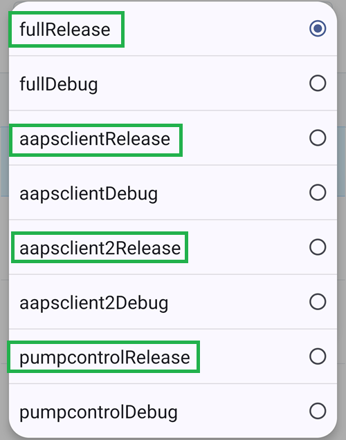

(github-build-apk)=

# Budowanie w przeglądarce – Krok 4: Zbuduj plik APK

```{note}
To jest **Krok 4** [budowania w przeglądarce](BrowserBuild.md). Najpierw wykonaj [Krok 3 – Autoryzuj Dysk Google](BrowserBuildGoogleDrive.md).
```

## Budowanie pliku APK AAPS przez GitHub Actions AAPS-CI
 - Odpowiednie dla zwykłych użytkowników.

```{tab-set}

:::{tab-item} Wiki
### Uruchom workflow, który zbuduje podpisany plik APK

1. W swojej kopii AndroidAPS na GitHub wybierz Actions.
2. Rozwiń All Workflows.
3. Wybierz AAPS-CI


4. Przewiń w dół i dotknij Run Workflow.


5. W polu **Use workflow from** zostaw gałąź „master”. W polu **Select AAPS Version** wybierz wersję **AAPS**, którą chcesz zbudować (zwykle najnowszą). Wybierz [wariant](#browserbuild-variant) (fullRelease) i dotknij Run workflow.


6. Zobaczysz komunikat „Workflow run was successfully requested.” Odśwież stronę w przeglądarce, a zobaczysz postęp budowania. Gdy akcja się zakończy, przy akcji AAPS CI pojawi się zielony znacznik. Zaktualizowana wersja AndroidAPS została zbudowana.


### Zainstaluj plik APK AAPS

1. Otwórz swój Dysk Google
2. Przejdź do folderu AAPS i wybierz folder nowej wersji. Znajdziesz tam wersję na telefon i wersję na Android Wear.


:::

:::{tab-item} Wideo
<div align="center" style="max-width: 360px; margin: auto; margin-bottom: 2em;">
  <div style="position: relative; width: 100%; aspect-ratio: 9/16;">
    <iframe
      src="https://geo.dailymotion.com/player/x9rdwms.html?video=x9rdwms&loop=true&mute=true"
      loading="lazy"
      style="position: absolute; top: 0; left: 0; width: 100%; height: 100%;"
      frameborder="0"
      allowfullscreen>
    </iframe>
  </div>
</div>
:::  

```

## Wybór wersji do zbudowania

**Metodą w przeglądarce zbudujesz tylko wersje AAPS od 3.3.2.1 wzwyż.**

Dotknij **Select AAPS Version** i wybierz wersję do zbudowania. Najnowsza wersja jest na górze listy.


(browserbuild-variant)=

## Wybór wariantu budowania

*Uwaga: aplikacje na Androida i na Android Wear zostaną zbudowane automatycznie.*

  - Wybierz potrzebny wariant:
    - fullRelease: do zwykłego używania z pompą, ze wszystkimi funkcjami.
    - [aapsclientRelease, aapsclient2Release, aapsclient3Release](#RemoteControl_aapsclient): dla opiekunów (wymaga [Nightscout](../SettingUpAaps/Nightscout.md)). `aapsclient3Release` buduje **AAPSClient3**, dostępny od wersji **AAPS** 4.0 (zobacz [O AAPSClient, AAPSClient2 i AAPSClient3](#remotecontrol-aapsclient-versions)).
    - pumpcontrolRelease: zamiast aplikacji/sterownika twojej pompy



Variants ending with “Debug” indicate that the APK will be built in debug mode, which is useful for developers for troubleshooting.

<!-- If you want to test the items in a pull request has been moved to dev page /AdvancedOptions/DevBranch.md -->

----

Gdy budowanie się uda, plik APK zostanie zapisany na twoim Dysku Google. Przejdź dalej do strony [Przenoszenie i instalacja AAPS na smartfonie](TransferringAndInstallingAaps.md).

```{note}
Od września 2026 [weryfikacja deweloperów Androida](#android-developer-verification) wprowadzona przez Google może, zależnie od kraju, blokować instalację pliku APK przez dotknięcie pliku. Darmowe obejścia są opisane na tamtej stronie.
```

Jeśli budowanie się nie uda, najpierw [sprawdź w logu budowania, co poszło nie tak](#aaps-ci-read-the-logs), a potem zobacz [Budowanie w przeglądarce: rozwiązywanie problemów](../GettingHelp/BrowserBuildTroubleshooting.md). Aby dodać konkretny commit do swojej wersji, zobacz [Budowanie w przeglądarce: przeniesienie commita (cherry-pick)](#github-cherry-pick).
