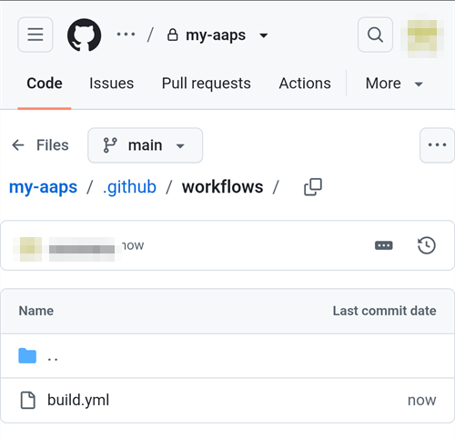

(aaps-builder)=

# Budowanie w przeglądarce z AAPS Builder

```{note}
To zalecany sposób budowania AAPS na **telefonie z Androidem**. Działa też w każdej przeglądarce na komputerze. Inne sposoby budowania na komputerze lub iPhonie znajdziesz w przeglądzie [Budowanie w przeglądarce](BrowserBuild.md).
```

```{contents} In this page
:backlinks: entry
:depth: 2
```

**AAPS Builder** buduje dla ciebie aplikację AAPS w GitHub, darmowym serwisie do przechowywania kodu. Nie musisz nic instalować na telefonie ani otwierać żadnego pliku przygotowawczego.

Strona konfiguracji w tej dokumentacji przeprowadzi cię przez cały proces. Za pierwszym razem zajmuje to około 10 minut:

1. Utwórz puste **prywatne** repozytorium na swoim koncie GitHub: strona konfiguracji otworzy GitHub z wypełnionymi polami, ty tylko potwierdzasz.
2. Dodaj **workflow budowania**, czyli plik, który mówi GitHubowi, jak zbudować AAPS.
3. Utwórz lub prześlij swój **klucz podpisu** (magazyn kluczy, keystore).
4. Przekaż klucz do swojego repozytorium jako **sekret** (secret) GitHub.
5. **Zbuduj** aplikację. Jedno budowanie trwa od 15 do 30 minut.
6. **Pobierz i zainstaluj** aplikację na telefonie.

**Nie** musisz robić forka AndroidAPS: kod źródłowy AAPS jest pobierany z oficjalnego repozytorium AndroidAPS przy każdym budowaniu. **Nie** potrzebujesz też Dysku Google: aplikację pobierasz bezpośrednio z GitHub.

```{admonition} Where the code comes from
:class: note

Strona konfiguracji i workflow budowania są częścią tej dokumentacji: są utrzymywane i sprawdzane razem z nią. <a href="../_static/aaps-builder/aaps-builder-build.yml">Workflow</a>, który dodajesz do repozytorium, jest krótki: uruchamia [kroki budowania](https://github.com/openaps/AndroidAPSdocs/blob/dev/.github/workflows/aaps-builder.yml) przechowywane w repozytorium dokumentacji, przypięte do jednej sprawdzonej wersji. Możesz przeczytać oba, zanim ich użyjesz. Podczas budowania workflow pobiera tylko oficjalny kod źródłowy AAPS i narzędzia do budowania samego GitHub. Twój magazyn kluczy nigdy nie opuszcza twojej przeglądarki i twojego prywatnego repozytorium.
```

(aaps-builder-before-you-start)=

## Zanim zaczniesz

Potrzebujesz:

- **Konta GitHub** (darmowego). Jeśli go nie masz, najpierw utwórz je na [github.com](https://github.com/signup).
- **Przeglądarki internetowej**: Chrome na telefonie albo dowolnej przeglądarki na komputerze. Zanim zaczniesz, zaloguj się w tej przeglądarce na github.com.
- **Masz na telefonie aplikację GitHub?** Możesz ją zostawić. Niektóre przyciski strony konfiguracji otworzą wtedy aplikację zamiast Chrome. Budowanie działa w aplikacji, ale aplikacja **nie może pobrać** gotowego AAPS: [krok 6](#aaps-builder-step6) pokazuje, jak przejść do Chrome, aby go pobrać.
- Swojego **istniejącego magazynu kluczy** (plik `.jks`), jego hasła i aliasu, jeśli już wcześniej budowałeś AAPS i chcesz go zaktualizować bez ponownej instalacji.

```{warning}
**Twoje repozytorium do budowania musi pozostać prywatne.** Wszystko, co powstaje podczas budowania, widzi każdy, kto może zobaczyć repozytorium. Strona konfiguracji tworzy dla ciebie prywatne repozytorium. Nigdy nie zmieniaj go na publiczne.

Prywatne repozytorium dostaje 2000 darmowych minut GitHub Actions miesięcznie. To wystarczy na kilka budowań.
```

```{warning}
**Nowy klucz czy istniejący klucz: od tego zależy, czy możesz zaktualizować AAPS.**

- **Masz już AAPS na telefonie, zbudowany z magazynem kluczy, który nadal masz**: na stronie konfiguracji wybierz **I already have a keystore** i prześlij go. Następne budowanie zaktualizuje istniejący AAPS. Budowałeś AAPS poprzednią metodą w przeglądarce (własny fork)? Twój magazyn kluczy jest w twoim forku: [najpierw zrób jego kopię](#aaps-builder-from-fork).
- **Budujesz AAPS po raz pierwszy albo zgubiłeś magazyn kluczy lub jego hasło**: wybierz **Create a new key**. Aplikacja podpisana nowym kluczem **nie może zaktualizować** AAPS podpisanego innym kluczem. Musisz wyeksportować ustawienia, skopiować plik poza telefon, odinstalować stary AAPS, zainstalować nowy, a potem zaimportować ustawienia: zobacz [Ponowna instalacja AAPS z nowym magazynem kluczy](#reinstall-aaps).

Potem zawsze używaj tego samego klucza. Gdy tworzysz nowy klucz, pobierz kopię zapasową, którą oferuje strona, i przechowuj ją razem z hasłem i aliasem (`key0`) w bezpiecznym miejscu poza telefonem.
```

(aaps-builder-from-fork)=

## Przejście z poprzedniej metody budowania w przeglądarce (fork)

Pomiń tę sekcję, jeśli nigdy nie budowałeś AAPS poprzednią metodą w przeglądarce (własna kopia, czyli fork, AndroidAPS w GitHub, z plikiem przygotowawczym i Dyskiem Google).

Twój magazyn kluczy jest zapisany jako sekrety w twoim forku. GitHub nigdy więcej nie pokazuje sekretu, więc nie możesz go skopiować do nowego repozytorium. Najpierw zrób kopię swojego magazynu kluczy, a potem użyj jej w [kroku 3](#aaps-builder-step3) z opcją **I already have a keystore**.

```{warning}
Nie wybieraj **Create a new key**. AAPS zbudowany z nowym kluczem nie może zaktualizować AAPS na twoim telefonie.
```

Który przypadek dotyczy ciebie?

- **Użyłeś Opcji 2** (przesłałeś własny magazyn kluczy z Android Studio) i nadal masz plik `.jks`, jego hasła i alias: tutaj nie musisz nic robić. Użyj tego pliku w kroku 3.
- **Użyłeś Opcji 1** (klucz utworzył plik przygotowawczy) albo nie masz już pliku magazynu kluczy: wyeksportuj go ze swojego forka, jak opisano poniżej.

Aby wyeksportować magazyn kluczy ze swojego forka:

1. W swoim forku otwórz **Settings** → **Secrets and variables** → **Actions** i dodaj sekret o nazwie `ZIP_PASSWORD`. Wybierz hasło tylko z angielskich liter i cyfr. Chroni ono plik, który zaraz utworzysz.
2. Otwórz kartę **Actions** swojego forka, dotknij **CI Keystore Export**, a potem **Run workflow**. Więcej szczegółów: [Eksportuj swój magazyn kluczy](#ci-keystore-export).
3. Gdy przy uruchomieniu pojawi się zielony znaczek, otwórz swój Dysk Google: plik `keystore.zip` jest w folderze **AAPS** → **KeyStore**. Jeśli uruchomienie nie uda się na kroku z Dyskiem Google, dostęp twojego forka do Dysku Google wygasł: zobacz [Wygasł token odświeżania Google](#aaps-ci-google-token-expired).
4. Pobierz `keystore.zip` i otwórz go za pomocą swojego `ZIP_PASSWORD`: na komputerze albo na telefonie w menedżerze plików, który potrafi otwierać pliki ZIP chronione hasłem. Zawiera on:
   - `keystore.jks`: twój magazyn kluczy,
   - `keyStoreInfo.txt`: twoje `KEYSTORE_PASSWORD`, `KEY_PASSWORD` i `ALIAS` (zwykle `key0`).
5. Skopiuj `keystore.jks` na telefon (albo na Dysk Google, aby wybrać go stamtąd).

W [kroku 3](#aaps-builder-step3) na stronie konfiguracji:

1. Dotknij **I already have a keystore**.
2. W polu **Keystore file** wybierz `keystore.jks`.
3. W polu **Keystore password** wpisz `KEYSTORE_PASSWORD` z pliku `keyStoreInfo.txt`.
4. W polu **Key alias** wybierz lub wpisz `ALIAS` z pliku `keyStoreInfo.txt`.
5. Jeśli `KEY_PASSWORD` jest inne niż `KEYSTORE_PASSWORD`, odznacz **Key password is the same as the keystore password** i wpisz `KEY_PASSWORD`.

Przechowuj `keystore.zip` i jego `ZIP_PASSWORD` w bezpiecznym miejscu poza telefonem: to kopia zapasowa twojego klucza.

Dostępu twojego forka do Dysku Google też nie da się skopiować. Aby zapisywać na Dysku Google także budowania z AAPS Builder, wykonaj [krok 7](#aaps-builder-google-drive). Możesz zachować swój fork, dopóki AAPS zbudowany w AAPS Builder nie zostanie zainstalowany na twoim telefonie.

## Otwórz stronę konfiguracji

**→ [Otwórz stronę konfiguracji AAPS Builder](#aaps-builder-setup)**

Nie zamykaj tej strony dokumentacji: przytrzymaj powyższy link i wybierz **Otwórz w nowej karcie**. Poniższe kroki dokładniej opisują każdą część strony konfiguracji.

Strona konfiguracji otwiera każdą stronę GitHub w nowej karcie Chrome. Aby wrócić do strony konfiguracji, dotknij przycisku kart obok paska adresu Chrome (kwadrat z liczbą) i wybierz stronę konfiguracji AAPS Builder.

Strona konfiguracji działa w całości w twojej przeglądarce: twój klucz i hasła nie są nigdzie wysyłane, poza sekretem GitHub, do którego sam je wklejasz. Do GitHub wysyłana jest tylko Twoja nazwa użytkownika GitHub, aby sprawdzić, czy istnieje. Strona zapamiętuje twoją nazwę użytkownika GitHub i nazwę repozytorium, więc możesz do niej wrócić w każdej chwili, aby znów otworzyć stronę sekretów lub swoje budowania.


(aaps-builder-step1)=

## Krok 1 – Utwórz prywatne repozytorium do budowania

W tym kroku na twoim koncie GitHub powstaje puste prywatne repozytorium. Tylko ty widzisz je i zbudowane w nim aplikacje.

1. Upewnij się, że w tej przeglądarce jesteś zalogowany na github.com.

2. W polu **Your GitHub username** wpisz swoją nazwę użytkownika GitHub, a nie adres e-mail. Strona sprawdza ją w GitHub: **✓ GitHub user found** oznacza, że jest poprawna.

3. W polu **Name of your repository** zostaw proponowaną nazwę `my-aaps`. Jeśli twoje repozytorium już istnieje pod inną nazwą, wpisz dokładnie tę nazwę.

   ```{tip}
   **Masz już samodzielnie utworzone puste prywatne repozytorium?** Wpisz tutaj dokładnie jego nazwę, nie dotykaj **Create my private repository** i przejdź do [kroku 2](#aaps-builder-step2).
   ```

4. Sprawdź wiersz **Your repository:** pokazuje `github.com/<your username>/my-aaps`.

5. Dotknij **Create my private repository**.

   

6. GitHub otworzy się w nowej karcie, z twoim kontem jako **Owner** i wybraną przez ciebie nazwą.

   

   Przewiń w dół: **Private**, **No template** i **Add README: Off** są już wybrane. Niczego nie zmieniaj i nie dodawaj pliku README ani innych plików.

7. Przewiń w dół i dotknij zielonego przycisku **Create repository**.

   

   GitHub pokaże twoje nowe, puste repozytorium. **Wróć do karty ze stroną konfiguracji**, aby wykonać krok 2: dotknij przycisku kart obok paska adresu Chrome i wybierz stronę konfiguracji.

(aaps-builder-step2)=

## Krok 2 – Dodaj workflow budowania

Workflow budowania to krótki plik tekstowy, który mówi GitHubowi, jak zbudować AAPS. Strona konfiguracji dodaje go do twojego repozytorium jeden raz: ty tylko to potwierdzasz.

1. Sprawdź, czy strona pokazuje **Workflow version … is ready**, a potem dotknij **Add the workflow to my repository**.

   

2. GitHub otworzy w twoim repozytorium nowy plik, który ma już nazwę `.github/workflows/build.yml` i jest już wypełniony. Sprawdź nazwę pliku na górze: musi to być dokładnie `.github/workflows/build.yml`. Nie zmieniaj tekstu.

3. Dotknij **Commit changes…**

   

4. a potem jeszcze raz **Commit changes** w oknie, które się otworzy.

   

   GitHub pokazuje nowy plik `build.yml` w folderze `.github/workflows` twojego repozytorium.

   

```{warning}
Nie naciskaj przycisku **Wstecz** na telefonie ani nie przeciągaj strony w dół, gdy edytor pliku jest otwarty: GitHub przeładuje stronę i tekst zniknie. Jeśli tak się stanie, dotknij **Restore** na niebieskim pasku albo wróć do strony konfiguracji i dotknij przycisku jeszcze raz.
```

Jeśli pole tekstowe jest puste, dotknij **Updating the workflow, or the text area is empty?** na dole kroku 2 na stronie konfiguracji: dotknij **Copy workflow** i wklej go do pola tekstowego (na telefonie długie naciśnięcie).

```{warning}
Używaj tylko workflow z tej strony konfiguracji. Nie kopiuj workflow budowania z innej strony internetowej ani innego repozytorium: workflow działa obok twojego klucza podpisu.
```

(aaps-builder-step3)=

## Krok 3 – Twój klucz podpisu

Aplikacja musi być podpisana twoim własnym kluczem. Wybierz jedną z dwóch kart. Najpierw przeczytaj [ostrzeżenie o nowym lub istniejącym kluczu](#aaps-builder-before-you-start).


### Mam już magazyn kluczy (I already have a keystore)

1. Dotknij **I already have a keystore**.
2. W polu **Keystore file** wybierz swój plik `.jks` (lub `.keystore`, `.p12`, `.pfx`). Na telefonie najpierw skopiuj plik do telefonu lub na Dysk Google.
3. W polu **Keystore password** wpisz hasło magazynu kluczy.
4. W polu **Key alias** wybierz swój alias z listy albo wpisz go, jeśli nie ma listy. W magazynach kluczy utworzonych w Android Studio jest to zwykle `key0`.
5. Jeśli hasło klucza jest inne niż hasło magazynu kluczy, odznacz **Key password is the same as the keystore password** i wpisz hasło klucza.
6. Dotknij **Check and continue**.

Strona sprawdza hasło i alias na twoim urządzeniu. **Keystore OK! Continue with step 4.** oznacza, że wszystko jest w porządku. Jeśli strona pisze, że hasło zostanie sprawdzone podczas budowania, i tak przejdź dalej: budowanie pokaże Ci, jeśli coś jest nie tak.

### Utwórz nowy klucz (Create a new key)

1. Dotknij **Create a new key**.

2. Wybierz hasło i wpisz je dwa razy. Zasady: co najmniej 8 znaków, tylko litery a–z i A–Z, cyfry 0–9 oraz symbole takie jak `! ? #`. Bez spacji, bez liter ze znakami diakrytycznymi (np. ą, ę, ł) i bez znaku `|`.

3. Dotknij **Create key**. Po kilku sekundach pojawi się **Key created**.

   

4. Dotknij **Download backup (aaps-keystore.jks)**. Jeśli Chrome zapyta **Pobrać plik jeszcze raz?**, na telefonie jest już starsza kopia zapasowa o tej samej nazwie: dotknij **Pobierz ponownie**. Chrome zapisze wtedy nowy klucz jako `aaps-keystore (1).jks`: to jest plik, który pasuje do tego klucza. Zachowaj go i nie pomyl go ze starszym.

   Przechowuj te trzy rzeczy razem, w bezpiecznym miejscu poza telefonem (na przykład we własnej chmurze):

   - plik `aaps-keystore.jks`,
   - twoje hasło,
   - alias klucza: **`key0`**.

   Wszystkie trzy będą ci potrzebne, jeśli kiedyś zbudujesz AAPS w inny sposób, na przykład w Android Studio. Klucze utworzone we wcześniejszej wersji strony konfiguracji mają alias `aaps`.

   

(aaps-builder-step4)=

## Krok 4 – Przekaż klucz do repozytorium

Krok 4 odblokuje się po wykonaniu kroku 3. Twój klucz, jego hasła i alias są spakowane w jedną wartość: sekret `KEYSTORE_SET`.

1. Dotknij **Open the secrets page**.


2. GitHub otworzy stronę **New secret** twojego repozytorium. Na telefonie jest ona pod menu ustawień: przewiń w dół.


3. Przejdź do karty ze stroną konfiguracji i dotknij **Copy name**. Wróć do karty GitHub i wklej go w małe pole **Name**. Nazwa to `KEYSTORE_SET`.

4. Przejdź do karty ze stroną konfiguracji i dotknij **Copy secret**. Wróć do karty GitHub i wklej go w duże pole **Secret** (na telefonie długie naciśnięcie). Sekret to bardzo długi kod, ma tysiące znaków: strona konfiguracji pokazuje jego pierwsze znaki obok przycisku. Nie wklejaj tam słowa `KEYSTORE_SET`.

5. Dotknij **Add secret**. `KEYSTORE_SET` pojawi się teraz w sekcji **Repository secrets**.


Robisz to tylko raz.

```{tip}
GitHub pokazuje **Page not found** (404)? Najpierw sprawdź, czy jesteś zalogowany do github.com w tej przeglądarce: GitHub pokazuje 404 dla prywatnych repozytoriów, gdy nie jesteś zalogowany. W przeciwnym razie nazwa użytkownika lub nazwa repozytorium w kroku 1 nie pasuje do twojego repozytorium. Sprawdź nazwę na github.com, popraw ją w kroku 1 i dotknij przycisku jeszcze raz.
```

(aaps-builder-step5)=

## Krok 5 – Zbuduj aplikację

1. Na stronie konfiguracji dotknij **Open the build page**. GitHub otworzy stronę **Build AAPS** twojego repozytorium.

   

   Jeśli zamiast tego otworzy się **aplikacja GitHub**: dotknij **RUN WORKFLOW**, sprawdź wersję i wariant, i dotknij jeszcze raz **RUN WORKFLOW**. Aplikacja może nadal pokazywać **Nothing to see here**: przeciągnij listę w dół, aby ją odświeżyć i zobaczyć swoje budowanie. Potem przejdź do kroku 4 poniżej.

2. Jeśli GitHub zapyta, dotknij zielonego przycisku, aby włączyć workflow.
3. Dotknij **Run workflow**. Otworzy się mały formularz:
   - **Version**: zostaw `latest`, aby zbudować najnowszą wersję AAPS, albo wpisz numer wersji, np. `3.3.2.1`.
   - **Variant**: zostaw `fullRelease` do zwykłego używania z pompą. Pozostałe warianty są opisane w sekcji [warianty budowania](#browserbuild-variant). `aapsclient3Release` buduje **AAPSClient3**, dostępny od wersji **AAPS** 4.0 (zobacz [O AAPSClient, AAPSClient2 i AAPSClient3](#remotecontrol-aapsclient-versions)).
   - Dotknij zielonego przycisku **Run workflow**.

   

4. Budowanie się zaczyna i pokazuje **In progress**, w dwóch częściach: najpierw **AAPS / Check**, potem **AAPS / Build AAPS**.

   

5. Poczekaj od 15 do 30 minut. Zielony znaczek (✓) oznacza, że budowanie się zakończyło. Czerwony krzyżyk oznacza, że się nie udało: otwórz budowanie, przeczytaj komunikat, a potem zobacz [rozwiązywanie problemów](#aaps-builder-troubleshooting).

   

   ```{tip}
   **E-mail po zakończeniu budowania:** GitHub wysyła e-mail tylko wtedy, gdy budowanie się nie uda. Aby dostawać e-mail także po udanym budowaniu: na github.com otwórz swoje zdjęcie profilowe → **Settings** → **Notifications** → **System** → **Actions** i odznacz **Only notify for failed workflows**.
   ```

Jeśli nie ma przycisku **Build AAPS** ani **Run workflow**:

- Otwórz swoje repozytorium i sprawdź, czy jest w nim plik `.github/workflows/build.yml`. Jeśli go nie ma lub ma inną nazwę, wykonaj jeszcze raz [krok 2](#aaps-builder-step2).
- Otwórz kartę **Actions**. Jeśli jest napisane, że workflow są wyłączone, dotknij zielonego przycisku, aby je włączyć, a potem dotknij **Build AAPS** na liście.

(aaps-builder-step6)=

## Krok 6 – Zainstaluj aplikację na telefonie

```{warning}
**Przed każdą aktualizacją** [wyeksportuj swoje ustawienia](#ExportImportSettings-Automating-Settings-Export) w AAPS i skopiuj plik **poza telefon** (Dysk Google, Dropbox…). Trzymaj tam też kilka starszych eksportów i pliki APK, aby zawsze móc wrócić do poprzedniej wersji.
```

1. Na telefonie otwórz stronę konfiguracji w **Chrome**. Zaloguj się na github.com, jeśli strona o to poprosi.
2. Dotknij **Open my builds**, a potem najnowszego budowania z zielonym znaczkiem.

   ```{admonition} The GitHub app opened instead of Chrome?
   :class: note

   Aplikacja GitHub nie potrafi pobierać zbudowanych aplikacji. W aplikacji otwórz najnowsze budowanie, a potem dotknij **Artifacts ↗** albo dotknij ikony udostępniania na górze i wybierz **Chrome** (albo **Copy link**, a potem wklej link w pasek adresu Chrome). Budowanie otworzy się w Chrome: tam przejdź do następnego kroku.

   Aby linki GitHub nie otwierały się w aplikacji: Android **Ustawienia** → **Aplikacje** → **GitHub** → **Otwieraj domyślnie** (Open by default) → wyłącz **Otwieraj obsługiwane linki** (Open supported links).
   ```

   

3. Przewiń w dół do podsumowania budowania i dotknij linku **Download AAPS**.

   

   ```{tip}
   Przewijaj palcem po tekście, a nie po schemacie kroków budowania: inaczej przesuwa się schemat zamiast strony.
   ```

   Możesz też przewinąć dalej w dół do **Artifacts** i dotknąć ikony pobierania obok `aaps-….apk`.

   

4. Gdy pobieranie się zakończy, otwórz menu Chrome **⋮** → **Pobrane**, dotknij `aaps-….apk` i wybierz **Zainstaluj**. Jeśli telefon zapyta, zezwól na instalowanie aplikacji z tego źródła.

   

`aaps-wear-….apk` to aplikacja na smartwatch. Pomiń ją, jeśli nie używasz smartwatcha.

Aplikacja jest przechowywana na stronie budowania przez **14 dni**. Nie widać jej w zakładce **Code** twojego repozytorium. Skopiuj ją w bezpieczne miejsce poza telefonem, razem z eksportami ustawień.

Więcej sposobów instalacji aplikacji znajdziesz na stronie [Przenoszenie i instalacja AAPS na smartfonie](TransferringAndInstallingAaps.md).

```{note}
Od września 2026 [weryfikacja deweloperów Androida](#android-developer-verification) wprowadzona przez Google może, zależnie od kraju, blokować instalację pliku APK przez dotknięcie pliku. Darmowe obejścia są opisane na tamtej stronie.
```

(aaps-builder-google-drive)=

## Krok 7 (opcjonalny) – Zapisuj aplikację także na Dysku Google

Możesz też zapisywać każde zbudowane APK na Dysku Google, w folderze `AAPS/<version>`. To jest opcjonalne: aplikacja jest zawsze dostępna na stronie budowania.

Potrzebny jest do tego jeszcze jeden sekret: `GDRIVE_OAUTH2`. Jego wartość uzyskasz za pomocą pliku przygotowawczego, którego używają inne metody budowania w przeglądarce:

1. Na **komputerze** pobierz plik przygotowawczy i otwórz go tak, jak opisano w [Opcja 1 – Komputer](BrowserBuildO1Computer.md). Pomiń część z magazynem kluczy: masz już swój klucz.
2. Wykonaj [Krok 3 – Autoryzuj Dysk Google](#aaps-ci-google-drive-auth), aby uzyskać wartość `GDRIVE_OAUTH2`.
3. Na stronie konfiguracji krok 7 otwiera twoją stronę sekretów.

   

   Dotknij **Copy name**, a potem wklej go w małe pole **Name** (nazwa to `GDRIVE_OAUTH2`). Wklej swoją wartość `GDRIVE_OAUTH2` w duże pole **Secret** i dotknij **Add secret**.

Od następnego budowania pliki APK są zapisywane także na Dysku Google.

Google zablokuje dostęp, jeśli nie będziesz budować przez 6 miesięcy albo jeśli zmienisz hasło Google. Budowanie ci o tym powie: wtedy wykonaj te kroki jeszcze raz. Zobacz [Wygasł token odświeżania Google](#aaps-ci-google-token-expired).

(aaps-builder-updates)=

## Aktualizowanie AAPS

Twoje repozytorium nigdy niczego nie buduje samo: to ty decydujesz, kiedy budować, jaką wersję i jaki wariant. Gdy pojawi się nowa wersja AAPS:

1. [Zrób kopię zapasową ustawień](#aaps-builder-step6), jak opisano w kroku 6.
2. Zbuduj nową wersję, jak w [kroku 5](#aaps-builder-step5). Zostaw `latest` albo wpisz numer wersji.
3. Pobierz ją i zainstaluj, jak w [kroku 6](#aaps-builder-step6).

**Aktualizacje workflow budowania:** twoje repozytorium nigdy samo nie pobiera nowego workflow, a kroki budowania, które uruchamia, są przypięte do jednej sprawdzonej wersji. Gdy workflow się zmieni, będzie o tym napisane na stronie [Aktualizacje i zmiany w dokumentacji](../Maintenance/DocumentationUpdate.md). Aby zaktualizować, otwórz krok 2 na stronie konfiguracji, a potem dotknij **Updating the workflow, or the text area is empty?**:

1. Dotknij **Copy workflow**, a potem **Open my workflow file**.
2. Zastąp cały tekst skopiowanym workflow (na telefonie długie naciśnięcie: **Zaznacz wszystko**, a potem **Wklej**).
3. Dotknij **Commit changes…**, a potem **Commit changes**.

W pierwszym wierszu pliku jest jego wersja.

(aaps-builder-troubleshooting)=

## Rozwiązywanie problemów

Aby zobaczyć, dlaczego budowanie się nie udało, [przeczytaj log budowania](#aaps-ci-read-the-logs): nazwy kroków są inne, ale błąd znajdziesz w ten sam sposób. W ten sam sposób możesz też [zaktualizować sekret](#aaps-ci-update-secret) i [uruchomić budowanie jeszcze raz](#aaps-ci-rerun).

- **Budowanie zatrzymuje się z komunikatem „This repository is PUBLIC”**: w swoim repozytorium otwórz **Settings** → **General** → **Danger Zone** → **Change visibility** → **Private**, a potem zbuduj jeszcze raz.
- **„Secret KEYSTORE_SET is missing”**: wykonaj krok 4 na stronie konfiguracji.
- **„The secret is too short”**, **„The secret is not a valid code”** lub **„The secret does not contain a keystore”**: do sekretu wklejono zły tekst, często samo słowo `KEYSTORE_SET` albo tylko część kodu. W swoim repozytorium otwórz **Settings** → **Secrets and variables** → **Actions**, edytuj `KEYSTORE_SET` i jeszcze raz wklej długi kod z **Copy secret** (jeśli zamknąłeś stronę konfiguracji, najpierw wykonaj jeszcze raz krok 3).
- **„Keystore, password or alias is wrong”**: sprawdź hasło i alias swojego magazynu kluczy, a potem wykonaj jeszcze raz kroki 3 i 4 na stronie konfiguracji.
- **„Version … does not exist”**: wpisana wersja nie jest wydaną wersją AAPS. Użyj `latest` albo sprawdź numer wersji.
- **„Page not found” (404), gdy strona konfiguracji otwiera GitHub**: zaloguj się na github.com w tej samej przeglądarce (GitHub pokazuje 404 dla prywatnych repozytoriów, gdy nie jesteś zalogowany). Jeśli jesteś zalogowany, nazwa użytkownika lub nazwa repozytorium w kroku 1 na stronie konfiguracji nie pasuje do twojego repozytorium. Wpisz dokładne nazwy.
- **„No GitHub user with this name”** w kroku 1: wpisz swoją nazwę użytkownika GitHub, taką jak w profilu GitHub, a nie adres e-mail.
- **Brak linku Download albo otworzyła się aplikacja GitHub**: aplikacja GitHub nie potrafi pobierać zbudowanych aplikacji. Otwórz budowanie w Chrome, jak opisano w [kroku 6](#aaps-builder-step6). Aby linki GitHub nie otwierały się w aplikacji: Android **Ustawienia** → **Aplikacje** → **GitHub** → **Otwieraj domyślnie** (Open by default) → wyłącz **Otwieraj obsługiwane linki** (Open supported links).
- **„Could not read the workflow file”** na stronie konfiguracji: przeładuj stronę i dotknij przycisku jeszcze raz. Stronę konfiguracji trzeba otworzyć z tej strony dokumentacji.
- **GitHub pisze, że plik już istnieje**, gdy zatwierdzasz workflow: twoje repozytorium ma już workflow. Zamiast tego zaktualizuj go, jak opisano w [Aktualizowanie AAPS](#aaps-builder-updates).
- **„Google Drive access has expired or was revoked”**: wykonaj jeszcze raz [krok 7](#aaps-builder-google-drive) i zaktualizuj sekret `GDRIVE_OAUTH2`.

Inne problemy z GitHub i Dyskiem Google opisuje strona [Budowanie w przeglądarce: rozwiązywanie problemów](../GettingHelp/BrowserBuildTroubleshooting.md).

```{toctree}
:hidden:

Strona konfiguracji AAPS Builder <BrowserBuildAapsBuilderSetup.md>
```
