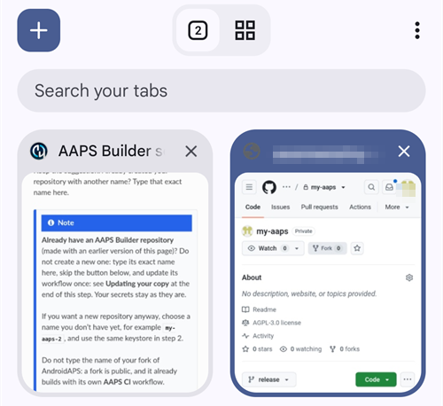
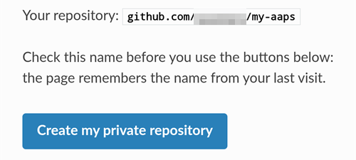
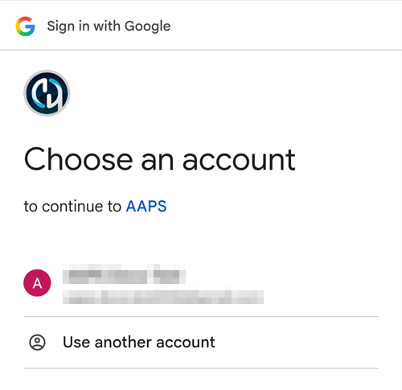
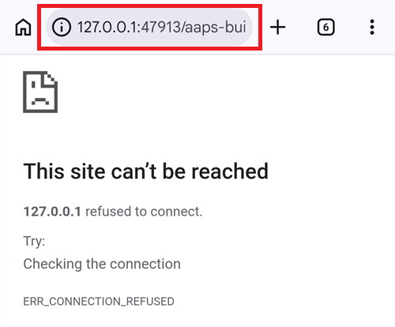
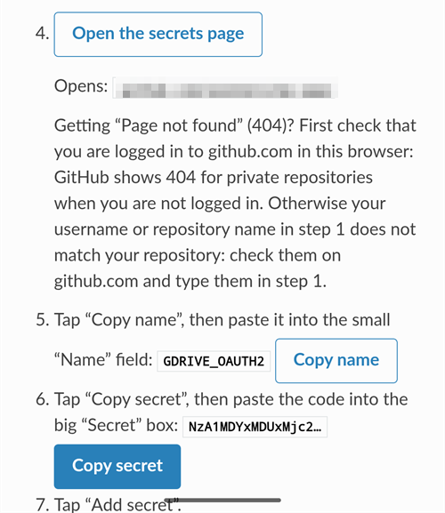

(aaps-builder)=

# Budowanie w przeglądarce z AAPS Builder

```{note}
To zalecany sposób budowania AAPS na **telefonie z Androidem**. Działa też w każdej przeglądarce na komputerze. Inne sposoby budowania na komputerze lub iPhonie znajdziesz w przeglądzie [Budowanie w przeglądarce](BrowserBuild.md).
```

```{contents} In this page
:backlinks: entry
:depth: 2
```

**AAPS Builder** buduje dla ciebie aplikację AAPS w GitHub, darmowym serwisie do przechowywania kodu. Nie musisz nic instalować na telefonie ani otwierać żadnego pliku przygotowawczego.

Strona konfiguracji przeprowadzi cię przez cały proces. Za pierwszym razem zajmuje to około 10 minut:

1. Utwórz własną **prywatną kopię** AAPS Builder na swoim koncie GitHub: strona konfiguracji otworzy GitHub z wypełnionymi polami, ty tylko potwierdzasz. Workflow budowania, czyli plik, który mówi GitHubowi, jak zbudować AAPS, jest już w niej.
2. Utwórz lub prześlij swój **klucz podpisu** (magazyn kluczy, keystore).
3. Przekaż klucz do swojego repozytorium jako **sekret** (secret) GitHub.
4. **Zbuduj** aplikację. Jedno budowanie trwa od 15 do 30 minut.
5. **Pobierz i zainstaluj** aplikację na telefonie.

**Nie** musisz robić forka AndroidAPS: kod źródłowy AAPS jest pobierany z oficjalnego repozytorium AndroidAPS przy każdym budowaniu. **Nie** potrzebujesz też Dysku Google: aplikację pobierasz bezpośrednio z GitHub.

```{admonition} Where the code comes from
:class: note

Workflow budowania jest utrzymywany przez deweloperów AAPS w repozytorium [nightscout/aaps-builder](https://github.com/nightscout/aaps-builder), a twoje repozytorium jest jego kopią. [Workflow](https://github.com/nightscout/aaps-builder/blob/main/.github/workflows/build.yml) w twojej kopii jest krótki: uruchamia [kroki budowania](https://github.com/nightscout/aaps-builder/blob/main/.github/workflows/aaps-builder.yml) przechowywane w tamtym repozytorium, więc ulepszenia docierają do ciebie bez żadnej zmiany w twoim repozytorium. Możesz przeczytać oba pliki. Podczas budowania workflow pobiera tylko oficjalny kod źródłowy AAPS i narzędzia do budowania samego GitHub. Twój magazyn kluczy nigdy nie opuszcza twojej przeglądarki i twojego prywatnego repozytorium.
```

(aaps-builder-before-you-start)=

## Zanim zaczniesz

Potrzebujesz:

- **Konta GitHub** (darmowego). Jeśli go nie masz, najpierw utwórz je na [github.com](https://github.com/signup).
- **Przeglądarki internetowej**: Chrome na telefonie albo dowolnej przeglądarki na komputerze. Zanim zaczniesz, zaloguj się w tej przeglądarce na github.com.
- **Masz na telefonie aplikację GitHub?** Możesz ją zostawić. Niektóre przyciski strony konfiguracji otworzą wtedy aplikację zamiast Chrome. Budowanie działa w aplikacji, ale aplikacja **nie może pobrać** gotowego AAPS: [krok 5](#aaps-builder-step5) pokazuje, jak przejść do Chrome, aby go pobrać.
- Swojego **istniejącego magazynu kluczy** (plik `.jks`), jego hasła i aliasu, jeśli już wcześniej budowałeś AAPS i chcesz go zaktualizować bez ponownej instalacji.

```{warning}
**Twoje repozytorium do budowania musi pozostać prywatne.** Wszystko, co powstaje podczas budowania, widzi każdy, kto może zobaczyć repozytorium. Strona konfiguracji tworzy dla ciebie prywatne repozytorium. Nigdy nie zmieniaj go na publiczne i nie rób zamiast tego **forka** AAPS Builder: fork jest zawsze publiczny.

Prywatne repozytorium dostaje 2000 darmowych minut GitHub Actions miesięcznie. To wystarczy na kilka budowań.
```

```{warning}
**Nowy klucz czy istniejący klucz: od tego zależy, czy możesz zaktualizować AAPS.**

- **Masz już AAPS na telefonie, zbudowany z magazynem kluczy, który nadal masz**: na stronie konfiguracji wybierz **I already have a keystore** i prześlij go. Następne budowanie zaktualizuje istniejący AAPS. Budowałeś AAPS poprzednią metodą w przeglądarce (własny fork)? Twój magazyn kluczy jest w twoim forku: [najpierw zrób jego kopię](#aaps-builder-from-fork).
- **Budujesz AAPS po raz pierwszy albo zgubiłeś magazyn kluczy lub jego hasło**: wybierz **Create a new key**. Aplikacja podpisana nowym kluczem **nie może zaktualizować** AAPS podpisanego innym kluczem. Musisz wyeksportować ustawienia, skopiować plik poza telefon, odinstalować stary AAPS, zainstalować nowy, a potem zaimportować ustawienia: zobacz [Ponowna instalacja AAPS z nowym magazynem kluczy](#reinstall-aaps).

Potem zawsze używaj tego samego klucza. Gdy tworzysz nowy klucz, pobierz kopię zapasową, którą oferuje strona, i przechowuj ją razem z hasłem i aliasem (`key0`) w bezpiecznym miejscu poza telefonem.
```

(aaps-builder-from-fork)=

## Przejście z poprzedniej metody budowania w przeglądarce (fork)

Pomiń tę sekcję, jeśli nigdy nie budowałeś AAPS poprzednią metodą w przeglądarce (własna kopia, czyli fork, AndroidAPS w GitHub, z plikiem przygotowawczym i Dyskiem Google).

Twój magazyn kluczy jest zapisany jako sekrety w twoim forku. GitHub nigdy więcej nie pokazuje sekretu, więc nie możesz go skopiować do nowego repozytorium. Najpierw zrób kopię swojego magazynu kluczy, a potem użyj jej w [kroku 2](#aaps-builder-step2) z opcją **I already have a keystore**.

```{warning}
Nie wybieraj **Create a new key**. AAPS zbudowany z nowym kluczem nie może zaktualizować AAPS na twoim telefonie.
```

Który przypadek dotyczy ciebie?

- **Użyłeś Opcji 2** (przesłałeś własny magazyn kluczy z Android Studio) i nadal masz plik `.jks`, jego hasła i alias: tutaj nie musisz nic robić. Użyj tego pliku w kroku 2.
- **Użyłeś Opcji 1** (klucz utworzył plik przygotowawczy) albo nie masz już pliku magazynu kluczy: wyeksportuj go ze swojego forka, jak opisano poniżej.

Aby wyeksportować magazyn kluczy ze swojego forka:

1. W swoim forku otwórz **Settings** → **Secrets and variables** → **Actions** i dodaj sekret o nazwie `ZIP_PASSWORD`. Wybierz hasło tylko z angielskich liter i cyfr. Chroni ono plik, który zaraz utworzysz.
2. Otwórz kartę **Actions** swojego forka, dotknij **CI Keystore Export**, a potem **Run workflow**. Więcej szczegółów: [Eksportuj swój magazyn kluczy](#ci-keystore-export).
3. Gdy przy uruchomieniu pojawi się zielony znaczek, otwórz swój Dysk Google: plik `keystore.zip` jest w folderze **AAPS** → **KeyStore**. Jeśli uruchomienie nie uda się na kroku z Dyskiem Google, dostęp twojego forka do Dysku Google wygasł: zobacz [Wygasł token odświeżania Google](#aaps-ci-google-token-expired).
4. Pobierz `keystore.zip` i otwórz go za pomocą swojego `ZIP_PASSWORD`: na komputerze albo na telefonie w menedżerze plików, który potrafi otwierać pliki ZIP chronione hasłem. Zawiera on:
   - `keystore.jks`: twój magazyn kluczy,
   - `keyStoreInfo.txt`: twoje `KEYSTORE_PASSWORD`, `KEY_PASSWORD` i `ALIAS` (zwykle `key0`).
5. Skopiuj `keystore.jks` na telefon (albo na Dysk Google, aby wybrać go stamtąd).

W [kroku 2](#aaps-builder-step2) na stronie konfiguracji:

1. Dotknij **I already have a keystore**.
2. W polu **Keystore file** wybierz `keystore.jks`.
3. W polu **Keystore password** wpisz `KEYSTORE_PASSWORD` z pliku `keyStoreInfo.txt`.
4. W polu **Key alias** wybierz lub wpisz `ALIAS` z pliku `keyStoreInfo.txt`.
5. Jeśli `KEY_PASSWORD` jest inne niż `KEYSTORE_PASSWORD`, odznacz **Key password is the same as the keystore password** i wpisz `KEY_PASSWORD`.

Przechowuj `keystore.zip` i jego `ZIP_PASSWORD` w bezpiecznym miejscu poza telefonem: to kopia zapasowa twojego klucza.

Aby zapisywać na Dysku Google także budowania z AAPS Builder, wykonaj [krok 6](#aaps-builder-google-drive): strona konfiguracji uzyska dla ciebie nowy `GDRIVE_OAUTH2`. Możesz zachować swój fork, dopóki AAPS zbudowany w AAPS Builder nie zostanie zainstalowany na twoim telefonie.

## Otwórz stronę konfiguracji

**→ [Otwórz stronę konfiguracji AAPS Builder](#aaps-builder-setup)**

Strona konfiguracji jest częścią tej dokumentacji, w twoim języku. Miej też tę stronę otwartą w innej karcie: poniższe sekcje dokładniej opisują, ze zrzutami ekranu, każdy krok strony konfiguracji.

Strona konfiguracji otwiera każdą stronę GitHub w nowej karcie Chrome. Aby wrócić do strony konfiguracji, dotknij przycisku kart obok paska adresu Chrome (kwadrat z liczbą) i wybierz stronę konfiguracji AAPS Builder.



Strona konfiguracji działa w całości w twojej przeglądarce: twój klucz i hasła nie są nigdzie wysyłane, poza sekretem GitHub, do którego sam je wklejasz. Do GitHub wysyłana jest tylko Twoja nazwa użytkownika GitHub, aby sprawdzić, czy istnieje. Strona zapamiętuje twoją nazwę użytkownika GitHub i nazwę repozytorium, więc możesz do niej wrócić w każdej chwili, aby znów otworzyć stronę sekretów lub swoje budowania.


(aaps-builder-step1)=

## Krok 1 – Utwórz prywatne repozytorium do budowania

W tym kroku na twoim koncie GitHub powstaje twoja własna prywatna kopia AAPS Builder, z gotowym workflow budowania. Tylko ty widzisz je i zbudowane w nim aplikacje.

1. Upewnij się, że w tej przeglądarce jesteś zalogowany na github.com.

2. W polu **Your GitHub username** wpisz swoją nazwę użytkownika GitHub, a nie adres e-mail. Strona sprawdza ją w GitHub: **✓ GitHub user found** oznacza, że jest poprawna.

3. W polu **Name of your repository** zostaw proponowaną nazwę `my-aaps`. Jeśli twoje repozytorium już istnieje pod inną nazwą, wpisz dokładnie tę nazwę.

   ```{note}
   **Masz już repozytorium AAPS Builder** (utworzone we wcześniejszej wersji strony konfiguracji)? Nie twórz nowego: wpisz dokładnie jego nazwę, pomiń **Create my private repository** i raz zaktualizuj jego workflow, jak opisano w [Aktualizowanie AAPS](#aaps-builder-updates). Twoje sekrety zostają bez zmian. Jeśli mimo to chcesz nowe repozytorium, wybierz nazwę, której jeszcze nie masz, na przykład `my-aaps-2`, i w kroku 2 użyj tego samego magazynu kluczy.

   Nie wpisuj nazwy swojego forka AndroidAPS: fork jest publiczny i już buduje się własnym workflow **AAPS CI**.
   ```

   

4. Sprawdź wiersz **Your repository:** pokazuje `github.com/<your username>/my-aaps`. Strona konfiguracji zapamiętuje nazwę z twojej ostatniej wizyty: sprawdź ją za każdym razem, zanim użyjesz jej przycisków.

5. Dotknij **Create my private repository**.

   

6. GitHub otworzy stronę **Create a new repository** w nowej karcie. Wszystko jest już wypełnione: w sekcji **Start with a template** szablon `nightscout/aaps-builder` z wyłączoną opcją **Include all branches**, a w sekcji **General** twoje konto jako **Owner** i wybrana przez ciebie nazwa.

   

   Niczego nie zmieniaj.

7. Przewiń w dół: w sekcji **Configuration** opcja **Choose visibility** jest już ustawiona na **Private**. Dotknij zielonego przycisku **Create repository**.

   

   GitHub pokazuje twoje nowe repozytorium: jest w nim folder `.github` (z workflow budowania) i plik `README.md`. **Wróć do karty ze stroną konfiguracji**, aby wykonać krok 2: dotknij przycisku kart obok paska adresu Chrome i wybierz stronę konfiguracji.

   

```{warning}
**Twoje nowe repozytorium jest puste**, bez żadnych plików? Nie zostało utworzone z szablonu i nie może budować. Usuń je (**Settings** → dół strony → **Delete this repository**), a potem na stronie konfiguracji jeszcze raz dotknij **Create my private repository**.
```

```{tip}
GitHub says **my-aaps already exists in this account**? You already have your repository: close the GitHub tab and go on with the setup page. If your key is already in it, continue with [step 4](#aaps-builder-step4). See [troubleshooting](#aaps-builder-ts-repo-exists).
```

(aaps-builder-step2)=

## Krok 2 – Twój klucz podpisu

Aplikacja musi być podpisana twoim własnym kluczem. Wybierz jedną z dwóch kart. Najpierw przeczytaj [ostrzeżenie o nowym lub istniejącym kluczu](#aaps-builder-before-you-start).


### Mam już magazyn kluczy (I already have a keystore)

1. Dotknij **I already have a keystore**.
2. W polu **Keystore file** wybierz swój plik `.jks` (lub `.keystore`, `.p12`, `.pfx`). Na telefonie najpierw skopiuj plik do telefonu lub na Dysk Google.
3. W polu **Keystore password** wpisz hasło magazynu kluczy.
4. W polu **Key alias** wybierz swój alias z listy albo wpisz go, jeśli nie ma listy. W magazynach kluczy utworzonych w Android Studio jest to zwykle `key0`.
5. Jeśli hasło klucza jest inne niż hasło magazynu kluczy, odznacz **Key password is the same as the keystore password** i wpisz hasło klucza.
6. Dotknij **Check and continue**.

Strona sprawdza hasło i alias na twoim urządzeniu. **Keystore OK! Continue with step 3.** oznacza, że wszystko jest w porządku. Jeśli strona pisze, że hasło zostanie sprawdzone podczas budowania, i tak przejdź dalej: budowanie pokaże Ci, jeśli coś jest nie tak.

### Utwórz nowy klucz (Create a new key)

1. Dotknij **Create a new key**.

2. Wybierz hasło i wpisz je dwa razy. Zasady: co najmniej 8 znaków, tylko litery a–z i A–Z, cyfry 0–9 oraz symbole takie jak `! ? #`. Bez spacji, bez liter ze znakami diakrytycznymi (np. ą, ę, ł) i bez znaku `|`.

3. Dotknij **Create key**. Po kilku sekundach pojawi się **Key created**.

   

4. Dotknij **Download backup (aaps-keystore.jks)**. Jeśli Chrome zapyta **Pobrać plik jeszcze raz?**, na telefonie jest już starsza kopia zapasowa o tej samej nazwie: dotknij **Pobierz ponownie**. Chrome zapisze wtedy nowy klucz jako `aaps-keystore (1).jks`: to jest plik, który pasuje do tego klucza. Zachowaj go i nie pomyl go ze starszym.

   Przechowuj te trzy rzeczy razem, w bezpiecznym miejscu poza telefonem (na przykład we własnej chmurze):

   - plik `aaps-keystore.jks`,
   - twoje hasło,
   - alias klucza: **`key0`**.

   Wszystkie trzy będą ci potrzebne, jeśli kiedyś zbudujesz AAPS w inny sposób, na przykład w Android Studio. Klucze utworzone we wcześniejszej wersji strony konfiguracji mają alias `aaps`.

   

(aaps-builder-step3)=

## Krok 3 – Przekaż klucz do repozytorium

Krok 3 odblokuje się po wykonaniu kroku 2. Twój klucz, jego hasła i alias są spakowane w jedną wartość: sekret `KEYSTORE_SET`.

1. Dotknij **Open the secrets page**.


2. GitHub otworzy stronę **New secret** twojego repozytorium. Na telefonie jest ona pod menu ustawień: przewiń w dół.


3. Przejdź do karty ze stroną konfiguracji i dotknij **Copy name**. Wróć do karty GitHub i wklej go w małe pole **Name**. Nazwa to `KEYSTORE_SET`.

4. Przejdź do karty ze stroną konfiguracji i dotknij **Copy secret**. Wróć do karty GitHub i wklej go w duże pole **Secret** (na telefonie długie naciśnięcie). Sekret to bardzo długi kod, ma tysiące znaków: strona konfiguracji pokazuje jego pierwsze znaki obok przycisku. Nie wklejaj tam słowa `KEYSTORE_SET`.

5. Dotknij **Add secret**. `KEYSTORE_SET` pojawi się teraz w sekcji **Repository secrets**.


Robisz to tylko raz.

```{tip}
GitHub pokazuje **Page not found** (404)? Najpierw sprawdź, czy jesteś zalogowany do github.com w tej przeglądarce: GitHub pokazuje 404 dla prywatnych repozytoriów, gdy nie jesteś zalogowany. W przeciwnym razie nazwa użytkownika lub nazwa repozytorium w kroku 1 nie pasuje do twojego repozytorium. Sprawdź nazwę na github.com, popraw ją w kroku 1 i dotknij przycisku jeszcze raz.
```

(aaps-builder-step4)=

## Krok 4 – Zbuduj aplikację

1. Na stronie konfiguracji dotknij **Open the build page**. GitHub otworzy stronę **Build AAPS** twojego repozytorium.

   

   Jeśli zamiast tego otworzy się **aplikacja GitHub**: dotknij **RUN WORKFLOW**, sprawdź wersję i wariant, i dotknij jeszcze raz **RUN WORKFLOW**. Aplikacja może nadal pokazywać **Nothing to see here**: przeciągnij listę w dół, aby ją odświeżyć i zobaczyć swoje budowanie. Potem przejdź do kroku 4 poniżej.

2. Jeśli GitHub zapyta, dotknij zielonego przycisku, aby włączyć workflow.

   Lista workflow pokazuje dwie pozycje: użyj **Build AAPS**. Pomiń **AAPS Builder**: zawiera kroki budowania i nie ma przycisku **Run workflow**.

3. Dotknij **Run workflow**. Otworzy się mały formularz:
   - **Version**: zostaw `latest`, aby zbudować najnowszą wersję AAPS, albo wpisz numer wersji, np. `4.0.0`.
   - **Variant**: zostaw `fullRelease` do zwykłego używania z pompą. Pozostałe warianty są opisane w sekcji [warianty budowania](#browserbuild-variant). `aapsclient3Release` buduje **AAPSClient3**, dostępny od wersji **AAPS** 4.0 (zobacz [O AAPSClient, AAPSClient2 i AAPSClient3](#remotecontrol-aapsclient-versions)).
   - Dotknij zielonego przycisku **Run workflow**.

   

4. Budowanie się zaczyna i pokazuje **In progress**, w dwóch częściach: najpierw **AAPS / Check**, potem **AAPS / Build AAPS**.

   

5. Poczekaj od 15 do 30 minut. Zielony znaczek (✓) oznacza, że budowanie się zakończyło. Czerwony krzyżyk oznacza, że się nie udało: otwórz budowanie, przeczytaj komunikat, a potem zobacz [rozwiązywanie problemów](#aaps-builder-troubleshooting).

   

   ```{tip}
   **E-mail po zakończeniu budowania:** GitHub wysyła e-mail tylko wtedy, gdy budowanie się nie uda. Aby dostawać e-mail także po udanym budowaniu: na github.com otwórz swoje zdjęcie profilowe → **Settings** → **Notifications** → **System** → **Actions** i odznacz **Only notify for failed workflows**.
   ```

Jeśli nie ma przycisku **Build AAPS** ani **Run workflow**:

- Otwórz swoje repozytorium i sprawdź, czy jest w nim folder `.github` z plikiem `workflows/build.yml`. Jeśli repozytorium jest puste, nie zostało utworzone z szablonu: usuń je (**Settings** → dół strony → **Delete this repository**) i wykonaj jeszcze raz [krok 1](#aaps-builder-step1) za pomocą przycisku.
- The file is there, but GitHub shows **This workflow does not exist**: see [troubleshooting](#aaps-builder-ts-workflow-not-found).
- Otwórz kartę **Actions**. Jeśli jest napisane, że workflow są wyłączone, dotknij zielonego przycisku, aby je włączyć, a potem dotknij **Build AAPS** na liście.

(aaps-builder-step5)=

## Krok 5 – Zainstaluj aplikację na telefonie

```{warning}
**Przed każdą aktualizacją** [wyeksportuj swoje ustawienia](#ExportImportSettings-Automating-Settings-Export) w AAPS i skopiuj plik **poza telefon** (Dysk Google, Dropbox…). Trzymaj tam też kilka starszych eksportów i pliki APK, aby zawsze móc wrócić do poprzedniej wersji.
```

1. Na telefonie otwórz stronę konfiguracji w **Chrome**. Zaloguj się na github.com, jeśli strona o to poprosi.
2. Dotknij **Open my builds**, a potem najnowszego budowania z zielonym znaczkiem.

   ```{admonition} The GitHub app opened instead of Chrome?
   :class: note

   Aplikacja GitHub nie potrafi pobierać zbudowanych aplikacji. W aplikacji otwórz najnowsze budowanie, a potem dotknij **Artifacts ↗** albo dotknij ikony udostępniania na górze i wybierz **Chrome** (albo **Copy link**, a potem wklej link w pasek adresu Chrome). Budowanie otworzy się w Chrome: tam przejdź do następnego kroku.

   Aby linki GitHub nie otwierały się w aplikacji: Android **Ustawienia** → **Aplikacje** → **GitHub** → **Otwieraj domyślnie** (Open by default) → wyłącz **Otwieraj obsługiwane linki** (Open supported links).
   ```

   

3. Przewiń w dół do podsumowania budowania i dotknij linku **Download AAPS**.

   

   ```{tip}
   Przewijaj palcem po tekście, a nie po schemacie kroków budowania: inaczej przesuwa się schemat zamiast strony.
   ```

   Możesz też przewinąć dalej w dół do **Artifacts** i dotknąć ikony pobierania obok `aaps-….apk`.

   

4. Gdy pobieranie się zakończy, otwórz menu Chrome **⋮** → **Pobrane**, dotknij `aaps-….apk` i wybierz **Zainstaluj**. Jeśli telefon zapyta, zezwól na instalowanie aplikacji z tego źródła.

   

`aaps-wear-….apk` to aplikacja na smartwatch. Pomiń ją, jeśli nie używasz smartwatcha.

Aplikacja jest przechowywana na stronie budowania przez **14 dni**. Nie widać jej w zakładce **Code** twojego repozytorium. Skopiuj ją w bezpieczne miejsce poza telefonem, razem z eksportami ustawień.

Więcej sposobów instalacji aplikacji znajdziesz na stronie [Przenoszenie i instalacja AAPS na smartfonie](TransferringAndInstallingAaps.md).

```{note}
Od września 2026 [weryfikacja deweloperów Androida](#android-developer-verification) wprowadzona przez Google może, zależnie od kraju, blokować instalację pliku APK przez dotknięcie pliku. Darmowe obejścia są opisane na tamtej stronie.
```

(aaps-builder-google-drive)=

## Krok 6 (opcjonalny) – Zapisuj aplikację także na Dysku Google

Możesz też zapisywać każde zbudowane APK na Dysku Google, w folderze `AAPS/<version>`. To jest opcjonalne: aplikacja jest zawsze dostępna na stronie budowania.

Potrzebny jest do tego jeszcze jeden sekret: `GDRIVE_OAUTH2`. Krok 6 na stronie konfiguracji uzyska go dla ciebie od Google, na telefonie lub na komputerze. **AAPS** będzie wtedy widział i zmieniał na twoim Dysku Google tylko pliki, które sam utworzy, nic więcej.

1. Na stronie konfiguracji dotknij **Connect Google Drive**. Google otworzy się w nowej karcie.

2. Wybierz swoje konto Google i zezwól na dostęp. Jeśli Google napisze, że aplikacja nie jest zweryfikowana, dotknij **Advanced** (Zaawansowane), a potem **Go to …** (Przejdź do …).

   

   

3. Nowa karta pokaże wtedy błąd, np. **This site can't be reached** albo **127.0.0.1 refused to connect**. **Tak ma być:** odpowiedź Google jest w adresie tej karty. Tap the address bar, then the copy icon next to the address (on a computer: select the whole address and copy it). Zaczyna się od `http://127.0.0.1:47913/`.

   

   

4. W ciągu kilku minut wróć do karty ze stroną konfiguracji: odpowiedź Google jest ważna tylko przez krótki czas i tylko raz. Wklej adres w pole **Paste the copied address here** i dotknij **Get GDRIVE_OAUTH2**. Strona pokaże **GDRIVE_OAUTH2 jest gotowy**.

   

   

5. Dotknij **Open the secrets page**. Dotknij **Copy name**, a potem wklej go w małe pole **Name** (nazwa to `GDRIVE_OAUTH2`). Dotknij **Copy secret**, wklej go w duże pole **Secret** i dotknij **Add secret**.

   

Od następnego budowania pliki APK są zapisywane także na Dysku Google.

Masz już wartość `GDRIVE_OAUTH2` z pliku przygotowawczego innych metod budowania w przeglądarce? Ona też działa: dodaj ją jako sekret `GDRIVE_OAUTH2`.

Google zablokuje dostęp, jeśli nie będziesz budować przez 6 miesięcy albo jeśli zmienisz hasło Google. Budowanie ci o tym powie: wtedy wykonaj te kroki jeszcze raz. Zobacz [Wygasł token odświeżania Google](#aaps-ci-google-token-expired).

(aaps-builder-updates)=

## Aktualizowanie AAPS

Twoje repozytorium nigdy niczego nie buduje samo: to ty decydujesz, kiedy budować, jaką wersję i jaki wariant. Gdy pojawi się nowa wersja AAPS:

1. [Zrób kopię zapasową ustawień](#aaps-builder-step5), jak opisano w kroku 5.
2. Zbuduj nową wersję, jak w [kroku 4](#aaps-builder-step4). Zostaw `latest` albo wpisz numer wersji.
3. Pobierz ją i zainstaluj, jak w [kroku 5](#aaps-builder-step5).

**Aktualizacje kroków budowania** docierają do ciebie same: przy każdym budowaniu twoje repozytorium uruchamia kroki budowania wydane przez deweloperów AAPS w nightscout/aaps-builder. W twoim repozytorium nic się nie zmienia i nie ma automatycznego budowania.

**Aktualizacje twojego pliku workflow** są rzadkie: tylko gdy zmienia się formularz **Run workflow**, na przykład dla nowego wariantu budowania, albo jeden raz, jeśli twoje repozytorium zostało utworzone we wcześniejszej wersji strony konfiguracji (puste repozytorium z krótkim plikiem workflow) lub ze starego szablonu. Będzie o tym napisane na stronie [Aktualizacje i zmiany w dokumentacji](../Maintenance/DocumentationUpdate.md). Twój sekret `KEYSTORE_SET` zostaje bez zmian. Na stronie konfiguracji otwórz **Updating your copy** na końcu kroku 1:

1. Dotknij **Open the newest workflow**. Na komputerze kliknij **ikonę kopiowania** („Copy raw file”) w prawym górnym rogu pliku. Na telefonie otwórz zamiast tego **wersję tekstową**, przytrzymaj palec na tekście, a potem wybierz **Zaznacz wszystko** i **Kopiuj**.
2. Tap **Open my workflow file**, then the **⋯** menu at the top right of the file and **Edit file… In place** (on a computer, click the pencil).
3. Zastąp cały tekst skopiowanym workflow (na telefonie długie naciśnięcie: **Zaznacz wszystko**, a potem **Wklej**).
4. Dotknij **Commit changes…**, a potem **Commit changes**.

W pierwszym wierszu pliku jest jego wersja.

## Rozwiązywanie problemów

Something went wrong? See [AAPS Builder troubleshooting](#aaps-builder-troubleshooting).

```{toctree}
:hidden:

Strona konfiguracji AAPS Builder <BrowserBuildAapsBuilderSetup.md>
```
