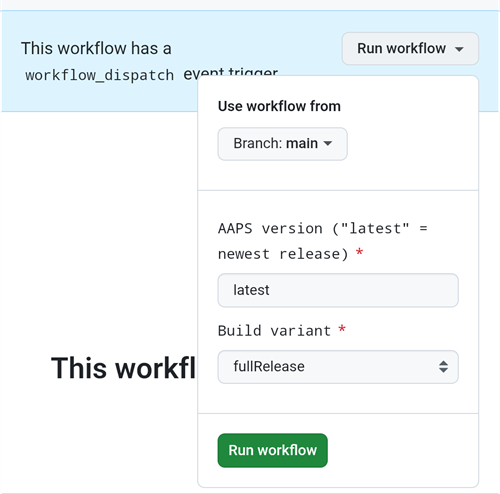

(aaps-builder)=

# Budowanie w przeglądarce z AAPS Builder

```{note}
To zalecany sposób budowania AAPS na **telefonie z Androidem**. Działa też w każdej przeglądarce na komputerze. Inne sposoby budowania na komputerze lub iPhonie znajdziesz w przeglądzie [Budowanie w przeglądarce](BrowserBuild.md).
```

```{contents} In this page
:backlinks: entry
:depth: 2
```

**AAPS Builder** buduje dla ciebie aplikację AAPS w GitHub, darmowym serwisie do przechowywania kodu. Nie musisz nic instalować na telefonie ani otwierać żadnego pliku przygotowawczego.

A setup page walks you through it. Za pierwszym razem zajmuje to około 10 minut:

1. Create your own **private copy** of AAPS Builder in your GitHub account: the setup page opens GitHub with everything filled in, you only confirm. The build workflow, the file that tells GitHub how to build AAPS, is already in it.
2. Create or upload your **signing key** (the keystore).
3. Give the key to your repository as a GitHub **secret**.
4. **Build** the app. One build takes 15 to 30 minutes.
5. **Download and install** the app on your phone.

**Nie** musisz robić forka AndroidAPS: kod źródłowy AAPS jest pobierany z oficjalnego repozytorium AndroidAPS przy każdym budowaniu. **Nie** potrzebujesz też Dysku Google: aplikację pobierasz bezpośrednio z GitHub.

```{admonition} Where the code comes from
:class: note

The build workflow is maintained by the AAPS developers in the [nightscout/aaps-builder](https://github.com/nightscout/aaps-builder) repository, and your repository is a copy of it. The [workflow](https://github.com/nightscout/aaps-builder/blob/main/.github/workflows/build.yml) in your copy is short: it runs the [build steps](https://github.com/nightscout/aaps-builder/blob/main/.github/workflows/aaps-builder.yml) kept in that repository, so improvements reach you without any change to your repository. You can read both files. Podczas budowania workflow pobiera tylko oficjalny kod źródłowy AAPS i narzędzia do budowania samego GitHub. Twój magazyn kluczy nigdy nie opuszcza twojej przeglądarki i twojego prywatnego repozytorium.
```

(aaps-builder-before-you-start)=

## Zanim zaczniesz

Potrzebujesz:

- **Konta GitHub** (darmowego). Jeśli go nie masz, najpierw utwórz je na [github.com](https://github.com/signup).
- **Przeglądarki internetowej**: Chrome na telefonie albo dowolnej przeglądarki na komputerze. Zanim zaczniesz, zaloguj się w tej przeglądarce na github.com.
- **Masz na telefonie aplikację GitHub?** Możesz ją zostawić. Niektóre przyciski strony konfiguracji otworzą wtedy aplikację zamiast Chrome. Building works in the app, but the app **cannot download** the finished AAPS: [step 5](#aaps-builder-step5) shows how to switch to Chrome for the download.
- Swojego **istniejącego magazynu kluczy** (plik `.jks`), jego hasła i aliasu, jeśli już wcześniej budowałeś AAPS i chcesz go zaktualizować bez ponownej instalacji.

```{warning}
**Twoje repozytorium do budowania musi pozostać prywatne.** Wszystko, co powstaje podczas budowania, widzi każdy, kto może zobaczyć repozytorium. Strona konfiguracji tworzy dla ciebie prywatne repozytorium. Never change it to public, and don't **fork** AAPS Builder instead: a fork is always public.

Prywatne repozytorium dostaje 2000 darmowych minut GitHub Actions miesięcznie. To wystarczy na kilka budowań.
```

```{warning}
**Nowy klucz czy istniejący klucz: od tego zależy, czy możesz zaktualizować AAPS.**

- **Masz już AAPS na telefonie, zbudowany z magazynem kluczy, który nadal masz**: na stronie konfiguracji wybierz **I already have a keystore** i prześlij go. Następne budowanie zaktualizuje istniejący AAPS. Budowałeś AAPS poprzednią metodą w przeglądarce (własny fork)? Twój magazyn kluczy jest w twoim forku: [najpierw zrób jego kopię](#aaps-builder-from-fork).
- **Budujesz AAPS po raz pierwszy albo zgubiłeś magazyn kluczy lub jego hasło**: wybierz **Create a new key**. Aplikacja podpisana nowym kluczem **nie może zaktualizować** AAPS podpisanego innym kluczem. Musisz wyeksportować ustawienia, skopiować plik poza telefon, odinstalować stary AAPS, zainstalować nowy, a potem zaimportować ustawienia: zobacz [Ponowna instalacja AAPS z nowym magazynem kluczy](#reinstall-aaps).

Potem zawsze używaj tego samego klucza. Gdy tworzysz nowy klucz, pobierz kopię zapasową, którą oferuje strona, i przechowuj ją razem z hasłem i aliasem (`key0`) w bezpiecznym miejscu poza telefonem.
```

(aaps-builder-from-fork)=

## Przejście z poprzedniej metody budowania w przeglądarce (fork)

Pomiń tę sekcję, jeśli nigdy nie budowałeś AAPS poprzednią metodą w przeglądarce (własna kopia, czyli fork, AndroidAPS w GitHub, z plikiem przygotowawczym i Dyskiem Google).

Twój magazyn kluczy jest zapisany jako sekrety w twoim forku. GitHub nigdy więcej nie pokazuje sekretu, więc nie możesz go skopiować do nowego repozytorium. Get a copy of your keystore first, then use it in [step 2](#aaps-builder-step2) with **I already have a keystore**.

```{warning}
Nie wybieraj **Create a new key**. AAPS zbudowany z nowym kluczem nie może zaktualizować AAPS na twoim telefonie.
```

Który przypadek dotyczy ciebie?

- **Użyłeś Opcji 2** (przesłałeś własny magazyn kluczy z Android Studio) i nadal masz plik `.jks`, jego hasła i alias: tutaj nie musisz nic robić. Use that file in step 2.
- **Użyłeś Opcji 1** (klucz utworzył plik przygotowawczy) albo nie masz już pliku magazynu kluczy: wyeksportuj go ze swojego forka, jak opisano poniżej.

Aby wyeksportować magazyn kluczy ze swojego forka:

1. W swoim forku otwórz **Settings** → **Secrets and variables** → **Actions** i dodaj sekret o nazwie `ZIP_PASSWORD`. Wybierz hasło tylko z angielskich liter i cyfr. Chroni ono plik, który zaraz utworzysz.
2. Otwórz kartę **Actions** swojego forka, dotknij **CI Keystore Export**, a potem **Run workflow**. Więcej szczegółów: [Eksportuj swój magazyn kluczy](#ci-keystore-export).
3. Gdy przy uruchomieniu pojawi się zielony znaczek, otwórz swój Dysk Google: plik `keystore.zip` jest w folderze **AAPS** → **KeyStore**. Jeśli uruchomienie nie uda się na kroku z Dyskiem Google, dostęp twojego forka do Dysku Google wygasł: zobacz [Wygasł token odświeżania Google](#aaps-ci-google-token-expired).
4. Pobierz `keystore.zip` i otwórz go za pomocą swojego `ZIP_PASSWORD`: na komputerze albo na telefonie w menedżerze plików, który potrafi otwierać pliki ZIP chronione hasłem. Zawiera on:
   - `keystore.jks`: twój magazyn kluczy,
   - `keyStoreInfo.txt`: twoje `KEYSTORE_PASSWORD`, `KEY_PASSWORD` i `ALIAS` (zwykle `key0`).
5. Skopiuj `keystore.jks` na telefon (albo na Dysk Google, aby wybrać go stamtąd).

In [step 2](#aaps-builder-step2) of the setup page:

1. Dotknij **I already have a keystore**.
2. W polu **Keystore file** wybierz `keystore.jks`.
3. W polu **Keystore password** wpisz `KEYSTORE_PASSWORD` z pliku `keyStoreInfo.txt`.
4. W polu **Key alias** wybierz lub wpisz `ALIAS` z pliku `keyStoreInfo.txt`.
5. Jeśli `KEY_PASSWORD` jest inne niż `KEYSTORE_PASSWORD`, odznacz **Key password is the same as the keystore password** i wpisz `KEY_PASSWORD`.

Przechowuj `keystore.zip` i jego `ZIP_PASSWORD` w bezpiecznym miejscu poza telefonem: to kopia zapasowa twojego klucza.

To also save the builds of AAPS Builder in Google Drive, do [step 6](#aaps-builder-google-drive): the setup page gets a new `GDRIVE_OAUTH2` for you. Możesz zachować swój fork, dopóki AAPS zbudowany w AAPS Builder nie zostanie zainstalowany na twoim telefonie.

## Otwórz stronę konfiguracji

**→ [Otwórz stronę konfiguracji AAPS Builder](#aaps-builder-setup)**

The setup page is part of this documentation, in your language. Keep this page open in another tab as well: the sections below explain each step of the setup page in more detail, with screenshots.

Strona konfiguracji otwiera każdą stronę GitHub w nowej karcie Chrome. Aby wrócić do strony konfiguracji, dotknij przycisku kart obok paska adresu Chrome (kwadrat z liczbą) i wybierz stronę konfiguracji AAPS Builder.

Strona konfiguracji działa w całości w twojej przeglądarce: twój klucz i hasła nie są nigdzie wysyłane, poza sekretem GitHub, do którego sam je wklejasz. Do GitHub wysyłana jest tylko Twoja nazwa użytkownika GitHub, aby sprawdzić, czy istnieje. Strona zapamiętuje twoją nazwę użytkownika GitHub i nazwę repozytorium, więc możesz do niej wrócić w każdej chwili, aby znów otworzyć stronę sekretów lub swoje budowania.


(aaps-builder-step1)=

## Krok 1 – Utwórz prywatne repozytorium do budowania

This step creates your own private copy of AAPS Builder in your GitHub account, with the build workflow already in it. Tylko ty widzisz je i zbudowane w nim aplikacje.

1. Upewnij się, że w tej przeglądarce jesteś zalogowany na github.com.

2. W polu **Your GitHub username** wpisz swoją nazwę użytkownika GitHub, a nie adres e-mail. Strona sprawdza ją w GitHub: **✓ GitHub user found** oznacza, że jest poprawna.

3. W polu **Name of your repository** zostaw proponowaną nazwę `my-aaps`. Jeśli twoje repozytorium już istnieje pod inną nazwą, wpisz dokładnie tę nazwę.

   ```{note}
   **Already have an AAPS Builder repository** (made with an earlier version of the setup page)? Don't create a new one: type its exact name, skip **Create my private repository**, and update its workflow once as explained in [Updating AAPS](#aaps-builder-updates). Your secrets stay as they are. If you want a new repository anyway, choose a name you don't have yet, for example `my-aaps-2`, and use the same keystore in step 2.

   Don't type the name of your fork of AndroidAPS: a fork is public, and it already builds with its own **AAPS CI** workflow.
   ```

   

4. Sprawdź wiersz **Your repository:** pokazuje `github.com/<your username>/my-aaps`. The setup page remembers the name from your last visit: check it every time before you use its buttons.

5. Dotknij **Create my private repository**.

   

6. GitHub opens **Create a new repository** in a new tab. Everything is already filled in: under **Start with a template**, the template `nightscout/aaps-builder` with **Include all branches** off, and under **General**, your account as **Owner** and the name you chose.

   

   Don't change anything.

7. Scroll down: under **Configuration**, **Choose visibility** is already **Private**. Tap the green **Create repository** button.

   

   GitHub shows your new repository: it contains a folder `.github` (with the build workflow) and a file `README.md`. **Wróć do karty ze stroną konfiguracji**, aby wykonać krok 2: dotknij przycisku kart obok paska adresu Chrome i wybierz stronę konfiguracji.

```{warning}
**Your new repository is empty**, with no files? It was not created from the template, and it cannot build. Delete it (**Settings** → bottom of the page → **Delete this repository**), then tap **Create my private repository** on the setup page again.
```

(aaps-builder-step2)=

## Step 2 – Your signing key

Aplikacja musi być podpisana twoim własnym kluczem. Wybierz jedną z dwóch kart. Najpierw przeczytaj [ostrzeżenie o nowym lub istniejącym kluczu](#aaps-builder-before-you-start).


### Mam już magazyn kluczy (I already have a keystore)

1. Dotknij **I already have a keystore**.
2. W polu **Keystore file** wybierz swój plik `.jks` (lub `.keystore`, `.p12`, `.pfx`). Na telefonie najpierw skopiuj plik do telefonu lub na Dysk Google.
3. W polu **Keystore password** wpisz hasło magazynu kluczy.
4. W polu **Key alias** wybierz swój alias z listy albo wpisz go, jeśli nie ma listy. W magazynach kluczy utworzonych w Android Studio jest to zwykle `key0`.
5. Jeśli hasło klucza jest inne niż hasło magazynu kluczy, odznacz **Key password is the same as the keystore password** i wpisz hasło klucza.
6. Dotknij **Check and continue**.

Strona sprawdza hasło i alias na twoim urządzeniu. **Keystore OK! Continue with step 3.** means everything is right. Jeśli strona pisze, że hasło zostanie sprawdzone podczas budowania, i tak przejdź dalej: budowanie pokaże Ci, jeśli coś jest nie tak.

### Utwórz nowy klucz (Create a new key)

1. Dotknij **Create a new key**.

2. Wybierz hasło i wpisz je dwa razy. Zasady: co najmniej 8 znaków, tylko litery a–z i A–Z, cyfry 0–9 oraz symbole takie jak `! ? #`. Bez spacji, bez liter ze znakami diakrytycznymi (np. ą, ę, ł) i bez znaku `|`.

3. Dotknij **Create key**. Po kilku sekundach pojawi się **Key created**.

   

4. Dotknij **Download backup (aaps-keystore.jks)**. Jeśli Chrome zapyta **Pobrać plik jeszcze raz?**, na telefonie jest już starsza kopia zapasowa o tej samej nazwie: dotknij **Pobierz ponownie**. Chrome zapisze wtedy nowy klucz jako `aaps-keystore (1).jks`: to jest plik, który pasuje do tego klucza. Zachowaj go i nie pomyl go ze starszym.

   Przechowuj te trzy rzeczy razem, w bezpiecznym miejscu poza telefonem (na przykład we własnej chmurze):

   - plik `aaps-keystore.jks`,
   - twoje hasło,
   - alias klucza: **`key0`**.

   Wszystkie trzy będą ci potrzebne, jeśli kiedyś zbudujesz AAPS w inny sposób, na przykład w Android Studio. Klucze utworzone we wcześniejszej wersji strony konfiguracji mają alias `aaps`.

   

(aaps-builder-step3)=

## Step 3 – Give the key to your repository

Step 3 unlocks when step 2 is done. Twój klucz, jego hasła i alias są spakowane w jedną wartość: sekret `KEYSTORE_SET`.

1. Dotknij **Open the secrets page**.


2. GitHub otworzy stronę **New secret** twojego repozytorium. Na telefonie jest ona pod menu ustawień: przewiń w dół.


3. Przejdź do karty ze stroną konfiguracji i dotknij **Copy name**. Wróć do karty GitHub i wklej go w małe pole **Name**. Nazwa to `KEYSTORE_SET`.

4. Przejdź do karty ze stroną konfiguracji i dotknij **Copy secret**. Wróć do karty GitHub i wklej go w duże pole **Secret** (na telefonie długie naciśnięcie). Sekret to bardzo długi kod, ma tysiące znaków: strona konfiguracji pokazuje jego pierwsze znaki obok przycisku. Nie wklejaj tam słowa `KEYSTORE_SET`.

5. Dotknij **Add secret**. `KEYSTORE_SET` pojawi się teraz w sekcji **Repository secrets**.


Robisz to tylko raz.

```{tip}
GitHub pokazuje **Page not found** (404)? Najpierw sprawdź, czy jesteś zalogowany do github.com w tej przeglądarce: GitHub pokazuje 404 dla prywatnych repozytoriów, gdy nie jesteś zalogowany. W przeciwnym razie nazwa użytkownika lub nazwa repozytorium w kroku 1 nie pasuje do twojego repozytorium. Sprawdź nazwę na github.com, popraw ją w kroku 1 i dotknij przycisku jeszcze raz.
```

(aaps-builder-step4)=

## Step 4 – Build the app

1. Na stronie konfiguracji dotknij **Open the build page**. GitHub otworzy stronę **Build AAPS** twojego repozytorium.

   

   Jeśli zamiast tego otworzy się **aplikacja GitHub**: dotknij **RUN WORKFLOW**, sprawdź wersję i wariant, i dotknij jeszcze raz **RUN WORKFLOW**. Aplikacja może nadal pokazywać **Nothing to see here**: przeciągnij listę w dół, aby ją odświeżyć i zobaczyć swoje budowanie. Potem przejdź do kroku 4 poniżej.

2. Jeśli GitHub zapyta, dotknij zielonego przycisku, aby włączyć workflow.
3. Dotknij **Run workflow**. Otworzy się mały formularz:
   - **Version**: keep `latest` to build the newest AAPS release, or type a release number such as `4.0.0`.
   - **Variant**: zostaw `fullRelease` do zwykłego używania z pompą. Pozostałe warianty są opisane w sekcji [warianty budowania](#browserbuild-variant). `aapsclient3Release` buduje **AAPSClient3**, dostępny od wersji **AAPS** 4.0 (zobacz [O AAPSClient, AAPSClient2 i AAPSClient3](#remotecontrol-aapsclient-versions)).
   - Dotknij zielonego przycisku **Run workflow**.

   

4. Budowanie się zaczyna i pokazuje **In progress**, w dwóch częściach: najpierw **AAPS / Check**, potem **AAPS / Build AAPS**.

   

5. Poczekaj od 15 do 30 minut. Zielony znaczek (✓) oznacza, że budowanie się zakończyło. Czerwony krzyżyk oznacza, że się nie udało: otwórz budowanie, przeczytaj komunikat, a potem zobacz [rozwiązywanie problemów](#aaps-builder-troubleshooting).

   

   ```{tip}
   **E-mail po zakończeniu budowania:** GitHub wysyła e-mail tylko wtedy, gdy budowanie się nie uda. Aby dostawać e-mail także po udanym budowaniu: na github.com otwórz swoje zdjęcie profilowe → **Settings** → **Notifications** → **System** → **Actions** i odznacz **Only notify for failed workflows**.
   ```

Jeśli nie ma przycisku **Build AAPS** ani **Run workflow**:

- Open your repository and check that it has a folder `.github` with the file `workflows/build.yml`. If the repository is empty, it was not created from the template: delete it (**Settings** → bottom of the page → **Delete this repository**) and do [step 1](#aaps-builder-step1) again with the button.
- Otwórz kartę **Actions**. Jeśli jest napisane, że workflow są wyłączone, dotknij zielonego przycisku, aby je włączyć, a potem dotknij **Build AAPS** na liście.

(aaps-builder-step5)=

## Step 5 – Install the app on your phone

```{warning}
**Przed każdą aktualizacją** [wyeksportuj swoje ustawienia](#ExportImportSettings-Automating-Settings-Export) w AAPS i skopiuj plik **poza telefon** (Dysk Google, Dropbox…). Trzymaj tam też kilka starszych eksportów i pliki APK, aby zawsze móc wrócić do poprzedniej wersji.
```

1. Na telefonie otwórz stronę konfiguracji w **Chrome**. Zaloguj się na github.com, jeśli strona o to poprosi.
2. Dotknij **Open my builds**, a potem najnowszego budowania z zielonym znaczkiem.

   ```{admonition} The GitHub app opened instead of Chrome?
   :class: note

   Aplikacja GitHub nie potrafi pobierać zbudowanych aplikacji. W aplikacji otwórz najnowsze budowanie, a potem dotknij **Artifacts ↗** albo dotknij ikony udostępniania na górze i wybierz **Chrome** (albo **Copy link**, a potem wklej link w pasek adresu Chrome). Budowanie otworzy się w Chrome: tam przejdź do następnego kroku.

   Aby linki GitHub nie otwierały się w aplikacji: Android **Ustawienia** → **Aplikacje** → **GitHub** → **Otwieraj domyślnie** (Open by default) → wyłącz **Otwieraj obsługiwane linki** (Open supported links).
   ```

   

3. Przewiń w dół do podsumowania budowania i dotknij linku **Download AAPS**.

   

   ```{tip}
   Przewijaj palcem po tekście, a nie po schemacie kroków budowania: inaczej przesuwa się schemat zamiast strony.
   ```

   Możesz też przewinąć dalej w dół do **Artifacts** i dotknąć ikony pobierania obok `aaps-….apk`.

   

4. Gdy pobieranie się zakończy, otwórz menu Chrome **⋮** → **Pobrane**, dotknij `aaps-….apk` i wybierz **Zainstaluj**. Jeśli telefon zapyta, zezwól na instalowanie aplikacji z tego źródła.

   

`aaps-wear-….apk` to aplikacja na smartwatch. Pomiń ją, jeśli nie używasz smartwatcha.

Aplikacja jest przechowywana na stronie budowania przez **14 dni**. Nie widać jej w zakładce **Code** twojego repozytorium. Skopiuj ją w bezpieczne miejsce poza telefonem, razem z eksportami ustawień.

Więcej sposobów instalacji aplikacji znajdziesz na stronie [Przenoszenie i instalacja AAPS na smartfonie](TransferringAndInstallingAaps.md).

```{note}
Od września 2026 [weryfikacja deweloperów Androida](#android-developer-verification) wprowadzona przez Google może, zależnie od kraju, blokować instalację pliku APK przez dotknięcie pliku. Darmowe obejścia są opisane na tamtej stronie.
```

(aaps-builder-google-drive)=

## Step 6 (optional) – Also save the app in Google Drive

Możesz też zapisywać każde zbudowane APK na Dysku Google, w folderze `AAPS/<version>`. To jest opcjonalne: aplikacja jest zawsze dostępna na stronie budowania.

Potrzebny jest do tego jeszcze jeden sekret: `GDRIVE_OAUTH2`. Step 6 of the setup page gets it from Google for you, on a phone or a computer. **AAPS** can then only see and change the files it creates in your Google Drive, nothing else.

1. On the setup page, tap **Connect Google Drive**. Google opens in a new tab.
2. Choose your Google account and allow access. If Google says the app is not verified, tap **Advanced**, then **Go to …**.
3. The new tab then shows an error such as **This site can't be reached** or **127.0.0.1 refused to connect**. **This is expected:** Google's answer is in the address of that tab. Tap the address bar, select the whole address (it starts with `http://127.0.0.1:47913/`) and copy it.
4. Go back to the setup page tab within a few minutes: Google's answer is only valid for a short time, and only once. Paste the address into **Paste the copied address here** and tap **Get GDRIVE_OAUTH2**. The page shows **GDRIVE_OAUTH2 is ready**.
5. Dotknij **Open the secrets page**. Dotknij **Copy name**, a potem wklej go w małe pole **Name** (nazwa to `GDRIVE_OAUTH2`). Tap **Copy secret**, paste it into the big **Secret** box and tap **Add secret**.

Od następnego budowania pliki APK są zapisywane także na Dysku Google.

Already have a `GDRIVE_OAUTH2` value from the preparation file of the other browser build methods? It works too: add it as the `GDRIVE_OAUTH2` secret.

Google zablokuje dostęp, jeśli nie będziesz budować przez 6 miesięcy albo jeśli zmienisz hasło Google. Budowanie ci o tym powie: wtedy wykonaj te kroki jeszcze raz. Zobacz [Wygasł token odświeżania Google](#aaps-ci-google-token-expired).

(aaps-builder-updates)=

## Aktualizowanie AAPS

Twoje repozytorium nigdy niczego nie buduje samo: to ty decydujesz, kiedy budować, jaką wersję i jaki wariant. Gdy pojawi się nowa wersja AAPS:

1. [Back up your settings](#aaps-builder-step5) as explained in step 5.
2. Build the new version as in [step 4](#aaps-builder-step4). Zostaw `latest` albo wpisz numer wersji.
3. Download and install it as in [step 5](#aaps-builder-step5).

**Updates of the build steps** reach you by themselves: at every build, your repository runs the build steps released by the AAPS developers in nightscout/aaps-builder. Nothing changes in your repository, and there is no automatic build.

**Updates of your workflow file** are rare: only when the **Run workflow** form changes, for example for a new build variant, or once if your repository was made with an earlier version of the setup page (an empty repository with a short workflow file) or from the old template. The [Docs updates & changes](../Maintenance/DocumentationUpdate.md) page says so. Your `KEYSTORE_SET` secret stays as it is. On the setup page, open **Updating your copy** at the end of step 1:

1. Tap **Open the newest workflow**. On a computer, click the **copy icon** ("Copy raw file") at the top right of the file. On a phone, open the **plain-text version** instead, press and hold the text, then **Select all** and **Copy**.
2. Tap **Open my workflow file**.
3. Replace the whole text with the copied workflow (long press on a phone: **Select all**, then **Paste**).
4. Tap **Commit changes…**, then **Commit changes**.

The first line of the file shows its version.

(aaps-builder-troubleshooting)=

## Rozwiązywanie problemów

To see why a build failed, [read the build log](#aaps-ci-read-the-logs): the step names are different, but you find the error the same way. You can also [update a secret](#aaps-ci-update-secret) and [run the build again](#aaps-ci-rerun) the same way.

- **No "Build AAPS" or "Run workflow" button, or the repository is empty**: the repository was not created from the template. Delete it (**Settings** → bottom of the page → **Delete this repository**) and do [step 1](#aaps-builder-step1) again with the **Create my private repository** button.
- **Budowanie zatrzymuje się z komunikatem „This repository is PUBLIC”**: w swoim repozytorium otwórz **Settings** → **General** → **Danger Zone** → **Change visibility** → **Private**, a potem zbuduj jeszcze raz.
- **"Secret KEYSTORE_SET is missing"**: do step 3 of the setup page.
- **„The secret is too short”**, **„The secret is not a valid code”** lub **„The secret does not contain a keystore”**: do sekretu wklejono zły tekst, często samo słowo `KEYSTORE_SET` albo tylko część kodu. In your repository, open **Settings** → **Secrets and variables** → **Actions**, edit `KEYSTORE_SET` and paste the long code from **Copy secret** again (redo step 2 of the setup page first if you closed it).
- **"Keystore, password or alias is wrong"**: check your keystore's password and alias, then redo steps 2 and 3 of the setup page.
- **„Version … does not exist”**: wpisana wersja nie jest wydaną wersją AAPS. Użyj `latest` albo sprawdź numer wersji.
- **"Variant … is not supported"**: your workflow file is an older version. Replace it as explained in [Updating AAPS](#aaps-builder-updates).
- **„Page not found” (404), gdy strona konfiguracji otwiera GitHub**: zaloguj się na github.com w tej samej przeglądarce (GitHub pokazuje 404 dla prywatnych repozytoriów, gdy nie jesteś zalogowany). Jeśli jesteś zalogowany, nazwa użytkownika lub nazwa repozytorium w kroku 1 na stronie konfiguracji nie pasuje do twojego repozytorium. Wpisz dokładne nazwy.
- **„No GitHub user with this name”** w kroku 1: wpisz swoją nazwę użytkownika GitHub, taką jak w profilu GitHub, a nie adres e-mail.
- **Brak linku Download albo otworzyła się aplikacja GitHub**: aplikacja GitHub nie potrafi pobierać zbudowanych aplikacji. Open the build in Chrome as explained in [step 5](#aaps-builder-step5). Aby linki GitHub nie otwierały się w aplikacji: Android **Ustawienia** → **Aplikacje** → **GitHub** → **Otwieraj domyślnie** (Open by default) → wyłącz **Otwieraj obsługiwane linki** (Open supported links).
- **"Google Drive access has expired or was revoked"**: redo [step 6](#aaps-builder-google-drive) and update the `GDRIVE_OAUTH2` secret.

For other GitHub and Google Drive issues, see [Browser build troubleshooting](../GettingHelp/BrowserBuildTroubleshooting.md).

```{toctree}
:hidden:

AAPS Builder setup page <BrowserBuildAapsBuilderSetup.md>
```
