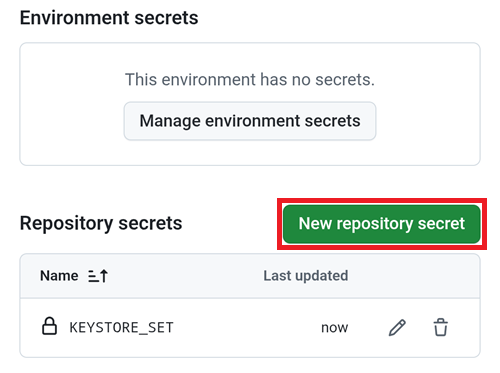

(aaps-ci-google-drive-auth)=

# Budowanie w przeglądarce – Krok 3: Autoryzuj Dysk Google

```{note}
To jest **Krok 3** [budowania w przeglądarce](BrowserBuild.md). Najpierw wykonaj [Krok 2 – Utwórz magazyn kluczy do podpisu](BrowserBuildKeystore.md).
```

```{warning}
Bez względu na to, którą wcześniejszą instrukcję wykonałeś (Opcja 1 czy Opcja 2), MUSISZ dodać autoryzację Dysku Google, aby budowanie w przeglądarce działało.
```

Uwaga: jeśli ta część jest już zrobiona według wideo, możesz teraz przejść do [Kroku 4 – Zbuduj plik APK](BrowserBuildAPK.md).

```{warning}
Jeśli autoryzacja Google się nie uruchamia albo strona przygotowania nie działa, zamknij stronę przygotowania, otwórz ponownie `aaps-ci-preparation.html` tak samo jak w Kroku 2 i zacznij ten krok od nowa. Zobacz [rozwiązywanie problemów](#aaps-ci-preparation-web).
```

Wróć do karty ze stroną przygotowania.

Przewiń w dół do sekcji Google Drive Auth (autoryzacja Dysku Google) i dotknij Start Auth.


Wybierz swoje konto Google.


Przewiń w dół i zezwól na dostęp. Strona potrzebuje go, aby uzyskać klucz autoryzacji Dysku Google.

Dotknij Continue.


Pole `GDRIVE_OAUTH2` zostanie wypełnione. Dotknij górnego przycisku Copy.


Wróć do karty GitHub.

Przewiń w dół do Repository secrets i dotknij New repository secret.

Jeśli wykonałeś Opcję 1, zobaczysz to:



Jeśli wykonałeś Opcję 2, kluczy będzie więcej:


W polu Name wklej tekst, który właśnie skopiowałeś. Przytrzymaj palec na polu tekstowym, aby pokazać menu wklejania.


Przejdź do karty ze stroną przygotowania.

Dotknij drugiego przycisku Copy.


Wróć do karty GitHub.

1. W polu Secret wklej tekst, który właśnie skopiowałeś. Przytrzymaj palec na polu tekstowym, aby pokazać menu wklejania.

2. Dotknij Add secret.


Powinieneś mieć teraz dwa (Opcja 1) albo pięć (Opcja 2) sekretów.


Po zbudowaniu GitHub będzie mógł zapisać plik APK AAPS na Twoim Dysku Google.

----

**Dalej: [Krok 4 – Zbuduj plik APK](BrowserBuildAPK.md) →**
