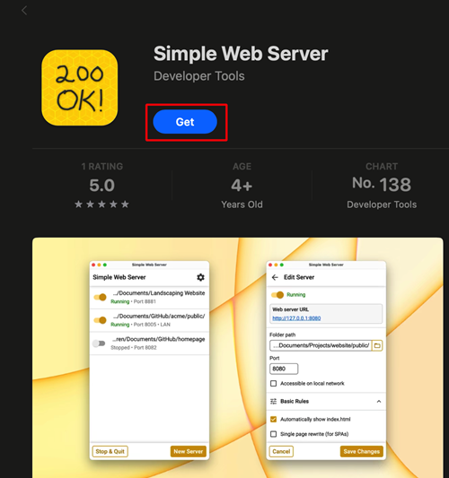

(aaps-ci-option1-computer)=

# Opcja 1 · Komputer – Wygeneruj nowy magazyn kluczy

```{note}
[Opcja 1](BrowserBuildO1.md) (wygenerowanie nowego magazynu kluczy) na **komputerze** (Windows / Mac / Linux).
```

## 1. Pobierz plik przygotowania

:::{include} BrowserBuildDownloadPrep.md
:::

## 2. Uruchom lokalny serwer i wygeneruj magazyn kluczy

Użyj komputera (Windows/Mac/Linux)

Otwórz stronę [https://simplewebserver.org/download.html](https://simplewebserver.org/download.html)

Install Simple Web Server<br/> If you are a Windows or Mac user, you can install it from the Microsoft Store or the Mac App Store.<br/> If your browser asks whether to open the store app, allow it.<br/><br/> <br/>

Przykład na Macu:

- pobierz → zainstaluj → otwórz<br/><br/> <br/><br/>

- Kliknij Get Started<br/><br/> <br/><br/>

- Kliknij New Server<br/><br/> <br/><br/>

- W polu Folder Path wybierz folder, w którym jest plik aaps-ci-preparation.html, a potem kliknij Create Server.<br/><br/> <br/><br/>

- Jeśli widzisz ten ekran, serwer jest uruchomiony.<br/><br/> <br/><br/>

- Nie zamykaj Simple Web Server. Please switch to your browser and open<br/> [http://127.0.0.1:8080/aaps-ci-preparation.html](http://127.0.0.1:8080/aaps-ci-preparation.html)<br/><br/>

- Kolejne kroki pokazuje poniższe wideo, od 1 minuty 37 sekund.

  <!--crowdin: exclude-->
  <div align="center" style="max-width: 360px; margin: auto; margin-bottom: 2em;">
    <div style="position: relative; width: 100%; aspect-ratio: 9/16;">
      <iframe
        src="https://geo.dailymotion.com/player/x9rdrpy.html?video=x9rdrpy&startTime=97&loop=true&mute=true"
        loading="lazy"
        style="position: absolute; top: 0; left: 0; width: 100%; height: 100%;"
        frameborder="0"
        allowfullscreen>
      </iframe>
    </div>
  </div>

----

**Dalej: [Krok 3 – Autoryzuj Dysk Google](BrowserBuildGoogleDrive.md) →**
