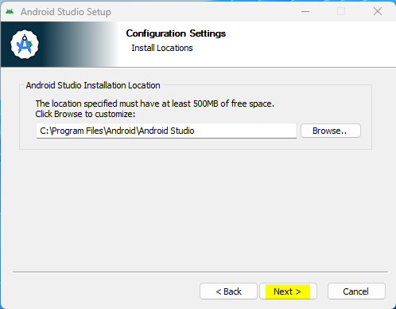
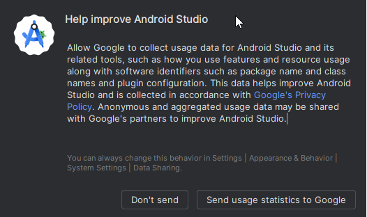
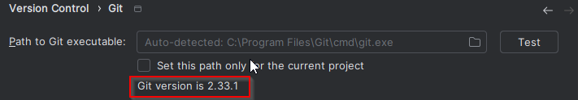
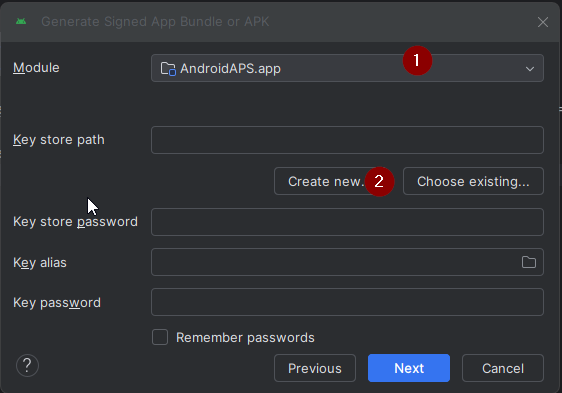

<!-- Android Studio Build, FKA Computer Build. Preserve filenames to avoid breaking URLs. -->

# Budowanie w Android Studio

To tradycyjna metoda budowania aplikacji AAPS.

Aplikację możesz zbudować bez komputera metodą [Budowanie w przeglądarce](./BrowserBuild.md).

## Zbuduj sam zamiast pobierać

**Aplikacji AAPS (pliku apk) nie można pobrać gotowej z powodu przepisów dotyczących wyrobów medycznych. Zbudowanie aplikacji na własny użytek jest legalne, ale NIE WOLNO Ci przekazywać jej kopii innym osobom!**

Szczegóły znajdziesz na stronie [FAQ](../UsefulLinks/FAQ.md).

---

(Building-APK-recommended-specification-of-computer-for-building-apk-file)=
## Wymagania dotyczące komputera i oprogramowania do budowania AAPS

* Do zbudowania pliku apk może być potrzebna konkretna wersja **[Android Studio](https://developer.android.com/studio/)**. Zobacz tabelę poniżej:

| Wersja AAPS             | Zalecana<br/>wersja<br/>Android Studio | Alternatywna<br/>wersja<br/>Android Studio | Gradle | JVM |
| ----------------------- | -------------------------------------------------- | ------------------------------------------------------ | ------ |:--- |
| 2.6.2                   | 3.6.1                                              |                                                        | 5.6.4  | 11  |
| 2.8.2.1                 | 4.1.1                                              |                                                        | 6.1.1  | 13  |
| [3.1.0.3](#version3100) | 2020.3.1                                           | testowane do Quail 4                                   | 7.3.3  | 17  |
| [3.2.0.4](#version3204) | Hedgehog (2023.1.1)                                | testowane do Quail 4                                   | 8.2    | 17  |
| [3.3.1.3](#version3300) | Ladybug Feature Drop (2024.2.2)                    | testowane do Quail 4                                   | 8.10   | 21  |
| [3.3.2](#version3300)   | Meerkat (2024.3.1)                                 | testowane do Quail 4                                   | 8.11.1 | 21  |
| [3.3.2.1](#version3321) | Narwhal (2025.1.2)                                 | testowane do Quail 4                                   | 8.13   | 21  |
| [3.4.2.6](#version3426) | Panda 2 (2025.3.2)                                 | testowane do Quail 4                                   | 9      | 21  |
| [4.0.0](#version400)    | Rabbit 2 (2026.2.2)                                | Latest                                                 | 9.8    | 21  |

„Zalecana wersja” zawiera odpowiednią wersję JVM. Zalecana wersja jest też minimalną wersją, której możesz użyć do zbudowania **AAPS**. **NIE** zbudujesz aplikacji w wersji starszej niż „zalecana”. Jeśli używasz innej wersji, mogą wystąpić problemy związane z wersją JVM. Zobacz stronę [Rozwiązywanie problemów z Android Studio](#troubleshooting_androidstudio-uncommitted-changes), aby rozwiązać te problemy. Jeśli Twojej obecnej wersji Android Studio nie ma w tabeli, MUSISZ ją najpierw zaktualizować.

Wersja Gradle jest powiązana z kodem źródłowym. Zawsze otrzymasz właściwą wersję Gradle podczas pobierania lub aktualizacji kodu źródłowego. Podajemy ją tu tylko dla informacji, nie musisz nic z nią robić.

* [32-bitowe systemy Windows](#troubleshooting_androidstudio-unable-to-start-daemon-process) nie są obsługiwane przez Android Studio. Pamiętaj, że **64-bitowy procesor i 64-bitowy system operacyjny są warunkiem obowiązkowym.** Jeśli Twój system NIE spełnia tego warunku, musisz wymienić odpowiedni sprzęt, oprogramowanie lub cały system.

<table class="tg">
<tbody>
  <tr>
    <th class="tg-baqh">System operacyjny (tylko 64-bit)</th>
    <td class="tg-baqh">Windows 10 or higher</td>
    <td class="tg-baqh">macOS 12 or higher</td>
    <td class="tg-baqh">Any Linux distribution that supports Gnome, KDE, or Unity DE;&nbsp;&nbsp;GNU C Library (glibc) 2.31 or later</td>
  </tr>
  <tr>
    <th class="tg-baqh"><p align="center">Procesor (tylko 64-bit)</th>
    <td class="tg-baqh">x86_64 CPU from 2017 or newer (Intel 8th generation Core i5, AMD Ryzen, or newer) with <a href="https://developer.android.com/studio/install" target="_blank" rel="noopener noreferrer">virtualization support</a> (Intel VT-x or AMD-V) enabled in the BIOS</td>
    <td class="tg-baqh">Apple Silicon (M1 or newer), or 6th generation Intel Core or newer (support for Intel Macs is being phased out)</td>
    <td class="tg-baqh">x86_64 CPU from 2017 or newer (Intel 8th generation Core i5, AMD Ryzen, or newer) with virtualization support (Intel VT-x or AMD-V) enabled in the BIOS</td>
  </tr>
  <tr>
    <th class="tg-baqh"><p align="center">Pamięć RAM</th>
    <td class="tg-baqh" colspan="3"><p align="center">16GB or more (8GB is the strict minimum for Android Studio alone, 32GB is recommended)</td>
  </tr>
  <tr>
    <th class="tg-baqh"><p align="center">Dysk</th>
    <td class="tg-baqh" colspan="3"><p align="center">At least 32GB free space. Zalecany jest dysk SSD.</td>
  </tr>
  <tr>
    <th class="tg-baqh"><p align="center">Rozdzielczość</th>
    <td class="tg-baqh" colspan="3"><p align="center">1280 x 800 minimum (1920 x 1080 recommended)<br></td>
  </tr>
  <tr>
    <th class="tg-baqh"><p align="center">Internet</th>
    <td class="tg-baqh" colspan="3"><p align="center">Szerokopasmowy</td>
  </tr>
</tbody>
</table>

**Zdecydowanie zalecamy (nie jest to obowiązkowe) używanie dysku SSD (Solid State Disk) zamiast HDD (Hard Disk Drive), ponieważ budowanie pliku apk AAPS trwa wtedy krócej.**  Do budowania pliku apk **AAPS** możesz nadal używać dysku HDD. Jeśli tak, budowanie może trwać długo, ale gdy już się zacznie, możesz zostawić je bez nadzoru.

## Pomoc i wsparcie podczas budowania

Jeśli podczas budowania aplikacji **AAPS** napotkasz problemy, jest osobna sekcja [**Rozwiązywanie problemów z Android Studio**](../GettingHelp/TroubleshootingAndroidStudio.md). Zajrzyj tam najpierw.

Jeśli uważasz, że coś w instrukcji budowania jest błędne, brakuje czegoś lub jest niejasne, albo nadal masz problemy, zwróć się do grupy użytkowników **AAPS** na [Facebooku](https://www.facebook.com/groups/AndroidAPSUsers) lub [Discordzie](https://discord.gg/4fQUWHZ4Mw). Jeśli chcesz sam coś zmienić (np. zaktualizować zrzuty ekranu _itp._), wyślij [pull request (PR)](../SupportingAaps/HowToEditTheDocs.md).

## Instrukcja krok po kroku: budowanie aplikacji AAPS

```{admonition} WARNING
:class: warning
Jeśli już wcześniej budowałeś AAPS, nie musisz znowu wykonywać wszystkich poniższych kroków.
Przejdź od razu do [instrukcji aktualizacji](../Maintenance/UpdateToNewVersion.md)!
```

```{contents} The overall steps for building the **AAPS** apk file
:depth: 1
:local: true
```

W tej instrukcji znajdziesz _przykładowe_ zrzuty ekranu z budowania pliku apk **AAPS**. **Android Studio** – program, którego używamy do budowania apk **AAPS** – jest regularnie aktualizowany. Dlatego zrzuty ekranu mogą różnić się od Twojej instalacji, ale nadal powinno się dać według nich postępować.

Since **Android Studio** runs on Windows, Mac OS X and Linux platforms, there might also be minor differences in the steps for the different  platforms.

(install-git-if-you-dont-have-it)=
### Zainstaluj Git

```{admonition} Why Git? 
:class: dropdown

Git to tak zwany „_system kontroli wersji_” (VCS).\
Git to program, który pozwala śledzić zmiany w kodzie i współpracować z innymi. Użyjesz Git, aby skopiować kod źródłowy **AAPS** ze strony GitHub na swój komputer. Then, you will use Android Studio on your computer to build the **AAPS** application (apk). 
```

(BuildingAaps-steps-for-installing-git)=
#### Kroki instalacji Git

1.  Sprawdź, czy nie masz już zainstalowanego **Git**. You can do this by typing “git” in the Windows search bar – if you see **“Git bash”** or some other form of Git, it is already installed and you can go straight to [installing Android Studio](#Building-APK-install-android-studio):


2. If you don’t have Git installed, download and install the latest version for your system from the "Download" section [**here**](https://git-scm.com/downloads). Powinna działać każda nowsza wersja Git. Wybierz wersję dla swojego systemu: Mac, Windows lub Linux.

**Uwaga dla użytkowników Maca:** strona Git poprowadzi Cię też przez instalację dodatkowego programu „homebrew”, który pomaga w instalacji. Jeśli instalujesz Git przez Homebrew, nie musisz zmieniać żadnych ustawień.

(Make_a_note_of_Git_path)=

* Gdy podczas instalacji pojawi się pytanie „select destination location”, zapisz, _gdzie_ instalowany jest Git (to „**ścieżka instalacji**”). Sprawdzisz ją w następnym kroku. Będzie to coś podobnego do „C:\Program Files\Git\cmd\git.exe”

*  Podczas kolejnych kroków instalacji Git po prostu akceptuj wszystkie domyślne opcje.

*  Jeśli po instalacji zapomniałeś zapisać, gdzie zainstalowano Git, możesz to sprawdzić tak: wpisz „git” w pasku wyszukiwania na komputerze, kliknij prawym przyciskiem „Git bash”, wybierz „open file location” i najedź myszą na ikonę „Git bash” – zobaczysz, gdzie jest zainstalowany.

* Przed następnym krokiem uruchom ponownie komputer.

(Building-APK-install-android-studio)=
### Zainstaluj Android Studio

- **Podczas kolejnych kroków musisz być cały czas online, bo Android Studio pobiera kilka aktualizacji**

```{admonition} What is Android Studio?
:class: dropdown
Android Studio to program, który działa na Twoim komputerze. Pozwala pobrać kod źródłowy z internetu (przez Git) i zbudować aplikacje na smartfon (i smartwatch). Budując nową lub zaktualizowaną aplikację na komputerze w Android Studio, nie „zepsujesz” obecnej wersji **AAPS**, która działa jako pętla na Twoim smartfonie. To dwa całkowicie oddzielne procesy. 
```

Jedna z najważniejszych rzeczy przy instalacji Android Studio to **cierpliwość!** Podczas instalacji i konfiguracji Android Studio pobiera dużo danych, co zajmuje czas.

```{admonition} Different UI
:class: warning
Important note: Android Studio changed its UI during the last releases. Ta instrukcja pokazuje kroki w *nowym interfejsie*. Zrzuty ekranu wykonano w wersji „Ladybug”, więc nowsze wersje mogą wyglądać trochę inaczej. Jeśli nadal używasz starego interfejsu, możesz najpierw przełączyć Android Studio na nowy interfejs według [tych instrukcji](#computerbuild-NewUI).
```

Wersja Android Studio jest bardzo ważna. Zobacz [instrukcje powyżej](#Building-APK-recommended-specification-of-computer-for-building-apk-file), aby wybrać właściwą wersję Android Studio.

Pobierz [aktualną wersję Android Studio](https://developer.android.com/studio) lub starszą wersję z [**archiwum**](https://developer.android.com/studio/archive) i zaakceptuj warunki pobierania.


Po zakończeniu pobierania uruchom pobrany program, aby zainstalować go na komputerze. Być może musisz zaakceptować lub potwierdzić ostrzeżenia Windows o pobranych aplikacjach!

Zainstaluj Android Studio, klikając „Next”, jak na poniższych zrzutach ekranu. **Nie** musisz zmieniać żadnych ustawień!


If you want to save hard disk space, you can uncheck Android Virtual Device: it is not used for building **AAPS**.




Teraz kliknij „Install”:


Gdy instalacja się zakończy, naciśnij „Next”


In the last step, click on "Finish" to start Android Studio for the first time.


Android Studio zapyta, czy chcesz pomóc w jego ulepszaniu. Wybierz dowolną opcję – nie ma to wpływu na dalsze kroki.



Zobaczysz ekran powitalny instalatora Android Studio. Naciśnij „Next”.


Jako typ instalacji wybierz „Standard”.


Sprawdź ustawienia i ponownie kliknij „Next”.


Teraz musisz zaakceptować umowy licencyjne. Po lewej stronie są dwie sekcje (1 + 3). Wybierz je po kolei i w każdej zaznacz „Accept” (2 + 4) po prawej stronie.

Potem możesz kliknąć przycisk „Finish” (5).


Teraz zostaną pobrane i zainstalowane pakiety Androida. Bądź cierpliwy i poczekaj.

Gdy to się skończy, zobaczysz poniższy ekran. Tu ponownie wybierz „Finish”.


Zobaczysz teraz ekran powitalny Android Studio.


(Building-APK-download-AAPS-code)=
### Pobierz kod AAPS

```{admonition} Why can it take a long time to download the AAPS code?
:class: dropdown

Przy pierwszym pobieraniu **AAPS** Android Studio połączy się przez internet ze stroną GitHub, aby pobrać kod źródłowy **AAPS**. Powinno to zająć około 1 minuty. 

Następnie Android Studio użyje **Gradle** (narzędzia do tworzenia aplikacji na Androida), aby ustalić, jakie inne składniki są potrzebne do zbudowania aplikacji na Twoim komputerze. 
```

Na ekranie powitalnym Android Studio sprawdź, czy po lewej jest zaznaczone „**Projects**” (1).

Potem kliknij „**Clone Repository**” (2) po prawej:


Teraz wskażesz Android Studio, skąd ma pobrać kod:


* Po lewej stronie (1) powinno być wybrane (domyślnie) „Repository URL”.
* Jako system kontroli wersji (2) powinien być wybrany (domyślnie) „Git”.
* Teraz skopiuj ten adres URL:
    ```
    https://github.com/nightscout/AndroidAPS.git
    ```
    i wklej go w pole URL (3).

* Sprawdź, czy (domyślny) folder do zapisania sklonowanego kodu nie istnieje już na Twoim komputerze (4). Możesz zmienić go na inny folder, ale pamiętaj, gdzie go zapisałeś!
* Teraz kliknij przycisk „Clone” (5).

```{admonition} INFORMATION
:class: note
Zapisz, jaki to folder. To tam jest przechowywany Twój kod źródłowy!
```

Zobaczysz teraz ekran z informacją, że repozytorium jest klonowane:


W pewnym momencie Android Studio zamknie się i uruchomi ponownie. Możesz zostać zapytany, czy ufasz temu projektowi. Kliknij „Trust project”:

  


Tylko dla użytkowników Windows: jeśli zapora sieciowa poprosi o zgodę, zezwól na dostęp:

 

Gdy repozytorium zostanie sklonowane, Android Studio otworzy sklonowany projekt.

(computerbuild-NewUI)=
```{admonition} New UI
:class: note
Android Studio niedawno zmieniło swój interfejs. Nowe instalacje Android Studio domyślnie używają nowego interfejsu!

Tylko jeśli Twoje Android Studio wygląda inaczej, może być konieczne przełączenie na nowy interfejs:
Kliknij menu (hamburger) w lewym górnym rogu, a potem wybierz **Settings** (lub **Preferences** na komputerach Apple).
W **Appearance & Behavior** przejdź do **New UI** i zaznacz **Enable new UI**. Potem uruchom ponownie Android Studio, aby zacząć go używać.

Jeśli nie znajdziesz opcji **New UI**, nie martw się: już jej używasz!
```


Gdy Android Studio się otworzy, cierpliwie poczekaj (może to potrwać kilka minut) i przede wszystkim **nie** aktualizuj projektu, jak proponuje okienko.

Android Studio automatycznie uruchomi „Gradle project sync” (synchronizację projektu). Potrwa to kilka minut. Możesz zobaczyć, że (nadal) działa:


```{admonition} NEVER UPDATE GRADLE!
:class: warning

Android Studio może zalecać aktualizację systemu gradle. **Nigdy nie aktualizuj gradle!** To prowadzi do problemów.
```

Tylko na komputerach z Windows: może pojawić się powiadomienie o działaniu Windows Defender. Kliknij **Automatically** i potwierdź – budowanie będzie szybsze!


Możesz zostawić działającą synchronizację Gradle i już teraz wykonywać kolejne kroki.

(Building-APK-set-git-path-in-preferences)=
### Ustaw ścieżkę Git w ustawieniach Android Studio

Teraz pokażemy Android Studio, gdzie jest Git, który zainstalowałeś [wcześniej](#install-git-if-you-dont-have-it).

* Tylko dla Windows: upewnij się, że uruchomiłeś ponownie komputer po [instalacji Git](#install-git-if-you-dont-have-it). Jeśli nie, uruchom teraz ponownie komputer i otwórz ponownie Android Studio

W lewym górnym rogu **Android Studio** otwórz menu (hamburger) i przejdź do **File** > **Settings** (na Windows) lub **Android Studio** > **Preferences** (na Macu). Otworzy się następujące okno. Kliknij, aby rozwinąć listę **Version Control** (1), i wybierz **Git** (2)


Check if **Android Studio** can automatically locate the correct **Path to Git executable** by clicking the button "Test" (1):


Jeśli automatyczne ustawienie się uda, obok ścieżki pojawi się Twoja obecna wersja **Git**.

   


Jeśli **git.exe** nie zostanie znaleziony automatycznie albo kliknięcie „Test” kończy się błędem, możesz:
* ręcznie wpisać ścieżkę, którą zapisałeś [wcześniej](#BuildingAaps-steps-for-installing-git), albo
* click on the folder icon (1) and manually navigate to the directory where **git.exe** was installed [earlier](#BuildingAaps-steps-for-installing-git)
* Sprawdź ustawienia przyciskiem **Test**!

  

(Building-APK-generate-signed-apk)=
### Zbuduj „podpisany” plik APK AAPS

```{admonition} Why does the AAPS app need to be "signed"?
:class: dropdown

Android wymaga, aby każda aplikacja była _podpisana_. Dzięki temu można ją później aktualizować tylko z tego samego zaufanego źródła, które wydało oryginalną aplikację. Więcej informacji na ten temat znajdziesz pod [tym linkiem](https://developer.android.com/studio/publish/app-signing.html#generate-key). 

Dla nas oznacza to tylko tyle, że tworzymy plik podpisu, czyli „keystore” (magazyn kluczy), i używamy go przy budowaniu aplikacji **AAPS**.
```


**Ważne: zanim przejdziesz dalej, upewnij się, że synchronizacja gradle zakończyła się pomyślnie!**


Kliknij menu (ikona z trzema kreskami) w lewym górnym rogu, aby otworzyć pasek menu. Wybierz **Build** (1), a potem **Generate Signed App Bundle / APK** (2)


Wybierz „APK” (1) zamiast „Android App Bundle” i kliknij „Next” (2):


Na następnym ekranie upewnij się, że „Module” jest ustawione na „AndroidAPS.app” (1). Część przed „.app” to nazwa folderu, do którego sklonowałeś kod.

(Building-APK-wearapk)=
```{admonition} INFORMATION!
:class: note
Jeśli chcesz utworzyć apk na zegarek, musisz teraz wybrać AndroidAPS.wear!
```


Kliknij „Create new...” (2), aby zacząć tworzyć magazyn kluczy.

```{admonition} INFORMATION!
:class: note
Magazyn kluczy tworzysz tylko raz.
If you have built AAPS before, do NOT create a new keystore but select your existing one and enter its passwords!
```

**_Uwaga:_** magazyn kluczy (keystore) to plik, w którym są zapisane informacje do podpisania aplikacji. Jest zaszyfrowany, a informacje są chronione hasłami.


* Kliknij ikonę „folderu” (1), aby wybrać na komputerze ścieżkę dla magazynu kluczy.

  **Nie** używaj folderu, w którym jest Twój kod źródłowy, tylko folderu, który przeniósłbyś też na nowy komputer.

```{admonition} WARNING!
:class: warning
Zapisz sobie, gdzie jest przechowywany Twój magazyn kluczy. You will need it when you build the next AAPS update!
```

* Teraz wybierz proste hasło (i zapisz je), wpisz je w polu hasła (2) i potwierdź je (2).

  Hasła do magazynu kluczy i do klucza nie muszą być skomplikowane. Jeśli w przyszłości zgubisz hasło, zobacz [Ponowna instalacja AAPS z nowym magazynem kluczy](#reinstall-aaps).

```{warning}
**Unikaj znaków specjalnych w hasłach.** Do haseł magazynu kluczy i klucza używaj tylko liter i cyfr. W szczególności nie używaj `$`, odwrotnego apostrofu (backtick), `"` ani `\`. Jeśli później przejdziesz na [Budowanie w przeglądarce](#aaps-ci-option2) i użyjesz tego samego magazynu kluczy, te znaki mogą spowodować błąd podpisywania. Zobacz [Budowanie w przeglądarce: rozwiązywanie problemów](#aaps-ci-password-special-characters).
```

* Domyślny alias (3) Twojego klucza to „key0” – nie zmieniaj go.

* Teraz potrzebujesz hasła do klucza. Dla prostoty możesz użyć tego samego hasła, którego użyłeś wyżej dla magazynu kluczy. Wpisz hasło (4) i potwierdź je.

```{admonition} WARNING!
:class: warning
Zapisz te hasła! Będziesz ich potrzebować przy budowaniu następnej aktualizacji AAPS!
```

* Domyślna ważność to 25 lat – zostaw ją bez zmian.

* Wpisz swoje imię i nazwisko (5). Inne informacje nie są wymagane, ale możesz je dodać (6-7).

* Kliknij „OK” (8), aby kontynuować:


Na stronie **Generate signed App Bundle or APK** zobaczysz teraz ścieżkę do swojego magazynu kluczy. Teraz ponownie wpisz hasło magazynu kluczy (1) i hasło klucza (2) oraz zaznacz pole (3), aby zapamiętać hasła. Wtedy nie musisz ich wpisywać przy następnym budowaniu apk (np. przy aktualizacji do nowej wersji AAPS). Kliknij „Next” (4):


Na następnym ekranie wybierz wariant budowania „fullRelease” (1) i kliknij „Create” (3). Zapamiętaj folder docelowy pokazany w (2), bo później znajdziesz tam zbudowany plik apk!

   

Android Studio zbuduje teraz apk **AAPS**. W prawym dolnym rogu pojawi się „Gradle Build running” (2). Proces zajmuje trochę czasu, zależnie od komputera i połączenia z internetem, więc **bądź cierpliwy!** Jeśli chcesz śledzić postęp budowania, kliknij mały młotek „build” (1) na dole okna Android Studio:


Teraz możesz obserwować postęp budowania:


Po zakończeniu budowania Android Studio wyświetli komunikat „BUILD SUCCESSFUL”. Może pojawić się wyskakujące powiadomienie – możesz je kliknąć i wybrać „locate”. Jeśli to przegapisz, kliknij ikonę powiadomień (1), aby otworzyć powiadomienia, a potem **locate** (2):


**_Jeśli budowanie się nie udało, zajrzyj do sekcji [Rozwiązywanie problemów z Android Studio](../GettingHelp/TroubleshootingAndroidStudio.md)._**

W okienku Notifications kliknij niebieski link „locate”:

 Otworzy się menedżer plików i pokaże plik apk, który właśnie zbudowałeś.

   

Gratulacje! Masz już zbudowany plik apk **AAPS**. W następnej części dokumentacji przeniesiesz go na smartfon.

```{tip}
Jeśli myślisz, że w przyszłości możesz chcieć używać smartwatcha z Android Wear, to najlepszy moment, aby zbudować apk AAPS Wear. Wtedy masz pewność, że będzie zgodny z Twoim apk AAPS.
```

Przejdź do następnego etapu: [Przenoszenie i instalacja **AAPS**](../SettingUpAaps/TransferringAndInstallingAaps.md).


