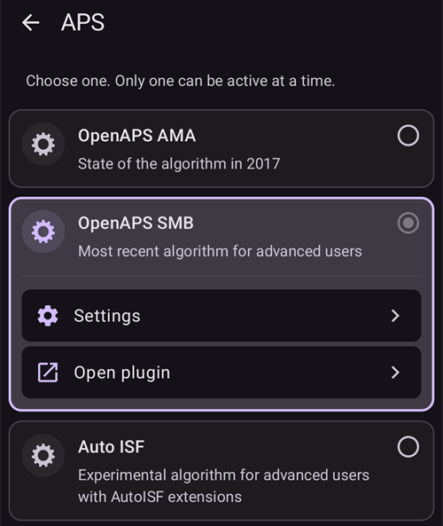

# Konfiguracja (Config Builder)

```{admonition} Przechodzisz z AAPS v3? :class: note **Config Builder** nazywa się teraz **Konfiguracja** i znajduje się w **menu** (☰). Zobacz [Co zmieniło się w AAPS v4](#v4-changes).

    <br />**Konfiguracja** (menu ☰) to miejsce, w którym wybierasz, które wtyczki są aktywne (CGM, pompa, algorytm APS, wrażliwość, synchronizacja, …), oraz otwierasz każdą wtyczkę i jej ustawienia. [Przewodnik krok po kroku](#configuration-v4) jest poniżej; reszta tej strony szczegółowo opisuje każdą sekcję.
    
    (configuration-v4)=
    ## Konfiguracja w AAPS v4
    
    W **AAPS** v4 dotknij **menu** (☰) w **lewym górnym** rogu ekranu głównego i wybierz **Konfiguracja** (*„Ustaw swoją konfigurację (CGM, pompa, ...) i włącz funkcje.”*).
    
    
    
    Wtyczki są pogrupowane według **kategorii** — na przykład *Wygładzanie*, *Kalibracja*, *Detekcja wrażliwości (sensitivity)*, *APS*, *Komunikacja* i *Ogólne*. Każdy wiersz pokazuje nazwę kategorii i **obecnie aktywną** wtyczkę (np. *APS → OpenAPS SMB*). Dotknij wiersza, aby otworzyć kategorię.
    
    
    
    W kategorii widzisz wtyczki, które są w niej dostępne. W kategoriach jednokrotnego wyboru wybierasz jedną aktywną wtyczkę; niektóre kategorie są wielokrotnego wyboru (*„Wybierz wszystkie, które pasują.”*). Każda wtyczka ma dwie akcje:
    
    - **Otwórz wtyczkę** — otwiera własny ekran wtyczki.
    - **Ustawienia** — otwiera ustawienia wtyczki (ustawienia mogą być pogrupowane w rozwijane sekcje).
    
    
    
    (configuration_sync_icon)=
    ### Ikona telefonu — „synchronizowane z telefonu pacjenta”
    
    Mała **ikona telefonu (komórki)** obok kategorii lub ustawienia oznacza, że ten element jest **synchronizowany z telefonu pacjenta (master)** — jego wartość/wybór trafia na to urządzenie przez kanał NSClientV3 (Nightscout).
    
    Na urządzeniu **opiekuna** (**AAPSClient**) te elementy są **utrzymywane w zgodności z telefonem pacjenta**. Ikona jest widoczna tylko na urządzeniu opiekuna, więc nie ma jej na zrzucie ekranu powyżej, który wykonano w głównej aplikacji **AAPS**. Na urządzeniu opiekuna zwykle pojawia się przy *Wygładzanie*, *Kalibracja*, *Detekcja wrażliwości (sensitivity)* i *APS*. Jak dokładnie telefon pacjenta i urządzenia opiekunów pozostają zgodne — i które ustawienia możesz zmienić z każdej strony — opisano w części [Sterowanie Master ↔ Client](#client-master-config-prefs).
    
    Ta sama ikona pojawia się też **w ustawieniach**, obok poszczególnych synchronizowanych opcji. W przykładzie poniżej ikonę ma *Czas odcięcia wchłaniania*; ustawienia bez ikony konfiguruje się osobno na każdym urządzeniu:
    
    
    
    Elementy **bez** ikony konfiguruje się **osobno na każdym urządzeniu**. Najważniejszym przykładem jest samo połączenie **NSClientV3 (Komunikacja)** — **Adres URL strony Nightscout**, **token dostępu** i **websockets** ustawia się osobno na każdym telefonie, więc **nie** mają one ikony telefonu.
    
    ---
    
    (Config-Builder-tab-or-hamburger-menu)=
    ## Otwieranie ekranu wtyczki
    
    Każdy ekran wtyczki możesz otworzyć na jeden z tych sposobów (karty i pole wyboru z okiem z **AAPS** v3 już nie istnieją, zobacz [Co zmieniło się w AAPS v4](#v4-changes)):
    
    - **Konfiguracja** → kategoria wtyczki → **Otwórz wtyczkę**,
    - panel **Zarządzaj** w dolnym pasku nawigacji, dla ekranów, których używasz najczęściej (Profil, Ustawienia insuliny, Pompa, Automatyzacja, Żywność...),
    - przycisk [QuickLaunch](../DailyLifeWithAaps/QuickLaunch.md), który dodajesz sam,
    - **pasek wyszukiwania** na ekranie głównym.
    
    ```{contents}
    :backlinks: entry
    :depth: 2
    

(ConfigBuilder_Profile)=

## Profil

Tego modułu nie można wyłączyć, ponieważ jest podstawową częścią **AAPS**.

Zobacz [Twój profil AAPS](../SettingUpAaps/YourAapsProfile.md), aby zrozumieć podstawy tego, co zawiera Twój **Profil**.

(insulin)= (Config-Builder-insulin)=

## Insulina


W **AAPS** 4 insuliny nie wybiera się już jako wtyczki w menu **Konfiguracja**. Otwórz **Zarządzaj → Ustawienia insuliny**, aby ustawić insulinę, której używasz.

Edytor insuliny pozwala:

* nadać profilowi **Pseudonim insuliny**, aby łatwo go rozpoznać,
* ustawić **Szczyt** (czas do maksymalnej aktywności insuliny, w minutach) i **DIA** (czas działania insuliny, w godzinach), wpisując wartość albo używając przycisków **–** / **+**,
* dotknąć przycisku gotowego ustawienia **Pobierz szczyt z** — **Novorapid** (75 min), **Fiasp** (55 min) lub **Lyumjev** (45 min) — aby jednym krokiem wpisać standardowy czas szczytu dla tej insuliny.

Dozwolone zakresy są takie same dla każdej insuliny:

* **DIA**: od 5 do 9 godzin (od 5 do 10 godzin, jeśli typ pacjenta to **Ciąża**). Zobacz [Czas działania insuliny (DIA) i szczyt](#Config-Builder-insulin-dia), aby wybrać wartość.
* **Szczyt**: od 35 do 120 minut.

Krzywe **IOB** (aktywna insulina) i **Aktywność** na dole edytora zmieniają się razem z wartościami, więc od razu widzisz, jak Twoje ustawienia kształtują działanie insuliny.

Więcej informacji o profilu insuliny, tak jak pokazuje go **AAPS**, znajdziesz [tutaj](#AapsScreens-insulin-profile).

(Config-Builder-insulin-change-active)=

### Zmiana używanej insuliny (DIA lub szczyt)

Insulina z oznaczeniem **AKTYWNY** to ta, której używa Twój bieżący profil. Jej pola są wyszarzone: nie możesz jej edytować ani usunąć. Dzięki temu nazwa insuliny w bieżącym profilu zawsze odpowiada ustawieniom, które są faktycznie używane.

Aby zmienić używane DIA lub szczyt:

1. Otwórz **Zarządzaj → Ustawienia insuliny**. Jeśli ekran otworzy się tylko do odczytu (**✏️ ołówek** na górnym pasku), dotknij ołówka i odblokuj ustawienia.
2. Dotknij **+** (*Dodaj nową insulinę*). **AAPS** tworzy kopię insuliny widocznej na ekranie.
3. Ustaw nowy **Szczyt** i/lub **DIA**, a potem dotknij ikony zapisu (w prawym górnym rogu).
4. Dotknij **▶** (*Aktywuj insulinę*) i potwierdź. Nowa insulina dostaje oznaczenie **AKTYWNY**.

```{admonition} Nazwa zawiera szczyt i DIA :class: note **AAPS** automatycznie dodaje szczyt, DIA i stężenie do nazwy insuliny (na przykład *Fiasp 55m 8h U100*), więc od razu odróżnisz swoje konfiguracje.

    <br />Możesz usunąć starą insulinę, gdy nie jest już aktywna.
    
    ### Gotowe ustawienia „Pobierz szczyt z”
    
    W **AAPS** 4 nie ma listy typów insuliny do wyboru. Każda insulina używa tej samej wykładniczej krzywej aktywności; różnią się tylko **Szczyt** i **DIA**. Gotowe ustawienia **Pobierz szczyt z** w edytorze insuliny jednym dotknięciem wpisują zalecany szczyt dla najczęściej używanych insulin (małe ⓘ obok **Pobierz szczyt z** pokazuje ich listę z wartościami szczytu). Potem nadal możesz zmienić **Szczyt** i **DIA**.
    
    Zmieniaj szczyt na inny niż zalecany tylko wtedy, gdy rozumiesz skutki tej zmiany. [Wykres krzywej insuliny](#AapsScreens-insulin-profile) pomaga zrozumieć krzywe.
    
    #### Novorapid
    
    
    
    * zalecane dla Humalog, Novolog i Novorapid (w **AAPS** v3 nazywane *Rapid-Acting Oref*)
    * Szczyt = 75 minut po wstrzyknięciu
    
    #### Fiasp
    
    
    
    * zalecane dla Fiasp (w **AAPS** v3 nazywane *Ultra-Rapid Oref*)
    * Szczyt = 55 minut po wstrzyknięciu
    
    (Config-Builder-lyumjev)=
    #### Lyumjev
    
    
    
    * zalecane dla Lyumjev
    * Szczyt = 45 minut po wstrzyknięciu
    
    #### Własny szczyt
    
    * W **AAPS** 4 nie ma osobnego typu insuliny „Swobodny-Pik Oref” (Free-Peak Oref): wpisz dowolny **Szczyt** (od 35 do 120 minut) bezpośrednio w [edytorze insuliny](#Config-Builder-insulin), bez używania gotowego ustawienia.
    * Własny szczyt przydaje się, jeśli używasz insuliny, której nie ma na liście, albo mieszanki różnych insulin.
    
    (Config-Builder-insulin-dia)=
    ### Czas działania insuliny (DIA) i szczyt
    
    ```{warning}
    W pętli zmniejszenie DIA lub szczytu zawsze zwiększa ilość podawanej insuliny. DIA działa w AAPS inaczej niż w komercyjnych systemach AID, a nieostrożne zmiany tych ustawień mogą zmienić dawkowanie insuliny dużo bardziej lub dużo mniej, niż się spodziewasz.
    

AAPS opisuje przebieg działania insuliny wzorem matematycznym, który konfiguruje się ustawieniem **DIA** i ściśle z nim związanym ustawieniem **szczytu**. DIA to teoretyczny czas, po którym IOB spada do zera, a szczyt to moment, w którym działanie insuliny jest najsilniejsze. Daje to krzywą IOB i krzywą aktywności, która jest po prostu **tempem** spadku IOB.

Pamiętaj, że gdy AAPS działa w pętli, okresy [zerowej bazy tymczasowej](#Open-APS-features-super-micro-bolus-smb) są normalne. Ta brakująca insulina bazowa jest w całości odejmowana od IOB. Dlatego w praktyce IOB spada do zera wiele godzin wcześniej niż ustawione DIA. Na ekranie głównym możesz osobno sprawdzić [IOB z bolusów i IOB z bazy](#aaps-screens-iob-cob-basal-sens).

Aby skonfigurować DIA i szczyt, dotknij **Zarządzaj** na ekranie głównym, a potem **Ustawienia insuliny**. AAPS pokazuje aktywną konfigurację insuliny tak:


W tym przykładzie szczyt wynosi 55 minut, DIA 8 godzin, a [stężenie insuliny](#Insulin-Concentration) to standardowe 100 IU/ml.

Z powodu opisanego wyżej wpływu zerowej bazy tymczasowej oraz wzoru, którego AAPS używa do spadku IOB, większość użytkowników ustawia wyraźnie dłuższe DIA niż w systemach komercyjnych. Ogólnie wiele osób uważa, że **DIA** 9 godz. dobrze się u nich sprawdza. Gdy zdobędziesz więcej doświadczenia z AAPS i będziesz mieć dobrze dopasowany profil, możesz spróbować znaleźć własne ustawienia DIA i szczytu, korzystając z poniższych informacji.

````{admonition} Szczegóły wpływu ustawień DIA i szczytu :class: dropdown

Ponieważ dawka bazowa pośrednio wpływa na spadek IOB w AAPS, za wysokie dawki bazowe mogą ukrywać za długie DIA i odwrotnie. Dlatego warto najpierw starannie dopasować dawki bazowe, a dopiero potem zmieniać DIA i szczyt. Pamiętaj też, że ustawienia DIA i szczytu wpływają na siebie: działanie DIA zależy od szczytu i odwrotnie.

Te wykresy pokazują dokładny wpływ DIA i szczytu na krzywe IOB w całym zakresie dozwolonych wartości.

Zmiana DIA:

```{image} ../images/iob_remaining_static_peak.png :width: 400px

    <br />Zmiana szczytu:
    
    ```{image} ../images/iob_remaining_static_dia.png
    :width: 400px
    

Na koniec porównanie, w którym DIA i szczyt zmienia się jednocześnie. Zasada jest taka, że obie wartości zmienia się w tej samej proporcji, więc `49/35 ~ 7/5`. Podobnie `120/93 ~ 9/7`. Odstępy będą takie same niezależnie od wyjściowego DIA lub szczytu, o ile względna zmiana jest taka sama dla obu.

```{image} ../images/iob_remaining_uniform.png :width: 400px

    <br />Pamiętaj, że gdy DIA i szczyt zmienia się w ten sposób, każdy punkt krzywej przesuwa się o tę samą względną wartość.
    
    ````
    
    #### Dalsze informacje o ustawieniach DIA i szczytu
    
    * [Szczegóły techniczne i tło historyczne od poprzednika AAPS, OpenAPS](https://openaps.readthedocs.io/en/latest/docs/While%20You%20Wait%20For%20Gear/understanding-insulin-on-board-calculations.html#understanding-the-new-iob-curves-based-on-exponential-activity-curves).
    * [Dlaczego regularnie mylimy się w czasie działania insuliny (DIA), którego używamy, i dlaczego to ważne…](https://www.diabettech.com/insulin/why-we-are-regularly-wrong-in-the-duration-of-insulin-action-dia-times-we-use-and-why-it-matters/) na Diabettech.
    * [Wykładnicze krzywe insuliny + Fiasp](https://web.archive.org/web/20220630154425/http://seemycgm.com/2017/10/21/exponential-insulin-curves-fiasp/) na See My CGM (archiwum).
    * [Zmieniony model Humalog w zamkniętej pętli](https://bionicwookiee.com/2022/04/13/revised-humalog-model-in-a-closed-loop/) i inne artykuły na Bionic Wookie, które zalecają DIA 9 godz. dla Lyumjev, Fiasp, NovoRapid i Humalog.
    
    (Config-Builder-bg-source)=
    ## Źródło BG
    Wybierz źródło glukozy, którego używasz. Więcej informacji o konfiguracji znajdziesz na stronie [Źródło BG](../Getting-Started/CompatiblesCgms.md).
    
    
    
    Przewiń w dół, aby zobaczyć pozostałe źródła:
    
    
    
    
    
    * [xDrip+ BG](../CompatibleCgms/xDrip.md) - także dla zgodnych aplikacji, takich jak [Juggluco](../CompatibleCgms/Juggluco.md)
    * [NSClient BG](../CompatibleCgms/CgmNightscoutUpload.md) - tylko jeśli wiesz, co robisz, zobacz [Źródło BG](../Getting-Started/CompatiblesCgms.md).
    * [MM640g](../CompatibleCgms/MM640g.md)
    * Glimp - obsługiwana jest tylko wersja 4.15.57 i nowsze
    * [BYODA (Build Your Own Dexcom App)](#DexcomG6-if-using-g6-with-build-your-own-dexcom-app).
    * Aplikacja MicroTech CGM - dla CGM Aidex / LinX
    * [Poctech](../CompatibleCgms/PocTech.md)
    * Tomato (MiaoMiao) - aplikacja Tomato dla urządzenia MiaoMiao
    * [Glunovo](https://infinovo.com/) - aplikacja Glunovo dla systemu CGM Glunovo
    * Intelligo - aplikacja Intelligo
    * Syai/Ottai - dla aplikacji Syai i Ottai (zobacz [Syai Tag](../CompatibleCgms/SyaiTagX1.md) i [Ottai](../CompatibleCgms/OttaiM8.md))
    * SI App - zmodyfikowana aplikacja SI App lub Sibionics App dla CGM Sibionics
    * Sino App - zmodyfikowana aplikacja dla CGM Sinocare
    * Odczyt powiadomień - odczytuje wartości glukozy z powiadomień wyświetlanych przez oficjalne aplikacje CGM (Dexcom, Medtronic, Eversense itd.)
    * Instara - aplikacja Instara
    * Losowa glikemia - generuje losowe dane BG do testów. Można je włączyć tylko w wersji inżynierskiej (deweloperskiej), gdy wybrana jest **Pompa wirtualna**, więc w normalnej instalacji **AAPS** nie da się go używać.
    
    ## Wygładzanie
    
    
    
    Zobacz [Wygładzanie danych dotyczących poziomu glukozy we krwi](../CompatibleCgms/SmoothingBloodGlucoseData.md).
    
    ## Kalibracja
    
    Wybierz, jak **AAPS** traktuje wartości otrzymywane z sensora:
    
    - **Brak kalibracji**: wartości z sensora są używane bez zmian. Używaj tej opcji, gdy sensor jest już skalibrowany fabrycznie i dokładny. To ustawienie domyślne.
    - **Kalibracja liniowa**: **AAPS** koryguje wartości z sensora za pomocą nachylenia i przesunięcia, które oblicza z Twoich pomiarów z palca.
    
    Jak działa **Kalibracja liniowa**:
    
    - Wymaga zapisanej **wymiany sensora**, aby wiedzieć, kiedy zaczęła się sesja sensora. Pierwsze 2 godziny sesji są pomijane jako rozgrzewka.
    - Wymaga co najmniej **2 pomiarów z palca**. Nowsze pomiary liczą się bardziej niż starsze.
    - Korekta jest stosowana tylko wtedy, gdy wynik mieści się w bezpiecznym zakresie. Jeśli Twoje pomiary są zbyt blisko siebie, korygowane jest tylko przesunięcie.
    - **Otwórz wtyczkę** pokazuje stan kalibracji, używane nachylenie i korektę oraz listę pomiarów z palca. Możesz dodać pomiar przyciskiem **Dodaj kalibrację** i usunąć błędny.
    
    ```{admonition} Kalibruj ostrożnie
    :class: warning
    Błędna wartość z palca prowadzi do błędnych wartości glukozy, a przez to do błędnego dawkowania insuliny. Przed pomiarem umyj ręce i nie kalibruj, gdy glukoza szybko się zmienia.
    


(Config-Builder-pump)=

## Pompa

Wybierz pompę, z której korzystasz. Więcej informacji o konfiguracji znajdziesz na stronie [Kompatybilne pompy](../Getting-Started/CompatiblePumps.md).


Przewiń w dół, aby zobaczyć wszystkie sterowniki pomp:


Gdy wybierzesz inną pompę, **AAPS** poprosi o potwierdzenie zmiany:


* [Dana R](../CompatiblePumps/DanaR-Insulin-Pump.md)
* Dana R koreańska (dla pompy DanaR z rynku koreańskiego)
* Dana Rv2 (pompa DanaR z nieoficjalną aktualizacją firmware)
* [Dana-i/RS](../CompatiblePumps/DanaRS-Insulin-Pump.md)
* [Accu-Chek Insight](../CompatiblePumps/Accu-Chek-Insight-Pump.md)
* [Accu Chek Combo](../CompatiblePumps/Accu-Chek-Combo-Pump-v2.md)
* Omnipod dla [Omnipod Eros](../CompatiblePumps/OmnipodEros.md)
* Dash dla [Omnipod DASH](../CompatiblePumps/OmnipodDASH.md)
* [Medtronic](../CompatiblePumps/MedtronicPump.md)
* [Diaconn G8](../CompatiblePumps/DiaconnG8.md)
* [EOPatch2](../CompatiblePumps/EOPatch2.md)
* [Medtrum](../CompatiblePumps/MedtrumNano.md)
* [Equil 5.3](../CompatiblePumps/Equil5.3.md)
* [Carelevo](../CompatiblePumps/CareLevo.md)
* Pompa wirtualna: otwarta pętla – tylko sugestie **AAPS** 
  * gdy stawiasz pierwsze kroki z **AAPS**, w czasie pierwszych [zadań](../SettingUpAaps/CompletingTheObjectives.md)
  * dla pompy, która nie ma jeszcze żadnego sterownika

(config-builder-wrong-pump-data)=

### Komunikat: „Dane pochodzą z innej pompy”

**AAPS** pamięta pompę, z którą jest połączony (typ pompy i numer seryjny). Jeśli otrzyma dane z innej pompy, na przykład po wymianie pompy na nową tego samego modelu, pokazuje ten komunikat i ignoruje dane z tej pompy:


Aby używać nowej pompy, zmień sterownik pompy: wybierz **Pompa wirtualna**, potwierdź, a potem ponownie wybierz swoją pompę. Następnie **AAPS** zapisuje pompę, z którą jest teraz połączony.

(Config-Builder-sensitivity-detection)=

## Detekcja wrażliwości (sensitivity)


Wybierz rodzaj detekcji wrażliwości. Więcej szczegółów o różnych rozwiązaniach [przeczytasz tutaj](../DailyLifeWithAaps/SensitivityDetectionAndCob.md). Analizuje na bieżąco dane historyczne i wprowadza korekty, jeśli rozpozna, że reagujesz na insulinę bardziej wrażliwie (albo odwrotnie, z większą opornością) niż zwykle. Więcej szczegółów o tym, jak obliczany jest sam współczynnik wrażliwości, znajdziesz w [Kluczowe funkcje AAPS > Autosens](#Open-APS-features-autosens).

Swoją wrażliwość możesz zobaczyć na ekranie głównym na [dodatkowym wykresie](#AapsScreens-section-g-additional-graphs), wybierając SEN i obserwując białą linię. Pamiętaj: musisz być w [Zadaniu 8](#objectives-objective8), aby detekcja wrażliwości/[Autosens](#Open-APS-features-autosens) mogła automatycznie dostosowywać ilość podawanej insuliny. Zanim dojdziesz do tego zadania, procent Autosens / linia na wykresie są wyświetlane tylko informacyjnie.

### Ustawienia wchłaniania

Jeśli używasz Oref1 z **SMB**, musisz zmienić **min_5m_carbimpact** na 8. Ta wartość jest używana tylko w czasie przerw w odczytach **CGM** lub gdy aktywność fizyczna „zużywa” cały wzrost glikemii, który w innym przypadku pozwoliłby **AAPS** zmniejszać COB. Gdy [wchłaniania węglowodanów](../DailyLifeWithAaps/CobCalculation.md) nie da się dynamicznie obliczyć na podstawie reakcji Twojej glikemii, AAPS stosuje domyślne tempo zmniejszania Twoich węglowodanów. Zasadniczo jest to taki bezpiecznik.

(Config-Builder-aps)=

## APS



Wybierz algorytm APS w celu dostosowania terapii. Aktywne szczegóły wybranego algorytmu zobaczysz przez **Otwórz wtyczkę**.

* OpenAPS AMA 
  * Advanced Meal Assist: starszy algorytm, już niezalecany.
  * Mówiąc prościej, zaleta jest taka, że po podaniu bolusa do posiłku system może szybciej ustawić wysoką bazę tymczasową, JEŚLI rzetelnie wpisujesz węglowodany.
* [OpenAPS SMB](#Open-APS-features-super-micro-bolus-smb) 
  * Super Micro Bolus: najnowszy algorytm, zalecany dla wszystkich użytkowników.
  * W odróżnieniu od AMA, SMB nie używa tymczasowych dawek bazowych do kontroli poziomu glukozy, tylko głównie małych **Super Mikro Bolusów**.
  * Uwaga: zaleca się używanie tego algorytmu od początku, nawet jeśli SMB nie będą faktycznie podawane aż do [Zadania 9](#objectives-objective9).
* [Auto ISF](#Open-APS-features-auto-isf) 
  * Eksperymentalny algorytm dla zaawansowanych użytkowników. Pojawia się na liście dopiero po ukończeniu zadań.

Jeśli przechodzisz z algorytmu AMA na SMB, musisz ręcznie zmienić *min_5m_carbimpact* na **8** (wartość domyślna dla SMB) w [Ustawienia → Ustawienia wchłaniania](#Preferences-min_5m_carbimpact).

## Pętla

Tego modułu nie można wyłączyć, ponieważ jest podstawową częścią **AAPS**.


## Ograniczenia


### Zadania

**AAPS** ma program nauki (serię zadań), który musisz wykonać krok po kroku. Ma on bezpiecznie przeprowadzić Cię przez konfigurację systemu zamkniętej pętli.

Więcej informacji znajdziesz na stronie [Zadania](../SettingUpAaps/CompletingTheObjectives.md).

## Komunikacja

W tej kategorii (w **AAPS** v3 nazywanej **Synchronizacja**) wybierasz, czy i dokąd **AAPS** ma wysyłać Twoje dane.


Przewiń w dół, aby zobaczyć resztę listy:


### NSClientV3

Może być używany jako [serwer raportów](../SettingUpAaps/SettingUpTheReportingServer.md) i/lub do [zdalnego monitorowania](../RemoteFeatures/RemoteMonitoring.md), [zdalnego sterowania](../RemoteFeatures/RemoteControl.md).

Aby skonfigurować synchronizację NSClientV3, zobacz [Synchronizacja z serwerem raportów](#SetupWizard-synchronization-with-the-reporting-server-and-more).

### Tidepool

Może być używany jako [serwer raportów](../SettingUpAaps/SettingUpTheReportingServer.md).

Zobacz [Tidepool](../SettingUpAaps/Tidepool.md).

### xDrip

Służy do **wysyłania** danych, takich jak wartości glukozy i leczenie, do xDrip+ na tym samym telefonie. Jej ustawienia zawierają też opcję **Wyślij status do xDrip+** – linię stanu z IOB i COB, którą wyświetla xDrip+ i niektóre aplikacje towarzyszące dla zegarków.

### Open Humans

Zobacz [Open Humans](../SupportingAaps/OpenHumans.md).

(Config-Builder-wear)=

### Oprogramowanie Wear (Smartwatch)

Monitoruj **AAPS** i steruj nim z zegarka z Wear OS. Konfigurację zegarka opisano na stronie [Smartwatch z Wear OS](../WearOS/WearOsSmartwatch.md). Po włączeniu wtyczki wybierz jej opcje w [Ustawienia > Oprogramowanie Wear (Smartwatch)](#preferences-wear). Obsługę zegarka opisano na stronie [Obsługa AAPS ze smartwatcha z Wear OS](../RemoteFeatures/RemoteControlWearOS.md).

(external-companion-apps)=

### Zewnętrzne aplikacje towarzyszące

Rozgłasza dane o stanie **AAPS** na telefonie, aby inne zainstalowane na nim aplikacje mogły je wyświetlać — na przykład aplikacje towarzyszące dla zegarków lub widżetów. Rozgłaszane dane obejmują glukozę i trend, IOB, COB, bazę i bazę tymczasową, nazwę profilu, stan pętli, baterię telefonu i pompy, poziom zbiornika oraz postęp bolusa. Włącz ją tylko wtedy, gdy aplikacja towarzysząca, której używasz, prosi o te dane.

Aplikacje, o których wiadomo, że odczytują te dane, to [WatchDrip+](https://bigdigital.home.blog/) (zegarki Xiaomi i Amazfit), [GlucoDataHandler](https://github.com/pachi81/GlucoDataHandler) (komplikacje i widżety Wear OS oraz Android Auto przez GlucoDataAuto) i aplikacja G-Watch. Ich konfigurację opisano na stronie [Smartwatche i AAPS](#watches-external-companion-apps). Niektóre z nich używają też opcji **Wyślij status do xDrip+** z wtyczki **xDrip** powyżej, aby wyświetlać linię stanu z IOB i COB.

We wcześniejszych wersjach ta wtyczka nazywała się **Samsung Tizen**, od [aplikacji G-Watch dla zegarków Samsung Tizen](#Watchfaces-tizen), dla której ją pierwotnie stworzono.

### Garmin

Połączenie z urządzeniem Garmin (Fenix, Edge...)

## Leczenie

Otwórz **menu** (☰) i wybierz [Historia leczenia](#aaps-screens-treatments), aby zobaczyć zapisane leczenie. Jeśli chcesz edytować lub usunąć wpis (np. zjedzono mniej węglowodanów, niż planowano), wybierz „Usuń” i wpisz nową wartość (w razie potrzeby zmień czas) przez **Leczenie → Węglowodany** w dolnym pasku nawigacji (zobacz [Węglowodany](#screens-bolus-carbs)).

## Ogólne

W **AAPS** 4 kategoria **Ogólne** w menu **Konfiguracja** zawiera tylko **Autotune**. Pozostałe funkcje opisane poniżej są zawsze dostępne i nie trzeba ich już tu włączać; każdy akapit mówi, gdzie je znaleźć.


### Przegląd

[Ekran główny](#AapsScreens-the-homescreen) **AAPS** nie jest już wtyczką i nie ma własnych ustawień w menu **Konfiguracja**. Opcje, które tu były, znajdziesz teraz w **Ustawienia** (ikona koła zębatego): [Pokaż notatki w oknach dialogowych](#Preferences-show-notes-field-in-treatments-dialogs), [Wskaźniki stanu](#Preferences-status-lights) i [Procent bolusa](#Preferences-deliver-this-part-of-bolus-wizard-result) używany przez kalkulator bolusa. Opcja superbolusa z **AAPS** 3.x [nie jest dostępna jako ustawienie](#Preferences-advanced-settings-overview) w **AAPS** 4.

(Config-Builder-actions)=

### Akcje

Karta Akcje z **AAPS** 3.x już nie istnieje. Jej przyciski są teraz w panelu **Zarządzaj** — zobacz [Gdzie jest karta Akcje?](#screens-action-tab).

### Automatyzacja

**Zarządzaj → Automatyzacja** pozwala zarządzać [automatyzacjami](../DailyLifeWithAaps/Automations.md), począwszy od [Zadania 10](#objectives-objective10).

(Config-Builder-sms-communicator)=

### Komunikator SMS

Pozwala opiekunom zdalnie sterować niektórymi funkcjami **AAPS** przez SMS. Więcej informacji o konfiguracji znajdziesz na stronie [Polecenia SMS](../RemoteFeatures/SMSCommands.md).

### Żywność

**Zarządzaj → Żywność** pokazuje gotowe produkty zdefiniowane w bazie żywności Nightscout. Więcej informacji o konfiguracji znajdziesz w [Nightscout Readme](https://github.com/nightscout/cgm-remote-monitor#food-custom-foods).

Uwaga: tych wpisów nie można używać w kalkulatorze **AAPS**. (Tylko podgląd)

(Config-Builder-autotune)=

### Autotune

Możesz włączyć Autotune, zobacz [tutaj](../AdvancedOptions/Autotune.md).

### Konserwacja

Otwórz **menu** (☰) i wybierz **Konserwacja**, aby eksportować / importować ustawienia i zarządzać plikami logów.


### Config Builder

Teraz nazywa się **Konfiguracja**: to właśnie ta strona.