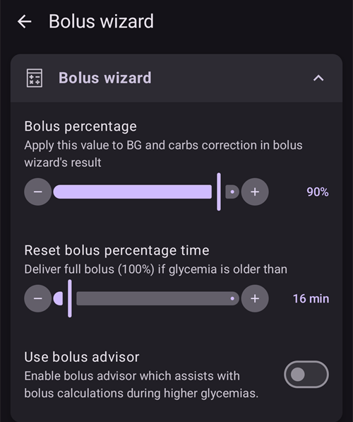
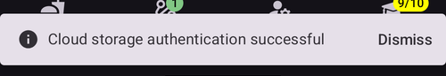

# Ustawienia

W **AAPS** v4 preferencje znajdziesz na ekranie **Ustawienia**. Dostać się do nich możesz na trzy sposoby – szczegóły znajdziesz na stronie [Zmiana konfiguracji AAPS](../SettingUpAaps/ChangeAapsConfiguration.md):

1. Dotknij ikony **Ustawienia** (koło zębate) w prawym górnym rogu ekranu głównego: wszystkie ustawienia, pogrupowane w rozwijane sekcje.
2. W **Konfiguracji** dotknij „**Ustawienia**” pod aktywną wtyczką: tylko ustawienia tej wtyczki.
3. Użyj **paska wyszukiwania** u góry ekranu głównego: po prostu zacznij wpisywać część szukanego tekstu. W ten sposób znajdziesz pojedyncze ustawienia (także te niewidoczne na ekranie Ustawienia), okna dialogowe i dokumentację.


- **Sekcje** otwierasz i zamykasz, dotykając ich. Widoczne sekcje zależą od włączonych wtyczek i od [trybu uproszczonego](#preferences-simple-mode).


```{contents}
:backlinks: entry
:depth: 2
```

(Preferences-general)=
## Ogólne


**Jednostki**

- Ustaw jednostki mmol/l lub mg/dl, zależnie od tego, czego używasz.

**Język**

- By default **AAPS** follows the language of the phone (recommended).

- If you want **AAPS** in another language than the phone, choose it here. On Android 13 and newer, **AAPS** registers it as its own app language in Android, so all its screens, the main screen, the widgets and the way numbers are written follow it.

- Gdy zmienisz język, teksty **AAPS** od razu przełączą się na nowy język. Jeśli niektóre teksty są nadal w starym języku, uruchom ponownie **AAPS**.
- On Android 12 this setting is not shown: **AAPS** always uses the language of the phone.
- Ustawienie ukryte w [trybie uproszczonym](#preferences-simple-mode).

(preferences-simple-mode)= **Tryb uproszczony**

**Tryb uproszczony** jest domyślnie włączony po pierwszej instalacji **AAPS**. W **trybie uproszczonym** wiele ustawień jest ukrytych, a ich wartości są zastąpione wartościami domyślnymi. Wyłącz tryb uproszczony, gdy dobrze poznasz interfejs i ustawienia **AAPS**.

**Obsługa stężenia insuliny**

- Włącza obsługę różnych stężeń insuliny (U50, U200, ...). Włącz to tylko wtedy, gdy naprawdę używasz innego stężenia niż U100, i dokładnie przeczytaj ostrzeżenia.
- Ustawienie ukryte w [trybie uproszczonym](#preferences-simple-mode).

**Utrzymuj ekran włączony**

- Wymusza na Androidzie, aby ekran był zawsze włączony. Przydaje się to np. podczas prezentacji. Ale zużywa dużo energii baterii. Dlatego zalecamy podłączenie smartfona do ładowarki.

**Nazwa pacjenta**

- Imię osoby, która używa tego telefonu. Pozwala odróżnić tę instancję **AAPS** w raportach i synchronizacji, np. gdy w twojej rodzinie dwoje dzieci z cukrzycą typu 1 używa **AAPS**.
- Używane w nazwach eksportowanych plików ustawień.
- Pokazywana na [tarczy Dual](../WearOS/WearOsSmartwatch.md).

(Preferences-skin)=
### Motyw

Wybór skórki z **AAPS** 3.x (Oryginalna, Niska rozdzielczość, Duży wyświetlacz...) nie istnieje już w **AAPS** 4. Nowy interfejs sam dopasowuje się do ekranu, a schemat kolorów możesz zmienić w sekcji [Wygląd](#preferences-appearance).

(preferences-appearance)=
## Wygląd


(Preferences-range-for-visualization)=
### Zakres do wizualizacji (na wykresie)

Wybierz górną i dolną granicę wykresu glikemii na ekranie głównym **AAPS** i na smartwatchu. To tylko wizualizacja, a nie zakres docelowy glikemii. Przykład: 70–180 mg/dl lub 3,9–10 mmol/l

(Preferences-show-notes-field-in-treatments-dialogs)=
### Pokaż notatki w oknach dialogowych

Pozwala dodawać krótkie notatki tekstowe do leczenia (kalkulator bolusa, węglowodany, insulina...)

Ustawienie ukryte w [trybie uproszczonym](#preferences-simple-mode).

### Schemat kolorów aplikacji

Wybierz jasny motyw, ciemny motyw lub ustawienie systemowe telefonu.

(Preferences-protection)=
## Ochrona


(Preferences-master-password)=
### Hasło główne

Wymagane, aby można było [eksportować ustawienia](../Maintenance/ExportImportSettings.md), bo od wersji 2.7 są one szyfrowane.

**Ochrona biometryczna może nie działać na telefonach OnePlus. To znany problem niektórych telefonów OnePlus.**


(Preferences-settings-protection)=
### Ochrona ustawień

- Chroń swoje ustawienia hasłem lub uwierzytelnianiem biometrycznym telefonu (np. gdy [dziecko używa **AAPS**](../RemoteFeatures/RemoteMonitoring.md)). Jeśli włączysz tę funkcję, przy każdym otwarciu widoku związanego z Ustawieniami zostaniesz poproszony o uwierzytelnienie.

- Ekrany zarządzania (**Profil**, **Ustawienia insuliny**, **Cel tymczasowy**, **Szybki kalkulator**) otwierają się wtedy **tylko do odczytu**. Nadal możesz aktywować lub użyć wpisu, ale dodawanie, edycja, klonowanie i usuwanie są ukryte, dopóki nie odblokujesz ustawień. Zobacz [Ochrona ustawień blokuje teraz także ekrany zarządzania](#v4changes-read-only-management).

- Hasła użytkownika używaj wtedy, gdy chcesz, aby hasło główne chroniło tylko [eksportowane ustawienia](../Maintenance/ExportImportSettings.md), a do edycji ustawień chcesz używać innego hasła.

- Jeśli używasz hasła użytkownika, dotknij wiersza „Hasło do ustawień”, aby ustawić hasło tak, jak opisano [powyżej](#Preferences-master-password).

### Ochrona aplikacji

Jeśli aplikacja jest chroniona, musisz wpisać hasło lub użyć uwierzytelniania biometrycznego telefonu, aby otworzyć **AAPS**, a także ponownie, gdy wracasz do aplikacji po upływie [czasu ochrony](#Preferences-password-and-pin-retention).

Po wpisaniu złego hasła **AAPS** od razu się zamknie – ale nadal będzie działać w tle, jeśli wcześniej zostało poprawnie otwarte.

### Ochrona Bolusa

- Ochrona bolusa może być przydatna, jeśli **AAPS** używa małe dziecko, a ty [podajesz bolus przez SMS](../RemoteFeatures/SMSCommands.md).

- Opcję **Ochrona Bolusa** możesz wybrać dopiero wtedy, gdy ustawisz opcję **Ochrona ustawień** (poziom 2).

- W przykładzie poniżej ochrona bolusa używa opcji **Hasło główne**: **AAPS** prosi o hasło główne przed otwarciem okna leczenia, np. **Insulina**. Przy opcji **Biometryczne**, jeśli uwierzytelnianie biometryczne nie działa, możesz zamiast tego wpisać hasło główne.


(Preferences-password-and-pin-retention)=
### Pamiętanie hasła i PIN-u

**Czas do ponownego zablokowania** określa, jak długo (w sekundach) ustawienia lub funkcje bolusa pozostają odblokowane po poprawnym wpisaniu hasła.

## Bezpieczeństwo terapii


(preferences-patient-type)=
### Wiek pacjenta

- Limity bezpieczeństwa są ustawiane na podstawie wieku, który wybierzesz w tym ustawieniu.
- Jeśli zaczynasz dochodzić do tych twardych limitów (np. maksymalny bolus), czas przejść o jeden krok wyżej.
- Wybór wieku wyższego niż prawdziwy to zły pomysł, bo może prowadzić do przedawkowania przy wpisaniu złej wartości w oknie insuliny (np. gdy pominiesz przecinek dziesiętny).
- Jeśli chcesz poznać dokładne wartości tych stałych limitów bezpieczeństwa, przewiń do funkcji algorytmu, której używasz, na [tej stronie](../DailyLifeWithAaps/KeyAapsFeatures.md).

(Preferences-maximum-bolus)=
### Maksymalny bolus

- Określa maksymalną ilość insuliny w bolusie (w jednostkach insuliny), jaką **AAPS** może podać za jednym razem.
- To ustawienie jest limitem bezpieczeństwa. Chroni przed podaniem bardzo dużego bolusa przez przypadkowe wpisanie wartości lub błąd użytkownika.
- Zalecamy ustawić tu rozsądną wartość, która odpowiada mniej więcej największej dawce bolusa, jakiej możesz kiedykolwiek potrzebować na posiłek lub korektę.
- To ograniczenie dotyczy też wyników kalkulatora bolusa.

### Maksymalna ilość węglowodanów

- Określa maksymalną ilość węglowodanów (w gramach), dla jakiej kalkulator bolusa **AAPS** może obliczyć dawkę.
- To ustawienie jest limitem bezpieczeństwa. Chroni przed podaniem bardzo dużego bolusa przez przypadkowe wpisanie wartości lub błąd użytkownika.
- Zalecamy ustawić tu rozsądną wartość, która odpowiada mniej więcej największej ilości węglowodanów, jaką możesz kiedykolwiek zjeść w jednym posiłku.

## Źródła danych o poziomie cukru we krwi (BG) - CGM/FGM

Ustawienia wybranego [źródła BG](#Config-Builder-bg-source) pojawiają się jako osobna sekcja. Na przykład dla **xDrip+ BG**:


- **Przekaż glikemię do NS**: **AAPS** wysyła otrzymane wartości glikemii do Nightscout. Włącz to tylko wtedy, gdy sama aplikacja CGM jeszcze ich nie wysyła.
- **Odnotuj zmianę sensora**: po założeniu sensora automatycznie tworzy zdarzenie terapii „zmiana sensora”.

## Ekran główny

W **AAPS** 3.x te ustawienia były zebrane w sekcji „Przegląd” (Overview). W **AAPS** 4 ustawiasz je bezpośrednio w elementach ekranu głównego, do których należą.

(Preferences-buttons)=
### Przyciski szybkich akcji (QuickLaunch)

Określ, które przyciski akcji są widoczne na ekranie głównym: dotknij małego **koła zębatego** na dole, na środku ekranu głównego („Konfiguracja szybkich akcji”) i wybierz **Dodaj** przy akcjach, do których chcesz mieć szybki dostęp (leczenie, akcje CGM, wpisy portalu opieki...).


(Preferences-quick-wizard)=
### Szybki kalkulator

Utwórz własne przyciski dla wybranych standardowych posiłków lub przekąsek. Będą one widoczne na ekranie głównym. Przydatne przy standardowych posiłkach, które często jesz.

Dla każdego przycisku określasz węglowodany i sposób obliczania bolusa. Następnie określasz, w jakim przedziale czasu przycisk będzie widoczny na ekranie głównym – tylko jeden przycisk na jeden przedział. Przycisk nie będzie widoczny poza ustawionym przedziałem czasu ani wtedy, gdy masz dość IOB, aby pokryć węglowodany ustawione w przycisku Szybkiego kalkulatora. Jeśli dla różnych posiłków ustawisz różne godziny, na ekranie głównym zawsze zobaczysz przycisk standardowego posiłku pasujący do pory dnia.

Aby zarządzać ustawieniami Szybkiego kalkulatora, wpisz „QuickWizard” w pasku wyszukiwania na ekranie głównym i otwórz **Szybki kalkulator - Zarządzaj ustawieniami szybkiego kalkulatora**.

Gdy klikniesz przycisk Szybkiego kalkulatora, **AAPS** obliczy i zaproponuje bolus na te węglowodany na podstawie twoich aktualnych współczynników (z uwzględnieniem glikemii lub aktywnej insuliny, jeśli tak ustawisz).

Propozycję musisz potwierdzić, zanim insulina zostanie podana.

(Preferences-default-temp-targets)=
### Domyślne cele tymczasowe

[Cele tymczasowe (TT)](../DailyLifeWithAaps/TempTargets.md) pozwalają zmienić cel glikemii na określony czas. Gdy ustawisz domyślne TT, możesz łatwo zmienić cel np. na aktywność czy wkrótce posiłek.

Dotknij **zakresu docelowego** na ekranie głównym, aby otworzyć ekran **Cel tymczasowy**. Przesuwaj karty presetów (Wkrótce posiłek, Aktywność, Hipo) i zmień cel oraz czas trwania każdego presetu w **Ustawienia predefiniowane**. Wstępnie ustawione wartości to:

* Wkrótce posiłek: cel 90 mg/dl / 5,0 mmol/l, czas trwania 45 min
* Aktywność: cel 140 mg/dl / 7,8 mmol/l, czas trwania 90 min
* Hipo: cel 160 mg/dl / 8,9 mmol/l, czas trwania 60 min


Dowiedz się, [jak włączyć cele tymczasowe](#TempTargets-where-can-i-select-a-temp-target).

### Standardowe ilości insuliny do wypełnienia/napełnienia

Jeśli chcesz wypełnić dren lub napełnić kaniulę przez **AAPS**, użyj przycisków **Napełnij/Wypełnij** w rozwiniętym panelu stanu na ekranie głównym.

Domyślne ilości dla trzech przycisków wypełniania możesz ustawić w ustawieniach **Napełnij/Wypełnij**, zależnie od długości twojego drenu. Aby je otworzyć, wpisz „prime” w pasku wyszukiwania na ekranie głównym.


(Preferences-status-lights)=
### Wskaźniki stanu

Wskaźniki stanu dają wizualne ostrzeżenie dla:

- Wiek sensora
- Wiek insuliny (ile dni używany jest zbiornik)
- Poziom zbiornika (jednostki)
- Wiek wkłucia
- Wiek baterii pompy
- Poziom baterii pompy (%)

Gdy próg ostrzeżenia zostanie przekroczony, wartości będą pokazane na żółto. Gdy próg krytyczny zostanie przekroczony, wartości będą pokazane na czerwono.

Aby zmienić progi, rozwiń panel stanu na ekranie głównym (strzałka po prawej stronie wiersza stanu) i dotknij małej ikony **Ustawienia** obok „Status”:


Dotknij elementu (**Kaniula**, **Insulina**, **Sensor** lub **Bateria pompy**), aby otworzyć jego progi ostrzeżenia i krytyczne:


Ostatnia opcja pozwala zaimportować te ustawienia z Nightscout, jeśli są tam ustawione. Więcej informacji znajdziesz w [dokumentacji Nightscout](https://nightscout.github.io/nightscout/setup_variables/#age-pills).

(Preferences-deliver-this-part-of-bolus-wizard-result)=
### Ustawienia kalkulatora bolusa

Aby otworzyć ustawienia **Kalkulator bolusa**, wpisz „bolus” w pasku wyszukiwania na ekranie głównym:



**Procent bolusa** ustawia [domyślny procent](#AapsScreens-section-j) bolusa obliczonego przez kalkulator bolusa.

Domyślnie 100%: bez zmiany. Nawet jeśli ustawisz tu inną wartość, nadal możesz ją zmienić przy każdym użyciu kalkulatora bolusa. Jeśli to ustawienie ma wartość 75%, a potrzebujesz bolusa 10 U, kalkulator bolusa zaproponuje bolus na posiłek tylko 7,5 U.

Przy używaniu [SMB](#objectives-objective9) wiele osób nie podaje bolusa na posiłek w 100% potrzebnej insuliny, tylko część (np. 75%), a resztę zostawia SMB z UAM (wykrywanie nieogłoszonych posiłków). Wartość niższa niż 100% może być tu przydatna:
* dla osób z wolnym trawieniem: podanie całego bolusa od razu może spowodować hipoglikemię, bo insulina działa szybciej, niż trwa trawienie.
* aby zostawić **AAPS** więcej miejsca na samodzielne radzenie sobie ze **wzrostem glikemii**. W obu przypadkach **AAPS** uzupełni brakującą część bolusa za pomocą SMB, jeśli i kiedy uzna to za właściwe.

**Włącz doradcę bolusa**

Gdy ta opcja jest włączona i użyjesz kalkulatora bolusa przy hiperglikemii, dostaniesz ostrzeżenie z pytaniem, czy chcesz podać bolus wcześniej, a zjeść później, gdy twoja **glikemia** wróci do zakresu.

(Preferences-advanced-settings-overview)=
### Superbolus

Opcja Superbolus z **AAPS** 3.x nie jest dostępna jako ustawienie w **AAPS** 4.

## Pętla

Aby teraz zmienić tryb pętli, zobacz [Ekrany AAPS > Ekran główny > Status pętli](#AapsScreens-loop-status).

(Preferences-minimal-request-change)=
### Minimalna zmiana w trybie otwartej pętli

Gdy używasz trybu **Otwarta pętla**, dostajesz powiadomienie za każdym razem, gdy **AAPS** zaleca zmianę dawki bazowej. Aby zmniejszyć liczbę powiadomień, możesz użyć [szerszego zakresu docelowego glikemii](#profile-glucose-targets) albo zwiększyć procent w ustawieniu „**Minimalna zmiana w trybie otwartej pętli**”. Określa względną zmianę, która jest potrzebna, aby pojawiło się powiadomienie.


## Advanced Meal Assist (AMA) lub Super Micro Bolus (SMB)

Zależnie od ustawień w [Konfiguracja > APS](../SettingUpAaps/ConfigBuilder.md) możesz wybrać jeden z dwóch algorytmów:

- [Advanced meal assist (OpenAPS AMA)](#Open-APS-features-advanced-meal-assist-ama) – stan algorytmu z 2017 roku
- [Super Micro Bolus (OpenAPS SMB)](#Open-APS-features-super-micro-bolus-smb) – najnowszy algorytm, zalecany dla początkujących

Od [**AAPS** w wersji 3.3](#version3300) funkcja [Dynamiczny ISF](../DailyLifeWithAaps/DynamicISF.md) jest częścią OpenAPS SMB.

### OpenAPS AMA

Wszystkie ustawienia OpenAPS AMA są opisane w osobnej sekcji [Kluczowe funkcje AAPS > Advanced Meal Assist (AMA)](#Open-APS-features-advanced-meal-assist-ama).

(Preferences-openaps-smb-settings)=
### OpenAPS SMB

Wszystkie ustawienia OpenAPS SMB są opisane w osobnej sekcji [Kluczowe funkcje AAPS > Super Micro Bolus (SMB)](#Open-APS-features-super-micro-bolus-smb).

Lista widocznych ustawień zależy od twoich postępów w [Zadaniach](../SettingUpAaps/CompletingTheObjectives.md) i od [trybu uproszczonego](#preferences-simple-mode). Po nowej instalacji widoczna jest tylko opcja **Włącz wrażliwość dynamiczną**. Po ukończeniu zadań sekcja wygląda tak:


**Ustawienia zaawansowane** na dole sekcji zawierają wartości, których zwykle nie trzeba zmieniać:


## Ustawienia wchłaniania


(Preferences-min_5m_carbimpact)=
### SMB min wpływ węglowodanów (5 min) (min_5m_carbimpact)

Ustawienie ukryte w [trybie uproszczonym](#preferences-simple-mode).

Algorytm używa BGI (wpływu na glikemię), aby ustalić, kiedy [węglowodany są wchłaniane](../DailyLifeWithAaps/CobCalculation.md).

Gdy wchłaniania węglowodanów nie da się obliczyć dynamicznie na podstawie reakcji twojego organizmu, **AAPS** stosuje domyślny spadek węglowodanów. Zasadniczo jest to taki bezpiecznik. Ta wartość jest używana tylko w czasie przerw w odczytach **CGM** lub gdy aktywność fizyczna „zużywa” cały wzrost glikemii, który w innym przypadku pozwoliłby **AAPS** zmniejszać COB.

Mówiąc prosto: algorytm „wie”, jak twoja glikemia *powinna* się zachowywać pod wpływem aktualnej dawki insuliny itp. Za każdym razem, gdy glikemia rośnie bardziej niż oczekiwano, część węglowodanów zostaje uznana za wchłoniętą. Duża zmiana = dużo węglowodanów itd.

Wartość min_5m_carbimpact określa domyślny wpływ wchłaniania węglowodanów na 5 minut. Pełny opis parametru znajdziesz w [dokumentacji OpenAPS o preferencjach i ustawieniach bezpieczeństwa](https://openaps.readthedocs.io/en/latest/docs/While%20You%20Wait%20For%20Gear/preferences-and-safety-settings.html?highlight=carbimpact#min-5m-carbimpact).

Wartość standardowa dla AMA to 3, dla SMB to 8.

Wykres COB na ekranie głównym pokazuje, kiedy używana jest wartość min_5m_carbimpact: na górze krzywej COB pojawiają się pomarańczowe kropki.


### Czas odcięcia wchłaniania

Czas, po którym każdy posiłek jest uznany za wchłonięty; pozostałe węglowodany zostaną odcięte. Jeśli często jesz posiłki z dużą ilością tłuszczu lub białka, musisz wydłużyć czas wchłaniania posiłku.

### Ustawienia zaawansowane – współczynnik autosens


- Określ minimalny i maksymalny współczynnik [autosens](#Open-APS-features-autosens).
- Zwykle nie zmienia się wartości standardowych (maks. 1,2 i min. 0,7).

## Pompa


### Watchdog BT

W razie potrzeby włącz Watchdog BT (np. dla pomp Dana). Wyłącza Bluetooth na jedną sekundę, jeśli nie można połączyć się z pompą. Może to pomóc na niektórych telefonach, na których stos Bluetooth się zawiesza.

## Ustawienia pompy

Dostępne tu opcje zależą od sterownika pompy wybranego w [Konfiguracja > Pompa](#Config-Builder-pump). Sparuj i skonfiguruj pompę zgodnie z [instrukcjami dla twojej pompy](../Getting-Started/CompatiblePumps.md).

Na przykład dla **Pompa wirtualna** sekcja nazywa się **Ustawienia pompy wirtualnej**. Wybierasz **Typ pompy**, który ma udawać wirtualna pompa, oraz to, czy jej stan jest wysyłany do Nightscout:


## Tidepool

Więcej informacji na osobnej stronie [Tidepool](../SettingUpAaps/Tidepool.md).

(Preferences-nsclient)=
## NSClientV3


Wtyczka NSClient (w menu konfiguracji widoczna jako **NSClientV3**) synchronizuje twoje dane z Nightscout. Używa Nightscout API v3.

```{admonition} Data uploaders
:class: warning

Gdy używasz NSClientV3, wszystkie programy wysyłające dane (uploadery) muszą używać Nightscout API v3. If another uploader (for example your CGM app) is not API v3 compliant, **let AAPS upload all data** (BG, treatments, ...) to Nightscout and disable that uploader.
```

- Set your *Nightscout URL* (i.e. <https://yoursitename.yourplatform.dom>).
- **Upewnij się, że adres URL NIE ma na końcu /api/v1/.**
- W Nightscout utwórz *[token Admin](https://nightscout.github.io/nightscout/security/#create-a-token)* (do API V3 potrzebny jest [Nightscout 15](https://nightscout.github.io/update/update/)) i wpisz go w polu **Token dostępu do Nightscout** (nie twój API Secret!). W **AAPSClient** możesz zamiast tego zeskanować kod QR z głównego telefonu. W ten sposób klient dostaje własny token. Klient sparowany za pomocą PIN-u po sparowaniu dostaje własny token od głównego telefonu. Zobacz [Własny token Nightscout klienta](#client-master-control-own-token).
- Dzięki temu dane mogą być odczytywane i zapisywane zarówno na stronie Nightscout, jak i w **AAPS**.
- Jeśli utknąłeś w Zadaniu 1, sprawdź tu dokładnie, czy nie ma literówek.
- Zostaw włączoną opcję „Użyj websockets” (zalecane).

(Preferences-nsclient-synchronization)=
### Synchronizacja


Wybór synchronizacji zależy od tego, jak chcesz używać **AAPS**.

Możesz wybrać, które dane chcesz [wysyłać do Nightscout i pobierać z Nightscout](#Nightscout-aaps-settings).

Gdy sterowanie z urządzenia opiekuna jest włączone (zawsze w trybie uproszczonym), te ustawienia są ukryte: **AAPS** działa wtedy w [trybie silniejszych zabezpieczeń](#client-master-control-hardened-mode), nie przyjmuje zmian zrobionych bezpośrednio w Nightscout i wysyła wszystkie swoje dane.

### Opcje alarmu


- Opcje alarmu pozwalają wybrać, których alarmów Nightscout ma używać aplikacja. **AAPS** uruchomi alarm, gdy włączy się alarm Nightscout.
- Aby alarmy działały, musisz ustawić wartości alarmów Urgent High, High, Low i Urgent Low w [zmiennych Nightscout](https://nightscout.github.io/nightscout/setup_variables/#alarms).
- Działają tylko wtedy, gdy masz połączenie z Nightscout, i są przeznaczone dla rodziców/opiekunów.
- Jeśli źródło **CGM** masz na telefonie (np. xDrip lub BYODA), używaj jego alarmów zamiast alarmów Nightscout.
- Ogłoszenia NS powtarzają [ogłoszenia](https://nightscout.github.io/nightscout/discover/#announcement) Nightscout w powiadomieniach **AAPS**.
- Możesz zmienić próg alarmów o nieaktualnych danych (stale data i urgent stale data), gdy przez pewien czas nie przychodzą żadne dane z Nightscout.

### Zdalne sterowanie

Przełącznika „**Zezwalaj na sterowanie z urządzenia opiekuna**” nie ma już w tych ustawieniach: jest na górze ekranu **Zarządzaj → Autoryzowani opiekunowie**, gdzie zarządzasz sparowanymi klientami. Zobacz osobną stronę [Sterowanie Master ↔ Client](../RemoteFeatures/ClientMasterControl.md), także o [trybie silniejszych zabezpieczeń](#client-master-control-hardened-mode), który włącza ten przełącznik.

### Ustawienia połączenia


- Ustawienia połączenia określają, kiedy połączenie z Nightscout jest włączone.
- Ogranicz wysyłanie do Nightscout tylko do Wi-Fi albo nawet do wybranych sieci Wi-Fi (SSID).
- Jeśli chcesz używać tylko określonej sieci Wi-Fi, możesz wpisać jej SSID.
- Kilka SSID możesz rozdzielić średnikiem.
- Aby usunąć wszystkie SSID, wpisz w polu spację.

(Preferences-advanced-settings-nsclient)=
### Advanced settings (NSClientV3)


Opcje w ustawieniach zaawansowanych są zrozumiałe same przez się.

## Komunikator SMS

Więcej informacji na osobnej stronie [Polecenia SMS](../RemoteFeatures/SMSCommands.md).

(preferences-wear)=
## Oprogramowanie Wear (Smartwatch)

Ta sekcja jest widoczna, gdy wtyczka **Oprogramowanie Wear (Smartwatch)** jest włączona w [Konfiguracja > Komunikacja](#Config-Builder-wear). Więcej informacji na osobnych stronach [Smartwatch z Wear OS](../WearOS/WearOsSmartwatch.md) i [Obsługa AAPS ze smartwatcha z Wear OS](../RemoteFeatures/RemoteControlWearOS.md).


- **Sterowanie z zegarka**: pozwala wysyłać z zegarka leczenie i inne akcje. Bez tej opcji zegarek tylko pokazuje dane: telefon odrzuca każde polecenie z zegarka, a dotknięcie komplikacji, która otworzyłaby ekran sterowania, otwiera zamiast tego menu **AAPS** na zegarku.

**Ustawienia kreatora Wear** określają, które obliczenia są uwzględniane w wyniku kalkulatora bolusa na zegarku. Na zegarku wpisujesz tylko węglowodany; te przełączniki zastępują wybory, których dokonałbyś w kalkulatorze bolusa na telefonie:

- **Uwzględnij BG w kalkulatorze**: dodaje korektę na różnicę między aktualną glikemią a celem.
- **Uwzględnij cel tymczasowy w kalkulatorze bolusa**: do tej korekty używa aktywnego celu tymczasowego zamiast celu z profilu.
- **Uwzględnij trend w kalkulatorze**: bierze pod uwagę aktualny trend glikemii.
- **Uwzględnij COB w kalkulatorze**: dodaje insulinę na węglowodany, które są jeszcze aktywne (COB).
- **Uwzględnij IOB w kalkulatorze bolusa**: odejmuje insulinę, która jest jeszcze aktywna (IOB).


**Ustawienia niestandardowej tarczy** zawierają opcję **Pozwól na niestandardowe tarcze zegarka**. Plik własnej tarczy może zawierać wartości niektórych ustawień zegarka. Gdy ten przełącznik jest włączony, wczytanie takiej tarczy może zmienić te ustawienia na zegarku; gdy jest wyłączony, tarcza zostaje wczytana, ale ustawienia się nie zmieniają:


**Ustawienia ogólne** zawierają opcję **Powiadamiaj o SMB**, aby dostawać powiadomienie na zegarku przy każdym podaniu SMB:


## Autotune

Ta sekcja jest widoczna, gdy wtyczka **Autotune** jest włączona w [Konfiguracja > Ogólne](#Config-Builder-autotune). Ustawienia są opisane na osobnej stronie [Autotune](../AdvancedOptions/Autotune.md).


## Automatyzacja


Wybierz, której usługi lokalizacji ma używać aplikacja:

- Użyj lokalizacji pasywnej: **AAPS** pobiera lokalizację tylko wtedy, gdy prosi o nią inna aplikacja
- Użyj lokalizacji sieciowej: lokalizacja twojej sieci Wi-Fi
- Użyj lokalizacji GPS (Uwaga! Może bardzo szybko rozładowywać baterię!)

## Lokalne alarmy


Ustawienia są zrozumiałe same przez się.

**Override Do Not Disturb mode** (on by default): the **AAPS** alarms ring even when the phone is silent or in Do Not Disturb. Turn it off if **AAPS** should respect those modes: the alarms do not ring then, and in Do Not Disturb they only vibrate, on the phone and on the watch. Loop suggestions that arrive during Do Not Disturb are shown without a sound.

When an alarm rings, the alarm screen offers **Silence alarm** (the screen stays open, so you can read the message) and **Silence and close**. Swiping the alarm notification away in the notification tray mutes the alarm. When you open **AAPS** later, an alarm you did not answer is shown again.

(preferences-maintenance-settings)=
## Ustawienia konserwacji


**Odbiorca e-maili**: standardowym odbiorcą logów jest <logs@aaps.app>.

**Liczba plików dziennika do wysłania**: ile najnowszych plików logów jest dołączanych, gdy wysyłasz logi.

**Wybór Danych**


Możesz pomóc w dalszym rozwoju **AAPS**, wysyłając raporty o awariach do programistów.

**Automatyczny Eksport Ustawień**<br/> Gdy włączysz tę funkcję, pozwalasz **AAPS** eksportować ustawienia bez twojego udziału. W tym celu hasło główne zostanie bezpiecznie zapisane (tylko) w twoim telefonie przy następnym ręcznym eksporcie. Zapisane hasło będzie używane przez maksymalnie 4 tygodnie. Po 4 tygodniach dostaniesz powiadomienie, że hasło wkrótce wygaśnie. W okresie przejściowym 1 tygodnia możesz wtedy odświeżyć hasło, eksportując ręcznie ustawienia z menu Konserwacja.

Po upływie okresu przejściowego 1 tygodnia zapisane hasło wygasa, a każdy automatyczny eksport ustawień zostanie przerwany i pojawi się powiadomienie z prośbą o ponowne wpisanie hasła. [(**Automatyczne eksporty ustawień**)](../DailyLifeWithAaps/Automations.md#automating-preference-settings-export) będą zapisywane na listach „Portal opieki” i „Wpis użytkownika” w **AAPS**, w sekcji Leczenie.

Po włączeniu tej opcji wykonaj ręczny eksport ustawień. Zostaniesz wtedy poproszony o hasło, aby **AAPS** mógł je zapisać.

### Pliki logów

AAPS zapisuje logi, aby pomóc w rozwiązywaniu problemów.

Nie wyłączaj tej funkcji: pomoże zrozumieć przyczyny, jeśli coś pójdzie nie tak.

Jeśli musisz wysłać logi do programistów, dokładnie opisz problem w e-mailu. Najlepiej wysyłać logi dopiero wtedy, gdy ktoś cię o to poprosi, po [zgłoszeniu problemu na GitHub](https://github.com/nightscout/AndroidAPS/issues).

Logi AAPS znajdziesz w pamięci telefonu -> Android -> data -> info.nightscout.androidaps -> files.

Obsługę logów (ustawienia logów, wysyłanie i usuwanie logów) i zarządzanie plikami znajdziesz na ekranie **Konserwacja**, który otwierasz z **menu** (☰) w lewym górnym rogu ekranu głównego:


(preferences-maintenance-logdirectory)=

### Ustawianie lokalnego katalogu AAPS

Ekran **Konserwacja** zawiera też **Katalog AAPS**. To ustawienie pozwala wybrać katalog w telefonie, w którym **AAPS** będzie zapisywać ustawienia, logi i inne pliki. Po wybraniu katalogu jego ścieżka (np. `Documents/AAPS`) jest widoczna pod **Katalog AAPS**, więc zawsze wiesz, gdzie zapisywane są twoje pliki.

Zdecydowanie zalecamy katalog bezpośrednio w głównym folderze pamięci telefonu. Domyślnie jest to AAPS.


Jeśli wybierzesz podkatalog katalogu AAPS, zobaczysz komunikat o błędzie. Dotknij „OK” i spróbuj ponownie, wybierając właściwy katalog (o jeden poziom wyżej). Nie wybieraj „ZAMKNIJ”, chyba że dokładnie wiesz, co robisz.


Android może bez ostrzeżenia odebrać uprawnienie do katalogu, np. po ponownej instalacji **AAPS** lub wyczyszczeniu jego danych. Gdy tak się stanie, **AAPS** pokazuje stałe powiadomienie **Utracono dostęp do katalogu AAPS**, a lokalny eksport ustawień przestaje działać, dopóki nie wrócisz tutaj i ponownie nie wybierzesz katalogu. Zrób to szybko, bo inaczej kopie zapasowe w telefonie przestaną być odświeżane.

(preferences-maintenance-cloud)=

### Ustawianie katalogu w chmurze

Możesz eksportować swoje ustawienia, logi i dane CSV do usługi w chmurze.

1. Otwórz **menu** (☰), wybierz **Konserwacja** i dotknij **Katalog w chmurze** (w sekcji **Zarządzanie plikami**).

   

2. W oknie **Wybierz typ przechowywania** wybierz **Dysk Google**.

   

3. Otworzy się strona logowania Google. Wybierz konto Google, na którym będą przechowywane twoje kopie zapasowe (możesz użyć [osobnego konta Google](../UsefulLinks/DedicatedGoogleAccountForAaps.md)).

   

4. Sprawdź, czy to właściwe konto, i dotknij **Dalej** (Continue), aby dać **AAPS** dostęp. Jeśli wcześniej był już ustawiony katalog w chmurze, strona informuje, że **AAPS** ma już pewien dostęp.

   

5. Po powrocie do **AAPS** na dole ekranu głównego pojawi się komunikat **Uwierzytelnianie zapisu w chmurze powiodło się**:

   

   W menu **Konserwacja** przy **Katalog w chmurze** jest teraz zielona kropka, a przyciski **Chmura** obok **Wyślij logi**, **Eksport ustawień**, **Importuj ustawienia** i **Eksportuj wpisy użytkownika do Excel-a (csv)** są dostępne.

   

Aby zakończyć eksport do chmury, dotknij ikony **✕** (**Wyczyść ustawienia**) na końcu wiersza **Katalog w chmurze** w menu **Konserwacja** (jest widoczna, gdy usługa w chmurze jest ustawiona) i potwierdź **Wyczyść ustawienia chmury**. To przywraca zapis lokalny i usuwa autoryzację.

## Open Humans

Możesz pomóc społeczności, przekazując swoje dane do projektów badawczych! Szczegóły znajdziesz na [stronie Open Humans](../SupportingAaps/OpenHumans.md).

W **Ustawienia → Open Humans** możesz określić, kiedy dane mają być wysyłane
- tylko po połączeniu z Wi-Fi
- tylko gdy się ładuje
