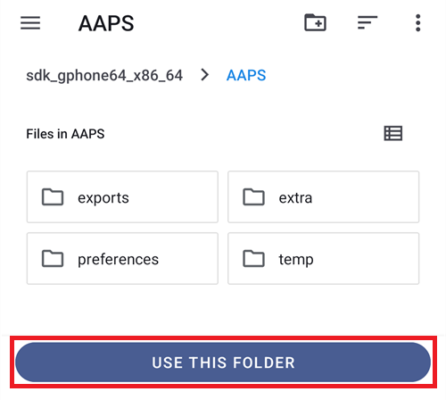
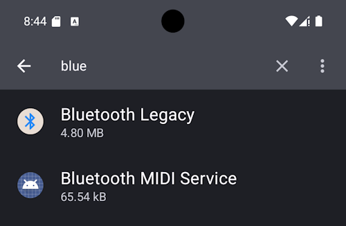
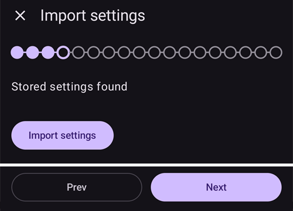
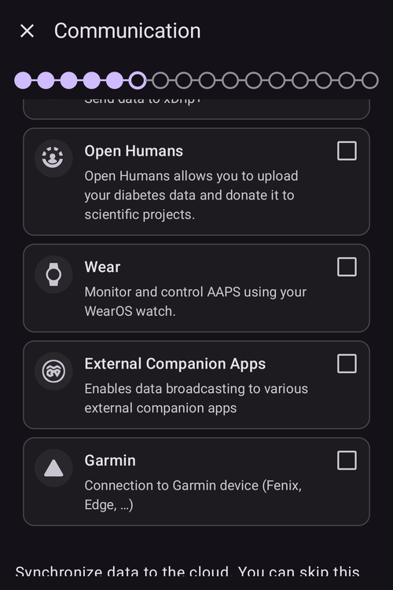
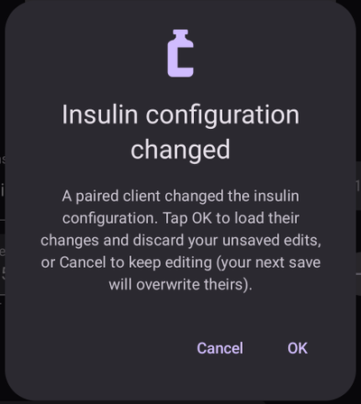
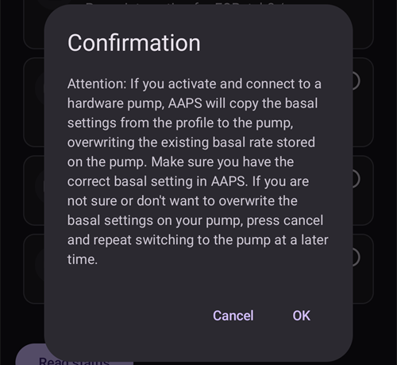

# Kreator konfiguracji AAPS

```{contents} In this page
:backlinks: entry
:depth: 2
```

Gdy po raz pierwszy uruchomisz **AAPS**, poprowadzi cię „**Kreator konfiguracji**”. Dzięki niemu szybko ustawisz za jednym razem wszystkie podstawowe opcje aplikacji. **Kreator konfiguracji** prowadzi cię krok po kroku, abyś nie zapomniał o niczym ważnym. Na przykład **ustawienia uprawnień** są podstawą poprawnej konfiguracji **AAPS**.

Nie musisz jednak skonfigurować wszystkiego za pierwszym razem w **Kreatorze konfiguracji**. Możesz łatwo wyjść z kreatora i wrócić do niego później. Po **Kreatorze konfiguracji** są trzy sposoby, aby dalej poprawić lub zmienić konfigurację. Zostaną one wyjaśnione w następnej sekcji. Możesz więc pominąć niektóre punkty w kreatorze konfiguracji - łatwo skonfigurujesz je później.

W trakcie i zaraz po użyciu **Kreatora konfiguracji** możesz nie zauważyć w **AAPS** żadnych dużych zmian. Aby włączyć pętlę **AAPS**, musisz przejść **Zadania** i włączać funkcje jedna po drugiej. Na końcu Kreatora konfiguracji rozpoczniesz **Zadanie 1**. To ty kontrolujesz **AAPS**, a nie odwrotnie.

```{admonition} Preview Objectives
:class: note
Jeśli chcesz poznać strukturę zadań, przeczytaj [Ukończenie zadań](../SettingUpAaps/CompletingTheObjectives.md), ale potem wróć tutaj i najpierw przejdź Kreator konfiguracji.

```

Z doświadczenia wiemy, że nowi użytkownicy często naciskają na siebie, aby jak najszybciej skonfigurować **AAPS**. To może prowadzić do frustracji, bo trzeba się wiele nauczyć.

Dlatego nie spiesz się z konfiguracją pętli. Korzyści z dobrze działającej pętli **AAPS** są ogromne.

```{admonition} Ask for Help
:class: note
Jeśli w dokumentacji jest błąd albo masz lepszy pomysł, jak coś wyjaśnić, możesz poprosić społeczność o pomoc, jak opisano w części [Kontakt z innymi użytkownikami](../GettingHelp/WhereCanIGetHelp.md).
```
## Wiadomość powitalna

Po otwarciu Kreator konfiguracji wita cię krótką wiadomością i od razu pokazuje panel „**Wymagane uprawnienia**” na dole ekranu (patrz następna sekcja).

Gdy przyznasz uprawnienia, panel się zamknie, a na ekranie powitalnym pojawi się przycisk „**Dalej**”. Naciśnij „**DALEJ**”, aby kontynuować:


## Wymagane uprawnienia

**AAPS** potrzebuje kilku uprawnień, aby działać poprawnie. Kreator zbiera je w jednym panelu „**Wymagane uprawnienia**”. Każde ma swój przycisk „**Przyznaj**”. Przyznaj je po kolei — gdy uprawnienie jest gotowe, ikona obok niego zmienia się w znacznik ✓.


### Optymalizacja baterii

Zużycie baterii w smartfonach jest ważne, bo możliwości baterii są nadal dość ograniczone. Dlatego system Android w smartfonie ogranicza aplikacjom działanie i używanie procesora, a przez to baterii.

**AAPS** musi jednak działać regularnie, _np._ aby co kilka minut odbierać odczyty glukozy, a potem użyć algorytmu i zdecydować, jak reagować na poziom glukozy zgodnie z twoimi ustawieniami. Dlatego trzeba ją wyłączyć z optymalizacji baterii.

Naciśnij „**Przyznaj**” obok „**Optymalizacja baterii**”, a potem wybierz „**Zezwól**” w oknie „Zezwolić aplikacji na ciągłe działanie w tle?”:


(SetupWizard-StoragePermission)=

### Katalog AAPS

**AAPS** musi zapisywać swoje ustawienia i logi w pamięci trwałej smartfona. Pamięć trwała oznacza, że dane będą dostępne także po ponownym uruchomieniu smartfona. Inne informacje po prostu giną, bo nie są zapisane w pamięci trwałej.

Naciśnij „**Przyznaj**” obok „**Katalog AAPS**”. Otworzy się system plików telefonu. Wybierzesz w nim, gdzie **AAPS** ma zapisywać swoje dane.

```{tip}
Zalecamy wybór domyślnego katalogu AAPS.</br>
**Nie** wybieraj podkatalogu AAPS.
```

Domyślny katalog to **AAPS**, ale możesz użyć dowolnego osobnego katalogu. W razie potrzeby utwórz katalog, wejdź do niego i wybierz „**UŻYJ TEGO FOLDERU**”:



Potwierdź przyciskiem „**ZEZWÓL**”, że chcesz dać **AAPS** dostęp do wybranego katalogu:


### Powiadomienia

Android wymaga specjalnego uprawnienia dla aplikacji, które chcą wysyłać Ci powiadomienia.

Wyłączenie powiadomień _np._ z mediów społecznościowych to dobra rzecz, ale musisz koniecznie pozwolić **AAPS** wysyłać ci powiadomienia.

Naciśnij „**Przyznaj**” obok „**Powiadomienia**” i wybierz „**Zezwól**” w oknie systemu:


### Alarmy i przypomnienia

W **Androidzie 14 i nowszym** **AAPS** potrzebuje uprawnienia „**Alarmy i przypomnienia**”. Dzięki niemu alarmy mogą włączyć ekran, gdy **AAPS** działa w tle, a przypomnienia (na przykład z **Automatyzacji**) dzwonią na czas.

Ta pozycja jest widoczna tylko wtedy, gdy jest potrzebna. Gdy **AAPS** jest wyłączone z optymalizacji baterii (patrz wyżej), Android sam przyznaje dokładne alarmy i ta pozycja znika. Jeśli nadal jest na liście, naciśnij „**Przyznaj**” obok „**Alarmy i przypomnienia**”. Otworzy się ekran ustawień systemu dla **AAPS**. Włącz przełącznik i wróć do **AAPS**. W Androidzie 13 i starszym ta pozycja się nie pojawia i nic nie musisz robić.

Gdy wszystkie uprawnienia mają znacznik ✓ (trzy, a w Androidzie 14 i nowszym cztery), panel „**Wymagane uprawnienia**” zamknie się sam i możesz nacisnąć „**DALEJ**” na ekranie powitalnym, aby kontynuować.

(setup-wizard-bluetooth-battery-optimisation)=
### Optymalizacja baterii dla Bluetooth

```{admonition} Extra Android setting, not part of the Wizard
:class: note
Poniższe kroki to dodatkowa konfiguracja Androida, wykonywana poza Kreatorem konfiguracji. Nie jest to jeden z przycisków „Przyznaj” powyżej, ale jest ważne dla stabilnego połączenia z pompą.
```

Nowsze wersje Androida stosują optymalizację baterii także do systemowej aplikacji Bluetooth.

Oprócz wyłączenia optymalizacji baterii dla **AAPS** prawdopodobnie musisz ją wyłączyć także dla systemowej aplikacji Bluetooth. Jeśli tego nie zrobisz, połączenie z pompą może się zrywać i mogą pojawić się problemy.

***UWAGA: Dokumentacja xDrip opisuje, jak to zrobić: [dokumentacja xDrip](https://navid200.github.io/xDrip/docs/BluetoothBatteryOpt.html)***

Wykonaj te kroki w Androidzie 16. W innych wersjach ekrany mogą się trochę różnić od zrzutów ekranu:

1. Otwórz ustawienia Androida, wyszukaj **Aplikacje** i otwórz ustawienia aplikacji.

   

2. Zobaczysz ustawienia aplikacji, ale trzeba rozwinąć listę wszystkich aplikacji. Kliknij **Wyświetl wszystkie aplikacje**, aby ją rozwinąć.

   

3. Aplikacja Bluetooth jest aplikacją systemową, więc domyślnie jest ukryta. Trzeba pokazać aplikacje systemowe. Kliknij **trzy kropki** (⋮) w prawym górnym rogu (1). Potem kliknij **Pokaż systemowe** (2).

   

4. Wyszukaj aplikację `Bluetooth` i kliknij `Bluetooth` lub `Legacy Bluetooth`. Jeśli są obie, wykonaj te kroki dla obu.

   ***UWAGA: `Bluetooth MIDI Service` możesz bezpiecznie pominąć, AAPS go nie używa***

           

   1. On Android 12 click on `Battery`, on Android 13+ click on `App battery usage`.

      

5. W Androidzie 12+ wybierz opcję `Unrestricted` (Bez ograniczeń). W Androidzie 15+ musisz najpierw rozwinąć ustawienie `Allow background usage` (Zezwalaj na używanie w tle): kliknij sekcję zaznaczoną na czerwono, a potem wykonaj krok 6.

       

6. W Androidzie 16 wybierz `Unrestricted` (Bez ograniczeń)

   

## Umowa licencyjna

Umowa licencyjna użytkownika końcowego zawiera ważne informacje o prawnych aspektach korzystania z **AAPS**. Przeczytaj ją uważnie.

Jeśli nie rozumiesz umowy licencyjnej użytkownika końcowego albo nie możesz się na nią zgodzić, w ogóle nie używaj **AAPS**!

Jeśli rozumiesz i się zgadzasz, naciśnij przycisk „**ROZUMIEM I WYRAŻAM ZGODĘ**” i przejdź dalej w Kreatorze konfiguracji:


Po wyrażeniu zgody pojawi się przycisk „**Dalej**”. Naciśnij „**DALEJ**”.

Następny ekran, „**Uprawnienia**”, ponownie pokazuje listę uprawnień. Wszystkie powinny mieć znacznik ✓, bo przyznałeś je na początku. Jeśli jakiegoś brakuje, naciśnij „**Przyznaj**” obok niego. Naciśnij „**DALEJ**”, aby kontynuować:


## Hasło główne

Konfiguracja **AAPS** zawiera dane wrażliwe (_np._ token dostępu do serwera Nightscout), dlatego jest szyfrowana hasłem, które tutaj ustawiasz.

Kreator pokazuje „**Hasło nie ustawione**”. Naciśnij „**Ustaw**”:


Otworzy się ekran „**Ochrona aplikacji**”. Naciśnij „**Hasło główne**” (widoczne jako „Hasło nie ustawione”):


Wpisz to samo hasło w obu polach i naciśnij „**OK**”:


Wróć strzałką w lewym górnym rogu. Kreator pokazuje teraz „**Hasło ustawione!**”:


```{admonition} Do not lose your Master Password
:class: danger
**NIE ZGUB SWOJEGO HASŁA GŁÓWNEGO**. Zapisz je _np._ na Dysku Google. To dobre miejsce, bo Google robi dla ciebie kopię zapasową. Twój smartfon lub komputer może ulec awarii, a Ty możesz nie mieć aktualnej kopii. Jeśli zapomnisz hasła głównego (Master Password), później odzyskanie konfiguracji profilu i postępu w **Zadaniach** może być trudne.
```

Gdy skończysz, naciśnij „**DALEJ**”, aby przejść do następnego ekranu.

(setup-wizard-import-settings)=
## Importuj ustawienia

Ten ekran pojawia się tylko wtedy, gdy **AAPS** znajdzie w katalogu **AAPS** wcześniej wyeksportowane ustawienia („Znaleziono zapisane ustawienia”), na przykład gdy instalujesz aplikację ponownie albo przenosisz się na nowy telefon.

- Aby przywrócić poprzednią konfigurację, naciśnij „**Importuj ustawienia**” — patrz [Tworzenie i przywracanie kopii zapasowych](../Maintenance/ExportImportSettings.md).
- Aby zacząć z nową konfiguracją, naciśnij „**DALEJ**” i kontynuuj w kreatorze.



## Jednostki (mg/dl <-> mmol/l)

Wybierz, czy wartości glukozy mają być w mg/dl czy w mmol/l, a potem naciśnij przycisk „**DALEJ**”:


## Ustawienia wyświetlania

Tutaj ustawiasz „**Znacznik NISKI**” i „**Znacznik WYSOKI**” dla wyświetlania glukozy z sensora. Wartości glukozy między tymi dwoma znacznikami są pokazane jako „w zakresie”. Na razie możesz zostawić wartości domyślne (72 i 180 mg/dl) i zmienić je później.

Wybrane wartości wpływają tylko na wygląd wykresu i na nic więcej.

Twój cel glikemii _np._ ustawiasz osobno w swoim profilu.

Zakres do analizy TIR (czas w zakresie) ustawiasz osobno na serwerze raportów.

W razie potrzeby zmień znaczniki przyciskami „−” / „+”, a potem naciśnij przycisk „**DALEJ**”:


(SetupWizard-synchronization-with-the-reporting-server-and-more)=
## Komunikacja

Ekran „**Komunikacja**” pokazuje wtyczki do przesyłania, synchronizacji i rozgłaszania twoich danych:

- **Komunikator SMS** – zdalne sterowanie **AAPS** poleceniami SMS
- **NSClientV3** – synchronizuje twoje dane z Nightscout przez API v3
- **Tidepool** – przesyła dane do Tidepool
- **xDrip** – wysyła dane do xDrip
- **Open Humans** – przesyłanie i przekazywanie twoich danych o cukrzycy do projektów naukowych
- **Oprogramowanie Wear (Smartwatch)** – monitorowanie i sterowanie **AAPS** ze smartwatcha z WearOS
- **Zewnętrzne aplikacje towarzyszące** – rozgłaszanie danych do różnych zewnętrznych aplikacji
- **Garmin** – połączenie z urządzeniem Garmin


Przewiń w dół, aby zobaczyć resztę listy:



Możesz teraz skonfigurować kilka z nich, ale przy pierwszym uruchomieniu skupimy się tylko na serwerze raportów. Jeśli nie możesz go teraz skonfigurować, na razie go pomiń — możesz to zrobić później.

W tym przykładzie jako serwera raportów używamy Nightscout. Zaznacz pole po prawej stronie „**NSClientV3**”, aby go włączyć. W przypadku Tidepool jest jeszcze prościej, bo potrzebujesz tylko swoich danych logowania.

Po włączeniu naciśnij „**Ustawienia**” pod NSClientV3, aby go skonfigurować:


Tutaj konfigurujesz serwer raportów Nightscout. Ustawienia NSClientV3 są pokazane na jednej przewijanej stronie:


Naciśnij „**Adres URL strony Nightscout**” i wpisz adres swojego serwera Nightscout (adres URL, który ustawiłeś sam albo dostałeś od swojego dostawcy usługi). Potwierdź przyciskiem „**OK**”.

Naciśnij „**Token dostępu do Nightscout**” i wpisz token dostępu do swojego serwera Nightscout. Bez tego tokenu dostęp nie zadziała. Jeśli jeszcze go nie masz, sprawdź dokumentację konfiguracji serwera raportów.

Zostaw włączoną opcję „**Użyj websockets**”, aby mieć komunikację z Nightscout w czasie rzeczywistym.

Pozostałe sekcje możesz na razie zostawić z ustawieniami domyślnymi. Opisujemy je tutaj, abyś wiedział, gdzie je później znaleźć:

**Opcje alarmu** — alarmy Nightscout, powiadomienia i progi nieaktualnych danych. Na razie zostaw przełączniki wyłączone. Otwieramy je tylko po to, abyś znał te opcje.

**Ustawienia połączenia** — wybierz, jak przesyłać dane. Opiekunowie muszą włączyć „**Używaj danych komórkowych**”. W przeciwnym razie telefon osoby, którą się opiekują (_np._ dziecka), nie może przesyłać danych poza zasięgiem Wi-Fi, _np._ w drodze do szkoły. Inni użytkownicy mogą wyłączyć przesyłanie przez sieć komórkową, aby oszczędzać dane lub baterię. Jeśli masz wątpliwości, zostaw wszystko włączone.


**Ustawienia zaawansowane** — włącz „**Odnotuj uruchomienie aplikacji**”, jeśli chcesz widzieć w Nightscout, kiedy aplikacja się uruchamia ponownie (przydatne dla opiekunów). Zostaw włączone „**Twórz powiadomienia w NS z błędów**” i „**Twórz powiadomienia w NS z wymaganych węglowodanów (sugestii dosłodzenia)**”. Zostaw wyłączone „**Użyj powolnej synchronizacji**”. Używa się go tylko wtedy, gdy serwer Nightscout wolno przetwarza dużą ilość danych.


Wróć do listy wtyczek i naciśnij „**DALEJ**”, aby przejść do następnego ekranu.

## Kontrola z urządzenia opiekuna

Od wersji 4 **AAPS** urządzenia opiekuna z aplikacją **AAPSClient** można **sparować** z tym telefonem (**urządzeniem pacjenta**) i sterować nim podpisanymi poleceniami wysyłanymi przez Nightscout. To nowy, zalecany sposób zdalnego sterowania **AAPS** — pełny opis i konfigurację znajdziesz w [Sterowanie Master ↔ Client](../RemoteFeatures/ClientMasterControl.md).

Na tym ekranie nie musisz teraz nic konfigurować. Urządzenia opiekuna możesz sparować później w dowolnym momencie w **Zarządzaj → Autoryzowani opiekunowie**. Tam dodajesz urządzenie opiekuna **kodem QR** (konfiguruje on też Nightscout na urządzeniu opiekuna) albo **kodem PIN** i nadajesz mu **rolę**.

- „**Autoryzowani opiekunowie**” — zarządzanie sparowanymi urządzeniami opiekuna, które mogą sterować tym urządzeniem pacjenta.
- „**Przyjmowanie danych z Nightscout**” — przyjmowanie wpisów leczenia i danych wpisanych bezpośrednio w Nightscout (stary, mniej bezpieczny sposób) jest teraz domyślnie wyłączone. Otwieraj te ustawienia tylko wtedy, gdy nadal tego potrzebujesz, _np._ aby wpisywać dane przez Nightscout lub aplikacje innych firm.

Gdy sterowanie z urządzenia opiekuna jest już włączone — zawsze w [Trybie uproszczonym](#preferences-simple-mode) — ten telefon jest w [trybie silniejszych zabezpieczeń](#client-master-control-hardened-mode): przyjmuje zmiany tylko od sparowanych urządzeń opiekuna. Dlatego ekran wyjaśnia tryb silniejszych zabezpieczeń zamiast pokazywać ustawienia „**Przyjmowanie danych z Nightscout**”.


„**Przyjmowanie danych z Nightscout**” otwiera ustawienia „**Synchronizacja**”, gdzie każdy rodzaj danych odbieranych z Nightscout ma swój przełącznik:


Naciśnij „**DALEJ**”, aby przejść do następnego ekranu.

(setup-wizard-instance-name)=
## Kto korzysta z tego telefonu?

Tutaj wpisujesz imię osoby, która korzysta z tego telefonu. To imię odróżnia tę instancję **AAPS** od innych w raportach i podczas synchronizacji, na przykład gdy dwoje dzieci w rodzinie używa **AAPS**. Jest też używane w nazwach plików z wyeksportowanymi ustawieniami i pokazywana na zegarku.

Może to być cokolwiek. Możesz je później zmienić w **Ustawienia → Ogólne → Nazwa pacjenta**.

Naciśnij „**DALEJ**”, aby przejść do następnego ekranu.


## Typ pacjenta

Tutaj wybierasz „Typ pacjenta”. To ważne, bo oprogramowanie **AAPS** ma różne limity zależnie od wieku pacjenta. Jest to ważne ze względów bezpieczeństwa.

Tutaj ustawiasz też **maksymalny dozwolony bolus** na posiłek. Czyli największy bolus, którego potrzebujesz na typowe posiłki. To funkcja bezpieczeństwa. Pomaga uniknąć przypadkowego przedawkowania, gdy podajesz bolus na posiłek.

Drugi limit działa podobnie, ale dotyczy maksymalnej ilości węglowodanów, jaką zamierzasz zjeść.

Po ustawieniu tych wartości naciśnij „**DALEJ**”, aby przejść do następnego ekranu:


## Insulina

Tutaj konfigurujesz insulinę używaną w pompie. Nowe profile insuliny wymagają **DIA co najmniej 5 godz.**

Naciśnij przycisk „**Insulina**”, aby otworzyć edytor insuliny:


W edytorze możesz nadać insulinie **nazwę** i ustawić jej **Szczyt** (w minutach) oraz **DIA** (w godzinach). Najszybciej jest wczytać gotowe ustawienie przez „**Pobierz szczyt z**” — wybierz **Novorapid**, **Fiasp** lub **Lyumjev** — a szczyt zostanie wpisany za ciebie. Wykres na dole pokazuje podgląd krzywej działania insuliny.


Wybierz ustawienie pasujące do twojej insuliny, na przykład **Fiasp**:


```{admonition} Use your insulin brand's preset peak
:class: danger
Nie zmieniaj szczytu, jeśli nie jesteś ekspertem — zwykle gotowe wartości dobrze działają dla każdej insuliny danej marki.
```

Jeśli jesteś nowym użytkownikiem **AAPS**, ustaw **DIA** na 9 godzin — aby zrozumieć dlaczego, zobacz [Czas działania insuliny (DIA) i szczyt](#Config-Builder-insulin-dia).

```{admonition} "Insulin configuration changed" dialog
:class: note
Jeśli sparowane urządzenie opiekuna (_np._ inny telefon) zmieniło konfigurację insuliny, pojawi się okno. Naciśnij **OK**, aby wczytać te zmiany, lub **Anuluj**, aby dalej edytować (twój następny zapis nadpisze ich zmiany).
```



Naciśnij ikonę zapisu (prawy górny róg), a potem naciśnij „**DALEJ**”, aby przejść do następnego ekranu.

## Źródło BG

Tutaj wybierasz, skąd **AAPS** pobiera dane o glukozie. Przeczytaj dokumentację swojego [źródła BG](../Getting-Started/CompatiblesCgms.md).

Dostępnych jest wiele źródeł — przewiń listę i wybierz to, którego używasz:


Gdy wybierzesz źródło, jego karta się rozwinie i pokaże dwa przyciski: „**Ustawienia**”, aby dostosować odbieranie danych, oraz „**Otwórz wtyczkę**”, aby otworzyć ekran tego źródła. W przykładzie poniżej wybrane jest **BYODA**. Niektóre źródła nie wymagają teraz żadnej konfiguracji, więc zwykle możesz od razu przejść do następnego ekranu:


Po dokonaniu wyboru naciśnij „**DALEJ**”, aby przejść do następnego ekranu.

(setup-wizard-profile)=
## Profil

Teraz zaczynamy bardzo ważną część kreatora konfiguracji.

Zanim wpiszesz dane profilu na następnym ekranie, przeczytaj dokumentację o [profilach](../SettingUpAaps/YourAapsProfile.md).

```{admonition} Working profile required - no exceptions here !
:class: danger
Dokładny profil jest konieczny, aby **AAPS** działał bezpiecznie.

Musisz ustalić swój profil i omówić go z lekarzem. Musi on też być sprawdzony w udanych testach dawki bazowej, ISF i IC!

Jeśli robot dostanie błędne dane, będzie się mylił – za każdym razem. **AAPS** może działać tylko na podstawie informacji, które dostanie. Jeśli twój profil jest za silny, ryzykujesz hipoglikemię, a jeśli za słaby – hiperglikemię. 
```

Naciśnij przycisk „**Profil**”, aby otworzyć edytor profilu:


Edytor otwiera się pusty („Brak wpisów”). Naciśnij przycisk „**+**” na dole, aby utworzyć nowy profil:


W dłuższym czasie możesz mieć kilka profili, jeśli zajdzie taka potrzeba. Tutaj tworzymy tylko jeden.

```{admonition} Profile only for tutorial - not for your usage
:class: note
Przykładowy profil służy tylko do pokazania, jak wpisywać dane.

Nie jest to dokładny ani dobrze dopracowany profil, bo potrzeby każdej osoby są bardzo różne.

Nie używaj jej do prawdziwej pętli!
```

Nowy profil (na przykład „**LocalProfile1**”) ma cztery karty: **IC**, **ISF**, **BAS** i **CEL**. Naciśnij ołówek obok nazwy profilu, aby zmienić nazwę. Wypełnij każdą kartę — karta pozostaje czerwona i pokazuje komunikat o błędzie, dopóki nie ma poprawnych wartości:


Naciśnij „**IC**” i wpisz swoje wartości [IC](#your-aaps-profile-insulin-to-carbs-ratio). Przyciskiem „**+**” dodasz kolejne przedziały czasu:


Naciśnij „**ISF**” i wpisz swoje [wartości ISF](#your-aaps-profile-insulin-sensitivity-factor):


Naciśnij „**BAS**” i wpisz swoje [wartości dawki bazowej](#your-aaps-profile-basal-rates):


Naciśnij „**CEL**” i wpisz swoje docelowe wartości glikemii.

Przy otwartej pętli ten cel może być szerszym zakresem. W przeciwnym razie **AAPS** ciągle powiadamia cię o zmianie dawki bazy tymczasowej lub innego ustawienia, co może być męczące.

Później, przy zamkniętej pętli, zwykle będziesz mieć tylko jedną wartość dla górnego i dolnego celu. Dzięki temu **AAPS** łatwiej osiąga cel i daje ci lepszą ogólną kontrolę cukrzycy.


Gdy wszystkie cztery karty są poprawne, **ikona zapisu** (prawy górny róg) staje się aktywna. Naciśnij ją, aby zapisać profil:


Zamknij edytor przyciskiem „**X**” w lewym górnym rogu. Podsumowanie profilu pokazuje wtedy jego nazwę, całkowitą dzienną dawkę bazową (∑), jednostki oraz wartości IC i ISF z wykresami:


```{admonition} Several defined but only one active profile
:class: note
Możesz mieć kilka zdefiniowanych profili, ale w danym momencie działa tylko jeden aktywny profil.
```

Naciśnij przycisk „**▶**” (aktywuj) w prawym dolnym rogu. Otworzy się ekran „**Aktywuj**”. Ponieważ żadna insulina nie jest jeszcze używana, najpierw musisz wybrać insulinę, której używasz, aby zmiana profilu mogła ją zapisać. Do tego czasu przycisk „**Aktywuj**” pozostaje szary:


Naciśnij „**Wybierz insulinę**” i wybierz insulinę skonfigurowaną wcześniej. Zostaw procent na 100% i naciśnij „**Aktywuj**”:


Pojawi się okno zmiany profilu. Tym razem zostaw ustawienia bez zmian i potwierdź przyciskiem „**OK**”:

```{admonition} Profile switch dialog
:class: note
Później nauczysz się używać tego ogólnego okna w sytuacjach takich jak choroba czy sport, gdy musisz dopasować profil do okoliczności.
```


Twój profil jest teraz aktywny. Naciśnij „**DALEJ**”, aby przejść do następnego ekranu.

## Pompa insulinowa

Teraz wybierasz swoją pompę insulinową. Przeczytaj dokumentację swojej [pompy insulinowej](../Getting-Started/CompatiblePumps.md).

Przewiń listę i wybierz swoją pompę. W tym przykładzie używamy „**Pompa wirtualna**”. Przydaje się, gdy jeszcze się uczysz i nie masz podłączonej prawdziwej pompy:


Obsługiwanych jest wiele pomp — przewiń w dół, aby znaleźć swoją:


Gdy wybierzesz prawdziwą pompę, **AAPS** poprosi o potwierdzenie, bo skopiuje dawki bazowe z twojego profilu do pompy i nadpisze dawki bazowe w niej zapisane. Naciśnij „**OK**” tylko wtedy, gdy dawki bazowe w twoim profilu **AAPS** są poprawne. W przeciwnym razie naciśnij „**Anuluj**” i zmień pompę później:



If the pump you select communicates over Bluetooth, **AAPS** asks for permission to connect to nearby devices once you finish the Wizard (see [Bluetooth permission](#setup-wizard-bluetooth-permission)).

Jeśli masz już skonfigurowany profil i wiesz, jak połączyć pompę, możesz ją połączyć teraz. W przeciwnym razie na razie zostaw **Pompa wirtualna** — możesz to zmienić w każdej chwili albo wyjść z Kreatora konfiguracji strzałką w lewym górnym rogu i pozwolić, aby **AAPS** najpierw pokazał ci kilka wartości glikemii.

Naciśnij „**DALEJ**”, aby przejść do następnego ekranu.

## Algorytm APS

Jako algorytm APS użyj algorytmu OpenAPS SMB. Mimo nazwy funkcja SMB algorytmu jest wyłączona, dopóki nie poznasz AAPS i nie przejdziesz pierwszych zadań. OpenAPS SMB jest nowszy i ogólnie lepszy niż OpenAPS AMA.

SMB jest na początku wyłączony, bo funkcja SMB szybciej reaguje na wzrost glikemii: podaje Super Mikro Bolus zamiast zwiększać procent dawki bazowej. Na początku twój profil zwykle nie jest tak dobry jak po zdobyciu doświadczenia, dlatego ta funkcja jest najpierw wyłączona.

```{admonition} Only use the older algorithm **OpenAPS AMA** if you know what you are doing
:class: note
OpenAPS AMA to najprostszy algorytm. Nie obsługuje mikro bolusów do korekty wysokich wartości. W pewnych sytuacjach lepiej użyć tego algorytmu, ale nie jest to zalecane.
```

Wybierz „**OpenAPS SMB**”, a potem naciśnij „**Ustawienia**”, aby zobaczyć szczegóły:


Jedyna opcja tutaj to „**Włącz wrażliwość dynamiczną**”. Zostaw ją wyłączoną i na razie nic nie zmieniaj — tylko przeczytaj tekst.

Z powodu ograniczeń narzuconych przez **Zadania** i tak nie możesz na razie używać ani „zamkniętej pętli”, ani „funkcji SMB”.

Wróć i naciśnij „**DALEJ**”, aby przejść do następnego ekranu:


## Detekcja wrażliwości (sensitivity)

Zostaw wybraną „**Wrażliwość Oref1**” jako standardową wtyczkę wrażliwości:


Gdy naciśniesz „**Ustawienia**”, możesz przejrzeć ustawienia wchłaniania. Wartości domyślne (_np._ limit wchłaniania 6 godz.) są na razie dobre.


Naciśnij „**DALEJ**”, aby przejść do następnego ekranu.

## Rozpocznij Zadanie 1

Teraz zaczynasz Zadania — dzięki nim uzyskasz dostęp do kolejnych funkcji **AAPS**.

Naciśnij „**Otwórz Zadania**”:


Tutaj rozpoczynamy Zadanie 1, nawet jeśli w tej chwili konfiguracja nie jest jeszcze gotowa, aby to Zadanie ukończyć. Ale to jest początek.

Press the "**Start**" button of **Objective 1**:


Zadanie się rozwinie i pokaże swoje poszczególne kroki. Widzisz, że część kroków masz już zrobioną, a inne są jeszcze do zrobienia:


Wróć, a potem naciśnij „**ZAKOŃCZ**”, aby zakończyć Kreator konfiguracji:


Po naciśnięciu „**ZAKOŃCZ**” zobaczysz ekran główny **AAPS**. Może otworzyć się panel „**Powiadomienie**” z informacjami, na przykład o właśnie wykonanej zmianie profilu — naciśnij „**Zamknij**” pod każdą wiadomością, aby ją usunąć.

Jeśli przypadkiem w dowolnym momencie opuścisz Kreator konfiguracji, możesz po prostu uruchomić kreator ponownie albo zmienić [konfigurację pętli AAPS](../SettingUpAaps/ChangeAapsConfiguration.md) ręcznie.

(setup-wizard-bluetooth-permission)=
## Uprawnienie Bluetooth

Jeśli wybierzesz pompę łączącą się przez Bluetooth (na przykład **Omnipod Dash**), baner przypomni ci, że **AAPS** potrzebuje uprawnienia Bluetooth. Na razie możesz nacisnąć „**Zamknij**” — uprawnienie przyznasz po zakończeniu kreatora:


Po zakończeniu Kreatora konfiguracji ekran główny **AAPS** pokaże panel „**Wymagane uprawnienia**”. Pozostałe uprawnienia są już przyznane. Naciśnij „**Przyznaj**” obok „**Bluetooth**”:


Wybierz „**Zezwól**”, aby **AAPS** mógł znaleźć twoją pompę i się z nią połączyć:


Jeśli twoja pętla **AAPS** jest już w pełni skonfigurowana, przejdź do następnej sekcji [„Ukończenie zadań”](../SettingUpAaps/CompletingTheObjectives.md).
