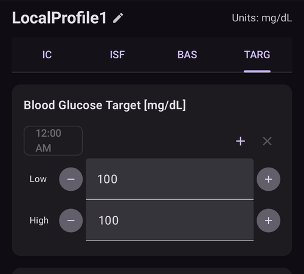
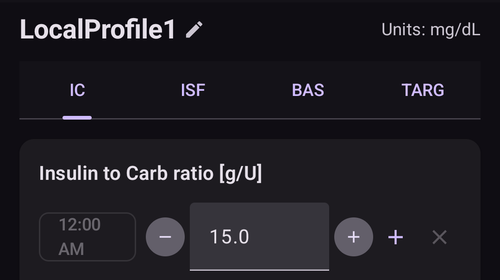
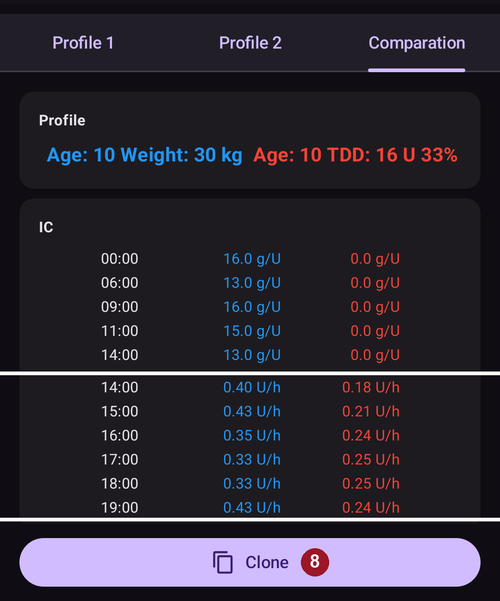
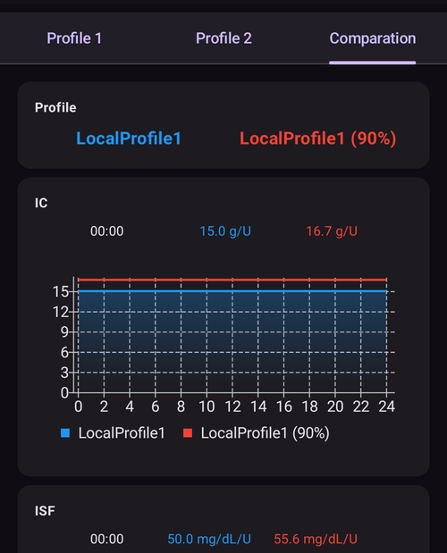

# Twój profil AAPS

Twój **profil AAPS** to zestaw czterech kluczowych parametrów, które określają, jak **AAPS** ma podawać insulinę w odpowiedzi na poziom glukozy z sensora. To są główne parametry, na których opiera się **AAPS**. W miarę przechodzenia przez **Zadania** odblokujesz kolejne parametry do zmiany (np. ustawienia SMB), ale te funkcje działają dobrze tylko wtedy, gdy Twój bazowy **Profil** jest poprawny. **Profil** zawiera:
* [cele glikemii](#profile-glucose-targets),
* [dawki bazowe](#your-aaps-profile-basal-rates) (BR),
* [współczynniki wrażliwości na insulinę](#your-aaps-profile-insulin-sensitivity-factor) (ISF) i
* [współczynniki insulina/węglowodany](#your-aaps-profile-insulin-to-carbs-ratio) (IC lub ICR).

```{admonition} Where did DIA go?
:class: note
**Czas działania insuliny (DIA)** nie jest już częścią Twojego **Profilu**. Jest teraz ustawiany dla każdej insuliny osobno – zobacz [Zarządzaj → Ustawienia insuliny](#Config-Builder-insulin-dia).
```

W ramach korzystania z **AAPS** musisz stale oceniać i sprawdzać, czy ustawienia Twojego **Profilu** są trafne. Zalecamy ustawiać parametry w kolejności, w jakiej są tu opisane. Najpierw dobrze ustaw jeden parametr, a dopiero potem zmieniaj następny. Rób małe kroki zamiast dużych zmian naraz. Nie zapomnij aktywować nowego profilu po każdej zmianie. Regularnie [rób kopię zapasową ustawień **Profilu**](#YourAapsProfile_Profile-backup), eksportując ustawienia.

Ustawienia **Profilu** wpływają na siebie nawzajem – możesz mieć „złe” ustawienia, które w pewnych sytuacjach dobrze się uzupełniają, a w innych nie. Na przykład gdy za wysoka baza występuje w tym samym czasie co za wysoki **CR**. Dlatego musisz rozważyć każde ustawienie osobno i sprawdzić, czy dobrze współdziałają w różnych sytuacjach.

Możesz użyć [Autotune](https://autotuneweb.azurewebsites.net/) jako pomocy, ale nie stosuj go ślepo: może nie działać dobrze dla Ciebie albo nie we wszystkich sytuacjach.

```{admonition} Your diabetes may vary
:class: note
**Profile** bardzo się różnią u różnych osób.

Dawki bazowe (BR), współczynniki wrażliwości na insulinę (ISF) i współczynniki insulina/węglowodany (IC lub ICR) – ich wartości i zmiany zapotrzebowania na insulinę bardzo się różnią u różnych osób. Zależą od organizmu, płci, wieku, kondycji itp., a także od czynników krótkoterminowych, jak choroba czy niedawny wysiłek. For more guidance on this, the book [“Bright Spots and Landmines”](https://diatribe.org/bright-spots-and-landmines/) by Adam Brown is an excellent book to read.

```

Cztery ostatnie parametry (cele glikemii, dawki bazowe, współczynniki wrażliwości na insulinę i współczynniki insulina/węglowodany) mogą mieć różne wartości w ciągu doby, w razie potrzeby zmieniane co godzinę.


Poniżej są zrzuty ekranu **AAPS** z _przykładowym_ profilem. Uwaga: poniższy przykładowy profil ma dużo punktów czasowych. Gdy zaczynasz z **AAPS**, Twój profil będzie zapewne dużo prostszy.


(profile-glucose-targets)=
## Cele glikemii

### Opis

Twój **cel BG** to podstawowa wartość i wszystkie obliczenia **AAPS** są na nim oparte. Różni się on od zakresu docelowego, w którym zwykle chcesz utrzymywać glikemię. Cel jest używany w obliczeniach **AAPS**: jeśli **AAPS** przewiduje, że Twoja **BG** wyjdzie poza zakres celu, podejmie działania, aby przywrócić ją do tego zakresu.

Cele można ustawić w tych granicach:

|          | _Dolny_ cel             | _Górny_ cel               |
| -------- | ----------------------- | ------------------------- |
| Minimum  | 4,4 mmol/l lub 80 mg/dl | 5 mmol/l lub 90 mg/dl     |
| Maksimum | 10 mmol/l lub 180 mg/dl | 11,1 mmol/l lub 200 mg/dl |

### Wpływ

Jeśli cel w Twoim **Profilu** jest bardzo szeroki (np. 3 mmol/l lub więcej [50 mg/dl lub więcej]), często zobaczysz niewiele działań **AAPS**. Dzieje się tak, ponieważ prognoza **BG** wypada gdzieś w tym szerokim zakresie, więc **AAPS** rzadko ustawia bazy tymczasowe.

### Jak to ustawić

**Rysunek poniżej** pokazuje przykład, jak można ustawić cel w profilu **AAPS**.



Cele **BG** ustawiasz według własnych preferencji i potrzeb. Na przykład, jeśli boisz się hipoglikemii w nocy, możesz ustawić cel nieco wyżej, na 117 mg/dl (6,5 mmol/l), od 21:00 do 7:00. Jeśli chcesz mieć rano dużo aktywnej insuliny (IOB) przed bolusem na śniadanie, możesz ustawić niższy cel 81 mg/dl (4,5 mmol/l) od 7:00 do 8:00.

W trybie [Otwarta pętla](#KeyAapsFeatures-OpenLoop), szczególnie podczas [pierwszych zadań](../SettingUpAaps/CompletingTheObjectives.md), szeroki zakres celu może być dobrym wyborem, gdy uczysz się, jak działa **AAPS**, i dostosowujesz swój **Profil**.<br/> W trybie [Zamknięta pętla](#KeyAapsFeatures-ClosedLoop) (od **[Zadania 6](#objectives-objective6)**) zalecamy zmniejszać zakres, aż będziesz mieć jeden cel dla każdej pory dnia (_Dolny_ cel = _Górny_ cel). Dzięki temu **AAPS** szybko reaguje na wahania **BG**.

(your-aaps-profile-basal-rates)=

## Dawki bazowe

### Opis

Dawka bazowa insuliny (jednostki/godz.) zapewnia insulinę w tle i utrzymuje stały poziom glukozy, gdy nie jesz i nie ćwiczysz.

Pompa insulinowa co kilka minut podaje małe ilości szybko działającej insuliny, aby wątroba nie uwalniała zbyt dużo glukozy i aby glukoza mogła wejść do komórek ciała. Insulina bazowa stanowi zwykle 40–50% całkowitej dawki dobowej (TDD), zależnie od diety, i zwykle ma rytm dobowy, z jednym szczytem i jednym dołkiem zapotrzebowania na insulinę w ciągu 24 godzin. Więcej informacji znajdziesz w rozdziale 6 książki [„Think like a Pancreas”](https://amzn.eu/d/iVU0RGe) Gary'ego Scheinera.

Większość edukatorów diabetologicznych (i osób z cukrzycą typu 1!) zgadza się, że najpierw trzeba dobrze ustawić dawki bazowe, a dopiero potem optymalizować ISF i ICR.

### Wpływ

Dobrze ustawione dawki bazowe pozwalają budzić się w zakresie i pominąć posiłek - albo zjeść wcześniej lub później w ciągu dnia - bez wysokiej lub niskiej glikemii.

Za wysoka dawka bazowa może prowadzić do niskich glikemii. I odwrotnie.

**AAPS** traktuje domyślną dawkę bazową jako punkt odniesienia. Jeśli dawka bazowa jest za wysoka, „zerowa baza tymczasowa” liczy się jako większe ujemne IOB, niż powinna. Przez to **AAPS** poda potem więcej korekt, niż powinien, aby w końcu doprowadzić IOB do zera.

Za wysoka dawka bazowa powoduje więc niskie **BG** zarówno przy domyślnej bazie, jak i kilka godzin później, gdy **AAPS** koryguje do celu.

I odwrotnie: za niska dawka bazowa może prowadzić do wysokich glikemii i braku zejścia do celu.

### Jak to ustawić

**Rysunek poniżej** pokazuje przykład, jak można ustawić dawki bazowe w profilu **AAPS**.


Setting your basal rates right is done by trial and error, and should be done in consultation with your diabetes team.

Istnieją metody testowania bazy, które zwykle polegają na obserwowaniu dawek bazowych i zapotrzebowania na insulinę w czasie <u>przerywanej</u> głodówki w ciągu 24 godzin. Chociaż musisz sprawdzić dawki bazowe dla całej doby, nie zalecamy głodówki przez 24 godziny bez przerwy. Powodem jest to, że organizm uruchamia mechanizmy wyrównawcze, np. hormony. Zalecany sposób to głodówka przez 8 godzin w 3 różne dni.

Zalecana metoda to wstrzymać pętlę (dla bezpieczeństwa możesz ustawić AAPS w tryb [**LGS**](#KeyAapsFeatures-LGS), aby uniknąć niskich glikemii, tak jak przy [Zadaniu 6](#objectives-objective6)). Wtedy pompa wraca do Twojej domyślnej dawki bazowej. Obserwuj, jak zmienia się Twoja **BG**: jeśli spada, dawka bazowa jest za wysoka. I odwrotnie.<br/> Inna metoda (może trudniejsza) to zostawić działającą pętlę i obserwować, jak zmienia się **IOB**. Jeśli **IOB** jest ujemne, Twoja dawka bazowa jest za wysoka. I odwrotnie. Pamiętaj, że ta metoda opiera się na **ISF** do korekty **BG**, więc działa tylko wtedy, gdy inne parametry są ustawione dość dobrze.<br/> Inny sposób dostosowania dawek bazowych to obserwowanie działania pętli w nocy, gdy całe COB zostało już wchłonięte. Ta metoda jest szczególnie przydatna u dzieci, gdy trudno jest pościć albo zapotrzebowanie na insulinę często się zmienia. [Dr Saleh Adi z Tidepool](https://www.youtube.com/watch?v=-fpWnGRhLSo) pokazuje przydatne sposoby analizy nocnych wykresów BG, aby zoptymalizować dawki bazowe.

Zobacz [tutaj](../GettingHelp/ProfileTuning.md), jak dostroić profil bazy, analizując wzorce w zamkniętej pętli.

Gdy wprowadzasz zmiany na podstawie wyników testu bazy, zmień **Profil** 1 do 2 godzin (zależnie od rodzaju insuliny) przed wzrostem/spadkiem. Powtarzaj test, aż ustawienia **dawek bazowych** będą dla Ciebie odpowiednie.

(your-aaps-profile-basal-not-compatible)=
#### Komunikat: „Wartość bazy nie jest zgodna z aktualną pompą”

Każda pompa ma limity: najniższą i najwyższą dawkę bazową, jaką może podać, a w niektórych pompach (np. Dana, Accu-Chek Combo, Medtronic i Diaconn G8) dawki bazowe mogą się zmieniać tylko o pełnej godzinie. **AAPS** sprawdza Twój profil względem używanej pompy **po** zastosowaniu wybranego procentu.

Jeśli dawka bazowa jest poza tymi limitami, ekran **Aktywuj** pokazuje ten komunikat, a przycisk **Aktywuj** pozostaje szary:


Na przykład przy dawce bazowej 0,10 U/h w nocy i procencie profilu 35% **AAPS** musiałby podawać 0,035 U/h. To mniej, niż może podać pompa Dana (0,04 U/h).

Aby to rozwiązać:

* wybierz inny procent: **wyższy**, jeśli dawka bazowa staje się za niska, **niższy**, jeśli dawka bazowa staje się za wysoka, albo
* [edytuj profil](#your-aaps-profile-create-and-edit-profiles) i zmień dawkę bazową.

Edytor profilu pozwala zaczynać dawki bazowe tylko o pełnej godzinie. Dawka bazowa zaczynająca się np. o 06:30 może pochodzić tylko ze starszego profilu, np. po zmianie na pompę, która tego nie obsługuje.

(your-aaps-profile-insulin-sensitivity-factor)=

## Współczynnik wrażliwości na insulinę (ISF)

### Opis

Współczynnik wrażliwości na insulinę (ISF), czasem nazywany współczynnikiem korekty, mówi, o ile 1 jednostka insuliny obniży poziom glukozy we krwi.

**W jednostkach mg/dl:** Jeśli Twój **ISF** wynosi 40, każda jednostka insuliny obniży glikemię o ok. 40 mg/dl (na przykład glikemia spadnie ze 140 mg/dl do 100 mg/dl).

**W jednostkach mmol/l:** Jeśli Twój **ISF** wynosi 1,5, każda jednostka insuliny obniży glikemię o ok. 1,5 mmol/l (na przykład z 8 mmol/l do 6,5 mmol/l).

Z tych przykładów widać, że im _mniejsza_ wartość **ISF**, tym mniej jesteś wrażliwy na insulinę. Jeśli więc zmniejszysz ISF z 40 do 35 (mg/dl) lub z 1,5 do 1,3 (mmol/l), często nazywa się to wzmocnieniem **ISF**. Conversely, increasing the **ISF** value from 40 to 45 (mg/dL) or 1.5 to 1.8 (mmol/L) is weakening your **ISF**.

### Wpływ

**Niższy / silniejszy ISF** (np. 40 zamiast 50) oznacza, że jedna jednostka insuliny obniża **BG** mniej. To prowadzi do bardziej agresywnej / silniejszej korekty przez pętlę, z **większą ilością insuliny**. Jeśli Twój **ISF** jest za silny (mała wartość), może to prowadzić do niskiej **BG**.

**Wyższy / słabszy ISF** (np. 45 zamiast 35) oznacza, że jedna jednostka insuliny obniża **BG** bardziej. To prowadzi do mniej agresywnej / słabszej korekty przez pętlę, z **mniejszą ilością insuliny**. Jeśli Twój **ISF** jest za słaby (duża wartość), może to prowadzić do wysokiej **BG**.

**Example:**
* **BG** is 190 mg/dL (10.5 mmol/L) and target is 100 mg/dL (5.6 mmol/L).
* So, you want a correction of `190 - 100 = 90 mg/dL` or `10.5 - 5.6 = 4.9 mmol/L`
* Jeśli `ISF = 30` -> `90 / 30 = 3` lub `ISF = 1.63` -> `4.9 / 1.63 = 3`: 3 jednostki insuliny
* Jeśli `ISF = 45` -> `90 / 45 = 2` lub `ISF = 2.45` -> `4.9 / 2.45 = 2`: 2 jednostki insuliny

Za niski **ISF** (a więc bardziej agresywny, co zdarza się często) może powodować „nadmierne korekty”, bo **AAPS** oblicza, że do korekty wysokiej **BG** potrzeba więcej insuliny, niż naprawdę trzeba. Może to prowadzić do glikemii jak na „rollercoasterze” (szczególnie na czczo), jak na obrazku poniżej. W takiej sytuacji wartość **ISF** trzeba zwiększyć, aby **AAPS** był mniej agresywny. Dzięki temu **AAPS** poda mniejsze dawki korekcyjne i nie skoryguje wysokiej **BG** za mocno, co skończyłoby się niską **BG**.


I odwrotnie: za wysoki **ISF** może powodować za słabe korekty, czyli Twoja **BG** zostaje powyżej celu – szczególnie widać to w nocy.

### Jak to ustawić

Na **rysunku poniżej** zobaczysz przykład, jak można ustawić wartości ISF w profilu **AAPS**.


Prostym punktem wyjścia do ustalenia dziennego ISF jest całkowita dawka dobowa (TDD) i reguła 1700 (94). Więcej szczegółów znajdziesz w rozdziale 7 książki [„Think like a Pancreas”](https://amzn.eu/d/iVU0RGe) Gary'ego Scheinera.

| 1700 (gdy mierzysz w mg/dl) lub 94 (mmol/l) / TDD = ok. ISF.<br/><br/>Przykład: TDD = 40 U<br/>Ok. ISF (mg/dl) = 1700/40 = 43<br/>Ok. ISF (mmol/l) = 94/40 = 2,4 |
| ---------------------------------------------------------------------------------------------------------------------------------------------------------------------------------------- |
|                                                                                                                                                                                          |

Jeśli dawki bazowe są poprawne, możesz to sprawdzić tak: wstrzymaj pętlę, sprawdź, czy **IOB** wynosi zero, i zjedz kilka tabletek glukozy, aby osiągnąć stabilny „wysoki” poziom.

Potem podaj szacowaną ilość insuliny (według obecnego 1/ISF), aby dojść do docelowej BG.

Uważaj, bo często jest on ustawiony za nisko. Za nisko oznacza, że 1 U obniży BG szybciej, niż się spodziewasz.

(your-aaps-profile-insulin-to-carbs-ratio)=

## Współczynnik insulina/węglowodany (ICR)

### Opis

**ICR** mówi, ile gramów węglowodanów pokrywa jedna jednostka insuliny.

Niektórzy używają też skrótu **I:C** zamiast **ICR** albo mówią o przeliczniku węglowodanów: **CR**.

Na przykład współczynnik insulina/węglowodany 1 do 10 (1:10) oznacza, że bierzesz 1 U insuliny na każde 10 gramów zjedzonych węglowodanów. Posiłek z 25 g węglowodanów wymagałby 2,5 U insuliny.

Jeśli Twój **ICR** jest słabszy (wyższa wartość), np. 1:20, potrzebujesz tylko 0,5 U insuliny na 10 g węglowodanów. Posiłek z 25 g węglowodanów wymagałby 25/20 = 1,25 U insuliny.

Często **ICR** jest różny o różnych porach dnia, z powodu poziomu hormonów i aktywności fizycznej. Wiele osób ma najniższy/najsilniejszy **ICR** w porze śniadania, bo wtedy są bardziej insulinooporne. Na przykład **ICR** pewnej dorosłej osoby może wynosić 1:8 na śniadanie, 1:10 na obiad i 1:10 na kolację. Te wzorce nie są jednak takie same u wszystkich – niektórzy są bardziej insulinooporni wieczorem i wtedy potrzebują silniejszego/mniejszego **ICR**.

> **UWAGA:**
> 
> W niektórych krajach Europy do określania, ile insuliny potrzeba do jedzenia, używano wymienników węglowodanowych (WW). Na początku 1 WW odpowiadał 12 g węglowodanów, później niektórzy przeszli na 10 g węglowodanów.
> 
> W tym modelu ilość węglowodanów była stała, a ilość insuliny zmienna. („Ile insuliny potrzeba na jeden wymiennik węglowodanowy?”)
> 
> Przy **ICR** ilość insuliny jest stała, a ilość węglowodanów zmienna. („Ile g węglowodanów pokrywa jedna jednostka insuliny?”)
> 
> Example:
> 
> Przelicznik WW (WW = 12 g węglowodanów): 2,4 U/WW -> Potrzebujesz 2,4 jednostki insuliny, gdy jesz jeden wymiennik węglowodanowy.
> 
> Odpowiedni **ICR**: 12g / 2,4 U = 5,0 g/U -> jedna jednostka insuliny pokrywa 5,0 g węglowodanów.
> 
> Przelicznik WW 2,4 U / 12g   ===>   IC = 12g / 2,4 U = 5,0 g/U
> 
> Tabele przeliczeniowe są dostępne w internecie, np. [tutaj](https://www.mylife-diabetescare.com/files/media/03_Documents/11_Software/FAS/SOF_FAS_App_KI-Verha%CC%88ltnis_MSTR-DE-AT-CH.pdf).

### Wpływ

**Niższy / silniejszy ICR** oznacza mniej jedzenia na jednostkę, czyli dostajesz więcej insuliny na stałą ilość węglowodanów. Można też powiedzieć „bardziej agresywny”. Jeśli Twój IC jest za silny, dostajesz za dużo insuliny, co może prowadzić do niskich **BG**.

**Wyższy / słabszy ICR** = więcej jedzenia na jednostkę, czyli dostajesz mniej insuliny na stałą ilość węglowodanów. Można też powiedzieć „mniej agresywny”. Jeśli Twój IC jest za słaby, dostajesz mniej insuliny, niż potrzebujesz, co może prowadzić do wysokich **BG**.

### Jak to ustawić

**Rysunek poniżej** pokazuje przykładowy **ICR** i jak można go ustawić w **profilu AAPS**. Wpisując te wartości, podajemy tylko drugą część proporcji, więc współczynnik insulina/węglowodany 1:3,5 wpisujesz po prostu jako „3,5”.



Jeśli po strawieniu posiłku, gdy **IOB** wróciło do zera, Twoja **BG** jest wyższa niż przed jedzeniem, to prawdopodobnie **ICR** jest za słaby (_tzn._ liczba jest za duża i trzeba ją stopniowo zmniejszać). I odwrotnie: jeśli Twoja **BG** jest niższa niż przed jedzeniem, **ICR** jest za silny (_tzn._ liczba jest za mała i trzeba ją stopniowo zwiększać).

Jeśli dawki bazowe są poprawne, możesz to sprawdzić tak: upewnij się, że **IOB** wynosi zero i jesteś w zakresie, zjedz dokładnie znaną ilość węglowodanów i podaj szacowaną ilość insuliny według obecnego współczynnika insulina/węglowodany. Najlepiej zjeść to, co zwykle jesz o tej porze dnia, i dokładnie policzyć węglowodany.

## Częste pytania o profil

```{contents} Common questions related to the Profile
:depth: 1
:local: true
```

### Dlaczego dobre ustawienie profilu jest ważne

**Dlaczego warto dobrze ustawić profil? Czy pętla nie może po prostu sama się tym zająć?**

Hybrydowa zamknięta pętla _może_ próbować dostosować podawanie insuliny, aby zmniejszyć złą kontrolę glikemii wynikającą z błędnych wartości **Profilu**. Może to robić na przykład wstrzymując podawanie insuliny, gdy grozi Ci hipoglikemia. Jednak możesz osiągnąć dużo lepszą kontrolę glikemii, jeśli ustawienia **Profilu** są już jak najbliższe temu, czego potrzebuje Twój organizm. To jeden z powodów, dla których **AAPS** używa kolejnych zadań, aby przejść od pompy w otwartej pętli do hybrydowej zamkniętej pętli. Poza tym będą sytuacje, gdy musisz otworzyć pętlę (rozgrzewanie sensora, awaria sensora _itp._), czasem w środku nocy. Wtedy chcesz mieć dobre ustawienia.

Jeśli zaczynasz z **AAPS** po używaniu innego systemu pompowego z otwartą lub zamkniętą pętlą, to już mniej więcej wiesz, jakich wartości użyć dla dawek bazowych (**BR**), współczynników wrażliwości na insulinę (**ISF**) i współczynników insulina/węglowodany (**ICR**).

Jeśli przechodzisz z wstrzyknięć (MDI) na **AAPS**, najpierw warto poczytać, jak przejść z MDI na pompę. Zaplanuj i przeprowadź tę zmianę ostrożnie, w porozumieniu ze swoim zespołem diabetologicznym. Bardzo przydatne są książki [„Pumping insulin”](https://amzn.eu/d/iaCsFa2) Johna Walsha i Ruth Roberts oraz [„Think like a Pancreas”](https://amzn.eu/d/iVU0RGe) Gary'ego Scheinera.

### Co powoduje wysokie skoki po posiłku w zamkniętej pętli?
Najpierw sprawdź dawkę bazową i zrób test bazy bez węglowodanów. Jeśli jest poprawny, a Twoja **BG** spada do celu po pełnym wchłonięciu węglowodanów, spróbuj ustawić w **AAPS** cel tymczasowy „wkrótce posiłek” jakiś czas przed jedzeniem albo ustal z diabetologiem odpowiedni czas podania bolusa przed posiłkiem. <br/> Jeśli Twoja **BG** jest za wysoka po posiłku i nadal za wysoka po pełnym wchłonięciu węglowodanów, rozważ z diabetologiem zmniejszenie **ICR**. Jeśli Twoja **BG** jest za wysoka w czasie **COB**, a za niska po pełnym wchłonięciu węglowodanów, rozważ z diabetologiem zwiększenie **ICR** i odpowiedni czas bolusa przed posiłkiem.

### Mam wysoką glikemię, a pętla jej nie obniża
Możliwe powody, dla których **AAPS** nie podaje wystarczająco insuliny:
* **ISF** nie jest dość silny
* Dawka bazowa może być za słaba
* Może zadziałać ustawienie bezpieczeństwa, np. **maxIOB**. Albo **SMB** jest w tym czasie wyłączone, zależnie od Twoich ustawień.
* Automatyzacja została ustawiona i nadpisała działanie **AAPS**.

Zobacz też [Dostrajanie profilu AAPS](../GettingHelp/ProfileTuning.md).

### Mam ujemne IOB – czy to problem?
Ujemne **IOB** oznacza, że całkowita ilość insuliny (baza + bolus) w Twoim organizmie jest mniejsza niż sama baza. Spowoduje to, że **AAPS** poda więcej insuliny, gdy tylko **BG** zacznie rosnąć, bo uzna, że brakuje insuliny. Może to później skończyć się niską **BG**.

Oto kilka powodów ujemnego IOB i co wtedy zrobić:
* za silna baza: popraw swój **Profil**
* za duży bolus przy poprzednim posiłku: popraw swój **Profil** albo sprawdź, czy podajesz bolus we właściwym czasie.
* DIA ustawione za krótko dla Twojego rodzaju insuliny, co powoduje kumulację insuliny: popraw je w [Zarządzaj → Ustawienia insuliny](#Config-Builder-insulin-dia)
* aktywność fizyczna: następnym razem rozważ niższy [procent profilu](../DailyLifeWithAaps/ProfileSwitch-ProfilePercentage.md) w czasie aktywności, ze względu na większą wrażliwość.

## Zarządzanie profilami

```{contents} Operations that you can perform on your **Profiles** in **AAPS**
:depth: 1
:local: true
```
(your-aaps-profile-create-and-edit-profiles)=
### Tworzenie i edycja profili

W **AAPS** v4 Twoje profile są na ekranie **Zarządzaj** (dolny pasek nawigacji) → **Profil**, pokazane jako karuzela kart do przesuwania z paskiem akcji (**➕ Dodaj**, **✏️ Edytuj**, **⧉ Sklonuj**, **🗑️ Usuń**, **▶ Aktywuj**). Jak zarządzać profilem i go aktywować, zobacz [Zarządzanie i aktywacja profili](#ProfileSwitch-manage-v4). Przechodzisz z **AAPS** v3, gdzie profile miały własną zakładkę? Zobacz [Co zmieniło się w AAPS v4](#v4changes-manage).

Dotknięcie **✏️ Edytuj** otwiera edytor. Ustaw **nazwę** profilu i **jednostki**, a potem wypełnij cztery harmonogramy w zakładkach:

- **IC** — współczynnik insulina/węglowodany (g/U)
- **ISF** — współczynnik wrażliwości na insulinę
- **BAS** — dawki bazowe
- **CEL** — zakres celu


Każdy harmonogram to lista **bloków czasowych**: dodaj blok, ustaw jego godzinę początku i wartość, potem **ZACHOWAJ**.

Gdy zmieniasz swój **Profil**, upewnij się, że edytujesz właściwy **Profil**: karta używanego profilu ma oznaczenie **AKTYWNY**, ale karta wybrana na ekranie może być inna.

(your-aaps-profile-profile-from-scratch-for-a-kid)=
### Tworzenie profilu od zera dla dziecka

[Pomocnik profilu](#aaps-screens-profile-helper) (menu ☰ → **Pomocnik profilu**) może pomóc Ci utworzyć profil dla dziecka (do 18 lat).

**Ważna uwaga:**

**Pomocnik profilu ma pomóc Ci znaleźć początkowy profil dla dziecka. Chociaż opiera się na danych z dwóch różnych szpitali, zawsze porozmawiaj z zespołem medycznym, zanim użyjesz nowego profilu!**

Pomocnik profilu oferuje dane dzieci z dwóch różnych szpitali, aby znaleźć początkowy profil dla dziecka w wieku do 18 lat.


1. Upewnij się, że jesteś na zakładce **Profil 1**.
2. W **Typ profilu** upewnij się, że wybrany jest „Profil domyślny”.
3. Dostosuj Profil domyślny (oparty na danych szpitala), wpisując wiek dziecka oraz TDD Całkowita **albo** wagę.
4. Przejdź do zakładki **Profil 2**.
5. Naciśnij **Typ profilu** i wybierz „Domyślny profil DPV”.
6. Dostosuj Domyślny profil DPV (oparty na danych innego szpitala), wpisując wiek dziecka, TDD Całkowita i procent bazy. Pamiętaj, że dane DPV podają tylko **dawki bazowe**, więc IC i ISF są dla tego profilu pokazane jako zero.
7. Otwórz zakładkę **Porównanie**. Wyświetli się porównanie dwóch dostosowanych profili (zobacz zrzut ekranu poniżej).
8. Jeśli chcesz zacząć dostrajać profil na podstawie jednej z tych propozycji, użyj przycisku **Sklonuj** na dole porównania.



### Zmiana profilu

Zobacz [Zmiana profilu i procent profilu](../DailyLifeWithAaps/ProfileSwitch-ProfilePercentage.md).

(your-aaps-profile-clone-profile-switch)=
### Klonowanie zmiany profilu do nowego profilu


[Historia leczenia](#aaps-screens-treatments) pokazuje wszystkie wcześniejsze **Zmiany Profilu**. Na zakładce **Zmiana profilu** możesz użyć wcześniejszej **Zmiany profilu** jako podstawy do utworzenia nowego **Profilu**. W tym przypadku przesunięcie czasu i procent zostaną zastosowane do nowego profilu lokalnego. Użyj przycisku **Sklonuj** w wierszu **2**.

Teraz możesz przejść do [ekranu Profil](#your-aaps-profile-create-and-edit-profiles) (**Zarządzaj → Profil**), aby edytować nowo utworzony profil.

(YourAapsProfile_Profile-backup)=
### Kopia zapasowa profilu

Twoje **Profile** to podstawowe ustawienie Twojego systemu pętli, więc są bardzo ważne i na pewno nie chcesz ich stracić.

* Twoje **Profile** są zapisane w bazie danych **AAPS**.
* Gdy **NSClientV3** jest skonfigurowany (zobacz [Synchronizacja](#SetupWizard-synchronization-with-the-reporting-server-and-more)), Twoje **Profile** są też automatycznie wysyłane do Nightscout.
* Są też częścią [eksportowanych ustawień](../Maintenance/ExportImportSettings.md). Dlatego trzymaj kopię zapasową w bezpiecznym miejscu.

### Edycja profili w Nightscout

Jeśli to włączysz, zmiany **Profilu** zrobione bezpośrednio w Nightscout mogą trafiać do **AAPS**. To ustawienie nazywa się „**Odbieraj zbiór profili z NS**” i należy do opcji **Przyjmowanie danych z Nightscout** (przyjmowanie danych z Nightscout jest domyślnie wyłączone, zobacz [krok Kontrola z urządzenia opiekuna w Kreatorze konfiguracji](../SettingUpAaps/SetupWizard.md)). Szybko znajdziesz je **paskiem wyszukiwania** na ekranie głównym. Gdy sterowanie z urządzenia opiekuna jest włączone, to ustawienie jest ukryte, a **AAPS** nie przyjmuje zmian profilu z Nightscout ([tryb silniejszych zabezpieczeń](#client-master-control-hardened-mode)). Zamiast tego edytuj profil na sparowanym urządzeniu opiekuna albo wczytaj go raz przez **Pełna synchronizacja**.

To może się przydać przed dużymi zmianami w bardziej rozbudowanym **Profilu**. Można je łatwiej wpisać przez interfejs strony, _np._ aby ręcznie skopiować dane z arkusza kalkulacyjnego.

Aby to zrobić, trzeba jednak sklonować w edytorze Nightscout cały **rekord bazy danych**, który zawiera kilka profili (niebieska strzałka na zrzucie ekranu poniżej). Nowy rekord bazy danych ma wtedy aktualną datę. Po zapisaniu zmieniony/nowy **Profil** można aktywować w **AAPS** zwykłą [zmianą profilu](../DailyLifeWithAaps/ProfileSwitch-ProfilePercentage.md).


(your-aaps-profile-compare-profiles)=
### Porównanie dwóch profili

Możesz też użyć [Pomocnika profilu](#aaps-screens-profile-helper) (menu ☰ → **Pomocnik profilu**), aby porównać dwa różne profile lub zmiany profilu (procent jednego z Twoich profili użyty wcześniej w [zmianie profilu](../DailyLifeWithAaps/ProfileSwitch-ProfilePercentage.md)).


1. Upewnij się, że jesteś na zakładce **Profil 1**.
2. W **Typ profilu** wybierz „Dostępny profil”, aby wybierać spośród wszystkich zapisanych **Profili**.
3. Wybierz **Profil**, od którego chcesz porównać.
4. Przejdź do zakładki **Profil 2**.
5. W **Typ profilu** wybierz „Zmiana profilu”, aby wybierać z historii wszystkich **Zmian profilu**.
6. Wybierz **Zmianę profilu**, z którą chcesz porównać.
7. Otwórz zakładkę **Porównanie**. Wyświetli się porównanie dwóch profili (zobacz zrzut ekranu poniżej).


