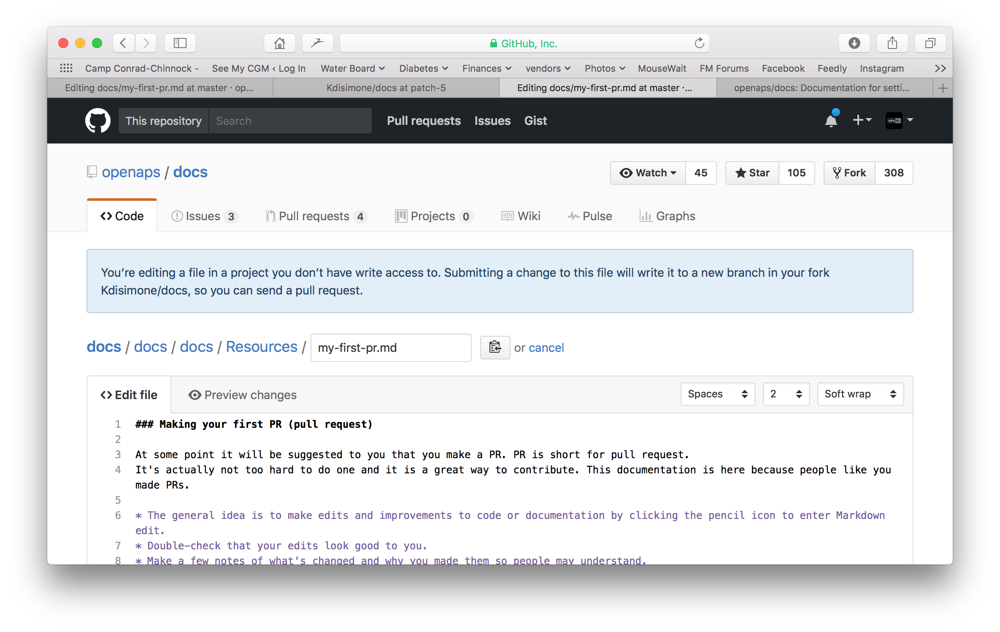

# Jak edytować dokumentację

**Ten opis dotyczy tylko edycji angielskiej dokumentacji. Wszystkie nowe informacje trzeba najpierw dodać po angielsku. Jeśli chcesz tłumaczyć na inne języki (dziękujemy!), użyj [Crowdin](https://crowdin.com/project/androidapsdocs).**

Wskazówki, jak formatować tekst (nagłówki, pogrubienie...) i dodawać linki, znajdziesz w części [„Składnia kodu”](#code-syntax) na tej stronie.

## Ogólne

Z pytaniami, uwagami lub nowymi pomysłami możesz zwrócić się do zespołu dokumentacji na [Discordzie](https://discord.gg/4fQUWHZ4Mw).

W pewnym momencie ktoś zaproponuje Ci zrobienie pull requesta (PR). W ten sposób Twoje zmiany w dokumentacji trafiają na strony AAPS, które są przechowywane w GitHub. Zrobienie PR nie jest wcale takie trudne i to świetny sposób, aby pomóc. Czytasz teraz tę dokumentację, bo ludzie tacy jak Ty robili PR. Nie martw się, że popełnisz błąd albo przez przypadek zmienisz niewłaściwe dokumenty. Twoje zmiany są sprawdzane, zanim zostaną scalone z „oficjalnym” repozytorium dokumentacji AAPS. Żaden przypadek w tym procesie nie może zepsuć oryginałów. Ogólny proces wygląda tak:

- Wprowadzaj zmiany i ulepszenia w kodzie lub dokumentacji, edytując istniejącą treść.
- Sprawdź jeszcze raz, czy Twoje zmiany dobrze wyglądają.
- Zapisz krótko, co się zmieniło, aby inni mogli zrozumieć Twoje zmiany.
- Utwórz pull request, czyli prośbę do administratorów o przyjęcie Twoich zmian.
- Sprawdzą je i albo (1) scalą Twoje zmiany, (2) skomentują Twoje zmiany, albo (3) utworzą nowy dokument z Twoimi zmianami.

(Uwaga: jeśli lepiej uczysz się wzrokowo, [tutaj](https://youtu.be/4b6tsL0_kzg) jest film na YouTube, który pokazuje pracę z PR.)

W naszym przykładzie wprowadzimy zmianę w AndroidAPSdocs. Możesz to zrobić na dowolnym komputerze z Windows, Macu itp. (na każdym komputerze z dostępem do internetu).

1. Przejdź do <https://github.com/openaps/AndroidAPSdocs> i kliknij Fork w prawym górnym rogu, aby utworzyć własną kopię repozytorium.


2. Przejdź na dowolną stronę i znajdź stronę, którą chcesz edytować. Możesz kliknąć link „Edit in GitHub” w prawym górnym rogu. Działa to tylko na stronach w języku angielskim. 


Albo kliknij ikonę ołówka, która pojawia się na górnym pasku edytowanej strony. Musisz być już zalogowany na swoje konto GitHub (jeśli go nie masz, łatwo je założyć).


3. Każda z opcji w kroku 2 utworzy nową gałąź w TWOIM repozytorium, w której zostaną zapisane Twoje zmiany. Wprowadź zmiany w pliku.

Strony dokumentacji piszemy w Markdown. The files have the suffix ".md". The Markdown specification is not fixed and we use at the moment the myst_parser for our markdown files. Uważaj, aby używać poprawnej składni, jak [opisano poniżej](#code-syntax).



4. Pracowałeś na karcie „<>Edit file”. Wybierz kartę „Preview changes”, aby spojrzeć na zmiany świeżym okiem i upewnić się, że wszystko wygląda tak, jak chciałeś (literówki!). Jeśli widzisz, że coś trzeba jeszcze poprawić, wróć na kartę edycji i wprowadź kolejne poprawki. 


5. Gdy skończysz edycję, przewiń na dół strony. W polu na dole strony wpisz swoje komentarze w polu tekstowym z napisem „Add an optional extended description...”. Domyślny tytuł zawiera nazwę pliku. Postaraj się dodać zdanie, które wyjaśnia **powód** zmiany. Podanie powodu pomaga recenzentom zrozumieć, co chcesz osiągnąć tym PR.


6. Kliknij zielony przycisk „Propose file changes” lub „Commit changes”. Na stronie, która się pojawi, kliknij „Create Pull Request”, a potem na następnej stronie znowu kliknij „Create Pull Request”.


7. W ten sposób pull request (PR) jest otwarty. GitHub nadaje PR numer, który znajdziesz po tytule i znaku #. Wracaj na tę stronę, aby sprawdzić odpowiedzi (albo, jeśli powiadomienia GitHub przychodzą do Ciebie e-mailem, dostaniesz e-maile o każdej aktywności w PR). Twoja zmiana jest teraz na liście PR, które zespół sprawdzi i może skomentuje, zanim zostanie dodana do głównej dokumentacji AAPS! Jeśli chcesz sprawdzić postęp PR, kliknij ikonę dzwonka w prawym górnym rogu swojego konta GitHub. Zobaczysz tam wszystkie swoje PR.


PS: Twój fork i gałąź nadal zostają na Twoim osobistym koncie GitHub. Gdy dostaniesz powiadomienie, że Twój PR został scalony, możesz usunąć swoją gałąź, jeśli już jej nie potrzebujesz (w obszarze powiadomień z kroku 8 pojawi się link do usunięcia gałęzi, gdy PR zostanie zamknięty lub scalony). Jeśli przy kolejnych zmianach użyjesz tej samej procedury, Twoje zmiany zawsze zaczną się od aktualnej wersji repozytoriów AndroidAPSdocs. Jeśli wybierzesz inną metodę rozpoczęcia PR (np. edycję zaczynając od gałęzi master w Twoim forku), musisz najpierw upewnić się, że Twoje repozytorium jest aktualne: wykonaj „compare” i scal wszystkie zmiany, które pojawiły się od ostatniej aktualizacji Twojego forka. Ludzie często zapominają aktualizować swoje repozytoria, dlatego zalecamy używanie opisanego wyżej procesu PR, dopóki nie nauczysz się wykonywać „compare”.

(edit-the-docs-code-syntax)=

## Składnia kodu

Strony dokumentacji piszemy w Markdown. Pliki mają rozszerzenie „.md”.

Markdown to bardzo prosty język formatowania tekstu, który oddziela treść tekstu od jego formatowania.

Autor tylko oznacza np. nagłówek jako nagłówek poziomu 1, a procesor Markdown podczas przetwarzania tworzy potrzebny kod HTML, aby wyświetlić nagłówek w HTML.

Chodzi o to, że

- autor powinien najpierw myśleć o tekście, a nie o formatowaniu,
- tekst Markdown można przenosić między różnymi narzędziami Markdown, zamiast używać np. zamkniętych narzędzi, takich jak Microsoft Windows, oraz
- z jednego pliku Markdown można wygenerować kilka formatów wyjściowych.

Markdown nie jest w 100% ustalonym standardem. Staramy się trzymać jak najbliżej standardu, aby

- możemy elastycznie zmieniać narzędzia Markdown, gdy jest to potrzebne lub wymuszone przez dalszy rozwój narzędzi Markdown i usług Markdown SaaS, oraz
- móc używać usług tłumaczeniowych do tłumaczenia z angielskiego na inne języki, np. francuski lub niemiecki. Te usługi radzą sobie z Markdown, ale nie ze skomplikowanymi kodami formatowania, bo nie potrafią oddzielić treści od układu, co może mieć bardzo złe skutki.

### Nagłówki

- Nagłówek 1: `# headline`
- Nagłówek 2: `## headline`
- Nagłówek 3: `### headline`
- Nagłówek 4: `#### headline`

Staramy się unikać dalszych poziomów nagłówków.

### Formatowanie tekstu

- **pogrubienie**: `**text**`
- *kursywa*: `*text*`
- ***pogrubiona kursywa***: `***text***`

### Lista numerowana

    1. pierwszy
    1. drugi
    1. trzeci
    

1. pierwszy
2. drugi
3. trzeci

### Lista nienumerowana

    - jeden element
    - inny element
    - i jeszcze jeden element
    

- jeden element
- inny element
- i jeszcze jeden element

### Lista wielopoziomowa

Możesz wstawiać listy w listach: każdy następny poziom przesuń o 4 spacje bardziej w prawo niż poprzedni.

    1. pierwszy
    1. drugi
    1. trzeci
      1. jeden element
      1. inny element
      1. i jeszcze jeden element
    1. cztery
    1. pięć
    1. sześć
    

1. pierwszy
2. drugi
3. trzeci 
    1. jeden element
    2. inny element
    3. i jeszcze jeden element
4. cztery
5. pięć
6. sześć

### Obrazy

Aby dodać obraz, użyj tej składni Markdown.

- obrazy: ``

Obraz powinien być w formacie PNG lub JPEG.

Image names should conform to one of the following naming rules. W przykładzie używam rozszerzenia png. Jeśli używasz JPEG, użyj rozszerzenia jpeg.

- `filename-image-xx.png`, gdzie xx to unikalna liczba dwucyfrowa dla obrazów w tym pliku.
- `filename-image-xx.png` where xx is a meaningful name chosen by the author of the md file.

Obrazy znajdują się w folderze images dla języka angielskiego i Crowdin automatycznie przenosi je do innych języków. Nie musisz nic z tym robić!

Obecnie nie tłumaczymy obrazów: obrazy powinny zawierać **jak najmniej tekstu**, aby były dostępne dla osób, które nie czytają po angielsku.

(make-a-PR-image-size)= Używaj rozsądnego rozmiaru obrazów. Muszą być czytelne na komputerze, tablecie i telefonie.

- Zrzuty ekranu stron internetowych powinny mieć szerokość do **1050 pikseli**.
- Diagramy przebiegu procesów powinny mieć szerokość do **1050 pikseli**.
- Zrzuty ekranu z aplikacji powinny mieć szerokość do **500 pikseli**. Nie umieszczaj ich obok siebie, jeśli nie jest to potrzebne.
- Zrzuty ekranu z zegarka (**Wear OS**) powinny mieć szerokość do **360 pikseli**. Nigdy nie powiększaj mniejszego zrzutu ekranu.

### Linki

#### Linki zewnętrzne

Linki zewnętrzne to linki do zewnętrznych stron internetowych.

- link zewnętrzny: `[alt text](www.url.tld)`

#### Linki wewnętrzne do początku pliku md

Linki wewnętrzne do stron to linki do początku pliku md, który jest na naszym własnym serwerze.

- link wewnętrzny do strony .md: `[alt text](../folder/file.md)`

#### Linki wewnętrzne do nazwanych etykiet w tekście

Linki wewnętrzne do nazwanych etykiet to linki do dowolnego miejsca w pliku md, który jest na naszym własnym serwerze i w którym ustawiono etykietę, do której można linkować.

Dodaj nazwaną etykietę (named reference) w tym miejscu docelowego pliku md, do którego chcesz przejść.

`(name-of-my-md-file-this-is-my-fancy-named-reference)=`

Nazwana etykieta musi być unikalna we wszystkich plikach md AndroidAPSDocs, a nie tylko w pliku md, w którym się znajduje!

Dlatego dobrą praktyką jest zacząć od nazwy pliku, a potem dodać wybraną nazwę etykiety.

Używaj tylko małych liter i łącz słowa myślnikiem.

Potem dodaj link do tej etykiety w tekście, który piszesz, takim rodzajem linku.

- Linki wewnętrzne do nazwanych etykiet: `[alt text](name-of-my-md-file-this-is-my-fancy-named-reference)`

### Uwagi, ostrzeżenia, zwijane uwagi

Możesz dodawać do dokumentacji ramki z uwagami i ostrzeżeniami.

Furthermore you can add collapsing notes for detailed information, so that users who are not interested in the details are not put off reading the text. Używaj ich ostrożnie, bo dokumentacja powinna być jak najłatwiejsza do czytania.

#### Notatki

    ```{admonition} Nagłówek uwagi
    :class: note
    To jest uwaga.
    ```
    

```{admonition} Nagłówek uwagi :class: note To jest uwaga.

    <br />#### Ostrzeżenia
    
    ````
    ```{admonition} Ostrzeżenie
    :class: warning
    To jest ostrzeżenie.
    

    ```{admonition} Nagłówek ostrzeżenia
    :class: warning
    To jest ostrzeżenie.
    ```
    
    #### Zwijane uwagi
    
    

    {admonition} więcej szczegółów dla zainteresowanych
    :class: dropdown
    
    Ta uwaga jest zwinięta,
    co oznacza, że możesz tu dodać dłuższy tekst,
    który nie zajmie dużo miejsca na stronie.
    

````

```{admonition} więcej szczegółów dla zainteresowanych :class: dropdown Ta uwaga jest zwinięta, co oznacza, że możesz tu dodać dłuższy tekst, który nie zajmie dużo miejsca na stronie.

```

## Tabele

Unikaj tabel z długimi tekstami: ich zawartość trudno ustawić w Markdown, zwykle nie mieszczą się na szerokość ekranu telefonu i po tłumaczeniu pewnie nie będą wyglądać tak samo.

## Przewodnik stylu

### Spis treści

1. Wskazówki dotyczące pisania po angielsku

2. Uwagi dotyczące pisania o AAPS

3. Przydatne materiały

###  1\. Wskazówki dotyczące pisania po angielsku

#### Używaj języka dopasowanego do czytelnika

Pisz prostym angielskim, gdzie tylko się da. To pomaga czytelnikom, dla których angielski nie jest językiem ojczystym, i ułatwia tłumaczenie dokumentacji AAPS na inne języki. Pisz tak, jakbyś rozmawiał z użytkownikiem. Wyobraź sobie, że siedzisz przy biurku naprzeciwko osoby, dla której piszesz. Pamiętaj: większość użytkowników AAPS nie umie programować. Cukrzyca też ma dużo żargonu i skrótów. Pamiętaj, że niektórzy ludzie mogli niedawno dostać diagnozę, mogą mieć mniej doświadczenia z cukrzycą niż Ty albo mogli przejść inne szkolenie z cukrzycy. Jeśli używasz skrótu, za pierwszym razem napisz pełną nazwę, a skrót podaj zaraz po niej w nawiasie, np. „super micro bolus (SMB)”. Dodaj też link do słowniczka pojęć. Pojęcia techniczne, których czytelnik może nie znać, możesz też dodać w nawiasie.

Zamiast: *„What causes high postprandial BG peaks in closed loop?”*

Użyj: *„What causes a high BG peak **after lunch** (postprandial) in closed loop?”*

##### Używaj prostych słów, które każdy rozumie

Listę prostszych słów od A do Z, dzięki którym Twój tekst będzie łatwiejszy do zrozumienia, znajdziesz tutaj:

<https://www.plainenglish.co.uk/the-a-z-of-alternative-words.html>

#### Prywatność i licencje:

Zwłaszcza gdy nagrywasz film lub robisz zrzuty ekranu, uważaj, aby nie pokazać swoich prywatnych danych (klucz API, hasła). Upewnij się, że film na YouTube nie jest publicznie widoczny na liście i można go obejrzeć tylko przez link z dokumentacji. Nie zwracaj uwagi na materiały, które naruszają prawa autorskie (BYODA itp.).

#### Pisz krótkie zdania, mów od razu, o co chodzi

- W jasnym tekście zdanie ma średnio 15–20 słów.

- To nie znaczy, że każde zdanie ma mieć tę samą długość. Pisz zwięźle. Urozmaicaj tekst: mieszaj krótkie zdania (jak poprzednie) z dłuższymi (jak to).

- W jednym zdaniu trzymaj się jednej głównej myśli, ewentualnie z jedną dodatkową, powiązaną informacją.

- Czasem nadal napiszesz jakieś długie zdanie, zwłaszcza gdy wyjaśniasz coś trudnego. Ale większość długich zdań można jakoś podzielić.

- Usuwaj słabe słowa: „you can”, „there is/are/were”, „in order to”.

- Umieszczaj słowa kluczowe blisko początku tytułów, zdań i akapitów.

- Pokazuj! Gdzie tylko się da, dodaj krótki diagram, zrzut ekranu lub film.

#### Nie bój się wydawać poleceń

Polecenia to najszybszy sposób przekazania instrukcji, ale autorzy czasem boją się ich używać i piszą „powinieneś to zrobić” zamiast po prostu „zrób to”. Może ludzie się boją, że polecenia brzmią zbyt ostro. Często możesz to rozwiązać, dodając na początku słowo „proszę”. Ale jeśli coś trzeba zrobić koniecznie, lepiej nie pisać „proszę”, bo to daje czytelnikowi możliwość odmowy.

Zamiast: *„You should just think of it as a complete statement.”*

Użyj: *„Think of it as a complete statement.”*

#### Używaj głównie strony czynnej, a nie biernej

Przykład **strony czynnej**:

- *„The pump (podmiot) delivers (czasownik) the insulin (dopełnienie).”*

„delivers” jest tu w stronie czynnej. Zdanie mówi najpierw, kto podaje, a dopiero potem, co jest podawane.

Przykład **strony biernej**:

- *„The insulin (podmiot) is delivered (czasownik) by the pump (dopełnienie)”*

*“delivered”* is a passive verb here. Podmiot i dopełnienie zamieniły się miejscami w porównaniu ze zdaniem w stronie czynnej. Zdanie stało się dłuższe, bo musieliśmy dodać „is” i „by the”. Rozważ też zaczynanie od czasownika w stronie czynnej.

Zamiast: *„You can connect your pump with the phone through the AAPS pump menu, and there are a number of pumps available for you to connect with.”*

Użyj: *„Connect your desired pump to the phone through the AAPS pump menu.”*

Strona bierna może sprawiać problemy:

- Może wprowadzać w błąd.

- Często sprawia, że tekst jest bardziej rozwlekły.

- Sprawia, że tekst jest mniej żywy.

##### Dobre użycie strony biernej

Czasem strona bierna może być odpowiednia.

- Aby złagodzić przekaz: „this bill has not been paid” (strona bierna) brzmi łagodniej niż „you have not paid this bill” (strona czynna).

- Aby nie wskazywać winnego: „a mistake was made” (strona bierna) zamiast „You made a mistake” (strona czynna).

- Gdy nie wiesz, kto lub co wykonuje czynność: „the England team has been picked”.

- Gdy po prostu brzmi lepiej.

#### Unikaj nominalizacji

Nominalizacja to nazwa czegoś, co nie jest fizycznym przedmiotem, np. procesu, techniki lub emocji. Nominalizacje tworzy się od czasowników.

Na przykład:

| Czasownik | Nominalizacja |
| --------- | ------------- |
| complete  | completion    |
| introduce | introduction  |
| provide   | provision     |
| fail      | failure       |

Często używa się ich **zamiast** czasowników, od których pochodzą, ale wtedy tekst może brzmieć tak, jakby nic się nie działo. Zbyt wiele nominalizacji sprawia, że tekst jest nudny i ciężki do czytania.

Zamiast: *„The implementation of the method has been done by a team.”*

Użyj: *„A team has implemented the method.”*

#### Używaj list tam, gdzie to pasuje

Listy świetnie nadają się do dzielenia informacji. Są dwa główne rodzaje list:

- Jedno ciągłe zdanie, w którym kilka punktów jest wymienionych na początku, w środku lub na końcu.

- Osobne punkty ze zdaniem wprowadzającym.

W liście punktowanej powyżej każdy punkt jest pełnym zdaniem, więc zaczyna się wielką literą i kończy kropką. Używaj punktów zamiast cyfr lub liter, bo zwracają uwagę na każdy punkt i nie dają dodatkowych informacji do przyswojenia.

#### Obalanie mitów

- Zdanie po angielsku możesz zacząć od **and, but, because, so lub however**.

- Możesz rozdzielać bezokolicznik (split infinitive). Możesz więc napisać **„to boldly go”**.

- Możesz zakończyć zdanie przyimkiem. Właściwie to coś, **we should stand up for** (czego powinniśmy bronić).

- I **Ty** możesz użyć tego samego **słowa** dwa razy w zdaniu, jeśli **sam** nie znajdziesz lepszego **słowa**.

#### Dopasowanie stylu pisania do celu

Aby dokumentacja była jasna i krótka, różne jej części piszemy różnymi stylami.

Styl „wyjaśnienia” jest używany we wstępie, w informacjach podstawowych i w częściach, które rozwijają wiedzę.

Styl „poradnika” (z minimum wyjaśnień) jest używany przy budowaniu i konfiguracji AAPS oraz w niektórych częściach o rozwiązywaniu problemów.

Samouczek pomaga uczniowi zdobyć podstawowe umiejętności. Użytkownik **uczy się przez działanie**.


#####  Samouczki (np. uczenie dziecka ubijania białek)

- narrator mówi bezpośrednio do czytelnika: W tym samouczku **zrobisz** w rzadkich przypadkach można użyć (my), aby przekazać myśl „robimy to razem”

- Czas przyszły -> aby pokazać cel końcowy

- Tryb rozkazujący -> do wykonywania zadań -> Konkretne kroki – unikaj abstrakcyjnych pojęć

- Czas przeszły -> aby pokazać wykonane zadania -> Szybkie i od razu widoczne wyniki

- Minimum wyjaśnień -> tylko to, co konieczne do wykonania zadania – **co i dlaczego**

- Pomiń opcje/alternatywy/…. Bez niejasności

- Przejścia między krokami: zakończ krok zdaniem, które logicznie prowadzi do następnego kroku. Przykład: *Klient Let’s Encrypt jest już zainstalowany, ale zanim pobierzesz certyfikaty, musisz upewnić się, że wszystkie potrzebne porty są otwarte. W tym celu w następnym kroku zaktualizujesz ustawienia zapory sieciowej.*

- Tytuł **samouczka** (nagłówek poziomu 1)

- Wstęp (bez nagłówka)

- Wymagania wstępne (nagłówek poziomu 2)

- Kroki:

- Krok 1 — Robimy pierwszą rzecz (nagłówek poziomu 2)

- Krok 2 — Robimy następną rzecz (nagłówek poziomu 2)

- Krok n — Robimy ostatnią rzecz (nagłówek poziomu 2)

- Podsumowanie (nagłówek poziomu 2)
    
    - **Język samouczków**
        
        *W tym samouczku zrobisz…*
        
        Opisz, co uczeń osiągnie (uwaga: nie „nauczysz się…”).
        
        *Najpierw zrób x. Teraz zrób y. Gdy już zrobiłeś y, zrób z.*
        
        Bez miejsca na niejasności i wątpliwości.
        
        *Zawsze musimy zrobić x przed y, ponieważ… (więcej szczegółów w wyjaśnieniu).*
        
        Wyjaśniaj działania krótko i najprostszym możliwym językiem. Dodaj link do dokładniejszego wyjaśnienia.
        
        *Wynik powinien wyglądać mniej więcej tak…*
        
        Daj uczniowi jasne oczekiwania.
        
        *Zauważ, że… Pamiętaj, że…*
        
        Dawaj uczniowi dużo wskazówek, aby mógł sprawdzić, że idzie we właściwym kierunku, i się zorientować.
        
        *Zbudowałeś bezpieczny, trójwarstwowy silnik hylomorficznej stazy…*
        
        Opisz (i z umiarem pochwal) to, co uczeń osiągnął (uwaga: nie „nauczyłeś się…”)

#####  Poradniki (np. przepis kulinarny)

Celem poradnika jest pomóc użytkownikowi, który już ma podstawowe umiejętności, poprawnie wykonać konkretne zadanie.

- JAK to zrobić

- narrator mówi bezpośrednio do czytelnika: W tym samouczku **zrobisz**

- Czas przyszły -> aby pokazać cel końcowy

- Warunkowy tryb rozkazujący -> aby uzyskać X, zrób y -> Konkretne kroki – unikaj abstrakcyjnych pojęć

- Minimum wyjaśnień -> tylko to, co konieczne do wykonania zadania -> **co i dlaczego**

- Pomiń opcje/alternatywy/…. Bez niejasności, ale możesz dodać link do opisu w dokumentacji referencyjnej lub do wyjaśnienia

- **Jak**: Tytuł (nagłówek poziomu 1)

- Akapit wstępu

- Opcjonalne wymagania wstępne (akapit lub nagłówek poziomu 2, jeśli jest ich więcej niż 1)

- Kroki:

- Krok 1 — Robimy pierwszą rzecz (nagłówek poziomu 2)

- Krok 2 — Robimy następną rzecz (nagłówek poziomu 2)

- Krok n — Robimy ostatnią rzecz (nagłówek poziomu 2)

- Akapit podsumowania
    
    - **Język poradników**
        
        *Ten poradnik pokazuje, jak…*
        
        Jasno opisz problem lub zadanie, które poradnik pomaga rozwiązać.
        
        *Jeśli chcesz x, zrób y. Aby osiągnąć w, zrób z.*
        
        Używaj warunkowego trybu rozkazującego.
        
        *Pełną listę opcji znajdziesz w opisie referencyjnym x.*
        
        Nie zaśmiecaj praktycznego poradnika wszystkim, co użytkownik mógłby zrobić w związku z x.

#####  Wyjaśnienie (np. naukowe wyjaśnienie, dlaczego białka sztywnieją, gdy je ubijasz)

Wyjaśnienie porządkuje, pogłębia i poszerza wiedzę czytelnika na dany temat.

- DLACZEGO

- Zacznij od **O…** (About)

- Podaj kontekst, dodaj linki do WSZYSTKICH ważnych materiałów

- Omów opcje/alternatywy

- Nie podawaj instrukcji ani danych referencyjnych (dodaj do nich link)

- Podaj, czego nie wiadomo, co się jeszcze zmienia itp…

- Tytuł **O…** (About) (nagłówek poziomu 1)

- Wstęp (bez nagłówka)

- Opcjonalne wymagania wstępne (nagłówek poziomu 2)

- Podtemat 1 (nagłówek poziomu 2)

- Podsumowanie (nagłówek poziomu 2)
    
    - **Język wyjaśnień**
    
    *Powodem x jest to, że historycznie y…*
    
    Wyjaśniaj.
    
    *W jest lepsze niż z, ponieważ…*
    
    Offer judgements and even opinions where appropriate.
    
    *x w systemie y odpowiada w w systemie z. Jednak…*
    
    Podaj kontekst, który pomaga czytelnikowi.
    
    *Niektórzy użytkownicy wolą w (ponieważ z). To może być dobre podejście, ale…*
    
    Porównaj alternatywy.
    
    *x działa z y w następujący sposób:…*
    
    Odkryj wewnętrzne tajemnice mechanizmu, aby pomóc zrozumieć, dlaczego coś działa tak, a nie inaczej.

### 2\. Uwagi dotyczące pisania i aktualizacji dokumentacji AAPS

#### Autor i redaktor

Pisanie i aktualizację dokumentacji AAPS traktuj jako proces z dwoma etapami. Może je wykonać ta sama osoba w różnym czasie albo więcej niż jedna osoba.

**Autor (np. Ty!)** pisze lub edytuje część dokumentacji krótko, w stylu rozmowy, a potem przekazuje ją redaktorowi.

**Redaktor (np. inny użytkownik AAPS albo osoba, która dostaje pull request)** sprawdza zgodność z przewodnikiem stylu, poprawia tekst, aby był jasny i dostępny, i usuwa jak najwięcej zbędnych słów (zwłaszcza w samouczkach i poradnikach). Może pomóc przeczytanie tekstu na głos.

#### Ogólne uwagi o AAPS

- Dla wartości glukozy podawaj za każdym razem zarówno mg/dl, jak i mmol/l (rozważ to też na zrzutach ekranu, jeśli to możliwe).

- Dla spójności pisz „AAPS”, a nie „Android APS”.

- Jasno podaj wersję Android Studio/AAPS, dla której piszesz albo z której pochodzą zrzuty ekranu.

### 3\. Przydatne materiały

<https://dev.readthedocs.io/en/latest/style-guide.html>

[Diátaxis (diataxis.fr)](https://diataxis.fr/)

[Technical Writer Style Guide Examples | Technical Writer HQ](https://technicalwriterhq.com/writing/technical-writing/technical-writer-style-guide/)

[DigitalOcean's Technical Writing Guidelines | DigitalOcean](https://www.digitalocean.com/community/tutorials/digitalocean-s-technical-writing-guidelines)

[Top 10 tips for Microsoft style and voice - Microsoft Style Guide | Microsoft Learn](https://learn.microsoft.com/en-us/style-guide/top-10-tips-style-voice?source=recommendations)

<https://www.plainenglish.co.uk/how-to-write-in-plain-english.html>

<https://developers.google.com/style>

<https://www.mongodb.com/docs/meta/style-guide/screenshots/screenshot-guidelines/>