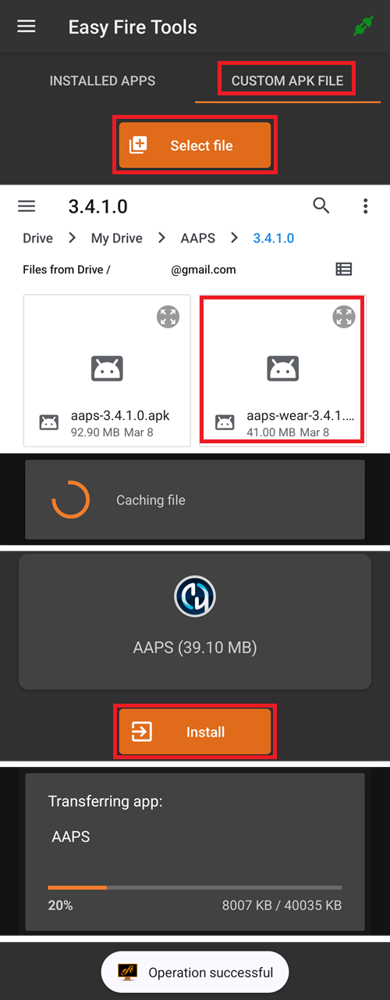

# Konfiguracja AAPS na zegarku z Wear OS

Poniższe instrukcje dotyczą apk **AAPS Wear**, który musisz zbudować. Jeśli jeszcze go nie zbudowałeś, zobacz instrukcję [tutaj](../WearOS/BuildingAapsWearOS.md). Podczas budowania użyj tego samego pliku magazynu kluczy (keystore), którego użyłeś dla apk **AAPS** na telefon.

Część tych informacji przyda się też dla apk **AAPSClient** i **PumpControl** **Wear**. Each **Wear** app will communicate with its matching phone app. Na przykład: aplikacji **AAPSClient Wear** możesz użyć do wyświetlania danych z **AAPSClient**, a nie z **AAPS**. Gdy obok siebie zainstalowanych jest kilka wersji klienta (**AAPSClient**, **AAPSClient2**, **AAPSClient3**), kafelki każdej z nich mają mały nagłówek w kolorze tej wersji, dzięki czemu odróżnisz je podczas przesuwania.

## Wersje Wear OS i zgodność

(wearos-watchface-changes)=

### Zmiany tarcz zegarka w Wear OS (wpływ na tarcze AAPS)

```{admonition} Why newer Wear OS watches break AAPS watchfaces
:class: warning

W czerwcu 2025 Google [ogłosił zmiany](https://android-developers.googleblog.com/2025/06/upcoming-changes-to-wear-os-watch-faces.html), które wycofują stary silnik tarcz zegarka (silnik AndroidX / Wearable Support Library, czyli „WSL”) na rzecz nowszego, deklaratywnego **Watch Face Format**. Własne tarcze **AAPS** są zbudowane na starym silniku, więc im nowsza wersja Wear OS, tym większa szansa, że tarcza AAPS będzie działać źle albo przestanie działać.

Dotyczy to tylko **tarcz zegarka** – **komplikacje**, kafelki i funkcje zdalnego sterowania AAPS nie są objęte zmianą. Dlatego też **aktualizacja oprogramowania/systemu na zegarku z Wear OS może zepsuć tarcze AAPS**, a zegarka nie da się potem cofnąć do starszej wersji Wear OS. Jeśli Twoja tarcza AAPS teraz działa, **wyłącz automatyczne aktualizacje zegarka**.
```

Tabela poniżej pokazuje, jak zmiana Google wpływa na tarcze AAPS (stary silnik) w poszczególnych wersjach Wear OS:

| Wersja Wear OS          | Bazowy Android | Poziom API | Wpływ na tarcze AAPS (stary silnik)                                                                                                                                                          |
| ----------------------- | -------------- | ---------- | -------------------------------------------------------------------------------------------------------------------------------------------------------------------------------------------- |
| Wear OS 6               | Android 16     | 36         | **Stare tarcze nie są już dostępne** – AAPS instaluje zamiast nich [tarczę w formacie Watch Face Format](#wearos-aaps-v4-watchface): Twoją własną tarczę albo tarczę z komplikacjami AAPS V4 |
| Wear OS 5               | Android 14     | 34         | **Poważny** – tryb aktywny (interaktywny) często nie działa, komplikacje się zawieszają, animacje się zatrzymują                                                                             |
| Wear OS 4               | Android 13     | 33         | **Umiarkowany** – ograniczanie działania, pominięte aktualizacje, częściowe awarie                                                                                                           |
| Wear OS 3.0 / 3.2 / 3.5 | Android 11     | 30         | **Niski** – stary silnik jest nadal obsługiwany                                                                                                                                              |

Jeśli Twój zegarek ma wersję, na której tarcze AAPS działają niepewnie, możesz zamiast tego pokazywać dane AAPS przez **komplikacje** na zgodnej tarczy albo użyć [GlucoDataHandler](https://play.google.com/store/apps/details?id=de.michelinside.glucodatahandler) z komplikacją, zasilanego przez wtyczkę [Zewnętrzne aplikacje towarzyszące](#external-companion-apps) w **AAPS**. Na **Wear OS 6 i nowszych** AAPS instaluje zastępczą tarczę zbudowaną w nowym formacie – zobacz poniżej.

(wearos-aaps-v4-watchface)=

### Wear OS 6 i nowsze – tarcza instalowana przez AAPS

Zegarki z **Wear OS 6 lub nowszym** nie mogą używać klasycznych tarcz AAPS jako tarcz zegarka. Dla tych zegarków aplikacja AAPS na zegarek zawiera dwie tarcze zbudowane w nowym formacie Google **Watch Face Format**. Wear OS pozwala aplikacji zainstalować tylko **jedną** tarczę, więc wybierasz, która z dwóch będzie na zegarku:

- **Własna tarcza** (domyślnie): pokazuje własną tarczę załadowaną z telefonu przyciskiem **Załaduj Tarczę** (zobacz [Zmiana na tarczę AAPS](#WearOS_changing-to-AAPS-watchface)). Zegarek rysuje Twój projekt jako obrazek, więc każda istniejąca własna tarcza działa. Miejsca na komplikacje, które może mieć własna tarcza, **nie są dostępne** na tym obrazku, bo Wear OS przekazuje dane komplikacji tylko do prawdziwej tarczy zegarka. Przytrzymaj tarczę, aby dojść do jej jedynego ustawienia: czy wyświetlacz zawsze włączony (always-on) pokazuje zwykły zegar, czy Twój przyciemniony projekt.
- **Tarcza z komplikacjami** (tarcza **AAPS V4**): jej **siedem miejsc na komplikacje** jest **wstępnie ustawionych z danymi AAPS**: wartość glikemii, IOB, COB, [komplikacja Wykres glikemii](#Watchfaces-complications), dawka bazowa / cel tymczasowy oraz ikona **Tryb pracy** w lewym górnym miejscu (stuknij ją, aby zmienić tryb pętli z zegarka). Stuknij godzinę na górze, aby otworzyć aplikację alarmów zegarka. W edytorze tarczy możesz zmienić, co pokazuje każde miejsce.

Wybór robisz na telefonie: otwórz wtyczkę **Wear** i w sekcji **Tarcza zainstalowana na zegarku** wybierz jedną z dwóch. Ta karta jest widoczna tylko wtedy, gdy połączony jest zegarek z Wear OS 6 lub nowszym. **AAPS** prosi o potwierdzenie, bo zegarek od razu zmienia tarczę. Przejście z **Tarczy z komplikacjami** na inną tarczę przywraca też domyślne komplikacje zmienione w edytorze tarczy. Potwierdzenie o tym informuje. Gdy wybrana jest **Tarcza z komplikacjami**, przyciski własnej tarczy są ukryte, a zamiast nich widać podgląd tarczy. Jeśli załadujesz własną tarczę, gdy wybrana jest **Tarcza z komplikacjami**, **AAPS** przypomni Ci, aby przełączyć na **Własna tarcza**, jeśli chcesz ją zobaczyć na zegarku.

- Wybrana tarcza jest **instalowana i włączana automatycznie** przy pierwszym uruchomieniu aplikacji AAPS na takim zegarku i jest **aktualizowana automatycznie** razem z aplikacją na zegarek.
- Jeśli usuniesz tarczę, na dole **menu głównego** aplikacji AAPS na zegarku pojawi się pozycja **Zainstaluj tarczę** – stuknij ją, aby zainstalować tarczę ponownie.

Gdy połączony jest zegarek z Wear OS 5 lub starszym, karta **Tarcza zainstalowana na zegarku** w ogóle nie jest widoczna (mechanizm, z którego korzysta, wymaga Wear OS 6). Klasyczne tarcze działają tam jak wcześniej.

(wearos-complications-watchface-setup)=

### Tarcza z komplikacjami – zalecana konfiguracja

**Tarcza z komplikacjami** ma siedem miejsc na komplikacje. Przytrzymaj tarczę, stuknij **Customize** (Dostosuj) i wybierz źródło danych dla każdego miejsca. Miejsca mają numery jak w edytorze tarczy: **1** lewe, **2** środkowe, **3** prawe, **4** wykres, **5** dolne, **6** lewe górne i **7** prawe górne.

| Konfiguracja domyślna                                                                                  | Konfiguracja alternatywna                                                                                      |
| ------------------------------------------------------------------------------------------------------ | -------------------------------------------------------------------------------------------------------------- |
|  |  |

| Miejsce | Pozycja         | Domyślnie                                                                | Alternatywnie                            |
| ------- | --------------- | ------------------------------------------------------------------------ | ---------------------------------------- |
| 1       | Lewo            | Ikona IoB                                                                | CoB i IoB                                |
| 2       | Środek          | Glikemia                                                                 | Glikemia                                 |
| 3       | Prawo           | Ikona CoB                                                                | BR i Cel                                 |
| 4       | Wykres          | Wykres glikemii                                                          | Wykres glikemii                          |
| 5       | Dół             | BR i Cel                                                                 | Bateria uploadera/telefonu               |
| 6       | Lewy górny róg  | Tryb pracy                                                               | Tryb pracy                               |
| 7       | Prawy górny róg | Bateria uploadera/telefonu albo skrót do aplikacji **Wycisz Alarm AAPS** | Skrót do aplikacji **Wycisz Alarm AAPS** |

Skrót **Wycisz Alarm AAPS** wybierasz z własnych komplikacji zegarka typu **App shortcut** (Skrót do aplikacji). Stuknięcie go wycisza alarm, który dzwoni na telefonie.

```{tip}
Włącz na zegarku **Always-on display** (wyświetlacz zawsze włączony) w **Ustawienia** > **Wyświetlacz**. Wtedy tarcza dalej pokazuje glikemię, gdy opuścisz rękę, zamiast pustego ekranu lub zwykłego zegara.
```

```{admonition} No complication data while the watch is locked
:class: note
Jeśli w **Ustawienia** > **Bezpieczeństwo i prywatność** jest ustawiony **Typ blokady**, zegarek ukrywa dane komplikacji, gdy jest zablokowany, a tarcza pokazuje puste miejsca, dopóki go nie odblokujesz. Aby dane były widoczne, wyłącz **Ukryj informacje** (Hide information) w tym samym menu.
```

### Wear OS 3

Zainstaluj apk **AAPS Wear** przez [Wear Installer 2](https://youtu.be/abgN4jQqHb0?si=5L7WUeYMSd_8IdPV), Easy Fire Tools (opis poniżej) albo ADB.  
Brak ograniczeń w działaniu **AAPS Wear**.

(BuildingAapsWearOs-WearOS5)=

### Wear OS 4 i Wear OS 5

Przykład: Galaxy Watch 4, 5, 6, 7 i Ultra albo Pixel Watch, które **nie** zostały jeszcze zaktualizowane do Wear OS 6. Wersję sprawdzisz w **Ustawienia** > **Informacje o zegarku** > **Oprogramowanie**.

Zainstaluj apk **AAPS Wear** przez [Wear Installer 2](https://youtu.be/abgN4jQqHb0?si=5L7WUeYMSd_8IdPV) (dla Wear OS 5 postępuj według [tego filmu](https://www.youtube.com/watch?v=yef_qGvcCnk)). Wszystkie funkcje **AAPS Wear** działają, ale klasyczne tarcze **AAPS** są ograniczone, jak opisano w tabeli powyżej: na Wear OS 4 ich działanie jest ograniczane, na Wear OS 5 często nie działają.

```{admonition} Wear OS 5
:class: warning
Na Wear OS 5 tarczę AAPS trzeba wybrać przez Wear Installer 2 zaraz po instalacji aplikacji Wear: na końcu instalacji instalator proponuje tarczę **AAPS (Custom)**. Jeśli przypadkiem przełączysz na inną tarczę, powtórz instalację. Changing the watchface settings (Dark, Matching divider, etc.) may not be possible.

Jeśli klasyczna tarcza teraz u Ciebie działa, **wyłącz automatyczne aktualizacje zegarka**: następna aktualizacja oprogramowania prawdopodobnie ją zepsuje. Jeśli mimo to zaktualizujesz do Wear OS 6, przeczytaj sekcję powyżej: **AAPS** zainstaluje wtedy własną tarczę w nowym formacie.
```

Jeśli tarcza działa zbyt niepewnie, rozważ zamiast niej [GlucoDataHandler](https://play.google.com/store/apps/details?id=de.michelinside.glucodatahandler) z komplikacją. Wymaga to włączonej w **AAPS** wtyczki [Zewnętrzne aplikacje towarzyszące](#external-companion-apps).

### Wear OS 6 i nowsze

Przykład: Galaxy Watch 4 i nowsze z One UI 8 Watch, Pixel Watch po aktualizacji z 2025 roku. Większość zegarków Galaxy i Pixel dostała już tę aktualizację.

Zainstaluj apk **AAPS Wear** przez [Wear Installer 2](https://youtu.be/abgN4jQqHb0?si=5L7WUeYMSd_8IdPV). Klasyczne tarcze nie są dostępne. **AAPS** automatycznie instaluje tarczę wybraną na telefonie, zobacz [tarcza instalowana przez AAPS](#wearos-aaps-v4-watchface). Brak ograniczeń w działaniu **AAPS Wear**.

## How to set up a Samsung Galaxy Watch 4 smartwatch with **AAPS**

Ta sekcja jest dla osób, które dopiero zaczynają ze smartwatchami. Najpierw przedstawia podstawy popularnego zegarka **Galaxy Watch 4**, a potem krok po kroku pokazuje, jak skonfigurować **AAPS** na zegarku.

_Ta instrukcja została napisana dla zegarka Galaxy Watch z Wear OS 3._ Na Wear OS 4 i nowszych zegarek prosi o **kod parowania**, gdy telefon lub komputer łączy się przez ADB. Wear Installer 2 i procedura w terminalu opisana [poniżej](#BuildingAapsWearOs-WearOS5-TShoot) obsługują to.

Tu znajdziesz podstawowe instrukcje konfiguracji dla [Galaxy Watch 5](https://www.youtube.com/watch?v=Y5upzOIxwTU) i [Galaxy Watch 6](https://www.youtube.com/watch?v=D6bq20KzPW0)

## Podstawowa znajomość smartwatcha

After basic setup of your watch according to the video above, go to the playstore on the phone and download the following apps: "Galaxy Wearable", “Samsung” and either “Easy Fire tools” or "Wear Installer 2".

Na YouTube jest wiele filmów innych autorów, które pomogą Ci poznać nowy smartwatch, na przykład:

[https://www.youtube.com/watch?v=tSVkqWNmO2c](https://www.youtube.com/watch?v=tSVkqWNmO2c)

Aplikacja „Galaxy Wearable” ma też sekcję z instrukcją obsługi. Otwórz Galaxy Wearable na telefonie, wyszukaj zegarek i spróbuj sparować zegarek z telefonem. Depending on your version, this may prompt you to install one more app, “galaxy watch 4 plugin”, from the playstore (takes a while to download). Zainstaluj ją na telefonie, a potem jeszcze raz spróbuj sparować zegarek z telefonem w aplikacji Wearable. Przejdź przez kilka menu i zaznacz różne ustawienia.

## Zakładanie konta Samsung

Upewnij się, że konto e-mail, którego używasz do założenia konta Samsung, ma taką datę urodzenia, że użytkownik ma co najmniej 13 lat. W przeciwnym razie bardzo trudno zatwierdzić uprawnienia Samsung. Jeśli Twoje dziecko poniżej 13 lat ma konto Gmail i używasz tego adresu e-mail, nie możesz po prostu zmienić go na konto dla dorosłych. One way around this is to modify the current date-of-birth to make the current age 12 years and 364 days old. Następnego dnia konto zmieni się w konto dla dorosłych i możesz kontynuować zakładanie konta Samsung.

(remote-control-transferring-the-aaps-wear-app-onto-your-aaps-phone)=

## Przenoszenie aplikacji **AAPS** Wear na telefon z **AAPS**

Plik Wear.apk z Android Studio możesz przenieść na telefon na dwa sposoby:

a)  kablem USB skopiuj plik apk **AAPS** Wear na telefon, a potem zainstaluj go na zegarku (side-load). Przenieś Wear.apk przez USB do folderu pobranych plików na telefonie; albo

b)  wytnij i wklej Wear.apk z Android Studio na swój Dysk Google.


Aby zainstalować AAPS na zegarku (side-load), możesz użyć: 1) Wear Installer 2 2) Easy Fire tools 3) Android Debug Bridge (ADB) Polecamy Wear Installer 2, bo instrukcje i cały proces w filmie są bardzo jasne i dobrze wyjaśnione. Jeśli Wear Installer 2 u Ciebie nie działa, spróbuj Easy Fire Tools albo ADB – oba opisane poniżej.

### Instalacja **AAPS** Wear z telefonu na zegarku za pomocą Wear Installer 2

 

Wear Installer 2, napisany przez [Malcolma Bryanta](https://www.youtube.com/@Freepoc), możesz pobrać z Google Play na telefon i za jego pomocą zainstalować aplikację AAPS Wear na zegarku (side-load). Aplikacja zawiera przydatny [film](https://youtu.be/abgN4jQqHb0?si=5L7WUeYMSd_8IdPV) „how to sideload” (jak zainstalować aplikację z pliku).

```{tip}
Dla zegarków z Wear OS 5 postępuj według [tego filmu](https://www.youtube.com/watch?v=yef_qGvcCnk).
Wskazówki rozwiązywania problemów znajdziesz [poniżej](#BuildingAapsWearOs-WearOS5-TShoot).
```

Film podaje wszystkie potrzebne szczegóły (najlepiej otwórz go na innym urządzeniu, aby oglądać go podczas konfiguracji telefonu).

Jak mówi film, po zakończeniu wyłącz debugowanie ADB na zegarku, aby nie rozładowywać baterii smartwatcha.

Możesz też, ale nie na Wear OS 5:

### Instalacja **AAPS** Wear na zegarku za pomocą Easy Fire tools

1)   Pobierz _[Easy Fire Tools](https://play.google.com/store/apps/details?id=de.agondev.easyfiretools&hl=en)_ ze Sklepu Play na telefon


2)  Włącz tryb programisty na zegarku (gdy zegarek jest już skonfigurowany i połączony z telefonem):

Przejdź do **Ustawienia** > **System** > **Informacje** > **Wersje** (nazwy menu różnią się zależnie od marki zegarka – na niektórych zegarkach jest to **Informacje o zegarku** > **Informacje o oprogramowaniu** > **Wersja oprogramowania**).


Szybko stuknij kilka razy w **Numer kompilacji** (lub **Wersja oprogramowania**), aż pojawi się komunikat, że jesteś teraz programistą.


Wróć do **Ustawienia** > **System**: widać tam teraz nowe menu **Opcje programisty**.

W **Opcje programisty** włącz **Debugowanie ADB** i **Debugowanie bezprzewodowe** i potwierdź komunikaty. Debugowanie bezprzewodowe pokaże wtedy **adres IP i port** zegarka, na przykład: **192.168.1.214** : 5555. Potrzebujesz tylko adresu IP (tutaj **192.168.1.214**), bez numeru portu po dwukropku. Pamiętaj, że adres IP może się zmienić, na przykład za każdym razem, gdy zmieniasz telefon dla AAPS na nowy.


KROK 3)     Wpisz adres IP, _np._ **192.168.1.214**, w Easy Fire tools na telefonie (otwórz menu po lewej (hamburger), ustawienia i wpisz adres IP).


Następnie kliknij ikonę gniazdka w prawym górnym rogu. Po połączeniu zmieni kolor na zielony.


KROK 4) Postępuj według instrukcji [tutaj](https://wearablestouse.com/blog/2022/01/04/install-apps-apk-samsung-galaxy-watch-4/?utm_content=cmp-true), aby zainstalować (czyli przenieść) aaps-wear.apk na smartwatch za pomocą Easy Fire tools





(BuildingAapsWearOs-WearOS5-TShoot)=

### Za pomocą terminala
Połącz smartwatch i komputer z tą samą siecią Wi-Fi.

- Aby zainstalować ADB, pobierz go ze strony: https://developer.android.com/tools/releases/platform-tools
- Otwórz terminal.
- W systemie Windows utwórz nowy folder o nazwie `adb` na dysku `C:`. Otwórz pobrany wcześniej plik `platform-tools-latest-windows.zip`. Skopiuj wszystkie pliki z `platform-tools` do `C:\adb` i otwórz ten folder w wierszu poleceń (prawy przycisk myszy i Otwórz w terminalu). Wpisz poniższe polecenie, aby ustawić ścieżkę do folderu z ADB: `setx PATH "%PATH%;C:\adb"`
- Na Macu zamiast ręcznej instalacji możesz użyć homebrew: `brew install android-platform-tools`

Na zegarku:
- Przejdź do Ustawienia → Informacje o zegarku → **Informacje o oprogramowaniu** (Software Information)
- Stuknij 7 razy w Wersja oprogramowania, aż zobaczysz, że tryb programisty jest włączony.
- Przejdź do Ustawienia → Opcje programisty. Włącz **Debugowanie ADB** (ADB debugging)
- Przejdź do Ustawienia → Opcje programisty → Debugowanie bezprzewodowe → **Paruj nowe urządzenie** (Pair new device)

Pojawi się kod parowania Wi-Fi oraz adres IP i port:


- W terminalu: `adb pair ipaddress:port` Np. `adb pair 10.10.1.125:36299`
- Pojawi się prośba o kod parowania. Wpisz go.
- Zobaczysz odpowiedź:<br> `Successfully paired to 10.10.1.125:36299 [guid=adb-RXXXW20LMKJY-eh5zBj]`<br>
- W terminalu wpisz: <br>`adb devices`.<br> Powinieneś zobaczyć coś takiego:<br> `List of devices attached`<br> `10.10.1.125:36299  offline`<br> `adb-RFAW20LMKJY-eh5zBj._adb-tls-connect._tcp   device`<br>

- Now go to the folder on your computer where the Wear apk is and type<br> `adb install wear-full.apk` <br>with wear-full.apk replaced by the name of your apk file.
- Zobaczysz:<br> `Performing Streamed Install`<br> `Success`


(wear-os-5-troubleshooting)=

### Ogólne zalecenia rozwiązywania problemów dla Wear OS 5

- Nie używaj tetheringu Wi-Fi (udostępniania internetu przez Wi-Fi). To nie zadziała.
- Nie musisz włączać debugowania adb na telefonie (tylko na zegarku). Wyłącz debugowanie adb na telefonie.
- Upewnij się, że łączysz się z siecią lokalną, w której telefon i zegarek się widzą (nie łącz się przez sieć Wi-Fi dla gości).
- Upewnij się, że zegarek i telefon są w tej samej sieci i na tym samym urządzeniu Wi-Fi. Szczególnie wzmacniacze Wi-Fi lub punkty dostępu mogą sprawiać problemy.
- Bądź blisko głównego routera, a potem uruchom ponownie telefon i zegarek.

**Parowanie:**

- Zegarek: Debugowanie bezprzewodowe: zapisz adres IP.
- Wear Installer: Enter the IP in the Wear Installer app.
- Wybierz parowanie nowego urządzenia, zapisz wyświetlony kod parowania i numer portu.
- Wear Installer: wpisz kod parowania + spację + numer portu.
- Wear Installer powinien zgłosić, że parowanie się udało. Jeśli nie, zamknij Wear Installer i spróbuj ponownie.

Po sparowaniu powinna być możliwa instalacja apk AAPS Wear:

- Wyjdź/zamknij, a potem ponownie uruchom Wear Installer.
- W debugowaniu bezprzewodowym zapisz adres IP i numer portu i upewnij się, że sprawdzasz/wpisujesz ten adres IP i numer portu w Wear Installer.
- Uwaga: ten numer portu jest inny niż port użyty do parowania!

## Konfiguracja połączenia między zegarkiem a telefonem w **AAPS**

Ostatni krok to konfiguracja **AAPS** na telefonie, aby współpracował z **Wear.apk** na zegarku. W tym celu włącz wtyczkę Wear:

* Otwórz aplikację **AAPS** na telefonie

* Otwórz **menu** (☰) w lewym górnym rogu i przejdź do **Konfiguracja** > **Komunikacja**

* Zaznacz pole **Oprogramowanie Wear (Smartwatch)**


Aby podawać bolus lub wykonywać inne akcje z zegarka, włącz też **Sterowanie z zegarka** w [Ustawienia > Wear](#preferences-wear).

To change to a different **AAPS**  watchface, long-press the watchface on the home screen of the watch and tap **Customize**. Następnie przesuwaj w prawo, aż dojdziesz do wszystkich tarcz **AAPS**.

Jeśli plik **AAPS** Wear.apk został poprawnie zainstalowany na smartwatchu, będzie to wyglądać tak:


W niektórych smartwatchach, np. Samsung Galaxy, opcja „Remote Connection” (Połączenie zdalne) w Funkcjach zaawansowanych Samsung Galaxy musi być **włączona**, aby używać **Wear.apk** i **AAPS** zdalnie przez Wi-Fi.


(wear-os-watch-phone-communication)=

### Rozwiązywanie problemów z komunikacją między zegarkiem z **AAPS** a telefonem z **AAPS**

1.  Jeśli EasyFire tools nie łączy się albo widzisz „authorisation failed” (autoryzacja nieudana) > sprawdź, czy adres IP jest wpisany poprawnie.
2.  Sprawdź, czy smartwatch jest połączony z internetem (a nie tylko z telefonem przez Bluetooth).
3.  Sprawdź, czy telefon z **AAPS** i smartwatch są sparowane lub połączone w aplikacji Samsung.
4.  Może też pomóc pełny restart telefonu i smartwatcha (czyli wyłączenie i włączenie telefonu).
5.  Jeśli udało Ci się pobrać Wear.apk na telefon, ale nie dostajesz danych BG, _sprawdź_, czy na zegarek zainstalowałeś właściwy apk **AAPS** Wear: aplikacja na zegarek z budowania w przeglądarce to plik `aaps-wear-….apk`, zobacz [Budowanie aplikacji AAPS na zegarek (Wear)](../WearOS/BuildingAapsWearOS.md). Jeśli zainstalowany plik jest jednym z poniższych: a) apk **AAPSClient** Wear (gdy na telefonie działa **AAPS**); b) plik `.aab`; albo c) plik ze słowem ‘debug’ w nazwie, to podczas budowania nie wybrałeś właściwego apk Wear OS.
6.  Sprawdź, czy router nie izoluje urządzeń od siebie.

Więcej wskazówek rozwiązywania problemów znajdziesz [tutaj](https://freepoc.org/wear-installer-help-page/#:~:text=If%20you%20are%20having%20problems,your%20phone%20and%20your%20watch.)

(WearOS_changing-to-AAPS-watchface)=

## Zmiana na tarczę AAPS na zegarku z WearOS

Standardowa wersja aplikacji AAPS Wear OS (APK) zawiera kilka tarcz zegarka. Będą dostępne, gdy zainstalujesz aplikację AAPS Wear APK na zegarku. Tak wybierzesz jedną z nich:

1. Na zegarku (zakładamy WearOS) przytrzymaj obecną tarczę, aby otworzyć ekran wyboru tarczy, przewiń maksymalnie w prawo, aż zobaczysz przycisk "Add Watch Face" (Dodaj tarczę), i wybierz go


2. Przewiń listę, aż znajdziesz "AAPS (Custom)" (zależnie od zegarka tarcze zainstalowanych aplikacji są w sekcji "Downloaded" (Pobrane) albo pogrupowane według aplikacji), i kliknij środek obrazka, aby dodać ją do listy swoich obecnych tarcz. Nie przejmuj się obecnym wyglądem tarczy "AAPS (Custom)". W następnym kroku wybierzesz wygląd, który lubisz.


3. Teraz otwórz AAPS na telefonie i otwórz wtyczkę Wear: **Konfiguracja** > **Komunikacja** > **Oprogramowanie Wear (Smartwatch)** > **Otwórz wtyczkę** (najpierw zaznacz **Oprogramowanie Wear (Smartwatch)**, jeśli nie jest włączone).


4. Kliknij przycisk "Załaduj Tarczę" (Load Watchface) i wybierz tarczę, która Ci się podoba


5. Sprawdź zegarek: tarcza "AAPS (Custom)" powinna teraz pokazywać wybrany przez Ciebie wygląd. Odczekaj kilka sekund na odświeżenie. Ekran **Wear** na telefonie pokazuje teraz nazwę załadowanej tarczy i jej podgląd. **O tarczy** pokazuje jej szczegóły i pola, które zawiera, a **Więcej tarcz zegarka** otwiera [stronę wymiany tarcz](../ExchangeSiteCustomWatchfaces/index.md), z której możesz pobrać inne własne tarcze. Teraz możesz dostosować komplikacje itp.: przytrzymaj tarczę, a potem naciśnij przycisk "Customize" (Dostosuj) na obrazku tarczy.

```{admonition} Complications on a custom watchface
:class: note
Własne tarcze zrobione w wersji 3.0 lub nowszej formatu własnych tarcz mogą mieć do pięciu miejsc na komplikacje, których położenie i rozmiar określa tarcza (**Układ komplikacji**). Na zegarku przytrzymaj tarczę, stuknij **Customize** (Dostosuj) i stuknij od **Komplikacja 1** do **Komplikacja 5**, aby wybrać źródło danych dla każdego miejsca. Te same pozycje są w aplikacji AAPS na zegarku w **Ustawienia** > **AAPS(niestandardowy)**; stuknięcie pozycji tam otwiera ten sam wybór. **Priorytet typu komplikacji** decyduje, czy miejsce woli wartość lub wskaźnik, tekst czy ikonę, gdy źródło danych oferuje kilka typów. Zmieniony priorytet działa dopiero przy następnym wyborze źródła danych dla tego miejsca.

Te miejsca działają tylko na zegarkach z **Wear OS 5 lub starszym**, gdzie własna tarcza działa jako prawdziwa tarcza zegarka. Na **Wear OS 6 i nowszych** własna tarcza jest pokazywana jako obrazek bez miejsc na komplikacje, a kroki 1 i 2 powyżej nie są potrzebne: upewnij się, że w sekcji **Tarcza zainstalowana na zegarku** we wtyczce **Wear** na telefonie wybrana jest **Własna tarcza** (zobacz [tarcza instalowana przez AAPS](#wearos-aaps-v4-watchface)).
```

## Tarcza AAPSv2 – legenda


A - czas od ostatniego uruchomienia pętli

B - odczyt CGM

C - minuty od ostatniego odczytu CGM

D - zmiana w stosunku do ostatniego odczytu CGM (w mmol lub mg/dl)

E - średnia zmiana odczytu CGM z ostatnich 15 minut

F - bateria telefonu

G - dawka bazowa (w U/h przy standardowej dawce i w % przy TBR)

H - BGI (blood glucose impact) -> the degree to which BG “should” be rising or falling based on insulin activity alone.

I - węglowodany (aktywne węglowodany | e-carbs w przyszłości)

J - aktywna insulina (z bolusa | z bazy)
