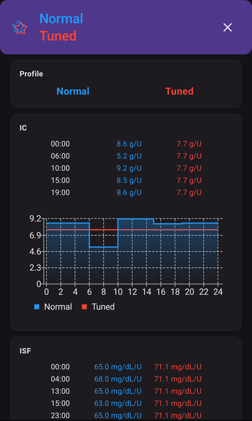
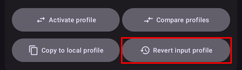
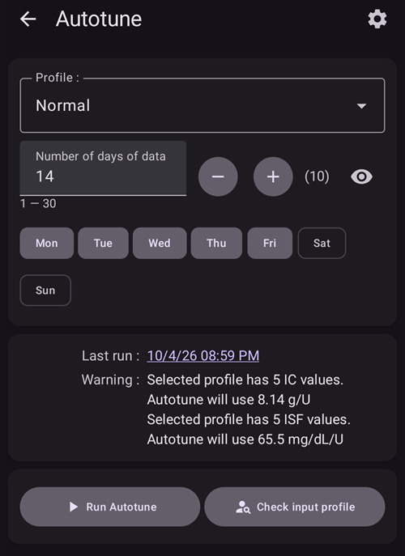

# How to use Autotune plugin

Autotune plugin is an implementation of OpenAPS autotune algorithm within AAPS. It analyzes your recent AAPS history to suggest adjustments to your basal rates, ISF and carb ratio.

Autotune Plugin is available in AAPS releases since [3.4](#version3400) but is hidden by default.

(autotune-how-autotune-calculates-adjustments)=
## How Autotune calculates adjustments

Autotune looks back over your recent AAPS history — CGM readings, boluses, carbs and temporary basal rates — and works out where your **Profile** (basal rates, ISF, carb ratio) doesn't quite match what actually happened to your BG.

For each 5-minute data point, it compares your **actual BG change** to the change your Profile predicted, and sorts the resulting deviation into one of three buckets:

* deviations that happened with no carbs on board and no insulin activity (used to tune **basal rates**, hour by hour),
* deviations that happened after a bolus/correction with no carbs (used to tune **ISF**), or
* deviations that happened while carbs were absorbing (used to tune **carb ratio**).

It then looks at the pattern of deviations in each bucket (using percentiles rather than a simple average, so a few noisy data points don't skew the result) and proposes a new value for that hour/parameter.

To keep any single run from overcorrecting, each Autotune run only ever moves a value a fraction of the way towards what the data suggests: up to 10% for ISF and carb ratio, and up to 20% for each basal segment. Overall drift is further capped by the **Max autosens ratio** / **Min autosens ratio** settings (see [Other settings](#autotune-other-settings) below) — the same bounds that limit Autosens. This is why Autotune is meant to be run repeatedly (day after day, or nightly) rather than trusted after a single run: results should converge gradually, and a big jump on one run is a sign to double check your data (missed carbs, a bad sensor day, _etc._) rather than to trust it blindly.

Autotune can be run three ways: manually as a one-off from within the plugin (as described below), automatically every night via an [automation rule](#autotune-run-autotune-with-an-automation-rule), or — outside of AAPS entirely — as a standalone command-line tool against exported data, which is how some community guides describe using it without a phone actively running AAPS.

*For the underlying oref0 algorithm in full mathematical detail, see [OpenAPS's Autotune documentation](https://openaps.readthedocs.io/en/latest/docs/Customize-Iterate/autotune.html).*

## Show the Autotune plugin

Create an empty file named `enable_autotune` in the `extra` subfolder of your phone [AAPS directory](#preferences-maintenance-settings).

***NOTE: Ensure you check in the AAPS settings where your AAPS Directory is, and that you placed the file in the correct one. Several users have put the file into the wrong folder.***


Restart **AAPS**. Then open the **menu** (☰), select **Configuration**, then the **General** category, and tick **Autotune**. The card then shows **Settings** and **Open plugin**:


## Interface do Autoajuste

Tap **Open plugin** on the **Autotune** card to open the Autotune screen:


- No menu pendente Perfil pode selecionar o perfil de entrada que quer ajustar (por predefinição, está selecionado o seu perfil ativo atual)
  - Note: each time you select a new profile, previous results will be removed and the **Number of days of data** will be set to its default value
- Then **Number of days of data** (called **Tune days** in older versions) is to select the number of days used in calculation to tune your profile. O valor mínimo é 1 dia e o valor máximo é 30 dias. Este número não deve ser demasiado pequeno para obter resultados iterativos corretos e suaves (mais de 7 dias em cada cálculo)
  - Note: each time you change the **Number of days of data**, previous results will be removed
- Last Run is a link that recover your latest valid calculation. If you didn't launch Autotune on current day, or if previous results was removed with a modification of calculation parameter above, then you can recover parameters and results of the latest successful run.
- O aviso mostra, por exemplo, algumas informações sobre o perfil selecionado (se tiver vários valores de IHC ou vários valores de FSI)
  - Nota: o cálculo do Autoajuste funciona apenas com um único valor de IHC e um único valor de FSI. There is currently no existing Autotune algorithm to tune a circadian IC or circadian ISF. Se o seu perfil de entrada tiver vários valores, pode ver na secção de aviso o valor médio usado para ajustar o seu perfil.
- Check Input Profile button open the Profile Viewer to allow you a quick verification of your profile (Units, IC, ISF, basal and target)
  - Nota: o Autoajuste só ajusta o seu IHC (valor único), o FSI (valor único) e a basal (com variação circadiana). Units and target will remain unchanged in output profile.

- "Run Autotune" will launch Autotune calculation with selected profile and the selected number of days of data
  - Nota: o cálculo do Autoajuste pode demorar muito tempo. Depois de iniciado, pode mudar para outra vista (início, ...) e voltar mais tarde ao plugin Autoajuste para ver os resultados

  

- Depois, durante a execução, verá os resultados intermédios abaixo

  - Nota: durante a execução, as definições ficam bloqueadas, por isso já não pode mudar o perfil de entrada selecionado nem o número de dias. Se quiser iniciar outra execução com outros parâmetros, terá de esperar pelo fim do cálculo atual.

  

- Quando o cálculo do Autoajuste terminar, verá o resultado (perfil ajustado) e quatro botões abaixo.

  

- É importante comparar sempre o perfil de entrada (coluna «Perfil»), o perfil de saída (coluna «Ajust.») e a percentagem de variação de cada valor (coluna «%»).

- Para as taxas basais, tem também o número de «dias em falta». Há dias em falta quando o Autoajuste não tem dados suficientes classificados como «Basal» para ajustar a taxa basal nesse período (por exemplo, depois de cada refeição, quando há absorção de hidratos de carbono). Este número deve ser o mais baixo possível, sobretudo quando a basal é importante (por exemplo, durante a noite ou ao fim da tarde)

- O botão «Comparar Perfis» abre a vista de comparação de perfis. O perfil de entrada está a azul e o perfil de saída (chamado «Ajustado») está a vermelho.

  - Nota: no exemplo abaixo, o perfil de entrada tem variação circadiana para IHC e FSI, mas o perfil de saída calculado tem um único valor. If it's important for you to get a circadian output profile see [Circadian IC or ISF profile](#autotune-circadian-ic-or-isf-profile) below.

  

- Se confiar nos resultados (baixa percentagem de variação entre o perfil de entrada e o perfil de saída), pode clicar no botão «Ativar perfil» e depois em OK para validar.

  - Activate Tuned profile will automatically create a new profile "Tuned" in your profile list (**Manage → Profile**).
  - If you already have a profile named "Tuned" in **Manage → Profile**, then this profile will be updated with calculated Autotune profile before the activation

  

- Se achar que o perfil ajustado deve ser corrigido (por exemplo, se achar que algumas variações são demasiado grandes), pode clicar no botão «Copiar para perfil local»

  - A new profile with the prefix "Tuned" and the date and time of the run will be created in **Manage → Profile**

  

- You can then edit the Tuned profile: open **Manage** > **Profile**, swipe to the card named "Tuned" with the date and time of the run, and tap the **Edit** (pencil) button

  - the values in the profile will be rounded in the user interface to your pump capabilities

  

- Se quiser substituir o seu perfil de entrada pelo resultado do Autoajuste, clique no botão «Atualizar perfil de entrada» e confirme a janela com OK

  - Note: if you click on "Activate profile" after "Update input profile", then you will activate your updated profile and not the default "Tuned" profile.

  

- Se atualizou o seu perfil de entrada, o botão «Atualizar perfil de entrada» é substituído pelo botão «Repor perfil de entrada» (ver a captura de ecrã abaixo). You can that way immediately see if your current input profile in **Manage → Profile** already includes the result of last run or not. You also have the possibility to recover your input profile without autotune result with this button

  


## Definições do Autoajuste

(autotune-plugin-settings)=

### Definições do plugin Autoajuste

  

```{admonition} Only DEV
:class: note
The **Auto switch profile** feature is only available in Dev/Engineering mode.
```

- **Auto switch profile** (default Off): see [Run Autotune with an automation rule](#autotune-run-autotune-with-an-automation-rule) below. Se ativar esta definição, o perfil de entrada será atualizado automaticamente com o perfil ajustado, e este será ativado.
  - **Be Careful, you must trust and verify during several following days, that after an update and activation of Tuned profile without modification, it improves your loop**

- **Categorize UAM as basal** (default Off): This setting is for the users using AndroidAPS without any carbs entered (Full UAM). Quando desativada, impede que os períodos RNA sejam classificados como basal.
  - Nota: se tiver pelo menos uma hora de absorção de hidratos de carbono detetada num dia, todos os dados classificados como «RNA» serão classificados como basal, seja qual for esta definição (ativada ou desativada)
- **Default tune days** (default 5): You can define the default value with this setting. Each time you select a new profile in the Autotune plugin, the **Number of days of data** will be replaced by this default value
- **Use circadian IC/ISF** (default Off): see [Circadian IC or ISF profile](#autotune-circadian-ic-or-isf-profile) below.

(autotune-other-settings)=
### Other settings

- Autotune also uses Max autosens ratio and Min autosens ratio to limit variation. You can see and adjust these values in [**Settings** > **Absorption settings** > **Advanced Settings**](../SettingUpAaps/Preferences.md) (**Autosens max** and **Autosens min**).

  


## Função avançada

(autotune-circadian-ic-or-isf-profile)=

### Perfil de IHC ou FSI circadiano

- If you have important variation of IC and/or you ISF in your profile, and you fully trust in your circadian time and variation, then you can enable **Use circadian IC/ISF** (called "Apply average result in circadian IC/ISF" in older versions)

  - Note que o cálculo do Autoajuste é sempre feito com um único valor, e a variação circadiana não é ajustada pelo Autoajuste. Esta definição apenas aplica aos seus valores circadianos a variação média calculada para o IHC e/ou o FSI

- Veja na captura de ecrã abaixo o perfil ajustado com a definição desativada (à esquerda) e ativada (à direita)

  


### Tune specific days of the week

- If you tap the **eye** icon on the right of the **Number of days of data** field, you will see the day selection. You can specify which day of the week should be included in Autotune calculation (in screenshot below you can see an example for "working days" with Saturday and Sunday removed from autotune calculation)
  - If the number of days included in Autotune calculation is lower than the **Number of days of data**, then you will see how many days will be included on the right of the days selector (10 days in the example below)
  - This setting gives good results only if the number of remaining days is not too small (for example if you Tune a specific profile for week end days with only Sunday and Saturday selected, you should set **Number of days of data** to at least 21 or 28 to have 6 or 8 days included in Autotune calculation)

  

- During Autotune calculation, you can see the progress of the calculations ("Partial result day 1 / 4 tuned" in the example below, with Saturday and Sunday excluded)

  


(autotune-run-autotune-with-an-automation-rule)=

## Executar o Autoajuste com uma regra de automatização

```{admonition} Only DEV
:class: note
The **Auto switch profile** feature is only available in Dev/Engineering mode.
```

O primeiro passo é definir o acionador correto para uma regra de automatização com o Autoajuste:

Note: for more information on how to set an automation rule, see [here](../DailyLifeWithAaps/Automations.md).

- You should select Recurring time trigger: only run Autotune once per day, and autotune is designed to be run daily (each new run you shift one day later and quickly profile modification should be tiny)

  

- No início, é melhor executar o Autoajuste durante o dia, para poder verificar os resultados. Se quiser executar o Autoajuste durante a noite, tem de selecionar no acionador as 4:00 ou mais tarde, para incluir o dia atual no cálculo seguinte do Autoajuste.

  

- Then you can select the **Autotune profile** action (in the **Loop & insulin** group)

  

- You can then adjust the parameters of the action for your run. In a new action, **Select profile to tune** shows the first profile of your local profile list, the **Tune days** field is empty and all days are selected. Choose the profile to tune and enter the number of **Tune days** (1 to 30).

  

- After a few days, if you fully trust Autotune results and percentage of modification is low, you can modify [Autotune settings](#autotune-plugin-settings) "**Auto switch profile**" to enabled to automatically update and activate profile tuned after calculation.

Note: if you want to automatically tune profiles for specific days of the week (for example a profile for "Weekend days" and another one for "Working days"), then create one rule for each profile, select the same days in Trigger and in Autotune Action, Tune days must be high enough to be sure tuning will be done with at least 6 or 8 days, and don't forget to select time after 4AM in trigger...

- See below an example of rule that runs every working day (Monday to Friday) at 04:00 and tunes the profile "Normal" with 14 **Tune days**, working days only (so only 10 days are included in the Autotune calculation).

  


## Dicas e truques

Autotune works with information existing in your database, so if you just installed AAPS on a new phone, you will have to wait several days before being able to launch Autotune with enough days to get relevant results.

O Autoajuste é apenas uma ajuda: é importante verificar regularmente se concorda com o perfil calculado. Se tiver alguma dúvida, mude as definições do Autoajuste (por exemplo, o número de dias) ou copie os resultados para um perfil local e ajuste o perfil antes de o usar.

Always use Autotune several days manually to check results before applying them. Só quando confiar totalmente nos resultados do Autoajuste, e quando a variação entre o perfil anterior e o perfil calculado for muito pequena, deve começar a usar a automatização (nunca antes)

- O Autoajuste pode funcionar muito bem para alguns utilizadores e não para outros, por isso **se não confiar no resultado do Autoajuste, não o use**

It's also important to analyze Autotune results to understand (or try to understand) why Autotune proposes these modifications

- pode haver um aumento ou uma diminuição geral da força do seu perfil (por exemplo, aumento da basal total associado a uma diminuição dos valores de FSI e IHC). it could be associated to several following days with autosens correction above 100% (more aggressivity required) or below 100% (you are more sensitive)
- Sometimes Autotune proposes a different balance between basal rates and IC/ISF (for ex lower basal and more aggressive IC/ISF)

Aconselhamos a não usar o Autoajuste nos seguintes casos:

- Não introduz todos os seus hidratos de carbono
  - If you don't enter carbs correction for hypoglycemia, Autotune will see an unexpected increase of your BG value and will increase your basal rates 4 hours earlier, it could be the opposite of what you need to avoid hypo, especially if it's in the middle of the night. That's why it's important to enter all carbs, especially correction for hypo.
- You have a lot of periods with UAM detected during the day.
  - Do you have entered all your carbs and correctly estimated your Carbs?
  - Todos os períodos RNA (exceto se não introduzir hidratos de carbono num dia e a classificação de RNA como basal estiver desativada) serão classificados como basal, o que pode aumentar muito a sua basal (muito mais do que o necessário)

- Your carbs absorption is very slow: if most of your carbs absorption are calculated with min_5m_carbimpact parameter (you can see these periods with a little orange dot in the top of COB curve), the calculation of COB could be wrong and leads to wrong results.
  - When you practice sport, you are generally more sensitive and your BG doesn't rise a lot, so during or after an exercise, it's usual to see some periods with slow carbs. But if you have too often unexpected slow carb absorption, then you may need a profile adjustment (higher value of IC) or a min_5m_carbimpact a bit too high.
- You have "very bad days", for example stuck several hours in hyperglycemia with a huge amount of insulin to be able to go down within the range, or after a sensor change you have long periods of wrong BG values. If during the past weeks you only have one or 2 "bad days", you can disable manually these days in autotune calculation to exclude them from calculation, and again **check carefully if you can trust the results**
- If the percentage of modification is too important
  - You can try to increase the number of days to get smoother results
